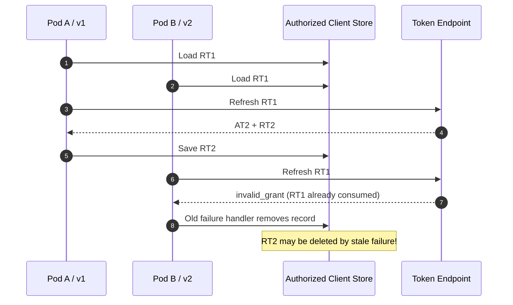
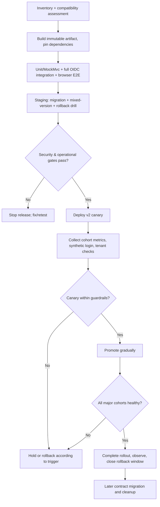

# 33.10. Kế hoạch rollout, rollback và theo dõi sau nâng cấp

## 1. Nâng cấp OAuth2/OIDC Client là thay đổi đường đi đăng nhập, không chỉ thay dependency

Trong ứng dụng Spring Boot sử dụng **Spring Security OAuth 2.0/OIDC Client**, một bản nâng cấp có thể tác động đến:

- Cách khởi tạo `ClientRegistration` và tìm metadata OIDC.
- Cách dựng authorization request, redirect URI, `state`, PKCE và `nonce`.
- Cách xử lý callback, authorization code exchange và validate ID Token.
- Cách Spring Security lưu `SecurityContext` trong session.
- Cách lưu và tái sử dụng `OAuth2AuthorizedClient` cùng access/refresh tokens.
- Authentication authorities, custom `OAuth2UserService`/`OidcUserService`, success/failure handlers.
- HTTP client cho Token Endpoint, UserInfo/JWKS và proxy/TLS settings.
- Method security, authorization request matchers, CSRF và các chính sách mặc định.
- Login/logout UX, consent, account linking và đa tenant.

Một ứng dụng chạy xanh sau nâng cấp **chưa chứng minh** người dùng có thể đăng nhập trọn vẹn. Hơn nữa, khi triển khai theo rolling update, **phiên bản cũ và mới tồn tại cùng lúc**: authorization request bắt đầu tại một pod phiên bản A nhưng callback có thể được pod B xử lý.

```text
Browser                  Load balancer                  Spring pods

GET /oauth2/authorization/corporate
      -----------------------------------------------> Pod A (old)
      <------------------ 302 authorize URL ----------
      ---> Identity Provider -------------------------
      <--- authorization code + state ----------------
GET /login/oauth2/code/corporate
      -----------------------------------------------> Pod B (new)
                                                       |
                                                       v
                        Session + state + PKCE + token
                        deserialization / callback logic
```

Nếu Pod B không đọc được authorization request hoặc session của Pod A, người dùng gặp `authorization_request_not_found`, `invalid_state` hay `invalid_grant`. Nếu Pod B lưu authorized client bằng định dạng mà Pod A không đọc được, rollback sau đó cũng có thể thất bại.

**Chủ đề bài học:** xây kế hoạch *rollout, rollback và theo dõi sau nâng cấp* cho hệ thống Spring Security OAuth2/OIDC Client, ưu tiên khả năng phục hồi, bảo toàn security invariants và hạn chế gián đoạn người dùng.

### Mục tiêu học tập

Sau bài này, bạn có thể:

1. Lập inventory và đánh giá thay đổi tương thích trước khi nâng cấp Spring Boot/Spring Security.
2. Xác định những điểm cần kiểm thử ở authorization request, callback, OIDC validation, session và authorized client store.
3. Thiết kế rolling/canary/blue-green rollout, hiểu rủi ro callback qua hai phiên bản.
4. Áp dụng **expand–migrate–contract** cho database/config/token/session migration.
5. Thiết kế rollback thực sự hoạt động, không giả định chỉ quay lại image là đủ.
6. Định nghĩa health/readiness riêng với functional login monitoring.
7. Theo dõi login success rate, callback errors, refresh failures, ID Token validation, latency và tenant segmentation.
8. Đưa ra tiêu chí promote, hold, rollback và security stop-ship.
9. Viết runbook có owner, timeline, thao tác và bằng chứng phục hồi.
10. Tổ chức post-release observation, incident learning và dọn tương thích sau rollout.

Ví dụ tập trung vào Spring Security Servlet/MVC, nhưng nhiều nguyên tắc áp dụng cho WebFlux. Cấu hình, số liệu và mốc thời gian dưới đây là ví dụ, **không phải các ngưỡng bắt buộc của Spring Security hoặc Kubernetes**.

---

## 2. Xác định chính xác điều gì đang được nâng cấp

Không thể xây kế hoạch rollback nếu không biết phạm vi thay đổi.

| Hạng mục | Ví dụ | Khả năng ảnh hưởng |
|---|---|---|
| JDK | JDK/runtime mới | TLS, truststore, serialization, crypto providers |
| Spring Boot | Framework baseline/dependency BOM | Auto-configuration, Actuator, MVC, session/cookies |
| Spring Security | Security filter chain, OAuth2 Client | Login/filter behavior, user service, token management |
| Nimbus JOSE/JWT | JWT decoder, JWK source | Allowed algorithms, JWKS cache, validation |
| Servlet container | Embedded Tomcat/Jetty | Cookies, session, HTTP headers |
| Spring Session | Redis/JDBC session schema | SecurityContext persistence/mixed-version compatibility |
| HTTP client | `RestClient`, Apache HttpClient, `WebClient` | Token/UserInfo/JWKS connectivity, timeouts, TLS |
| Data store | JDBC `OAuth2AuthorizedClientService` hoặc custom | Token schema, encryption, concurrent refresh |
| IdP settings | Issuer, client secret, redirect URI | Authorization/token exchange/trust |
| Proxy/Ingress | Forwarded headers, TLS termination | Redirect URI/cookie/host validation |
| Frontend | SPA/BFF login initiation, CSRF | Login redirects và API 401/403 behavior |
| Tenant catalog | Dynamic ClientRegistrations | Tenant routing, issuer metadata, cached config |

### 2.1. Ghi rõ from → to

Ví dụ change record:

```yaml
changeId: SEC-2026-041
service: portal-bff
environment: production
runtime:
  javaFrom: 17
  javaTo: 21
framework:
  springBootFrom: "version-in-current-bom"
  springBootTo: "version-in-approved-bom"
  springSecurityFrom: "resolved-old-version"
  springSecurityTo: "resolved-new-version"
identity:
  providers: [corporate, partner, social]
  authFlows:
    - authorization_code
    - oidc_login
    - refresh_token
    - client_credentials
data:
  sessionStore: redis
  authorizedClientStore: jdbc
deployment:
  strategy: canary
  rollbackImage: "registry.example/portal-bff:previous-approved-tag"
```

Các values mang tính mô tả. Trong thực tế phải **pin version/digest chính xác**, lưu dependency tree và release artifact đã được kiểm soát.

### 2.2. Đừng chỉ ghi “upgrade Spring Security”

Cần biết:

- Có đổi major version không?
- Có thay JDK/Jakarta Servlet APIs không?
- Có thay session repository và cách serialize object không?
- Có thay bean customization/authorization request resolver?
- Có thay JWT/JWK library transitive không?
- Có thay issuer/JWKS metadata hoặc permitted signing algorithms?
- Có đổi principal name sau login không?
- Có thay client ID/redirect URI cùng lúc không?
- Có schema migration đồng thời không?

Một release bao gồm quá nhiều loại thay đổi sẽ khó phân biệt nguyên nhân và khó rollback.

---

## 3. Nguyên tắc vận hành xuyên suốt

**1. Không đánh đổi xác thực đúng lấy availability.** Nếu `state`, PKCE, ID Token signature, `iss`, `aud` hoặc `nonce` sai, callback phải bị từ chối.

**2. Tách code rollback khỏi data rollback.** Image cũ không tự đọc được schema hoặc session format mới.

**3. Không coi HTTP 200 từ readiness là login thành công.** Cần đo end-to-end authentication journey.

**4. Triển khai có quan sát trước, rồi mới tăng traffic.** Canary nhỏ với metrics, logs, traces và synthetic flows.

**5. Không mở rộng phạm vi lỗi của một IdP thành toàn bộ platform.** Có thể phân provider/tenant và giữ các route không phụ thuộc IdP hoạt động.

**6. Không sửa production bằng cách tắt security filters.** Với lỗi cấu hình phải rollback/config-fix/trust-restore có kiểm soát.

**7. Giữ bí mật trong rollback.** Không log access/refresh tokens, client secrets, authorization codes, PKCE verifier, session cookies.

**8. Mọi thay đổi phải có owner.** Người có quyền deploy, người kiểm tra IdP, người theo dõi DB/session, người quyết định rollback và kênh thông báo phải được xác định từ trước.

---

## 4. Mô hình trách nhiệm cho một đợt rollout

Một release liên quan đăng nhập thường cần nhiều vai trò.

| Vai trò | Nhiệm vụ |
|---|---|
| Release owner | Điều phối các mốc, quyết định promote/hold theo tiêu chí |
| Identity/Security owner | Review issuer, redirects, token/nonce/PKCE, consent, security invariants |
| Application owner | Spring filters, endpoints, feature flags, error handling |
| Platform/SRE | Deployment, ingress, pods, health probes, autoscaling, rollback |
| Database/session owner | Migrations, shared session, authorized client store, backup |
| IdP owner/partner | Provider registration, client auth methods, keys, rate limits |
| QA/automation | Functional tests, negative auth flows, browser E2E |
| Support/communications | Login incident messages, escalation và support references |

### 4.1. Quyền rollback phải có trước rollout

Không để:

```text
Canary lỗi -> cần admin approval cho rollback -> đợi người không online
```

Người trực ca phải có quyền thực thi playbook đã được phê duyệt, hoặc có escalation rõ ràng.

### 4.2. RACI không thay tiêu chí kỹ thuật

Có owner không có nghĩa test đã đạt. Quyết định nên dựa trên **bằng chứng**: signed-in completion, token exchange, session continuation, refresh token behavior, error ratio, security-negative tests.

---

## 5. Inventory các đường đi OAuth2/OIDC

Một ứng dụng có thể không chỉ có một nút login.

```text
Spring Security OAuth2/OIDC Client
|
+-- Interactive OIDC login (browser)
|   +-- Corporate provider
|   +-- Social provider
|   +-- Partner tenant providers
|
+-- Incremental consent for external APIs
|   +-- Calendar read
|   +-- Drive write
|
+-- Outbound authorized client
|   +-- Access token reuse
|   +-- Refresh token rotation
|
+-- Background client credentials
|   +-- Scheduled jobs
|   +-- Service-to-service calls
|
+-- Session/logout
|   +-- Local logout
|   +-- OIDC RP-Initiated Logout
|
+-- Multi-tenant ClientRegistrationRepository
    +-- Dynamic onboarding
    +-- Issuer config cache
```

### 5.1. Ma trận luồng bắt buộc

| Luồng | Provider | Đầu vào | Kết quả kiểm chứng |
|---|---|---|---|
| Login ban đầu | Corporate | Browser, code + state | Session authenticated |
| Login với account khác | Corporate | Account chooser | Đúng `(iss,sub)`, không account confusion |
| Refresh token | Corporate | Expired access token | New token lưu atomically |
| Client credentials | Internal AS | Service principal | Token đúng scope/audience |
| Consent thêm scope | External provider | Explicit user intent | Granted scopes chính xác |
| OIDC logout | Corporate | Current session | Local session invalidated, OP behavior theo contract |
| Dynamic tenant login | Partner | Registration per tenant | Issuer/tenant isolation |
| Error callback | Corporate | `access_denied`/invalid_state | Public error an toàn, không tạo session |
| JWKS rotation | Corporate | New signed ID Token K2 | Signature validation và cache refresh đúng |
| API sau login | Orders API | Authorized client | Token đúng audience/scope |

### 5.2. Độ ưu tiên theo blast radius

Có thể xếp:

- **P0:** mọi user login, session integrity, tenant isolation, unauthorized access.
- **P1:** refresh token, downstream API, corporate tenant login.
- **P2:** optional integration/consent, alternate provider.
- **P3:** purely cosmetic login page changes.

Đây chỉ là ví dụ. Một SaaS có thể coi optional integration là P0 nếu nó là chức năng cốt lõi của khách hàng.

---

## 6. Nâng cấp Spring Security cần đối chiếu contract nào?

### 6.1. Public APIs và configuration

Đặc biệt chú ý:

```java
SecurityFilterChain
HttpSecurity
OAuth2AuthorizationRequestResolver
OAuth2AccessTokenResponseClient
OAuth2AuthorizedClientManager
OAuth2AuthorizedClientRepository
OAuth2AuthorizedClientService
OAuth2UserService
OidcUserService
AuthenticationSuccessHandler
AuthenticationFailureHandler
```

Các API, fluent DSL và supported customizers có thể đổi giữa các major/minor versions. Đối chiếu **Spring Security migration guides và release notes của exact target version**.

### 6.2. Default behavior không phải hợp đồng bất biến

Một library upgrade có thể thay:

- Authentication entry point cho browser/API routes.
- CSRF request handling.
- SecurityContext persistence.
- OAuth2 Login authorization request repository interaction.
- Access token refresh timing/clock skew.
- Auto-configuration bean selection.
- Filter ordering/authorization matchers.
- Supported JWT algorithms/caching logic.

Không suy “compile thành công => behavior không đổi”.

### 6.3. Boot 2.x → 3.x hoặc major jumps

Nếu đợt nâng cấp gồm chuyển sang Spring Boot 3.x, cần xét **Java 17 baseline** và **Jakarta EE namespace (`jakarta.servlet.*`)** cùng các thay đổi framework liên quan. Các bước chi tiết phải dựa trên source/target versions thực, không tự áp mọi cảnh báo major migration cho các patch/minor upgrades.

### 6.4. Pin dependency resolution

Sau nâng cấp, biết version được **thực sự resolve** của:

```text
spring-security-oauth2-client
spring-security-oauth2-core
spring-security-oauth2-jose
spring-security-web
spring-session
nimbus-jose-jwt
HTTP client dependencies
```

Không chỉ xem version được khai báo trong một dependency rồi suy mọi transitive dependencies đều khớp.

---

## 7. Baseline trước rollout: phải đo từ lúc còn tốt

Không có baseline, sau release khó phân biệt lỗi mới và lỗi vốn đã tồn tại.

Một snapshot baseline có thể gồm:

```yaml
window: "previous-7-days-same-hour-traffic"
by:
  - provider
  - tenant_tier
  - region
  - app_version
indicators:
  - login_start_rate
  - login_completion_rate
  - login_callback_failure_rate
  - token_endpoint_error_rate
  - token_refresh_invalid_grant_rate
  - id_token_validation_failures
  - userinfo_error_rate
  - session_restore_failures
  - downstream_oauth_401_403_rate
  - p95_login_completion_latency
```

### 7.1. Cần định nghĩa mẫu số

Ví dụ:

\[
\text{Login Completion Rate} =
\frac{\text{số login attempts hoàn tất thành công trong cohort}}
{\text{số eligible login attempts đã bắt đầu trong cohort}}
\]

Nếu dùng time window ngắn, một attempt bắt đầu gần cuối window có thể hoàn thành ở window sau. Cần có **attempt ID/correlation** và timeout window hợp lý.

Đừng so sánh sai:

```text
successful callbacks per minute
/
authorization starts per minute
```

rồi coi là exact conversion rate trong mọi trường hợp.

### 7.2. User cancel khác lỗi hệ thống

Một user từ chối consent (`access_denied`) có thể là hành vi mong đợi. Metric nên có `outcome` rõ ràng:

```text
success
user_cancel
provider_policy_denied
client_configuration_error
protocol_validation_failed
dependency_timeout
application_error
```

Không gộp hết thành “service failed” nếu muốn đánh giá rollout công bằng.

### 7.3. Segment theo provider, tenant, version

Aggregate login success có thể vẫn cao nếu corporate provider A gặp lỗi nhưng social provider B chiếm phần lớn traffic.

Ít nhất cần:

```text
source app version
provider alias
region
trusted tenant group / bounded reference
error stage/category
```

Tránh raw user/tenant IDs làm metrics labels không giới hạn cardinality.

---

## 8. Readiness xanh không có nghĩa login xanh

Spring Boot Actuator có thể cung cấp:

```text
/actuator/health/liveness
/actuator/health/readiness
```

Readiness hỏi pod có thể nhận traffic theo local policy; nó không mặc nhiên chạy một authorization code flow thật.

Trong upgrade, cần hai luồng quan sát:

**Pod health:**

```text
application started
required local config loaded
DB/session store usable
main HTTP listener healthy
```

**Identity functional health:**

```text
OIDC authorize redirect works
callback state/PKCE recognized
token code exchange success
ID Token verifies issuer/aud/nonce/signature
SecurityContext persists
subsequent API authorized
```

### 8.1. Không đưa IdP/JWKS vào liveness

Một IdP outage không nên khiến mọi pods restart liên tục. Rolling update đang diễn ra càng dễ gây cold-cache storm nếu pod restart làm mất JWKS cache.

### 8.2. Cần synthetic login phù hợp

Một synthetic test account trong sandbox/staging có thể đi qua full OIDC Login. Trong production, nếu được IdP cho phép, một control account không chứa dữ liệu người dùng có thể thực hiện controlled functional checks.

Không tự thực hiện synthetic login liên tục bằng credentials production của người dùng thật, và không dùng nó làm Kubernetes liveness probe.

---

## 9. Inventory dữ liệu trạng thái phải sống qua release

Rollout/rollback cần biết các trạng thái sau nằm ở đâu:

| Trạng thái | Nơi lưu thường gặp | Rủi ro khi version khác nhau |
|---|---|---|
| OAuth2AuthorizationRequest | HttpSession/`AuthorizationRequestRepository` | State, PKCE verifier, nonce serialization |
| SecurityContext | HttpSession/Spring Session | Authentication object/authority/user principal format |
| OIDC user claims | SecurityContext/session, custom profile DB | Class/claim mapping thay đổi |
| OAuth2AuthorizedClient | Repository/service/JDBC/Redis | Token serialization/encryption/schema |
| ClientRegistration | Static bean/dynamic catalog | Registration ID, issuer, endpoint, version |
| Refresh token | Authorized client secure store | Rotation race, destructive overwrite |
| Pending consent intent | Session/DB | Callback ownership, state binding |
| Session cookie | Browser + session store | Cookie name/Domain/Path/SameSite |
| IdP/tenant mapping | Local DB | Stable external identity `(iss,sub)` |
| JWKS cache | Decoder in-memory/shared | Unknown kid/rotation, old/new keys |
| Login error telemetry | Logs/traces | New code/category comparability |

**Nguyên tắc:** thay một trong các formats/schema này có thể ảnh hưởng người dùng ngay cả khi ứng dụng code cũ vẫn deploy lại được.

---

## 10. Mixed-version login transaction: trường hợp phải diễn tập

Giả sử rolling deployment:

```text
10:00:00 Pod A (v1) nhận /oauth2/authorization/corporate
10:00:01 A lưu authorization request state=S1, PKCE verifier=V1 vào session
10:00:05 Pod B (v2) được đưa vào Service
10:00:10 IdP redirect user về /login/oauth2/code/corporate?code=C1&state=S1
10:00:11 Load balancer gửi callback tới B
```

Để callback thành công:

1. B tìm lại đúng authorization request của A.
2. B đọc session serialization và repository schema.
3. B lấy đúng `state`, `code_verifier`, `nonce` và registration context.
4. B dùng issuer/client authentication phù hợp.
5. B xác minh ID Token và internal account mapping.
6. B lưu Authentication/AuthorizedClient theo định dạng mà request sau trên A/B đều xử lý được.

### 10.1. Nếu state repository in-memory theo pod

Nếu authorization request nằm trong pod-local memory mà không có sticky affinity được bảo đảm, callback tới pod khác có thể fail.

Các lựa chọn:

- Spring Session shared store tương thích.
- Sticky routing đủ chắc trong khoảng flow (vẫn rủi ro khi pod được drain).
- Đưa login traffic tới một **version-isolated pool** trong giai đoạn upgrade.
- Thiết kế authorization request repository riêng với stable DTO và state binding.

Không dùng cookie không ký/không bảo vệ chứa raw PKCE verifier và client secrets.

### 10.2. Sticky sessions không giải quyết rollback hoàn toàn

Một pod A bị terminate khi user đang ở IdP. Callback quay về B; không còn pod A để sticky. Vì vậy cần **drain grace period hoặc shared state compatibility**, không chỉ bật affinity.

### 10.3. Không bypass state khi không tìm thấy request

Nếu callback fail vì A/B không đọc được session, tuyệt đối không làm:

```text
state missing -> accept authorization code anyway
```

Đó là lỗ hổng login CSRF/flow confusion.

### 10.4. Success path chưa đủ

Test cả:

```text
v1 start -> v1 callback
v1 start -> v2 callback
v2 start -> v1 callback
v2 start -> v2 callback
```

Với bản rollback, `v2 start -> v1 callback` là trường hợp thường bị bỏ quên.

---

## 11. Session serialization là một rủi ro nâng cấp lớn

`SecurityContext`, `OAuth2AuthenticationToken`, `OidcUser`, authorities và authorization requests có thể được serialize qua Spring Session Redis/JDBC hoặc custom session store.

### 11.1. Java native serialization không phải stable cross-version schema

Nếu session store chứa Java-serialized objects thuộc Spring Security/framework classes, một major upgrade có thể thay class hierarchy, serial UID, package namespace hoặc object graph.

Không mặc định:

```text
v2 đọc được mọi session v1
v1 đọc được mọi session v2
```

Ngay cả khi test login ở v2 xanh trong session mới, sessions có sẵn của v1 vẫn có thể lỗi.

### 11.2. Ba chiến lược

| Chiến lược | Ưu điểm | Đánh đổi |
|---|---|---|
| Cross-version compatible shared session format | Rolling/rollback mượt | Cần stable DTO/serializer compatibility và tests |
| Session/version isolation | Tránh giải mã nhầm object giữa versions | User có thể phải login lại khi đổi pool |
| Controlled session invalidation | Đơn giản hơn cho breaking change | User interruption, communication, traffic impact |

### 11.3. Không tự chuyển `SecurityContext` thành JSON tùy tiện

Một custom session serializer cần bảo vệ credentials/principal claims, type allowlisting và object-mapping security. Không deserialize arbitrary class names từ session data do attacker có thể ảnh hưởng.

### 11.4. Cần test cả “đọc lên” lẫn “ghi xuống”

- v1 tạo session → v2 đọc.
- v2 tạo session → v1 đọc (rollback path).
- v1 update session → v2 đọc.
- v2 update session → v1 đọc.
- Invalidate/logout từ một version → version kia không tái sử dụng.
- Session TTL, cookie security và concurrent writes.

### 11.5. Nếu không thể bảo đảm backward compatibility

Đặt một **explicit cutover plan**:

```text
Window: users with old sessions may be asked to sign in again.
Existing checkout/payment processes are protected against data loss.
Authentication state is invalidated safely, not force-migrated insecurely.
User-facing messaging/support staffed.
```

Đừng giấu nguy cơ user re-login rồi gọi release “zero downtime” thiếu căn cứ.

---

## 12. OAuth2AuthorizedClient store: token không chỉ là một field

Spring Security thường liên kết authorized client với:

```text
clientRegistrationId
principalName
accessToken
refreshToken (nếu có)
```

Có thể dùng:

```java
OAuth2AuthorizedClientService
OAuth2AuthorizedClientRepository
OAuth2AuthorizedClientManager
```

Khi nâng cấp, cần kiểm tra:

- Registration ID có đổi không?
- Principal name sau OIDC Login có đổi không?
- Stored access/refresh tokens được deserialize đúng không?
- Refresh token rotation xử lý atomic không?
- Concurrency giữa old/new versions có gây mất RT mới không?
- Token encryption key/version có tương thích không?
- Logout/disconnect có xóa đúng record không?
- Tenant A có thể đọc token của tenant B không?
- Database connection pool có ảnh hưởng latency không?

### 12.1. Nguy hiểm khi đổi principal key

Old version:

```text
principalName = alice@example.com
```

New version:

```text
principalName = issuer|sub-12345
```

Cả hai có thể nhận cùng một external identity, nhưng authorized client lookup:

```text
(registrationId,principalName)
```

khác nhau. New version có thể không tìm thấy token, gây consent lại hoặc duplicate records.

### 12.2. Đổi sang `(iss,sub)` có thể tốt cho bảo mật

Tuy nhiên, migration cần explicit mapping từ old → new:

```text
legacy principal key
    -> verified linked identity key
    -> new stable principal key
```

Không tự gộp users dựa vào email chưa được xác minh.

### 12.3. Token store phải đúng ownership

Trong rolling deployment, v1/v2 cùng store. Không được để một version lưu token của Bob dưới principal Alice hoặc tenant Alpha do user mapping mismatch.

---

## 13. Refresh token rotation dưới rolling deployment

Một race kinh điển:



Lỗi này có thể tồn tại trước nâng cấp nhưng **bộc lộ khi v1/v2 khác refresh timing/clockSkew hoặc storage behavior**.

### 13.1. Không sửa bằng cách vô hiệu hóa refresh token rotation

Rotation có thể là yêu cầu bảo mật của AS. Cần xử lý local concurrency và token storage.

### 13.2. Cách bảo vệ

- Conditional update/optimistic locking theo row version.
- Per-authorization serialization/singleflight.
- Re-read latest authorized client trước khi remove sau `invalid_grant`.
- Phân biệt refresh success, stale failure, revoked grant.
- Không để retry dùng RT cũ vô hạn.
- Không tự union OAuth2 tokens/scope mà AS không cấp.
- Tests cho background jobs và user requests đồng thời.

### 13.3. Rollback cần giữ RT2

Sau rollout v2 đã rotate RT1→RT2, rollback v1 phải đọc được RT2. Nếu v1 không hiểu schema/token encryption mới, users sẽ bị disconnect.

Đó là lý do schema/token-format migration phải **backward-readable trước khi cutover** hoặc có kế hoạch reauthorization rõ ràng.

---

## 14. Database migrations: Expand → Migrate → Contract

Một thay đổi schema an toàn trong rolling deployment thường chia giai đoạn:

```text
Stage 1: EXPAND
    Add new columns/table/indexes without removing old contract.
    Old version continues operating.

Stage 2: COMPATIBLE CODE
    Deploy code that reads both old/new representations.
    If dual-write needed, ensure idempotence/conflict rules.

Stage 3: MIGRATE
    Backfill data in bounded batches with progress checkpoints.
    Verify row counts and identity/tenant associations.

Stage 4: CUTOVER
    New code uses new format after compatibility confirmed.
    Rollback to old code still possible in predefined window.

Stage 5: CONTRACT
    Remove old fields only after rollback window closes,
    no old instances remain, and migration evidence is retained.
```

### 14.1. Không để deployment đòi schema mới sau migration phá hủy

Nếu migration:

```sql
DROP COLUMN refresh_token;
```

thì image cũ có thể không hoạt động. Đó không phải rollback-safe change.

### 14.2. Ví dụ schema mở rộng

```sql
ALTER TABLE oauth2_authorized_client
    ADD COLUMN format_version INTEGER;

ALTER TABLE oauth2_authorized_client
    ADD COLUMN record_revision BIGINT;
```

Cú pháp là **ví dụ**; tên bảng/columns và SQL dialect phụ thuộc schema hiện tại. Đây không phải schema mặc định bắt buộc của Spring Security.

### 14.3. Không dual-write token bí mật tùy tiện

Việc lưu hai bản refresh token có thể tăng bề mặt rủi ro. Nếu cần dual-write phục vụ compatibility:

- Encrypt at rest đúng key policy.
- Không duplicate vô hạn.
- Có revision/concurrency semantics rõ ràng.
- Đảm bảo version mới/old không tranh nhau xóa RT.
- Có kế hoạch xóa old representation sau cutover.

### 14.4. Rollback của database không phải cứ `down migration`

Nếu data đã được ghi theo schema mới, `DROP TABLE` hoặc `down.sql` có thể làm mất token, account binding và consent history.

Rollback thường ưu tiên **rollback code trên schema mở rộng tương thích**, sau đó migrate dữ liệu có kiểm soát thay vì reverse destructive DDL.

---

## 15. Cấu hình IdP/client phải có rollback plan riêng

Một release có thể đồng thời thay:

```text
client_id
client_secret
redirect_uri
token auth method
issuer-uri
jwks_uri
scope
provider tenant
```

Đây là các thay đổi **trust/authorization contract**, không chỉ một config flag.

### 15.1. Redirect URI là ví dụ thường phá rollback

v1 dùng:

```text
https://portal.example/login/oauth2/code/corporate
```

v2 chuyển sang:

```text
https://auth.portal.example/login/oauth2/code/corporate
```

Nếu IdP xóa redirect URI cũ ngay khi v2 deploy, callback của những login attempts bắt đầu ở v1 có thể bị từ chối hoặc rollback v1 mất hiệu lực.

### 15.2. Two-phase IdP change

Khi provider cho phép:

1. **Pre-register** redirect URI/client settings mới, vẫn giữ cũ.
2. Deploy code tương thích cả hai trong transition window.
3. Bật new flow bằng controlled routing/flag.
4. Verify.
5. Chỉ xóa cũ khi đã đóng rollback window và active flows hết hạn.

Không phải mọi IdP cho phép nhiều redirect URIs/client secrets cùng lúc. Nếu không cho phép, cần một staged cutover hoặc downtime/reauth plan được công bố.

### 15.3. Client secret rotation phải xét token request

Nếu secret cũ bị revoke trước rollout hoàn tất, pods v1 có thể gặp `invalid_client` khi đổi code/refresh. Cần IdP contract về overlap credentials, deployment synchronization và rollback credential availability.

**Không lưu client secret cũ mãi mãi** chỉ để rollback thuận tiện; giữ theo thời hạn bảo mật và quy trình secret manager.

### 15.4. Issuer URI không phải một alias tùy tiện

Đổi issuer đồng nghĩa đổi trust domain; cùng `sub` từ hai issuers không mặc nhiên cùng external identity. Một rollback có thể cần giữ identity mapping cho cả issuers và kiểm tra migration để tránh account takeover.

---

## 16. JWKS rotation và upgrade đồng thời

Một đợt upgrade có thể đổi Nimbus/Spring Security JWT decoder hoặc cách cache JWKS. Nếu IdP cũng chuyển khóa ký K1→K2 cùng thời điểm, rất khó biết lỗi đến từ đâu.

### 16.1. Điều kiện nên kiểm tra

- Old and new versions chấp nhận tokens ký bằng trusted keys.
- Allowed algorithms vẫn đúng provider contract.
- Unknown `kid` có refresh JWKS theo effective implementation.
- JWKS URL/issuer trust không đổi ngoài dự kiến.
- Wrong signature/wrong issuer/wrong audience/wrong nonce vẫn bị từ chối.
- JWKS endpoint timeout không tạo login bypass.
- Multi-tenant caches không nhầm `kid` của các issuers.

### 16.2. Tốt nhất tách hai thay đổi nếu có thể

Nếu không bắt buộc phải vừa nâng cấp client vừa rotate OP signing key, hãy triển khai thành những sự kiện riêng, có baseline và monitoring độc lập.

Nếu buộc phải đồng thời, tăng số lượng canary/negative tests và định nghĩa owner cho cả provider change lẫn application release.

### 16.3. Cache vẫn sống khi process được giữ lại

Pods v1 có JWKS cache K1, pods v2 có cold cache hoặc K2. Nếu chỉ một subset login fail, cần segment theo pod/app version/cache state trước khi quy lỗi cho user session.

---

## 17. Các chiến lược rollout có thể chọn

### 17.1. Rolling update

Kubernetes dần thay các pods cũ bằng pods mới.

**Phù hợp:** versions có session/config/store compatibility và login flow có thể đi qua hai versions.

**Rủi ro:** mixed-version callback, session deserialization, refresh concurrency và state ownership.

### 17.2. Canary

Một phần nhỏ traffic chạy v2:

```text
v1 = 95%
v2 = 5%
```

Tăng dần khi có bằng chứng tốt.

**Phù hợp:** cần phát hiện lỗi theo SLO trước khi mở rộng blast radius.

**Rủi ro:** random routing làm authorization start ở v1, callback ở v2; canary 5% request **không đồng nghĩa** 5% login transactions. Cần routing/cohort theo session/attempt nếu mục tiêu là so sánh end-to-end.

### 17.3. Blue-green

Hai environments/pools riêng:

```text
Blue: v1
Green: v2
```

Traffic được chuyển có kiểm soát. Có thể dễ revert traffic hơn, nhưng phải bảo đảm:

- Active session compatibility hoặc isolated cookie namespaces.
- Shared DB/schema backward compatibility.
- Pending OAuth2 authorization requests và redirect URI routing.
- Secret/issuer settings phù hợp cả Blue/Green.
- Background token refresh jobs không chạy đúp trên cả pools.

### 17.4. Feature-flagged rollout

Một server-side flag có thể chọn provider registration strategy hoặc logic mapping mới.

**Không dùng feature flag để tắt** JWT signature validation, OAuth2 `state`, PKCE, nonce, CSRF hoặc tenant isolation.

### 17.5. Shadow traffic

Không replay authorization codes hoặc refresh tokens thật vào một environment thứ hai chỉ để “shadow test”: chúng có thể one-time-use và chứa credentials. Shadow nên dùng **sanitized metadata**, synthetic identities hoặc replay business requests đã loại bỏ secrets theo contract.

---

## 18. Chọn canary cohort theo người dùng, tenant hay pod?

| Cohort | Ưu điểm | Rủi ro |
|---|---|---|
| Random request 5% | Dễ triển khai bằng ingress | Login journey có nhiều requests, dễ cross-version |
| Sticky browser/session | Cùng version cho nhiều requests | Pod drain/rollback làm session drift |
| Internal employee group | Giảm tác động customer | Không đại diện cho IdP/tenant production |
| Single test tenant | Test end-to-end cấu hình cụ thể | Không đại diện cho nhiều issuers |
| Region | Có rollback blast radius rõ | Traffic/IdP policy khác regions |
| Explicit account cohort | Theo dõi functional outcome | Cần trusted routing/consistent hashing |

### 18.1. Tập trung vào transaction stickiness

Một login attempt gồm:

```text
initiation -> external redirect -> callback -> session usage
```

Traffic splitting phải được xét **theo journey** thay vì một HTTP request đơn lẻ.

### 18.2. Không dùng OAuth2 `state` làm routing token công khai

`state` là dữ liệu bảo mật của authorization flow. Không expose nó vào metrics labels, URL mới hoặc logs để pin routing. Có thể dùng server-side opaque login-attempt reference đã bind vào session/transaction.

### 18.3. Chọn canary có test coverage thực

Canary chỉ với internal employees dùng corporate IdP A sẽ không phát hiện lỗi tenant B, social provider, JWKS rotation hay WebFlux paths.

Lựa chọn cohort và synthetic tests nên bao phủ các **hạng mục rủi ro cao**, không chỉ số lượng người dùng.

---

## 19. Ví dụ Kubernetes rolling rollout

Một cấu hình minh họa:

```yaml
apiVersion: apps/v1
kind: Deployment
metadata:
  name: portal-bff
spec:
  replicas: 6
  strategy:
    type: RollingUpdate
    rollingUpdate:
      maxSurge: 2
      maxUnavailable: 1
  selector:
    matchLabels:
      app: portal-bff
  template:
    metadata:
      labels:
        app: portal-bff
        app-version: v2
    spec:
      containers:
        - name: portal
          image: registry.example/portal-bff@sha256:REPLACE_WITH_REAL_DIGEST
          ports:
            - name: http
              containerPort: 8080
          startupProbe:
            httpGet:
              path: /actuator/health/liveness
              port: http
            periodSeconds: 5
            failureThreshold: 24
          livenessProbe:
            httpGet:
              path: /actuator/health/liveness
              port: http
            periodSeconds: 10
            failureThreshold: 3
          readinessProbe:
            httpGet:
              path: /actuator/health/readiness
              port: http
            periodSeconds: 5
            failureThreshold: 3
          terminationGracePeriodSeconds: 30
```

**Chú ý:** `terminationGracePeriodSeconds` là field của **Pod spec**, không phải field trong `containers[]`. Trong triển khai thực, đặt:

```yaml
spec:
  template:
    spec:
      terminationGracePeriodSeconds: 30
      containers:
        - name: portal
          ...
```

Mẫu trên dùng digest placeholder và ví dụ về probes; cần điều chỉnh theo schema, image tag/digest thực và thông số runtime. Không copy placeholder thành production manifest.

### 19.1. Readiness không phải functional OIDC test

Một pod v2 có thể ready nhưng user callback fail. Phải kết hợp readiness với synthetic/browser login metrics trong rollout gates.

### 19.2. Graceful shutdown

Khi pod bị drain, requests đang xử lý cần cơ hội hoàn tất trong termination window. Nhưng browser có thể đang ở IdP trong nhiều phút; grace period 30 giây **không giải quyết được** callback đã rời app.

Muốn hỗ trợ ongoing login transaction, cần shared-state compatibility hoặc version-aware routing/window riêng.

### 19.3. Canaries có thể dùng separate Deployments

Với service mesh/ingress hỗ trợ weighted routing, thường giữ Deployments v1 và v2 riêng để dễ kiểm soát percentage và rollback. Một `RollingUpdate` đơn thuần không tự cung cấp tất cả các cơ chế experiment/canary analysis.

---

## 20. Quy trình rollout từng giai đoạn

Một mẫu tham khảo:



### 20.1. Phase 0 — Readiness trước khi triển khai

- Confirm approved release artifact/digest.
- Confirm rollback image exists and can start.
- Confirm DB/session migrations are backward compatible.
- Confirm IdP secret/redirect URI overlap policy.
- Confirm canary routing + log/metric version tags.
- Confirm baseline and thresholds.
- Confirm runbooks and on-call presence.
- Confirm live configuration and flags are versioned.
- Confirm backups/restore strategy where data migration is involved.
- Confirm no ongoing high-severity Identity Provider incident.

### 20.2. Phase 1 — Canary nhỏ

Ví dụ 1–5% **eligible traffic** hoặc một set of trusted internal/tenant cohorts. Con số phụ thuộc traffic, risk và monitoring signal-to-noise ratio.

Check:

```text
OIDC Login complete from test account.
Callback state/PKCE accepted.
Session persists across subsequent requests.
Authorized client record saved and reused.
Token refresh works.
No new unauthorized access.
```

### 20.3. Phase 2 — Promote có kiểm soát

Tăng tỷ lệ dần:

```text
5% -> 20% -> 50% -> 100%
```

Đây là ví dụ, không phải quy chuẩn. Mỗi mốc cần một observation window có đủ sample và ít nhất một số login attempts đi qua trọn lifecycle.

### 20.4. Phase 3 — Stabilize

Sau 100%, vẫn theo dõi:

- Sessions được tạo bởi v1 nhưng đang dùng ở v2.
- Tokens/authorized clients được lưu từ v1.
- Refresh token rotation sau vài chu kỳ.
- Rare tenant/provider flows.
- IdP signing key/JWKS refresh.
- User logout/relogin.
- Background jobs và long-lived sessions.

### 20.5. Phase 4 — Contract cleanup

Chỉ sau khi rollback window đóng:

- Remove legacy DB columns/code.
- Remove temporary flags/dual-read.
- Delete obsolete redirect URIs/client secrets theo security policy.
- Dọn stale sessions có kiểm soát.
- Cập nhật diagrams/runbooks và operational ownership.

Không contract schema ngay trong canary phase nếu chưa thể rollback.

---

## 21. Định nghĩa promotion gates

Một gate phải dựa trên bằng chứng đủ ổn định.

Ví dụ illustrative:

| Signal | Hold/rollback gợi ý |
|---|---|
| Unauthorized access regression | **Immediate stop**, security incident |
| OIDC issuer/audience/nonce/signature validation bypass | **Immediate stop**, block release |
| Login completion rate | Canary giảm đáng kể so với control cohort và baseline |
| Callback state/PKCE failures | Spike mới sau deploy |
| Token Endpoint `invalid_client` | Spike theo registration/config version |
| Refresh Token `invalid_grant` | Spike có liên hệ deployment hoặc concurrency |
| Session deserialization failures | Bất kỳ cluster rộng hoặc tăng liên tục |
| Authorized client storage errors | Tăng lỗi hoặc mất refresh token |
| Login p95/p99 latency | Vượt SLO/guardrail đã phê duyệt |
| JWKS fetch/unknown kid | Spike bất thường không giải thích bằng OP rotation |
| CSRF/403 unexpected | Tăng sai lệch ở session flows |
| Support tickets | Tăng complaint không thể đăng nhập |
| Error budget burn | Theo chính sách SRE đã thống nhất |

### 21.1. Không đặt threshold bằng một con số võ đoán

Một canary có chỉ 10 login attempts không đủ chứng minh 99,9% success. Cần traffic sample đủ, cohort matching, observation window và synthetic coverage cho luồng có lưu lượng thấp.

### 21.2. Kết hợp metrics và security gates

Một phiên bản có login success tăng nhưng cho anonymous access vào protected API là **không được promote**. Authentication correctness không được đánh đổi cho SLO.

### 21.3. Hold khác rollback

- **Hold:** dừng tăng traffic, tiếp tục quan sát/điều tra.
- **Rollback:** chủ động rút v2, quay về release đã phê duyệt.
- **Hotfix:** khi rollback không an toàn do data migration hoặc security-critical issue, cần incident plan riêng.

Quyết định phụ thuộc **rollback feasibility**, không phải chỉ nút “undo deploy”.

---

## 22. Ví dụ quan sát metrics theo phiên bản

Một ứng dụng có thể tự phát metrics như:

```text
oauth2_login_attempts_total{
    provider="corporate",
    app_version="v2",
    outcome="started"
}

oauth2_login_completions_total{
    provider="corporate",
    app_version="v2",
    outcome="success"
}

oauth2_callback_failures_total{
    provider="corporate",
    app_version="v2",
    reason="STATE_MISMATCH"
}

oauth2_token_requests_total{
    grant="refresh_token",
    app_version="v2",
    outcome="failure"
}

oidc_id_token_validation_total{
    app_version="v2",
    provider="corporate",
    reason="UNKNOWN_KID"
}
```

Tên trên là **custom application metrics**. Spring Boot/Spring Security không tự bắt buộc xuất đầy đủ đúng tên và labels này.

### 22.1. Thiết kế cardinality thấp

Nên:

```text
app_version
provider_alias
region
stage
outcome
error_category
```

Không nên làm labels:

```text
session_id
trace_id
correlation_id
email
raw_subject
access_token
refresh_token
client_secret
authorization_code
tenant_id không giới hạn
raw_kid từ JWT attacker input
```

Nếu cần điều tra một tenant cụ thể, dùng protected structured logs/audit với opaque tenant references và quyền truy cập phù hợp.

### 22.2. Metrics phải biết cohort của login attempt

Một login bắt đầu ở v1 nhưng callback hoàn tất ở v2. Nếu chỉ gắn `app_version=v2` khi callback, có thể đo sai “v2 bắt đầu và hoàn tất bao nhiêu attempts”.

Nên lưu stable login attempt reference server-side (không log raw OAuth2 state), kèm:

```text
initiatingVersion
callbackHandlingVersion
provider
tenant cohort
outcome
duration
```

### 22.3. Nối logs/traces

Một event:

```json
{
  "event": "oauth2.callback.failure",
  "stage": "STATE_VALIDATION",
  "initiatingVersion": "v1",
  "handlingVersion": "v2",
  "providerAlias": "corporate",
  "tenantRef": "t-opaque-42",
  "publicCode": "LOGIN_NOT_COMPLETED",
  "internalReason": "AUTHORIZATION_REQUEST_NOT_FOUND",
  "correlationId": "c-2b93e",
  "result": "failure"
}
```

Không log raw `state`, PKCE verifier, ID Token hoặc callback query.

---

## 23. Observability cho token lifecycle

Mặc dù login success có thể ổn ở mốc canary, nhiều lỗi chỉ xuất hiện sau khi access token hết hạn.

### 23.1. Các chỉ số

```text
authorized_client_load_success/failure
access_token_reuse_rate
refresh_token_request_success/failure
refresh_invalid_grant_by_provider
token_endpoint_latency
authorized_client_store_save_failures
principal_name_lookup_misses
refresh_token_rotation_conflicts
downstream_api_401_403
```

### 23.2. Phân loại `invalid_grant`

Không suy mọi `invalid_grant` nghĩa user revoke consent. Nó có thể do:

- Authorization code đã dùng hoặc expired.
- PKCE mismatch.
- Refresh token expired/revoked.
- Refresh rotation concurrent requests.
- Client/issuer mismatch.
- Stale authorized client store.

Ghi **grant type + stage** để phân biệt.

### 23.3. Observation window phải bao phủ refresh

Nếu access token lifetime 60 phút, chỉ quan sát 5 phút sau rollout khó phát hiện refresh failures. Cần chạy synthetic refresh test hoặc quan sát đủ vòng đời token theo IdP policy.

Không tạo giả định “mọi refresh token được cấp sau một giờ”; provider có thể không phát RT hoặc có lifetime khác.

---

## 24. Theo dõi lỗi JWT/JWKS và OIDC

Các signals cần theo dõi riêng:

```text
ID Token signature_invalid
unknown_kid
issuer_mismatch
audience_mismatch
nonce_mismatch
expired_id_token
JWKS fetch timeout/HTTP error
OIDC discovery failure
UserInfo subject_mismatch
```

### 24.1. Không gộp chúng thành “login failed”

Một spike `issuer_mismatch` có tính chất bảo mật khác timeout Token Endpoint. Rủi ro và quyết định rollback khác nhau.

### 24.2. Cẩn thận với key rotation đồng thời

Nếu IdP publish K2 khi application đang đổi Nimbus/JWK cache behavior, cần theo dõi:

```text
provider key rotation timeline
remote JWKS contents
cache fetch status/latency
app version
pod instance
unknown_kid errors
```

Không làm workaround bằng cách chấp nhận unsigned JWT hoặc JWK từ URL chưa được trust.

### 24.3. Existing sessions có thể tiếp tục hoạt động

OIDC ID Token thường được xác minh lúc login; business requests sau đó dùng stored `SecurityContext`. Vì vậy JWKS outage có thể làm **new logins fail** nhưng existing sessions vẫn hoạt động.

Post-upgrade dashboard nên tách new login health khỏi existing-session API health.

---

## 25. Theo dõi Spring Security filter behavior

Đặc biệt khi thay DSL/matchers hoặc framework major version, cần kiểm tra:

- `GET /oauth2/authorization/{registrationId}` có truy cập được?
- `/login/oauth2/code/{registrationId}` được đúng login filter xử lý?
- `/api/**` chưa authenticated trả 401 JSON hay 302 HTML?
- Browser login vẫn redirect đúng provider?
- CSRF được áp đúng POST endpoints?
- `requestMatchers` không cho anonymous truy cập resource nhạy cảm?
- `/actuator/**` không bị expose không mong muốn?
- Logout không làm bypass hoặc giữ session sau invalidation?
- Multiple SecurityFilterChains và `@Order` có đúng route priority?

### 25.1. Một config migration có thể làm tất cả login tests mock xanh

Ví dụ `.with(oidcLogin())` đưa Authentication giả trực tiếp vào MockMvc, bỏ qua redirect/callback. Dù v2 dùng sai redirect URI hoặc client secret, controller test vẫn pass.

**Bắt buộc có tests chạy actual authorization flow** với fake OP hoặc IdP sandbox.

### 25.2. Negative security tests

Không chỉ xác minh happy path:

```text
anonymous -> protected API must reject
wrong state -> reject
wrong PKCE verifier -> reject
wrong nonce/issuer/audience -> reject
wrong tenant registration -> reject
expired ID Token -> reject
invalid JWT signature -> reject
CSRF missing on state-changing browser POST -> reject
logout -> old session unusable
```

---

## 26. Test matrix trước khi promote

| Test group | Câu hỏi | Mức phù hợp |
|---|---|---|
| Unit tests | Scope/claim/authority mapper đúng không? | Mọi PR |
| MockMvc `oidcLogin()` | Controllers với OIDC principal hoạt động? | Mọi PR |
| OAuth2 redirect filter | `state`, PKCE, redirect URI đúng? | Mọi PR |
| Fake OP full code exchange | Token Endpoint, ID Token validation đúng? | Mọi PR |
| Browser E2E | Cookies, redirect, session continuity đúng? | Staging/pre-release |
| Provider sandbox | Contract IdP thật có thay đổi? | Pre-release/định kỳ |
| Mixed-version | v1↔v2 sessions/callbacks đọc được? | Trước rolling deploy |
| Refresh rotation race | Shared authorized client không bị mất RT? | Trước upgrade token layer |
| JWKS K1→K2 | Cache/crypto validation sau upgrade? | Trước upgrade JOSE/Nimbus |
| Schema migration | Expand/read/write/rollback hoạt động? | Trước DB changes |
| Security negative | Không có authentication bypass? | Mọi release rủi ro |
| Canary synthetic | User journey trên v2 hoàn tất? | Production canary |
| Rollback drill | v1 chạy lại trên data do v2 ghi? | Trước production |

### 26.1. `MockMvc` và browser E2E bổ sung, không thay thế

`oidcLogin()` không verify chữ ký ID Token hay gọi Token Endpoint. Browser E2E có thể kiểm tra redirect/cookies nhưng khó tạo mọi JWT tampering negative cases. Fake OP integration cho phép kiểm soát errors/keys và đảm bảo fail-closed.

### 26.2. Test với key thật trong test environment

Dùng signed JWT với **test RSA/EC keys**, không dùng private keys sản xuất. Fake OP công bố public JWK đúng; token response cần nonce từ authorization request để không test sai flow.

---

## 27. Staging phải phản ánh những điểm khó của production

Một staging environment có giá trị nên mô phỏng:

- Nhiều pods v1/v2.
- Cùng ingress/proxy topology và forwarded headers.
- TLS, `Secure` cookies và `SameSite`.
- Shared Spring Session store.
- Authorized client store/schema giống cấu trúc production.
- Dynamic tenant registrations theo provider type.
- Redis/JDBC connection pooling và session TTL.
- Token Endpoint/JWKS/UserInfo timeouts, error handling.
- Browser redirects thực.
- Background scheduled jobs.
- Secret/config versioning và deployment flags.

### 27.1. Không nhất thiết sao chép dữ liệu người dùng thật

Dùng synthetic/test accounts và redacted test fixtures. Không cần export production refresh tokens, user sessions hoặc client secrets để test.

### 27.2. Staging có thể chưa bắt được mọi IdP behavior

Provider sandbox có thể khác production ở consent policies, MFA, refresh token issuance và throttling. Ghi rõ contract coverage và bổ sung lightweight production canary phù hợp.

### 27.3. Test trên cùng versions

Fake OP integration chạy v2 với Nimbus version khác production không đủ. Build test artifact từ đúng dependency BOM và approved image/digest.

---

## 28. Rollback plan: định nghĩa trước khi triển khai

Một rollback plan không phải dòng:

```text
kubectl rollout undo deployment/portal-bff
```

mà là một hợp đồng:

```text
Which code version will run?
Can it read current session/token/schema data?
Are old IdP registration/redirect/secret settings still valid?
Will outstanding login callbacks succeed or safely restart?
Will background jobs double-run?
How do we observe recovery?
Who authorizes/executes rollback?
How do we communicate partial reauthentication?
```

### 28.1. Điều kiện rollback-safe

- Artifact v1 immutable và vẫn pull được.
- Config version v1 có thể phục hồi hợp lệ.
- Database schema tương thích v1.
- Authorized client records do v2 tạo có thể đọc bởi v1 hoặc có migration/cleanup hợp lệ.
- Session/state format backward compatible hoặc có controlled session reset.
- Old redirect URI/client auth vẫn hợp lệ tại IdP.
- Rollback không làm lộ credentials hay bỏ security checks.
- Metrics đủ phân biệt v1 recovery với v2 residual traffic.

### 28.2. Nếu một điều kiện không đạt

Không tuyên bố rollback nhanh. Cần **forward-fix/cutover plan**, backup restore path hoặc planned user reauthentication với impact được chấp nhận.

---

## 29. Hai kiểu rollback khác nhau

### 29.1. Traffic rollback

Ở blue-green/canary:

```text
Route new traffic back to v1 pool.
Keep v2 available for existing transactions if needed.
```

Ưu điểm: nhanh, ít thay infrastructure.

Rủi ro: các sessions/authorized clients do v2 ghi vẫn tồn tại; callbacks v2 initiation có thể đến v1; schema đã đổi.

### 29.2. Code rollback

Triển khai lại image v1:

```text
deployment image v2 -> v1
```

Rủi ro:

- Pod v1 startup lại cần discovery/IdP.
- Session v2 có thể không deserialize.
- DB schema có thể không tương thích.
- New client secret/issuer settings chưa backward compatible.
- Tokens đã rotate và records mới ghi có thể bị mất/không đọc được.

### 29.3. Database rollback hiếm khi là thao tác đầu tiên

Trả schema/data về bản cũ có thể xóa những login/consent/session updates đã diễn ra. Ưu tiên code/traffic rollback trên expanded compatible schema khi có thể.

---

## 30. Ví dụ rollback runbook thực tế

```text
INCIDENT: Login failures after Spring Security upgrade

Trigger:
    Canary shows state mismatch spike or login completion
    below approved guardrail.

Owner:
    Release On-call; Security co-sign for integrity anomalies.

Step 1 - Stop promotion:
    Freeze canary percentage and feature flags.
    Record deployment/config versions.

Step 2 - Protect user journeys:
    Stop routing new login initiations to suspect v2 cohort.
    Preserve pending authorization state if possible.
    Do not bypass state/nonce/PKCE.

Step 3 - Choose recovery:
    (A) Route to v1 if session/store backward compatible.
    (B) Keep version-isolated callback path temporarily.
    (C) Controlled re-login if incompatible, with UX notice.

Step 4 - Revert approved code/config:
    Use immutable v1 artifact/digest and compatible settings.
    Do not restore revoked client secrets insecurely.

Step 5 - Validate:
    Synthetic OAuth2 Login -> token exchange -> OIDC verify
    -> session persisted -> subsequent protected API.
    Refresh token flow, logout and tenant isolation.

Step 6 - Observe:
    Compare v1 baseline/login failure and session restore errors.
    Verify no more v2 pods/traffic where rollback intended.

Step 7 - Communicate and document:
    Notify support/security, record incident and follow-up.
```

### 30.1. Với Kubernetes

Các thao tác có thể gồm:

```powershell
kubectl rollout status deployment/portal-bff
kubectl rollout history deployment/portal-bff
```

và tùy deployment strategy:

```powershell
kubectl rollout undo deployment/portal-bff
```

**Chỉ thực hiện** khi biết revision trước thực sự tương thích với schema/config/IdP hiện tại. Trong một canary qua mesh/ingress, phải sửa routing weights; `rollout undo` không tự revert mọi flags hay external provider settings.

### 30.2. Không thay authorization callback path bất ngờ

Nếu v2 đã tạo authorization requests với redirect URI v2, sau rollback v1 phải có policy xử lý các callbacks đang bay:

- Route callback tới preserved v2 flow cho tới khi expired.
- Hoặc từ chối an toàn và yêu cầu user bắt đầu login mới.
- Không tự chấp nhận state/PKCE thuộc phiên bản khác nếu không đọc được.

---

## 31. Rollback và session reauthentication

Đôi khi v1 không thể đọc session được tạo bởi v2.

### 31.1. Không tự thử deserialize mọi object graph bằng unsafe fallback

Dùng arbitrary polymorphic deserialization hoặc “ignore class mismatch” để cố giữ user sessions có thể tạo security risks và session corruption.

### 31.2. Controlled reset

Nếu migration không tương thích và không có safe dual-read:

```text
v2-created sessions -> invalidate
browser sees AUTH_REQUIRED or safe login page
user signs in again through v1
```

Hệ thống cần đánh giá tác động:

- Người dùng mất unsaved UI state?
- Có business transaction đang pending?
- Có OAuth2 consent đã cấp nhưng local connection record chưa lưu?
- Có background workflow cần preserve idempotency?

### 31.3. Không xóa provider authorization khi chỉ session invalid

Xóa local BFF session không đồng nghĩa revoke OAuth2 tokens. Việc clean token/consent phải theo policy riêng; không gây mass revocation vô cớ chỉ vì rollback Spring Boot image.

---

## 32. Rollback và browser cookies

Khi v2 thay:

```text
cookie name
Domain
Path
SameSite
Secure
session cookie serializer
```

v1 có thể không nhận session cookie mà browser vẫn gửi.

### 32.1. Các bài test

- v1 cookie → v2 request.
- v2 cookie → v1 request.
- Cookies với cùng tên và path có gây conflict không?
- Cross-site OIDC callback GET/form_post có cookie không?
- Ingress/redirect host/protocol có khớp không?
- Browser nhận redirect to IdP rồi quay lại sau version switch.
- Logout xóa đúng cookie scope.

### 32.2. Nếu cách ly v1/v2 bằng cookie name

Phải có UI/UX cho việc user chuyển pool và tạo session mới. Không giả định user giữ phiên đăng nhập liên tục qua hai cookie namespaces.

### 32.3. Không hạ bảo mật cookie để khắc phục rollback

Không bỏ `Secure` trên HTTPS, bật `SameSite=None` thiếu `Secure`, hoặc tắt CSRF vô điều kiện để “cho callback hoạt động”.

---

## 33. Background jobs và client_credentials khi rollback

Một Spring OAuth2 Client có thể tự gọi downstream APIs từ scheduled jobs bằng:

```java
OAuth2AuthorizedClientManager
```

với `client_credentials` hoặc refresh token cho user integration.

### 33.1. Blue-green dễ chạy hai schedulers cùng lúc

Nếu Blue và Green đều chạy:

```text
sync jobs
token refresh jobs
scheduled payments
```

có thể xảy ra duplicate API calls và concurrent refresh.

### 33.2. Hướng kiểm soát

- Leader election/single scheduler ownership.
- Distributed locks/idempotency keys.
- Tách worker deployment khỏi web canary nếu cần.
- Rõ version nào thực hiện token refresh.
- Bounded retries và stale-write protection.
- Graceful drain before rollback.

### 33.3. Không dùng chung principal key vô tình

Với Client Credentials, principalName dùng để lưu authorized client có thể mang tính service identity. Nếu v1/v2 đổi principal name hoặc scope, token cache behavior thay đổi. Cần test key stability và expected scope/audience.

---

## 34. Tính tương thích của `OAuth2AuthorizedClientManager`

Khi nâng cấp, kiểm tra:

```text
AuthorizedClientManager/provider chain
ClientCredentials provider
RefreshToken provider
AuthorizationCode provider (interactive)
Clock skew
Failure handler
Authorized client persistence
Token response error mapping
```

### 34.1. Đừng nhầm OAuth2 Manager với browser login redirect

`OAuth2AuthorizedClientManager` có thể tự reuse/refresh tokens theo configured providers, nhưng không mặc nhiên mở browser consent screen khi API trả `insufficient_scope`.

Một upgrade đổi behavior refresh không có nghĩa nó sẽ tự handle incremental authorization.

### 34.2. Token persistence errors có thể bị che bởi controller tests

MockMvc `.with(oidcLogin())` không chạy Token Endpoint, refresh grant hoặc repository migration. Cần integration tests đọc/ghi authorized client qua chính implementation production.

### 34.3. Account/tenant isolation

Các tokens phải luôn được gắn với đúng:

```text
registrationId
principalName / stable internal identity
tenant
issuer
target resource/scope/audience
```

Nếu v2 đổi key design, rollback phải giữ trust boundary. Không dùng token của tenant B cho A vì phiên bản cũ hiểu format khác.

---

## 35. Failure injection để xác định rollback triggers

Một staging drill có thể chủ động tạo lỗi:

| Failure injection | Mục tiêu quan sát |
|---|---|
| Discovery endpoint 503 khi pod startup | Startup dependency behavior |
| JWKS endpoint timeout sau startup | OIDC validation fail-closed, cache |
| Token Endpoint `invalid_client` | Secret/config mismatch handling |
| Authorization callback wrong state | Security rejection và UX |
| PKCE verifier sai | Token grant rejected |
| OIDC issuer mismatch | Invalid ID Token rejected |
| Redis session unavailable | Readiness/session error behavior |
| Old session serialized, new pod đọc | Cross-version session compatibility |
| New session, old pod đọc | Rollback compatibility |
| Concurrent RT rotation | Stale `invalid_grant` không xóa RT mới |
| Wrong tenant registration | Tenant isolation, không mix-up |
| Proxy forwarded host giả mạo | Redirect URI trust |
| Partial canary traffic | Routing/sticky session behavior |
| IdP outage khi 50% canary | Pods vẫn không restart loop |

### 35.1. Không dùng production user credentials cho drill

Dùng fake OP/test tenant/trusted sandbox. Với production incident drill, chỉ dùng synthetic accounts và phạm vi được phê duyệt.

### 35.2. Test rollback thật

Không đủ:

```text
v1 image có trong registry
```

Phải **chạy v1 trên schema/session/config sau khi v2 đã ghi** để kiểm tra rollback feasibility.

---

## 36. Java helper cho chuẩn hóa lỗi sau nâng cấp

Một lớp ứng dụng có thể chuẩn hóa error categories để so sánh v1/v2 mà không lộ provider payload.

```java
public enum LoginFailureCategory {
    USER_CANCEL,
    CALLBACK_STATE_MISMATCH,
    TOKEN_ENDPOINT_ERROR,
    ID_TOKEN_VALIDATION_ERROR,
    USERINFO_ERROR,
    SESSION_STORE_ERROR,
    ACCOUNT_POLICY_DENIED,
    UNKNOWN
}
```

Ví dụ mapper khái niệm:

```java
public final class SafeLoginErrorMapper {

    public static String publicCode(LoginFailureCategory category) {
        return switch (category) {
            case USER_CANCEL -> "LOGIN_NOT_COMPLETED";
            case CALLBACK_STATE_MISMATCH -> "LOGIN_TRY_AGAIN";
            case TOKEN_ENDPOINT_ERROR,
                 ID_TOKEN_VALIDATION_ERROR,
                 USERINFO_ERROR,
                 SESSION_STORE_ERROR -> "LOGIN_SERVICE_UNAVAILABLE";
            case ACCOUNT_POLICY_DENIED -> "ACCESS_NOT_ALLOWED";
            case UNKNOWN -> "LOGIN_NOT_COMPLETED";
        };
    }
}
```

Trong production, phân loại dựa trên trusted exception type/error stage và server-side flow intent; không dựa vào raw `error_description` từ IdP.

### 36.1. Không expose internal details

Thông báo UI:

```text
"Không thể hoàn tất đăng nhập lúc này.
Nếu lỗi tiếp diễn, cung cấp mã hỗ trợ ..."
```

Thay vì:

```text
"issuer validation failed for tenant alpha, secret v12..."
```

### 36.2. Correlation giữa v1/v2

Có thể dùng:

```text
loginAttemptRef
initiatingAppVersion
handlingAppVersion
providerAlias
tenantRef
failureCategory
correlationId
```

`loginAttemptRef` là random server-side reference, **không là raw OAuth2 state**. Một request có correlation ID riêng; login attempt cần correlation qua nhiều HTTP requests.

---

## 37. Kiểm thử khi config của hai phiên bản không giống nhau

Một deployment có thể chạy:

```text
v1:
  registrationId=corporate
  issuer=https://idp-old.example
  clientId=old-client

v2:
  registrationId=corporate
  issuer=https://idp-new.example
  clientId=new-client
```

Dù cùng `registrationId`, đây là **hai authorization contracts khác nhau**.

### 37.1. Trường hợp hỏng

v1 tạo authorization request cho issuer A; callback đến v2 và v2 dùng client B/Token Endpoint B đổi code. AS từ chối `invalid_grant` hoặc validation thất bại.

### 37.2. Không tắt issuer validation

Một cách “fix” nguy hiểm là cho v2 chấp nhận cả issuer A/B không rõ account/tenant binding. Nếu cần transition dual-issuer, phải định nghĩa trusted issuers và migration policy cụ thể.

### 37.3. Version-qualified registration routing

Một số kiến trúc có thể dùng:

```text
registrationId = corporate-v1
registrationId = corporate-v2
```

trong transition window, cùng với callback routing/authorized client keys rõ ràng. Nhưng điều này tạo nhiều registrations/token records; phải có cleanup và không leak tokens.

### 37.4. Đơn giản nhất thường là tránh đổi nhiều thứ cùng release

Nếu có thể, tách framework upgrade khỏi issuer/client migration. Điều đó giảm điều kiện mixed-version phải hỗ trợ.

---

## 38. Thay đổi `SecurityFilterChain` và bảo vệ API

Một migration có thể chuyển authorization rules sang DSL mới.

Ví dụ Spring Security 6.x Servlet:

```java
import org.springframework.context.annotation.Bean;
import org.springframework.security.config.Customizer;
import org.springframework.security.config.annotation.web.builders.HttpSecurity;
import org.springframework.security.web.SecurityFilterChain;

@Bean
SecurityFilterChain securityFilterChain(HttpSecurity http)
        throws Exception {

    http
        .authorizeHttpRequests(authorize -> authorize
            .requestMatchers(
                "/", "/login", "/assets/**"
            ).permitAll()
            .requestMatchers("/api/admin/**")
                .hasRole("ADMIN")
            .requestMatchers("/api/**")
                .authenticated()
            .anyRequest()
                .authenticated()
        )
        .oauth2Login(Customizer.withDefaults())
        .oauth2Client(Customizer.withDefaults());

    return http.build();
}
```

Đây là mẫu cơ bản, không bao gồm toàn bộ cấu hình của một dự án thực. Các rules phải được migration từ policy gốc và kiểm tra với exact Spring Security version.

### 38.1. Không auto-convert rồi tin 100%

Phải kiểm tra:

- `requestMatchers` cho `/api/**`, `/oauth2/**`.
- Multiple filter chain ordering.
- Method authorization (`@PreAuthorize` và settings).
- CSRF enabled/disabled theo browser vs machine API.
- CORS policy cho SPA.
- Session creation/management.
- Login failure entrypoints/handlers.
- Bearer Resource Server nếu app cũng phục vụ machine API.
- OAuth2 Client outbound token usage.

### 38.2. Negative tests là release gate

Một endpoint bất ngờ public sau DSL migration là **security blocker**, kể cả login success rate tăng.

---

## 39. Sample CI gates

Một pipeline trước khi merge/promote có thể:

```text
1. Dependency compatibility check
2. Compile and unit tests
3. MockMvc authorization/role/CSRF tests
4. OAuth2 redirect request tests
5. Fake OP integration: code, state, PKCE, nonce
6. ID Token signed JWT/JWKS validation tests
7. Authorized client persistence and refresh rotation tests
8. Cross-version session/callback tests
9. Schema migration rollback compatibility test
10. Browser E2E through staging ingress
11. Provider contract sandbox smoke
12. Package immutable artifact + SBOM
13. Approval and production canary
```

### 39.1. `oidcLogin()` không chứng minh full login

MockMvc:

```java
mockMvc.perform(
    get("/api/me").with(oidcLogin())
);
```

giúp test controller với OIDC principal giả, **không** chạy code exchange, ID Token signature verification, JWKS cache, callback state/PKCE hay real browser cookie.

### 39.2. Fake OP cũng cần đủ contract

Nếu `/token` luôn 200 và trả ID Token không ký, integration test không kiểm tra protocol security. Fake OP nên có signed JWT test keys và validate code/redirect URI/PKCE/client authentication.

### 39.3. Kết quả test phải gắn artifact

Lưu version/digest và test report đối ứng; không test build A rồi deploy build B với dependencies khác mà coi kết quả tương đương.

---

## 40. Canary monitoring dashboard theo user journey

Một dashboard có thể gồm:

```text
Top:
    v1 vs v2 login completion rate
    v1 vs v2 p95 login time
    canary active users and attempts
    failed browser callbacks by stage

Identity:
    Authorization initiation rate
    Token Endpoint errors by provider
    ID Token validation errors
    JWKS fetch status/latency
    UserInfo failures

Session:
    Session deserialize failures
    Login to next-request success
    API unauthorized rate after login
    Logout success

Authorized Clients:
    Access token reuse
    Refresh success/failure
    invalid_grant by grant type
    Concurrent refresh conflicts
    Authorized client store load/save failures

Platform:
    Pod Ready/Available
    Restart count
    JVM/HTTP error metrics
    Redis/JDBC latency
    Ingress 4xx/5xx
```

### 40.1. V1 vs v2 so sánh công bằng

Một cohort có tỷ lệ login success thấp hơn vì đang thuộc provider khó hơn không nhất thiết do v2. Cần compare theo provider/tenant/region, cùng traffic pattern/time, và có baseline control.

### 40.2. Tách lỗi user cancel

User từ chối consent có thể nhiều hơn sau UI permission explanation change. Đây là UX metric, không tự là Token Endpoint outage.

### 40.3. Thời gian quan sát tối thiểu

Không có một khoảng 5 phút/1 giờ áp dụng chung. Cần bao phủ ít nhất:

- Một số login callbacks hoàn tất.
- Một vòng đời refresh token quan trọng (hoặc synthetic).
- Traffic của providers/tenants trọng yếu.
- Khung giờ/region ít traffic hoặc test có chủ đích.
- Rollout/rollback canary traffic đủ để phát hiện regression.

---

## 41. SLO và error budget sau nâng cấp

Ví dụ SLOs cần phân biệt:

```text
New interactive OIDC login success
Existing authenticated session API availability
Token refresh successful for active authorized clients
Protected business API availability
Security validation correctness
```

### 41.1. Security correctness không phải success percentage

Không đặt:

```text
"99.9% of invalid JWT tokens rejected"
```

làm mục tiêu rồi chấp nhận một số token giả qua authentication. Signature/issuer/nonce validation là invariants cần **không có bypass**.

### 41.2. Error budget burn giúp quyết định hold

Nếu error rate của canary vượt budget nhanh, có thể hold/rollback. Nhưng phải loại user-initiated cancel/provider-known-outage theo định nghĩa SLO đã phê duyệt để tránh false positives.

### 41.3. Support ticket vẫn là tín hiệu quan trọng

Lỗi callback ở một tenant nhỏ có thể không đủ volume kích hoạt aggregate alert. Support requests với correlation ID/provider/tenant info đã redacted giúp phát hiện vấn đề long-tail.

---

## 42. Tình huống rollback khẩn: issuer mismatch

**Triệu chứng:**

```text
OIDC callback fails in v2
reason=ISSUER_MISMATCH
v1 still healthy
```

**Hành động:**

1. Hold promotion.
2. Kiểm tra source issuer vs expected ClientRegistration.
3. Xác định v2 đổi metadata/issuer mapping hay provider đang có sự cố.
4. Kiểm tra callback từ v1 initiation có sang v2 không.
5. Nếu rollback-safe, route new logins về v1.
6. Không thêm untrusted issuer vào allowlist cho tiện.
7. Nếu issuer migration có chủ đích, thực hiện dual-trust policy đã được review và tests.
8. Theo dõi sau rollback, xác minh sign-in không còn fail.

**Không thực hiện:** tắt issuer validation hoặc map user theo email để vượt lỗi.

---

## 43. Tình huống rollback khẩn: callback mất `state`

**Triệu chứng:**

```text
authorization_request_not_found
invalid_state
```

chỉ tăng sau deploy v2.

**Khả năng:**

- Spring Session serialization không tương thích.
- AuthorizationRequestRepository thay đổi.
- Cookie Domain/SameSite/Path đổi.
- V1 initiate, v2 callback không đọc session.
- Session TTL/Redis key prefix khác.
- Proxy/load balancer routing thay đổi.
- Callback handler đi qua filter chain khác.

**Runbook:**

1. Kiểm tra initiating/handling versions.
2. So sánh session cookie và session store keys.
3. Test cùng browser session qua v1→v2 và v2→v1.
4. Nếu cần, pin callback routing trong transition window.
5. Nếu không tương thích, rollback hoặc controlled re-login.
6. Không bypass state validation.
7. Quan sát giảm lỗi và restore session.

---

## 44. Tình huống sau nâng cấp: refresh token failures tăng

**Triệu chứng:**

```text
oauth2_token_requests_total{grant="refresh_token", outcome="failure"}
```

tăng trong 1–2 giờ sau deploy, trong khi login vẫn bình thường.

**Khả năng:**

- v2 thay refresh timing/clock skew.
- Concurrent refresh giữa v1/v2.
- `OAuth2AuthorizedClientManager` không dùng đúng provider.
- `OAuth2AuthorizedClientService` đọc sai principal key.
- Refresh token encryption/schema không tương thích.
- Secret rotation làm Token Endpoint reject client.
- Provider revocation/rotation policy thay đổi.

**Hành động:**

1. Phân loại `invalid_grant`, `invalid_client`, network timeout.
2. Xác định old vs new authorized client record versions.
3. Kiểm tra concurrent refresh sequence và conditional writes.
4. Xác định rollback có đọc được RT mới không.
5. Nếu không an toàn, dừng feature/background jobs theo policy hoặc forward-fix.
6. Không retry `invalid_grant` vô hạn.
7. Không yêu cầu tất cả users logout nếu chỉ một integration cần reconnect.

---

## 45. Tình huống sau nâng cấp: cookie và CSRF đổi

**Triệu chứng:**

```text
Browser login success
POST /api/settings -> 403
```

hoặc:

```text
Browser callback -> session not found
```

**Cần kiểm tra:**

- Cookie names/paths/domains và flags.
- Browser `SameSite`, `Secure`, `HttpOnly`.
- CSRF token repo/header và frontend integration.
- OIDC callback response mode GET vs `form_post`.
- HTTPS termination/forwarded headers.
- Multiple `SecurityFilterChain` routing.

**Không sửa bằng cách:** disable CSRF toàn bộ session-cookie routes hoặc đưa access token/refresh token ra frontend.

Nếu browser dùng `fetch()` gọi API sau login, API 401 nên có JSON/error contract phù hợp, không tự nhận HTML redirect của IdP rồi gặp CORS/network error khó hiểu.

---

## 46. Nhiều tenant, nhiều provider và độ phủ quan sát

Không thể lấy 1 thành công ở Corporate IdP làm chứng cứ tất cả providers khỏe.

| Cohort | Kịch bản quan trọng |
|---|---|
| Corporate OIDC | Authorization Code, MFA, nonce, issuer |
| Social OIDC | Consent, UserInfo claims |
| OAuth2 non-OIDC | OAuth2User/user-name-attribute mapping |
| Tenant custom issuer | Dynamic registration/discovery/JWKS |
| High-risk tenants | Strong assurance/ACR/reauth |
| Long-lived integrations | Refresh rotation và reconnect |
| Client credentials jobs | Service principal/scope/audience |
| Browser variants | Cookie, redirects và CSRF |
| Multi-region | Egress, TLS, IdP routing, session store |

### 46.1. Mẫu canary không được vô tình bỏ qua tenants ít traffic

Có thể dùng provider-specific synthetic flows và manual validation cho một số tenants đại diện, trong khi production canary áp ngưỡng aggregate theo traffic.

### 46.2. Privacy

Không dùng raw tenant IDs/subjects làm public dashboards; dùng bounded aliases hoặc tenant reference có quyền truy cập. Không ghi credentials hoặc JWT vào logs.

### 46.3. Account linking cần test riêng

Một upgrade đổi OIDC user mapping có thể gộp nhầm external identities:

```text
issuer A, sub 123
issuer B, sub 123
```

Hai identity này **không được tự coi là một account**. Đây là security blocker, không chỉ một login UX bug.

---

## 47. Blue-green rollback có thể bị “split brain” ở job layer

Giả sử Blue và Green cùng chạy:

```text
Blue v1:
  Scheduler refresh user integrations

Green v2:
  Scheduler refresh same integrations
```

Khi provider dùng rotating refresh tokens:

```text
Blue RT1 -> RT2
Green RT1 -> invalid_grant
```

Nếu Green stale failure xóa RT2, hàng nghìn user phải reconnect.

### 47.1. Điều kiện vận hành

- Chỉ một worker leader active.
- Web canary có thể chạy song song nhưng background refresh job được chuyển chủ sở hữu có kiểm soát.
- Token records versioned và CAS/lock phù hợp.
- Rollback worker version đã được test trên current records.
- Event processing/idempotency không phát sinh duplicate business writes.

### 47.2. Tách rollout web và workers

Có thể nâng cấp web callback service trước, sau đó background workers, hoặc ngược lại theo dependency graph — nhưng phải test cross-version data contracts cho cả hai.

---

## 48. Feature flags: công cụ rollout, không phải nút tắt security

Một số flags hợp lý:

```text
oauthClient.newUserInfoMapping.enabled
oauthClient.newAuthorizedClientStore.enabled
oauthClient.newRegistrationResolver.enabled
oauthClient.newHttpClient.enabled
```

Nên ràng buộc flag theo:

```text
environment
tenant cohort
provider alias
trusted account cohort
app version
```

### 48.1. Flags phải server-side và audit được

Không để browser tự bật:

```text
?useNewAuthMapper=true
```

nếu điều đó thay trust policy hoặc tenant routing mà chưa được authorize.

### 48.2. Không flag tắt bất biến bảo mật

Không tạo production flags kiểu:

```text
disableOidcSignatureValidation
skipStateCheck
ignoreNonce
allowUnknownIssuer
allowAnyRedirectUri
disableCsrf
```

để phục vụ rollout.

### 48.3. Flag cleanup

Sau khi rollout ổn và rollback window đóng, bỏ code paths cũ. Giữ hàng chục security-sensitive flags lâu dài làm tăng tổ hợp cần kiểm thử và rủi ro drift.

---

## 49. Bảo mật thông tin trong release và incident logs

**Không log:**

```text
access_token
refresh_token
id_token
authorization_code
code_verifier
client_secret
client_assertion
private keys
Authorization header
Cookie / Set-Cookie
raw session IDs
OIDC nonce / OAuth2 state
```

### 49.1. Log đủ metadata

```json
{
  "event": "oauth2.login.failure",
  "stage": "TOKEN_ENDPOINT",
  "providerAlias": "corporate",
  "appVersion": "v2",
  "registrationConfigVersion": 19,
  "internalReason": "TOKEN_ENDPOINT_INVALID_CLIENT",
  "correlationId": "c-3a76e",
  "tenantRef": "t-opaque-73",
  "durationMs": 210
}
```

### 49.2. Reverse proxy logs

OAuth2 callback có thể là:

```text
/login/oauth2/code/corporate?code=...&state=...
```

Đừng lưu full query string trong ingress logs hoặc tracing spans. Dùng route template/path và sanitizer.

### 49.3. Correlation ID không phải session ID

Dùng random opaque request reference cho support, không dùng token value, OAuth2 `state` hoặc Java session ID làm public reference.

### 49.4. Log access control

Incident responders có thể cần tra theo tenant/registration alias; dashboard/log system phải RBAC, audit queries và retention theo policy.

---

## 50. Sau 100% rollout vẫn cần theo dõi

Những lỗi có thể xuất hiện muộn:

- Access token hết hạn và phải refresh.
- Refresh token rotation race khi traffic cao.
- OIDC signing-key/JWKS rotation.
- Long-idle sessions quay lại.
- Một tenant chỉ đăng nhập vào cuối tuần.
- Scheduled job lần đầu chạy sau upgrade.
- UserInfo custom claim hiếm gặp.
- Session old-format chưa hết TTL.
- Consent refresh/reconnect của một provider.
- Logout/revocation sau nhiều ngày.

### 50.1. Đừng đóng incident ngay khi deployment status xanh

Kubernetes thấy desired replicas available nhưng OAuth2 Client vẫn có thể lỗi ở những flows chưa được thực thi.

### 50.2. Observation window theo hệ thống

Định nghĩa:

```text
short-term:
    login callbacks, immediate errors

medium-term:
    session continuation, access-token refresh

long-term:
    low-traffic tenants, scheduled jobs,
    signing-key rotation and session expiry
```

Nếu JWKS rotation chỉ xảy ra hàng tháng, không thể chờ một tháng mới quyết định release; cần fake OP rotation test trước deploy, còn post-release monitor đảm nhiệm phát hiện drift.

---

## 51. Sau rollout: cleanup có điều kiện

Khi bản mới đã ổn định và rollback window được đóng có phê duyệt:

1. Gỡ code đọc legacy authorized client format.
2. Kết thúc dual-write theo migration plan.
3. Xóa deprecated DB columns sau backup/verification.
4. Vô hiệu hóa old IdP redirect URIs/client credentials nếu không còn clients sử dụng.
5. Dọn config flags.
6. Đóng version-specific callback routing.
7. Cập nhật security design và operational runbooks.
8. Review token/session retention.
9. Xóa test credentials/secrets đã không còn cần.
10. Lưu release outcomes và postmortem/action items.

### 51.1. Không xóa phiên bản rollback quá sớm

Giữ immutable artifact/config trong thời hạn rollback đã thống nhất. Nhưng không giữ client secrets có thể bị lộ, revoke hoặc expired trái với security policy chỉ vì “có thể cần rollback”.

### 51.2. Closure criteria

Một release hoàn tất không chỉ vì 100% traffic chuyển sang v2:

```text
No material regression in auth security.
Critical login and refresh journeys healthy.
No unexplained session/token store errors.
Rollback window closed with owner approval.
Data schema cleanup plan approved.
Operational ownership transferred.
```

---

## 52. Post-release review: những câu hỏi cần trả lời

Một retrospective nên có:

- Những đổi khác Spring Security/Boot/Nimbus nào thực sự gây vấn đề?
- Tests nào phát hiện sớm, tests nào bỏ sót?
- Có callback v1→v2 hoặc v2→v1 bị fail không?
- Token refresh failures có tăng sau một chu kỳ không?
- JWKS/cache behavior có đúng kỳ vọng không?
- IdP contract có khác sandbox không?
- Canary cohort có đại diện tenants/providers quan trọng không?
- Gate thresholds có false positives/negatives không?
- Rollback có thao tác được trên current data/schema không?
- Có cần cải thiện schema compatibility hoặc session isolation không?
- UX có giúp user hiểu temporary login issue mà không lộ secrets không?
- Logs/traces/metrics có đủ phân loại stage mà không chứa PII không?

Kết quả tốt nhất không chỉ là “upgrade successful”, mà là những cải tiến cụ thể cho dependency inventory, tests và playbooks trước đợt nâng cấp kế tiếp.

---

## 53. Các anti-pattern cần tránh

### Anti-pattern 1 — Deploy lên 100% rồi mới xem metrics

**Hậu quả:** blast radius lớn trước khi phát hiện callback/refresh regression.

### Anti-pattern 2 — Cho rằng `oidcLogin()` MockMvc xanh chứng minh login thật

**Hậu quả:** bỏ sót redirect, Token Endpoint, state, PKCE, nonce, JWKS và browser cookie behavior.

### Anti-pattern 3 — Rollback chỉ là `kubectl rollout undo`

**Hậu quả:** schema, sessions, tokens hoặc IdP config đã không còn tương thích.

### Anti-pattern 4 — Breaking schema migration trong cùng deploy

**Hậu quả:** old version không thể đọc dữ liệu sau cutover.

### Anti-pattern 5 — V1 và v2 cùng refresh một rotating RT

**Hậu quả:** `invalid_grant` và stale failure xóa record token mới.

### Anti-pattern 6 — Không test cross-version authorization callback

**Hậu quả:** nhiều users gặp `authorization_request_not_found` khi rolling.

### Anti-pattern 7 — Thay issuer và nâng Spring Security đồng thời không cần thiết

**Hậu quả:** khó phân biệt root cause, tăng trust/security risk.

### Anti-pattern 8 — Đưa IdP/JWKS vào liveness

**Hậu quả:** remote outage tạo pod restart storm.

### Anti-pattern 9 — Dùng aggregate login success che lỗi một tenant

**Hậu quả:** một provider quan trọng fail mà overall dashboard vẫn xanh.

### Anti-pattern 10 — Đưa OAuth2 state/token vào log để debug rollout

**Hậu quả:** credential/PII leakage.

### Anti-pattern 11 — Bỏ issuer/nonce/signature validation khi canary fail

**Hậu quả:** authentication bypass, nghiêm trọng hơn outage.

### Anti-pattern 12 — Canaries chỉ tính theo HTTP requests

**Hậu quả:** một login journey có thể qua nhiều versions, measurement sai.

### Anti-pattern 13 — Không quan sát đủ token refresh lifecycle

**Hậu quả:** chỉ phát hiện lỗi sau khi đã promote 100%.

### Anti-pattern 14 — Đổi principalName mà không migrate authorized clients

**Hậu quả:** mất token lookup, consent lại hoặc cross-account errors.

### Anti-pattern 15 — Blue-green cùng chạy scheduled jobs

**Hậu quả:** duplicate work/refresh rotation race.

### Anti-pattern 16 — Tắt CSRF khi frontend gặp lỗi sau upgrade

**Hậu quả:** rủi ro cross-site request forgery cho session-cookie BFF.

### Anti-pattern 17 — Xem successful discovery là full login success

**Hậu quả:** Token Endpoint/JWKS/UserInfo vẫn có thể lỗi.

### Anti-pattern 18 — Không giữ IdP redirect URI cũ qua rollback window

**Hậu quả:** old version callback hoặc rollback không thể hoạt động.

### Anti-pattern 19 — Dùng client secret cũ đã revoke sau rollback

**Hậu quả:** `invalid_client` toàn bộ token requests.

### Anti-pattern 20 — Dọn legacy code/columns ngay khi canary xanh

**Hậu quả:** không còn rollback path.

---

## 54. Các tình huống áp dụng thực tế

### Tình huống A — 5% canary, callback fail trên v2

Phân tích initiating/handling versions, session/state repository, cookie và filter chain. Hold; nếu rollback-safe, route new login starts về v1. Không tắt state validation.

### Tình huống B — Browser login OK, `/api/orders` 403

Phân biệt OAuth2 scopes/audience với local authorization. Kiểm tra authorized client token ownership/refresh và downstream Resource Server, không tự xin scopes mới để vượt business deny.

### Tình huống C — Mọi v2 pods Ready nhưng Corporate IdP login fail

Readiness không tự đo functional login. Kiểm tra Token Endpoint, issuer/JWKS và custom OIDC user service; tăng synthetic canary coverage.

### Tình huống D — Đổi `principalName` từ email sang `(iss,sub)`

Lập trusted identity mapping, migration dual-read và rollback plan cho authorized clients. Không gộp account theo email không verified.

### Tình huống E — v2 tạo session v1 không đọc được

Nếu không có stable serialization, rollback có thể yêu cầu controlled re-login hoặc version-isolated pools; không dùng unsafe deserialization.

### Tình huống F — V2 JWKS cache nhận K2, v1 chỉ có K1

Đo unknown-kid refresh và issuer trust. Nếu IdP thay key, hỗ trợ cả versions hoặc tách key rotation khỏi code release.

### Tình huống G — IdP quay secret đúng lúc deploy

Điều phối secret overlap theo provider contract; kiểm tra pods có config versions đúng và không rollback về secret đã revoked.

### Tình huống H — Token refresh lỗi sau 50 phút

Canary observation window quá ngắn; bổ sung synthetic refresh và metrics `invalid_grant`/authorized client update.

### Tình huống I — One tenant social login lỗi, corporate login bình thường

Segment metrics theo registration/provider/tenant group; không chờ aggregate failure rate vượt ngưỡng.

### Tình huống J — Rollback image v1 nhưng DB đã DROP column

Không nên chạy destructive down migration vội; đánh giá restore/forward-fix, data retention và security implications trước khi sửa.

### Tình huống K — New token store encryption không backward-readable

Rollback v1 không đọc được refresh tokens. Cần dual-read/versioned envelope hoặc planned reauthorization; không giải mã bằng cách tắt encryption.

### Tình huống L — Callback từ v2 vào v1 sau traffic rollback

Nếu pending state không compatible, safe reject và cho user restart login. Nếu cần preserve flow, giữ version-aware callback routing trong TTL window.

### Tình huống M — FilterChain migration vô tình permitAll `/api/admin/**`

Security stop-ship ngay dù mọi login synthetic đều pass.

### Tình huống N — CSRF 403 ở browser sau update

Kiểm tra token repo/header, cookie policy và frontend; không disable CSRF toàn cục.

### Tình huống O — Readiness phụ thuộc IdP gây mass Unready

Tách external IdP health khỏi pod readiness/liveness nếu ứng dụng vẫn có thể phục vụ traffic có ý nghĩa.

### Tình huống P — Blue-green cùng xử lý scheduled refresh

Leader election/worker isolation, idempotency và conditional token save; không để double refresh.

### Tình huống Q — ID Token signature valid nhưng issuer khác

Phải reject. Không vì rollback tiện mà nới OIDC issuer validation.

### Tình huống R — Gần cuối canary window chưa đủ callback samples

Giữ canary/thu thập thêm, không promote chỉ vì tỷ lệ 100% trên số mẫu quá ít.

### Tình huống S — Post-deploy support tickets báo login loop

Tra theo correlation/login attempt reference, provider, handlingVersion, session cookie/redirect chain và HTTP statuses. Không yêu cầu user gửi authorization code/token.

### Tình huống T — Deploy thành công nhưng admin consent workflow chưa chạy

Thêm scenario cho incremental authorization/admin policy và tenant-specific permissions trước khi đóng rollback window.

---

## 55. Câu hỏi tự kiểm tra

**1. Vì sao nâng cấp OAuth2 Client phải test mixed versions?**  
Vì authorization starts, callbacks, sessions và authorized client records có thể được xử lý/đọc bởi cả old và new pods trong rolling/canary.

**2. `kubectl rollout undo` có đủ để rollback không?**  
Không. Còn schema, session format, token store, IdP registration/secret và pending callbacks.

**3. Readiness UP có chứng minh login success không?**  
Không. Cần functional login observability/synthetic tests.

**4. Canary 5% request có đồng nghĩa 5% complete login journeys không?**  
Không. Một journey có nhiều HTTP requests và có thể qua nhiều versions.

**5. Vì sao không log OAuth2 `state` làm attempt ID?**  
Vì state là dữ liệu bảo vệ authorization transaction; dùng random server-side reference riêng.

**6. Vì sao `oidcLogin()` không đủ để test nâng cấp?**  
Nó tạo principal giả, không chạy redirect, code exchange hoặc ID Token signature validation.

**7. Expand–migrate–contract giải quyết vấn đề gì?**  
Giữ schema compatible trong rolling và rollback window, rồi mới xóa legacy contract.

**8. Vì sao thay principal name có thể làm mất authorized client?**  
Repository thường tìm theo registration ID và principalName; key mới khác key cũ.

**9. Token refresh rotation race là gì?**  
Hai pods cùng dùng RT cũ, một pod lưu RT mới nhưng failure handler của pod khác có thể xóa record mới.

**10. Có nên chạy scheduled refresh jobs ở cả Blue và Green?**  
Không nếu không có coordination/idempotency/leader ownership.

**11. Có thể rollback về client secret đã revoke không?**  
Không. Phải có provider-approved credential plan.

**12. Tại sao không đổi issuer cùng framework upgrade nếu không cần?**  
Vì issuer là trust boundary, thay đồng thời tăng rủi ro và khó điều tra.

**13. JWT có chữ ký đúng nhưng sai audience có được chấp nhận không?**  
Không. Phải verify đầy đủ OIDC claims.

**14. Vì sao post-release cần quan sát lâu hơn canary phút đầu?**  
Refresh token, low-traffic tenants, long-lived sessions và scheduled jobs có thể lộ lỗi muộn.

**15. Phân biệt hold và rollback?**  
Hold dừng tăng traffic; rollback đưa traffic/code về release trước theo playbook.

**16. Một IdP outage có nên làm liveness DOWN?**  
Không. Restart pods không sửa được remote dependency.

**17. Khi callback state missing, có được bỏ state check không?**  
Không; cần sửa session/state persistence hoặc safe restart flow.

**18. Có thể dùng old image sau migration phá schema không?**  
Không chắc; phải test backward compatibility, backup/restore hoặc forward-fix plan.

**19. Security-negative tests quan trọng thế nào?**  
Là stop-ship gate; login success không có giá trị nếu authorization bypass.

**20. Canary cohort nên bao phủ gì?**  
Providers, tenants, sessions, browser variants và token lifecycle trọng yếu.

**21. Public error message nên có gì?**  
Mã lỗi an toàn, hành động tiếp theo và correlation ID không nhạy cảm.

**22. Có nên dùng raw user ID làm metrics label không?**  
Không; cardinality và privacy risk.

**23. Sau 100% traffic chuyển v2 có được xóa legacy columns ngay không?**  
Chỉ sau rollback window, kiểm tra data migration và owner approval.

**24. `invalid_grant` luôn là user revoke?**  
Không; có thể do code expired/replay, PKCE mismatch hoặc rotating refresh token race.

**25. Thành công thực sự của rollout là gì?**  
Không regression security, các login/token/session flows cốt lõi hoạt động, dữ liệu vẫn an toàn, rollback path được kiểm chứng và theo dõi sau triển khai không còn bất thường quan trọng.

---

## 56. Bảng ghi nhớ nhanh

| Thuật ngữ | Ý nghĩa trong nâng cấp OAuth2/OIDC Client |
|---|---|
| Compatibility matrix | Các kết hợp versions/configs/data formats được hỗ trợ |
| Baseline | Số liệu hệ thống tốt trước thay đổi |
| Rollout | Mở rộng traffic sang phiên bản mới có kiểm soát |
| Canary | Cohort nhỏ để quan sát regression trước khi promote |
| Blue-green | Hai pools/version và traffic switch |
| Rolling update | Dần thay các pods |
| Mixed-version callback | v1 initiate, v2 callback hoặc ngược lại |
| AuthorizationRequestRepository | Lưu state/PKCE/nonce và request context |
| SecurityContext persistence | Duy trì Authentication qua requests |
| Authorized client store | Lưu access/refresh tokens theo principal/registration |
| `principalName` | Khóa lookup ảnh hưởng migration |
| Refresh token rotation | RT1→RT2, cần concurrency protection |
| Expand–migrate–contract | Schema migration tương thích trước khi cleanup |
| Rollback-safe schema | Old code đọc/ghi được theo contract cho phép |
| Immutable artifact | Image/digest xác định chính xác bản deploy |
| Feature flag | Điều khiển hành vi rollout có audit |
| Functional login health | Full auth journey, khác readiness |
| Startup/readiness/liveness | Health states của ứng dụng/pod |
| Synthetic OIDC login | Test transaction bằng test account/provider |
| JWKS cache | Public key set dùng verify signed ID Tokens |
| Unknown `kid` | Token ký key client chưa có trong cache |
| Trust boundary | Issuer/client/tenant constraints không được nới |
| Guardrail | Ngưỡng stop/hold/rollback đã được duyệt |
| Error budget | Ngân sách lỗi theo SLO |
| Correlation ID | Safe reference cho logs/support |
| Login attempt ref | Server-side journey correlation giữa các requests |
| Post-release observation | Giám sát sau khi chuyển 100% traffic |
| Contract cleanup | Xóa đường cũ sau rollback window |
| Security stop-ship | Không promote khi validation/authorization bị bypass |

### Kết luận

Một **kế hoạch rollout và rollback tốt cho Spring Security OAuth 2.0/OIDC Client** phải trả lời câu hỏi lớn hơn “ứng dụng v2 có compile và startup được không?”:

1. **Trong lúc v1/v2 cùng chạy**, authorization request, callback, state/PKCE, OIDC nonce, session và token store có còn đúng, an toàn và tương thích không?
2. **Khi v2 có lỗi**, old image có đọc được schema, session, authorized client records, refresh tokens và IdP settings hiện tại hay không?
3. **Khi canary được mở**, metrics và synthetic tests có chứng minh login/token/authorization đủ tốt mà không nhầm readiness với functional login health không?
4. **Khi nâng cấp hoàn tất**, có tiếp tục quan sát đủ lâu để phát hiện refresh, JWKS rotation, long-lived sessions và low-traffic tenants không?
5. **Nếu xảy ra sự cố bảo mật**, tổ chức có dừng release và fail closed, không tắt validation để giữ availability hay không?

Chiến lược đáng tin cậy là **inventory → baseline → compatibility tests → expanded migration → small canary → monitored promotion → rollback-ready operation → post-release observation → delayed cleanup**.

**Không coi việc deploy thành công là hoàn thành nâng cấp xác thực. Hoàn thành thực sự là khi phiên bản mới bảo vệ identity đúng như trước, chịu được chuyển tiếp và rollback, không làm mất authorization state/tokens, và các user journeys được đo lường rõ ràng sau triển khai.**

## Tài liệu tham khảo chính thức

- [Spring Security — Migration](https://docs.spring.io/spring-security/reference/migration/index.html) — migration guides cho phiên bản Spring Security.
- [Spring Boot — Upgrading Spring Boot](https://docs.spring.io/spring-boot/how-to/upgrading.html) — kiểm tra release notes, migration và configuration changes.
- [Spring Security — OAuth2 Login](https://docs.spring.io/spring-security/reference/servlet/oauth2/login/index.html) — OAuth2/OIDC login filters và flow.
- [Spring Security — Advanced OAuth2 Login Configuration](https://docs.spring.io/spring-security/reference/servlet/oauth2/login/advanced.html) — request resolvers, handlers và UserInfo/OIDC customizations.
- [Spring Security — OAuth2 Client Authorized Clients](https://docs.spring.io/spring-security/reference/servlet/oauth2/client/authorized-clients.html) — authorized client lifecycle và token management.
- [Spring Security — Servlet Architecture](https://docs.spring.io/spring-security/reference/servlet/architecture.html) — filter chain ordering và security routing.
- [Spring Security — MockMvc OAuth2 Testing](https://docs.spring.io/spring-security/reference/servlet/test/mockmvc/oauth2.html) — mock principals so với full protocol flow.
- [Spring Boot — Kubernetes Probes](https://docs.spring.io/spring-boot/reference/actuator/endpoints.html#actuator.endpoints.kubernetes-probes) — readiness/liveness và Actuator.
- [Spring Boot — Observability](https://docs.spring.io/spring-boot/reference/actuator/observability.html) — Micrometer observation/metrics/tracing.
- [Spring Session Documentation](https://docs.spring.io/spring-session/reference/index.html) — session persistence, Redis/JDBC và web session.
- [OpenID Connect Core 1.0](https://openid.net/specs/openid-connect-core-1_0.html) — OIDC issuer/audience/nonce/claims.
- [OpenID Connect Discovery 1.0](https://openid.net/specs/openid-connect-discovery-1_0.html) — issuer metadata/JWKS URIs.
- [RFC 6749 — OAuth 2.0 Authorization Framework](https://www.rfc-editor.org/rfc/rfc6749) — authorization code, token exchange, refresh grants.
- [RFC 7636 — Proof Key for Code Exchange](https://www.rfc-editor.org/rfc/rfc7636) — PKCE.
- [RFC 7517 — JSON Web Key](https://www.rfc-editor.org/rfc/rfc7517) — JWK/JWKS format.
- [RFC 9700 — OAuth 2.0 Security Best Current Practice](https://www.rfc-editor.org/rfc/rfc9700) — OAuth2 security.
- [Kubernetes — Deployments](https://kubernetes.io/docs/concepts/workloads/controllers/deployment/) — rolling updates và rollout behavior.
- [Kubernetes — Configure Liveness, Readiness and Startup Probes](https://kubernetes.io/docs/tasks/configure-pod-container/configure-liveness-readiness-startup-probes/) — probe semantics.
- [OWASP — Authentication Cheat Sheet](https://cheatsheetseries.owasp.org/cheatsheets/Authentication_Cheat_Sheet.html) — authentication security considerations.
