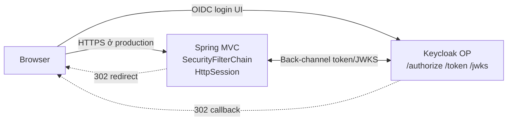
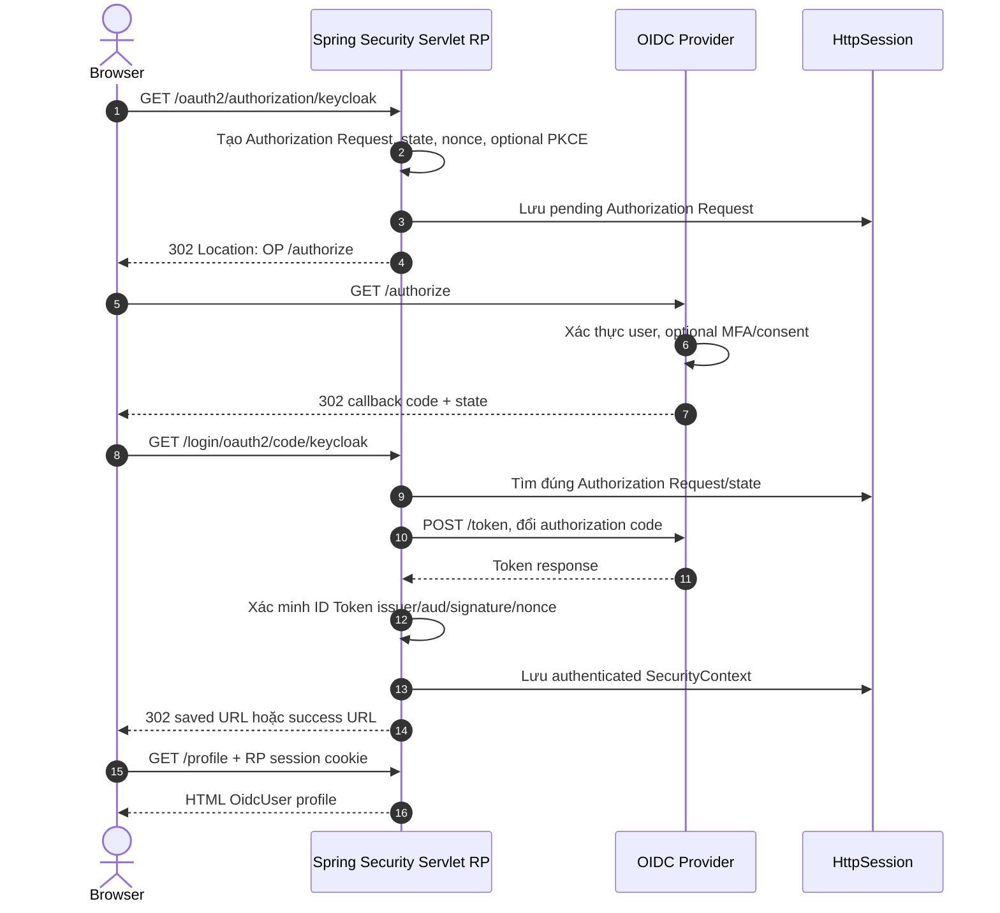
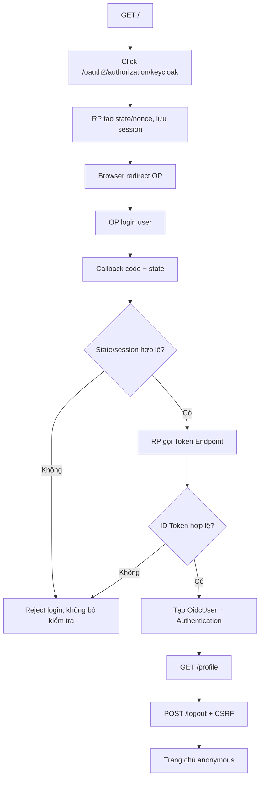

# 34.1. Ứng dụng Servlet đăng nhập bằng một provider OIDC

## 1. Mục tiêu thực hành

Bài này xây dựng một ứng dụng **Spring Boot Servlet / Spring MVC** đăng nhập bằng **một OpenID Connect Provider (OP)** thông qua Spring Security OAuth2 Client. Dự án demo là **Learning Portal**; OpenID Provider thử nghiệm là **Keycloak**. Sau khi thực hiện, bạn sẽ có luồng đăng nhập bằng browser, trang hồ sơ được bảo vệ bằng HTTP session và logout nội bộ.

Những năng lực đạt được:

- Cấu hình Spring Boot MVC, Spring Security, OAuth2 Client và Thymeleaf.
- Tạo một **ClientRegistration** với grant `authorization_code`, scope `openid`, issuer, client ID và secret.
- Dùng `SecurityFilterChain` và `.oauth2Login(...)`, không tự triển khai callback controller.
- Phân biệt URL khởi đầu `/oauth2/authorization/keycloak` và callback `/login/oauth2/code/keycloak`.
- Theo dõi Authorization Code Flow: redirect, `state`, `nonce`, code exchange, ID Token validation, `OidcUser` và session cookie.
- Truy cập claims an toàn với `@AuthenticationPrincipal OidcUser`, không trả token value ra HTML.
- Dùng POST `/logout` có CSRF token và hiểu **RP local logout khác OP SSO logout**.
- Test Servlet routes bằng MockMvc và `oidcLogin()`, rồi kiểm tra protocol bằng OP + browser integration.
- Chẩn đoán các lỗi `invalid_redirect_uri`, `invalid_state`, `invalid_client`, `invalid_grant`, issuer/JWKS mismatch và session/proxy issues.
- Có lộ trình từ HTTP trên localhost sang HTTPS reverse proxy production.

> **Mốc phiên bản minh họa:** Java 17+, Spring Boot 3.4.x, Spring Security 6.x và Keycloak 26.x. Những dòng phụ thuộc và API có thể khác khi chuyển sang Spring Boot/Spring Security mới hơn; hãy dùng BOM và hướng dẫn phù hợp với phiên bản dự án. HTTP chỉ dành cho demo localhost; public production phải dùng HTTPS.

## 2. Kết quả mong đợi

Ứng dụng có các địa chỉ:

| Thành phần | URL |
| --- | --- |
| RP Servlet demo | `http://localhost:8081` |
| Provider thử nghiệm | `http://localhost:8080` |
| OIDC issuer | `http://localhost:8080/realms/demo` |
| Trang chủ public | `GET /` |
| Bắt đầu OAuth2 Login | `GET /oauth2/authorization/keycloak` |
| OIDC callback | `GET /login/oauth2/code/keycloak` |
| Trang hồ sơ bảo vệ | `GET /profile` |
| Logout local | `POST /logout` |
| Client ID tại provider | `portal-web` |
| Registration ID trong Spring | `keycloak` |

Khi người dùng truy cập `/profile` mà chưa đăng nhập, Spring Security yêu cầu authentication. Sau khi xác thực tại Keycloak, app hiển thị username/email/issuer/subject được lấy từ `OidcUser` và ghi nhận authenticated HTTP session. Logout sẽ xóa local Authentication/session; phiên SSO ở provider có thể vẫn còn.

### 2.1. Phân biệt hai vai trò

**Spring Boot là OIDC Relying Party / OAuth2 Client**, không phải Authorization Server. Keycloak cung cấp `/authorize`, `/token`, JWKS và authentication UI.

Bài này không xây **Resource Server**. Nếu sau này app có REST API nhận Bearer Access Token, cần cấu hình `.oauth2ResourceServer(...)` riêng, không coi `.oauth2Login(...)` là cơ chế xác minh mọi incoming API token.

## 3. Sơ đồ hệ thống



Hai loại giao tiếp:

1. **Front-channel:** browser điều hướng qua các HTTP 302 giữa RP và OP.
2. **Back-channel:** RP gọi OP Token Endpoint và JWKS bằng HTTP client phía server.

Access Token/Refresh Token và client secret không cần đi vào HTML hoặc localStorage để một Spring MVC server-side login hoạt động.

## 4. Authorization Code Flow chi tiết



`state` bảo vệ sự tương ứng giữa authorization request và callback; `nonce` ràng buộc ID Token với authentication request trong OIDC; PKCE giúp bảo vệ authorization code exchange. Không tự bỏ các kiểm tra đó khi xảy ra lỗi login.

## 5. Chuẩn bị môi trường

Cần:

```text
Java 17+
Maven 3.9+ hoặc Maven Wrapper
Docker và Docker Compose
Trình duyệt Chrome, Firefox hoặc tương đương
Cổng localhost 8080, 8081 chưa bị chiếm
```

Kiểm tra:

```bash
java -version
mvn -version
docker compose version
```

Tất cả credentials trong bài là **test credentials**. Không dùng OP production, dữ liệu người dùng thật hoặc secrets thật.

### 5.1. Vì sao dùng một OP duy nhất?

Bài này tập trung vào một `registrationId` để dễ theo dõi state/callback/session. Khi hệ thống nhiều providers hoặc tenants, cần thêm trust/routing policy, identity linking và phân quyền riêng.

### 5.2. HTTP chỉ cho localhost

Các URL local dùng HTTP để giảm yêu cầu thiết lập chứng chỉ cho bài lab. Với public Internet, OAuth2/OIDC Authorization Code và session cookies phải dùng HTTPS.

## 6. Cấu trúc project

```text
oidc-servlet-demo/
├── pom.xml
├── compose.yaml
└── src/
    ├── main/
    │   ├── java/
    │   │   └── com/example/oidcdemo/
    │   │       ├── OidcServletDemoApplication.java
    │   │       ├── SecurityConfig.java
    │   │       └── PageController.java
    │   └── resources/
    │       ├── application.yml
    │       └── templates/
    │           ├── index.html
    │           └── profile.html
    └── test/
        └── java/com/example/oidcdemo/
            └── SecurityRoutesTest.java
```

Những tên package, realm và hostname là ví dụ. Không có file JavaScript SPA xử lý authorization code vì ứng dụng là **confidential Servlet client**.

## 7. `pom.xml`: dependencies

Tạo `pom.xml`:

```xml
<?xml version="1.0" encoding="UTF-8"?>
<project xmlns="http://maven.apache.org/POM/4.0.0"
         xmlns:xsi="http://www.w3.org/2001/XMLSchema-instance"
         xsi:schemaLocation="http://maven.apache.org/POM/4.0.0
         https://maven.apache.org/xsd/maven-4.0.0.xsd">
    <modelVersion>4.0.0</modelVersion>

    <parent>
        <groupId>org.springframework.boot</groupId>
        <artifactId>spring-boot-starter-parent</artifactId>
        <version>3.4.4</version>
        <relativePath/>
    </parent>

    <groupId>com.example</groupId>
    <artifactId>oidc-servlet-demo</artifactId>
    <version>0.0.1-SNAPSHOT</version>
    <name>oidc-servlet-demo</name>

    <properties>
        <java.version>17</java.version>
    </properties>

    <dependencies>
        <dependency>
            <groupId>org.springframework.boot</groupId>
            <artifactId>spring-boot-starter-web</artifactId>
        </dependency>

        <dependency>
            <groupId>org.springframework.boot</groupId>
            <artifactId>spring-boot-starter-security</artifactId>
        </dependency>

        <dependency>
            <groupId>org.springframework.boot</groupId>
            <artifactId>spring-boot-starter-oauth2-client</artifactId>
        </dependency>

        <dependency>
            <groupId>org.springframework.boot</groupId>
            <artifactId>spring-boot-starter-thymeleaf</artifactId>
        </dependency>

        <dependency>
            <groupId>org.springframework.boot</groupId>
            <artifactId>spring-boot-starter-test</artifactId>
            <scope>test</scope>
        </dependency>

        <dependency>
            <groupId>org.springframework.security</groupId>
            <artifactId>spring-security-test</artifactId>
            <scope>test</scope>
        </dependency>
    </dependencies>

    <build>
        <plugins>
            <plugin>
                <groupId>org.springframework.boot</groupId>
                <artifactId>spring-boot-maven-plugin</artifactId>
            </plugin>
        </plugins>
    </build>
</project>
```

### 7.1. Vai trò các starters

| Dependency | Lý do |
| --- | --- |
| `spring-boot-starter-web` | Servlet/Tomcat, MVC controller |
| `spring-boot-starter-security` | Filter chain, Authentication, CSRF, session security |
| `spring-boot-starter-oauth2-client` | ClientRegistration, OAuth2 Login, OIDC support |
| `spring-boot-starter-thymeleaf` | Server-side HTML templates |
| `spring-boot-starter-test` | JUnit, MockMvc/AssertJ, Spring Test |
| `spring-security-test` | Mock authentication với `oidcLogin()`, CSRF fixtures |

Boot quản lý versions tương thích của Spring Security/Framework qua dependency management. Đừng thêm legacy `org.springframework.security.oauth:spring-security-oauth2` để cấu hình login hiện tại.

### 7.2. Không cần WebFlux starter

Dự án dùng `HttpSecurity` và `SecurityFilterChain`. Không thêm `spring-boot-starter-webflux` chỉ vì Spring Security có WebClient API; ở đây bài thực hành thuộc Servlet.

## 8. Chạy Keycloak test OP

Tạo `compose.yaml`:

```yaml
services:
  keycloak:
    image: quay.io/keycloak/keycloak:26.1.0
    command: ["start-dev"]
    environment:
      KC_BOOTSTRAP_ADMIN_USERNAME: admin
      KC_BOOTSTRAP_ADMIN_PASSWORD: admin
    ports:
      - "127.0.0.1:8080:8080"
```

Chạy:

```bash
docker compose up -d
```

Mở:

```text
http://localhost:8080/admin
```

Tài khoản quản trị demo:

```text
admin / admin
```

Chỉ dùng các giá trị yếu này trên máy test cách ly. `start-dev` không phải cấu hình Keycloak production.

### 8.1. Tạo realm

Trong Admin Console:

1. Tạo realm `demo`.
2. Chọn realm mới.
3. Vào phần quản lý Clients.
4. Tạo một OpenID Connect client.

### 8.2. Tạo client

Cấu hình client:

```text
Client ID: portal-web
Client authentication: On
Standard Flow: Enabled
Direct Access Grants: Off (không cần)
```

Valid Redirect URI:

```text
http://localhost:8081/login/oauth2/code/keycloak
```

Nếu OP console cần Home URL, dùng:

```text
http://localhost:8081
```

Không cần wildcard redirect URI rộng để bài lab chạy.

### 8.3. Lấy Client Secret

Từ trang credentials của client `portal-web`, lấy secret thử nghiệm. **Không** dán vào source code hoặc lưu dưới dạng plaintext trong Git.

### 8.4. Tạo user

Tạo user thử nghiệm `student1` (hoặc tên khác), đặt password và cho phép login theo policy của OP. Nếu Keycloak yêu cầu cập nhật mật khẩu lần đầu hoặc verify email, hoàn thành các actions thử nghiệm trước khi đánh giá callback.

### 8.5. Kiểm tra Discovery

Sau khi có realm:

```text
http://localhost:8080/realms/demo/.well-known/openid-configuration
```

Một OP hợp lệ trả JSON metadata có:

```json
{
  "issuer": "http://localhost:8080/realms/demo",
  "authorization_endpoint": "...",
  "token_endpoint": "...",
  "jwks_uri": "..."
}
```

Đây là trích đoạn minh họa, không phải toàn bộ discovery document.

## 9. Cấu hình `application.yml`

Tạo `src/main/resources/application.yml`:

```yaml
server:
  port: 8081

spring:
  security:
    oauth2:
      client:
        registration:
          keycloak:
            provider: campus-oidc
            client-id: ${OIDC_CLIENT_ID:portal-web}
            client-secret: ${OIDC_CLIENT_SECRET}
            client-authentication-method: client_secret_basic
            authorization-grant-type: authorization_code
            redirect-uri: "{baseUrl}/login/oauth2/code/{registrationId}"
            scope:
              - openid
              - profile
              - email
        provider:
          campus-oidc:
            issuer-uri: ${OIDC_ISSUER_URI:http://localhost:8080/realms/demo}
```

### 9.1. `registration.keycloak`

`keycloak` là `registrationId` trong Spring Security, xuất hiện ở initiation và callback URLs.

### 9.2. `provider.campus-oidc`

`campus-oidc` là tên cấu hình OP do ứng dụng đặt, không nhất thiết bằng `registrationId`, `clientId` hoặc issuer hostname.

### 9.3. Client ID và authentication method

`client-id=portal-web` phải khớp OP client. Với server-side confidential client, ví dụ dùng `client_secret_basic` để xác thực ở Token Endpoint theo registration.

### 9.4. Scope `openid`

Bắt buộc để yêu cầu OIDC, từ đó ứng dụng nhận ID Token và dùng `OidcUser`. `profile`/`email` yêu cầu thêm claims theo OP consent/policy; không đảm bảo luôn có email.

### 9.5. `issuer-uri`

Issuer là định danh trust của OP; Spring Security dùng metadata để tìm endpoints/JWKS và kiểm tra OIDC claims.

Không lấy UserInfo endpoint làm issuer URI. Nếu dùng container, issuer hostname phải phù hợp cả browser và backend theo network architecture.

### 9.6. Redirect URI

Template:

```text
{baseUrl}/login/oauth2/code/{registrationId}
```

trên localhost thành:

```text
http://localhost:8081/login/oauth2/code/keycloak
```

Phải trùng Valid Redirect URI tại OP.

## 10. Cấp secret cho ứng dụng

Trên Bash:

```bash
export OIDC_CLIENT_SECRET='secret-from-test-op'
mvn spring-boot:run
```

Trên Windows PowerShell:

```powershell
$env:OIDC_CLIENT_SECRET = "secret-from-test-op"
mvn spring-boot:run
```

`secret-from-test-op` chỉ là placeholder. Dùng secret test bạn đã lấy ở Keycloak.

### 10.1. Không nhúng secret vào repository

Tránh:

```yaml
client-secret: actual-production-secret
```

trong file được commit. Trên production, dùng secret store của nền tảng triển khai và chính sách rotation.

### 10.2. Không ghi full environment ra logs

Một lệnh debug dump môi trường hoặc Actuator `/env` cấu hình sai có thể làm lộ secrets. Giới hạn quyền truy cập endpoints và redaction.

## 11. Main class

Tạo `src/main/java/com/example/oidcdemo/OidcServletDemoApplication.java`:

```java
package com.example.oidcdemo;

import org.springframework.boot.SpringApplication;
import org.springframework.boot.autoconfigure.SpringBootApplication;

@SpringBootApplication
public class OidcServletDemoApplication {

    public static void main(String[] args) {
        SpringApplication.run(
            OidcServletDemoApplication.class,
            args
        );
    }
}
```

Spring Boot khởi chạy MVC/Tomcat ở `8081` theo YAML.

## 12. SecurityFilterChain

Tạo `src/main/java/com/example/oidcdemo/SecurityConfig.java`:

```java
package com.example.oidcdemo;

import org.springframework.context.annotation.Bean;
import org.springframework.context.annotation.Configuration;
import org.springframework.security.config.Customizer;
import org.springframework.security.config.annotation.web.builders.HttpSecurity;
import org.springframework.security.web.SecurityFilterChain;

@Configuration
public class SecurityConfig {

    @Bean
    SecurityFilterChain securityFilterChain(
            HttpSecurity http) throws Exception {

        http
            .authorizeHttpRequests(auth -> auth
                .requestMatchers(
                    "/", "/error", "/favicon.ico", "/css/**"
                ).permitAll()
                .anyRequest().authenticated()
            )
            .oauth2Login(Customizer.withDefaults())
            .logout(logout -> logout
                .logoutSuccessUrl("/")
                .invalidateHttpSession(true)
                .deleteCookies("JSESSIONID")
            );

        return http.build();
    }
}
```

### 12.1. Giữ một chain cho bài này

Ở đây toàn bộ ứng dụng chỉ có một security mechanism cho browser login. Nếu bổ sung Bearer API sau này, có thể cần nhiều chains với `securityMatcher` và thứ tự rõ ràng.

### 12.2. Trang chủ công khai

`/`, `/error`, favicon, CSS được permit. Những trang khác, trong đó có `/profile`, yêu cầu authentication.

### 12.3. `.oauth2Login(...)`

Bật filter chuẩn cho Authorization Code Flow và OIDC. Không cần tự viết `@GetMapping("/login/oauth2/code/keycloak")`.

### 12.4. CSRF vẫn bật

Không có `csrf.disable()`. Logout dùng `POST` và phải kèm CSRF token. OAuth2 `state` không thay CSRF token cho mọi form action.

### 12.5. Logout local

Logout configuration xóa local session và cookie theo Servlet default. Nó **không** tự gọi OP end-session endpoint.

### 12.6. URL login mặc định

Khi anonymous truy cập protected route, Spring Security có thể redirect đến `/login`, rồi người dùng chọn provider. Link trực tiếp `/oauth2/authorization/keycloak` cũng bắt đầu login.

### 12.7. Không dùng security rule của UI để authorize business data

Với trang profile demo, `authenticated()` đủ để xem thông tin của chính session. Ứng dụng thật cần tenant/resource authorization riêng; một OIDC login không có nghĩa user là admin.

## 13. Controller MVC

Tạo `src/main/java/com/example/oidcdemo/PageController.java`:

```java
package com.example.oidcdemo;

import org.springframework.security.core.Authentication;
import org.springframework.security.core.annotation.AuthenticationPrincipal;
import org.springframework.security.oauth2.client.authentication.OAuth2AuthenticationToken;
import org.springframework.security.oauth2.core.oidc.user.OidcUser;
import org.springframework.stereotype.Controller;
import org.springframework.ui.Model;
import org.springframework.web.bind.annotation.GetMapping;

@Controller
public class PageController {

    @GetMapping("/")
    public String index(
            Authentication authentication,
            Model model) {

        boolean signedIn =
            authentication instanceof OAuth2AuthenticationToken;

        model.addAttribute("signedIn", signedIn);
        return "index";
    }

    @GetMapping("/profile")
    public String profile(
            @AuthenticationPrincipal OidcUser user,
            OAuth2AuthenticationToken authentication,
            Model model) {

        model.addAttribute(
            "username", user.getPreferredUsername()
        );

        model.addAttribute(
            "email", user.getEmail()
        );

        model.addAttribute(
            "subject", user.getSubject()
        );

        model.addAttribute(
            "issuer", user.getIdToken()
                .getIssuer().toString()
        );

        model.addAttribute(
            "registrationId",
            authentication.getAuthorizedClientRegistrationId()
        );

        return "profile";
    }
}
```

### 13.1. `Authentication` trên trang chủ

Controller chỉ dùng `signedIn` để hiển thị nút login/profile phù hợp. Quyền truy cập `/profile` được **Spring Security filter chain** kiểm soát, không do boolean UI.

### 13.2. `@AuthenticationPrincipal OidcUser`

Sau OIDC Login thành công, Spring Security tạo OIDC principal đã được xử lý theo framework. Controller đọc các claims cần thiết mà không lấy raw token value.

### 13.3. `OidcUser` claims có thể thiếu

`email` hoặc `preferred_username` có thể null. Không coi email là khóa người dùng global hoặc tự cấp quyền theo email domain.

### 13.4. OIDC external identity

Khi lưu user nội bộ, thường xác định external identity bằng:

```text
issuer + subject
```

Không chỉ dùng `sub` nếu một ngày hỗ trợ nhiều issuers; không tự merge users chỉ vì trùng email.

### 13.5. Không dùng ID Token để gọi API

`OidcUser.getIdToken()` xác thực End-User với RP; ID Token thường có audience là RP client ID. Resource Server API cần **Access Token** phù hợp và API riêng phải validate issuer/audience/scope.

## 14. Trang chủ `index.html`

Tạo `src/main/resources/templates/index.html`:

```html
<!DOCTYPE html>
<html lang="vi" xmlns:th="http://www.thymeleaf.org">
<head>
    <meta charset="UTF-8">
    <meta name="viewport"
          content="width=device-width, initial-scale=1">
    <title>OIDC Servlet Demo</title>
</head>
<body>
<main>
    <h1>Learning Portal</h1>
    <p>Đăng nhập OIDC với Spring Security Servlet.</p>

    <section th:if="${!signedIn}">
        <a th:href="@{/oauth2/authorization/keycloak}">
            Đăng nhập bằng Campus Identity
        </a>
    </section>

    <section th:if="${signedIn}">
        <p>Bạn đã đăng nhập.</p>
        <a th:href="@{/profile}">Xem hồ sơ</a>

        <form th:action="@{/logout}" method="post">
            <input type="hidden"
                   th:name="${_csrf.parameterName}"
                   th:value="${_csrf.token}">
            <button type="submit">Đăng xuất</button>
        </form>
    </section>
</main>
</body>
</html>
```

### 14.1. Link bắt đầu login

`/oauth2/authorization/keycloak` là default authorization-request endpoint của Spring Security, không phải Token Endpoint.

### 14.2. Logout form

POST `/logout` cần CSRF token khi CSRF enabled. Template lấy `_csrf` từ Spring MVC request và đưa hidden input.

### 14.3. Không đưa secret vào view

HTML không chứa Client Secret, Authorization Code, ID Token, Access Token hay Refresh Token. Confidential client credentials chỉ ở backend.

## 15. Trang hồ sơ `profile.html`

Tạo `src/main/resources/templates/profile.html`:

```html
<!DOCTYPE html>
<html lang="vi" xmlns:th="http://www.thymeleaf.org">
<head>
    <meta charset="UTF-8">
    <meta name="viewport"
          content="width=device-width, initial-scale=1">
    <title>OIDC Profile</title>
</head>
<body>
<main>
    <h1>Hồ sơ người dùng</h1>

    <dl>
        <dt>Username</dt>
        <dd th:text="${username}">username</dd>

        <dt>Email</dt>
        <dd th:text="${email}">email</dd>

        <dt>Issuer</dt>
        <dd th:text="${issuer}">issuer</dd>

        <dt>Subject</dt>
        <dd th:text="${subject}">subject</dd>

        <dt>Registration ID</dt>
        <dd th:text="${registrationId}">registrationId</dd>
    </dl>

    <a th:href="@{/}">Về trang chủ</a>

    <form th:action="@{/logout}" method="post">
        <input type="hidden"
               th:name="${_csrf.parameterName}"
               th:value="${_csrf.token}">
        <button type="submit">Đăng xuất</button>
    </form>
</main>
</body>
</html>
```

`th:text` escape nội dung khi render text. Không dùng `th:utext` với giá trị claims chưa được xử lý để tránh HTML injection.

### 15.1. Vì sao hiển thị issuer và subject?

Hai giá trị giúp hiểu OIDC identity, nhưng vẫn có thể là metadata nhạy cảm. Trong production chỉ hiển thị nếu có nhu cầu; không copy nguyên profile response vào logs.

### 15.2. Không tạo token-display page

Một trang "debug" hiển thị full compact JWT hoặc Access Token có thể làm rò secrets qua browser history, screenshots và frontend. Bài chỉ hiển thị claim metadata cần thiết.

## 16. Chạy thử end-to-end trên localhost

Sau khi OP, realm, client và user đã sẵn sàng:

```bash
mvn spring-boot:run
```

Mở:

```text
http://localhost:8081
```

Thực hiện:

1. Nhấn "Đăng nhập bằng Campus Identity".
2. Trình duyệt chuyển sang Keycloak.
3. Đăng nhập bằng test user.
4. OP redirect về `/login/oauth2/code/keycloak`.
5. Spring Security xác thực ID Token và tạo local Authentication.
6. Vào `/profile` xem claims.
7. Reload `/profile` để kiểm tra session.
8. Nhấn Logout rồi mở lại `/profile`.

### 16.1. SavedRequest và success URL

Nếu ban đầu user mở `/profile`, Spring Security có thể lưu SavedRequest và đưa user trở lại `/profile` sau login.

Nếu user vào trang chủ rồi nhấn login, URL sau login phụ thuộc success handler/default configuration. Nếu muốn cố định luôn về `/profile`:

```java
.oauth2Login(oauth2 -> oauth2
    .defaultSuccessUrl("/profile", true)
)
```

Lựa chọn này là UX, không phải security requirement của OIDC.

### 16.2. Có thể được login lại không cần password

Sau logout local, Keycloak vẫn có thể giữ OP SSO session. Lần login tiếp theo có thể tự xác thực; không có nghĩa local logout chưa hoạt động.

## 17. Phân tích Authorization Request

Khi browser gửi:

```http
GET /oauth2/authorization/keycloak
```

Spring Security đọc `ClientRegistration` và tạo URL đại ý:

```text
http://localhost:8080/realms/demo/protocol/openid-connect/auth
  ?response_type=code
  &client_id=portal-web
  &scope=openid%20profile%20email
  &redirect_uri=http%3A%2F%2Flocalhost%3A8081%2Flogin%2Foauth2%2Fcode%2Fkeycloak
  &state=<opaque-random>
```

Có thể có `nonce`/PKCE parameters theo cấu hình.

### 17.1. `state`

`state` được Spring Security tạo và lưu cùng authorization request để ràng buộc callback. Không đưa raw state vào application logs hoặc dùng làm correlation ID công khai.

### 17.2. `nonce`

OIDC nonce gắn ID Token với authentication request theo OIDC contract, giúp chống replay trong các tình huống liên quan.

### 17.3. PKCE

PKCE dùng `code_challenge` khi bắt đầu authorization và `code_verifier` khi đổi code. Nếu provider yêu cầu, cấu hình Spring Security phải hỗ trợ; không log verifier.

### 17.4. Redirect URI

Giá trị phải khớp URI đã đăng ký ở Keycloak. Trong production phải dùng public HTTPS, không internal hostname hoặc HTTP của reverse proxy backend.

## 18. Callback và Token Endpoint exchange

OP redirect browser về:

```text
http://localhost:8081/login/oauth2/code/keycloak
    ?code=<one-time-code>
    &state=<opaque-state>
```

Spring Security:

1. Lấy Authorization Request từ repository/session.
2. So khớp state/transaction.
3. Gọi Token Endpoint backend-to-backend với code và client authentication.
4. Nhận token response.
5. Xác minh ID Token issuer, audience, signature, expiry, nonce theo OIDC flow.
6. Tạo `OAuth2AuthenticationToken`/`OidcUser` và lưu SecurityContext.
7. Redirect user về saved request hoặc success URL.

### 18.1. Không tự viết callback handler

Nếu tạo controller đọc `code` rồi tùy ý gọi `/token` và đặt session authenticated, bạn phải tự chịu toàn bộ các trách nhiệm state/PKCE/nonce/JWS/issuer validation. Bài này dùng filter chuẩn của Spring Security.

### 18.2. Token Endpoint không hiển thị ở browser DevTools

Back-channel HTTP call do RP thực hiện nên không xuất hiện trong Network tab của browser như request JavaScript. Muốn debug, dùng logs/metrics server đã scrub hoặc test OP logs hạn chế.

### 18.3. Không log full callback URL

Callback query chứa Authorization Code và state. Ghi route template:

```text
/login/oauth2/code/{registrationId}
```

thay vì full URL.

## 19. HTTP session sau login

Browser thường có cookie RP, ví dụ:

```http
Set-Cookie: JSESSIONID=<opaque>; Path=/; HttpOnly
```

Thuộc tính Secure/SameSite phụ thuộc cấu hình và scheme. Sau login, browser gửi RP session cookie để truy cập `/profile` mà không phải thực hiện lại Authorization Code Flow mỗi request.

### 19.1. Session cookie khác OP cookie

Keycloak có cookies riêng ở `localhost:8080`/host OP. RP dùng cookie session của mình ở `localhost:8081`/host RP. Trong production hai bên thường khác hostname/domain.

### 19.2. Session ID là credential

Không log `JSESSIONID`, không nhúng vào URL và không dùng nó như public support reference.

### 19.3. Session fixation

Session ID có thể được thay đổi khi Authentication thành công theo Spring Security session fixation protection. Đừng tự gắn business identity vào một session ID cố định.

### 19.4. Session persistence

Nếu app chạy nhiều instances, session store phải hỗ trợ callback tới instance khác hoặc deployment routing phải được thiết kế phù hợp. Một callback có đúng cookie nhưng không có state trong store vẫn bị từ chối.

## 20. Ba loại token cần phân biệt

| Token | Mục đích | Ai dùng |
| --- | --- | --- |
| ID Token | Xác thực End-User và thông tin OIDC cho RP | OIDC Client |
| Access Token | Ủy quyền gọi Resource Server | HTTP Client/API |
| Refresh Token (nếu có) | Xin Access Token mới theo grant | OAuth2 Client và AS |

### 20.1. ID Token không phải API Bearer Token

Ngay cả khi cả hai có dạng JWT, ID Token thường có audience `portal-web`, trong khi API cần Access Token với audience riêng.

### 20.2. Scope không phải role admin

`openid`, `profile`, `email` không cấp `ROLE_ADMIN`. Business authorization là bước ứng dụng riêng.

### 20.3. Không gửi Refresh Token đến Resource Server

Refresh Token chỉ dành cho AS Token Endpoint theo grant/rotation policy, không phải credential của Course API.

## 21. `OAuth2AuthorizedClient` trong Servlet

Spring Security có thể lưu token được cấp cho user và registration dưới dạng:

```text
OAuth2AuthorizedClient
    -> ClientRegistration
    -> principalName
    -> OAuth2AccessToken
    -> optional OAuth2RefreshToken
```

Hạ tầng liên quan:

```java
OAuth2AuthorizedClientRepository
OAuth2AuthorizedClientService
OAuth2AuthorizedClientManager
```

Trang `/profile` không cần trực tiếp lấy Access Token vì chỉ hiển thị OIDC identity.

### 21.1. Khi mở rộng gọi API

Bạn có thể dùng `RestClient` + OAuth2 interceptor (trên Spring Security version hỗ trợ) hoặc `WebClient` + Servlet OAuth2 filter. Cần chọn đúng authorized client/registration và API audience/scope.

### 21.2. Không gửi token tới host tùy ý

Một `WebClient` có default current-user OAuth2 authorized client có thể làm lộ token nếu caller được kiểm soát outbound URL. Dùng destination allowlist và per-request selection.

### 21.3. Không cache Access Token vào static field

Token thuộc user/registration/context cụ thể; một global static token dễ gây rò giữa users hoặc tenants.

## 22. Logout: local RP và OP session

Spring Security local logout:

```text
POST /logout + CSRF
    -> invalidate session
    -> clear local SecurityContext
    -> redirect /
```

Nó không chắc logout Keycloak SSO.

### 22.1. Nếu cần RP-Initiated Logout

Spring Security có:

```java
OidcClientInitiatedLogoutSuccessHandler
```

có thể dùng khi provider hỗ trợ OIDC RP-Initiated Logout; cần xác định end-session endpoint và `post_logout_redirect_uri` theo OP contract.

### 22.2. OP logout ảnh hưởng các apps khác

Một SSO session có thể phục vụ nhiều RP. Logout toàn OP có thể khiến user phải đăng nhập lại ở các app khác; phải quyết định theo sản phẩm/security policy.

### 22.3. Không log logout Location có ID Token hint

OIDC logout redirect đôi khi chứa `id_token_hint`. Tránh ghi full response `Location` vào logs/APM.

## 23. Kiểm thử Servlet routes bằng MockMvc

Bạn có thể kiểm tra UI/security rules mà không cần provider thật bằng `spring-security-test`.

Mục tiêu:

```text
GET /           -> public 200
GET /profile    -> anonymous redirect login
GET /profile    -> mock OIDC user được phép xem
POST /logout    -> thiếu CSRF bị chặn
POST /logout    -> có CSRF được xử lý
```

### 23.1. Test context không phụ thuộc OP discovery

Khi dùng `issuer-uri` trong main YAML, app có thể gọi OP discovery lúc startup. Đối với MVC slice tests, tạo test `ClientRegistrationRepository` riêng với endpoint URLs giả hợp lệ, tránh network.

### 23.2. Ví dụ `SecurityRoutesTest.java`

```java
package com.example.oidcdemo;

import org.junit.jupiter.api.Test;
import org.springframework.beans.factory.annotation.Autowired;
import org.springframework.boot.test.autoconfigure.web.servlet.WebMvcTest;
import org.springframework.boot.test.context.TestConfiguration;
import org.springframework.context.annotation.Bean;
import org.springframework.context.annotation.Import;
import org.springframework.security.oauth2.client.registration.ClientRegistration;
import org.springframework.security.oauth2.client.registration.ClientRegistrationRepository;
import org.springframework.security.oauth2.client.registration.InMemoryClientRegistrationRepository;
import org.springframework.security.oauth2.core.AuthorizationGrantType;
import org.springframework.security.oauth2.core.ClientAuthenticationMethod;
import org.springframework.test.web.servlet.MockMvc;

import static org.springframework.security.test.web.servlet.request.SecurityMockMvcRequestPostProcessors.csrf;
import static org.springframework.security.test.web.servlet.request.SecurityMockMvcRequestPostProcessors.oidcLogin;
import static org.springframework.test.web.servlet.request.MockMvcRequestBuilders.get;
import static org.springframework.test.web.servlet.request.MockMvcRequestBuilders.post;
import static org.springframework.test.web.servlet.result.MockMvcResultMatchers.*;

@WebMvcTest(PageController.class)
@Import({
    SecurityConfig.class,
    SecurityRoutesTest.TestClientConfig.class
})
class SecurityRoutesTest {

    @Autowired
    MockMvc mvc;

    @TestConfiguration
    static class TestClientConfig {

        @Bean
        ClientRegistrationRepository clientRegistrationRepository() {

            ClientRegistration testClient =
                ClientRegistration
                    .withRegistrationId("keycloak")
                    .clientId("portal-web-test")
                    .clientSecret("test-secret-only")
                    .clientAuthenticationMethod(
                        ClientAuthenticationMethod.CLIENT_SECRET_BASIC
                    )
                    .authorizationGrantType(
                        AuthorizationGrantType.AUTHORIZATION_CODE
                    )
                    .redirectUri(
                        "{baseUrl}/login/oauth2/code/{registrationId}"
                    )
                    .authorizationUri(
                        "https://op.test.example/authorize"
                    )
                    .tokenUri(
                        "https://op.test.example/token"
                    )
                    .jwkSetUri(
                        "https://op.test.example/jwks"
                    )
                    .userInfoUri(
                        "https://op.test.example/userinfo"
                    )
                    .userNameAttributeName("sub")
                    .scope("openid", "profile", "email")
                    .clientName("Test OIDC Provider")
                    .build();

            return new InMemoryClientRegistrationRepository(
                testClient
            );
        }
    }

    @Test
    void homePageIsPublic() throws Exception {

        mvc.perform(get("/"))
            .andExpect(status().isOk())
            .andExpect(view().name("index"));
    }

    @Test
    void anonymousProfileNeedsLogin() throws Exception {

        mvc.perform(get("/profile"))
            .andExpect(status().is3xxRedirection())
            .andExpect(redirectedUrl("/login"));
    }

    @Test
    void authenticatedOidcUserViewsProfile() throws Exception {

        mvc.perform(
                get("/profile")
                    .with(oidcLogin().idToken(token -> token
                        .issuer("https://op.test.example")
                        .subject("student-123")
                        .claim(
                            "preferred_username", "student1"
                        )
                    ))
            )
            .andExpect(status().isOk())
            .andExpect(view().name("profile"))
            .andExpect(model().attributeExists(
                "subject", "issuer", "registrationId"
            ));
    }

    @Test
    void logoutWithoutCsrfIsForbidden() throws Exception {

        mvc.perform(
                post("/logout").with(oidcLogin())
            )
            .andExpect(status().isForbidden());
    }

    @Test
    void logoutWithCsrfRedirects() throws Exception {

        mvc.perform(
                post("/logout")
                    .with(oidcLogin())
                    .with(csrf())
            )
            .andExpect(status().is3xxRedirection());
    }
}
```

Ví dụ dùng `@WebMvcTest` slice và custom in-memory registration, không truy cập test OP. Với version khác, nếu autoconfiguration tạo duplicate registration bean, hãy điều chỉnh test context thay vì tắt production OIDC validations.

### 23.3. Test nào không được chạy ở ví dụ?

Đây là tài liệu bài thực hành; cần tự tạo project và chạy tests trong môi trường người học. Code trên là nội dung mẫu, không phải tuyên bố test đã được chạy cho mọi JDK/Boot/OP environment.

## 24. Giới hạn quan trọng của `oidcLogin()`

`oidcLogin()` tạo Authentication và principal giả cho test.

Nó **không** thực hiện:

```text
Browser redirect sang OP
Authorization Request persistence
State verification
PKCE code verifier exchange
Token Endpoint HTTP request
Client secret authentication
JWS signature/JWKS validation
Nonce verification
Cookie SameSite enforcement
```

Vì vậy test MockMvc có thể pass trong khi login browser thật vẫn fail do `redirect_uri` hoặc cookie.

### 24.1. Hai tầng testing cần có

**Tầng A — MockMvc:** kiểm tra access control/HTML/controller/CSRF.

**Tầng B — OIDC integration/browser E2E:** kiểm tra Authorization Code Flow, OP responses, cookie, TLS, state/nonce và ID Token validation.

### 24.2. Không tắt signature validation để test

Fake OP phải ký ID Token bằng test JWK tương ứng. Không sửa code production để chấp nhận `alg=none` hoặc JWT unsigned.

## 25. Test authorization redirect riêng

Một kiểm thử có thể gọi:

```java
MvcResult result = mvc.perform(
        get("/oauth2/authorization/keycloak")
    )
    .andExpect(status().is3xxRedirection())
    .andReturn();

String location =
    result.getResponse().getHeader("Location");
```

Assert logic:

```text
Location trỏ tới test OP authorization endpoint
response_type = code
client_id = portal-web-test
scope chứa openid
redirect_uri khớp callback
state có giá trị không trống
```

Không hard-code `state` cố định hoặc ghi full `Location` chứa state vào CI logs.

### 25.1. URL parsing

Một test production-grade cần parse query với URL/form decoding đúng và xử lý duplicate params. Không assert bằng chuỗi contains quá rộng cho những trường security-critical.

### 25.2. State khác nhau cho các attempts

Mỗi authorization request nên có state transaction-bound đủ entropy; khi kiểm thử hai lượt độc lập, không ép Spring Security sử dụng cùng state.

## 26. Fake OIDC Provider để test protocol

Để test thật, fake OP hoặc Keycloak test environment cần:

```text
/.well-known/openid-configuration
/authorize
/token
/jwks
/userinfo (nếu cần)
```

Provider test phải:

1. Đăng ký exact client ID/redirect URI.
2. Phát authorization code dùng một lần.
3. Trả đúng `state` trên callback.
4. Hỗ trợ PKCE nếu client dùng.
5. Xác thực confidential client khi code exchange.
6. Phát ID Token ký bằng test key hợp lệ.
7. Công bố JWKS, đúng `iss`, `aud`, `sub`, `exp`, `iat`, nonce.
8. Mô phỏng lỗi invalid state, invalid client, timeout, signing key rotation.

### 26.1. Không cần OP public thật

Dùng local test OP/realm để tránh phụ thuộc production availability và user credentials.

### 26.2. Khi nào cần browser thực?

Nếu muốn xác minh **SameSite cookies**, cross-site redirect, HTTPS certificates hoặc SSO login UI, dùng Playwright/Selenium với hostnames/HTTPS test tương ứng. HTTP test client không phải browser cookie engine.

## 27. Manual test checklist

| Bước | Hành động | Kỳ vọng |
| --- | --- | --- |
| 1 | Mở `/` anonymous | Trang chủ hiển thị |
| 2 | Mở `/profile` anonymous | Redirect login |
| 3 | Nhấn Login link | Browser tới OP |
| 4 | Đăng nhập test user | OP xác thực |
| 5 | OP trả callback | URI `/login/oauth2/code/keycloak` |
| 6 | RP nhận callback | State/nonce/token hợp lệ |
| 7 | Mở `/profile` | OIDC claims hiển thị |
| 8 | Reload `/profile` | Session duy trì |
| 9 | POST `/logout` qua form | RP local session bị xóa |
| 10 | Mở lại `/profile` | Cần đăng nhập |
| 11 | Login lại | OP SSO có thể làm login nhanh |
| 12 | Dùng sai Client Secret | Token Endpoint từ chối |
| 13 | Dùng sai Redirect URI | OP từ chối |
| 14 | Callback state giả | RP từ chối |
| 15 | Xóa RP cookie trước callback | Không bypass state |
| 16 | OP tạm unavailable | App báo lỗi phù hợp, không cấp session |

## 28. Browser DevTools và thông tin được phép ghi

Trong Network tab, quan sát:

- HTTP status của `/oauth2/authorization/keycloak`.
- Authorization endpoint host/route, nhưng **không chia sẻ raw query state**.
- Callback path và status.
- Cookie RP có được lưu/gửi hay không.
- `SameSite`, `Secure`, `HttpOnly`, `Path`, `Domain`, blocked reason.
- Redirect cuối cùng đến trang profile hoặc lỗi.

### 28.1. Không paste callback URL

Callback URL chứa:

```text
code
state
```

Đó là OAuth2 transaction data nhạy cảm. Trong ticket/logs dùng route template.

### 28.2. Token Endpoint không xuất hiện như browser fetch

RP gửi request `/token` back-channel. Xem safe server logs hoặc fake OP test metrics, không dump raw form body có authorization code/client secret/PKCE verifier.

### 28.3. OP cookie và RP cookie

OP quản lý SSO cookie, RP quản lý HttpSession cookie. Logout ở RP không mặc định xóa OP cookie.

## 29. Troubleshooting `invalid_redirect_uri`

Một thông báo từ OP:

```text
Invalid parameter: redirect_uri
```

có thể do:

| Nguyên nhân | Ví dụ |
| --- | --- |
| Sai host | `127.0.0.1` thay `localhost` |
| Sai port | 8080 thay 8081 |
| Sai scheme | HTTP/HTTPS khác nhau |
| Sai callback registration | `/code/campus` thay `/code/keycloak` |
| Sai path prefix | Thiếu hoặc lặp `/learning` |
| OP client config sai | Valid Redirect URI chưa đăng ký |
| Reverse proxy forwarding sai | App sinh internal URL |

### 29.1. Sửa tại nguồn

Cập nhật `ClientRegistration` và OP redirect URI chính xác; nếu sau proxy, sửa trusted forwarded-header setup.

### 29.2. Không mở wildcard rộng

Không thêm callback wildcard production chỉ để login qua được; redirect URI validation là security boundary quan trọng.

## 30. Troubleshooting `invalid_state`

Spring Security không tìm được matching Authorization Request hoặc state không đúng có thể là do:

```text
Cookie session không quay về callback
SameSite Strict cản cross-site navigation
Cookie Domain/Path sai
Session hết hạn trong lúc nhập MFA
Shared session store không có giữa instances
Multi-tab authorization requests bị ghi đè
State bị thay đổi hoặc callback forged
```

### 30.1. Chia nơi kiểm tra

**Trước redirect:** RP có lưu Authorization Request trong session không? Browser nhận session cookie chưa?

**Callback:** Browser có gửi cookie tới RP không? Spring Security có tìm thấy session/authorization request không?

### 30.2. Không bỏ state validation

Nếu callback không có saved authorization request, không tạo authenticated user từ raw `code`, raw `sub` hay query params.

### 30.3. Correlation để debug

Dùng request ID/trace ID hoặc random login-flow ID server-side, không log `state`, `nonce` hay code làm identifier.

## 31. Troubleshooting Token Endpoint

### 31.1. `invalid_client`

Kiểm tra:

```text
Client ID
Client Secret
Client Authentication method
OP token URI
Client active/disabled
Credential rotation
```

Đừng log client secret hoặc `Authorization: Basic ...`.

### 31.2. `invalid_grant`

Có thể do:

```text
Code expired
Code reused
Redirect URI không khớp
PKCE verifier mismatch
Code thuộc client khác
```

Không log raw authorization code hoặc code_verifier.

### 31.3. OP timeout

Một Token Endpoint timeout không chứng minh OP chưa xử lý code. Không tự retry code exchange vô hạn vì authorization code là one-time credential.

## 32. Troubleshooting issuer/JWKS

Nếu app không khởi động hoặc login fail do discovery:

```text
issuer-uri đúng realm?
OP đã chạy chưa?
Discovery endpoint trả metadata không?
Backend resolve được OP hostname không?
```

Nếu ID Token validation fail:

```text
iss đúng issuer?
aud chứa RP clientId?
Signature/JWKS phù hợp?
Token còn hạn?
Nonce đúng transaction?
```

Không tắt issuer/signature verification để sửa lỗi networking.

### 32.1. Container hostname

`localhost` bên trong app container chỉ chính container, không phải host machine. Nếu chuyển RP vào Docker, giải quyết hostname/issuer reachability của cả browser và backend; không sửa claims cho tiện.

## 33. Cookie SameSite khi deploy thực

Trên production browser redirect:

```text
OP (cross-site) -> RP callback
```

Cookie `SameSite=Strict` thường không được gửi trên cross-site top-level navigation.

Với callback top-level GET thông dụng, `SameSite=Lax` thường phù hợp.

Với callback `response_mode=form_post` cross-site POST, Lax thường không gửi cookie; có thể cần thiết kế `SameSite=None; Secure` và callback/CSRF protections được kiểm thử.

### 33.1. Production config tham khảo

```yaml
server:
  servlet:
    session:
      cookie:
        secure: true
        http-only: true
        same-site: lax
        path: /
```

Đây là cấu hình dành cho HTTPS public/stack phù hợp, không nhất thiết phù hợp local HTTP test ở mọi browser.

### 33.2. `Secure` không thay HTTPS

Nếu public callback bị redirect về HTTP, Secure cookie không được gửi. Phải sửa public HTTPS URL/proxy, không bỏ Secure để che lỗi.

### 33.3. Spring Session khác Servlet cookie mặc định

Nếu sau này thêm Spring Session Redis/JDBC, kiểm tra component nào thật sự phát `Set-Cookie` và tên `SESSION`/`JSESSIONID`, không chỉ dựa vào YAML.

## 34. Reverse proxy và public base URL

Production topology:

```text
Browser HTTPS:443
    -> Nginx / Ingress
    -> Spring Boot HTTP:8081 nội bộ
```

Spring Boot cần thấy public request scheme/host/port đã được trusted proxy xác minh để tính `{baseUrl}`.

Ví dụ property:

```yaml
server:
  forward-headers-strategy: framework
```

### 34.1. Proxy phải sanitize headers

Chỉ trusted proxy được đặt `Forwarded`/`X-Forwarded-*` cho backend; chặn direct backend access, forged host/proto và malicious prefix.

### 34.2. Public callback

OP phải đăng ký:

```text
https://portal.example.org/login/oauth2/code/keycloak
```

không phải internal:

```text
http://learning-app:8081/login/oauth2/code/keycloak
```

### 34.3. Không tắt CSRF/state/nonce để sửa proxy

Các security checks không gây ra lỗi cấu hình URL; sửa forwarding, cookie/session hoặc OP registration mới đúng.

## 35. Security checklist

- [ ] OP/client config thuộc môi trường test hoặc production đúng.
- [ ] `openid` scope, grant `authorization_code`.
- [ ] Callback exact, HTTPS trên production.
- [ ] Client secret không có trong HTML/source/log.
- [ ] Authorization Request lưu server-side, state validation còn nguyên.
- [ ] ID Token JWS/issuer/audience/expiry/nonce validation còn nguyên.
- [ ] Không đưa Access Token, Refresh Token, ID Token vào frontend.
- [ ] `/profile` chỉ được authenticated user truy cập.
- [ ] Logout qua POST có CSRF token.
- [ ] Session cookie Secure/HttpOnly/SameSite phù hợp.
- [ ] Reverse proxy trusted forwarded headers/host allowlist.
- [ ] Không log raw `code`, `state`, nonce hoặc `Location` nhạy cảm.
- [ ] Không dùng OIDC login làm bằng chứng business role/tenant membership.
- [ ] Resource Server, nếu có, kiểm tra Access Token riêng.
- [ ] Có negative tests cho invalid state, issuer, redirect URI và credentials.

## 36. Bài tập mở rộng

### Bài tập 1 — Đổi registration ID

Đổi từ `keycloak` thành `campus`. Cập nhật:

```text
application.yml registration key
Login URL
Callback URI tại OP
```

**Đáp án kỳ vọng:** `/oauth2/authorization/campus` và `/login/oauth2/code/campus` đều hoạt động đúng.

### Bài tập 2 — Trang profile mới

Thêm profile claim `name` khi OP cung cấp; dùng `th:text` và xử lý null. Không render raw HTML từ claim.

### Bài tập 3 — Giữ `/profile` protected

Thử gọi `/profile` với browser anonymous hoặc MockMvc. Xác minh không trả thông tin user khi chưa authenticated.

### Bài tập 4 — Thử Client Secret sai

Sử dụng test secret sai và quan sát Token Endpoint error; sửa về giá trị thật, không log secret.

### Bài tập 5 — Thử callback khác port

Đổi callback OP sang 8082 trong môi trường test. Quan sát redirect URI mismatch và khôi phục exact URL.

### Bài tập 6 — Logout

Đăng nhập, POST logout, đăng nhập lại. Giải thích vì sao OP SSO vẫn có thể bỏ qua màn hình password.

### Bài tập 7 — `oidcLogin()` vs full OIDC

Chứng minh MockMvc `oidcLogin()` pass ngay khi fake OP tắt. Giải thích vì sao đây không phải bằng chứng OIDC protocol hoạt động.

### Bài tập 8 — Keycloak unreachable

Tắt container OP trước khi khởi động RP. Quan sát discovery/connection errors theo phase; đừng disable issuer validation.

### Bài tập 9 — Cookie

Quan sát Secure/HttpOnly/SameSite/Path ở browser, không xuất raw cookie value vào logs.

### Bài tập 10 — HTTPS reverse proxy

Dùng HTTPS hostname test, đảm bảo `{baseUrl}` public và OP redirect callback đúng scheme/host/path.

### Bài tập 11 — Session timeout

Để user đứng ở OP login lâu tới khi RP session hết hạn rồi callback. Xác minh login fail closed do missing authorization transaction.

### Bài tập 12 — Hai tab

Mở hai login attempts; phân tích nếu repository hỗ trợ hoặc không hỗ trợ nhiều pending states trong cùng session. Không dùng session.lastState để chấp nhận callback khác flow.

### Bài tập 13 — Tài khoản không có email

Không cấp email claim; trang profile vẫn hoạt động, không gán user vào account khác chỉ dựa trên email.

### Bài tập 14 — Không dùng ID Token làm API token

Giải thích tại sao API audience khác RP clientId và cần Access Token/Resource Server policy riêng.

### Bài tập 15 — OP logout

Thử thêm RP-Initiated Logout bằng handler phù hợp, test local logout khác OP SSO logout, không log id_token_hint.

## 37. Câu hỏi ôn tập

**1. App trong bài là OAuth2 Client hay Authorization Server?**

> OAuth2 Client / OIDC Relying Party.

**2. `registrationId` là gì?**

> Khóa nội bộ Spring Security, ở đây là `keycloak`.

**3. `clientId` của OP là gì?**

> `portal-web`, không nhất thiết bằng registration ID.

**4. Endpoint bắt đầu login là gì?**

> `/oauth2/authorization/keycloak`.

**5. Callback mặc định?**

> `/login/oauth2/code/keycloak`.

**6. Vì sao cần scope `openid`?**

> Để yêu cầu OpenID Connect và nhận OIDC authentication/ID Token.

**7. Ai xử lý callback?**

> Spring Security OAuth2 Login filter, không cần custom controller.

**8. `state` dùng để làm gì?**

> Ràng buộc authorization request và response, giúp chống CSRF/mix-up.

**9. `nonce` khác state thế nào?**

> Nonce ràng buộc ID Token với OIDC authentication request.

**10. PKCE dùng gì?**

> Code challenge khi bắt đầu và code verifier khi đổi authorization code.

**11. Browser có trực tiếp gọi `/token` không?**

> Không trong confidential server-side flow của bài; backend thực hiện token exchange.

**12. Vì sao ID Token không là Access Token?**

> ID Token xác thực người dùng cho RP, Access Token ủy quyền truy cập Resource Server.

**13. `OidcUser` chứa gì?**

> Authenticated OIDC principal và các claims/token metadata theo Spring Security.

**14. Có phải email luôn tồn tại?**

> Không. OP có thể không cung cấp claim email.

**15. Identity key nên lấy theo gì?**

> Thường issuer + subject, không chỉ email.

**16. Trang `/profile` được bảo vệ ở đâu?**

> Trong `SecurityFilterChain` authorization rules.

**17. Tại sao POST logout cần CSRF?**

> App dùng browser cookie session; CSRF bảo vệ state-changing requests.

**18. Local logout có logout Keycloak không?**

> Không mặc định.

**19. Browser cookie RP có gửi sang OP không?**

> Không thông thường; RP và OP quản lý cookies theo origin/site riêng.

**20. Vì sao SameSite=Lax thường phù hợp callback GET?**

> Top-level cross-site navigation bằng GET có thể gửi cookie Lax.

**21. `MockMvc.with(oidcLogin())` kiểm tra chữ ký ID Token thật chưa?**

> Chưa. Đây là mock principal.

**22. Vì sao OP issuer cần chính xác?**

> Nó là trust identity trong OIDC discovery/ID Token validation.

**23. Khi callback invalid_state, có nên bỏ state validation?**

> Không. Phải sửa cookie/session/transaction flow.

**24. Production `redirect_uri` cần scheme nào?**

> HTTPS public.

**25. Có thể dùng client secret trong JavaScript frontend không?**

> Không, vì public browser không giữ secret an toàn.

**26. Nếu token JWT đọc được claims thì đã tin được chưa?**

> Chưa. Cần signature/issuer/audience/time/nonce validation theo OIDC.

**27. Một OIDC login có chứng minh user là admin tenant không?**

> Không. Business authorization riêng.

**28. Vì sao Keycloak trong Docker có thể gây lỗi `localhost`?**

> Localhost của app container khác localhost của host/browser.

**29. Tại sao không chạy bài bằng Legacy `@EnableOAuth2Sso`?**

> Bài sử dụng Spring Security OAuth2 Client hiện đại và `SecurityFilterChain`.

**30. Điều kiện hoàn thành bài là gì?**

> Login qua một OP, callback hợp lệ, authenticated session, trang profile và logout local hoạt động; có tests Servlet và biết giới hạn mock vs browser/OP integration.

---

## 38. Tổng kết



Một ứng dụng **Spring MVC với đúng một OpenID Provider** chỉ cần cấu hình `ClientRegistration` hợp lệ, bật `.oauth2Login(...)` trong `SecurityFilterChain`, cung cấp protected pages và quản lý Servlet session đúng cách. Spring Security đảm nhiệm Authorization Code Flow, state/nonce và ID Token verification. Browser đi theo redirects và gửi RP session cookie; Token Endpoint exchange diễn ra phía server. Khi kiểm thử, kết hợp **MockMvc** cho route/CSRF với **fake OP + browser E2E** để kiểm chứng giao thức, HTTPS/cookies và tình huống sai. Không tự làm yếu security bằng cách tắt state, nonce, issuer hoặc signature validation khi gặp lỗi cấu hình.

## 39. Tài liệu tham khảo

- [Spring Security — Servlet OAuth2 Login](https://docs.spring.io/spring-security/reference/servlet/oauth2/login/index.html): URL initiation, callback và OIDC Login.
- [Spring Security — OAuth2 Login Advanced](https://docs.spring.io/spring-security/reference/servlet/oauth2/login/advanced.html): authorization request, user info và extension points.
- [Spring Security — OAuth2 Client Core](https://docs.spring.io/spring-security/reference/servlet/oauth2/client/core.html): authorized clients và persistence.
- [Spring Security — Servlet Testing](https://docs.spring.io/spring-security/reference/servlet/test/index.html): MockMvc `oidcLogin()` và CSRF fixtures.
- [Spring Security API — OidcUser](https://docs.spring.io/spring-security/reference/api/java/org/springframework/security/oauth2/core/oidc/user/OidcUser.html): OIDC claims/principal.
- [Spring Boot — Security](https://docs.spring.io/spring-boot/reference/web/spring-security.html): web app security configuration.
- [Keycloak — OIDC Services](https://www.keycloak.org/securing-apps/oidc-layers): OIDC endpoints.
- [Keycloak — Server Administration Guide](https://www.keycloak.org/docs/latest/server_admin/): realms, clients, users, credentials.
- [OpenID Connect Core](https://openid.net/specs/openid-connect-core-1_0.html): ID Token, nonce, issuer and audience.
- [OpenID Connect Discovery](https://openid.net/specs/openid-connect-discovery-1_0.html): issuer metadata/JWKS.
- [RFC 6749 — OAuth2](https://www.rfc-editor.org/rfc/rfc6749): Authorization Code Flow.
- [RFC 7636 — PKCE](https://www.rfc-editor.org/rfc/rfc7636): code challenge/verifier.
- [RFC 9700 — OAuth2 Security BCP](https://www.rfc-editor.org/rfc/rfc9700): OAuth2 security practices.
- [OWASP — Session Management](https://cheatsheetseries.owasp.org/cheatsheets/Session_Management_Cheat_Sheet.html): session cookies.
- [OWASP — CSRF Prevention](https://cheatsheetseries.owasp.org/cheatsheets/Cross-Site_Request_Forgery_Prevention_Cheat_Sheet.html): browser CSRF and SameSite.
