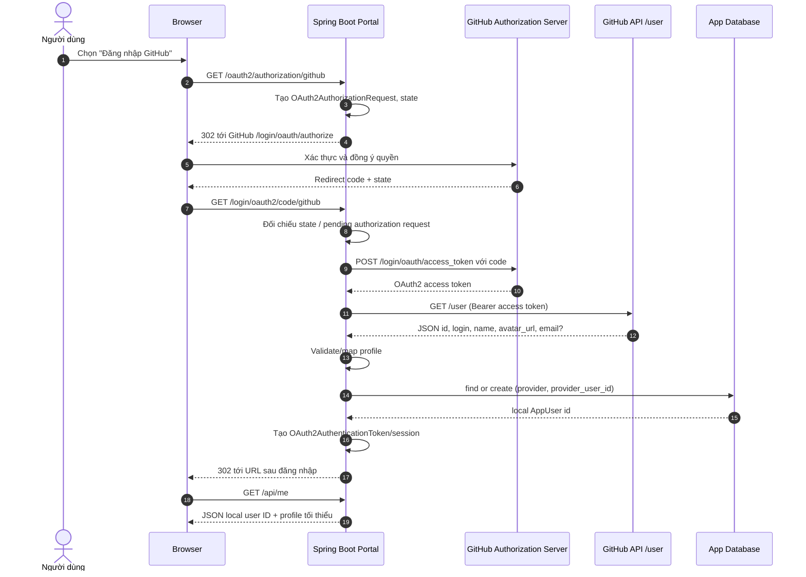
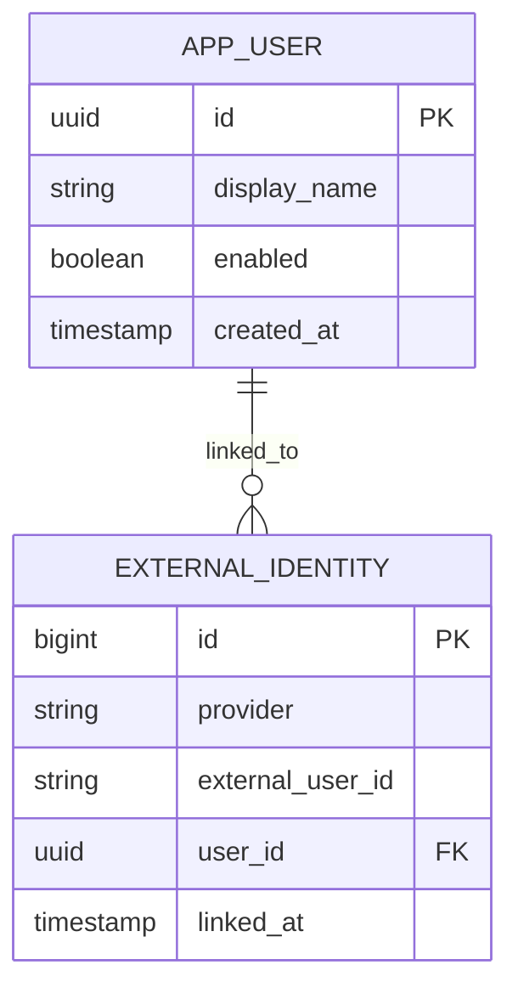
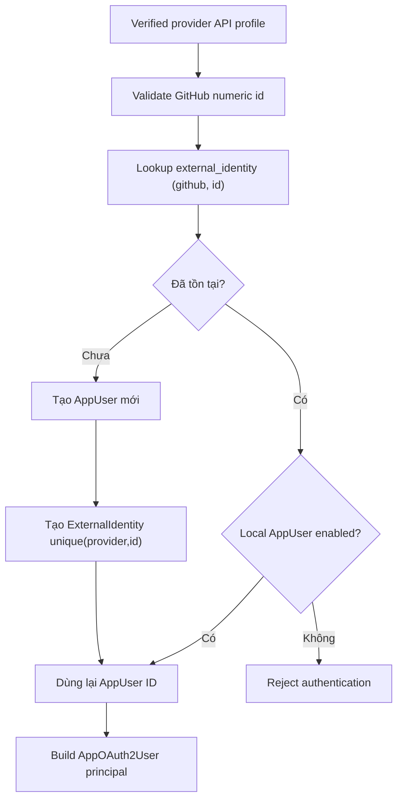

# 34.2. Đăng nhập OAuth 2.0 thuần và ánh xạ hồ sơ người dùng

Trong bài thực hành này, chúng ta xây một ứng dụng **Spring Boot + Spring Security OAuth2 Client** cho phép người dùng **đăng nhập bằng GitHub OAuth 2.0**, đọc thông tin hồ sơ qua **UserInfo Endpoint/REST API của provider**, ánh xạ hồ sơ thành **tài khoản nội bộ** và dùng `@AuthenticationPrincipal` để trả thông tin người dùng đang đăng nhập. Bài thực hành cố tình chọn **OAuth 2.0 thuần, không dùng OpenID Connect (OIDC)** để hiểu rõ điểm khác biệt giữa *ủy quyền truy cập API* và *xác minh danh tính bằng một giao thức chuẩn*.

OAuth 2.0 được thiết kế chủ yếu cho **ủy quyền**: Client lấy access token để truy cập tài nguyên được bảo vệ. Bản thân OAuth 2.0 **không chuẩn hóa một ID Token, `sub`, `iss` hoặc UserInfo response để đăng nhập**. Một số nhà cung cấp như GitHub cung cấp API profile và Spring Security hỗ trợ `oauth2Login()` để dùng profile đó tạo `Authentication`. Cách làm này hữu ích cho social login, nhưng ứng dụng phải hiểu **contract hồ sơ riêng của provider**, thiết kế khóa liên kết danh tính ổn định và không mặc định tin mọi thuộc tính provider là quyền nội bộ.

> **Kết quả cuối bài:** Browser truy cập `/oauth2/authorization/github` → GitHub yêu cầu đăng nhập/consent → GitHub redirect về `/login/oauth2/code/github` → Spring đổi authorization code lấy access token → `DefaultOAuth2UserService` gọi `https://api.github.com/user` → ứng dụng ánh xạ `id`/`login` thành `AppUser` và `ExternalIdentity` → Spring tạo local authenticated session → `GET /api/me` trả local user ID, provider và hồ sơ tối thiểu. Không cần và không nhận `id_token`.

Các ví dụ sử dụng **Spring Boot 3.x, Spring Security 6.x và Java 17+** với Spring MVC/Servlet. Các bản Spring Boot khác có thể thay đổi một số API hoặc tên dependency. **Không đưa Client secret thật vào Git, ảnh chụp màn hình, logs hoặc tài liệu**. Các mã Java được trình bày đủ để ghép thành một dự án học tập; khi xây hệ thống production cần bổ sung migration, kiểm thử tích hợp với provider giả, quản lý bí mật, account linking và vận hành.

---

## 1. Mục tiêu học tập

Sau khi thực hành, bạn có thể:

1. Giải thích vì sao OAuth2 Login dựa vào profile API khác với OIDC Login dựa vào ID Token được xác minh.
2. Đăng ký GitHub OAuth App với callback URI đúng, cấu hình `ClientRegistration` bằng Spring Boot.
3. Hiểu các vai trò **Resource Owner**, **Client**, **Authorization Server** và **Resource Server**.
4. Quan sát Authorization Code Flow qua browser redirect, `state`, callback và Token Endpoint.
5. Dùng `DefaultOAuth2UserService` để lấy `OAuth2User` từ profile endpoint.
6. Chuyển thuộc tính provider thành một kiểu hồ sơ có validation thay vì dùng `Map<String, Object>` khắp application.
7. Ánh xạ danh tính ngoài bằng **`(provider, providerUserId)`**, không tự ghép tài khoản bằng email.
8. Lưu `AppUser` và `ExternalIdentity` vào database với unique constraint và transaction.
9. Trả custom principal chứa local user ID nhưng vẫn giữ tên provider user ổn định.
10. Bảo vệ endpoint bằng Spring Security và kiểm tra kết quả qua `/api/me`.
11. Viết unit tests cho profile mapping, kiểm thử MVC authorization và các trường hợp callback/token/profile lỗi.
12. Biết ranh giới an toàn của scopes, CSRF, session cookies, access token, roles, email và account linking.

## 2. Kiến trúc bài thực hành



### 2.1. Thành phần chính

| Thành phần | Vai trò |
|---|---|
| `ClientRegistrationRepository` | Cấu hình OAuth2 client, Client ID, authorize/token/userInfo URI, scope |
| `OAuth2AuthorizationRequestRedirectFilter` | Tạo yêu cầu và chuyển browser tới GitHub |
| `AuthorizationRequestRepository` | Giữ pending authorization request/`state` trong session |
| `OAuth2LoginAuthenticationFilter` | Xử lý callback, đổi authorization code, tạo Authentication |
| `DefaultOAuth2UserService` | Dùng access token để gọi profile API |
| `OAuth2UserService<OAuth2UserRequest, OAuth2User>` | Điểm custom mapping profile và identity |
| `OAuth2AuthenticationToken` | Spring Security Authentication cho OAuth2 Login |
| `AppUser` | Tài khoản nội bộ của ứng dụng |
| `ExternalIdentity` | Liên kết một user của provider với một AppUser |
| `OAuth2AuthorizedClient` | Giữ access token và refresh token nếu provider cấp, khác với profile |
| `SecurityContext`/`HttpSession` | Giữ đăng nhập local cho các requests tiếp theo |

### 2.2. Sự khác biệt cần hiểu ngay

| OAuth 2.0 Login với GitHub | OIDC Login |
|---|---|
| Access token truy cập GitHub API `/user` | ID Token được OP cấp để xác thực user tại RP |
| Profile JSON có `id`, `login` theo GitHub | ID Token có claims chuẩn `iss`, `sub`, `aud`, `exp` |
| Không có `id_token` trong flow mẫu | Phải xác minh chữ ký và các claims ID Token |
| App phải hiểu user-name-attribute của provider | Identity chuẩn thường theo `(iss, sub)` |
| `DefaultOAuth2UserService`, `OAuth2User` | `OidcUserService`, `OidcUser` |
| Email có thể vắng hoặc chưa được ứng dụng xác minh | `email`/`email_verified` vẫn không phải khóa danh tính chuẩn |
| Assurance phụ thuộc contract/API và chính sách provider | OIDC có profile xác thực chuẩn hơn, nhưng vẫn cần policy nghiệp vụ |

**Không thêm scope `openid` vào GitHub OAuth App rồi mong nó tự trở thành OIDC Provider.** Scope `openid` chỉ có ý nghĩa OIDC khi provider thực sự hỗ trợ OIDC và phát ID Token theo giao thức.

## 3. Kịch bản nghiệp vụ và tiêu chí hoàn thành

Giả định Portal có người dùng nội bộ. Mỗi người có thể đăng nhập bằng GitHub; lần đầu tự tạo tài khoản local với role thấp nhất `ROLE_USER`. Những lần sau, GitHub ID cũ phải ánh xạ về **cùng một AppUser**.

**Tiêu chí chấp nhận:**

- Người chưa đăng nhập mở `/api/me` thì được chuyển sang quá trình xác thực/nhận response không được phép theo cấu hình.
- `/` cho phép truy cập công khai và hiển thị nút “Đăng nhập GitHub”.
- `/oauth2/authorization/github` chuyển tới GitHub authorization endpoint.
- Callback đúng `state` được Spring xử lý; callback sai `state` bị từ chối.
- Sau callback, app gọi profile API, kiểm tra GitHub `id` hợp lệ.
- Lần login đầu tạo một `AppUser` và một `ExternalIdentity(provider=github, externalUserId=id)`.
- Lần login thứ hai với cùng GitHub ID **không tạo AppUser mới**.
- Cùng email nhưng GitHub ID khác **không tự được gắn** với AppUser cũ.
- Principal cho phép lấy local AppUser ID; **không lộ access token** trong `/api/me`.
- Logout xóa local session theo policy, không tuyên bố logout khỏi GitHub toàn cục.
- Lỗi provider/DB không tạo một `Authentication` giả hoặc bỏ validation.

## 4. Chuẩn bị môi trường

### 4.1. Yêu cầu

- JDK **17+**.
- Spring Boot **3.x** hoặc bản tương thích Spring Security 6.x.
- Maven hoặc Gradle (bài dùng tên lệnh Maven minh họa).
- Trình duyệt có thể truy cập GitHub.
- Một **GitHub OAuth App** phục vụ bài học.
- GitHub Client ID và Client secret được cất trong environment/secret manager.
- H2 in-memory database cho môi trường học tập; production dùng PostgreSQL/MySQL và migrations.

### 4.2. Tạo dự án qua Spring Initializr

Đặt thông tin ví dụ:

```text
Group:    com.example
Artifact: oauth2-profile-lab
Package:  com.example.oauth2profile
Java:     17+
Build:    Maven
Type:     Jar
```

Thêm dependencies:

```text
Spring Web
Spring Security
OAuth2 Client
Spring Data JPA
H2 Database
Spring Boot Starter Test
Spring Security Test
```

Trong `pom.xml` (không cần tự chỉ định versions nếu dùng Spring Boot dependency management), các dependencies chính tương ứng:

```xml
<dependencies>
  <dependency>
    <groupId>org.springframework.boot</groupId>
    <artifactId>spring-boot-starter-web</artifactId>
  </dependency>
  <dependency>
    <groupId>org.springframework.boot</groupId>
    <artifactId>spring-boot-starter-security</artifactId>
  </dependency>
  <dependency>
    <groupId>org.springframework.boot</groupId>
    <artifactId>spring-boot-starter-oauth2-client</artifactId>
  </dependency>
  <dependency>
    <groupId>org.springframework.boot</groupId>
    <artifactId>spring-boot-starter-data-jpa</artifactId>
  </dependency>
  <dependency>
    <groupId>com.h2database</groupId>
    <artifactId>h2</artifactId>
    <scope>runtime</scope>
  </dependency>
  <dependency>
    <groupId>org.springframework.boot</groupId>
    <artifactId>spring-boot-starter-test</artifactId>
    <scope>test</scope>
  </dependency>
  <dependency>
    <groupId>org.springframework.security</groupId>
    <artifactId>spring-security-test</artifactId>
    <scope>test</scope>
  </dependency>
</dependencies>
```

**Lưu ý:** Các mã ở bài dùng `jakarta.persistence.*` và `jakarta.servlet.*` của Spring Boot 3/Spring Security 6, không dùng `javax.*` từ thế hệ cũ.

### 4.3. Cấu trúc source đề xuất

```text
oauth2-profile-lab/
  pom.xml
  src/
    main/
      java/com/example/oauth2profile/
        Oauth2ProfileApplication.java
        config/SecurityConfig.java
        auth/GithubOAuth2UserService.java
        auth/GithubProfile.java
        auth/GithubProfileMapper.java
        auth/AppOAuth2User.java
        domain/AppUser.java
        domain/ExternalIdentity.java
        repository/AppUserRepository.java
        repository/ExternalIdentityRepository.java
        service/ProfileLinkService.java
        web/MeController.java
      resources/
        application.yml
        static/index.html
    test/
      java/com/example/oauth2profile/
        auth/GithubProfileMapperTest.java
        web/MeControllerTest.java
        service/ProfileLinkServiceTest.java
```

Tên packages là gợi ý, có thể đổi phù hợp project thật. Không cần triển khai toàn bộ tập tin test trước khi có flow cơ bản.

## 5. Đăng ký GitHub OAuth App

Tại trang cài đặt dành cho developer của GitHub, tạo một OAuth App mới theo chính sách tài khoản/tổ chức.

Thông tin local demo:

```text
Application name: OAuth2 Profile Lab (Development)
Homepage URL: http://localhost:8080
Authorization callback URL:
  http://localhost:8080/login/oauth2/code/github
```

Sau khi tạo app, GitHub cấp:

```text
Client ID
Client secret
```

Không dán Client secret vào `application.yml` rồi commit. Cấu hình bằng environment variables hoặc secret manager.

### 5.1. Callback URL phải nhất quán

Mặc định Spring Security OAuth2 Login dùng callback:

```text
/login/oauth2/code/{registrationId}
```

Với registration ID `github`, callback là:

```text
http://localhost:8080/login/oauth2/code/github
```

Nếu đổi host, port, context path hoặc reverse proxy, cần kiểm tra lại public callback URL và cấu hình GitHub. Trong production dùng **HTTPS** và chính sách forwarded headers/chỉ tin proxy xác thực.

### 5.2. Phân biệt OAuth App và GitHub App

GitHub cung cấp nhiều loại app/integration có permission và token model khác nhau. Bài này tập trung vào **GitHub OAuth App** theo Authorization Code Flow qua browser. Không tự giả định mọi đặc tính token, scopes, expiry hoặc fine-grained permissions của một loại GitHub App khác giống hệt.

## 6. Cấu hình Spring Boot OAuth2 Client

`src/main/resources/application.yml`:

```yaml
server:
  port: 8080

spring:
  security:
    oauth2:
      client:
        registration:
          github:
            client-id: ${GITHUB_CLIENT_ID}
            client-secret: ${GITHUB_CLIENT_SECRET}
            scope:
              - read:user
  datasource:
    url: jdbc:h2:mem:oauth2lab;DB_CLOSE_DELAY=-1
    driver-class-name: org.h2.Driver
    username: sa
    password: ""
  jpa:
    hibernate:
      ddl-auto: create-drop
    open-in-view: false
    show-sql: false
```

Spring Boot có **common provider defaults** cho `github` (authorization URI, token URI, userInfo URI và user-name attribute), nên demo này không cần khai báo phần `provider.github` thủ công. Với nhà cung cấp **không thuộc common providers**, bạn phải khai báo endpoint metadata rõ ràng.

### 6.1. Cấu hình thủ công tương đương để hiểu bản chất

Để thấy Spring biết gọi profile API ở đâu, cấu hình giải thích (chọn một trong hai cách, không cần lặp trong YAML demo):

```yaml
spring:
  security:
    oauth2:
      client:
        registration:
          github:
            client-id: ${GITHUB_CLIENT_ID}
            client-secret: ${GITHUB_CLIENT_SECRET}
            authorization-grant-type: authorization_code
            redirect-uri: "{baseUrl}/login/oauth2/code/{registrationId}"
            scope: read:user
            provider: github
        provider:
          github:
            authorization-uri: https://github.com/login/oauth/authorize
            token-uri: https://github.com/login/oauth/access_token
            user-info-uri: https://api.github.com/user
            user-name-attribute: id
```

Điểm đáng nhớ: **`user-name-attribute: id`**. GitHub trả `id` làm định danh user bền vững hơn `login` (username có thể đổi). Tên thuộc tính này **không phải OIDC `sub`**, nó là contract của GitHub REST API.

### 6.2. Thiết lập environment variables

Ví dụ một môi trường shell hỗ trợ export:

```bash
export GITHUB_CLIENT_ID="your-development-client-id"
export GITHUB_CLIENT_SECRET="your-development-client-secret"
./mvnw spring-boot:run
```

Trên Windows PowerShell:

```powershell
$env:GITHUB_CLIENT_ID = "your-development-client-id"
$env:GITHUB_CLIENT_SECRET = "your-development-client-secret"
./mvnw spring-boot:run
```

Các chuỗi trên là placeholders. Không đưa secrets vào history, màn hình chia sẻ hoặc source control. Trong môi trường production, ưu tiên secret manager và cơ chế rotation được quản lý.

### 6.3. H2 chỉ dùng cho lab

`ddl-auto: create-drop` và `jdbc:h2:mem` giúp demo nhanh nhưng **xóa dữ liệu khi ứng dụng dừng**. Không áp dụng cho production: dùng DB bền vững, Flyway/Liquibase migrations, backup, unique constraints, transaction và phân quyền DB.

## 7. Hiểu authorization redirect trước khi viết code mapping

Khi browser gọi:

```http
GET /oauth2/authorization/github HTTP/1.1
Host: localhost:8080
```

Spring tạo `OAuth2AuthorizationRequest`, lưu ngữ cảnh pending authorization request (bao gồm `state`) trong session/repository và trả 302 tới Authorization Endpoint của GitHub.

Một URL minh họa:

```text
https://github.com/login/oauth/authorize
  ?response_type=code
  &client_id=DEVELOPMENT_CLIENT_ID
  &scope=read%3Auser
  &state=OPAQUE_RANDOM_VALUE
  &redirect_uri=http%3A%2F%2Flocalhost%3A8080%2Flogin%2Foauth2%2Fcode%2Fgithub
```

Đây là **minh họa**; thứ tự và tập tham số thực tế phụ thuộc Spring Security version, registration và provider. Không hardcode `state`. Nếu client/provider hỗ trợ PKCE theo cấu hình, authorization request còn có thể có `code_challenge`; đừng tự phỏng đoán rằng mọi GitHub OAuth App đều có cùng PKCE requirement.

### 7.1. Vai trò của `state`

`state` liên kết authorization response với request do RP khởi tạo, giúp chống login CSRF/callback confusion. Khi GitHub trả:

```text
GET /login/oauth2/code/github?code=EXAMPLE_CODE&state=OPAQUE_RANDOM_VALUE
```

Spring phải tìm saved request trong session và so khớp state. Nếu mất session hoặc state sai, **không được** tạo user từ code trả về.

### 7.2. Access token dùng ở đâu?

Sau callback hợp lệ, **server** trao đổi code tại Token Endpoint, nhận access token rồi gọi `GET https://api.github.com/user`. Access token là credential để truy cập GitHub API; không phải ID Token và **không phải local session cookie**.

Không trả access token trong JSON `/api/me`; nếu application không cần gọi GitHub API về sau, cân nhắc chính sách lưu/giữ authorized-client tokens phù hợp.

## 8. Profile JSON GitHub và dữ liệu có thể thiếu

Phản hồi minh họa từ `GET https://api.github.com/user`:

```json
{
  "id": 482193,
  "login": "octocat-lab",
  "name": "Người dùng thử nghiệm",
  "avatar_url": "https://avatars.githubusercontent.com/u/482193",
  "email": null,
  "type": "User"
}
```

Các trường quan trọng:

| Field | Kiểu thường gặp | Cách dùng an toàn |
|---|---|---|
| `id` | Number | **Khóa user ngoài ổn định** trong phạm vi GitHub |
| `login` | String | Tên đăng nhập hiển thị; có thể thay đổi |
| `name` | String hoặc null | Display name; có thể trống |
| `avatar_url` | String hoặc null | URL ảnh hồ sơ; cần CSP/validation, không fetch tùy ý |
| `email` | String hoặc null | Thông tin liên hệ có thể thiếu; **không dùng làm khóa liên kết** |
| `type` | String | Metadata provider, không phải quyền của Portal |

### 8.1. Vì sao không ánh xạ bằng email?

Một email có thể:

- Không được trả dù OAuth login thành công.
- Bị thay đổi hoặc ẩn trong profile.
- Chưa được ứng dụng xác minh theo mức assurance mong muốn.
- Trùng một tài khoản nội bộ đang tồn tại.
- Được dùng trong logic liên kết tài khoản sai, dẫn đến **account takeover**.

**Quy tắc identity:** Liên kết ban đầu của bài dùng `(provider="github", providerUserId=String.valueOf(id))`. Không query `findByEmail(...)` rồi tự gắn vào user hiện có.

### 8.2. Khi thật sự cần email

GitHub có API email riêng và quyền truy cập phù hợp (ví dụ scope `user:email` theo GitHub OAuth App). Một tập email có thể chứa thuộc tính `primary` và `verified`, nhưng muốn dùng cho nghiệp vụ cần kiểm tra contract/permission, xác minh và chính sách account linking. Ngay cả **email verified** cũng không có nghĩa được tự nối một external identity với local account khác nếu user không chủ động xác nhận.

### 8.3. Không ánh xạ roles từ profile tùy ý

`login=admin`, `type=User` hoặc một field profile `groups` không phải bằng chứng có quyền `ROLE_ADMIN`. Role nội bộ phải đến từ policy của Portal hoặc mapping quyền được kiểm soát và audit.

## 9. Mô hình dữ liệu: AppUser tách khỏi ExternalIdentity

Một ứng dụng thực tế không nên đặt `githubId` trực tiếp vào bảng user duy nhất nếu sau này có nhiều providers hoặc account linking.



### 9.1. Bảng `app_user`

- `id`: UUID do Portal tạo; không phụ thuộc GitHub username.
- `display_name`: giá trị hiển thị được chuẩn hóa.
- `enabled`: trạng thái cho phép truy cập Portal.
- `created_at`: phục vụ audit và dữ liệu nghiệp vụ.

### 9.2. Bảng `external_identity`

- `provider`: ví dụ `github`, được xác định từ ClientRegistration đáng tin.
- `external_user_id`: GitHub numeric ID chuyển thành String để tương thích nhiều providers.
- `user_id`: FK tới `app_user`.
- `linked_at`: thời điểm liên kết.

Cần unique constraint trên **`(provider, external_user_id)`**. Một identity ngoài **không thể** trỏ tới hai AppUsers.

### 9.3. SQL minh họa

```sql
CREATE TABLE app_user (
    id UUID PRIMARY KEY,
    display_name VARCHAR(160) NOT NULL,
    enabled BOOLEAN NOT NULL,
    created_at TIMESTAMP WITH TIME ZONE NOT NULL
);

CREATE TABLE external_identity (
    id BIGINT GENERATED BY DEFAULT AS IDENTITY PRIMARY KEY,
    provider VARCHAR(50) NOT NULL,
    external_user_id VARCHAR(128) NOT NULL,
    user_id UUID NOT NULL REFERENCES app_user(id),
    linked_at TIMESTAMP WITH TIME ZONE NOT NULL,
    CONSTRAINT uk_external_identity_provider_subject
        UNIQUE (provider, external_user_id)
);
```

SQL minh họa mô hình; cú pháp UUID/IDENTITY/timestamps có thể khác giữa H2 và PostgreSQL/MySQL. Dự án học tập dùng Hibernate DDL; production dùng migrations kiểm soát được.

## 10. Entity `AppUser`

`src/main/java/com/example/oauth2profile/domain/AppUser.java`:

```java
package com.example.oauth2profile.domain;

import java.time.Instant;
import java.util.UUID;

import jakarta.persistence.Column;
import jakarta.persistence.Entity;
import jakarta.persistence.GeneratedValue;
import jakarta.persistence.GenerationType;
import jakarta.persistence.Id;
import jakarta.persistence.Table;

@Entity
@Table(name = "app_user")
public class AppUser {

    @Id
    @GeneratedValue(strategy = GenerationType.UUID)
    private UUID id;

    @Column(name = "display_name", nullable = false, length = 160)
    private String displayName;

    @Column(nullable = false)
    private boolean enabled = true;

    @Column(name = "created_at", nullable = false, updatable = false)
    private Instant createdAt = Instant.now();

    protected AppUser() {
        // JPA
    }

    public AppUser(String displayName) {
        this.displayName = displayName;
    }

    public UUID getId() {
        return id;
    }

    public String getDisplayName() {
        return displayName;
    }

    public boolean isEnabled() {
        return enabled;
    }

    public void updateDisplayName(String displayName) {
        this.displayName = displayName;
    }
}
```

Lab minh họa lưu display name từ GitHub khi tạo mới. Trong production, nếu user tự chỉnh tên hiển thị ở Portal, cần policy rõ ràng trước khi **ghi đè** nó ở mỗi login.

## 11. Entity `ExternalIdentity`

`src/main/java/com/example/oauth2profile/domain/ExternalIdentity.java`:

```java
package com.example.oauth2profile.domain;

import java.time.Instant;

import jakarta.persistence.Column;
import jakarta.persistence.Entity;
import jakarta.persistence.FetchType;
import jakarta.persistence.GeneratedValue;
import jakarta.persistence.GenerationType;
import jakarta.persistence.Id;
import jakarta.persistence.JoinColumn;
import jakarta.persistence.ManyToOne;
import jakarta.persistence.Table;
import jakarta.persistence.UniqueConstraint;

@Entity
@Table(
    name = "external_identity",
    uniqueConstraints = @UniqueConstraint(
        name = "uk_external_identity_provider_subject",
        columnNames = {"provider", "external_user_id"}
    )
)
public class ExternalIdentity {

    @Id
    @GeneratedValue(strategy = GenerationType.IDENTITY)
    private Long id;

    @Column(nullable = false, length = 50, updatable = false)
    private String provider;

    @Column(
        name = "external_user_id",
        nullable = false,
        length = 128,
        updatable = false
    )
    private String externalUserId;

    @ManyToOne(fetch = FetchType.LAZY, optional = false)
    @JoinColumn(name = "user_id", nullable = false, updatable = false)
    private AppUser user;

    @Column(name = "linked_at", nullable = false, updatable = false)
    private Instant linkedAt = Instant.now();

    protected ExternalIdentity() {
        // JPA
    }

    public ExternalIdentity(
            String provider,
            String externalUserId,
            AppUser user) {
        this.provider = provider;
        this.externalUserId = externalUserId;
        this.user = user;
    }

    public AppUser getUser() {
        return user;
    }

    public String getProvider() {
        return provider;
    }

    public String getExternalUserId() {
        return externalUserId;
    }
}
```

**Vì sao `updatable=false` ở provider/user ID?** Liên kết danh tính không nên bị thay âm thầm. Nếu cần unlink/relink, dùng workflow có xác thực lại, CSRF protection, audit và chính sách ownership rõ.

## 12. Spring Data repositories

`AppUserRepository.java`:

```java
package com.example.oauth2profile.repository;

import java.util.UUID;

import org.springframework.data.jpa.repository.JpaRepository;
import com.example.oauth2profile.domain.AppUser;

public interface AppUserRepository
        extends JpaRepository<AppUser, UUID> {
}
```

`ExternalIdentityRepository.java`:

```java
package com.example.oauth2profile.repository;

import java.util.Optional;

import org.springframework.data.jpa.repository.JpaRepository;
import com.example.oauth2profile.domain.ExternalIdentity;

public interface ExternalIdentityRepository
        extends JpaRepository<ExternalIdentity, Long> {

    Optional<ExternalIdentity> findByProviderAndExternalUserId(
        String provider,
        String externalUserId
    );
}
```

Không khai báo `findByEmail(...)` để tự liên kết OAuth identity với local user. Khi mở rộng multi-provider, repository này vẫn có thể dùng chung, nhưng mỗi provider cần profile mapper rõ ràng.

## 13. Tạo kiểu `GithubProfile`

Không để business code phụ thuộc trực tiếp vào `Map<String, Object>` từ GitHub ở mọi lớp.

`src/main/java/com/example/oauth2profile/auth/GithubProfile.java`:

```java
package com.example.oauth2profile.auth;

public record GithubProfile(
    String externalId,
    String login,
    String displayName,
    String avatarUrl,
    String emailHint
) {
}
```

**Ý nghĩa:**

- `externalId`: khóa định danh đã chuẩn hóa từ GitHub `id`.
- `login`: username của GitHub; chỉ dùng hiển thị.
- `displayName`: fallback về login nếu `name` vắng.
- `avatarUrl`: optional untrusted URL, không tự fetch bằng backend.
- `emailHint`: optional, **không có nghĩa verified**.

### 13.1. Vì sao tên `emailHint`?

Tên biến phản ánh giới hạn trust của dữ liệu. Nếu hệ thống cần địa chỉ email đáng tin để gửi thông báo quan trọng, hãy có workflow xác minh riêng hoặc integration đọc GitHub verified emails với scope và policy phù hợp. Không gọi field này là `verifiedEmail` khi API response không đảm bảo như vậy.

## 14. Viết `GithubProfileMapper` có validation

`GithubProfileMapper.java`:

```java
package com.example.oauth2profile.auth;

import java.util.Map;

import org.springframework.security.oauth2.core.OAuth2AuthenticationException;
import org.springframework.security.oauth2.core.OAuth2Error;

public final class GithubProfileMapper {

    private GithubProfileMapper() {
    }

    public static GithubProfile map(
            Map<String, Object> attributes) {

        Object rawId = attributes.get("id");

        if (!(rawId instanceof Number number)
                || number.longValue() <= 0) {
            throw invalidProfile();
        }

        String id = Long.toString(number.longValue());
        String login = requiredText(attributes.get("login"), 100);
        String name = optionalText(attributes.get("name"), 160);
        String displayName = name != null ? name : login;

        String avatarUrl = optionalText(
            attributes.get("avatar_url"), 512
        );

        String emailHint = optionalText(
            attributes.get("email"), 320
        );

        return new GithubProfile(
            id, login, displayName, avatarUrl, emailHint
        );
    }

    private static String requiredText(
            Object raw, int maxLength) {
        String text = optionalText(raw, maxLength);

        if (text == null) {
            throw invalidProfile();
        }

        return text;
    }

    private static String optionalText(
            Object raw, int maxLength) {

        if (raw == null) {
            return null;
        }

        if (!(raw instanceof String value)) {
            throw invalidProfile();
        }

        String normalized = value.trim();

        if (normalized.isEmpty()) {
            return null;
        }

        if (normalized.length() > maxLength) {
            throw invalidProfile();
        }

        return normalized;
    }

    private static OAuth2AuthenticationException invalidProfile() {
        return new OAuth2AuthenticationException(
            new OAuth2Error("invalid_provider_profile"),
            "Provider profile does not contain valid required attributes"
        );
    }
}
```

### 14.1. Những bất biến được áp dụng

- GitHub `id` phải là số dương (với API contract của lab).
- `login` phải là String không rỗng; không dùng username làm identity key.
- `name` thiếu thì lấy `login` làm display name.
- `email`/`avatar_url` có thể null.
- Giá trị dài bất thường hoặc sai type bị từ chối thay vì đưa vào database.
- Exception message là chuỗi do ứng dụng kiểm soát, không dump raw JSON hoặc access token.

Đây là mapper học tập. Trong production, cân nhắc xử lý giới hạn ký tự Unicode, chuẩn hóa text, kiểm tra URL schemes/hosts, HTML escaping/CSP và thay đổi schema theo provider contract. **Không coi chuỗi từ profile đã được sanitize cho mọi HTML/SQL/URL context**; JPA parameter binding bảo vệ SQL injection theo cách khác với output encoding cho HTML.

### 14.2. Lưu ý với Numeric ID

Mã trên dùng `Number.longValue()` cho ID GitHub theo contract thông thường. Nếu cần hỗ trợ provider có ID dạng String/BigInteger, viết mapper riêng theo đặc tả của provider, không silently ép dữ liệu thiếu tin cậy qua các kiểu có thể gây overflow/collision.

## 15. Service liên kết danh tính với tài khoản local

`ProfileLinkService` chịu trách nhiệm kiểm tra `(provider, externalId)` đã có chưa, không tạo duplicate users khi đăng nhập lại.

`src/main/java/com/example/oauth2profile/service/ProfileLinkService.java`:

```java
package com.example.oauth2profile.service;

import java.util.UUID;

import org.springframework.stereotype.Service;
import org.springframework.transaction.annotation.Transactional;
import org.springframework.security.oauth2.core.OAuth2AuthenticationException;
import org.springframework.security.oauth2.core.OAuth2Error;

import com.example.oauth2profile.auth.GithubProfile;
import com.example.oauth2profile.domain.AppUser;
import com.example.oauth2profile.domain.ExternalIdentity;
import com.example.oauth2profile.repository.AppUserRepository;
import com.example.oauth2profile.repository.ExternalIdentityRepository;

@Service
public class ProfileLinkService {

    private final AppUserRepository users;
    private final ExternalIdentityRepository identities;

    public ProfileLinkService(
            AppUserRepository users,
            ExternalIdentityRepository identities) {
        this.users = users;
        this.identities = identities;
    }

    @Transactional
    public UUID findOrCreateGithubUser(GithubProfile profile) {

        return identities.findByProviderAndExternalUserId(
                "github", profile.externalId()
            )
            .map(identity -> {
                AppUser existing = identity.getUser();

                if (!existing.isEnabled()) {
                    throw new OAuth2AuthenticationException(
                        new OAuth2Error("local_account_disabled")
                    );
                }

                return existing.getId();
            })
            .orElseGet(() -> {
                AppUser created = users.save(
                    new AppUser(profile.displayName())
                );

                identities.saveAndFlush(
                    new ExternalIdentity(
                        "github", profile.externalId(), created
                    )
                );

                return created.getId();
            });
    }
}
```

### 15.1. Luồng lần đầu/lần sau



### 15.2. Tại sao cần transaction?

Tạo `AppUser` và `ExternalIdentity` phải thành **một đơn vị nhất quán**. Nếu insert identity lỗi nhưng user được tạo rời rạc, database có thể sinh orphan accounts hoặc các bản ghi không được quản lý.

`@Transactional` đặt ở service lưu DB, **không đặt transaction bao trùm cả HTTP call tới GitHub**. Lời gọi remote UserInfo có thể chậm, không nên giữ database transaction trong lúc chờ mạng.

### 15.3. Trường hợp hai login đầu đồng thời

Hai callbacks với cùng GitHub ID có thể cùng thấy identity chưa tồn tại và đồng thời tạo record. Unique constraint ngăn một `(github, id)` trỏ hai users, nhưng một request sẽ gặp constraint violation.

Trong production, cần cơ chế **upsert/conditional insert**, transaction isolation hoặc retry có kiểm soát trong một transaction **mới**, sau khi conflict được xác nhận do cùng identity. Không bắt `DataIntegrityViolationException` rồi tự chọn một user theo email. Bài này chỉ có baseline transactional behavior; test race là phần nâng cao.

### 15.4. Không tự gắn user theo email

Nếu local account A có email `a@example.test` và GitHub account B cũng có email ấy, **không** mặc định B là A. Account linking cần một workflow riêng với xác thực phiên hiện tại, xác nhận quyền sở hữu external account, CSRF/session binding và audit.

## 16. Custom principal có local user ID

Nếu chỉ trả `DefaultOAuth2User` từ GitHub, ứng dụng có thể đọc `principal.getName()` là GitHub `id`. Nhưng ứng dụng thường cần **local AppUser ID** để truy cập dữ liệu nội bộ.

Ta có thể tạo một principal mở rộng `DefaultOAuth2User` mà vẫn giữ `getName()` tương thích với provider.

`AppOAuth2User.java`:

```java
package com.example.oauth2profile.auth;

import java.util.Collection;
import java.util.Map;
import java.util.UUID;

import org.springframework.security.core.GrantedAuthority;
import org.springframework.security.oauth2.core.user.DefaultOAuth2User;

public final class AppOAuth2User extends DefaultOAuth2User {

    private static final long serialVersionUID = 1L;

    private final UUID appUserId;

    public AppOAuth2User(
            UUID appUserId,
            Collection<? extends GrantedAuthority> authorities,
            Map<String, Object> attributes) {

        // GitHub id được cấu hình là user-name-attribute.
        super(authorities, attributes, "id");
        this.appUserId = appUserId;
    }

    public UUID getAppUserId() {
        return appUserId;
    }
}
```

### 16.1. Hai tên định danh cần phân biệt

- `principal.getName()`: ở ví dụ là **GitHub numeric ID** (theo key `id`).
- `principal.getAppUserId()`: **UUID nội bộ** của Portal.

Không tự thay `getName()` thành email hoặc username `login`, vì nó có thể ảnh hưởng khóa lưu authorized client (`registrationId, principalName`) và thay đổi theo provider.

### 16.2. Lưu principal trong session

`DefaultOAuth2User`/custom principal thường được lưu cùng `SecurityContext` qua session. Khi dùng Spring Session Redis/distributed sessions, kiểm tra serialization compatibility, class version, size dữ liệu và không đưa raw access token vào custom principal. Trong ví dụ, principal chứa attributes trả từ UserInfo; nếu production có PII đáng kể, cân nhắc **chỉ giữ dữ liệu tối thiểu** trong principal hoặc tải hồ sơ theo local user ID.

## 17. Tùy biến `DefaultOAuth2UserService`

Đây là phần trọng tâm của bài: **delegate HTTP/UserInfo parsing cho Spring**, chỉ viết logic mapping và persistence ở lớp ứng dụng.

`GithubOAuth2UserService.java`:

```java
package com.example.oauth2profile.auth;

import java.util.HashSet;
import java.util.Set;
import java.util.UUID;

import org.springframework.dao.DataAccessException;
import org.springframework.security.core.GrantedAuthority;
import org.springframework.security.core.authority.SimpleGrantedAuthority;
import org.springframework.security.oauth2.client.userinfo.DefaultOAuth2UserService;
import org.springframework.security.oauth2.client.userinfo.OAuth2UserRequest;
import org.springframework.security.oauth2.client.userinfo.OAuth2UserService;
import org.springframework.security.oauth2.core.OAuth2AuthenticationException;
import org.springframework.security.oauth2.core.OAuth2Error;
import org.springframework.security.oauth2.core.user.OAuth2User;
import org.springframework.stereotype.Service;

import com.example.oauth2profile.service.ProfileLinkService;

@Service
public class GithubOAuth2UserService
        implements OAuth2UserService<OAuth2UserRequest, OAuth2User> {

    private final DefaultOAuth2UserService delegate =
        new DefaultOAuth2UserService();

    private final ProfileLinkService links;

    public GithubOAuth2UserService(ProfileLinkService links) {
        this.links = links;
    }

    @Override
    public OAuth2User loadUser(OAuth2UserRequest userRequest) {

        String registrationId =
            userRequest.getClientRegistration().getRegistrationId();

        if (!"github".equals(registrationId)) {
            throw new OAuth2AuthenticationException(
                new OAuth2Error("unsupported_provider")
            );
        }

        // Spring gọi GitHub UserInfo Endpoint bằng access token
        // rồi trả OAuth2User với attributes.
        OAuth2User providerUser = delegate.loadUser(userRequest);

        GithubProfile profile =
            GithubProfileMapper.map(providerUser.getAttributes());

        UUID appUserId;

        try {
            appUserId = links.findOrCreateGithubUser(profile);
        } catch (DataAccessException databaseFailure) {
            throw new OAuth2AuthenticationException(
                new OAuth2Error("local_profile_unavailable"),
                databaseFailure
            );
        }

        Set<GrantedAuthority> authorities =
            new HashSet<>(providerUser.getAuthorities());

        // Chỉ gán quyền cơ sở. Không tạo ROLE_ADMIN từ profile.
        authorities.add(new SimpleGrantedAuthority("ROLE_USER"));

        return new AppOAuth2User(
            appUserId,
            authorities,
            providerUser.getAttributes()
        );
    }
}
```

### 17.1. Từng bước trong `loadUser`

1. Đọc `registrationId` từ **`ClientRegistration` của Spring**, không lấy từ query tùy ý.
2. Delegate `DefaultOAuth2UserService.loadUser` gọi UserInfo URI đã định nghĩa trong registration bằng access token.
3. Nhận `OAuth2User` với attributes của provider.
4. Mapper kiểm tra `id`, `login` và optional fields.
5. `ProfileLinkService` resolve local AppUser ID trong transaction.
6. Tạo `AppOAuth2User` chứa local ID và attributes.
7. Giữ authorities từ OAuth2 user, chỉ bổ sung `ROLE_USER` (không suy quyền quản trị từ profile).
8. Spring hoàn thành OAuth2 authentication flow và lưu local `SecurityContext`.

### 17.2. `OAuth2UserService` này không phải `OidcUserService`

Đối với OAuth2-only:

```java
OAuth2UserService<OAuth2UserRequest, OAuth2User>
DefaultOAuth2UserService
OAuth2User
```

Đối với OIDC:

```java
OAuth2UserService<OidcUserRequest, OidcUser>
OidcUserService
OidcUser
```

Không dùng OIDC claims validator như `nonce` hay ID Token signature validation với một OAuth2 provider không phát ID Token. Ngược lại, khi provider có OIDC, nên dùng Spring OIDC Login đúng giao thức thay vì tự tạo danh tính chỉ từ profile JSON khi không cần.

### 17.3. Nếu profile API lỗi thì sao?

`DefaultOAuth2UserService` có thể ném `OAuth2AuthenticationException` hoặc exception liên quan khi HTTP/response không hợp lệ. Không nên catch rồi tạo một default user “anonymous-but-authenticated”. Nếu profile không có stable ID bắt buộc, **từ chối login**.

### 17.4. Mapping email chưa được chứng minh verified

`emailHint` không được dùng ở service trên để tìm existing user. Nó không trở thành role, principalName hay authorization decision. Tách email verification workflow nếu nghiệp vụ cần.

### 17.5. Vì sao không gọi GitHub `/user` bằng browser JavaScript?

Access token được Spring trao đổi ở server. Nếu frontend tự gọi GitHub API bằng token nhận từ backend, dễ làm tăng bề mặt rò token. Backend nên giữ token trong authorized-client store bảo vệ thích hợp và chỉ trả hồ sơ/permission cần thiết qua API nội bộ.

## 18. Cấu hình `SecurityFilterChain`

`SecurityConfig.java`:

```java
package com.example.oauth2profile.config;

import org.springframework.context.annotation.Bean;
import org.springframework.context.annotation.Configuration;
import org.springframework.security.config.annotation.web.builders.HttpSecurity;
import org.springframework.security.web.SecurityFilterChain;

import com.example.oauth2profile.auth.GithubOAuth2UserService;

@Configuration
public class SecurityConfig {

    @Bean
    SecurityFilterChain securityFilterChain(
            HttpSecurity http,
            GithubOAuth2UserService githubUserService)
            throws Exception {

        return http
            .authorizeHttpRequests(authorize -> authorize
                .requestMatchers(
                    "/", "/index.html", "/login", "/error",
                    "/favicon.ico", "/assets/**"
                ).permitAll()
                .anyRequest().authenticated()
            )
            .oauth2Login(oauth2 -> oauth2
                .userInfoEndpoint(userInfo -> userInfo
                    .userService(githubUserService)
                )
            )
            .logout(logout -> logout
                .logoutSuccessUrl("/")
            )
            .build();
    }
}
```

Cấu hình này:

- Giữ trang chủ và login/error public.
- Bảo vệ `/api/me` vì không có rule permitAll.
- Bật `oauth2Login` với custom OAuth2 user service.
- Không tắt CSRF.
- Dùng local session mặc định để giữ authenticated state.
- Không tự cấu hình access token vào response.
- Khi logout, chỉ đảm bảo logout local application theo Spring Security config; **không đảm bảo GitHub browser session bị logout**.

### 18.1. Không cần tự viết callback controller

`/login/oauth2/code/github` được Spring Security OAuth2 Login filter xử lý. Tạo một `@GetMapping("/login/oauth2/code/github")` chỉ để “nhận code và đổi token thủ công” rất dễ làm mất bảo vệ `state`, PKCE, token/client authentication, session và error handling.

### 18.2. Cần cấu hình failure handler không?

Mặc định Spring Security có thể redirect về trang login kèm error. Trong production nên tùy biến UX, metrics, correlation ID và sự cố OP/API, nhưng handler phải **fail closed** và không hiển thị raw exception/provider error. Bài lab tập trung flow cơ bản nên chưa cần handler tùy biến.

### 18.3. Không tắt CSRF cho session-based Portal

CSRF protection vẫn quan trọng cho các POST/PUT/DELETE nghiệp vụ và account linking. Authorization Code login dùng `state` để bảo vệ OAuth2 callback correlation, **không thay** CSRF protection của các form/API thay đổi dữ liệu trong Portal.

## 19. API `/api/me` hiển thị thông tin đã ánh xạ

`MeController.java`:

```java
package com.example.oauth2profile.web;

import java.util.UUID;

import org.springframework.security.core.annotation.AuthenticationPrincipal;
import org.springframework.web.bind.annotation.GetMapping;
import org.springframework.web.bind.annotation.RestController;

import com.example.oauth2profile.auth.AppOAuth2User;

@RestController
public class MeController {

    public record MeResponse(
        UUID appUserId,
        String provider,
        String providerUserId,
        String githubLogin,
        String displayName
    ) {
    }

    @GetMapping("/api/me")
    public MeResponse me(
            @AuthenticationPrincipal AppOAuth2User principal) {

        return new MeResponse(
            principal.getAppUserId(),
            "github",
            principal.getName(),
            principal.getAttribute("login"),
            principal.getAttribute("name")
        );
    }
}
```

Ví dụ JSON (các giá trị là giả):

```json
{
  "appUserId": "dfda09e9-5d8f-4987-a43a-cb7035a6f292",
  "provider": "github",
  "providerUserId": "482193",
  "githubLogin": "octocat-lab",
  "displayName": "Người dùng thử nghiệm"
}
```

**Không trả về:** access token, refresh token, Client secret, session cookie, `state` hoặc toàn bộ `OAuth2User.getAttributes()`. Khi cần bảo vệ thêm quyền riêng tư, cũng có thể bỏ `providerUserId` khỏi public response và chỉ giữ local AppUser ID.

### 19.1. Vì sao `@AuthenticationPrincipal` hoạt động?

Spring Security đưa principal từ `OAuth2AuthenticationToken` vào `SecurityContext`. Custom `GithubOAuth2UserService` đã trả `AppOAuth2User`, nên Spring MVC có thể inject kiểu này. Nếu bạn đổi sang một user service khác mà principal không còn là `AppOAuth2User`, cần cập nhật controller/test để không nhận null sai.

### 19.2. Khi UI cần thêm hồ sơ từ DB

Có thể viết `AppUserService.getById(principal.getAppUserId())` để lấy trạng thái hiện tại từ DB. Đừng giả định `enabled` và roles trong principal tồn tại mãi cho đến logout; các policy thu hồi quyền khẩn cấp có thể cần kiểm tra DB/cache trên requests tiếp theo hoặc vô hiệu session.

## 20. Trang chủ có liên kết đăng nhập

`src/main/resources/static/index.html`:

```html
<!doctype html>
<html lang="vi">
<head>
  <meta charset="UTF-8">
  <meta name="viewport" content="width=device-width, initial-scale=1">
  <title>OAuth2 Profile Lab</title>
</head>
<body>
  <h1>OAuth 2.0 thuần: GitHub Login</h1>
  <p>
    <a href="/oauth2/authorization/github">
      Đăng nhập bằng GitHub
    </a>
  </p>
  <p>
    Sau khi đăng nhập, mở
    <a href="/api/me">/api/me</a>
    để xem hồ sơ đã ánh xạ.
  </p>
</body>
</html>
```

Không phải SPA mới làm được OAuth2 Login. Với Spring MVC, server-rendered HTML hoặc file static là đủ để browser thực hiện redirect flow.

### 20.1. Logout local

Spring Security mặc định có endpoint logout theo cấu hình; với CSRF bật, thao tác logout phù hợp thường dùng **POST** kèm CSRF token trong form. Không thêm một link GET `/logout` rồi mặc định nó sẽ logout thành công trong mọi cấu hình.

Nếu muốn demo nút logout trong trang HTML, thêm form server-rendered có CSRF token hoặc endpoint phù hợp đã được cấu hình theo security policy. **Không tắt CSRF chỉ để dùng GET logout**.

## 21. Chạy ứng dụng và thao tác bằng browser

1. Thiết lập `GITHUB_CLIENT_ID` và `GITHUB_CLIENT_SECRET`.
2. Chạy ứng dụng Spring Boot.
3. Truy cập `http://localhost:8080/`.
4. Bấm **Đăng nhập bằng GitHub**.
5. Browser chuyển sang GitHub; user xác thực và chấp thuận theo provider policy.
6. GitHub callback tới `http://localhost:8080/login/oauth2/code/github`.
7. Spring trao đổi code, gọi GitHub `/user`, mapper đọc `id` và service tạo/tìm local user.
8. Browser trở lại Portal. Mở `http://localhost:8080/api/me`.
9. Ghi nhận `appUserId`, `providerUserId` và `githubLogin` từ JSON.
10. Đăng xuất **local**, đăng nhập lại cùng GitHub account; kiểm tra local `appUserId` không đổi khi cùng H2 process còn chạy.

### 21.1. Quan sát flow trên Developer Tools

Trong tab Network, có thể thấy:

```text
GET /oauth2/authorization/github
  -> 302 GitHub authorize

GitHub authorization & consent (browser)
  -> callback

GET /login/oauth2/code/github?code=...&state=...
  -> Spring handles code exchange server-side

GET /api/me
  -> authenticated profile
```

**Không chụp/đính kèm** URL callback đầy đủ vì chứa authorization code và state. Browser không nhất thiết hiển thị `POST /token` trong Network tab: đó là request **server-to-server** của Spring Boot.

### 21.2. Kiểm tra database

Trong H2 lab, bạn có thể kiểm tra các records của `app_user` và `external_identity` bằng công cụ JPA/data viewer phù hợp. Nếu cần H2 console, bật nó **chỉ trong profile development**, bảo vệ quyền truy cập và không triển khai ra Internet. Không cần bật console để bài thực hành hoạt động.

Expected after first login:

```text
app_user:
  id = local UUID
  display_name = GitHub name hoặc login
  enabled = true

external_identity:
  provider = github
  external_user_id = GitHub numeric id dạng String
  user_id = local UUID
```

Expected after second login: **cùng hai records**, không tạo thêm user. Vì H2 in-memory, nếu restart app `create-drop`, toàn bộ dữ liệu bị tạo lại; khi đó local UUID mới là bình thường ở lab, không phải mapping bug.

## 22. Cơ chế giữ authorized client và session

Đây là hai tầng khác nhau:

```text
SecurityContext / HttpSession:
  - Authentication cho Portal
  - Principal AppOAuth2User
  - Roles và thông tin phiên

OAuth2AuthorizedClient:
  - ClientRegistration = github
  - Principal name = GitHub user id
  - Access token dùng gọi GitHub API
  - Refresh token nếu provider có cấp, tùy mô hình
```

Một user đăng nhập Portal thành công **không đồng nghĩa** access token sẽ hợp lệ mãi. GitHub/provider có thể revoke token, thay policy hoặc giới hạn API. Nếu Portal chỉ cần đăng nhập, cần xác định retention token phù hợp; không tự đặt access token vào browser localStorage để “dùng lại”.

### 22.1. Tại sao không dùng ID Token?

GitHub OAuth App theo ví dụ này cung cấp **OAuth2 access token và UserInfo/REST API profile**, không sử dụng OIDC ID Token. Cố parse access token như JWT để đọc `sub` sẽ sai: access token có thể opaque, và ngay cả JWT-form access token cũng dành cho Resource Server, không phải ID Token authentication của RP.

### 22.2. Khi có nhu cầu assurance cao hơn

Nếu sản phẩm cần tiêu chuẩn xác thực liên thông và claims kiểm chứng được, cân nhắc một OP **hỗ trợ OIDC thực sự**. Khi đó flow thay bằng `OidcUserService`/`OidcUser`, issuer-sub binding và ID Token validation. Không chỉ đổi field `id` thành `sub` trong mapper rồi gọi đó là OIDC.

## 23. Unit test cho profile mapping

`GithubProfileMapperTest.java`:

```java
package com.example.oauth2profile.auth;

import java.util.HashMap;
import java.util.Map;

import org.junit.jupiter.api.Test;
import org.springframework.security.oauth2.core.OAuth2AuthenticationException;

import static org.assertj.core.api.Assertions.assertThat;
import static org.assertj.core.api.Assertions.assertThatThrownBy;

class GithubProfileMapperTest {

    @Test
    void mapsStableIdAndDisplayName() {
        var attributes = Map.<String, Object>of(
            "id", 482193,
            "login", "octocat-lab",
            "name", "Người dùng thử nghiệm"
        );

        GithubProfile profile =
            GithubProfileMapper.map(attributes);

        assertThat(profile.externalId()).isEqualTo("482193");
        assertThat(profile.login()).isEqualTo("octocat-lab");
        assertThat(profile.displayName())
            .isEqualTo("Người dùng thử nghiệm");
        assertThat(profile.emailHint()).isNull();
    }

    @Test
    void fallsBackToLoginWhenNameAndEmailAreMissing() {
        Map<String, Object> attributes = new HashMap<>();
        attributes.put("id", 77L);
        attributes.put("login", "alice");
        attributes.put("name", null);
        attributes.put("email", null);

        GithubProfile profile =
            GithubProfileMapper.map(attributes);

        assertThat(profile.displayName()).isEqualTo("alice");
        assertThat(profile.emailHint()).isNull();
    }

    @Test
    void rejectsProfileWithoutStableNumericId() {
        var attributes = Map.<String, Object>of(
            "login", "alice"
        );

        assertThatThrownBy(() ->
            GithubProfileMapper.map(attributes)
        ).isInstanceOf(OAuth2AuthenticationException.class);
    }

    @Test
    void rejectsMissingLoginInsteadOfInventingIdentity() {
        var attributes = Map.<String, Object>of(
            "id", 77L
        );

        assertThatThrownBy(() ->
            GithubProfileMapper.map(attributes)
        ).isInstanceOf(OAuth2AuthenticationException.class);
    }
}
```

### 23.1. Điều đã test

- `id` được dùng làm stable external ID.
- `name` rỗng thì dùng `login` làm display name.
- `email` null không làm login mapper crash.
- Thiếu `id`/`login` phải từ chối.
- Không có assumption email là verified hoặc luôn hiện diện.

### 23.2. Điều chưa test

Đây chỉ là mapper unit test. Nó **chưa** xác minh browser redirect, `state`, token exchange, HTTP UserInfo, database uniqueness hoặc Spring Security session. Các mức kiểm thử này cần triển khai riêng.

## 24. Unit test service liên kết danh tính

Test quan trọng nhất của `ProfileLinkService` là **idempotent user mapping**. Một plan dùng `@DataJpaTest` hoặc `@SpringBootTest` với H2:

```text
Given database rỗng
When  findOrCreateGithubUser(profile id=482193)
Then  có 1 AppUser, 1 ExternalIdentity(github, 482193)

When  gọi lại findOrCreateGithubUser(profile id=482193)
Then  local UUID giữ nguyên và counts không đổi

When  profile id=482194 nhưng cùng emailHint
Then  tạo một mapping khác (không nối dựa trên email)

When  existing AppUser.enabled=false
Then  authentication bị từ chối, không cấp role mới
```

### 24.1. Ví dụ test tương thích JPA

```java
package com.example.oauth2profile.service;

import org.junit.jupiter.api.Test;
import org.springframework.beans.factory.annotation.Autowired;
import org.springframework.boot.test.context.SpringBootTest;
import org.springframework.transaction.annotation.Transactional;

import com.example.oauth2profile.auth.GithubProfile;
import com.example.oauth2profile.repository.AppUserRepository;
import com.example.oauth2profile.repository.ExternalIdentityRepository;

import static org.assertj.core.api.Assertions.assertThat;

@SpringBootTest
@Transactional
class ProfileLinkServiceTest {

    @Autowired ProfileLinkService service;
    @Autowired AppUserRepository users;
    @Autowired ExternalIdentityRepository identities;

    @Test
    void repeatGithubLoginReusesTheSameLocalUser() {
        var profile = new GithubProfile(
            "482193", "octocat-lab",
            "Lab User", null, null
        );

        var first = service.findOrCreateGithubUser(profile);
        var second = service.findOrCreateGithubUser(profile);

        assertThat(second).isEqualTo(first);
        assertThat(users.count()).isEqualTo(1);
        assertThat(identities.count()).isEqualTo(1);
    }

    @Test
    void sameLoginButDifferentProviderIdIsDifferentIdentity() {
        var a = new GithubProfile(
            "482193", "same-login", "Alice", null, "a@example.test"
        );
        var b = new GithubProfile(
            "482194", "same-login", "Alice", null, "a@example.test"
        );

        var userA = service.findOrCreateGithubUser(a);
        var userB = service.findOrCreateGithubUser(b);

        assertThat(userA).isNotEqualTo(userB);
        assertThat(users.count()).isEqualTo(2);
    }
}
```

**Chú ý:** Vì đây là `@SpringBootTest`, Spring Security ClientRegistration cần test configuration phù hợp nếu environment không có GitHub credentials. Có thể đặt dummy config test-only hoặc tách profile service tests thành JPA slice + import service. Test ở trên minh họa expected assertions, không được coi là kết quả đã chạy.

### 24.2. Test uniqueness ở database

Ngoài test service, cần assert unique constraint `(provider, external_user_id)` thực sự được DB áp dụng. Unit test repository mock không phát hiện transaction race/unique constraint bị thiếu.

### 24.3. Kiểm thử concurrency

Hai login đầu đồng thời có thể tạo race. Trong production, test với database thật (ví dụ PostgreSQL Testcontainers), barrier đồng bộ threads và thao tác upsert/retry đúng transaction. Unique constraint là **lớp bảo vệ cuối**, không thay UX xử lý conflict.

## 25. MockMvc kiểm thử endpoint đã xác thực

Có thể dùng `spring-security-test` tạo một OAuth2AuthenticationToken với custom principal mà **không gọi GitHub thật**, để test `/api/me`.

```java
import java.util.Map;
import java.util.Set;
import java.util.UUID;

import org.junit.jupiter.api.Test;
import org.springframework.security.core.authority.SimpleGrantedAuthority;
import org.springframework.security.oauth2.client.authentication.OAuth2AuthenticationToken;

import static org.springframework.security.test.web.servlet.request
    .SecurityMockMvcRequestPostProcessors.authentication;
import static org.springframework.test.web.servlet.request
    .MockMvcRequestBuilders.get;
import static org.springframework.test.web.servlet.result
    .MockMvcResultMatchers.*;

@Test
void meReturnsLocalUserIdWithoutTokens() throws Exception {
    UUID localId =
        UUID.fromString("dfda09e9-5d8f-4987-a43a-cb7035a6f292");

    var principal = new AppOAuth2User(
        localId,
        Set.of(new SimpleGrantedAuthority("ROLE_USER")),
        Map.of(
            "id", 482193,
            "login", "octocat-lab",
            "name", "Lab User"
        )
    );

    var auth = new OAuth2AuthenticationToken(
        principal,
        principal.getAuthorities(),
        "github"
    );

    mockMvc.perform(
            get("/api/me").with(authentication(auth))
        )
        .andExpect(status().isOk())
        .andExpect(jsonPath("$.appUserId")
            .value(localId.toString()))
        .andExpect(jsonPath("$.provider").value("github"))
        .andExpect(jsonPath("$.providerUserId").value("482193"))
        .andExpect(jsonPath("$.accessToken").doesNotExist());
}
```

Đây là một **test method minh họa bên trong class có `MockMvc mockMvc` được inject**. Để chạy thực tế, cần khai báo test class `@WebMvcTest(MeController.class)` cùng Spring Security config/test dependencies phù hợp hoặc `@SpringBootTest @AutoConfigureMockMvc`.

### 25.1. Vì sao không chỉ dùng `@WithMockUser`?

`@WithMockUser` tạo UsernamePasswordAuthenticationToken với user cơ bản, không phải `AppOAuth2User` của bài. Nó rất hữu ích cho kiểm thử authorization chung, nhưng controller đang yêu cầu custom OAuth2 principal. Vì vậy dùng `authentication(auth)` giúp test đúng dữ liệu principal.

### 25.2. Không nhầm mock principal với kiểm thử OAuth2 protocol

MockMvc test ở trên **không** gọi GitHub, không đổi code lấy token và không kiểm tra `state`/PKCE/UserInfo. Nó chỉ khẳng định controller nhận đúng principal và không lộ tokens. Cần thêm integration tests để kiểm chứng đường login thật.

## 26. Integration test Authorization Code + UserInfo với provider giả

Để test không phụ thuộc GitHub online, dùng một **fake OAuth2 Authorization Server và UserInfo Endpoint** (WireMock hoặc MockWebServer) có scripted responses.

### 26.1. Registration test-only

```text
registrationId = github
authorizationUri = http://127.0.0.1:{port}/authorize
tokenUri = http://127.0.0.1:{port}/token
userInfoUri = http://127.0.0.1:{port}/user
userNameAttributeName = id
scope = read:user
```

Chỉ dùng HTTP localhost trong môi trường test. Production phải dùng HTTPS đến provider đáng tin.

### 26.2. Happy-path scenario

1. MockMvc `GET /oauth2/authorization/github`.
2. Capture `Location` redirect và lưu HTTP session của response.
3. Đọc `state` từ authorization request do Spring tạo (**chỉ trong test fixture, không log raw state**).
4. Giả lập browser callback cùng session: `GET /login/oauth2/code/github?code=FAKE_CODE&state=EXPECTED_STATE`.
5. Fake Token Endpoint nhận `grant_type=authorization_code`, Client authentication và trả JSON access token hợp lệ cho test.
6. Fake UserInfo `/user` xác nhận Bearer test token và trả `{"id":482193,"login":"octocat-lab"}`.
7. Spring chạy `GithubOAuth2UserService` và tạo `AppUser`/`ExternalIdentity`.
8. Assert Authentication/session thành công, và `/api/me` trả cùng local ID.
9. Assert token store/database không ghi secrets vào logs.
10. Lặp login, assert cùng GitHub ID không tạo local account mới.

### 26.3. Những gì cần kiểm tra ở fake provider

- Token request đến **đúng Token Endpoint**, không phải URL từ callback không tin cậy.
- `redirect_uri` khớp registration, Client ID đúng.
- Token response parse đúng; không dùng ID Token.
- UserInfo request có Bearer access token đúng **chỉ gửi tới host test đã tin cậy**.
- `user-name-attribute=id` được đọc đúng; `login` có thể đổi.
- Session và `state` liên kết đúng browser flow.
- Authorization code dùng một lần; replay bị từ chối.
- DB uniqueness và transaction side effects hợp lệ.

### 26.4. Vì sao cần fake server?

Nếu test gọi GitHub thật:

- Có thể bị rate limit.
- Phụ thuộc Internet hoặc OP availability.
- Khó tạo phản hồi 401/429/503, malformed profile và token error một cách quyết định.
- Có thể lộ Client secret/token vào CI.
- Không thể an toàn thử callback attacks với user production.

Các test GitHub thật chỉ nên là **manual smoke/contract test** với môi trường và credentials test-only được phê duyệt; unit/integration suite thường dùng fake server.

## 27. Negative tests bắt buộc

| Trường hợp | Kết quả mong đợi |
|---|---|
| Callback thiếu `state` | Từ chối, không gọi Token Endpoint |
| Callback có `state` khác saved request | Từ chối, không tạo Authentication |
| Browser callback không có session | Từ chối, không tự dựng authorization request |
| Authorization code hết hạn/đã dùng | Token Endpoint error, login thất bại an toàn |
| Token Endpoint trả `invalid_client` | Không báo user “sai mật khẩu”, kiểm tra config |
| Token Endpoint timeout | Không replay code vô hạn; không tạo principal giả |
| UserInfo trả 401 | Không tạo AppUser từ profile không lấy được |
| UserInfo trả malformed JSON | Reject authentication, log category an toàn |
| UserInfo thiếu `id` | Reject, không tạo identity từ email |
| UserInfo `id` đổi nhưng email giống | Không tự link với local user cũ |
| UserInfo thiếu `email` | Có thể login nếu required ID/login hợp lệ |
| UserInfo `name` null | Dùng `login` cho display name |
| Existing local AppUser disabled | Reject, không tự cấp quyền mới |
| DB unavailable | Login fail hoặc error theo policy; không bỏ persistence |
| Two concurrent first logins | Unique constraint hoạt động; không tạo duplicate identity |
| Unauthorized `/api/me` | Không trả local user/profile |
| GitHub API trả 429/503 | Error UX an toàn, không leak token |
| Authentication từ provider khác | Không tự dùng GitHub mapper cho profile không tương thích |
| Open redirect callback | Bị chặn bằng registered redirect URI |
| Token trong JSON/headers log | Không được phép |
| Logout local | Session Portal hết hiệu lực; không tuyên bố GitHub logout |

### 27.1. Không sửa test fail bằng cách bỏ `state`

Nếu fake callback không có saved authorization request, Spring Security sẽ dừng trước Token Endpoint. Phải chuẩn bị **đúng session và state** khi test token/profile error, chứ không bypass correlation.

### 27.2. Test access token không phải JWT

Không assert `access_token.split(".")` có ba phần. Access token OAuth2 có thể opaque; profile được lấy qua GitHub UserInfo API, không tự decode token thành user identity.

### 27.3. Test profile schema drift

Provider có thể đổi type hoặc bỏ fields optional. Mapper cần fail với **required ID** không hợp lệ nhưng degrade với optional `email`/`name` theo hợp đồng đã thống nhất. Gắn metrics category `invalid_provider_profile` thay vì dump nguyên response có PII.

## 28. Quyền và account linking: tách biệt với OAuth2 Login

Một social-login flow có ba khái niệm:

1. **Authentication:** người dùng đăng nhập Portal qua GitHub profile.
2. **Authorization:** người dùng có thể làm gì trong Portal.
3. **Account linking:** GitHub identity này có được nối với local AppUser cụ thể hay không.

Chúng không phải một việc.

### 28.1. Phân quyền cơ sở

Lab thêm `ROLE_USER` khi login, nhưng production cần lấy roles từ **local authorization policy/database**; một user có thể bị khóa hoặc thu hồi quyền giữa hai lần đăng nhập. Không suy `ROLE_ADMIN` từ GitHub username, email, organization profile hoặc metadata chưa được kiểm soát.

### 28.2. Account linking chủ động

Nếu user đang đăng nhập bằng mật khẩu/corporate OIDC muốn liên kết GitHub:

```text
1. User đã đăng nhập local và có session hợp lệ.
2. User chủ động chọn "Liên kết GitHub".
3. App lưu một linking intent vào session/database (CSRF protected).
4. Chạy Authorization Code Flow cho GitHub.
5. Sau callback hợp lệ, app xác minh stable GitHub id.
6. Đảm bảo identity chưa thuộc AppUser khác.
7. Link vào AppUser hiện tại trong transaction.
8. Ghi audit event, thông báo thành công.
```

Không tự liên kết chỉ vì `email` trùng. Cũng không dùng query `?userId=...` không được xác thực để chọn tài khoản nhận identity.

### 28.3. Unlink cần bảo vệ

Trước khi unlink GitHub, phải đảm bảo user còn ít nhất một phương thức đăng nhập hợp lệ nếu product yêu cầu. Cần recent authentication/step-up, CSRF, confirmation, session revocation policy và audit. Đừng chỉ xóa row `external_identity` bằng GET.

## 29. Chính sách xử lý email, avatar và thông tin profile

### 29.1. Email

- `email=null` là trường hợp bình thường với GitHub.
- Không dùng email chưa xác minh để cấp quyền.
- Không tự liên kết local accounts dựa trên email.
- Nếu email dùng để gửi dữ liệu nhạy cảm, xác minh theo policy.
- Có privacy/retention policy cho email được thu thập.

### 29.2. Avatar URL

`avatar_url` là dữ liệu từ bên ngoài:

- Không cho backend tự fetch một URL tùy ý nếu chưa có SSRF controls.
- Khi hiển thị trong browser, áp CSP/allowed image origins, output encoding và privacy policy.
- Không xem avatar URL là tài nguyên tin cậy dùng làm HTML/JS.
- Có fallback avatar local nếu URL lỗi.

### 29.3. Username/display name

GitHub `login`/`name` có thể thay đổi; chỉ phục vụ UI. Nếu Portal cho chỉnh display name, không ghi đè lựa chọn user ở mỗi lần login mà không có policy. Display name không phải khóa danh tính.

### 29.4. Dữ liệu tối thiểu

Nếu Portal chỉ cần local UUID và username để chào user, không cần lưu full GitHub profile/organization data. Áp dụng nguyên tắc thu thập tối thiểu và retention rõ ràng.

## 30. Bảo vệ Client secret và access token

### 30.1. Không lưu secret trong source

Sai:

```yaml
spring:
  security:
    oauth2:
      client:
        registration:
          github:
            client-secret: gh-secret-real-value
```

Đúng: dùng environment variable/secret manager như cấu hình ở phần trên. Với production, bảo vệ quyền đọc secret, có rotation và monitoring phiên bản.

### 30.2. Không log OAuth2 response

Không ghi:

```text
Authorization: Bearer ...
/login/oauth2/code/github?code=...&state=...
client_secret=...
access_token=...
Cookie: JSESSIONID=...
```

HTTP access logs, reverse proxy, tracing/observability cũng cần redaction. Một `logger.debug("principal={}", oauthUser)` có thể chứa profile PII; chỉ log category/registration/correlation ID độc lập.

### 30.3. Session cookie

- Dùng HTTPS trong production.
- Session cookie `Secure`/`HttpOnly`/`SameSite` phù hợp flow.
- Đảm bảo reverse proxy forwarded headers chỉ được tin từ proxy đáng tin.
- Session fixation protection theo Spring Security defaults/configuration.
- Logout local invalidates session, không gán nghĩa toàn bộ GitHub SSO logout.

### 30.4. Token ở đâu?

`OAuth2AuthorizedClient` chứa access token và refresh token nếu có. Với app nhiều pods, xem repository/service storage thật: in-memory của một pod không tự chia sẻ với pod khác. Bảo vệ token store bằng encryption at rest/least privilege/retention phù hợp.

## 31. Troubleshooting theo triệu chứng

| Triệu chứng | Nguyên nhân thường gặp | Kiểm tra |
|---|---|---|
| `/oauth2/authorization/github` không redirect | Registration/chain sai | `spring.security.oauth2.client.registration.github` |
| GitHub báo callback mismatch | URL đăng ký khác app URL | Host/port/path/HTTPS |
| GitHub hiện consent nhưng callback lỗi | Session/`state` không khớp | Cookie, session store, callback routing |
| `authorization_request_not_found` | Session mất/expired | SameSite, Redis, multi-tab, pods |
| Token Endpoint `invalid_client` | Secret/Client ID/auth method sai | Environment, OAuth App credentials |
| Token Endpoint `invalid_grant` | Code hết hạn/đã dùng/redirect/PKCE | Callback flow; không retry code mù |
| GitHub API `/user` trả 401 | Token bị từ chối/revoked | Authorization/token/UserInfo request |
| GitHub API 403/429 | Scope/quota/policy | Rate limit, provider status, scopes |
| `id` thiếu hoặc sai type | Profile mapping/schema | Mapper validation, không dùng email thay ID |
| `name` null | Optional field | Fallback sang `login` |
| `email` null | Email private/không cấp scope | Không coi là login failure |
| Login lần sau tạo account mới | Dùng username/email thay stable ID | Unique(provider,externalId), transaction |
| Login thành công nhưng `/api/me` lỗi cast | Custom user service chưa được wiring | `userInfoEndpoint().userService(...)` |
| Lỗi chỉ ở production proxy | Wrong baseUrl/forwarded headers | Public redirect, trusted proxy |
| Login xong bị logout sau đổi pod | Session store in-memory | Shared Spring Session |
| User bị cấp ROLE_ADMIN ngoài ý muốn | Trust provider claims quá mức | Local role mapping policy |
| App restart mất AppUser | H2 `create-drop` | Dùng DB bền vững/migrations |

### 31.1. Debug có giới hạn

Có thể bật Spring Security debug ở môi trường riêng và thời gian ngắn để điều tra flow, nhưng không bật HTTP wire/body logs ghi secret trong production. Nên quan sát:

```text
registration_id=github
stage=authorization|callback|token|userinfo|mapping
outcome=success|failure
error_category=invalid_grant|profile_invalid|db_unavailable
correlation_id=internal-random-id
```

Không dùng `state` hay authorization code làm correlation ID.

## 32. Mở rộng sang provider OAuth2 tùy chỉnh

Giả sử có provider tên `partner` không nằm trong common provider defaults.

```yaml
spring:
  security:
    oauth2:
      client:
        registration:
          partner:
            client-id: ${PARTNER_CLIENT_ID}
            client-secret: ${PARTNER_CLIENT_SECRET}
            authorization-grant-type: authorization_code
            redirect-uri: "{baseUrl}/login/oauth2/code/{registrationId}"
            provider: partner
            scope:
              - profile.read
        provider:
          partner:
            authorization-uri: https://auth.partner.example.test/oauth/authorize
            token-uri: https://auth.partner.example.test/oauth/token
            user-info-uri: https://api.partner.example.test/v1/me
            user-name-attribute: user_id
```

Đây là **provider giả minh họa**, không phải endpoint để gọi thật.

### 32.1. Profile schema khác GitHub

Giả sử Partner trả:

```json
{
  "user_id": "partner-9e8f",
  "display": "An Nguyen",
  "contact": {
    "email": "an@example.test"
  }
}
```

Không nên dùng `GithubProfileMapper` cho payload này. Tạo:

```java
public interface ExternalProfileMapper {
    ExternalProfile map(Map<String, Object> attributes);
}
```

và implementation riêng cho từng provider. `ExternalProfile` nên có fields chung như `provider`, `externalId`, `displayName`, email hint, trong khi **parser/validation riêng** hiểu nested data, ID type và schema của từng provider.

### 32.2. Giữ `provider` ổn định và đáng tin

Registration ID có thể đổi khi refactor cấu hình. Nếu `provider` trong bảng identity chỉ dựa vào registration ID tạm thời, đổi ID mà không migration có thể làm người dùng mất liên kết. Production nên có **canonical provider key** ổn định, mapped từ allowlisted ClientRegistrations/issuer contract.

### 32.3. Không gửi token sai Resource Server

Access token của Partner không được gửi tới API GitHub hoặc bất kỳ URL do browser cung cấp. `WebClient` phải gắn token đúng registration và trusted origin, kiểm soát redirect và SSRF. Đây là nguyên tắc quan trọng khi thêm nhiều providers.

## 33. Khi nào nên chuyển từ OAuth2-only sang OIDC?

Nên cân nhắc OIDC khi:

- Cần một **identity assertion chuẩn** thay vì tự xem JSON từ một vendor API là danh tính.
- Cần phân biệt issuer và subject ở cấp giao thức.
- Cần xác minh ID Token qua chữ ký, `iss`, `aud`, `exp`, `nonce`.
- Cần tiêu chuẩn hóa login với nhiều enterprise providers.
- Cần khả năng áp authentication policy/assurance và SSO rõ ràng hơn.
- Cần OIDC Discovery, RP initiated logout hoặc các tính năng OIDC tương thích.

Khi chọn OIDC, cách tích hợp Spring có thể chuyển sang:

```java
.oauth2Login(oauth2 -> oauth2
    .userInfoEndpoint(userInfo -> userInfo
        .oidcUserService(customOidcUserService)
    )
)
```

Ở đây `customOidcUserService` là bean do app cung cấp; **không có trong bài OAuth2-only GitHub demo**. Với OIDC, identity key nên là verified `(iss, sub)`, không chỉ một email hoặc username.

**Lưu ý:** OIDC không tự bảo đảm email luôn có/verified và không tự cấp quyền nghiệp vụ; vẫn phải thiết kế account linking và local authorization.

## 34. Bài tập nâng cao

### Bài 1 — Username đổi nhưng local user không đổi

GitHub user có `id=482193`, ban đầu `login=alice`, sau đổi thành `alice-new`.

**Yêu cầu:** Hai lần login phải trả cùng `AppUser.id`. Không dùng `login` làm khóa DB.

### Bài 2 — Email bị ẩn

Profile có `email=null` nhưng `id`/`login` hợp lệ.

**Yêu cầu:** Login vẫn thành công. Nếu app cần email để gửi thông báo, yêu cầu verification riêng.

### Bài 3 — Dữ liệu provider sai kiểu

GitHub API trả `id="482193"` như String trong khi contract của mapper yêu cầu Number.

**Yêu cầu:** Mapper fail closed có message không lộ raw payload. Nếu contract thực tế thay đổi, cập nhật mapper và tests có chủ đích, không nhận mọi type tùy tiện.

### Bài 4 — Account takeover qua email

Attacker có GitHub ID khác nhưng email hiển thị giống local user có quyền admin.

**Yêu cầu:** Không được auto-link hoặc cấp role admin. Stable provider ID quyết định identity lookup.

### Bài 5 — Đồng thời hai callback

Cả hai callbacks cùng GitHub ID và identity chưa tồn tại.

**Yêu cầu:** Unique constraint và retry/upsert an toàn, không tạo hai external identities hoặc orphan users.

### Bài 6 — UserInfo trả 429

`GET /user` bị GitHub rate limit.

**Yêu cầu:** Login fail an toàn, không tự tạo fake principal, không dump token. Retry policy có giới hạn và phù hợp provider.

### Bài 7 — Session bị mất

Browser về callback với code và state nhưng không có pending request.

**Yêu cầu:** Từ chối callback; sửa session/cookie store, không bỏ `state`.

### Bài 8 — Token bị log

Interceptor ghi `Authorization: Bearer` và callback URL.

**Yêu cầu:** Gỡ instrumentation, redact logs, đánh giá credential exposure/rotation theo security policy.

### Bài 9 — Đổi sang provider thứ hai

Provider Partner dùng `user_id` dạng String và nested email.

**Yêu cầu:** Viết mapper riêng, canonical provider key và database unique(provider,externalId).

### Bài 10 — Local account bị disabled

AppUser đã bị khóa nhưng GitHub vẫn trả valid profile.

**Yêu cầu:** `ProfileLinkService` từ chối authentication theo local policy. OAuth authorization không vượt quyền hệ thống nội bộ.

### Bài 11 — Nút logout sai phương thức

UI dùng GET `/logout` nhưng app bật CSRF mặc định.

**Yêu cầu:** Hiểu quy trình local logout hợp lệ và CSRF token; không tắt CSRF để shortcut.

### Bài 12 — Những điều `oauth2Login()` test không bao phủ

Test chỉ dùng `oauth2Login()` mock request postprocessor.

**Yêu cầu:** Phân biệt controller test với full authorization request/callback/token/UserInfo/database integration.

### Bài 13 — Dùng access token làm identity

Developer base64-decode access token và đọc trường `sub` mà provider không hứa có JWT.

**Yêu cầu:** Không. Với OAuth2-only, dùng authenticated access token gọi profile API và validate stable provider ID theo contract; với OIDC phải xác minh ID Token chuẩn.

### Bài 14 — Avatar URL không an toàn

Provider profile chứa avatar URL trỏ tới địa chỉ nội bộ.

**Yêu cầu:** Không backend-fetch tùy tiện; thêm allowlist/SSRF controls và CSP.

### Bài 15 — Role từ provider không được phép

Profile JSON có `admin=true` do bên ngoài cung cấp.

**Yêu cầu:** Không tự cấp `ROLE_ADMIN`. Dùng role/permission policy nội bộ hoặc trusted mapping có explicit contract.

## 35. Checklist hoàn thành bài thực hành

- [ ] Có GitHub OAuth App development, callback đúng `/login/oauth2/code/github`.
- [ ] Cấu hình Client ID và Client secret qua environment/secret manager.
- [ ] `application.yml` dùng registration `github`, không dùng secrets thật.
- [ ] `oauth2Login()` bật trên Spring MVC SecurityFilterChain.
- [ ] Browser khởi tạo authorization tại `/oauth2/authorization/github`.
- [ ] Spring xử lý callback và `state`, không custom controller bỏ validation.
- [ ] Hiểu Token Endpoint và UserInfo API là các HTTP calls khác nhau.
- [ ] Không trông chờ `id_token` từ GitHub OAuth App demo.
- [ ] `DefaultOAuth2UserService` lấy profile API bằng access token.
- [ ] `GithubProfileMapper` bắt buộc stable `id` và `login`.
- [ ] `name`/`email` optional được xử lý.
- [ ] Không dùng email/username làm identity key.
- [ ] Có bảng `AppUser` và `ExternalIdentity` với unique(provider, externalId).
- [ ] Service mapping chạy trong DB transaction.
- [ ] Lần login lặp lại dùng cùng local AppUser ID.
- [ ] Local account disabled không được tự authenticate.
- [ ] Custom `AppOAuth2User` chứa local UUID, không chứa raw access token.
- [ ] `@AuthenticationPrincipal` trên `/api/me` đọc đúng local ID.
- [ ] `/api/me` không trả access/refresh tokens hoặc Client secret.
- [ ] Không cấp role admin từ provider attributes tùy ý.
- [ ] Session cookies, HTTPS và CSRF giữ theo security policy.
- [ ] Logout local không bị hiểu nhầm là GitHub global logout.
- [ ] Có unit tests cho mapper (missing ID/login, null email/name).
- [ ] Có tests cho unique mapping và duplicate race.
- [ ] Có MockMvc controller test với custom OAuth2 principal.
- [ ] Có integration plan với fake Authorization/Token/UserInfo endpoints.
- [ ] Callback wrong state/missing session bị từ chối.
- [ ] Không log code, state, nonce, verifier, token hoặc cookies.
- [ ] Có xử lý UserInfo 401/429/503 và DB unavailable an toàn.
- [ ] Có policy account linking chủ động nếu hỗ trợ nhiều phương thức login.
- [ ] H2 `create-drop` chỉ dùng dev; production dùng DB/migration bền vững.
- [ ] Khi thêm provider, mỗi profile schema có mapper/validation riêng.
- [ ] Phân biệt rõ OAuth2-only Login với OIDC Login trong design docs.

## 36. Tài liệu tham khảo

1. [Spring Security Reference — OAuth2 Login (Servlet)](https://docs.spring.io/spring-security/reference/servlet/oauth2/login/index.html): flow và customization OAuth2 Login.
2. [Spring Security Reference — OAuth2 Login Advanced](https://docs.spring.io/spring-security/reference/servlet/oauth2/login/advanced.html): user service, userInfo endpoint và provider-specific mapping.
3. [Spring Security Reference — OAuth2 Client (Servlet)](https://docs.spring.io/spring-security/reference/servlet/oauth2/client/index.html): `ClientRegistration`, `OAuth2AuthorizedClient` và token lifecycle.
4. [Spring Security API — DefaultOAuth2UserService](https://docs.spring.io/spring-security/reference/api/java/org/springframework/security/oauth2/client/userinfo/DefaultOAuth2UserService.html): tải user info/profile.
5. [Spring Security API — OAuth2UserService](https://docs.spring.io/spring-security/reference/api/java/org/springframework/security/oauth2/client/userinfo/OAuth2UserService.html): custom user service contract.
6. [Spring Security API — DefaultOAuth2User](https://docs.spring.io/spring-security/reference/api/java/org/springframework/security/oauth2/core/user/DefaultOAuth2User.html): principal attributes/name/authorities.
7. [Spring Security API — OAuth2AuthenticationToken](https://docs.spring.io/spring-security/reference/api/java/org/springframework/security/oauth2/client/authentication/OAuth2AuthenticationToken.html): login Authentication.
8. [Spring Security Reference — Testing OAuth2](https://docs.spring.io/spring-security/reference/servlet/test/mockmvc/oauth2.html): mock OAuth2 principal trong MockMvc.
9. [Spring Boot Reference — OAuth2 Client](https://docs.spring.io/spring-boot/reference/web/spring-security.html): Boot client registration properties/common providers.
10. [GitHub Docs — Authorizing OAuth Apps](https://docs.github.com/en/apps/oauth-apps/building-oauth-apps/authorizing-oauth-apps): Authorization Code Flow của GitHub OAuth App.
11. [GitHub Docs — REST Users: Get the authenticated user](https://docs.github.com/en/rest/users/users#get-the-authenticated-user): `GET /user` và profile schema.
12. [GitHub Docs — REST Users: List email addresses for the authenticated user](https://docs.github.com/en/rest/users/emails#list-email-addresses-for-the-authenticated-user): email API và permissions.
13. [RFC 6749 — OAuth 2.0 Authorization Framework](https://www.rfc-editor.org/rfc/rfc6749): Authorization Code Grant, access token và Client authentication.
14. [RFC 7636 — PKCE](https://www.rfc-editor.org/rfc/rfc7636): code challenge/verifier khi flow dùng PKCE.
15. [RFC 9700 — OAuth 2.0 Security Best Current Practice](https://www.rfc-editor.org/rfc/rfc9700): redirect URI, authorization code, mix-up, token security.
16. [OpenID Connect Core 1.0](https://openid.net/specs/openid-connect-core-1_0.html): sự khác nhau giữa OAuth2 và OIDC identity.
17. [Spring Data JPA Reference](https://docs.spring.io/spring-data/jpa/reference/index.html): transaction, repositories và JPA persistence.
18. [OWASP Authentication Cheat Sheet](https://cheatsheetseries.owasp.org/cheatsheets/Authentication_Cheat_Sheet.html): login session, reauthentication, account protection.
19. [OWASP Session Management Cheat Sheet](https://cheatsheetseries.owasp.org/cheatsheets/Session_Management_Cheat_Sheet.html): cookie/session security.
20. [OWASP Logging Cheat Sheet](https://cheatsheetseries.owasp.org/cheatsheets/Logging_Cheat_Sheet.html): logs không rò PII/tokens/secrets.

## 37. Tổng kết

Bài thực hành đã xây một luồng **OAuth 2.0 thuần để đăng nhập bằng GitHub** trong Spring Security: browser được redirect qua Authorization Endpoint, callback được kiểm tra `state`, server đổi authorization code lấy access token, `DefaultOAuth2UserService` gọi GitHub `/user`, sau đó ứng dụng **ánh xạ stable GitHub `id` thành tài khoản `AppUser` nội bộ**.

Ba lựa chọn thiết kế quyết định an toàn của hệ thống:

1. **Không đồng nhất OAuth2 với OIDC:** GitHub OAuth App demo không cấp ID Token cho RP; UserInfo/profile JSON được xử lý theo contract GitHub, không tự giả định có `iss`/`sub`/`aud` chuẩn.
2. **Không đồng nhất email với danh tính:** khóa liên kết là **`(canonical provider, stable external user ID)`**, có unique constraint và transaction; việc link accounts phải có workflow xác thực chủ động.
3. **Không đồng nhất profile với quyền:** thông tin `login`/`name`/`email`/`avatar_url` phục vụ hiển thị và mapping giới hạn; quyền, session và ownership nằm trong chính sách Portal.

Một ứng dụng có thể hoàn tất OAuth2 Login chỉ với vài dòng `oauth2Login()`. Nhưng một hệ thống có khả năng vận hành lâu dài còn cần **validation profile, persistence nhất quán, kiểm thử callback/token/UserInfo, kiểm soát token và logging, account linking an toàn, role policy và xử lý provider outage**. Những thực hành này giúp bạn mở rộng từ social login đầu tiên sang nhiều providers mà không đánh đổi danh tính hoặc quyền truy cập người dùng.
