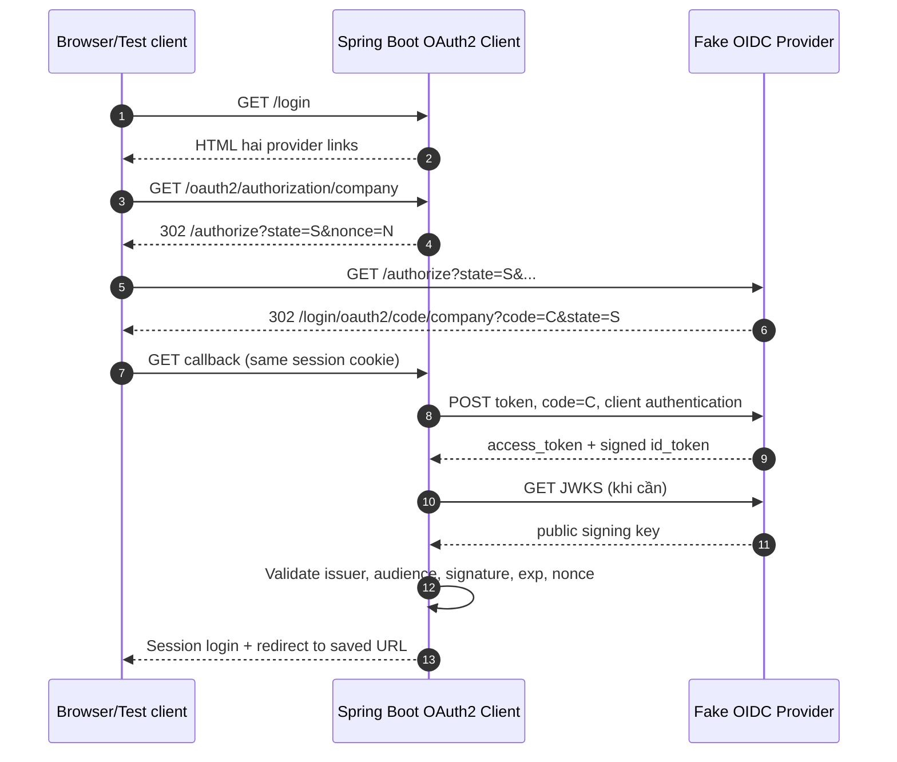

# 34.3. Trang đăng nhập tùy chỉnh với nhiều provider

## 1. Bối cảnh và kết quả cần đạt

Trong một hệ thống Spring Boot, người dùng có thể đăng nhập bằng **Google** để sử dụng tài khoản cá nhân hoặc bằng **Company SSO** để truy cập dịch vụ của tổ chức. Spring Security OAuth 2.0 / OpenID Connect (OIDC) Client hỗ trợ nhiều `ClientRegistration` trên cùng ứng dụng. Tuy nhiên, trang đăng nhập sinh tự động của framework thường chưa đáp ứng yêu cầu về thương hiệu, mô tả quyền riêng tư, thứ tự nhà cung cấp, thông báo lỗi hoặc trải nghiệm người dùng.

Bài thực hành này xây dựng trang **“Chọn cách đăng nhập”** trên Servlet/Spring MVC:

- Hai lựa chọn: `Google` và `Company SSO`.
- Giao diện tùy chỉnh bằng **Thymeleaf**, không tự thu thập mật khẩu của Google/Company.
- Mỗi nút dẫn tới đúng endpoint `/oauth2/authorization/{registrationId}` của Spring Security.
- Spring Security tiếp tục chịu trách nhiệm authorization request, `state`, code exchange, ID Token verification, session và SecurityContext.
- Trang hiển thị lỗi/cancel an toàn và có nút đăng nhập lại.
- Sau login, người dùng trở về URL ban đầu hoặc trang mặc định theo chính sách.
- Có test bằng **MockMvc** để kiểm tra UI, lựa chọn provider, bảo vệ route và principal.
- Có hướng dẫn production về cookies, redirect URIs, reverse proxy, secret management, multi-tenant và identity mapping.

**Điểm quan trọng:** Tùy chỉnh **trang đăng nhập** không có nghĩa tự viết **OAuth2 callback handler**, tự verify ID Token hay tự trao đổi authorization code. Nên giữ các bộ lọc đã được Spring Security cung cấp, chỉ tùy biến các điểm thực sự cần.

> **Phạm vi phiên bản:** Java 17+, Spring Boot 3.x, Spring Security 6.5, Servlet/MVC, Thymeleaf. Đây là bài thực hành cho **OAuth2 Client/OIDC Login**, không phải hướng dẫn chạy Spring Authorization Server. Provider Company được giả định là OIDC Provider có discovery endpoint tương thích; địa chỉ `example.test` chỉ là ví dụ. Cần đăng ký client thật ở từng provider nếu muốn chạy ngoài môi trường test.

### Sơ đồ kết quả cuối

```text
                         TRANG LOGIN TÙY CHỈNH
                     GET https://app.example.test/login
                         +--------------------+
                         |  Chào mừng trở lại |
                         |                    |
                         | [Google]           |
                         | [Company SSO]      |
                         +---------+----------+
                                   |
                   +---------------+---------------+
                   |                               |
               Google click                   Company click
                   |                               |
    /oauth2/authorization/google       /oauth2/authorization/company
                   |                               |
         Google authorization              Company authorization
                   |                               |
                   +---------------+---------------+
                                   |
                     OP trả authorization code
                                   |
              /login/oauth2/code/{registrationId}
                                   |
                     OAuth2LoginAuthenticationFilter
                                   |
                Kiểm tra request state, lấy token, OIDC
                                   |
                          SecurityContext/session
                                   |
                  Trang gốc hoặc /dashboard
```

---

## 2. Vì sao framework có trang login mặc định?

Khi application có cấu hình OAuth2 Login và các client registrations, Spring Security có thể sử dụng `DefaultLoginPageGeneratingFilter` để tạo trang đăng nhập mặc định tại `/login`.

Một trang mặc định thường hiển thị các link:

```html
<a href="/oauth2/authorization/google">Google</a>
<a href="/oauth2/authorization/company">Company</a>
```

Đây không phải URL Authorization Endpoint của Google hoặc Company. Chúng là **URL nội bộ của ứng dụng** để Spring Security **tạo authorization request và 302 redirect** đến provider tương ứng.

Khi gọi:

```java
.oauth2Login(oauth2 -> oauth2.loginPage("/login"))
```

chúng ta yêu cầu Spring Security **không tự xây giao diện này nữa**. Ứng dụng phải định nghĩa controller/view xử lý `GET /login`. Nếu quên, một request chưa authenticated có thể bị chuyển tới `/login` nhưng nhận 404 hoặc vòng lặp redirect.

### So sánh trang mặc định và trang tùy chỉnh

| Thành phần | Trang mặc định | Trang tùy chỉnh |
| --- | --- | --- |
| Nội dung giao diện | Framework tạo | Ứng dụng tự thiết kế |
| Danh sách provider | Từ registrations có thể duyệt được | Từ allowlist hoặc config UI |
| Link khởi động login | `/oauth2/authorization/{id}` | Thường giữ như mặc định |
| Callback authorization code | Spring Security xử lý | **Không cần tự xử lý** |
| `state` / PKCE / OIDC nonce | Spring Security và OP | **Không tự làm ở view** |
| Error UX | Thông báo mặc định | Thông báo cố định/được kiểm soát |
| Return-to-original-page | Success handler | Có thể giữ mặc định hoặc cấu hình |
| Xác thực token | Spring Security | **Không giao cho Thymeleaf** |

Tài liệu Spring Security chỉ ra rằng việc tạo links tự động trên trang mặc định yêu cầu `ClientRegistrationRepository` cũng có thể duyệt `Iterable<ClientRegistration>`. Với trang do ứng dụng tự thiết kế, **không nên tự động lộ mọi registration**, đặc biệt khi một application còn có registrations `client_credentials` dành cho machine-to-machine.

---

## 3. Chuẩn bị bài lab

### 3.1. Điều kiện

- JDK 17+ và Maven hoặc Gradle.
- Một dự án Spring Boot 3.x có Servlet/Spring MVC.
- Hai client registrations hợp lệ ở hai OIDC providers; hoặc một provider test có hai clients.
- Trình duyệt hỗ trợ DevTools để xem redirect/cookies.
- Một đường dẫn ứng dụng test: `http://localhost:8080`.
- Với staging/production, dùng HTTPS và public host thật.

Nếu chưa có tài khoản nhà cung cấp thật, vẫn có thể hoàn thành **phần giao diện + MockMvc tests** với registrations tổng hợp; nhưng kiểm thử login qua authorization code/ID Token thật cần provider/test OP.

### 3.2. Cấu trúc dự án

```text
custom-multi-provider-login/
├── pom.xml
└── src/
    ├── main/
    │   ├── java/example/login/
    │   │   ├── LoginApplication.java
    │   │   ├── SecurityConfiguration.java
    │   │   ├── LoginPageController.java
    │   │   └── DashboardController.java
    │   └── resources/
    │       ├── application.yml
    │       ├── templates/
    │       │   ├── login.html
    │       │   └── dashboard.html
    │       └── static/css/
    │           └── login.css
    └── test/
        └── java/example/login/
            └── MultiProviderLoginTest.java
```

Trong bài, các snippets gắn với **file dự kiến trong dự án ví dụ**. Ở bước soạn tài liệu này, không cần thay đổi source code của repository Java-learning.

### 3.3. Maven dependencies

```xml
<dependencies>
    <dependency>
        <groupId>org.springframework.boot</groupId>
        <artifactId>spring-boot-starter-web</artifactId>
    </dependency>

    <dependency>
        <groupId>org.springframework.boot</groupId>
        <artifactId>spring-boot-starter-security</artifactId>
    </dependency>

    <dependency>
        <groupId>org.springframework.boot</groupId>
        <artifactId>spring-boot-starter-oauth2-client</artifactId>
    </dependency>

    <dependency>
        <groupId>org.springframework.boot</groupId>
        <artifactId>spring-boot-starter-thymeleaf</artifactId>
    </dependency>

    <dependency>
        <groupId>org.springframework.boot</groupId>
        <artifactId>spring-boot-starter-test</artifactId>
        <scope>test</scope>
    </dependency>

    <dependency>
        <groupId>org.springframework.security</groupId>
        <artifactId>spring-security-test</artifactId>
        <scope>test</scope>
    </dependency>
</dependencies>
```

Nếu dùng Spring Boot BOM/parent, phiên bản các thư viện đã được quản lý. Không ghép `spring-security-test` phiên bản khác với core runtime.

### 3.4. Gradle (tham khảo)

```groovy
dependencies {
    implementation 'org.springframework.boot:spring-boot-starter-web'
    implementation 'org.springframework.boot:spring-boot-starter-security'
    implementation 'org.springframework.boot:spring-boot-starter-oauth2-client'
    implementation 'org.springframework.boot:spring-boot-starter-thymeleaf'

    testImplementation 'org.springframework.boot:spring-boot-starter-test'
    testImplementation 'org.springframework.security:spring-security-test'
}

tasks.named('test') {
    useJUnitPlatform()
}
```

Bài dùng **Servlet**. Nếu ứng dụng thực sự dùng WebFlux, `ServerHttpSecurity` và cấu hình login tùy chỉnh khác; phần đối chiếu có ở cuối bài.

---

## 4. Đăng ký ứng dụng ở hai providers

Mỗi provider phải biết ứng dụng của bạn và các Redirect URIs nó cho phép.

### 4.1. Google

Tại Google Cloud OAuth client configuration:
- Tạo OAuth client phù hợp kiểu **Web application**.
- Lấy `client-id` và `client-secret`.
- Cấu hình OAuth consent screen và test users khi đang trong chế độ thử nghiệm.
- Đăng ký **Authorized redirect URI**:

```text
http://localhost:8080/login/oauth2/code/google
```

Khi triển khai trên production:

```text
https://app.example.test/login/oauth2/code/google
```

Cần cấu hình chính xác scheme, host, port (nếu có), context path và path; không thể chỉ thêm wildcard tùy ý nếu provider không hỗ trợ.

### 4.2. Company SSO (OIDC)

Giả sử tổ chức có OIDC issuer:

```text
https://sso.example.test/realms/company
```

Trong quản trị provider:
- Tạo client `company-portal` hoặc tên được tổ chức quy định.
- Bật Authorization Code Flow.
- Cấu hình client authentication tương ứng (ví dụ confidential client secret).
- Cho phép Redirect URI:

```text
http://localhost:8080/login/oauth2/code/company
```

- Cấp các scopes cơ bản `openid`, `profile`, `email` theo policy.
- Xác nhận Discovery Document của issuer hoạt động và chứa endpoints/JWKS.

### 4.3. Ba loại ID thường bị nhầm

| Tên | Ví dụ | Ai dùng? |
| --- | --- | --- |
| **registrationId** | `google`, `company` | Spring Security URL và lookup |
| **clientId** | Giá trị do OP cấp | AS nhận diện OAuth2 client |
| **provider ID** trong YAML | `company-oidc` | Chọn metadata của AS trong Spring Boot |

Ví dụ:
- Button Company liên kết `/oauth2/authorization/company`;
- Spring Security tìm `registration.company`;
- Entry đó có `provider: company-oidc`;
- `company-oidc` có `issuer-uri` của tổ chức.

Không đưa `client-secret` vào Thymeleaf model, HTML, URL, JavaScript hoặc cookie.

---

## 5. Cấu hình application.yml cho nhiều ClientRegistration

```yaml
spring:
  security:
    oauth2:
      client:
        registration:
          google:
            client-id: ${GOOGLE_CLIENT_ID}
            client-secret: ${GOOGLE_CLIENT_SECRET}
            authorization-grant-type: authorization_code
            redirect-uri: "{baseUrl}/login/oauth2/code/{registrationId}"
            scope:
              - openid
              - profile
              - email

          company:
            provider: company-oidc
            client-id: ${COMPANY_CLIENT_ID}
            client-secret: ${COMPANY_CLIENT_SECRET}
            client-authentication-method: client_secret_basic
            authorization-grant-type: authorization_code
            redirect-uri: "{baseUrl}/login/oauth2/code/{registrationId}"
            scope:
              - openid
              - profile
              - email

        provider:
          company-oidc:
            issuer-uri: https://sso.example.test/realms/company

server:
  servlet:
    session:
      timeout: 20m
      cookie:
        http-only: true
        same-site: lax
```

**Giải thích từng phần:**

1. `registration.google` sử dụng metadata provider Google dựng sẵn bởi Spring Boot/Spring Security khi không override provider theo cách khác.
2. `registration.company` chỉ rõ `provider: company-oidc`, vì đây là provider tổ chức tự cấu hình.
3. `issuer-uri` cho phép OIDC Discovery; issuer phải chính xác và nhà cung cấp phải hỗ trợ discovery metadata theo contract.
4. `redirect-uri` mặc định theo pattern `{baseUrl}/login/oauth2/code/{registrationId}`. Có thể khai báo tường minh để người học dễ đối chiếu.
5. Scope `openid` là dấu hiệu yêu cầu OIDC; `profile` và `email` phụ thuộc provider/policy.
6. `server.servlet.session.timeout` là thời gian HTTP session của ứng dụng, không phải thời gian sống của authorization code hoặc OP SSO session.
7. Cookie `SameSite=Lax` thường phù hợp với top-level GET callback trong Authorization Code Flow, nhưng không tự xử lý mọi trường hợp cross-site `form_post`.

Với production HTTPS, bổ sung chính sách `Secure` cho cookie:

```yaml
server:
  servlet:
    session:
      cookie:
        secure: true
        http-only: true
        same-site: lax
```

**Chú ý:** nếu truy cập local qua HTTP mà cookie `Secure` không được browser gửi, login callback có thể mất session. Nên tách profile local/production hoặc phát triển qua HTTPS local; không bỏ `Secure` trong production chỉ để “chữa” một lỗi chưa phân tích.

### 5.1. Giá trị môi trường

Ví dụ khái niệm:

```text
GOOGLE_CLIENT_ID=<test-google-client-id>
GOOGLE_CLIENT_SECRET=<test-google-secret>
COMPANY_CLIENT_ID=<test-company-client-id>
COMPANY_CLIENT_SECRET=<test-company-secret>
```

Không commit giá trị thật. Trong production dùng secret manager/workload identity hoặc kênh cấu hình bí mật được quản lý; bảo đảm logs, exception traces và CI output đã redact.

### 5.2. Scope tối thiểu

Trang login không cần `drive.write`, `calendar.delete` hay các quyền rộng nếu chỉ muốn xác thực danh tính. Nếu cần gọi Google API thay mặt user, thiết kế OAuth2 authorization/consent và authorized client lifecycle ở một bước riêng.

Không tự cho browser gửi query `scope=admin` rồi ghép vào authorization request mà không có policy.

---

## 6. SecurityFilterChain: thay trang login mặc định

Tạo `src/main/java/example/login/SecurityConfiguration.java`:

```java
package example.login;

import org.springframework.context.annotation.Bean;
import org.springframework.context.annotation.Configuration;
import org.springframework.security.config.annotation.web.builders.HttpSecurity;
import org.springframework.security.web.SecurityFilterChain;

@Configuration
public class SecurityConfiguration {

    @Bean
    SecurityFilterChain securityFilterChain(HttpSecurity http)
            throws Exception {

        return http
            .authorizeHttpRequests(auth -> auth
                .requestMatchers(
                    "/",
                    "/login",
                    "/error",
                    "/favicon.ico",
                    "/css/**",
                    "/js/**",
                    "/images/**",
                    "/oauth2/authorization/**",
                    "/login/oauth2/code/**")
                    .permitAll()
                .anyRequest().authenticated()
            )
            .oauth2Login(oauth2 -> oauth2
                .loginPage("/login")
                .failureUrl("/login?error")
            )
            .logout(logout -> logout
                .logoutSuccessUrl("/login?logout")
                .invalidateHttpSession(true)
                .clearAuthentication(true)
            )
            .build();
    }
}
```

### 6.1. Tại sao phải permitAll trang login?

Nếu `GET /login` cũng yêu cầu authenticated, hành vi có thể thành:

```text
GET /dashboard (anonymous)
  -> security redirect /login
GET /login (anonymous)
  -> security redirect /login
GET /login ...
```

Vì vậy trang login, CSS cần cho trang login và error page phải public. Không viết `anyRequest().permitAll()` chỉ để login page render được.

### 6.2. Authorization Request Endpoint phải khác login page

```text
GET /login
    -> Controller + Thymeleaf view

GET /oauth2/authorization/google
    -> OAuth2AuthorizationRequestRedirectFilter

GET /oauth2/authorization/company
    -> OAuth2AuthorizationRequestRedirectFilter
```

Không định nghĩa controller:

```java
@GetMapping("/oauth2/authorization/google")
String fakeLogin() { return "dashboard"; }
```

để bỏ qua provider. Spring Security filter cần được quyền tạo state/PKCE/nonce context và gửi redirect đúng giao thức.

### 6.3. Callback không phải trang Thymeleaf

```text
GET /login/oauth2/code/google?code=...&state=...
GET /login/oauth2/code/company?code=...&state=...
```

được xử lý bởi `OAuth2LoginAuthenticationFilter`, không phải một `@GetMapping` viết bằng tay. Việc `permitAll` đường callback không làm vô hiệu state/PKCE/token validation của filter.

### 6.4. Vì sao dùng failureUrl thay vì hiển thị exception trực tiếp?

`failureUrl("/login?error")` chuyển lỗi xác thực về URL do ứng dụng kiểm soát. Trang login sẽ hiển thị một thông báo cố định.

Không redirect kiểu:

```text
/login?error_description=<raw-exception-message-or-provider-response>
```

vì message có thể chứa dữ liệu nhạy cảm/untrusted và có rủi ro log/XSS nếu render không đúng.

### 6.5. Nếu ứng dụng đã có formLogin()

Ví dụ một ứng dụng hybrid có cả username/password local và OAuth2 Login:
- Cần thiết kế rõ entry point nào đưa người dùng tới `/login`.
- FormLogin processing URL và OAuth2 callback không được xung đột.
- CSRF vẫn cần cho local login form POST.
- Hai cơ chế Authentication có thể dẫn tới principal types khác nhau.

Bài thực hành chủ đích dùng **OAuth2/OIDC only**, nên không thêm `formLogin()`.

---

## 7. LoginPageController: tạo danh sách hai provider đã được duyệt

Có thể hardcode link trong HTML, nhưng một controller giúp:
- Ẩn provider nếu registration chưa được cấu hình;
- Đặt nhãn/description thân thiện;
- Hiển thị thông báo lỗi và logout;
- Dễ mở rộng lựa chọn nhiều providers;
- **Không vô tình hiển thị các registrations client_credentials**.

Ở đây dùng **allowlist cố định** từ code được review. Không lấy raw `registrationId` từ request query làm danh sách provider.

### 7.1. Controller

Tạo `src/main/java/example/login/LoginPageController.java`:

```java
package example.login;

import java.util.List;

import org.springframework.security.oauth2.client.registration.ClientRegistrationRepository;
import org.springframework.stereotype.Controller;
import org.springframework.ui.Model;
import org.springframework.web.bind.annotation.GetMapping;
import org.springframework.web.bind.annotation.RequestParam;

@Controller
public class LoginPageController {

    public record LoginChoice(
        String registrationId,
        String label,
        String description) {}

    private static final List<LoginChoice> APPROVED_CHOICES =
        List.of(
            new LoginChoice(
                "google",
                "Tiếp tục với Google",
                "Sử dụng tài khoản Google của bạn"),
            new LoginChoice(
                "company",
                "Tiếp tục với Company SSO",
                "Dành cho nhân viên có tài khoản tổ chức")
        );

    private final ClientRegistrationRepository registrations;

    public LoginPageController(
            ClientRegistrationRepository registrations) {
        this.registrations = registrations;
    }

    @GetMapping("/login")
    public String loginPage(
            @RequestParam(
                name = "error", required = false) String error,
            @RequestParam(
                name = "logout", required = false) String logout,
            Model model) {

        List<LoginChoice> available = APPROVED_CHOICES.stream()
            .filter(choice -> registrations
                .findByRegistrationId(
                    choice.registrationId()) != null)
            .toList();

        model.addAttribute("providers", available);
        model.addAttribute("loginError", error != null);
        model.addAttribute("loggedOut", logout != null);

        return "login";
    }
}
```

### 7.2. Vì sao không dùng `Iterable<ClientRegistration>` ở ví dụ chính?

Không phải mọi `ClientRegistrationRepository` đều implement `Iterable`. Ngoài ra, nếu có nhiều registrations:
- `google` và `company` dùng để login;
- `reports-machine` với `client_credentials` dùng cho batch job;
- `billing-machine` cũng không nên xuất hiện trên trang người dùng.

Ví dụ kiểm soát chính xác **hai provider được phép hiển thị**. Trong production, có thể chuyển `APPROVED_CHOICES` thành cấu hình UI đã được validate thay vì sửa code để thêm provider.

### 7.3. Controller có thể gặp provider bị vô hiệu hóa

Nếu Company SSO chưa được khai báo, `available` chỉ còn Google. Điều này tránh hiện nút Company dẫn đến registration không tồn tại.

Tuy nhiên, việc **ẩn nút không chặn người dùng gọi trực tiếp**:

```text
GET /oauth2/authorization/company
```

nếu registration vẫn tồn tại. Nếu provider bị chặn theo tenant/organization, cần chính sách **ở request resolution/authentication boundary**, không chỉ ẩn UI.

### 7.4. Tạo trang login ngay cả khi providers rỗng

Nếu danh sách rỗng, view nên hiển thị thông báo:

> Hiện chưa có phương thức đăng nhập khả dụng. Vui lòng liên hệ quản trị viên.

Không nên fallback sang một client ID admin hoặc tự cấp `ROLE_USER` để trang “hoạt động”.

---

## 8. Thiết kế giao diện Thymeleaf có khả năng truy cập

Tạo `src/main/resources/templates/login.html`:

```html
<!DOCTYPE html>
<html lang="vi" xmlns:th="http://www.thymeleaf.org">
<head>
    <meta charset="UTF-8">
    <meta name="viewport" content="width=device-width, initial-scale=1">
    <title>Đăng nhập | Learning Portal</title>
    <link rel="stylesheet" th:href="@{/css/login.css}">
</head>
<body>
<main class="login-shell">
    <section class="login-panel" aria-labelledby="login-title">

        <p class="eyebrow">Learning Portal</p>
        <h1 id="login-title">Chào mừng trở lại</h1>
        <p class="subtitle">
            Chọn nhà cung cấp danh tính để đăng nhập an toàn.
        </p>

        <div
            class="notice notice-error"
            role="alert"
            th:if="${loginError}">
            Phiên đăng nhập không thể hoàn tất.
            Vui lòng chọn nhà cung cấp và thử lại.
        </div>

        <div
            class="notice notice-success"
            role="status"
            th:if="${loggedOut}">
            Bạn đã đăng xuất khỏi ứng dụng.
        </div>

        <nav class="provider-list" aria-label="Phương thức đăng nhập">
            <a
                class="provider-link"
                th:each="provider : ${providers}"
                th:href="@{/oauth2/authorization/{id}(id=${provider.registrationId})}">

                <span class="provider-title"
                      th:text="${provider.label}">
                    Tên nhà cung cấp
                </span>

                <span class="provider-description"
                      th:text="${provider.description}">
                    Mô tả
                </span>
            </a>
        </nav>

        <p class="notice"
           th:if="${#lists.isEmpty(providers)}">
            Hiện chưa có phương thức đăng nhập khả dụng.
            Vui lòng liên hệ quản trị viên.
        </p>

        <p class="privacy-note">
            Bạn sẽ được chuyển đến trang đăng nhập của nhà cung cấp
            đã chọn. Ứng dụng không yêu cầu bạn nhập mật khẩu
            của nhà cung cấp tại trang này.
        </p>

    </section>
</main>
</body>
</html>
```

### 8.1. Vì sao nút nên là `<a>`?

Với Authorization Code Flow, liên kết này tạo **top-level browser navigation** tới URL nội bộ. Spring Security trả 302 đến OP.

Link `<a href>` có:
- Hành vi bàn phím/navigational semantics chuẩn;
- Có thể mở trong tab mới, nhưng cần kiểm thử multi-tab session behavior;
- Không cần JavaScript hoặc gửi password;
- Không phải form POST nên không đòi CSRF token cho bước start authorization request.

Nếu dùng `<button>` và `onclick` điều hướng, cần thêm accessibility/JS fallback; không có lợi ích bảo mật rõ rệt so với link đúng.

### 8.2. Vì sao `th:href` thay vì ghép chuỗi HTML bằng Java?

```html
th:href="@{/oauth2/authorization/{id}(id=${provider.registrationId})}"
```

Thymeleaf URL expression xử lý context path/URL encoding thay vì để application tự nối raw path. Dù vậy, **giá trị `registrationId` vẫn phải đến từ allowlist tin cậy**; escaping không thay thế authorization.

### 8.3. Vì sao `th:text`?

`th:text` sẽ escape text theo cơ chế template engine. Không dùng `th:utext` cho tên provider, error description hoặc một chuỗi user có thể sửa để tránh HTML injection/XSS.

### 8.4. Không để secret/tokens trong HTML

Không render:

```html
<input type="hidden" name="client_secret" value="...">
<script>const idToken = "eyJ...";</script>
```

Client secret phải nằm server-side. ID Token và access token không cần được trả tới browser chỉ để trang đăng nhập hoạt động.

---

## 9. CSS tối giản, responsive và có focus state

Tạo `src/main/resources/static/css/login.css`:

```css
:root {
    color-scheme: light;
    font-family: system-ui, -apple-system, BlinkMacSystemFont,
                 "Segoe UI", sans-serif;
    color: #172033;
    background: #f4f6fa;
}

* { box-sizing: border-box; }

body {
    margin: 0;
    min-height: 100vh;
}

.login-shell {
    min-height: 100vh;
    display: grid;
    place-items: center;
    padding: 1.5rem;
}

.login-panel {
    width: min(100%, 31rem);
    background: white;
    border: 1px solid #dfe4ef;
    border-radius: 1rem;
    box-shadow: 0 1rem 3rem rgb(26 38 66 / 10%);
    padding: clamp(1.5rem, 5vw, 2.5rem);
}

.eyebrow {
    font-size: 0.8rem;
    text-transform: uppercase;
    letter-spacing: 0.1em;
    color: #4a5680;
}

h1 {
    font-size: clamp(1.6rem, 5vw, 2.1rem);
    line-height: 1.2;
    margin: 0.5rem 0;
}

.subtitle,
.provider-description,
.privacy-note {
    color: #526078;
}

.provider-list {
    display: grid;
    gap: 0.75rem;
    margin-top: 1.75rem;
}

.provider-link {
    border: 1px solid #c7d3ea;
    border-radius: 0.75rem;
    padding: 1rem;
    text-decoration: none;
    color: inherit;
    display: grid;
    gap: 0.3rem;
    background: #fff;
}

.provider-link:hover { background: #f7f9ff; }

.provider-link:focus-visible {
    outline: 3px solid #3053c6;
    outline-offset: 3px;
}

.provider-title {
    font-weight: 650;
}

.provider-description {
    font-size: 0.875rem;
}

.notice {
    border-radius: 0.5rem;
    padding: 0.75rem 1rem;
    margin: 1rem 0;
}

.notice-error {
    background: #fff4f4;
    color: #8b2020;
}

.notice-success {
    background: #ecf9f1;
    color: #1d6637;
}

.privacy-note {
    font-size: 0.85rem;
    line-height: 1.5;
    margin-top: 1.75rem;
}

@media (prefers-reduced-motion: reduce) {
    *, *::before, *::after {
        scroll-behavior: auto !important;
        animation: none !important;
        transition: none !important;
    }
}
```

Đây là UI ví dụ không phụ thuộc CDN, logo hay JavaScript bên ngoài. Nếu dùng logo Google hoặc Company SSO thật, nên tuân thủ brand guidelines và tải assets từ nguồn được quản lý. Việc chèn icon/logo từ host thứ ba vào login page có thể làm lộ metadata truy cập.

### 9.1. Accessibility không chỉ là màu sắc

Một trang login tốt cần:
- Đủ tương phản;
- Có `<h1>` duy nhất và mô tả rõ;
- Tab bằng bàn phím được tới mọi provider;
- `:focus-visible` rõ ràng;
- Error dùng `role="alert"`;
- Không phân biệt provider chỉ bằng màu hoặc icon;
- Thông báo lỗi nói được hành động tiếp theo;
- Không tạo tự động redirect liên tục khi đăng nhập thất bại.

---

## 10. Cách trang login được render

Khi user truy cập:

```http
GET /login HTTP/1.1
Host: localhost:8080
```

Flow:

```text
Spring MVC
    -> LoginPageController.loginPage(error, logout, model)
    -> ClientRegistrationRepository
    -> providers = [google, company] nếu đã đăng ký
    -> model["loginError"] = error != null
    -> model["loggedOut"] = logout != null
    -> view name = "login"
    -> Thymeleaf templates/login.html
    -> HTML có đúng hai links
```

Controller **không đọc access token, ID Token hoặc client secret** để render page. Việc đọc registrations nhằm xác nhận link nào khả dụng, không xác thực user.

### 10.1. Nếu provider list hiển thị trống

Kiểm tra:
- Properties có prefix `spring.security.oauth2.client.registration` chính xác không;
- Có đăng ký client ID/secret ở đúng profile không;
- `registrationId` trong `APPROVED_CHOICES` khớp cấu hình không;
- Provider discovery có thất bại khi startup không;
- Có custom `ClientRegistrationRepository` ghi đè Boot auto-config hay không.

Đừng “sửa” bằng cách cho browser tự cung cấp client ID/secret để tạo registration runtime.

---

## 11. Bước click Google: authorization request diễn ra thế nào?

Khi người dùng click “Tiếp tục với Google”:

```text
GET /oauth2/authorization/google
```

Spring Security dùng `OAuth2AuthorizationRequestRedirectFilter` và một `OAuth2AuthorizationRequestResolver` để chọn registration và tạo Authorization Request.

Ví dụ URL redirect tới OP (đã rút gọn):

```text
https://accounts.google.com/o/oauth2/v2/auth
    ?response_type=code
    &client_id=GOOGLE_CLIENT_ID
    &scope=openid%20profile%20email
    &redirect_uri=http%3A%2F%2Flocalhost%3A8080%2Flogin%2Foauth2%2Fcode%2Fgoogle
    &state=OPAQUE_RANDOM_STATE
```

Đây là **sơ đồ minh họa**, thứ tự tham số và các tham số bổ sung (PKCE, nonce, prompt) phụ thuộc config và provider.

### 11.1. Bước click Company

```text
GET /oauth2/authorization/company
```

Framework chọn registration `company`, dùng metadata authorization endpoint của Company issuer và tạo request với **state mới riêng**.

Không dùng URL Google rồi thay `client_id` bằng Company client ID. Mỗi provider có issuer, endpoint, credentials, JWKS và policy riêng.

### 11.2. Redirect không cần frontend tự tạo state

Không làm:

```javascript
const state = "fixed-state";
window.location.href =
    "https://provider.example/authorize?...&state=" + state;
```

Nếu frontend tự build authorization URI, bạn phải giải quyết nhiều vấn đề state/session correlation, PKCE verifier, nonce, redirect URI, issuer mix-up và authorized-client persistence. Trong bài này, **để Spring Security tạo Authorization Request** là cách đúng.

### 11.3. Vai trò của browser

Browser thực hiện navigation qua RP và OP, giữ cookies theo policy. Browser **không được sở hữu client secret**. Code exchange từ backend đến token endpoint sử dụng confidential client authentication khi cấu hình.

---

## 12. Callback: cùng ứng dụng nhưng khác registrationId

Sau khi login ở Google, browser được chuyển về:

```text
GET /login/oauth2/code/google?code=...&state=...
```

Sau khi login ở Company:

```text
GET /login/oauth2/code/company?code=...&state=...
```

Spring Security:
1. Khôi phục authorization request đã lưu và đối chiếu correlation context.
2. Xác định đúng client registration;
3. Dùng authorization code gọi token endpoint **của provider tương ứng**;
4. Kiểm tra token response;
5. Với OIDC, xác minh ID Token (signature, issuer, audience, expiry, nonce theo flow/config);
6. Xử lý UserInfo nếu phù hợp;
7. Tạo `OAuth2AuthenticationToken` và `OidcUser`;
8. Lưu SecurityContext/session theo policy;
9. Chuyển user tới destination sau login.

**Không tạo controller `@GetMapping("/login/oauth2/code/{registrationId}")`** để lấy code về tự đổi token nếu không có yêu cầu/thiết kế đặc biệt đã security review.

### 12.1. OIDC `sub` không phải email

Với OIDC, `sub` chỉ có ý nghĩa trong phạm vi issuer. Hai providers có thể trả cùng `sub` hoặc `email` nhưng đó chưa chắc là một identity.

Identity key tối thiểu:

```text
(issuer, subject)
```

Không tự liên kết accounts chỉ vì email giống nhau hoặc display name giống nhau. Nếu sản phẩm cần account linking, thiết kế explicit verification/policy flow riêng.

### 12.2. UserInfo và claims khác nhau giữa providers

Google và Company có thể trả:
- `preferred_username` chỉ ở Company;
- `email` đôi khi không được cấp nếu scope/consent bị giới hạn;
- `groups` theo provider-specific mapper;
- Display name ở ID Token hoặc UserInfo;
- Không có group claim nếu OP không trả.

Controller không nên giả định mọi `OidcUser` có `email`, `name` hoặc `groups`.

---

## 13. Dashboard: hiển thị người dùng đăng nhập bằng provider nào

Tạo `src/main/java/example/login/DashboardController.java`:

```java
package example.login;

import org.springframework.security.core.Authentication;
import org.springframework.security.oauth2.client.authentication.OAuth2AuthenticationToken;
import org.springframework.security.oauth2.core.oidc.user.OidcUser;
import org.springframework.stereotype.Controller;
import org.springframework.ui.Model;
import org.springframework.web.bind.annotation.GetMapping;

@Controller
public class DashboardController {

    @GetMapping("/")
    public String home() {
        return "redirect:/dashboard";
    }

    @GetMapping("/dashboard")
    public String dashboard(
            Authentication authentication,
            Model model) {

        if (!(authentication instanceof OAuth2AuthenticationToken oauth2)) {
            // Đối với bài chỉ có OIDC login, đây là trạng thái
            // không mong muốn; không tự giả một OidcUser.
            throw new IllegalStateException(
                "OAuth2 Login authentication required");
        }

        String registrationId =
            oauth2.getAuthorizedClientRegistrationId();

        String displayName = authentication.getName();
        String subject = null;

        if (oauth2.getPrincipal() instanceof OidcUser oidcUser) {
            subject = oidcUser.getIdToken().getSubject();
            String preferred =
                oidcUser.getPreferredUsername();

            if (preferred != null && !preferred.isBlank()) {
                displayName = preferred;
            }
        }

        model.addAttribute("displayName", displayName);
        model.addAttribute("registrationId", registrationId);
        model.addAttribute("subject", subject);
        return "dashboard";
    }
}
```

### 13.1. Điều gì được hiển thị?

- `displayName`: tên hiển thị, có fallback.
- `registrationId`: `google` hoặc `company`; có thể map sang nhãn đẹp ở view.
- `subject`: OIDC subject nếu có; trong sản phẩm thật chỉ xuất khi có nhu cầu hợp lệ.

**Không hiển thị access token, refresh token, ID Token raw hay client secret** trong dashboard hoặc debug UI.

### 13.2. Vì sao check instanceof OidcUser?

`OAuth2AuthenticationToken` có thể dùng cho OAuth2 Login không phải OIDC (ví dụ một số provider social OAuth2). Nếu sau này thêm provider generic OAuth2, principal có thể là `OAuth2User` không có `getIdToken()`.

Đoạn code dùng `instanceof` để không cast bừa.

### 13.3. Trang dashboard.html

```html
<!DOCTYPE html>
<html lang="vi" xmlns:th="http://www.thymeleaf.org">
<head>
    <meta charset="UTF-8">
    <meta name="viewport" content="width=device-width, initial-scale=1">
    <title>Dashboard | Learning Portal</title>
    <link rel="stylesheet" th:href="@{/css/login.css}">
</head>
<body>
<main class="login-shell">
    <section class="login-panel">
        <h1>Đăng nhập thành công</h1>
        <p>
            Xin chào
            <strong th:text="${displayName}">Người dùng</strong>.
        </p>
        <p>
            Nhà cung cấp:
            <strong th:text="${registrationId}">company</strong>
        </p>
        <p th:if="${subject != null}">
            OIDC subject:
            <code th:text="${subject}">sub</code>
        </p>

        <form method="post" th:action="@{/logout}">
            <button type="submit">Đăng xuất khỏi ứng dụng</button>
        </form>
    </section>
</main>
</body>
</html>
```

Với Spring MVC + Thymeleaf/Spring Security integration, `th:action` thường hỗ trợ CSRF hidden field thông qua `RequestDataValueProcessor`. Nếu app dùng template/rendering khác, phải cung cấp CSRF token hợp lệ cho `POST /logout` thay vì tắt CSRF toàn cục.

---

## 14. Đăng xuất khỏi ứng dụng khác với Single Logout của OP

Trong cấu hình mẫu:

```java
.logout(logout -> logout
    .logoutSuccessUrl("/login?logout")
    .invalidateHttpSession(true)
    .clearAuthentication(true))
```

đây là logout **ở ứng dụng (RP)**:
- Xóa/kết thúc local authentication session theo cấu hình;
- Đưa user về trang `/login?logout`;
- **Không đảm bảo** Google hoặc Company OP SSO session cũng bị đóng;
- **Không tự revoke** access/refresh tokens hoặc toàn bộ authorization grants.

### 14.1. Người dùng click lại Company sau logout

Nếu Company OP SSO cookie còn hợp lệ, user có thể được đăng nhập lại rất nhanh mà không gõ mật khẩu. Đó có thể là hành vi SSO đúng, không phải bug của trang login.

### 14.2. Nếu sản phẩm cần OIDC RP-Initiated Logout

Spring Security có thể tích hợp `OidcClientInitiatedLogoutSuccessHandler` khi OP cung cấp `end_session_endpoint` tương thích. Nhưng:
- Không phải mọi provider cùng hỗ trợ;
- Phải cấu hình post-logout redirect URI được phép;
- Cần cân nhắc nhiều providers/issuer;
- Phải tách account unlink/revoke consent với logout browser;
- Không nên tự dựng URL logout OP từ raw user input.

Bài này cố ý dùng **local logout** để tránh tạo giả định rằng một handler logout giống nhau hoạt động cho cả Google và Company.

---

## 15. Hành vi sau login: quay lại URL ban đầu

Một người dùng mở trực tiếp:

```text
GET /reports/2026
```

trước khi login. Security filter có thể lưu request gốc và redirect tới `/login`. Sau khi xác thực thành công, success handler mặc định của Spring Security (SavedRequest-aware theo cấu hình) thường đưa người dùng về destination đã lưu.

```text
Anonymous GET /reports/2026
       |
       v
SavedRequest stored
       |
       v
/login -> Company
       |
       v
OIDC login success
       |
       v
GET /reports/2026
```

### 15.1. Vì sao không mặc định luôn chuyển về /dashboard?

Cấu hình:

```java
.oauth2Login(oauth2 -> oauth2
    .defaultSuccessUrl("/dashboard", true))
```

với tham số `alwaysUse=true` thường buộc chuyển về dashboard ngay cả khi có saved request. Điều này có thể phá UX deep link.

Nếu muốn dashboard là default **nhưng vẫn giữ saved request**, dùng:

```java
.oauth2Login(oauth2 -> oauth2
    .loginPage("/login")
    .defaultSuccessUrl("/dashboard", false))
```

Hoặc giữ mặc định và sử dụng home route `/` redirect tới `/dashboard`.

**Không đặt target URL từ query string tùy ý** như:

```text
/login?returnTo=https://evil.example.test
```

rồi truyền nguyên giá trị vào `setDefaultTargetUrl` hoặc header Location. Đó là **open redirect** và có thể bị lạm dụng trong login flow.

### 15.2. Chọn trang đích theo provider

Đôi khi Company user cần trang nội bộ, Google user cần onboarding. Có thể dùng `AuthenticationSuccessHandler` nhưng phải:
- Xác định provider bằng `OAuth2AuthenticationToken.getAuthorizedClientRegistrationId()` đã được xác thực, không phải raw query;
- Tôn trọng saved request nếu business contract yêu cầu;
- Kiểm tra roles/tenant policy thật;
- Chỉ redirect tới relative internal URLs đã allowlist;
- Không leak tokens qua URL query.

---

## 16. Lỗi đăng nhập: hiển thị đúng mà không tiết lộ chi tiết

Một callback có thể thất bại do:
- User từ chối consent;
- HttpSession hết hạn trong khi user hoàn thành MFA;
- State mismatch/multi-tab;
- Token endpoint trả `invalid_client`;
- Provider tạm thời không hoạt động;
- ID Token signature/issuer/audience/nonce invalid;
- User chưa được tổ chức cấp quyền truy cập.

Trang login chỉ cần thông báo an toàn:

> Không thể hoàn tất đăng nhập. Vui lòng thử lại hoặc chọn phương thức khác.

Trong mã mẫu, `/login?error` bật cờ `loginError`; controller **không đưa raw exception/error_description vào view**.

### 16.1. Phân biệt lỗi tại đâu

| Triệu chứng | Giai đoạn | Kiểm tra trước |
| --- | --- | --- |
| Click Google nhưng 404 | Start authorization | URL, registration ID, filter chain |
| Click Company nhưng bị chuyển lại login liên tục | Login page/entrypoint | Permit rules, controller mapping |
| OP báo `redirect_uri_mismatch` | Authorization request | URI đã đăng ký tại OP, public baseUrl |
| OP login xong về `/login?error` | RP callback/filter | Session, state, token response, ID Token |
| `authorization_request_not_found` | Callback correlation | Cookie/session, state, multi-tab, cluster |
| `invalid_state_parameter` | Callback correlation | State và authorization request, custom repository |
| `invalid_grant` | Token endpoint | Expired/reused code, PKCE/redirect/client binding |
| `invalid_client` | Token endpoint | Client ID/secret, auth method |
| ID Token issuer/audience invalid | OIDC validation | Issuer, client registration, JWKS |
| Browser 403 ở callback POST | CSRF/response_mode | Filter matcher, SameSite, cookie, method |
| Mất session trên staging | Cookie/proxy | HTTPS, forwarded headers, session store |
| Google thành công nhưng Company fail | Provider-specific | Discovery, scopes, redirect, client policy |
| Login thành công nhưng bị 403 trang quản trị | Application authorization | Authorities, groups mapping, tenant policy |

### 16.2. Không auto-retry lỗi correlation vô hạn

Nếu session cookie không quay lại vì domain/proxy sai, automatic redirect:

```text
/login?error -> /oauth2/authorization/company
             -> OP -> callback error -> /login?error -> ...
```

gây vòng lặp. Dừng ở trang lỗi và cho user **chủ động chọn lại provider**.

### 16.3. Lỗi `authorization_request_not_found` không chỉ do session trống

Với repository mặc định, callback `state` khác request đã lưu có thể khiến `loadAuthorizationRequest` trả `null`. Login filter khi đó có thể báo `authorization_request_not_found` ngay cả khi HttpSession vẫn chứa một request có state khác.

Không “sửa” bằng cách bỏ state matching.

---

## 17. State, PKCE và OIDC nonce vẫn phải được bảo vệ

Tùy chỉnh UI **không được** làm yếu OAuth2/OIDC protocol.

### 17.1. State

`state` liên hệ authorization response về đúng request/browser context đã khởi động login và giúp chống login CSRF/response injection.

Nên để Spring Security:
- Sinh state khó đoán;
- Lưu authorization request trong repository (thường HttpSession);
- So sánh callback state;
- Loại bỏ pending request sau khi xử lý;
- Từ chối request thiếu/mismatch correlation.

### 17.2. PKCE

**Proof Key for Code Exchange (RFC 7636)** bảo vệ authorization code khi bị chặn/cướp trong front-channel.

Một authorization request có thể thêm:

```text
code_challenge=<S256-challenge>
code_challenge_method=S256
```

Sau callback, token request gửi `code_verifier` tương ứng (được lưu trong authorization request context phía client).

Spring Security hỗ trợ PKCE và thường tự bật cho **public clients** với `client-authentication-method=none`. Với confidential clients, việc yêu cầu PKCE có thể được cấu hình bổ sung theo capability của AS/policy.

**Bật PKCE không thay state validation.** Không tự gửi `code_verifier` sang browser hoặc ghi vào logs.

### 17.3. Tùy chọn áp dụng PKCE cho confidential clients

Khi chính sách yêu cầu, có thể dùng resolver:

```java
import org.springframework.security.oauth2.client.registration.ClientRegistrationRepository;
import org.springframework.security.oauth2.client.web.DefaultOAuth2AuthorizationRequestResolver;
import org.springframework.security.oauth2.client.web.OAuth2AuthorizationRequestCustomizers;
import org.springframework.security.oauth2.client.web.OAuth2AuthorizationRequestResolver;

@Bean
OAuth2AuthorizationRequestResolver authorizationRequestResolver(
        ClientRegistrationRepository registrations) {

    DefaultOAuth2AuthorizationRequestResolver resolver =
        new DefaultOAuth2AuthorizationRequestResolver(
            registrations, "/oauth2/authorization");

    resolver.setAuthorizationRequestCustomizer(
        OAuth2AuthorizationRequestCustomizers.withPkce());

    return resolver;
}
```

Rồi gắn vào DSL:

```java
.oauth2Login(oauth2 -> oauth2
    .loginPage("/login")
    .authorizationEndpoint(endpoint -> endpoint
        .authorizationRequestResolver(authorizationRequestResolver)))
```

Đây là **minh họa tùy chọn**, không phải phần bắt buộc cho mọi bài lab. Cần bảo đảm resolver/customizer hỗ trợ các provider đang dùng, không thay base URI mà quên cập nhật login links.

### 17.4. OIDC nonce

Trong OIDC Authorization Code Flow, nonce có thể được dùng để ràng buộc ID Token với authentication request. Spring Security xử lý OIDC identity validation ở tầng thích hợp.

Không cố tạo ID Token “hợp lệ” bằng cách thêm `nonce` từ query của browser hoặc bỏ kiểm tra issuer/signature để một provider hoạt động.

---

## 18. Cookie và HttpSession: điều kiện để callback thành công

Mặc định, Spring Security Servlet lưu `OAuth2AuthorizationRequest` đang chờ trong `HttpSession` thông qua repository tương ứng.

```text
GET /oauth2/authorization/company
    |
    v
Create authorization request state=S1
Store in HttpSession SESSION-A
    |
    v
302 to OP
    |
    v
OP login/MFA
    |
    v
GET /login/oauth2/code/company?code=C1&state=S1
Cookie: JSESSIONID=<SESSION-A>
    |
    v
Load matching authorization request S1
```

Nếu callback không có session tương ứng, framework không tìm được authorization request để đối chiếu state.

### 18.1. Những lỗi cookie thường gặp

- `Domain` khác callback host;
- Cookie `Path` không bao phủ callback;
- `Secure` cookie trên public HTTP;
- Cross-site POST callback và `SameSite=Lax`;
- Browser/webview chặn cookie;
- Session TTL ngắn hơn MFA/consent;
- App restart hoặc chuyển node làm mất in-memory session;
- Session bị logout/invalidate trước callback.

### 18.2. SameSite=Lax cho top-level GET

Phần lớn browser Authorization Code callback dùng **top-level GET navigation**, cho phép Lax cookies theo browser rules hiện đại. Nếu OP yêu cầu `response_mode=form_post`, cookie behavior khác và CSRF filter cũng có thể chặn POST.

Không đặt toàn bộ cookie `SameSite=None` hoặc tắt CSRF toàn app chỉ vì một callback lỗi. Phải hiểu response mode và threat model trước.

### 18.3. Chạy nhiều replicas

```text
Node A: stores authorization request in local session
Node B: receives OAuth2 callback
Node B: cannot find A's session data
```

Nếu deployment multi-node, cân nhắc sticky sessions hoặc **Spring Session** với distributed store được bảo vệ, và test load balancing/failover. Sticky sessions không bảo vệ khi node chết; distributed session cũng không tự sửa race multi-tab.

---

## 19. Vấn đề nhiều tab và nhiều provider

Một user có thể:
1. Mở trang login ở tab A, click Google, được state `S1`.
2. Mở tab B, click Company, được state `S2`.
3. Hoàn tất login ở tab A.

Với một số implementation mặc định của `HttpSessionOAuth2AuthorizationRequestRepository`, session có thể chỉ giữ **một pending authorization request**; request của tab B ghi đè tab A và callback tab A thất bại.

```text
Tab A: Google -> state=S1
  session pending request = S1

Tab B: Company -> state=S2
  session pending request = S2

Tab A callback state=S1
  repository cannot find matching request
  -> authorization_request_not_found
```

### 19.1. Cách xử lý ở bài lab

- Không mở đồng thời hai login flows trong cùng browser khi kiểm thử happy path.
- Nếu gặp lỗi, quay về trang login và bắt đầu **flow mới**.
- Không sửa bằng cách tắt state validation.
- Chỉ xây custom multi-state `AuthorizationRequestRepository` nếu sản phẩm yêu cầu, với map theo session+state, TTL, one-time removal, concurrency và security review.

### 19.2. Không tự sửa đăng nhập bằng code C1 cũ

Authorization code chỉ dùng một lần và có hạn ngắn. Khi callback thất bại vì pending request mất, phải tạo request/code mới thay vì replay C1.

### 19.3. UX gợi ý

Nếu người dùng click một provider khác khi login flow đã chạy ở tab khác, có thể hiển thị hướng dẫn “Đã có một lần đăng nhập đang thực hiện” trong cùng tab. Tuy nhiên frontend không được dựa trên `localStorage` để khẳng định user đã authenticated.

---

## 20. Tùy chỉnh đường khởi tạo authorization request

Mặc định:

```text
/oauth2/authorization/{registrationId}
```

Nếu muốn thay bằng:

```text
/sso/start/{registrationId}
```

cấu hình:

```java
.oauth2Login(oauth2 -> oauth2
    .loginPage("/login")
    .authorizationEndpoint(authorization ->
        authorization.baseUri("/sso/start")))
```

Và cập nhật link Thymeleaf:

```html
<a th:href="@{/sso/start/{id}(id=${provider.registrationId})}">
    Tiếp tục đăng nhập
</a>
```

**Không chỉ đổi link trong HTML mà quên cấu hình authorization endpoint matcher.** Lúc đó `/sso/start/company` có thể là 404 hoặc bị chặn.

### 20.1. Base URI khởi tạo khác callback URI

| Mục đích | Mặc định | Khi muốn thay |
| --- | --- | --- |
| Login page | `/login` | `oauth2Login().loginPage(...)` |
| Authorization start | `/oauth2/authorization/{id}` | `authorizationEndpoint().baseUri(...)` |
| OAuth2 callback | `/login/oauth2/code/{id}` | `redirectionEndpoint().baseUri(...)` + redirect-uri |
| Logout | `POST /logout` | `logout()` |
| After success | Saved request/default target | `defaultSuccessUrl` hoặc success handler |

Ba URL đầu **không cùng một chức năng**. Không đổi tất cả sang `/login` vì “dễ nhớ”.

---

## 21. Nếu muốn đổi callback path

Ví dụ muốn callback là:

```text
https://app.example.test/sso/callback/google
https://app.example.test/sso/callback/company
```

Cần đồng bộ **ba nơi**.

### 21.1. Security config

```java
.oauth2Login(oauth2 -> oauth2
    .loginPage("/login")
    .redirectionEndpoint(redirection ->
        redirection.baseUri("/sso/callback/*")))
```

### 21.2. Registration redirect-uri

```yaml
spring:
  security:
    oauth2:
      client:
        registration:
          google:
            redirect-uri: "{baseUrl}/sso/callback/{registrationId}"
          company:
            redirect-uri: "{baseUrl}/sso/callback/{registrationId}"
```

Đây là **phần override liên quan redirect URI**, không thay thế toàn bộ cấu hình registration ở mục 5. Không bỏ client ID/secret/scope khi áp dụng.

### 21.3. Provider admin console

Thêm chính xác:

```text
https://app.example.test/sso/callback/google
https://app.example.test/sso/callback/company
```

**Chú ý kỹ thuật:** matcher `"/sso/callback/*"` trên filter và template `"{baseUrl}/sso/callback/{registrationId}"` ở client registration là hai cách biểu diễn khác nhau: một cái là **filter URL pattern**, cái kia là **redirect URI template**.

Nếu chỉ đổi Thymeleaf page URL hoặc chỉ đổi provider console, login sẽ lỗi redirect mismatch/filter không bắt callback.

---

## 22. Reverse proxy và public origin

Môi trường staging/production thường có topology:

```text
Browser
  https://app.example.test
       |
       v
Ingress / Reverse Proxy (TLS termination)
       |
       v
Spring Boot
  http://portal-service:8080
```

Nếu app tính `{baseUrl}` sai thành internal HTTP host, nó có thể gửi:

```text
redirect_uri=http://portal-service:8080/login/oauth2/code/company
```

Provider sẽ từ chối hoặc callback tới host không áp dụng session cookie.

### 22.1. Forwarded headers

Khi đứng sau proxy **đáng tin**:

```yaml
server:
  forward-headers-strategy: framework
```

Spring có thể sử dụng thông tin forwarded scheme/host từ proxy. Nhưng ingress phải **loại bỏ hoặc ghi đè forwarded headers do external client tự đưa vào**, nếu không attacker có thể ảnh hưởng URL generation.

### 22.2. Checklist cấu hình deploy

- Public scheme là HTTPS;
- Public host đúng với cookie domain;
- Redirect URIs khớp provider console;
- Context path (nếu có) nhất quán;
- Cookie `Secure` và `SameSite` phù hợp;
- Ingress forwarded headers được tin cậy và lọc;
- CSRF/session store hoạt động trên mọi replicas;
- Không log callback query chứa `code`/`state`;
- Không expose internal token endpoint hoặc client secret.

### 22.3. Không dùng Wildcard Redirect URI bừa bãi

Không đăng ký redirect patterns quá rộng như:

```text
https://*.example.test/*
```

nếu provider/security policy không cho phép. Redirect URI phải giới hạn theo hostname/path thực tế để giảm authorization code interception/routing confusion.

---

## 23. Tùy chỉnh provider list bằng Iterable<ClientRegistration>

Trong dự án cần nhiều providers hơn, có thể lấy danh sách từ `ClientRegistrationRepository` nếu implementation hỗ trợ duyệt.

Ví dụ khái niệm:

```java
ClientRegistrationRepository repository = ...;

if (repository instanceof Iterable<?> registrations) {
    for (Object item : registrations) {
        if (item instanceof ClientRegistration registration) {
            // Filter theo grant, allowlist và business policy.
        }
    }
}
```

Với Spring Boot mặc định, `InMemoryClientRegistrationRepository` có thể implement `Iterable<ClientRegistration>`. Tuy nhiên, **đừng tự hiển thị mọi entry**.

### 23.1. Lọc grant và allowlist

```java
import java.util.Set;
import org.springframework.security.oauth2.core.AuthorizationGrantType;

private static final Set<String> LOGIN_ALLOWED =
    Set.of("google", "company");

private static boolean isApprovedLoginRegistration(
        ClientRegistration registration) {

    return LOGIN_ALLOWED.contains(registration.getRegistrationId())
        && AuthorizationGrantType.AUTHORIZATION_CODE.equals(
            registration.getAuthorizationGrantType());
}
```

Filter này kiểm tra:
- Registration ID có trong allowlist;
- Grant `authorization_code`, không phải `client_credentials`.

Nếu ứng dụng chỉ chấp nhận OIDC, có thể kiểm tra registration scope có `openid`; tuy vậy vẫn cần server-side authentication policy vì registration metadata có thể bị cấu hình sai.

### 23.2. Nhãn từ provider không phải HTML đã tin cậy

`ClientRegistration.getClientName()` có thể từ config/admin. Khi render, dùng `th:text` chứ không đưa nguyên HTML vào `th:utext`.

### 23.3. UI provider order

Nên định nghĩa thứ tự theo UX/policy, ví dụ:
1. Company SSO;
2. Google.

Nếu dùng HashMap/Set không có thứ tự, các nút có thể đổi vị trí ngẫu nhiên giữa builds. Trong bài này `APPROVED_CHOICES` là `List` nên thứ tự rõ ràng.

---

## 24. Provider có điều kiện theo tenant hoặc email domain

Một số sản phẩm muốn:
- Nhân viên đăng nhập Company SSO;
- Khách mời đăng nhập Google;
- Tenant A chỉ được chọn Company;
- Tenant B được chọn một OP khác.

### 24.1. UI không phải security boundary

Giả sử trang login của Tenant A chỉ render Company. Nhưng nếu registration Google vẫn tồn tại và route khởi tạo còn public, user vẫn có thể gọi:

```text
GET /oauth2/authorization/google
```

Do đó, ẩn link **không đồng nghĩa cấm provider**.

Nếu policy có giới hạn per tenant, cần:
- Tenant context từ host/route đã được xác minh;
- Authorization request resolver/entrypoint kiểm tra registration cho tenant;
- Callback correlation đúng với tenant và issuer đã chọn;
- Account provisioning/role mapping sau login;
- Authorization logic kiểm tra tenant resource;
- Negative integration tests chứng minh route direct bị từ chối.

### 24.2. Không tự chọn provider chỉ dựa email nhập vào

Một UX “Nhập email để tìm công ty” có thể hợp lý nhưng dễ thành:
- User enumeration (trả lời email nào tồn tại);
- Open redirect nếu domain gắn với URL do user cung cấp;
- Sai tenant policy;
- Lộ email tới bên thứ ba trước consent.

Nếu xây home-realm discovery, nên dùng domain-to-provider allowlist được quản lý và phản hồi không tiết lộ thông tin account nhạy cảm. Đây là tính năng bổ sung, không phải phần bắt buộc của bài.

### 24.3. Same email không đồng nghĩa same account

Không tự link Google account và Company account chỉ vì email giống nhau. Cần verify issuer+subject, account linking approval và chính sách của tổ chức; email có thể đổi hoặc chưa được xác minh.

---

## 25. MockMvc: kiểm thử trang login mà không cần gọi OP thật

Spring Security Test hỗ trợ kiểm thử:
- Trang login có render hai choices hay không;
- Chỉ các providers được allowlist mới xuất hiện;
- GET start authorization trả 302 với đúng authorization endpoint;
- Protected page dẫn tới login page;
- Authentication đã login (mock) có principal/registration ID đúng;
- Logout với CSRF;
- Error banner không làm lộ exception/provider details.

**Không nhầm các tests này với full authorization code end-to-end.**

### 25.1. Test-only registrations không cần OIDC Discovery

Để CI không phải gọi Company discovery endpoint, tạo registrations test tổng hợp:

```java
package example.login;

import org.springframework.boot.test.context.TestConfiguration;
import org.springframework.context.annotation.Bean;
import org.springframework.context.annotation.Primary;

import org.springframework.security.oauth2.client.registration.ClientRegistration;
import org.springframework.security.oauth2.client.registration.ClientRegistrationRepository;
import org.springframework.security.oauth2.client.registration.InMemoryClientRegistrationRepository;
import org.springframework.security.oauth2.core.AuthorizationGrantType;
import org.springframework.security.oauth2.core.ClientAuthenticationMethod;

@TestConfiguration
public class TestLoginRegistrations {

    @Bean
    @Primary
    ClientRegistrationRepository testRegistrations() {
        return new InMemoryClientRegistrationRepository(
            registration("google", "Google",
                "https://google-id.test/authorize"),
            registration("company", "Company SSO",
                "https://company-id.test/authorize")
        );
    }

    private ClientRegistration registration(
            String id, String name, String authorizationUri) {

        return ClientRegistration.withRegistrationId(id)
            .clientId("synthetic-" + id + "-client")
            .clientSecret("synthetic-test-only-secret")
            .clientAuthenticationMethod(
                ClientAuthenticationMethod.CLIENT_SECRET_BASIC)
            .authorizationGrantType(
                AuthorizationGrantType.AUTHORIZATION_CODE)
            .redirectUri(
                "{baseUrl}/login/oauth2/code/{registrationId}")
            .scope("openid", "profile", "email")
            .authorizationUri(authorizationUri)
            .tokenUri(
                "https://" + id + "-id.test/token")
            .jwkSetUri(
                "https://" + id + "-id.test/jwks")
            .clientName(name)
            .build();
    }
}
```

`ClientRegistrationRepository` và những URL `*.test` trên là **test fixtures**. Với unit/MockMvc test start redirect, không có network call tới chúng.

**Chú ý Boot test wiring:** Nếu application.yml production có `issuer-uri` khiến Boot cố discovery trong quá trình tạo beans, cần test profile override cấu hình registrations hoặc thực sự thay bằng test-only repository **trước khi discovery xảy ra**. Việc thêm một `@Primary` bean không phải lúc nào cũng loại bỏ side effect của một bean đã được tạo. Một test profile với registrations tổng hợp hoặc configuration import riêng thường dễ kiểm soát hơn.

### 25.2. Test lớp SecurityFilterChain/Controller

```java
package example.login;

import org.junit.jupiter.api.Test;
import org.springframework.beans.factory.annotation.Autowired;
import org.springframework.boot.test.autoconfigure.web.servlet.AutoConfigureMockMvc;
import org.springframework.boot.test.context.SpringBootTest;
import org.springframework.context.annotation.Import;
import org.springframework.test.web.servlet.MockMvc;

import static org.hamcrest.Matchers.containsString;
import static org.hamcrest.Matchers.startsWith;
import static org.springframework.test.web.servlet.request.MockMvcRequestBuilders.get;
import static org.springframework.test.web.servlet.result.MockMvcResultMatchers.content;
import static org.springframework.test.web.servlet.result.MockMvcResultMatchers.header;
import static org.springframework.test.web.servlet.result.MockMvcResultMatchers.status;
import static org.springframework.test.web.servlet.result.MockMvcResultMatchers.view;

@SpringBootTest
@AutoConfigureMockMvc
@Import(TestLoginRegistrations.class)
class MultiProviderLoginTest {

    @Autowired
    MockMvc mvc;

    @Test
    void loginPageShowsTwoProviders() throws Exception {
        mvc.perform(get("/login"))
            .andExpect(status().isOk())
            .andExpect(view().name("login"))
            .andExpect(content().string(
                containsString("Tiếp tục với Google")))
            .andExpect(content().string(
                containsString("Tiếp tục với Company SSO")));
    }

    @Test
    void googleStartRedirectsToGoogleAuthorizationEndpoint()
            throws Exception {

        mvc.perform(get("/oauth2/authorization/google"))
            .andExpect(status().is3xxRedirection())
            .andExpect(header().string(
                "Location",
                startsWith("https://google-id.test/authorize?")));
    }

    @Test
    void companyStartRedirectsToCompanyAuthorizationEndpoint()
            throws Exception {

        mvc.perform(get("/oauth2/authorization/company"))
            .andExpect(status().is3xxRedirection())
            .andExpect(header().string(
                "Location",
                startsWith("https://company-id.test/authorize?")));
    }

    @Test
    void unauthenticatedUserIsSentToLoginPage()
            throws Exception {

        mvc.perform(get("/dashboard"))
            .andExpect(status().is3xxRedirection());
    }

    @Test
    void errorPageShowsSafeMessage() throws Exception {
        mvc.perform(get("/login?error"))
            .andExpect(status().isOk())
            .andExpect(content().string(
                containsString("không thể hoàn tất")));
    }
}
```

### 25.3. Đừng mock manager nếu muốn kiểm start redirect

`oauth2Login()` trong test đã có authorization request filter/resolver. Test chỉ phải:
- Có registrations chính xác;
- Có SecurityFilterChain;
- Có MockMvc Security integration;
- Gửi GET đến internal OAuth2 authorization request URL;
- Kiểm tra 302 Location tới đúng provider.

Nó không cần giả lập toàn bộ Authorization Server.

### 25.4. Test kiểm tra state mà không ghi raw state

```java
import java.net.URI;
import org.springframework.web.util.UriComponentsBuilder;

var result = mvc.perform(
        get("/oauth2/authorization/company"))
    .andExpect(status().is3xxRedirection())
    .andReturn();

String location = result.getResponse().getRedirectedUrl();

var params = UriComponentsBuilder
    .fromUri(URI.create(location))
    .build()
    .getQueryParams();

assertThat(params.getFirst("state"))
    .isNotBlank();

assertThat(params.getFirst("response_type"))
    .isEqualTo("code");
```

`assertThat` trong snippet dùng AssertJ static import. Không in Location đầy đủ có state vào CI logs; trong test chỉ assert presence/format. State phải được tạo và kiểm tra bởi framework, không phải value cố định `S123`.

### 25.5. Vì sao start redirect test chưa chứng minh OIDC Login thành công?

Test trên không thực hiện:
- Login ở OP;
- Authorization code callback;
- Code exchange tại token endpoint;
- ID Token signature/issuer/audience/nonce validation;
- UserInfo retrieval;
- Authentication success persistence.

Đó là phạm vi integration test **với mock OP** hoặc E2E test riêng.

---

## 26. MockMvc: kiểm thử principal sau khi đăng nhập

Spring Security Test có `oidcLogin()`, dùng để tạo giả `OidcUser` và `OAuth2AuthenticationToken` cho controller test.

```java
import static org.springframework.security.test.web.servlet.request.SecurityMockMvcRequestPostProcessors.oidcLogin;
import static org.springframework.test.web.servlet.request.MockMvcRequestBuilders.get;
import static org.springframework.test.web.servlet.result.MockMvcResultMatchers.content;
import static org.springframework.test.web.servlet.result.MockMvcResultMatchers.status;

mvc.perform(get("/dashboard")
        .with(oidcLogin()
            .idToken(token -> token
                .claim("sub", "employee-42")
                .claim("preferred_username", "nguyen.an"))))
    .andExpect(status().isOk())
    .andExpect(content().string(
        containsString("nguyen.an")));
```

### 26.1. Có cần test provider ID không?

Có. Dùng `ClientRegistration` fixture Company:

```java
import org.springframework.security.oauth2.client.registration.ClientRegistration;
import org.springframework.security.oauth2.client.registration.ClientRegistrationRepository;

// repository được inject hoặc lấy từ test context:
ClientRegistration company =
    registrations.findByRegistrationId("company");

mvc.perform(get("/dashboard")
        .with(oidcLogin()
            .clientRegistration(company)
            .idToken(token -> token
                .claim("sub", "employee-42"))))
    .andExpect(status().isOk())
    .andExpect(content().string(
        containsString("company")));
```

Đừng chỉ đặt ID Token `iss` claim thành Company issuer rồi nghĩ `OAuth2AuthenticationToken.getAuthorizedClientRegistrationId()` cũng tự đổi; chúng là hai dữ liệu khác nhau.

### 26.2. @WithMockUser khác oidcLogin()

`@WithMockUser` phù hợp kiểm generic role/username, nhưng nó không tạo `OidcUser`. Nếu controller cần `getIdToken()`, nên dùng `oidcLogin()`.

### 26.3. Login mock không kiểm JWT signature

`oidcLogin()` cung cấp Authentication giả đã xác thực. Nó không chạy JwtDecoder, JWKS hoặc authorization code/token endpoint. Một test với claim `iss=wrong` vẫn có thể render dashboard vì authentication đã được inject vào request. Không suy ra production bỏ issuer validation.

---

## 27. MockMvc: kiểm thử logout và CSRF

Với Spring Security CSRF enabled mặc định, `POST /logout` cần CSRF token hợp lệ.

```java
import static org.springframework.security.test.web.servlet.request.SecurityMockMvcRequestPostProcessors.csrf;
import static org.springframework.security.test.web.servlet.request.SecurityMockMvcRequestPostProcessors.oidcLogin;
import static org.springframework.test.web.servlet.request.MockMvcRequestBuilders.post;
import static org.springframework.test.web.servlet.result.MockMvcResultMatchers.status;
import static org.springframework.test.web.servlet.result.MockMvcResultMatchers.redirectedUrl;

mvc.perform(post("/logout")
        .with(oidcLogin())
        .with(csrf()))
    .andExpect(status().is3xxRedirection())
    .andExpect(redirectedUrl("/login?logout"));
```

Nếu thiếu `csrf()`, một POST có thể bị từ chối 403 trước logout filter. Đây là hành vi CSRF protection bình thường, không phải OAuth2 state mismatch.

**Không tắt CSRF toàn ứng dụng** chỉ để một integration test logout pass.

### 27.1. Logout và browser cookie

Trong production, invalidating session và xóa authentication thường làm browser cần tạo session/login flow mới. Xóa cookie cụ thể như `JSESSIONID` có thể phụ thuộc container/proxy/Spring Session; không giả định `deleteCookies("JSESSIONID")` giải quyết mọi session persistence nếu app đang dùng tên cookie khác.

---

## 28. Integration test với fake OIDC Provider

Nếu mục tiêu là kiểm tra toàn bộ login flow, cần đi xa hơn MockMvc fixture:



Có thể dùng:
- WireMock/MockWebServer + một fake OIDC issuer;
- Một test Authorization Server/OP chạy bằng container;
- Mock token endpoint + test JWKS với RSA/EC keys;
- Browser automation trong môi trường test.

### 28.1. Bất biến cần kiểm tra

1. Start URL chọn đúng registration;
2. Authorization request có `response_type=code`;
3. `state` ngẫu nhiên và callback phải khớp;
4. Redirect URI khớp với registration và OP policy;
5. PKCE verifier/challenge hợp lệ khi bật;
6. OIDC nonce, issuer, audience và chữ ký hợp lệ;
7. Callback thiếu/mismatch state bị từ chối;
8. Token sai issuer/audience bị từ chối;
9. UserInfo subject mismatch không được chấp nhận khi dùng UserInfo;
10. Session security context được lưu sau success;
11. Không login nhầm registration/provider;
12. Không xuất tokens ra browser hoặc logs.

### 28.2. Test providers độc lập

Mỗi provider nên có happy path và negative cases. Một Google happy path không chứng minh Company issuer discovery, claim mapping hoặc callback của Company đúng.

### 28.3. Không dùng token production để “thử”

Synthetic ID Tokens được ký bởi test keys và fake issuer là đủ để kiểm tra validation. Không chép refresh token/access token thật vào fixtures, CI artifacts hoặc ticket.

---

## 29. Các tình huống kiểm thử bằng trình duyệt

### 29.1. Happy path Google

1. Mở một cửa sổ browser mới, truy cập `/dashboard`.
2. Kiểm tra redirect tới `/login`.
3. Chọn Google.
4. Quan sát browser tới Google authorization domain.
5. Xác thực bằng test user theo provider policy.
6. Chấp thuận consent nếu được yêu cầu.
7. Quay về ứng dụng và thấy dashboard.
8. Registration ID là `google`.
9. Đăng xuất qua POST form, thấy `/login?logout`.

### 29.2. Happy path Company

Lặp lại, chọn Company:
- Đúng Company issuer;
- Redirect URI `/login/oauth2/code/company`;
- Session và dashboard theo Company;
- Không xuất token/secret trong HTML.

### 29.3. User từ chối consent

Provider có thể trả `error=access_denied`. Application cần đưa về trang login với thông báo hữu ích, không hiển thị raw provider error description hoặc vòng lặp.

### 29.4. Session hết hạn trong MFA

Để người dùng ở trang MFA lâu hơn session TTL thử nghiệm. Khi callback, repository có thể không tìm được authorization request. UI cần cho phép bắt đầu flow mới; không chấp nhận callback cũ bằng cách bỏ state check.

### 29.5. Multi-tab

Mở hai tabs, khởi tạo hai providers đồng thời. Xem behavior của repository với pending authorization requests; nếu một tab lỗi thì flow phải fail closed.

### 29.6. Deep link

Mở `/reports/2026`, hoàn tất login và kiểm tra có trở về resource ban đầu nếu policy yêu cầu.

### 29.7. URL giả mạo

Thử `/oauth2/authorization/unknown` và query `returnTo=https://evil.example.test`. Hệ thống không được tự mở provider tùy ý hoặc redirect ngoài allowlist.

### 29.8. Reverse proxy

Trên staging HTTPS, quan sát `redirect_uri` gửi đến OP. Nó phải dùng public origin, không phải `http://portal-service:8080`.

---

## 30. Bộ tiêu chí hoàn thành bài lab

| Tiêu chí | Cách xác nhận |
| --- | --- |
| Trang `/login` là custom Thymeleaf page | GET trả HTML thiết kế của ứng dụng |
| Có chính xác các lựa chọn được duyệt | Google và Company SSO |
| Không có machine registration trong UI | Chỉ allowlisted login registrations |
| Google link đúng | `/oauth2/authorization/google` |
| Company link đúng | `/oauth2/authorization/company` |
| Authorization start được framework xử lý | 302 đến đúng OP và có state |
| Callback được framework xử lý | `/login/oauth2/code/{id}` |
| Anonymous được đưa tới login | Protected page redirect |
| Login thành công có SecurityContext | Dashboard nhận Authentication |
| Registration ID có thể phân biệt | Google vs Company |
| Error UX không rò thông tin | Banner cố định, không raw exception |
| Logout yêu cầu CSRF | POST với token hợp lệ |
| Không dùng client secret ở browser | HTML/JS không chứa secret |
| State/PKCE/OIDC không bị bỏ | Integration test với fake OP khi cần |
| Redirect URL khớp public host | Local/staging/prod tests |
| Multi-node session hoạt động | Staging load-balancer test |
| Không account-link theo email tự động | Identity mapping policy rõ |
| Có negative tests | Missing state, wrong issuer, unknown provider |
| Code không chứa credentials thật | Secret manager/environment injection |
| Không ghi token/code/state vào logs | HTTP log/APM redaction |

Một bài chỉ có giao diện đẹp nhưng login được bằng cách bypass security filters **không đạt mục tiêu**.

---

## 31. Troubleshooting theo triệu chứng

| Triệu chứng | Nguyên nhân thường gặp | Cách xử lý |
| --- | --- | --- |
| GET `/login` trả 404 | Chưa có MVC controller/view | Tạo `@GetMapping("/login")` và template |
| Browser chuyển `/login` vô hạn | Login page chưa `permitAll` | Mở đúng route login và static assets |
| Trang login không thấy CSS | `/css/**` bị chặn hoặc file sai path | Permit static files, kiểm tra Thymeleaf URL |
| Chỉ thấy Google, không thấy Company | Registration company missing/mismatched allowlist | Kiểm tra config/profile |
| Nút Google click 404 | URL thiếu `/oauth2/authorization/google` | Cập nhật link và filter base URI |
| Nút Company click 404 | registration ID khác `company` | So sánh YAML và HTML |
| OP báo redirect URI invalid | Redirect URI không nằm trong allowlist OP | Đăng ký đúng URL public |
| Company startup fail | Issuer metadata endpoint inaccessible/invalid | Xác minh issuer/discovery/TLS |
| Google login thành công nhưng Company lỗi | Provider-specific client config, scopes, token auth method | Debug từng provider riêng |
| Callback có code/state nhưng app báo not found | Mất session hoặc state mismatch | Cookies, session TTL, multi-tab, cluster |
| Hai tab login làm một tab thất bại | Pending request bị ghi đè | Custom multi-state repo nếu cần |
| Cứ logout xong click login lại thì vào luôn | OP SSO session còn | Phân biệt local logout và OP logout |
| Mất cookie khi dùng HTTPS proxy | Cookie Secure/Domain/Path/proxy | Public origin và trusted forwarded headers |
| `invalid_grant` từ token endpoint | Code expired/reused, PKCE/redirect/client mismatch | Kiểm tra token request; flow mới |
| `invalid_client` từ token endpoint | Client secret hoặc auth method sai | Secret manager/OP client settings |
| OIDC issuer không đúng | Nhầm Company issuer/client registration | Sửa issuer/trust configuration |
| Dashboard NPE khi login qua provider mới | Principal không phải OidcUser hoặc thiếu claim | Type check/fallback và test |
| Company user có sub trùng Google | Identity key bị thiết kế thiếu issuer | Dùng `(iss, sub)` và linking policy |
| User có group claim nhưng không có quyền | Chưa mapping authorities | Test `GrantedAuthoritiesMapper`/OidcUserService |
| @WithMockUser test xanh nhưng OIDC login hỏng | Test bypass OIDC protocol | Mock OP integration test |
| Request tới Google nhưng Company client ID | Provider/registration mapping sai | Check resolver, provider IDs |
| POST `/logout` trả 403 | Thiếu CSRF token | Thêm hidden CSRF, không disable global |
| Wrong return URL sau login | Success handler alwaysUse hoặc saved request | Cấu hình target/saved request đúng |
| Login link dùng HTTPS public nhưng callback HTTP internal | Forwarded headers chưa đúng | Configure trusted proxy |
| Credentials xuất hiện ở browser | Sai kiến trúc | Giữ client secret/token server-side |
| Unknown provider tự redirect ngoài domain | Resolver/provider input chưa allowlist | Enforce provider selection policy |
| Thay callback path rồi login fail | Chưa đồng bộ matcher, redirect URI, OP | Sửa cả ba nơi |
| Login page HTML có raw error text | Render unescaped provider message | Chỉ dùng fixed/escaped messages |

### 31.1. Quan sát log đúng phạm vi

Tạm thời tăng log level **có kiểm soát trong môi trường test** có thể giúp thấy Spring Security filter chain và OAuth2 phases, nhưng không bật HTTP wire logging raw token/cookie/code trong production.

Nên log:
- `registrationId` đã allowlist;
- Phase: authorization_start, callback, token_exchange, login_success/failure;
- Error code đã chuẩn hóa;
- Trace ID độc lập với state/token;
- HTTP status và latency aggregate.

Không log:
- Raw authorization code;
- Raw `state`;
- PKCE verifier;
- OIDC nonce;
- ID/access/refresh token;
- Client secret;
- Full callback query string;
- Session ID/Cookie/Authorization headers.

---

## 32. Các câu hỏi thực hành có đáp án

### Câu 1 — Trang tùy chỉnh có cần tự xử lý code?

**Không.** `oauth2Login().loginPage("/login")` chỉ thay UI. Callback `/login/oauth2/code/{registrationId}` vẫn do Spring Security xử lý.

### Câu 2 — Vì sao link Google là `/oauth2/authorization/google`?

Đó là endpoint **nội bộ** khởi tạo authorization request. Spring Security chọn `registrationId=google` và redirect tới Google. Đây không phải token endpoint.

### Câu 3 — Company login cần cấu hình `provider` nào?

Registration `company` có thể trỏ tới `provider: company-oidc`, còn provider `company-oidc` định nghĩa issuer và discovery metadata.

### Câu 4 — Có thể đưa client secret vào hidden input không?

**Không.** Client secret là server-side credential. Hidden input, JavaScript hoặc browser storage đều do client kiểm soát/đọc được.

### Câu 5 — Vì sao `/login` cần `permitAll`?

Vì user anonymous phải nhìn thấy trang đăng nhập. Chặn trang đó có thể tạo redirect loop.

### Câu 6 — Vì sao không dùng `@GetMapping` cho callback?

Callback cần khôi phục authorization request, kiểm state/PKCE, đổi code, validate token và thiết lập Authentication. Framework filter đã xử lý; tự làm rất dễ bỏ sót yêu cầu an toàn.

### Câu 7 — `state` đặt ở đâu?

Spring Security tạo trong authorization request, lưu qua repository/session context và đối chiếu tại callback. Không lấy value từ query callback làm expected state.

### Câu 8 — `client_credentials` có được hiển thị như provider login?

**Không.** Grant machine-to-machine không phải lựa chọn user login. Dùng allowlist và grant filter khi xây provider list.

### Câu 9 — Logout xong vẫn không cần nhập lại password ở Company?

Có thể đúng vì SSO session tại OP còn hoạt động. RP local logout không tự đảm bảo OP logout.

### Câu 10 — Có nên tự động luôn chuyển sang Google nếu Company lỗi?

Không mặc định. Người dùng có thể bị ràng buộc phải dùng Company SSO; chuyển provider có thể vi phạm policy hoặc gây account confusion. Cho user chọn lại và kiểm policy.

### Câu 11 — Hai providers trả cùng email?

Không đủ để liên kết account. Dùng issuer+subject và account linking policy.

### Câu 12 — Làm sao test không cần mạng Google thật?

Tạo test-only ClientRegistrationRepository với authorization/token/JWK URLs tổng hợp; MockMvc kiểm UI và start redirect. Full OIDC validation cần fake OP có JWT/JWKS.

### Câu 13 — Có nên đặt `defaultSuccessUrl("/dashboard", true)`?

Chỉ nếu UX cố ý bỏ saved request. Nếu cần deep link, dùng `false` hoặc giữ handler mặc định.

### Câu 14 — Đổi base URI start login nhưng chưa đổi link?

Request sẽ không match `OAuth2AuthorizationRequestRedirectFilter`. Cập nhật cả DSL và Thymeleaf URL.

### Câu 15 — Đổi callback path chỉ ở provider console?

Chưa đủ. Cần đồng bộ Spring redirection endpoint matcher, registration redirect URI và OP registration.

### Câu 16 — `SameSite=Lax` có luôn hoạt động với form_post?

Không. Cross-site POST khác top-level GET; cần đánh giá cookie/CSRF config riêng. Không disable CSRF toàn app.

### Câu 17 — Mất session trên cluster dù state đúng?

Nếu authorization request lưu local ở node A nhưng callback tới node B, state không có matching saved request. Xem sticky/shared session store và failover.

### Câu 18 — `OidcUser` luôn có preferred_username?

Không. Provider có thể không cung cấp. Dùng fallback và đúng principal type checks.

### Câu 19 — Có thể tin `returnTo` bất kỳ từ query?

Không. Open redirect có thể biến login flow thành điểm chuyển hướng đến host độc hại. Chỉ cho phép destinations đã được xác thực/allowlist.

### Câu 20 — `oidcLogin()` đã test ID Token signature chưa?

Chưa. Đây là MockMvc RequestPostProcessor tạo Authentication giả; phải có OIDC protocol/integration test riêng.

---

## 33. Bài tập mở rộng

### Bài A — Thêm provider thứ ba

Thêm OIDC provider `partner` bằng registration và issuer URI riêng.

Yêu cầu:
- Nút Partner chỉ xuất hiện khi được allowlist;
- `/oauth2/authorization/partner` redirect đúng OP;
- Callback `/login/oauth2/code/partner`;
- Dashboard hiển thị `partner`;
- Test negative issuer mix-up và anonymous access.

### Bài B — Hiển thị lựa chọn theo tenant

Tenant A chỉ dùng Company; tenant B dùng Company + Partner.

Yêu cầu:
- UI được xác định từ trusted tenant context;
- Resolver không cho direct-link bypass policy;
- Không ghép AS URL từ email/host do user gửi;
- Tests cross-tenant denied.

### Bài C — Trang sau login có role

Company cung cấp nhóm `report-readers`.

Yêu cầu:
- User service/authorities mapper chuyển nhóm đã xác minh sang `ROLE_REPORT_READER`;
- `/reports` dùng `hasAuthority("ROLE_REPORT_READER")`;
- Google user không tự có business role;
- Tests positive, negative và cross-tenant.

### Bài D — Custom failure message theo error category

Không render raw error_description. Handler map lỗi về các category cố định:
- cancelled;
- expired;
- unavailable;
- failed.

Yêu cầu:
- Không log code/state/token;
- Không tạo auto-login loop;
- Có nút chọn lại provider;
- UX không suy diễn mọi mismatch là attack.

### Bài E — Deploy sau reverse proxy

Chạy app ở HTTP internal, public HTTPS. Cấu hình cookie/proxy, đăng ký redirect URIs cho cả hai providers và test end-to-end với browser.

### Bài F — Multi-tab support

Nếu sản phẩm thực sự yêu cầu đăng nhập song song nhiều tabs, thiết kế custom authorization request repository theo session+state. Yêu cầu test TTL, one-time removal, CSRF/correlation, race và cluster. Đây là tính năng nâng cao, không cần cho happy path đơn giản.

---

## 34. Tổng kết kiến trúc

```text
                                    BROWSER
                                       |
                                       v
                             GET /login (public)
                                       |
                             LoginPageController
                                       |
                      Only approved registrations
                                       |
                  +--------------------+-------------------+
                  |                                        |
               Google                                  Company
                  |                                        |
         /oauth2/authorization/google        /oauth2/authorization/company
                  |                                        |
                  +--------------------+-------------------+
                                       |
                    OAuth2AuthorizationRequestRedirectFilter
                          - choose ClientRegistration
                          - generate state
                          - PKCE/nonce when applicable
                          - store pending request in session
                                       |
                                       v
                              Authorization Server
                                       |
                                       v
                    /login/oauth2/code/{registrationId}
                                       |
                          OAuth2LoginAuthenticationFilter
                          - match original auth request
                          - code exchange
                          - ID Token / UserInfo validation
                          - create Authentication
                                       |
                                       v
                           SecurityContext + session
                                       |
                               success redirect
                                       |
                                  /dashboard

Trust boundaries:
  - UI list does not grant authorization
  - State prevents callback substitution
  - Provider issuer and registration stay isolated
  - Client secret never goes to browser
  - Redirect targets must be allowlisted
  - User identity is (issuer, subject), not email alone
```

### Những điểm cốt lõi

1. **`oauth2Login().loginPage("/login")`** thay trang login tự sinh, **không thay giao thức OAuth2/OIDC**.
2. **`GET /oauth2/authorization/{registrationId}`** là điểm khởi động login; **`/login/oauth2/code/{registrationId}`** là callback.
3. Trang login phải public, có MVC controller và Thymeleaf view; assets cần truy cập được mà không yêu cầu authenticated.
4. Hai `ClientRegistration` phải có client credentials, redirect URIs và metadata đúng với từng provider.
5. **Provider list phải allowlisted**; không hiển thị tất cả registrations một cách vô điều kiện và không cho client chọn token endpoint/registration tùy ý.
6. Spring Security giữ trách nhiệm **state, PKCE, OIDC nonce, code exchange, token validation và SecurityContext**.
7. Success redirect cần tôn trọng saved request và tránh open redirect; failure message phải cố định và không chứa raw token/error details.
8. Logout ứng dụng khác logout OP, và `POST /logout` thường được bảo vệ bởi CSRF.
9. Cookie/session, SameSite, reverse proxy và shared session store là những yếu tố quyết định callback có tìm được authorization request hay không.
10. **Cùng email không đồng nghĩa cùng danh tính giữa các issuers**; giữ isolation theo issuer+subject và tenant policy.
11. MockMvc `oidcLogin()` phù hợp kiểm controller đã authenticated, **không thay full OIDC/JWT validation test**.
12. Một bài lab hoàn chỉnh cần cả happy paths và negative cases, nhất là state mismatch, wrong issuer, unknown provider, missing cookie và forbidden resources.

### Tài liệu tham khảo chính thức

- [Spring Security 6.5 — OAuth2 Login Core Configuration](https://docs.spring.io/spring-security/reference/6.5/servlet/oauth2/login/core.html)
- [Spring Security 6.5 — OAuth2 Login Advanced Configuration](https://docs.spring.io/spring-security/reference/6.5/servlet/oauth2/login/advanced.html)
- [Spring Security 6.5 — OAuth2 Login Overview](https://docs.spring.io/spring-security/reference/6.5/servlet/oauth2/login/index.html)
- [Spring Security 6.5 — OAuth2 Client Registration](https://docs.spring.io/spring-security/reference/6.5/servlet/oauth2/client/core.html)
- [Spring Security 6.5 — Client Authentication and PKCE](https://docs.spring.io/spring-security/reference/6.5/servlet/oauth2/client/client-authentication.html)
- [Spring Security 6.5 — Servlet OAuth2 MockMvc Tests](https://docs.spring.io/spring-security/reference/6.5/servlet/test/mockmvc/oauth2.html)
- [Spring Security 6.5 — Form Login/Logout Security](https://docs.spring.io/spring-security/reference/6.5/servlet/authentication/logout.html)
- [Spring Security 6.5 — HTTP Security Authorization](https://docs.spring.io/spring-security/reference/6.5/servlet/authorization/authorize-http-requests.html)
- [Spring Security API — OAuth2AuthorizationRequestRedirectFilter](https://docs.spring.io/spring-security/reference/6.5/api/java/org/springframework/security/oauth2/client/web/OAuth2AuthorizationRequestRedirectFilter.html)
- [Spring Security API — OAuth2LoginAuthenticationFilter](https://docs.spring.io/spring-security/reference/6.5/api/java/org/springframework/security/oauth2/client/web/OAuth2LoginAuthenticationFilter.html)
- [RFC 6749 — OAuth 2.0 Authorization Framework](https://www.rfc-editor.org/rfc/rfc6749)
- [RFC 7636 — Proof Key for Code Exchange](https://www.rfc-editor.org/rfc/rfc7636)
- [RFC 9700 — OAuth 2.0 Security Best Current Practice](https://www.rfc-editor.org/rfc/rfc9700)
- [OpenID Connect Core 1.0](https://openid.net/specs/openid-connect-core-1_0.html)
