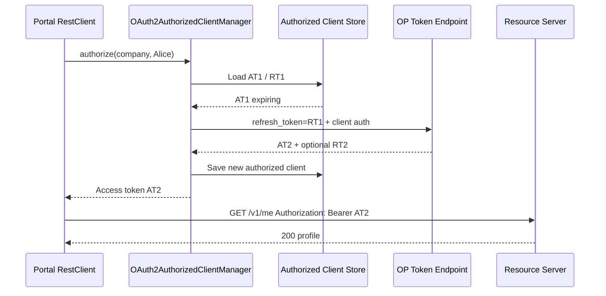

# 34.4. Gọi API thay mặt người dùng bằng RestClient

Trong một ứng dụng **Spring Security OAuth 2.0 / OpenID Connect (OIDC) Client**, người dùng đăng nhập vào web portal, sau đó portal cần gọi một API khác **với quyền được ủy quyền của chính người dùng đó**. Ví dụ: người dùng mở `/app/my-profile`, portal lấy access token đã được Authorization Server cấp cho người dùng và gọi `GET /v1/me` của Resource Server.

Nếu lấy nhầm **ID Token** làm Bearer token, hard-code access token, dùng token của một người cho người khác, hoặc để server gọi URL do browser cung cấp rồi tự gắn `Authorization: Bearer ...`, ứng dụng có thể hoạt động sai hoặc lộ credential nghiêm trọng. Bài thực hành này xây một đường đi đúng từ **OIDC Login → OAuth2AuthorizedClient → RestClient → Resource Server**.

**Phiên bản mẫu:** Java 17+, Spring Boot **3.5.x**, Spring Security **6.5.x** và Spring Framework 6.2.x trong **Servlet/Spring MVC**. `RestClient` xuất hiện ở Spring Framework 6.1; tích hợp OAuth2 Client bằng `OAuth2ClientHttpRequestInterceptor` có từ Spring Security 6.4. Các phiên bản mới hơn có thể có APIs/auto-configuration khác, nên phải đối chiếu **Javadoc của dependency thực tế**. `https://id.example.test`, `http://localhost:8090`, client IDs và tokens bên dưới đều là **giá trị minh họa**.

> **Mục tiêu bài thực hành:** User đăng nhập bằng Authorization Code + OIDC tại portal; portal lưu OAuth2 authorized client theo user; khi user yêu cầu profile, `RestClient` tự gắn **access token** của đúng user vào outbound HTTP request; API kiểm tra token và scopes; khi token hết hạn, authorized client manager có thể refresh theo chính sách OP. Không đưa access token vào browser response.

---

## 1. Sau bài này bạn làm được gì?

1. Phân biệt **browser session**, **ID Token**, **access token** và **refresh token**.
2. Hiểu vì sao `RestClient` không tự có Bearer token chỉ vì đã bật `http.oauth2Login()`.
3. Cấu hình `ClientRegistration` với `authorization_code` và các scopes cho API.
4. Kết nối `RestClient` với `OAuth2AuthorizedClientManager` thông qua `OAuth2ClientHttpRequestInterceptor`.
5. Chỉ định đúng `clientRegistrationId` cho outbound call, dùng principal đang đăng nhập làm phạm vi authorized client.
6. Tạo một `@Service` proxy gọi API và controller chỉ trả DTO an toàn.
7. Tạo Resource Server xác minh access token thay vì tin request từ portal chỉ vì cùng mạng.
8. Kiểm chứng các trạng thái: chưa login, login thành công, access token còn hạn/hết hạn, thiếu scope, API 401/403/5xx.
9. Dùng `MockRestServiceServer` kiểm tra outbound Bearer header mà không dùng credential thật.
10. Biết khi nào cần fake OP integration tests thay vì `MockMvc.with(oidcLogin())`.
11. Xử lý token refresh, token rotation, logout, nhiều providers và nhiều instances mà không dùng nhầm token.
12. Chống SSRF, redirect token leakage, over-scoping, log secrets, replay và unauthorized cross-tenant access.

## 2. Bài toán thực tế: “thay mặt người dùng” nghĩa là gì?

Một ứng dụng có ba vai trò:

- **Portal (OAuth2/OIDC Client hoặc Relying Party):** ứng dụng web có người dùng đăng nhập bằng browser.
- **OpenID Provider / Authorization Server (OP/AS):** xác thực user, cấp ID Token và access token, có thể cấp refresh token.
- **Resource Server (API):** sở hữu dữ liệu; nhận Bearer access token, xác minh token, scope, audience và quyền nghiệp vụ.

```mermaid
sequenceDiagram
    autonumber
    actor B as Browser của Alice
    participant P as Portal - Spring MVC
    participant OP as OpenID Provider
    participant API as Resource Server
    B->>P: GET /oauth2/authorization/company
    P-->>B: 302 OP /authorize, state + PKCE + nonce
    B->>OP: Đăng nhập / consent
    OP-->>B: 302 /login/oauth2/code/company?code&state
    B->>P: Callback kèm RP session cookie
    P->>OP: POST /token - code + client authentication
    OP-->>P: ID Token + Access Token + optional Refresh Token
    P->>P: Verify ID Token, tạo SecurityContext
    P->>P: Save OAuth2AuthorizedClient theo user + registration
    B->>P: GET /app/my-profile
    P->>P: OAuth2AuthorizedClientManager tìm AT hợp lệ
    opt AT hết hạn và có RT hợp lệ
        P->>OP: POST /token grant_type=refresh_token
        OP-->>P: AT mới + optional RT mới
    end
    P->>API: GET /v1/me; Authorization: Bearer AT
    API->>API: Validate signature / iss / aud / scope / user
    API-->>P: JSON profile của Alice
    P-->>B: JSON DTO đã chọn, KHÔNG chứa token
```

### 2.1. Không phải ba loại token giống nhau

| Giá trị | Ai sử dụng? | Mục đích | Có gửi tới API? |
| --- | --- | --- | --- |
| **Session cookie** | Browser ↔ portal | Duy trì phiên web của Alice | Không gửi tới Resource Server khác origin |
| **ID Token** | Portal/OIDC Relying Party | Chứng minh kết quả authentication cho client; có `iss`, `aud`, `sub`, `nonce` | **Không** dùng làm Bearer API token |
| **Access token (AT)** | Portal → API | Cho Resource Server quyết định request được cấp quyền gì | **Có**, nếu token có đúng audience/scope |
| **Refresh token (RT)** | Portal → OP Token Endpoint | Xin AT mới khi AT hết hạn | **Không** gửi tới Resource Server |
| **Client secret/private key** | Portal → OP | Xác thực OAuth2 client tại Token Endpoint | **Không** gửi tới Resource Server |

Một ID Token có chữ ký đúng vẫn chỉ chứng minh các claims cho **client audience**. Không tự nhận ID Token làm access token của API.

### 2.2. Delegation không có nghĩa “portal có toàn quyền”

Ví dụ portal có registration `company` với scope `api.profile.read`. Khi Alice login và consent, access token có thể chỉ cho phép đọc profile. API **vẫn phải** xác minh Alice được đọc đối tượng cụ thể.

Nếu portal muốn đọc profile của Bob, không được chỉ đổi `/v1/users/{id}` thành Bob và hy vọng access token “thay mặt Alice” tự cho phép. Resource Server phải áp dụng ownership/tenant policy.

### 2.3. Khác biệt với `client_credentials` và token exchange

- **Authorization Code + OIDC Login:** user hiện diện; authorized client gắn với Alice và OAuth2 registration.
- **Client Credentials:** app xác thực bằng client credential; token đại diện **ứng dụng**, không phải Alice.
- **OAuth2 Token Exchange (RFC 8693):** có thể đổi một token thành token khác phù hợp audience/ủy quyền theo AS policy; đây là flow riêng, **không tự xảy ra** khi gọi RestClient.
- **Token relay của incoming Bearer token:** một pattern khác; không được chuyển token tới mọi host một cách mù quáng.

Trong bài thực hành, ta dùng **token do OP cấp cho browser-login authorized client của Alice**, không dùng client_credentials và không tự tạo “on-behalf-of” assertion tùy ý.

## 3. Kiến trúc lab và sơ đồ project

```text
localhost:8080                         localhost:8090
+---------------------------------+   +------------------------+
| portal (Spring MVC)             |   | profile-api            |
| spring-boot-starter-oauth2-client|  | OAuth2 Resource Server |
|                                 |   |                        |
| /oauth2/authorization/company   |   | GET /v1/me             |
| /login/oauth2/code/company      |-->| validates access token |
| /app/my-profile                 |AT | scope, aud, ownership  |
| RestClient + OAuth2 interceptor |   |                        |
+---------------+-----------------+   +------------+-----------+
                |                                  ^
                v                                  |
      Trusted development OP / AS ----------------+
       - OIDC Discovery, JWKS
       - /authorize, /token
       - signed ID Token + access token
       - optional rotating refresh token
```

Thư mục đề xuất nếu tự tạo project học tập:

```text
oidc-restclient-lab/
  portal/
    pom.xml
    src/main/java/example/portal/
      PortalApplication.java
      WebSecurityConfig.java
      OutboundRestClientConfig.java
      ProfileApiClient.java
      ProfileView.java
      MyProfileController.java
    src/main/resources/application.yml
    src/test/java/example/portal/
      ProfileApiClientTest.java
  profile-api/
    pom.xml
    src/main/java/example/api/
      ProfileApiApplication.java
      ApiSecurityConfig.java
      MeController.java
    src/main/resources/application.yml
```

**Không có yêu cầu phải tạo chính xác những thư mục này trong repo hiện hành.** Đây là bài thực hành tự chứa: người học có thể dựng hai Spring Boot apps hoặc áp dụng từng đoạn vào hệ thống có sẵn.

## 4. Điều kiện trước khi chạy

Bạn cần:

- JDK 17 hoặc runtime được Boot version chọn hỗ trợ.
- Maven Wrapper/Gradle Wrapper của project.
- Một OP sandbox như Keycloak hoặc OP test double có **OIDC Discovery**, authorization code, signed ID Tokens và API access tokens.
- Một OAuth2 client registration cho **portal**.
- OP chấp nhận redirect URI `http://localhost:8080/login/oauth2/code/company` cho dev; production dùng HTTPS public URI.
- Scope API `api.profile.read` đã được đăng ký/cấp quyền.
- Resource Server biết **issuer** và **audience** mà OP dùng cho access token.
- Một test user `alice` có quyền gọi `GET /v1/me`.
- Không đưa tài khoản hoặc secrets production vào file ví dụ.

### 4.1. Contract của OP trong bài học

Các giá trị giả định:

| Thuộc tính | Giá trị minh họa | Ý nghĩa |
| --- | --- | --- |
| OP issuer | `https://id.example.test/realms/lab` | Identity/trust boundary |
| Portal registration ID | `company` | Key trong Spring ClientRegistrationRepository |
| Portal client ID | `portal-web` | OAuth2 client mà OP đã đăng ký |
| Authorization grant | `authorization_code` | Browser user login |
| Client authentication | `client_secret_basic` | Chỉ là một lựa chọn, phụ thuộc OP |
| Redirect URI | `http://localhost:8080/login/oauth2/code/company` | Callback của Spring OAuth2 Login |
| Login scopes | `openid profile api.profile.read` | OIDC login + API read permission |
| Resource API base URL | `http://localhost:8090` | Dev only |
| Expected access-token audience | `profile-api` | Token chỉ dành cho API này |
| Expected API authority | `SCOPE_api.profile.read` | Spring Resource Server scope mapping thông dụng |

**Quan trọng:** Không phải OP nào cũng tự đưa `aud=profile-api` vào access token khi bạn yêu cầu scope `api.profile.read`. Có thể phải cấu hình audience mapper, resource indicator hoặc cơ chế vendor riêng. Nếu OP trả **opaque access token**, Resource Server cần introspection hoặc cơ chế phù hợp, không dùng JWT decoder để “đoán” token.

### 4.2. Scope, audience và user khác nhau

Một access token có `scope=api.profile.read` nhưng `aud` chỉ hướng tới một API khác **không đủ** để dùng tại `profile-api`.

Một access token có `aud=profile-api` nhưng thiếu `api.profile.read` **cũng không đủ**.

Một access token có scope/audience đúng của Alice **không** cấp phép Alice xem toàn bộ dữ liệu người dùng khác. Resource Server còn phải kiểm subject, ownership và tenant.

## 5. Portal `pom.xml`

Maven dependencies cho portal:

```xml
<project xmlns="http://maven.apache.org/POM/4.0.0"
         xmlns:xsi="http://www.w3.org/2001/XMLSchema-instance"
         xsi:schemaLocation="http://maven.apache.org/POM/4.0.0
                             https://maven.apache.org/xsd/maven-4.0.0.xsd">
    <modelVersion>4.0.0</modelVersion>

    <parent>
        <groupId>org.springframework.boot</groupId>
        <artifactId>spring-boot-starter-parent</artifactId>
        <version>3.5.0</version>
        <relativePath/>
    </parent>

    <groupId>example</groupId>
    <artifactId>portal</artifactId>
    <version>0.0.1-SNAPSHOT</version>

    <properties>
        <java.version>17</java.version>
    </properties>

    <dependencies>
        <dependency>
            <groupId>org.springframework.boot</groupId>
            <artifactId>spring-boot-starter-web</artifactId>
        </dependency>
        <dependency>
            <groupId>org.springframework.boot</groupId>
            <artifactId>spring-boot-starter-security</artifactId>
        </dependency>
        <dependency>
            <groupId>org.springframework.boot</groupId>
            <artifactId>spring-boot-starter-oauth2-client</artifactId>
        </dependency>
        <dependency>
            <groupId>org.springframework.boot</groupId>
            <artifactId>spring-boot-starter-test</artifactId>
            <scope>test</scope>
        </dependency>
        <dependency>
            <groupId>org.springframework.security</groupId>
            <artifactId>spring-security-test</artifactId>
            <scope>test</scope>
        </dependency>
    </dependencies>

    <build>
        <plugins>
            <plugin>
                <groupId>org.springframework.boot</groupId>
                <artifactId>spring-boot-maven-plugin</artifactId>
            </plugin>
        </plugins>
    </build>
</project>
```

**Phiên bản 3.5.0 chỉ là bản được cố định để minh họa cú pháp 3.5/6.5**, không phải gợi ý chọn patch cũ cho production. Khi thực hành, chọn bản patch được hỗ trợ và đối chiếu BOM/Javadoc đúng phiên bản; không tự nâng từng JAR Spring Security lệch nhau.

### 5.1. Gradle tương đương

Nếu dùng Gradle, dependencies tương ứng:

```groovy
plugins {
    id 'java'
    id 'org.springframework.boot' version '3.5.0'
    id 'io.spring.dependency-management' version '1.1.7'
}

java {
    toolchain {
        languageVersion = JavaLanguageVersion.of(17)
    }
}

dependencies {
    implementation 'org.springframework.boot:spring-boot-starter-web'
    implementation 'org.springframework.boot:spring-boot-starter-security'
    implementation 'org.springframework.boot:spring-boot-starter-oauth2-client'
    testImplementation 'org.springframework.boot:spring-boot-starter-test'
    testImplementation 'org.springframework.security:spring-security-test'
}

tasks.named('test') {
    useJUnitPlatform()
}
```

`RestClient` nằm trong Spring Web. `OAuth2ClientHttpRequestInterceptor` nằm trong `spring-security-oauth2-client` ở những phiên bản hỗ trợ; không cần thêm một SDK OAuth2 không liên quan chỉ để lấy Bearer token.

## 6. Portal `application.yml`

```yaml
server:
  port: 8080

spring:
  security:
    oauth2:
      client:
        registration:
          company:
            provider: lab-op
            client-id: ${OIDC_CLIENT_ID:portal-web}
            client-secret: ${OIDC_CLIENT_SECRET}
            client-authentication-method: client_secret_basic
            authorization-grant-type: authorization_code
            redirect-uri: "{baseUrl}/login/oauth2/code/{registrationId}"
            scope:
              - openid
              - profile
              - api.profile.read
        provider:
          lab-op:
            issuer-uri: ${OIDC_ISSUER_URI}

lab:
  profile-api:
    base-url: ${PROFILE_API_BASE_URL:http://localhost:8090}
```

Trước khi chạy, cung cấp trong môi trường dev:

```bash
export OIDC_CLIENT_ID=portal-web
export OIDC_CLIENT_SECRET=dev-only-secret-from-op
export OIDC_ISSUER_URI=https://id.example.test/realms/lab
export PROFILE_API_BASE_URL=http://localhost:8090
```

Ở Windows PowerShell:

```powershell
$env:OIDC_CLIENT_ID="portal-web"
$env:OIDC_CLIENT_SECRET="<dev-only-client-secret>"
$env:OIDC_ISSUER_URI="https://id.example.test/realms/lab"
$env:PROFILE_API_BASE_URL="http://localhost:8090"
```

**Đừng dùng literal `id.example.test` khi chạy thật:** đó là domain dành cho minh họa. Thay bằng issuer của OP sandbox. `OIDC_CLIENT_SECRET` phải được cấp từ OP sandbox/secret manager, không commit vào repository.

### 6.1. Tại sao dùng `issuer-uri`?

Spring tạo `ClientRegistration` bằng metadata được công bố qua OIDC Discovery, gồm authorization endpoint, token endpoint và JWKS URI theo provider. Các giá trị phải nhất quán với **issuer đã được phê duyệt**; không dùng issuer đến từ query parameter người dùng.

Khi khởi động, ứng dụng có thể thực hiện discovery HTTP tới issuer. Nếu OP sandbox chưa chạy, context có thể khởi tạo thất bại. Có thể cấu hình provider endpoints tĩnh trong profile test để không phụ thuộc mạng, nhưng production cần trust configuration được xác nhận.

### 6.2. Vì sao không có thuộc tính `access-token` trong YAML?

Access token là **credential được cấp sau authorization**, khác với `client-id`/`client-secret` trong `ClientRegistration`. Không hard-code access/refresh token vào YAML hay global bean.

### 6.3. HTTP localhost có dùng được không?

Ví dụ dùng HTTP tới localhost để người học dễ chạy trên máy dev; production phải có **HTTPS/transport security và cấu hình proxy tin cậy**. Không gửi Bearer token qua một external HTTP origin hoặc kết nối tới host người dùng lựa chọn.

## 7. Ứng dụng portal và security chain

`PortalApplication.java`:

```java
package example.portal;

import org.springframework.boot.SpringApplication;
import org.springframework.boot.autoconfigure.SpringBootApplication;

@SpringBootApplication
public class PortalApplication {
    public static void main(String[] args) {
        SpringApplication.run(PortalApplication.class, args);
    }
}
```

`WebSecurityConfig.java`:

```java
package example.portal;

import org.springframework.context.annotation.Bean;
import org.springframework.context.annotation.Configuration;
import org.springframework.security.config.Customizer;
import org.springframework.security.config.annotation.web.builders.HttpSecurity;
import org.springframework.security.web.SecurityFilterChain;

@Configuration
public class WebSecurityConfig {

    @Bean
    SecurityFilterChain webChain(HttpSecurity http) throws Exception {
        return http
                .authorizeHttpRequests(auth -> auth
                        .requestMatchers("/", "/error").permitAll()
                        .requestMatchers("/app/**").authenticated()
                        .anyRequest().authenticated())
                .oauth2Login(Customizer.withDefaults())
                .oauth2Client(Customizer.withDefaults())
                .build();
    }
}
```

Với cấu hình này:

- `GET /app/my-profile` đòi authentication.
- Nếu chưa đăng nhập, browser có thể được redirect đến login/authorization entry point theo cấu hình thực tế.
- `oauth2Login` xử lý Authorization Code/OIDC Login.
- `oauth2Client` cung cấp OAuth2 client support trong security configuration.
- Không tắt CSRF. Nếu thêm POST/PUT/DELETE phục vụ session browser, bảo vệ CSRF theo ứng dụng.
- `oidcLogin()` test helper **không xuất hiện ở đây**; đây là DSL production.

### 7.1. Đường dẫn login mặc định

Với registration ID `company`:

```text
GET http://localhost:8080/oauth2/authorization/company
```

Spring Security mặc định nhận callback:

```text
GET http://localhost:8080/login/oauth2/code/company?code=...&state=...
```

OP cần đăng ký đúng redirect URI. Reverse proxy, HTTPS, `Host` và forwarded headers phải khớp; nếu không OP có thể trả `invalid_redirect_uri`.

### 7.2. Sau login, principal thuộc loại gì?

Với `openid` scope và một OP OIDC hợp lệ, principal thường là `OidcUser` nằm trong `OAuth2AuthenticationToken`. Tên/subject trong `Authentication` dùng cho RP session identity; nó **không** tự là Bearer access token.

Điều quan trọng là `OAuth2AuthorizedClient` được liên kết với **registration `company` và principal hiện tại**. Đó là nguồn access token cho outbound call.

## 8. Cấu hình `OAuth2AuthorizedClientManager` cho Servlet request

`OAuth2AuthorizedClientManager` là abstraction điều phối tìm authorized client, cấp/refresh tokens thông qua provider và lưu kết quả theo repository.

`AuthorizedClientManagerConfig.java`:

```java
package example.portal;

import org.springframework.context.annotation.Bean;
import org.springframework.context.annotation.Configuration;
import org.springframework.security.oauth2.client
        .DefaultOAuth2AuthorizedClientManager;
import org.springframework.security.oauth2.client
        .OAuth2AuthorizedClientManager;
import org.springframework.security.oauth2.client
        .OAuth2AuthorizedClientProvider;
import org.springframework.security.oauth2.client
        .OAuth2AuthorizedClientProviderBuilder;
import org.springframework.security.oauth2.client.registration
        .ClientRegistrationRepository;
import org.springframework.security.oauth2.client.web
        .OAuth2AuthorizedClientRepository;

@Configuration
public class AuthorizedClientManagerConfig {

    @Bean
    OAuth2AuthorizedClientManager authorizedClientManager(
            ClientRegistrationRepository registrations,
            OAuth2AuthorizedClientRepository authorizedClients) {

        OAuth2AuthorizedClientProvider provider =
                OAuth2AuthorizedClientProviderBuilder.builder()
                        .authorizationCode()
                        .refreshToken()
                        .build();

        var manager = new DefaultOAuth2AuthorizedClientManager(
                registrations, authorizedClients);
        manager.setAuthorizedClientProvider(provider);
        return manager;
    }
}
```

Chúng ta khai bean rõ ràng để người học thấy dependency flow. Một số Spring Security/Spring Boot versions có thể cung cấp default manager bean khi chưa tự khai; nếu đã có manager phù hợp, **không tạo hai beans cùng vai trò**. Đối chiếu auto-configuration của phiên bản đang dùng.

### 8.1. Vì sao dùng `authorizationCode()` và `refreshToken()`?

- `authorizationCode()` hỗ trợ logic liên quan Authorization Code grant.
- `refreshToken()` cho phép manager refresh access token đã cấp khi đủ điều kiện và có refresh token.
- OP có cấp refresh token không còn phụ thuộc profile, `offline_access`/consent/policy; **scope `openid` tự nó không cam kết có RT**.
- Khi không có RT, manager không tự có cách “gia hạn” bằng phép màu; có thể cần đăng nhập/authorize lại.

### 8.2. Có nên thêm `clientCredentials()`?

Không cho lab **gọi thay mặt user**. Nếu thêm client_credentials vào cùng manager, phải bảo đảm từng registration/grant/principal vẫn đúng để không vô tình dùng application token thay token của Alice.

Một workload scheduled job cần token của **ứng dụng** nên dùng registration/manager riêng, thường qua `AuthorizedClientServiceOAuth2AuthorizedClientManager` với `OAuth2AuthorizedClientService`. Đừng dùng user browser token trong một task nền không có entitlement/consent rõ ràng.

### 8.3. Repository lưu token ở đâu?

`OAuth2AuthorizedClientRepository`/`OAuth2AuthorizedClientService` có nhiều implementation; storage mặc định và cơ chế save/load có thể khác theo cấu hình/bean thực tế.

| Trường hợp | Kiểu lưu thường gặp | Điều cần lưu ý |
| --- | --- | --- |
| Browser servlet session | `HttpSessionOAuth2AuthorizedClientRepository` | Session timeout và session distribution |
| Authenticated principal service | `AuthenticatedPrincipalOAuth2AuthorizedClientRepository` + service | Shared DB/cleanup/tenant isolation |
| JDBC/custom | `OAuth2AuthorizedClientService` hoặc repository tùy biến | Encryption, rotation và conditional persistence |
| Background process | Service-backed manager | Không có HttpServletRequest, khác user session |

**Không mặc định ứng dụng có nhiều node tự chia sẻ tokens** chỉ vì bạn đã thêm `oauth2Client()`. Phải kiểm tra storage thật.

## 9. Tạo `RestClient` có OAuth2 interceptor

Đây là trung tâm của bài.

`OutboundRestClientConfig.java`:

```java
package example.portal;

import org.springframework.beans.factory.annotation.Value;
import org.springframework.context.annotation.Bean;
import org.springframework.context.annotation.Configuration;
import org.springframework.security.oauth2.client
        .OAuth2AuthorizedClientManager;
import org.springframework.security.oauth2.client.web.client
        .OAuth2ClientHttpRequestInterceptor;
import org.springframework.web.client.RestClient;

@Configuration
public class OutboundRestClientConfig {

    @Bean
    RestClient profileApiRestClient(
            RestClient.Builder builder,
            OAuth2AuthorizedClientManager manager,
            @Value("${lab.profile-api.base-url}") String baseUrl) {

        var oauth2 = new OAuth2ClientHttpRequestInterceptor(
                manager);

        return builder
                .baseUrl(baseUrl)
                .requestInterceptor(oauth2)
                .build();
    }
}
```

Khi outbound request được tạo và `clientRegistrationId`/principal xác định được, interceptor:

1. Gọi authorized client manager để lấy authorized client thích hợp.
2. Nếu token còn hợp lệ theo policy, dùng access token đang lưu.
3. Nếu token cần refresh và có RT/provider phù hợp, manager có thể gọi Token Endpoint để lấy token mới rồi lưu theo repository.
4. Đặt access token thành Bearer credential trong HTTP `Authorization` header của request.
5. Gửi request qua HTTP client tới Resource Server đã định cấu hình.

**Không cần viết interceptor tự ghép** `"Bearer " + accessToken` trong phần lớn trường hợp nếu API này đáp ứng yêu cầu. Tự làm có thể quên refresh, scope theo principal, failure handling hoặc logout.

### 9.1. Spring Security phiên bản nào?

`OAuth2ClientHttpRequestInterceptor` thuộc:

```java
org.springframework.security.oauth2.client.web.client
        .OAuth2ClientHttpRequestInterceptor
```

Tích hợp này có trong Spring Security 6.4+; không có nghĩa mọi Boot 3.x cũ đều có class. Nếu IDE không tìm thấy, xác minh:

```bash
./mvnw dependency:tree -Dincludes=org.springframework.security
```

hoặc:

```bash
./gradlew dependencyInsight --dependency spring-security-oauth2-client --configuration runtimeClasspath
```

Đừng thêm một bản `spring-security-oauth2-client` mới lệch với `spring-security-core`, `config` và `web` chỉ để có interceptor. Nâng release train tương thích theo Boot BOM và migration guidance.

### 9.2. `RestClient.Builder` thay vì global `RestClient` cho mọi API

Dùng một bean tên `profileApiRestClient` gắn với **một trusted base URL**. Không nên có một RestClient toàn cục tự gắn Bearer token rồi cho business code gọi bất cứ hostname nào. Nếu cần gọi API public hoặc host khác, tạo **RestClient riêng không gắn OAuth2 interceptor**, hoặc cấu hình rõ token-routing per trusted service.

### 9.3. Interceptor có tự biết registration nào không?

Mặc định, interceptor dùng `RequestAttributeClientRegistrationIdResolver` để đọc registration ID từ **RestClient request attributes**. Nó không tự chọn được đúng client từ một business ID bất kỳ.

Cần truyền:

```java
.attributes(clientRegistrationId("company"))
```

hoặc cấu hình một resolver rõ ràng (phần sau).

## 10. `ProfileView` — DTO trả cho browser

`ProfileView.java`:

```java
package example.portal;

public record ProfileView(String subject, String displayName) {}
```

DTO chỉ chứa dữ liệu profile cần hiển thị. Nó **không** chứa access token, refresh token, ID Token, OAuth2AuthorizedClient hoặc các headers từ outbound response.

Dù API trả JSON chứa nhiều dữ liệu, portal chỉ nên map các fields cần thiết với chính sách privacy/authorization phù hợp.

## 11. Gọi API bằng `RestClient` trong service

`ProfileApiClient.java`:

```java
package example.portal;

import static org.springframework.security.oauth2.client.web.client
        .RequestAttributeClientRegistrationIdResolver
        .clientRegistrationId;

import org.springframework.stereotype.Service;
import org.springframework.web.client.RestClient;

@Service
public class ProfileApiClient {

    private static final String REGISTRATION_ID = "company";
    private final RestClient profileApiRestClient;

    public ProfileApiClient(RestClient profileApiRestClient) {
        this.profileApiRestClient = profileApiRestClient;
    }

    public ProfileView loadMyProfile() {
        ProfileView result = this.profileApiRestClient
                .get()
                .uri("/v1/me")
                .attributes(clientRegistrationId(REGISTRATION_ID))
                .retrieve()
                .body(ProfileView.class);

        if (result == null) {
            throw new IllegalStateException(
                    "Profile API returned an empty body");
        }
        return result;
    }
}
```

**Giải thích từng dòng quan trọng:**

- `get()`: outbound HTTP GET.
- `uri("/v1/me")`: relative URI dưới trusted base URL, không phải URL do browser cung cấp.
- `attributes(clientRegistrationId("company"))`: chọn **OAuth2 client registration**; không phải đổi credential theo user input.
- `retrieve().body(ProfileView.class)`: thực hiện request, kiểm status theo `RestClient` contract và deserialize JSON về DTO.
- Không gọi `SecurityContextHolder` thủ công ở service; interceptor mặc định dùng principal resolver liên kết với current `SecurityContext` trong request thread.

### 11.1. Static import chính xác

```java
import static org.springframework.security.oauth2.client.web.client
        .RequestAttributeClientRegistrationIdResolver
        .clientRegistrationId;
```

Đừng import helper có cùng tên từ `ServletOAuth2AuthorizedClientExchangeFilterFunction` (dùng cho **WebClient**) hoặc từ một HTTP service client API khác. Cùng tên “clientRegistrationId” nhưng không cùng attributes semantics giữa RestClient và WebClient.

### 11.2. Vì sao `RegistrationId` được hard-code?

Trong bài lab có một trusted registration duy nhất dành cho API. Việc service tự chọn `company` tránh cho user điều khiển:

```text
?registrationId=attacker-client
?resourceUrl=https://attacker.example
```

Trong multi-provider app, đăng ký outbound được chọn dựa vào **server-side policy và verified Authentication**, không tin query parameter đơn thuần. Ví dụ mở rộng ở mục 19.

### 11.3. Không tạo `RestClient` mỗi lần controller gọi

`RestClient` là client reusable. Bean cố định có interceptors và HTTP connector được quản lý. Tạo client mỗi request có thể làm mất pooling/tracing, tạo chỗ gắn token không nhất quán và khó cấu hình retry/timeouts.

### 11.4. Có cần tự set `Authorization` header không?

Không. Interceptor làm việc này. Nếu thêm:

```java
.headers(h -> h.setBearerAuth(userSuppliedToken))
```

bạn có thể ghi đè token đúng bằng token do user tự cung cấp. Đừng tự đặt Bearer header khi OAuth2 interceptor đã chịu trách nhiệm chọn authorized client.

## 12. Controller gọi service, không trả token

`MyProfileController.java`:

```java
package example.portal;

import org.springframework.web.bind.annotation.GetMapping;
import org.springframework.web.bind.annotation.RestController;

@RestController
public class MyProfileController {

    private final ProfileApiClient profileApiClient;

    public MyProfileController(ProfileApiClient profileApiClient) {
        this.profileApiClient = profileApiClient;
    }

    @GetMapping("/app/my-profile")
    public ProfileView myProfile() {
        return profileApiClient.loadMyProfile();
    }
}
```

Browser gọi:

```http
GET /app/my-profile HTTP/1.1
Host: localhost:8080
Cookie: JSESSIONID=<browser-session-id>
```

Portal gửi tới Resource Server:

```http
GET /v1/me HTTP/1.1
Host: localhost:8090
Authorization: Bearer <access-token-of-current-user>
Accept: application/json
```

Portal phản hồi:

```json
{
  "subject": "alice-subject",
  "displayName": "Alice"
}
```

Không trả:

```json
{
  "access_token": "...",
  "refresh_token": "...",
  "id_token": "...",
  "client_secret": "..."
}
```

Response ví dụ chỉ minh họa hình thức; `subject` và `displayName` thực tế do API xác định, không được chỉ tin một trường request của browser.

## 13. Ứng dụng Resource Server để kiểm chứng token

Trong một hệ thống thật, Resource Server có thể là dịch vụ khác. Để thực hành end-to-end, tạo một app Spring Boot tại `localhost:8090`.

### 13.1. `profile-api/pom.xml`

```xml
<project xmlns="http://maven.apache.org/POM/4.0.0"
         xmlns:xsi="http://www.w3.org/2001/XMLSchema-instance"
         xsi:schemaLocation="http://maven.apache.org/POM/4.0.0
                             https://maven.apache.org/xsd/maven-4.0.0.xsd">
  <modelVersion>4.0.0</modelVersion>
  <parent>
    <groupId>org.springframework.boot</groupId>
    <artifactId>spring-boot-starter-parent</artifactId>
    <version>3.5.0</version>
    <relativePath/>
  </parent>
  <groupId>example</groupId>
  <artifactId>profile-api</artifactId>
  <version>0.0.1-SNAPSHOT</version>
  <properties>
    <java.version>17</java.version>
  </properties>
  <dependencies>
    <dependency>
      <groupId>org.springframework.boot</groupId>
      <artifactId>spring-boot-starter-web</artifactId>
    </dependency>
    <dependency>
      <groupId>org.springframework.boot</groupId>
      <artifactId>spring-boot-starter-security</artifactId>
    </dependency>
    <dependency>
      <groupId>org.springframework.boot</groupId>
      <artifactId>spring-boot-starter-oauth2-resource-server</artifactId>
    </dependency>
    <dependency>
      <groupId>org.springframework.boot</groupId>
      <artifactId>spring-boot-starter-test</artifactId>
      <scope>test</scope>
    </dependency>
    <dependency>
      <groupId>org.springframework.security</groupId>
      <artifactId>spring-security-test</artifactId>
      <scope>test</scope>
    </dependency>
  </dependencies>
  <build>
    <plugins>
      <plugin>
        <groupId>org.springframework.boot</groupId>
        <artifactId>spring-boot-maven-plugin</artifactId>
      </plugin>
    </plugins>
  </build>
</project>
```

### 13.2. Resource Server `application.yml`

```yaml
server:
  port: 8090

spring:
  security:
    oauth2:
      resourceserver:
        jwt:
          issuer-uri: ${OIDC_ISSUER_URI}

lab:
  resource:
    audience: profile-api
```

JWT decoder cần issuer/JWKS trust configuration chính xác. Không lấy issuer từ JWT chưa xác minh rồi tự chọn `jwks_uri` bất kỳ.

### 13.3. API application class

```java
package example.api;

import org.springframework.boot.SpringApplication;
import org.springframework.boot.autoconfigure.SpringBootApplication;

@SpringBootApplication
public class ProfileApiApplication {
    public static void main(String[] args) {
        SpringApplication.run(ProfileApiApplication.class, args);
    }
}
```

### 13.4. API security chain

`ApiSecurityConfig.java`:

```java
package example.api;

import org.springframework.context.annotation.Bean;
import org.springframework.context.annotation.Configuration;
import org.springframework.http.HttpMethod;
import org.springframework.security.config.Customizer;
import org.springframework.security.config.annotation.web.builders.HttpSecurity;
import org.springframework.security.config.http.SessionCreationPolicy;
import org.springframework.security.web.SecurityFilterChain;

@Configuration
public class ApiSecurityConfig {

    @Bean
    SecurityFilterChain resourceApiChain(HttpSecurity http)
            throws Exception {

        return http
                .securityMatcher("/v1/**")
                .authorizeHttpRequests(auth -> auth
                        .requestMatchers(HttpMethod.GET, "/v1/me")
                            .hasAuthority("SCOPE_api.profile.read")
                        .anyRequest().denyAll())
                .sessionManagement(session -> session
                        .sessionCreationPolicy(
                                SessionCreationPolicy.STATELESS))
                .csrf(csrf -> csrf.disable())
                .oauth2ResourceServer(oauth2 -> oauth2
                        .jwt(Customizer.withDefaults()))
                .build();
    }
}
```

**Phạm vi của `csrf.disable()` ở ví dụ này là API stateless chỉ nhận Bearer token, không sử dụng browser cookie để authenticate.** Không copy nó sang portal có login session và form POST. Trong một Resource Server hỗn hợp cookie/bearer hoặc yêu cầu security khác, CSRF policy cần thiết kế riêng.

### 13.5. Kiểm tra audience khi xác minh JWT

Một triển khai có thể kiểm tra issuer và timestamps mặc định, nhưng **không nên giả định Resource Server luôn kiểm đúng audience của API theo mong muốn nghiệp vụ**. Bổ sung validator hoặc cấu hình API audience theo phiên bản:

```java
package example.api;

import org.springframework.beans.factory.annotation.Value;
import org.springframework.context.annotation.Bean;
import org.springframework.context.annotation.Configuration;
import org.springframework.security.oauth2.core.DelegatingOAuth2TokenValidator;
import org.springframework.security.oauth2.core.OAuth2Error;
import org.springframework.security.oauth2.core.OAuth2TokenValidator;
import org.springframework.security.oauth2.core.OAuth2TokenValidatorResult;
import org.springframework.security.oauth2.jwt.Jwt;
import org.springframework.security.oauth2.jwt.JwtDecoder;
import org.springframework.security.oauth2.jwt.JwtValidators;
import org.springframework.security.oauth2.jwt.NimbusJwtDecoder;

@Configuration
class JwtAudienceConfig {

    @Bean
    JwtDecoder jwtDecoder(
            @Value("${spring.security.oauth2.resourceserver.jwt.issuer-uri}")
            String issuer,
            @Value("${lab.resource.audience}") String audience) {

        NimbusJwtDecoder decoder =
                NimbusJwtDecoder.withIssuerLocation(issuer).build();

        OAuth2TokenValidator<Jwt> audienceValidator = jwt ->
                jwt.getAudience().contains(audience)
                        ? OAuth2TokenValidatorResult.success()
                        : OAuth2TokenValidatorResult.failure(
                                new OAuth2Error(
                                        "invalid_token",
                                        "Required API audience is missing",
                                        null));

        decoder.setJwtValidator(
                new DelegatingOAuth2TokenValidator<>(
                        JwtValidators.createDefaultWithIssuer(issuer),
                        audienceValidator));

        return decoder;
    }
}
```

Chú ý:

- `JwtDecoder` ở đây dùng cho **incoming access token tại Resource Server**; không phải decoder xác minh ID Token của portal.
- Đoạn code minh họa đặt **một JwtDecoder bean** thay cho Boot decoder mặc định; không khai hai beans cạnh tranh.
- Nó giả định access token là **JWT**. Nếu OP phát **opaque token**, dùng introspection theo hợp đồng OP.
- JWT signature, issuer, expiry và audience phải được kiểm; **không chỉ parse `Jwt` rồi tin claims**.
- Trong production cần kiểm `alg` allowlist/JWKS/tenant policy và các validators đặc thù theo security profile; đừng chỉ chấp nhận arbitrary key type do header JWT đòi.

### 13.6. API controller lấy identity từ token, không lấy từ query

`MeController.java`:

```java
package example.api;

import org.springframework.security.core.annotation.AuthenticationPrincipal;
import org.springframework.security.oauth2.jwt.Jwt;
import org.springframework.web.bind.annotation.GetMapping;
import org.springframework.web.bind.annotation.RestController;

@RestController
public class MeController {

    public record ProfileView(String subject, String displayName) {}

    @GetMapping("/v1/me")
    public ProfileView me(@AuthenticationPrincipal Jwt token) {
        String subject = token.getSubject();
        String display = token.getClaimAsString("preferred_username");

        if (display == null || display.isBlank()) {
            display = subject;
        }
        return new ProfileView(subject, display);
    }
}
```

Ví dụ này tin **claims từ JWT đã được Spring Security Resource Server xác minh theo cấu hình**, không tin `?userId=...` từ browser.

Nếu API xử lý dữ liệu nội bộ thật, còn cần map verified `(issuer, sub)` sang account/tenant trong DB và kiểm quyền đối với object trước khi trả.

## 14. Chạy lab theo trình tự

1. Khởi động OP sandbox, tạo client `portal-web` với Authorization Code flow và redirect URI đúng.
2. Cấu hình OP phát access token cho audience `profile-api` và scope `api.profile.read`; cung cấp một test user.
3. Khởi động `profile-api` ở 8090 với cùng issuer URI.
4. Khởi động `portal` ở 8080, client ID/secret từ sandbox.
5. Mở browser tới `http://localhost:8080/oauth2/authorization/company`.
6. Đăng nhập test user tại OP.
7. Sau callback thành công, mở `http://localhost:8080/app/my-profile`.
8. Kiểm tra JSON trả về đúng user và API chỉ nhận Bearer access token.
9. Kiểm tra kịch bản thiếu scope và AT hết hạn.
10. Thực hiện logout và xác minh session/browser policy.

Trong mỗi module Maven:

```bash
./mvnw spring-boot:run
```

Hoặc Gradle:

```bash
./gradlew bootRun
```

Dùng hai terminals riêng. Lệnh chỉ có thể chạy nếu bạn đã tạo các file tương ứng và cấu hình OP thật; không coi các URL `.test` là dịch vụ đang tồn tại.

### 14.1. Ba quan sát bắt buộc

**Quan sát A — browser tới portal**

```http
GET /app/my-profile
Cookie: JSESSIONID=<opaque-session-cookie>
```

**Quan sát B — portal tới API**

```http
GET /v1/me
Authorization: Bearer <opaque-access-token>
```

**Quan sát C — API response**

```json
{
  "subject": "alice-subject",
  "displayName": "alice"
}
```

Không chụp hay chia sẻ raw cookies/tokens để chứng minh flow. Trong test, dùng counters và metadata đã redacted.

## 15. Tại sao interceptor cần `principal` hiện tại?

Theo thiết kế, authorized client thường được gắn với:

```text
ClientRegistration ID + Principal + security/storage context
```

Với `OAuth2ClientHttpRequestInterceptor`, mặc định principal resolver lấy Authentication hiện tại từ `SecurityContextHolder`. Vì vậy trên Servlet request xử lý Alice:

```text
SecurityContextHolder.getContext().getAuthentication()
                       |
                       v
                  principal Alice
                       |
                       v
     authorized client ("company", Alice)
                       |
                       v
                     AT_A
```

Khi Bob login và gọi endpoint tương tự:

```text
authorized client ("company", Bob) -> AT_B
```

**Không được dùng AT_A cho request của Bob.**

### 15.1. `ClientRegistration` không phải `OAuth2AuthorizedClient`

| Loại | Chứa | Vòng đời |
| --- | --- | --- |
| `ClientRegistration` | Registration ID, issuer, client ID, authentication method, scopes, redirect URI, endpoints | Cấu hình OAuth2 client |
| `OAuth2AuthorizedClient` | Registration + principal + access token + optional refresh token | Authorization được cấp cho user/app |
| `OAuth2AuthenticationToken` | Authenticated OAuth2 user + registration ID | Browser login Authentication |
| `SecurityContext` | Authentication đang active | Request/session |
| `RestClient` | Outbound HTTP configuration và interceptors | Reusable bean |

Nhiều user cùng dùng **một** `ClientRegistration` nhưng có **nhiều authorized clients khác nhau**.

### 15.2. Hai users cùng `sub` ở hai issuers

`sub="123"` chỉ có nghĩa trong phạm vi issuer. Không tự coi `sub=123` của OP Alpha và OP Beta là cùng account. Token storage/identity mapping cần đúng registration/issuer/tenant; không đặt authorization state vào singleton `currentAccessToken`.

## 16. Cấu hình registration resolver theo user hiện tại

Ở bài lab, service chỉ gọi provider `company` nên dùng request attribute tường minh. Trong hệ thống nhiều OP, bạn có thể chọn registration ID từ `OAuth2AuthenticationToken` **đã được xác thực**:

```java
package example.portal;

import org.springframework.context.annotation.Bean;
import org.springframework.context.annotation.Configuration;
import org.springframework.security.core.Authentication;
import org.springframework.security.core.context.SecurityContextHolder;
import org.springframework.security.oauth2.client
        .OAuth2AuthorizedClientManager;
import org.springframework.security.oauth2.client.authentication
        .OAuth2AuthenticationToken;
import org.springframework.security.oauth2.client.web.client
        .OAuth2ClientHttpRequestInterceptor;
import org.springframework.web.client.RestClient;

@Configuration
class LoginBasedRestClientConfig {

    @Bean("loginBasedRestClient")
    RestClient loginBasedRestClient(
            OAuth2AuthorizedClientManager manager) {

        var oauth2 = new OAuth2ClientHttpRequestInterceptor(
                manager);

        oauth2.setClientRegistrationIdResolver(request -> {
            Authentication auth = SecurityContextHolder
                    .getContext().getAuthentication();

            return auth instanceof OAuth2AuthenticationToken login
                    ? login.getAuthorizedClientRegistrationId()
                    : null;
        });

        return RestClient.builder()
                .baseUrl("https://resource.example.test")
                .requestInterceptor(oauth2)
                .build();
    }
}
```

**Đây là một cấu hình thay thế, không cần tạo cùng lúc với bean ở mục 9 nếu bạn chưa có mục tiêu dùng cả hai.**

Điểm cần kiểm:

- `OAuth2AuthenticationToken` phải xuất phát từ **trusted login flow**, không tự tạo từ request parameter.
- Không phải mọi OP registration đều có quyền gọi **cùng Resource Server**.
- Nếu Alpha và Beta đăng nhập các issuers khác nhau, API có chấp nhận cả hai không? Scopes/audience có tương thích không?
- Khi Authentication không phải OAuth2 login (ví dụ username/password hoặc JwtAuthenticationToken), resolver trả null; policy phải xử lý thay vì fallback sang một token application-wide.
- Không dùng resolver này để tự chuyển sang `client_credentials` khi không có user.

### 16.1. Đừng chỉ suy provider từ email domain

Email domain có thể thay đổi, được alias hoặc không được xác minh. Chọn client registration theo identity/issuer và server-side tenant policy đã được thẩm định. Nếu nghiệp vụ cho người dùng chọn tài khoản kết nối, server phải kiểm quyền sở hữu authorized client trước khi dùng.

### 16.2. Khi không thể dùng `SecurityContextHolder`

Một scheduled task, async thread hoặc worker queue không có Servlet request context có thể không mang SecurityContext của browser. Đừng ngầm “cứ lấy người dùng cuối cùng đã đăng nhập”.

Nếu cần delegated background access, thiết kế workflow lưu consent/grant đúng, token store service-backed, principal reference đáng tin cậy và authorization checks tại thời điểm xử lý. Có thể dùng manager thích hợp với non-request context; đây **không phải** đường đi mặc định của bài lab.

## 17. `principal` resolver tùy biến và cái bẫy application-wide token

Interceptor có `PrincipalResolver`. Theo tài liệu, mặc định dùng `SecurityContextHolderPrincipalResolver`; có thể thay bằng `RequestAttributePrincipalResolver` để chọn principal name từ request attributes.

Ví dụ mô hình **client_credentials**, không dùng thay cho flow của bài:

```java
import static org.springframework.security.oauth2.client.web.client
        .RequestAttributePrincipalResolver.principal;

// Chỉ khi interceptor đã được config với
// new RequestAttributePrincipalResolver() và registration
// là client_credentials theo policy.
restClient.get()
        .uri("/internal/status")
        .attributes(clientRegistrationId("service-account"))
        .attributes(principal("my-application"))
        .retrieve()
        .toBodilessEntity();
```

Khi đặt `principal="my-application"` cho mọi user authorization_code request, bạn có thể **làm mất isolation theo user** và khiến một access token bị lưu dưới một principal chung. Không sử dụng mẫu này cho Alice/Bob chỉ để “cache token ít hơn”.

Trong lab hiện tại, giữ principal resolver mặc định là chính xác.

## 18. Khi access token hết hạn: refresh diễn ra ra sao?

Giả sử OP cấp:

```text
Alice:
  AT1 expires at T1
  RT1 available
```

Khi `/app/my-profile` được gọi gần T1:

1. Interceptor hỏi manager cho authorized client của Alice/company.
2. Manager kiểm tra AT1 theo expiry và clock skew của provider implementation.
3. Nếu cần và RT1 hợp lệ, `refresh_token` provider gọi Token Endpoint bằng RT1 và client authentication phù hợp.
4. OP có thể trả AT2 và RT2 (nếu rotate RT).
5. Manager/service/repository lưu authorized client mới.
6. Interceptor dùng AT2 để gọi API.



### 18.1. Không có RT thì sao?

Không phải OP nào cũng cấp refresh token cho browser login. `openid` scope và việc có ID Token **không cam kết** RT. Để có RT có thể cần `offline_access`, additional consent hoặc OP-specific policy.

Nếu AT hết hạn và không có RT, hệ thống có thể phải yêu cầu authorization/login lại. Không tự dùng ID Token để xin quyền API khác.

### 18.2. RT rotation khác AT refresh

Nếu OP áp dụng refresh token rotation:

```text
RT1 --refresh--> AT2, RT2
RT2 --refresh--> AT3, RT3
```

Sau khi nhận RT2, không ghi đè nó bằng RT1 từ request song song. Trong hệ thống nhiều instances, manager mặc định không bảo đảm **distributed single-flight**; cần kiểm tra concurrency với token store và OP policy.

### 18.3. Test token refresh bằng cách nào?

- Dùng fake OP hoặc OP sandbox có thể cấp AT lifespan ngắn.
- Ghi nhận số lần Token Endpoint nhận `grant_type=refresh_token`.
- Kiểm tra AT2 được gửi đến API, không phải AT1.
- Kiểm tra RT2 được lưu nếu OP rotate.
- Kiểm tra Bob không bị thay RT khi Alice refresh.
- Tránh `Thread.sleep` kéo dài để test timeout; dùng clock/test fixtures khi khả thi.
- Test RT1 reused bị `invalid_grant`, không retry RT1 vô hạn.

## 19. Nhiều Resource Servers hoặc providers

Một portal có thể gọi:

```text
Profile API  -> OAuth2 registration company-profile
Billing API  -> OAuth2 registration company-billing
Partner API  -> OAuth2 registration partner
```

Không nên tự động dùng access token của một API cho API khác. Token có **audience/scope/trust boundary** riêng.

Cách thiết kế:

- Mỗi service dùng một trusted `RestClient`/base URL cố định.
- Mỗi outbound call gắn đúng registration ID.
- Chỉ gọi API khi user có authorized client phù hợp.
- Resource Server xác minh `iss`, `aud`, scope và business authorization.
- Không cho browser chọn `registrationId` tùy ý để thử các linked accounts.

Ví dụ hai services:

```java
// Trusted profile service:
profileRestClient.get()
        .uri("/v1/me")
        .attributes(clientRegistrationId("company-profile"))
        .retrieve()
        .body(ProfileView.class);

// Trusted billing service:
billingRestClient.get()
        .uri("/v1/invoices")
        .attributes(clientRegistrationId("company-billing"))
        .retrieve()
        .body(String.class);
```

**Không phải mọi OP đều hỗ trợ hai registrations dùng chung một authorized user state.** Với một registration mới, cần authorization/consent tương ứng. Không tự sao chép RT từ registration khác.

### 19.1. “User đã login bằng company” có đủ cho billing không?

Chưa chắc. Browser login chứng minh user authenticated; authorized client/token scope của billing có thể chưa được cấp. Manager có thể cần initiate Authorization Code Flow riêng để user cấp quyền theo policy.

### 19.2. Khi cần API có audience khác

Nếu AT đã cấp cho `profile-api` nhưng bạn muốn gọi `billing-api`, không chỉ đổi `Host` rồi gắn token. Dùng cơ chế authorization/token exchange/resource indicators/consent được OP hỗ trợ; đây là một grant/profile task riêng.

## 20. Phân biệt lỗi ở portal, OP và Resource Server

Một request `GET /app/my-profile` có thể lỗi ở nhiều tầng.

| Tầng | Tín hiệu | Ý nghĩa phổ biến |
| --- | --- | --- |
| Portal session | Redirect login/401 | User chưa authenticated tại RP |
| Authorized client lookup | Không có authorized client | Chưa authorize registration hoặc storage mismatch |
| OP Token Endpoint | `invalid_client` | Client authentication/secret/key cấu hình sai |
| OP Token Endpoint | `invalid_grant` | Authorization code/RT đã hết hạn, revoke hoặc reuse |
| OP Token Endpoint | Timeout/5xx | OP/network unavailable, trạng thái refresh có thể mơ hồ |
| Resource Server | **401** + `invalid_token` | AT sai/hết hạn/revoked/issuer/audience không hợp lệ |
| Resource Server | **403** + `insufficient_scope` | AT hợp lệ nhưng thiếu quyền/scope |
| Resource Server | 404/500 | Route/data/server problems |
| HTTP client | TLS/timeout/connect refused | Network/certificate/client settings |
| Portal JSON decoder | Decode/empty body | API schema/response mismatch |

**Một downstream 401 không nhất thiết là browser session đã hết hạn.** **Một downstream 403 không được tự đổi scope hoặc token khác để thử qua phân quyền.**

### 20.1. Những phản ứng không nên làm

- Nhận `401` từ API rồi tự mở rộng scope `api.admin`.
- Thấy `invalid_client` rồi thử secret của tenant khác.
- Thấy `invalid_grant` rồi retry RT1 mãi.
- Nhận `403` rồi lấy token admin của ứng dụng để thực hiện giúp user.
- Đổi `jwks_uri` sang host do response body gợi ý.
- Tắt Resource Server JWT validation.
- Tự động retry POST/DELETE có side effect sau HTTP timeout mà không có idempotency policy.
- Log toàn bộ `Authorization` header để debug.

### 20.2. Xử lý lỗi HTTP ở portal

`RestClient.retrieve()` thường ném exception cho status 4xx/5xx. Một phương án là để tầng controller advice map lỗi downstream sang response đã sanitize:

```java
package example.portal;

import java.util.Map;

import org.springframework.http.HttpStatus;
import org.springframework.http.ResponseEntity;
import org.springframework.web.bind.annotation.ExceptionHandler;
import org.springframework.web.bind.annotation.RestControllerAdvice;
import org.springframework.web.client.HttpClientErrorException;
import org.springframework.web.client.RestClientResponseException;

@RestControllerAdvice
public class ProfileApiErrorHandler {

    @ExceptionHandler(HttpClientErrorException.Forbidden.class)
    ResponseEntity<Map<String, String>> forbidden() {
        return ResponseEntity.status(HttpStatus.FORBIDDEN)
                .body(Map.of("error", "profile_access_denied"));
    }

    @ExceptionHandler(HttpClientErrorException.Unauthorized.class)
    ResponseEntity<Map<String, String>> apiUnauthorized() {
        return ResponseEntity.status(HttpStatus.BAD_GATEWAY)
                .body(Map.of("error", "profile_api_authentication_failed"));
    }

    @ExceptionHandler(RestClientResponseException.class)
    ResponseEntity<Map<String, String>> upstream() {
        return ResponseEntity.status(HttpStatus.BAD_GATEWAY)
                .body(Map.of("error", "profile_api_unavailable"));
    }
}
```

Đây là **policy minh họa**, không phải khẳng định mọi downstream 403 luôn cần trả 403 cho browser. Với UI, bạn có thể hiển thị lỗi kết nối/consent; với public API, cần contract riêng.

Không đưa nguyên exception body, endpoint/token URL hay HTTP headers upstream ra browser. Exceptions ngoài `RestClientResponseException` như TLS/connect/timeout cần handler riêng và trả lỗi an toàn.

## 21. Failure handler cho `OAuth2ClientHttpRequestInterceptor`

Theo Spring Security 6.5 reference, có thể cấu hình `OAuth2AuthorizationFailureHandler` để loại bỏ authorized client/token khi Resource Server báo token không hợp lệ và tránh lặp lại credential bị từ chối.

Một biến thể của `OutboundRestClientConfig`:

```java
package example.portal;

import org.springframework.context.annotation.Bean;
import org.springframework.context.annotation.Configuration;
import org.springframework.security.oauth2.client
        .OAuth2AuthorizedClientManager;
import org.springframework.security.oauth2.client
        .OAuth2AuthorizationFailureHandler;
import org.springframework.security.oauth2.client.web
        .OAuth2AuthorizedClientRepository;
import org.springframework.security.oauth2.client.web.client
        .OAuth2ClientHttpRequestInterceptor;
import org.springframework.web.client.RestClient;

@Configuration
class RestClientWithFailureHandlerConfig {

    @Bean("profileApiWithFailureHandler")
    RestClient profileApiWithFailureHandler(
            RestClient.Builder builder,
            OAuth2AuthorizedClientManager manager,
            OAuth2AuthorizedClientRepository repository) {

        var oauth2 = new OAuth2ClientHttpRequestInterceptor(manager);

        OAuth2AuthorizationFailureHandler failureHandler =
                OAuth2ClientHttpRequestInterceptor
                        .authorizationFailureHandler(repository);

        oauth2.setAuthorizationFailureHandler(failureHandler);

        return builder
                .baseUrl("http://localhost:8090")
                .requestInterceptor(oauth2)
                .build();
    }
}
```

**Đây là biến thể thay thế**, không phải bean cần thêm ngoài bean ở mục 9 khi mới làm lab. Với service-backed storage, tài liệu cũng có overload dùng `OAuth2AuthorizedClientService`.

### 21.1. Vì sao cần thận trọng?

Một failure handler loại authorized client khi lỗi token cần cân nhắc:

- Kết quả 401 có chắc phản ánh **token hiện hành** không?
- Một request khác vừa refresh RT1 → RT2 và lưu authorized client mới chưa?
- Xóa theo `registrationId + principal` có thể vô tình xóa trạng thái vừa được cập nhật trong shared store không?
- Có nhiều nodes cùng yêu cầu refresh/lỗi 401 không?
- API có trả `WWW-Authenticate` đúng chuẩn hay đang lạm dụng 401 cho lỗi khác?

Nếu hệ thống dùng **refresh token rotation** và nhiều instances, cần **conditional remove/versioned update** trong custom persistence hoặc cơ chế đồng bộ phù hợp, tránh một 401 cũ làm xóa AT2/RT2 mới được lưu.

### 21.2. Không hứa interceptor tự retry mọi 401

Một failure handler có thể loại client để lần authorize **sau** không dùng token cũ, nhưng không được mặc định nó an toàn để replay request hiện tại. Với POST/PUT/DELETE, tự retry có thể gây side effect kép.

Thiết kế explicit retry policy theo method, idempotency key, error semantics và OP/Resource Server contract.

## 22. Test thực tế phần Bearer header với `MockRestServiceServer`

Phần này không cần OP thật. Mục tiêu là chứng minh:

1. Service chọn registration `company`.
2. Interceptor gọi authorized client manager.
3. `Authorization: Bearer <test token>` được gắn vào **đúng outbound request**.
4. HTTP JSON được map thành `ProfileView`.
5. Test không gửi token thật qua Internet.

### 22.1. Dependencies

`spring-boot-starter-test`, `spring-security-test` và Mockito/JUnit đã có trong `pom.xml`. `MockRestServiceServer` thuộc Spring Test.

### 22.2. Mã kiểm thử

`ProfileApiClientTest.java`:

```java
package example.portal;

import static org.assertj.core.api.Assertions.assertThat;
import static org.mockito.ArgumentMatchers.any;
import static org.mockito.Mockito.mock;
import static org.mockito.Mockito.when;
import static org.springframework.security.oauth2.client.web.client
        .RequestAttributeClientRegistrationIdResolver.clientRegistrationId;
import static org.springframework.test.web.client.match
        .MockRestRequestMatchers.header;
import static org.springframework.test.web.client.match
        .MockRestRequestMatchers.requestTo;
import static org.springframework.test.web.client.response
        .MockRestResponseCreators.withSuccess;

import java.time.Instant;
import java.util.Set;

import org.junit.jupiter.api.AfterEach;
import org.junit.jupiter.api.Test;
import org.springframework.http.HttpHeaders;
import org.springframework.http.MediaType;
import org.springframework.security.authentication.TestingAuthenticationToken;
import org.springframework.security.core.context.SecurityContextHolder;
import org.springframework.security.oauth2.client.OAuth2AuthorizedClient;
import org.springframework.security.oauth2.client.OAuth2AuthorizedClientManager;
import org.springframework.security.oauth2.client.OAuth2AuthorizeRequest;
import org.springframework.security.oauth2.client.registration.ClientRegistration;
import org.springframework.security.oauth2.client.web.client.OAuth2ClientHttpRequestInterceptor;
import org.springframework.security.oauth2.core.AuthorizationGrantType;
import org.springframework.security.oauth2.core.ClientAuthenticationMethod;
import org.springframework.security.oauth2.core.OAuth2AccessToken;
import org.springframework.test.web.client.MockRestServiceServer;
import org.springframework.web.client.RestClient;

class ProfileApiClientTest {

    @AfterEach
    void clearContext() {
        SecurityContextHolder.clearContext();
    }

    @Test
    void sendsCurrentAuthorizedClientAccessTokenToTrustedApi() {
        ClientRegistration registration = ClientRegistration
                .withRegistrationId("company")
                .clientId("test-client")
                .clientSecret("test-only-secret")
                .clientAuthenticationMethod(
                        ClientAuthenticationMethod.CLIENT_SECRET_BASIC)
                .authorizationGrantType(
                        AuthorizationGrantType.AUTHORIZATION_CODE)
                .authorizationUri("https://op.test/authorize")
                .tokenUri("https://op.test/token")
                .redirectUri(
                        "{baseUrl}/login/oauth2/code/{registrationId}")
                .scope("openid", "api.profile.read")
                .build();

        OAuth2AccessToken accessToken = new OAuth2AccessToken(
                OAuth2AccessToken.TokenType.BEARER,
                "test-token-alice",
                Instant.now().minusSeconds(30),
                Instant.now().plusSeconds(600),
                Set.of("api.profile.read"));

        OAuth2AuthorizedClient authorizedClient =
                new OAuth2AuthorizedClient(
                        registration, "alice", accessToken);

        OAuth2AuthorizedClientManager manager =
                mock(OAuth2AuthorizedClientManager.class);

        when(manager.authorize(any(OAuth2AuthorizeRequest.class)))
                .thenReturn(authorizedClient);

        RestClient.Builder builder = RestClient.builder()
                .baseUrl("https://api.test");
        builder.requestInterceptor(
                new OAuth2ClientHttpRequestInterceptor(manager));

        MockRestServiceServer server =
                MockRestServiceServer.bindTo(builder).build();

        server.expect(requestTo("https://api.test/v1/me"))
                .andExpect(header(
                        HttpHeaders.AUTHORIZATION,
                        "Bearer test-token-alice"))
                .andRespond(withSuccess(
                        "{\"subject\":\"alice\",\"displayName\":\"Alice\"}",
                        MediaType.APPLICATION_JSON));

        RestClient client = builder.build();

        SecurityContextHolder.getContext().setAuthentication(
                new TestingAuthenticationToken(
                        "alice", "n/a", "ROLE_USER"));

        ProfileView result = client.get()
                .uri("/v1/me")
                .attributes(clientRegistrationId("company"))
                .retrieve()
                .body(ProfileView.class);

        assertThat(result).isEqualTo(
                new ProfileView("alice", "Alice"));
        server.verify();
    }
}
```

**Ghi chú:** `MockRestServiceServer` thay đường vận chuyển của `RestClient`; test **không gọi network** và dùng test credentials. Đây là một **test interceptor + request serialization**, không kiểm tra Authorization Code Flow, refresh provider hoặc JWT signature.

### 22.3. Có thể verify manager nhận đúng principal và registration không?

Có. Dùng `ArgumentCaptor<OAuth2AuthorizeRequest>` hoặc Mockito `argThat(...)` kiểm tra `getClientRegistrationId()` và `getPrincipal().getName()`, thay vì chỉ stub `any(...)`:

```java
// Mở rộng trong cùng test, sau outbound call:
ArgumentCaptor<OAuth2AuthorizeRequest> captor =
        ArgumentCaptor.forClass(OAuth2AuthorizeRequest.class);

verify(manager).authorize(captor.capture());

assertThat(captor.getValue().getClientRegistrationId())
        .isEqualTo("company");

assertThat(captor.getValue().getPrincipal().getName())
        .isEqualTo("alice");
```

Cần static import `verify` và import `org.mockito.ArgumentCaptor`. Nếu request bị gọi nhiều lần vì app có retry khác, adjust `verify` theo số lần thực tế và policy.

### 22.4. Một test riêng cho Bob

Tạo authorized client/token fixture Bob và đặt `Authentication("bob")`. Assert:

```text
Alice -> Authorization: Bearer test-token-alice
Bob   -> Authorization: Bearer test-token-bob
```

Không dùng cùng static token cho cả hai users nếu mục tiêu là test token isolation.

## 23. Test Controller bằng `MockMvc` có giới hạn gì?

Bạn có thể test một controller đã authenticated:

```java
import static org.springframework.security.test.web.servlet.request
        .SecurityMockMvcRequestPostProcessors.oidcLogin;

mvc.perform(get("/app/my-profile")
        .with(oidcLogin()))
        .andExpect(status().isOk());
```

Nhưng cần nhớ:

- `oidcLogin()` tạo principal giả; **không thực hiện OP login**.
- Nó không chắc đã lưu authorized client vào **cùng repository** mà `RestClient`/manager production đang dùng.
- Khi controller thực sự gọi API, hãy **mock/stub `ProfileApiClient`** nếu mục tiêu chỉ kiểm MVC, hoặc cung cấp đúng manager/repository + mock HTTP server nếu test integration.
- Method security/controller authorization cần SecurityFilterChain thật; test slice thiếu beans có thể không phản ánh production.
- `oauth2Login()` tạo `OAuth2User`; `oidcLogin()` tạo `OidcUser` thích hợp khi controller cần OIDC claims.

### 23.1. Hai tầng test không được đánh đồng

| Test | Kiểm tra | Không kiểm tra |
| --- | --- | --- |
| `MockMvc.with(oidcLogin())` | MVC, security rules, principal handling | State, PKCE, nonce, Token Endpoint, real tokens |
| `MockRestServiceServer + manager mock` | RestClient interceptor gắn Bearer header/JSON mapping | Refresh, network/OP thực |
| Integration với fake OP + API | End-to-end Authorization Code, AT/RT, Resource Server JWT | Vendor-specific production behaviors |
| Browser E2E với OP sandbox | Cookie, redirects, SSO/login, logout UX | Không tự bảo đảm multi-instance RT race |

Vì vậy một bài thực hành đầy đủ cần **ít nhất unit/interceptor test và một OP integration/sandbox flow**.

## 24. Kiểm thử end-to-end bằng OP giả lập

Một fake OP có thể là Keycloak sandbox hoặc test double stateful. Nó cần:

- OIDC Discovery: expected issuer, authorization/token endpoints, JWKS URI.
- Authorization endpoint: bind `code` với client ID, redirect URI, `state`, `code_challenge` và `nonce`.
- Token endpoint: chỉ redeem code một lần, kiểm client authentication và PKCE verifier.
- ID Token ký bằng **private test key**; portal verify với public JWKS.
- Access token là JWT có `iss=issuer`, `aud=profile-api` và scope phù hợp.
- Optional refresh token với expiry và rotation.
- Modes `invalid_client`/`invalid_grant`/5xx/timeout.
- Counters cho code redemption/refresh để assert hành vi thật.

### 24.1. Kịch bản happy path

```text
Given:
  OP có user alice, client portal-web
  client redirect URI đúng
  scope api.profile.read đã được cấp
  API chấp nhận issuer/aud/profile scope

When:
  GET /oauth2/authorization/company
  browser complete OP login/consent
  callback với đúng code/state
  GET /app/my-profile

Then:
  portal đã xác thực OIDC Login
  RestClient dùng access token Alice
  API kiểm JWT+aud+scope
  JSON subject=Alice
  token không xuất hiện trong browser response
```

### 24.2. Negative security cases

- Callback `state` sai: login bị từ chối.
- `code_verifier` không khớp: OP trả `invalid_grant`.
- ID Token `nonce` sai: portal không tạo session.
- ID Token issuer/audience sai: portal không chấp nhận.
- Resource access token sai audience: API trả 401.
- Token thiếu `api.profile.read`: API trả 403.
- Bob login không được nhận AT của Alice.
- Browser thử gửi `?registrationId=admin`: service vẫn chọn server-approved registration.
- API timeout: portal xử lý lỗi an toàn, không in raw credential.
- Logout rồi replay cookie cũ: không có authenticated browser session theo policy.

### 24.3. Đừng dùng fake token string để kiểm JWT

Một test dùng:

```json
{"access_token": "abc", "id_token": "fake"}
```

không chứng minh Resource Server signature verification hay OIDC ID Token validation. Với integration test protocol, tạo JWT được ký thật bằng **test keys**, không dùng signing key production.

## 25. Tình huống access token hết hạn và refresh token rotation

Test một kịch bản cụ thể:

```text
T0: Alice đã login, token store chứa AT1/RT1.
T1: Clock/test fixture đưa AT1 tới ngưỡng cần refresh.
T2: Browser GET /app/my-profile.
T3: Manager refresh bằng RT1 tại OP, OP cấp AT2/RT2.
T4: Authorized client store chứa AT2/RT2.
T5: API nhận Bearer AT2, trả profile.
T6: Browser GET lần nữa khi AT2 còn hiệu lực.
T7: Không refresh lại không cần thiết.
```

Assertions:

1. Token Endpoint nhận một request refresh hợp lệ.
2. Request API **không** dùng AT1 nếu manager đã refresh thành công.
3. RT2 được persisted nếu OP rotate.
4. Request tiếp theo không dùng lại RT1.
5. Token của user/registration khác không bị thay đổi.
6. Token Endpoint failures không làm lộ RT qua logs.

### 25.1. Hai requests cùng lúc

Nếu Alice mở hai tabs, A/B requests cùng thấy AT1 sắp hết hạn; cả hai có thể tìm cách refresh RT1. Với strict rotation, OP có thể phát hiện reuse và thu hồi token family.

**Mặc định manager không phải distributed refresh lock.** Trong production multi-node, cần cân nhắc:

- Single-flight theo authorized client trong một node.
- Distributed lease/lock theo registration + principal trước khi gửi RT.
- Đọc lại token record **sau khi lấy lock**.
- CAS/optimistic versioning khi lưu AT/RT.
- Bounded timeout và crash recovery.
- Không retry RT1 sau kết quả Token Endpoint không rõ.
- AuthorizationFailureHandler không xóa bừa RT2 vừa lưu.

### 25.2. Cần kiểm chứng qua API thực

Nếu AT1 vẫn còn hạn, manager có thể không gọi Token Endpoint; test `GET /app/my-profile -> 200` **chưa chứng minh refresh**. Phải inspect fake OP refresh counter và token generation persisted.

## 26. Logout, disconnect và token cleanup

Một browser **logout khỏi portal** không đồng nghĩa OP đã revoke access/refresh token:

| Hành động | Ý nghĩa |
| --- | --- |
| Local RP logout | Hủy session/SecurityContext của browser tại portal |
| RP-Initiated OIDC Logout | Redirect browser tới OP end-session endpoint (nếu hỗ trợ/config) |
| Back-channel Logout | OP thông báo RP hủy sessions dựa trên Logout Token |
| Disconnect account | Xóa authorized client và có thể revoke AT/RT tại OP |
| Token expiry | Resource Server từ chối AT hết hạn |
| Refresh token revocation | Ngăn xin AT mới theo OP policy |

Bài lab tập trung gọi API khi user đang login. Nếu dùng authorized client service backed bởi database và có background sync, local logout **không tự bảo đảm** xóa refresh token khỏi DB. Phải định nghĩa rõ policy xóa/revoke.

### 26.1. Kiểm thử sau logout

- POST logout với CSRF hợp lệ.
- Browser cookie cũ không truy cập lại `/app/my-profile`.
- Portal không dùng cached token của Alice cho request mới sau logout.
- Bob vẫn dùng token Bob bình thường.
- Nếu yêu cầu disconnect/revoke: OP nhận request revocation đúng client và token generation.
- Logout RP không bị nhầm với OP SSO session logout.
- Multi-instance: logout trên node A phải có hiệu lực khi request sang node B theo session policy.

## 27. Bảo vệ access token khỏi SSRF và redirect leakage

Đây là một trong những điều **quan trọng nhất** của bài thực hành.

### 27.1. Anti-pattern: URL do user nhập

```java
// Không làm điều này:
@GetMapping("/app/proxy")
String proxy(@RequestParam String target) {
    return restClient.get()
            .uri(target) // attacker điều khiển destination
            .attributes(clientRegistrationId("company"))
            .retrieve()
            .body(String.class);
}
```

Nếu `target` là `https://attacker.example/collect`, portal có thể gửi access token của Alice tới host do attacker kiểm soát. Redirect chains, DNS rebinding, private IP ranges và proxy rewrites làm SSRF phức tạp hơn.

### 27.2. Cách đúng: trusted fixed destinations

Trong bài:

```java
return restClient.get()
        .uri("/v1/me")
        .attributes(clientRegistrationId("company"))
        .retrieve()
        .body(ProfileView.class);
```

`RestClient` đã có trusted base URL ở server config. Nếu muốn dynamic path ID:

- Dùng template `/v1/users/{id}` và validate authorization/ownership.
- Không nhận arbitrary scheme/host/port.
- Không tự gửi Bearer header đến external destination.
- Cấu hình redirect handling sao cho **không forward sensitive headers sang origin khác**.
- Có outbound egress allowlist, HTTPS và hostname verification trong production.
- Không cho người dùng tùy ý chọn proxy, DNS hoặc token endpoint.

### 27.3. Cẩn trọng với 3xx từ downstream API

Một API có thể trả:

```http
HTTP/1.1 302 Found
Location: https://attacker.example/landing
```

Tùy HTTP client/request factory, redirects có thể được follow hoặc xử lý khác. **Không giả định mọi library giữ hoặc bỏ Authorization header giống nhau trong mọi version**. Production cần kiểm tra và **chặn cross-origin redirect mang token**, ưu tiên không follow redirect cho token-bearing calls nếu nghiệp vụ không cần.

Test phải gửi response 302 từ fake API và kiểm tra Bearer token **không** được chuyển đến host khác.

### 27.4. Đừng chia sẻ `RestClient` gắn OAuth2 cho untrusted APIs

Tạo clients riêng:

```text
profileApiRestClient     -> trusted profile API, có OAuth2 interceptor
publicMetadataRestClient -> public metadata, KHÔNG có user token
billingRestClient        -> trusted billing API, đúng registration/scope
```

Không dùng một RestClient có OAuth2 interceptor như một generic URL fetcher.

## 28. Các lỗi bảo mật cần tránh trong code

| Lỗi | Vì sao nguy hiểm | Cách xử lý |
| --- | --- | --- |
| Gửi ID Token như Bearer API token | Token không dành cho Resource Server | Dùng OAuth2 access token với aud/scope đúng |
| Hard-code access token trong static variable | Cross-user leak, hết hạn/revoke | Authorized client manager/repository |
| Dùng token Alice cho Bob | Vượt identity boundary | Scope theo principal + registration |
| Cho request chọn `registrationId` tùy ý | Có thể dùng authorized client khác | Trusted server-side policy |
| Cho request chọn full URL | SSRF/exfiltration | Fixed base URL + allowlist |
| Follow redirect tới host khác | Rò `Authorization` | Cross-origin redirect policy |
| Bỏ Resource Server JWT signature | Chấp nhận token giả | Trusted issuer/JWKS validators |
| Chỉ check signature, bỏ audience | Token cho API khác có thể được nhận | Validate `aud` |
| Chỉ check scope, bỏ ownership | User có thể đọc object khác | Resource-level authorization |
| Tự thêm `ROLE_ADMIN` từ email | Privilege escalation | Verified identity + policy |
| Token refresh không đồng bộ | RT reuse/rotation race | Single-flight + CAS |
| Retry token endpoint vô hạn | Reuse detection/DoS | Bounded grant-specific policy |
| Auto retry POST sau timeout | Side effect kép | Idempotency policy |
| Log request/response body Token Endpoint | Lộ client secret/RT | Redaction/no sensitive logs |
| Trả `OAuth2AuthorizedClient` ra browser | Lộ AT/RT | Chỉ trả DTO tối thiểu |
| Dùng HTTP bên ngoài localhost | Bearer token bị lộ trên đường truyền | HTTPS/TLS verification |
| Dùng wrong Spring version API | Compile/runtime mismatch | Exact Javadoc/dependency graph |
| Nhầm OAuth2 Client với Resource Server | Token handling sai tầng | Separate roles/configurations |

## 29. Một số sai lầm về HTTP, threads và performance

### 29.1. `RestClient` là synchronous/blocking API

`RestClient` phù hợp với Spring MVC/Servlet trong lab. Nó thực hiện HTTP call theo mô hình blocking; giới hạn connection pool, timeouts, retries, thread usage nếu API chậm.

Nếu ứng dụng server là **Spring WebFlux**, không đặt blocking `RestClient` trực tiếp trên Reactor event-loop. Dùng `WebClient` với `ServerOAuth2AuthorizedClientExchangeFilterFunction` hoặc kiến trúc phù hợp, tránh `block()` trong reactive request pipeline.

### 29.2. Không có SecurityContext trong async thread

Ví dụ:

```java
CompletableFuture.supplyAsync(
        () -> profileApiClient.loadMyProfile());
```

không tự đảm bảo `SecurityContextHolder` của browser được propagate. Default principal resolver có thể không tìm Alice, hoặc code fallback sai dùng application token.

Nên tách request-bound use khỏi background jobs, truyền **trusted principal reference** và đúng authorized client service/manager khi nghiệp vụ thật sự yêu cầu delegated background access. Không truyền raw refresh token sang queue message.

### 29.3. Cấu hình timeout và pool

Một RestClient với HTTP connector production cần:

- Connection timeout.
- Read/response timeout.
- Bounded connection pool nếu connector hỗ trợ.
- Circuit breaker/bulkhead per downstream.
- Retry policy theo HTTP method và idempotency.
- Redirect/TLS/hostname policy.
- Request ID/tracing.
- Metrics không chứa token, cookie hoặc user PII trong labels.

Timeout/connection APIs khác nhau theo request factory (JDK HTTP client, Apache HttpComponents, SimpleClientHttpRequestFactory...). Không copy một method timeout cho mọi connector/version mà không kiểm Javadoc.

## 30. Spring Security 6.4/6.5 so với các phiên bản khác

| Tình huống | Hướng xử lý |
| --- | --- |
| Boot 3.5/Security 6.5 | Sử dụng `OAuth2ClientHttpRequestInterceptor` như lab |
| Security 6.4 | Interceptor được giới thiệu; kiểm exact minor/patch docs |
| Security trước 6.4 | Không mặc định có RestClient OAuth2 interceptor; dùng manager thủ công hoặc nâng version tương thích |
| Security 7.x | Đối chiếu docs/Javadoc đúng line vì APIs/defaults có thể thay đổi |
| Servlet dùng WebClient | `ServletOAuth2AuthorizedClientExchangeFilterFunction`, không dùng request attributes của RestClient |
| WebFlux dùng WebClient | `ServerOAuth2AuthorizedClientExchangeFilterFunction` và reactive manager |
| Resource Server nhận JWT | `oauth2ResourceServer().jwt()`, **không** dùng OAuth2 login interceptor |
| Client Credentials background | Service-backed manager, principal/app identity, không trộn user grant |

**Không nâng mỗi JAR `spring-security-oauth2-client` lên 6.5 trong app Security 6.1**. Sử dụng Spring Boot BOM phù hợp, đọc migration guides và chạy regression tests.

### 30.1. Phương án thủ công trên Security line cũ (minh họa)

Nếu project không có `OAuth2ClientHttpRequestInterceptor`, bạn vẫn có thể lấy authorized client qua manager rồi dùng `RestClient`:

```java
// Chỉ minh họa core API; triển khai đủ exception handling
// và principal/repository context theo Spring Security version.
OAuth2AuthorizeRequest authorizeRequest =
        OAuth2AuthorizeRequest.withClientRegistrationId("company")
                .principal(authentication)
                .build();

OAuth2AuthorizedClient client =
        authorizedClientManager.authorize(authorizeRequest);

if (client == null) {
    throw new IllegalStateException("Authorization required");
}

String token = client.getAccessToken().getTokenValue();

ProfileView profile = restClient.get()
        .uri("/v1/me")
        .headers(h -> h.setBearerAuth(token))
        .retrieve()
        .body(ProfileView.class);
```

Đoạn code này cần chạy trong Servlet context phù hợp với manager. Với custom service-backed manager ngoài request, storage/principal khác. **Không lưu token vào field singleton** hoặc cho untrusted caller cung cấp token/API URI.

Điểm chính: phiên bản có interceptor giúp giảm boilerplate, nhưng trust/authorized-client semantics vẫn phải đúng.

## 31. Quan sát hệ thống mà không lộ credentials

Một trace thành công có thể log:

```text
event=portal_profile_api
registrationId=company
issuerAlias=lab-op
endpointAlias=profile-api
httpMethod=GET
outcome=success
httpStatus=200
durationMs=58
traceId=opaque-test-trace
```

Refresh:

```text
event=oauth2_authorized_client_refresh
registrationId=company
grant=refresh_token
outcome=success
tokenGeneration=2
```

Không log:

- Raw `Authorization: Bearer ...` header.
- Access token, refresh token, ID Token.
- Client secret/private key.
- Authorization code, `state`, PKCE verifier, nonce.
- Browser session cookie.
- Full upstream response khi chứa sensitive fields.
- Token URL query có secrets.
- `OAuth2AuthorizedClient.toString()`/serialization của client credentials.
- User email hoặc arbitrary `sub` làm high-cardinality metrics labels.

Dùng alias/opaque IDs không nhạy cảm. Test có thể assert interceptor tạo đúng Bearer fixture nhưng **CI logs không cần in token**.

## 32. Troubleshooting: nếu lab không chạy

| Triệu chứng | Nguyên nhân thường gặp | Kiểm tra |
| --- | --- | --- |
| Không tìm thấy `OAuth2ClientHttpRequestInterceptor` | Security trước 6.4 hoặc sai dependency | Maven/Gradle resolved versions |
| `NoSuchMethodError` | Trộn Security/Framework versions | Boot BOM/runtimeClasspath |
| Portal lỗi startup với issuer | OIDC Discovery chưa chạy/TLS metadata sai | Issuer URL và trust |
| OP trả `invalid_redirect_uri` | URI trong OP không khớp public RP origin | `{baseUrl}`/callback/proxy |
| Login xong `/app/my-profile` redirect login tiếp | Session cookie/sticky/shared session sai | Session persistence/cookie |
| Authorized client null | Registration ID/principal/repo mismatch | `ClientRegistrationRepository` và manager |
| Interceptor không gửi Bearer | Thiếu `clientRegistrationId` hoặc principal context | Request attributes/Authentication |
| API trả 401 | AT invalid, aud/iss/signature/expiry sai | JWT decoder/OP token issuance |
| API trả 403 | Thiếu scope hoặc resource permission | Token scopes, `hasAuthority`, object policy |
| AT hết hạn và không refresh | Không có RT hoặc provider/manager config thiếu | Token response, provider chain |
| OP trả `invalid_grant` | RT expired/reused, auth code mismatch | OP audit/token family |
| OP trả `invalid_client` | Client secret/method/key sai | Registration/OP config |
| API trả 5xx | Resource server lỗi | Downstream trace và timeout |
| Browser thấy AT trong response | Controller trả authorized client/token | Trả DTO, không token |
| Alice nhận dữ liệu Bob | Token store/principal mix hoặc API ownership bug | Cross-user negative tests |
| REST call dùng application token | Principal resolver sai/client_credentials fallback | Separate grants/manager |
| Một node chạy, node kia không | Local authorized client/session store | Shared storage/serialization |
| WebFlux throughput thấp | Dùng RestClient blocking trên event-loop | WebClient/reactive integration |
| API gọi attacker URL | SSRF/redirect handling | Fixed destination/egress policy |
| Browser POST 403 | CSRF policy | CSRF token trong form/request |
| Resource Server không hiểu opaque AT | JWT decoder đang chờ JWT | Introspection/profile đúng |
| API trả 401 dù portal OIDC login thành công | ID Token đúng nhưng AT audience sai | Cấu hình API audience |
| RestClient test pass nhưng OP sandbox fail | Mock manager bỏ qua grant/token endpoint | Fake OP end-to-end test |

### 32.1. Thứ tự điều tra an toàn

1. Xác minh **phiên bản Spring Boot/Security/Framework thực tế**.
2. Xác minh OP issuer/metadata/redirect URI.
3. Xác minh user có browser session đã authenticated.
4. Xác minh registration `company` và authorized client store.
5. Xác minh principal đang dùng khi RestClient gọi manager.
6. Xác minh interceptor được gắn lên **đúng bean** RestClient.
7. Xác minh outbound destination fixed/trusted.
8. Phân biệt lỗi ở OP token endpoint với lỗi 401/403 ở Resource Server.
9. Kiểm API JWT issuer/audience/scope/authorization policy.
10. Kiểm token expiry/refresh và concurrency khi có nhiều requests.
11. Dùng fake token/OP để test, không mở raw Authorization headers trong production logs.
12. Không vô hiệu hóa signature/state/PKCE/nonce/TLS để “sửa nhanh”.

## 33. Bài tập thực hành — từ cơ bản đến nâng cao

**Bài 1 — Phân biệt ID Token/AT.** Portal đã có `OidcUser.getIdToken()`. Có thể gửi ID Token ấy tới `profile-api` thay access token không?

> Không. ID Token phục vụ xác thực đối với RP; API cần access token có audience/scope phù hợp.

**Bài 2 — Dòng nào gắn token?** Trong `ProfileApiClient` không thấy `Authorization` header. Ai đặt Bearer token?

> `OAuth2ClientHttpRequestInterceptor`, dựa trên `OAuth2AuthorizedClientManager` và registration/principal resolver.

**Bài 3 — Sai helper.** Người học import `ServletOAuth2AuthorizedClientExchangeFilterFunction.clientRegistrationId` trong RestClient.

> Sai loại request attributes. Dùng `RequestAttributeClientRegistrationIdResolver.clientRegistrationId` cho RestClient.

**Bài 4 — Hai users.** Alice và Bob dùng cùng registration `company`. Có phải cùng access token không?

> Không. Authorized client/token gắn với principal và registration; không giữ token trong singleton.

**Bài 5 — Missing refresh token.** OP không cấp RT, AT hết hạn.

> Có thể cần authorization/login lại; `openid` tự nó không bảo đảm RT.

**Bài 6 — Resource Server 401.** Portal OIDC login thành công nhưng API báo `invalid_token`.

> Kiểm access token, signature, `iss`, `aud`, `exp` và token format. Không mặc định ID Token có thể dùng thay AT.

**Bài 7 — Resource Server 403.** AT hợp lệ nhưng API báo `insufficient_scope`.

> Kiểm scope đã consent/cấp và policy API. Không tự dùng token admin để bypass.

**Bài 8 — Scope và audience.** Token có `api.profile.read` nhưng `aud=billing-api`.

> Profile API phải từ chối nếu audience không khớp. Xin token có đúng audience theo OP contract.

**Bài 9 — SSRF.** Controller nhận `?target=https://attacker.example` rồi dùng RestClient có interceptor.

> Không được. Chặn arbitrary destinations và cross-origin redirects; dùng fixed trusted API base URL.

**Bài 10 — RestClient test.** Làm sao chứng minh interceptor gắn token đúng mà không gọi API thật?

> Mock manager trả authorized client fixture + `MockRestServiceServer` assert `Authorization: Bearer test-token`.

**Bài 11 — False positive.** `MockMvc.with(oidcLogin())` pass. Có chứng minh OP đã cấp access token đúng không?

> Không. Helper mock principal, cần OP integration test thật cho code/token exchange.

**Bài 12 — Concurrent refresh.** Hai nodes cùng dùng RT1, OP rotate RT và một request `invalid_grant`.

> Điều phối refresh và conditional persistence; local manager không phải distributed lock.

**Bài 13 — Token store.** Dự án có ba replicas, authorized clients chỉ nằm trong JVM memory.

> Không đảm bảo cross-node lookup. Dùng storage shared theo architecture/policy.

**Bài 14 — Logout.** Browser logout nhưng background job vẫn dùng RT trong DB.

> Logout session và disconnect/revoke authorized client khác nhau; định nghĩa cleanup/revocation.

**Bài 15 — API payload.** API trả `{"subject":"alice","displayName":"Alice","internalSecret":"..."}`.

> Portal nên deserialize/map DTO tối thiểu, không forward raw JSON sensitive.

**Bài 16 — Reactive.** WebFlux controller gọi blocking RestClient trên event-loop.

> Không phù hợp. Dùng WebClient/reactive OAuth2 integration hoặc chuyển blocking call ra bounded scheduler theo thiết kế.

**Bài 17 — Custom resolver.** Resolver luôn trả `"company"`, ngay cả khi user login bằng `partner`.

> Phải có policy rõ về OP/registration nào được dùng để gọi profile API; không tự dùng token không thuộc user/tenant hoặc sai audience.

**Bài 18 — API trả redirect.** Resource Server 302 sang host bên ngoài.

> Xác minh HTTP client's redirect behavior và ngăn Bearer header leak khi chuyển origin.

**Bài 19 — Client credentials.** Muốn chạy health check hệ thống không có browser user.

> Dùng application-scoped registration/manager `client_credentials` riêng, không dùng “user gần nhất”.

**Bài 20 — End-to-end.** Đề xuất một bộ test kiểm Authorization Code login, API call, refresh và logout.

> Dùng fake OP phát signed ID Token và AT, Resource Server kiểm aud/scope, cookie jar; assert client authorization, token generation, redirect/session và post-logout state.

## 34. Checklist tự nghiệm thu bài thực hành

- [ ] Project chạy Servlet/MVC với Spring Security version có `OAuth2ClientHttpRequestInterceptor`.
- [ ] Đã tạo trusted OP registration `company`, client ID/secret và callback đúng.
- [ ] OP có scope `api.profile.read` và phát AT cho audience `profile-api`.
- [ ] Portal có `SecurityFilterChain`, `oauth2Login` và OAuth2 Client support.
- [ ] `OAuth2AuthorizedClientManager` có provider `authorizationCode`/`refreshToken` phù hợp.
- [ ] `OAuth2AuthorizedClientRepository` lưu token theo user/registration đúng.
- [ ] `RestClient` được cấu hình interceptor và trusted fixed base URL.
- [ ] Outbound call dùng `.attributes(clientRegistrationId("company"))`.
- [ ] Default principal resolver nhận Alice từ request SecurityContext.
- [ ] Resource Server xác minh JWT signature, `iss`, `aud`, expiry và required scope.
- [ ] API còn kiểm ownership/tenant quyền nghiệp vụ.
- [ ] Browser chỉ nhận `ProfileView` DTO, không access/refresh/ID Token.
- [ ] Có test 401, 403, missing authorized client, wrong issuer/audience.
- [ ] Có `MockRestServiceServer` test chứng minh Bearer header được gắn đúng.
- [ ] Có OP integration test cho Authorization Code, state, PKCE và nonce.
- [ ] Có test token expiry/refresh nếu OP cấp RT.
- [ ] Nếu dùng nhiều instances, có test concurrent RT rotation/no lost update.
- [ ] Logout/disconnect/token revocation được phân biệt.
- [ ] Không có arbitrary URL/token forwarding, open redirect hoặc SSRF.
- [ ] TLS/cookie/CSRF policies phù hợp production.
- [ ] Không log raw tokens, secrets hoặc session cookies.
- [ ] Phiên bản Spring Boot/Security đã được pin/đối chiếu theo BOM và Javadoc.

## 35. Tổng kết: một vòng gọi API đúng

```text
           Browser (session cookie, không có access token)
                             |
                             v
                     Spring MVC Portal
                   /app/my-profile
                             |
                             v
                 Authentication của Alice
                             |
                             v
                ProfileApiClient.loadMyProfile()
                             |
                             v
                    RestClient.get("/v1/me")
                      + attributes(company)
                             |
                             v
                 OAuth2ClientHttpRequestInterceptor
                             |
                 OAuth2AuthorizedClientManager
                    registration = company
                    principal    = Alice
                             |
                 +-----------+------------+
                 |                        |
           AT còn hợp lệ            AT cần refresh
                 |                        |
                 |                  OP Token Endpoint
                 |                   RT1 -> AT2/RT2
                 |                        |
                 +-----------+------------+
                             |
                             v
                      Authorization:
                      Bearer <access token>
                             |
                             v
                       Profile API
              JWT signature + iss + aud + scope
              + account/tenant authorization
                             |
                             v
                        ProfileView
                             |
                             v
                    Portal trả JSON an toàn

Không được xảy ra:
  - ID Token được dùng thay API access token
  - AT_A của Alice được dùng cho Bob
  - token được gửi đến arbitrary URL / redirect host
  - refresh token xuất hiện trong request gửi API
  - 401/403 bị bypass bằng admin token
  - browser response/log chứa token hoặc client secret
```

**Mười điều quan trọng nhất:**

1. **`RestClient` là outbound HTTP client**, không tự biết token của user nếu chưa tích hợp OAuth2.
2. **`OAuth2ClientHttpRequestInterceptor`** là cầu nối từ RestClient tới `OAuth2AuthorizedClientManager` (Security 6.4+).
3. **`clientRegistrationId` chọn OAuth2 client**, còn principal hiện tại xác định authorized client của user.
4. **Gửi access token, không gửi ID Token hoặc refresh token** tới Resource Server.
5. **Resource Server phải kiểm issuer, audience, expiry, signature, scope và quyền dữ liệu**.
6. **Dùng fixed trusted API destinations**, không cho browser cung cấp arbitrary outbound URL để tránh lộ Bearer token.
7. **Manager có thể refresh access token**, nhưng RT grant/rotation, persistence và multi-instance concurrency cần test theo OP policy.
8. **MockRestServiceServer** kiểm Bearer header; **fake OP integration tests** kiểm Authorization Code/OIDC flow thật.
9. **Logout browser không tự revoke mọi access/refresh tokens**; quản lý token cleanup theo nghiệp vụ.
10. **Version và web stack rất quan trọng**: RestClient là blocking/Spring MVC; Reactive/WebFlux dùng integration riêng.

### Tài liệu tham khảo

- [Spring Security 6.5 — Authorized Client Features / RestClient Integration](https://docs.spring.io/spring-security/reference/6.5/servlet/oauth2/client/authorized-clients.html).
- [Spring Security 6.5 — OAuth2 Client](https://docs.spring.io/spring-security/reference/6.5/servlet/oauth2/client/index.html).
- [Spring Security — OAuth2 Login (Servlet)](https://docs.spring.io/spring-security/reference/servlet/oauth2/login/index.html).
- [Spring Security — OAuth2 Client (Servlet)](https://docs.spring.io/spring-security/reference/servlet/oauth2/client/index.html).
- [Spring Security API — OAuth2ClientHttpRequestInterceptor](https://docs.spring.io/spring-security/reference/api/java/org/springframework/security/oauth2/client/web/client/OAuth2ClientHttpRequestInterceptor.html).
- [Spring Security API — OAuth2AuthorizedClientManager](https://docs.spring.io/spring-security/reference/api/java/org/springframework/security/oauth2/client/OAuth2AuthorizedClientManager.html).
- [Spring Security API — OAuth2AuthorizedClient](https://docs.spring.io/spring-security/reference/api/java/org/springframework/security/oauth2/client/OAuth2AuthorizedClient.html).
- [Spring Security — RestClient OAuth2 Support in 6.4](https://spring.io/blog/2024/10/28/restclient-support-for-oauth2-in-spring-security-6-4/).
- [Spring Framework — RestClient](https://docs.spring.io/spring-framework/reference/integration/rest-clients.html#rest-restclient).
- [Spring Framework — MockRestServiceServer](https://docs.spring.io/spring-framework/reference/testing/spring-mvc-test-client.html).
- [Spring Security — OAuth2 Resource Server JWT](https://docs.spring.io/spring-security/reference/servlet/oauth2/resource-server/jwt.html).
- [Spring Security — Servlet Testing OAuth2](https://docs.spring.io/spring-security/reference/servlet/test/mockmvc/oauth2.html).
- [Spring Security — Reactive OAuth2 Client](https://docs.spring.io/spring-security/reference/reactive/oauth2/client/index.html).
- [RFC 6749 — OAuth 2.0 Authorization Framework](https://www.rfc-editor.org/rfc/rfc6749).
- [RFC 6750 — Bearer Token Usage](https://www.rfc-editor.org/rfc/rfc6750).
- [RFC 7636 — Proof Key for Code Exchange](https://www.rfc-editor.org/rfc/rfc7636).
- [RFC 8707 — Resource Indicators](https://www.rfc-editor.org/rfc/rfc8707).
- [RFC 8693 — OAuth2 Token Exchange](https://www.rfc-editor.org/rfc/rfc8693).
- [RFC 9700 — OAuth2 Security Best Current Practice](https://www.rfc-editor.org/rfc/rfc9700).
- [OpenID Connect Core 1.0](https://openid.net/specs/openid-connect-core-1_0.html).
- [OWASP OAuth2 Cheat Sheet](https://cheatsheetseries.owasp.org/cheatsheets/OAuth2_Cheat_Sheet.html).
- [OWASP SSRF Prevention Cheat Sheet](https://cheatsheetseries.owasp.org/cheatsheets/Server_Side_Request_Forgery_Prevention_Cheat_Sheet.html).

**Ghi chú về phiên bản:** Các ví dụ cố ý sử dụng API thuộc Spring Security 6.4/6.5 để làm rõ phần thực hành. Khi áp dụng vào dự án thực tế, xác minh resolved Maven/Gradle dependencies và exact-version Javadoc; không giả định mọi Boot 3.x hay mọi Spring Security minor đều có cùng API/behavior.
