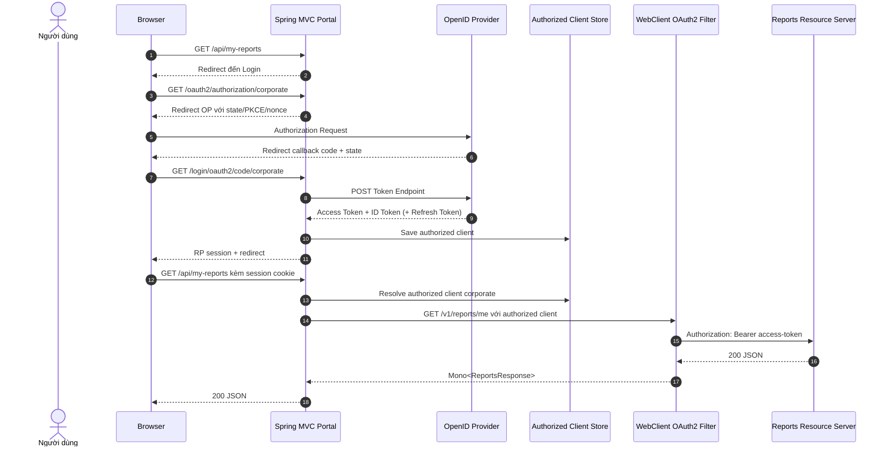

# 34.5. Gọi API bằng WebClient trong ứng dụng Servlet

> **Module:** Spring Security OAuth 2.0 OIDC Client  
> **Chương:** 34. Bài thực hành  
> **Bài lab:** Một ứng dụng **Spring MVC/Servlet** cho phép người dùng đăng nhập qua OpenID Connect, sau đó gọi Resource Server bằng **Spring WebClient**, gửi đúng OAuth2 access token trong header `Authorization: Bearer ...`. Bài mở rộng sang Client Credentials, refresh token, xử lý 401/403 và kiểm thử tích hợp.

Một ứng dụng Spring Boot chạy Servlet không bắt buộc phải dùng `RestTemplate` hoặc `RestClient` cho mọi HTTP call. Nó vẫn có thể dùng `WebClient` — HTTP client dựa trên Reactor — trong khi request phía server tiếp tục được xử lý qua `DispatcherServlet`, `HttpServletRequest` và `SecurityFilterChain`. Spring Security hỗ trợ trường hợp này bằng **`ServletOAuth2AuthorizedClientExchangeFilterFunction`**, một `ExchangeFilterFunction` biết cách tìm hoặc cấp `OAuth2AuthorizedClient` rồi gửi access token tới Resource Server.

Điểm khó của bài không phải cú pháp `webClient.get().retrieve()`. Các lỗi thường gặp nằm ở **chọn sai client/registration**, nhầm **ID Token** với **access token**, dùng authorization của người A trong lời gọi của người B, mất Servlet request/security context khi thực thi bất đồng bộ, hoặc gắn Bearer token mặc định lên mọi outbound URL. Cũng cần phân biệt thời điểm token đã tồn tại sau OIDC Login với trường hợp machine-to-machine phải xin token bằng Client Credentials.

Bài triển khai một ví dụ tự chứa, sau đó chỉ ra những điểm thay đổi nếu project dùng Spring Security 6.x/7.x, Servlet async, nhiều instance hoặc một OP thật.

---

## 1. Kết quả mong đợi

Sau khi làm xong lab, người học có thể:

1. Chạy ứng dụng Servlet có `oauth2Login()` và cấu hình một OIDC Client registration.
2. Đăng nhập browser qua Authorization Code Flow.
3. Nhận `OAuth2AuthorizedClient` theo registration của người đã login.
4. Tạo WebClient có `ServletOAuth2AuthorizedClientExchangeFilterFunction`.
5. Gọi API reports bằng WebClient và kiểm tra Bearer header được thêm tự động.
6. Chọn giữa `.attributes(oauth2AuthorizedClient(...))` và `.attributes(clientRegistrationId(...))`.
7. Giải thích khi nào `.block()` chấp nhận được trong Spring MVC và khi nào không.
8. Hiểu `OAuth2AuthorizedClientManager` cấp token mới, refresh token và lưu authorized client như thế nào.
9. Không vô tình gửi một token tới API không đúng audience, issuer hoặc tenant.
10. Dùng `AuthorizedClientServiceOAuth2AuthorizedClientManager` cho công việc ngoài Servlet request.
11. Phân biệt `ServletOAuth2AuthorizedClientExchangeFilterFunction` với phiên bản `ServerOAuth2AuthorizedClientExchangeFilterFunction` của WebFlux.
12. Kiểm thử happy path, anonymous request, sai quyền, 401, 403, token hết hạn và không lộ credentials.
13. Đánh giá khi nào nên dùng `RestClient` thay cho WebClient trong Servlet.
14. Có checklist cấu hình production, timeout, HTTP error handling, logging và token-store.

## 2. Tình huống thực hành

Giả sử hệ thống **Report Portal** có hai dịch vụ:

- **Portal/Relying Party (RP):** Spring Boot Servlet app, phục vụ browser, đăng nhập OIDC với registration `corporate`.
- **Reports API/Resource Server (RS):** Dịch vụ riêng tại `https://reports-api.example.test`; yêu cầu một **access token** có audience/scope phù hợp.

Người dùng thực hiện:

```text
Browser -> GET https://portal.example.test/api/my-reports
                |
                v
       Spring MVC Controller
                |
          SecurityContext
                |
       OAuth2AuthorizedClient
                |
         WebClient + OAuth2 Filter
                |
       GET https://reports-api.example.test/v1/reports/me
       Authorization: Bearer <access-token>
                |
                v
             JSON response
                |
                v
       Spring MVC trả JSON về browser
```

Browser **không trực tiếp nhận access token** trong ví dụ backend-for-frontend này. Portal là confidential OAuth2 Client, giữ authorized client/token ở phía server. Điều này giảm việc token xuất hiện trong JavaScript/browser storage, nhưng yêu cầu bảo vệ session, token store và server-to-server requests.

## 3. Phân biệt ba loại token hoặc thông tin xác thực

| Thành phần | Nguồn | Dùng để làm gì? | Có gửi tới Reports API? |
|---|---|---|---|
| `ID Token` | OP cấp trong OIDC Login | RP xác minh danh tính người dùng, issuer/audience/nonce | **Không** dùng làm Bearer API token |
| `Access Token` | AS cấp cho scope/resource cụ thể | Client gọi Resource Server đã được phép | **Có**, nếu audience/scope/sender constraints đúng |
| `Refresh Token` | AS có thể cấp | Client gọi Token Endpoint xin access token mới | **Không** gửi tới Reports API |
| `Client secret` | Secret của confidential Client | Client authentication tại Token Endpoint | **Không** gửi tới Reports API |
| RP session cookie | RP tạo cho browser | Browser giữ phiên đăng nhập Portal | Không chuyển tiếp sang Reports API |
| `OAuth2AuthorizedClient` | Spring Security lưu | Gom registration, principal và access/refresh token | Object ở server, filter trích access token |

Đặc biệt: một access token nhận từ OIDC login **không mặc định** có quyền gọi bất kỳ API nào. OP phải cấp token cho đúng Resource Server. Nếu token chỉ phục vụ UserInfo hoặc không có `aud`/scope mà Reports API chấp nhận, phải yêu cầu grant/resource/scope đúng theo hợp đồng provider.

## 4. Servlet WebClient không biến backend thành WebFlux

Hai sơ đồ dưới đây khác nhau.

**Bài này:**

```text
Spring MVC Controller (Servlet thread)
   -> WebClient (reactive HTTP client)
   -> External API
   -> Mono<T>
   -> block() ở ranh giới MVC (khi thực sự cần synchronous response)
```

**Ứng dụng WebFlux server thuần:**

```text
WebFlux Handler (reactive event loop)
   -> WebClient
   -> Mono<T> / Flux<T> trả thẳng
   -> SecurityWebFilterChain / Reactor Context
```

Trong Servlet app, Spring Security principal thường nằm trong `SecurityContextHolder` gắn với request thread, và HTTP request/response nằm trong Servlet scope. Trong WebFlux, framework dựa trên `ServerWebExchange` và reactive security context.

**Không dùng `ServerOAuth2AuthorizedClientExchangeFilterFunction` của WebFlux để thay filter Servlet** chỉ vì cùng có WebClient trong tên. Bài này dùng `ServletOAuth2AuthorizedClientExchangeFilterFunction`.

## 5. Các thành phần sẽ dùng

| Class / API | Vai trò trong lab |
|---|---|
| `SecurityFilterChain` | Bảo vệ browser endpoints và kích hoạt OIDC Login |
| `ClientRegistrationRepository` | Lưu cấu hình `corporate`: Client ID, issuer, redirect URI, scope |
| `OAuth2AuthenticationToken` | Authentication sau OAuth2/OIDC Login |
| `OAuth2AuthorizedClient` | Chứa access token, optional refresh token và registration |
| `OAuth2AuthorizedClientRepository` | Lưu/load authorized client theo Servlet request |
| `OAuth2AuthorizedClientService` | Lưu/load theo registration và principal name |
| `OAuth2AuthorizedClientManager` | Cấp, refresh và quản lý authorized client |
| `ServletOAuth2AuthorizedClientExchangeFilterFunction` | Gắn Bearer access token lên WebClient request |
| `@RegisteredOAuth2AuthorizedClient` | Resolve authorized client trong Spring MVC handler |
| `WebClient` | Gọi Reports API theo HTTP |
| `Mono<T>` | Đại diện kết quả bất đồng bộ của WebClient |
| `MockMvc` | Kiểm thử Servlet controller/security chain |
| Fake OP / fake RS | Test login/token exchange, Bearer header và error paths |

## 6. Luồng end-to-end của bài thực hành



Khi access token gần hết hạn, authorized-client manager có thể refresh theo provider/manager configuration và lưu record mới. Không suy rằng mỗi HTTP request đều thực hiện một token exchange.

## 7. Yêu cầu và phiên bản

Ví dụ dành cho **Spring Boot 3.x + Spring Security 6.x** theo phong cách Java 17+/Jakarta Servlet; những API được nhắc tới cũng có thể tồn tại trong Spring Security 7.x với version tương thích. Không ghim tùy tiện một Spring Security version khác Boot BOM.

Cần:

- Java và build tool tương thích Spring Boot project.
- Một OIDC OP sandbox/fake OP có Client registration.
- Một Reports API giả hoặc thật đã được cấu hình cho access-token audience/scope.
- HTTPS cho external deployment; localhost/test có thể dùng test issuer phù hợp.
- Test Client ID/secret riêng, không phải production secrets.

**Lưu ý:** Spring Security 6.4+ cung cấp `RestClient` integration mới. Bài này cố ý dùng **WebClient trên Servlet** theo yêu cầu thực hành; RestClient chỉ được so sánh ở phần sau.

## 8. Dependencies Gradle

```kotlin
dependencies {
    implementation("org.springframework.boot:spring-boot-starter-web")
    implementation("org.springframework.boot:spring-boot-starter-security")
    implementation("org.springframework.boot:spring-boot-starter-oauth2-client")

    // WebClient và HTTP connector; không biến ứng dụng thành
    // một WebFlux server khi Servlet starter cũng hiện diện.
    implementation("org.springframework.boot:spring-boot-starter-webflux")

    testImplementation("org.springframework.boot:spring-boot-starter-test")
    testImplementation("org.springframework.security:spring-security-test")
    testImplementation("io.projectreactor:reactor-test")
}
```

Trong Spring Boot, khi cả MVC và WebFlux starters có mặt, mặc định ứng dụng thường chọn **Servlet WebApplicationType**. Có thể cấu hình rõ:

```yaml
spring:
  main:
    web-application-type: servlet
```

Cấu hình này chỉ minh họa khi cần cố định stack. Việc có `spring-boot-starter-webflux` không đồng nghĩa controller lập tức trở thành reactive controller/ServerHttpSecurity.

### 8.1. Nếu project chỉ muốn WebClient

Tùy build policy, có thể thêm những modules cần thiết của `spring-webflux`/Reactor Netty thay vì cả starter. Khi đó phải chủ động chọn HTTP connector. Với bài lab học tập, starter-webflux giúp cấu hình đơn giản hơn và dễ có HTTP connector hoạt động.

### 8.2. Maven

Tương đương là các starters `spring-boot-starter-web`, `spring-boot-starter-security`, `spring-boot-starter-oauth2-client`, `spring-boot-starter-webflux`, cùng `spring-boot-starter-test` và `spring-security-test` ở scope `test`.

## 9. Tổ chức source code

```text
src/main/java/example/portal/
  ReportPortalApplication.java
  config/
    SecurityConfiguration.java
    ReportsWebClientConfiguration.java
  api/
    ReportsController.java
    ReportsApiClient.java
    ReportDto.java
    ReportsApiExceptionHandler.java

src/main/resources/
  application.yml
  application-dev.yml

src/test/java/example/portal/
  ReportsApiClientTest.java
  ReportsControllerSecurityTest.java
  OidcLoginIntegrationTest.java
```

Đây là cấu trúc tham khảo; không bắt buộc tên class/folder. Với lab tối thiểu, bạn có thể tạo toàn bộ class trong một project nhưng vẫn giữ **responsibilities riêng biệt**: Security config, HTTP client config, outbound API adapter và browser-facing controller.

## 10. Cấu hình ClientRegistration cho OIDC Login

```yaml
# application.yml — các URL dưới đây là ví dụ, cần OP thật/fake OP.
spring:
  security:
    oauth2:
      client:
        registration:
          corporate:
            provider: corporate-op
            client-id: ${OIDC_CLIENT_ID}
            client-secret: ${OIDC_CLIENT_SECRET}
            authorization-grant-type: authorization_code
            client-authentication-method: client_secret_basic
            redirect-uri: "{baseUrl}/login/oauth2/code/{registrationId}"
            scope:
              - openid
              - profile
              - reports.read
        provider:
          corporate-op:
            issuer-uri: https://login.example.test/realms/corporate

reports:
  api:
    base-url: https://reports-api.example.test
```

**Ý nghĩa:**

- `corporate` là **registration ID** phía Spring Security, được dùng trong `/oauth2/authorization/corporate`, callback và authorized-client lookup.
- `provider: corporate-op` liên kết registration với provider metadata.
- `issuer-uri` phải khớp `iss` của ID Token và OIDC Discovery; không chỉ là hostname tùy ý.
- `client-id` và `client-secret` đến từ OP; không commit secret vào Git.
- `redirect-uri` phải trùng URI đã đăng ký với OP sau proxy/HTTPS.
- `reports.read` chỉ có ý nghĩa nếu OP/RS đã định nghĩa scope đó; có thể cần `resource`/`audience` theo provider.
- `openid` là scope cần thiết để kích hoạt OIDC Login; không bỏ nó rồi vẫn mong có ID Token.
- `reports.api.base-url` tách Resource Server URL khỏi OP issuer.

### 10.1. Không dùng access token sai audience

Giả sử OP cấp access token cho UserInfo endpoint nhưng Reports API yêu cầu `aud=reports-api`. Chỉ thêm `reports.read` trong YAML chưa chắc đủ để audience đúng; hãy kiểm tra hợp đồng OP/RS, authorization request resolver và token customization theo provider.

### 10.2. Bí mật theo môi trường

```text
OIDC_CLIENT_ID=portal-dev
OIDC_CLIENT_SECRET=<managed-test-secret>
```

Trên production, dùng secret manager/Kubernetes Secret/managed identity tương ứng; không để secret trong image, source code, ticket hoặc HTTP logs.

## 11. Cấu hình SecurityFilterChain

```java
package example.portal.config;

import org.springframework.context.annotation.Bean;
import org.springframework.context.annotation.Configuration;
import org.springframework.security.config.annotation.web.builders.HttpSecurity;
import org.springframework.security.web.SecurityFilterChain;

@Configuration
public class SecurityConfiguration {

    @Bean
    SecurityFilterChain securityFilterChain(HttpSecurity http)
            throws Exception {

        return http
            .authorizeHttpRequests(auth -> auth
                .requestMatchers(
                    "/", "/public/**", "/error"
                ).permitAll()
                .requestMatchers("/api/**").authenticated()
                .anyRequest().authenticated()
            )
            .oauth2Login(login -> {})
            .oauth2Client(client -> {})
            .build();
    }
}
```

Đây là baseline cho bài học. Spring Security xử lý đăng nhập OIDC và xác minh ID Token trong login pipeline, không phải controller tự parse ID Token.

### 11.1. Có cần thêm /oauth2/authorization/** và callback vào permitAll?

Spring Security đặt các OAuth2 Authorization Request/Callback filters trong filter chain với cơ chế xử lý riêng. Trên một cấu hình sản phẩm có nhiều chains hoặc custom matchers, hãy xác minh các URL khởi tạo và callback được security filters xử lý đúng. Không mở `permitAll()` tràn lan cho `/api/**` chỉ để giải quyết lỗi redirect.

### 11.2. CSRF

Trong web app dùng browser session, để CSRF protection theo Spring Security defaults trừ khi có threat model và policy khác. GET `/api/my-reports` là read-only; các state-changing endpoints cần CSRF tests riêng.

### 11.3. Login thành công không có nghĩa API call thành công

Sau khi user login, `/api/my-reports` có thể vẫn trả lỗi do:

- Không có authorized client đúng registration.
- Access token hết hạn hoặc bị revoke.
- Token audience/scope không phù hợp.
- Reports API không có dữ liệu hoặc đang lỗi.
- Mạng/proxy/TLS không kết nối được.

Mục đích của phần kế tiếp là xử lý những trách nhiệm đó một cách rõ ràng.

## 12. OAuth2AuthorizedClientManager quản lý token như thế nào?

`OAuth2AuthorizedClientManager` là abstraction chung để authorize hoặc re-authorize một client. Nó sử dụng `OAuth2AuthorizedClientProvider` theo các grant types:

```text
OAuth2AuthorizedClientManager
    |
    +--> AuthorizationCode provider
    |
    +--> RefreshToken provider
    |
    +--> ClientCredentials provider
    |
    +--> AuthorizedClientRepository / AuthorizedClientService
```

Trong request sau OIDC Login, manager có thể đọc authorized client đã lưu. Nếu access token đã hết hạn, refresh-token provider có thể gọi Token Endpoint xin token mới nếu AS cấp refresh token và đủ điều kiện.

### 12.1. Quản lý token không phải tự cấp scope

Manager không biến token thiếu `reports.read` thành token đủ quyền. Nó chỉ vận hành theo ClientRegistration, grant data và provider configuration. Việc scope/audience/consent thuộc AS/RS contract.

### 12.2. Khi nào cần tự khai báo manager bean?

Ở một số Spring Security versions mới (đặc biệt 6.2+), framework có thể tạo mặc định các beans phù hợp khi có client registration infrastructure. Nhưng nếu cần custom grant providers, token store, failure handlers hoặc background jobs, bạn có thể khai báo manager tường minh. Hãy kiểm tra bean được dùng thực tế, tránh tạo **hai managers** mà filter và controller dùng khác nhau.

## 13. Ví dụ OAuth2AuthorizedClientManager trên Servlet

Nếu muốn chỉ rõ các grants được hỗ trợ, có thể dùng:

```java
package example.portal.config;

import org.springframework.context.annotation.Bean;
import org.springframework.context.annotation.Configuration;
import org.springframework.security.oauth2.client.OAuth2AuthorizedClientManager;
import org.springframework.security.oauth2.client.OAuth2AuthorizedClientProvider;
import org.springframework.security.oauth2.client.OAuth2AuthorizedClientProviderBuilder;
import org.springframework.security.oauth2.client.registration.ClientRegistrationRepository;
import org.springframework.security.oauth2.client.web.DefaultOAuth2AuthorizedClientManager;
import org.springframework.security.oauth2.client.web.OAuth2AuthorizedClientRepository;

@Configuration
public class AuthorizedClientConfiguration {

    @Bean
    OAuth2AuthorizedClientManager authorizedClientManager(
            ClientRegistrationRepository registrations,
            OAuth2AuthorizedClientRepository authorizedClients) {

        OAuth2AuthorizedClientProvider provider =
            OAuth2AuthorizedClientProviderBuilder.builder()
                .authorizationCode()
                .refreshToken()
                .clientCredentials()
                .build();

        DefaultOAuth2AuthorizedClientManager manager =
            new DefaultOAuth2AuthorizedClientManager(
                registrations, authorizedClients);

        manager.setAuthorizedClientProvider(provider);
        return manager;
    }
}
```

Trong lab một request đăng nhập browser, `DefaultOAuth2AuthorizedClientManager` phù hợp vì có Servlet request/response và repository. Nếu version đang sử dụng tự cấu hình manager mặc định đúng yêu cầu, có thể **không cần** bean này.

### 13.1. Không dùng manager Servlet-request cho scheduler

`DefaultOAuth2AuthorizedClientManager` phụ thuộc ngữ cảnh Servlet request trong nhiều trường hợp. Scheduled job/queue consumer không có `HttpServletRequest`. Phần machine-to-machine phía sau sẽ dùng `AuthorizedClientServiceOAuth2AuthorizedClientManager`.

## 14. WebClient bean với Servlet OAuth2 filter

Đây là điểm trung tâm của bài thực hành:

```java
package example.portal.config;

import org.springframework.beans.factory.annotation.Value;
import org.springframework.context.annotation.Bean;
import org.springframework.context.annotation.Configuration;
import org.springframework.security.oauth2.client.OAuth2AuthorizedClientManager;
import org.springframework.security.oauth2.client.web.reactive.function.client.ServletOAuth2AuthorizedClientExchangeFilterFunction;
import org.springframework.web.reactive.function.client.WebClient;

@Configuration
public class ReportsWebClientConfiguration {

    @Bean
    WebClient reportsWebClient(
            OAuth2AuthorizedClientManager authorizedClientManager,
            @Value("${reports.api.base-url}") String reportsApiBaseUrl) {

        ServletOAuth2AuthorizedClientExchangeFilterFunction oauth2 =
            new ServletOAuth2AuthorizedClientExchangeFilterFunction(
                authorizedClientManager);

        return WebClient.builder()
            .baseUrl(reportsApiBaseUrl)
            .apply(oauth2.oauth2Configuration())
            .build();
    }
}
```

**Cơ chế:**

1. `ServletOAuth2AuthorizedClientExchangeFilterFunction` cài filter lên WebClient.
2. `oauth2Configuration()` đồng thời cấu hình phần `defaultRequest()` để lấy Servlet request/response và Authentication khi phù hợp.
3. Khi outbound request có một `OAuth2AuthorizedClient` hoặc `clientRegistrationId` attribute, filter chọn đúng client.
4. Filter/manager xử lý token theo khả năng của providers.
5. Request được gửi với header `Authorization: Bearer <access-token>`.

### 14.1. Tại sao không setDefaultOAuth2AuthorizedClient(true) ở đây?

Theo thiết kế an toàn mặc định, **mỗi outbound call chỉ mang token khi bạn chọn rõ authorized client/registration**. Nếu bật default OAuth2 authorized client trên một WebClient dùng chung, mọi HTTP request có thể nhận token của principal hiện tại, kể cả request tới host không mong muốn. Đây là rủi ro token exfiltration.

### 14.2. Không có Authorization header cho request không chỉ định client?

Theo cấu hình trên, khi không có authorized client/clientRegistrationId/default được xác định, filter không tự đoán “gửi token user hiện tại tới mọi API”. Đây là thiết kế có lợi cho bảo mật; tránh thay bằng một global filter tự đọc và gắn access token vào tất cả requests.

## 15. Phương án A: chọn OAuth2AuthorizedClient tường minh

Đây là phương án dễ hiểu và có ranh giới bảo mật rõ nhất cho lab.

Tại Spring MVC controller, dùng:

```java
import org.springframework.security.oauth2.client.OAuth2AuthorizedClient;
import org.springframework.security.oauth2.client.annotation.RegisteredOAuth2AuthorizedClient;

@GetMapping("/api/my-reports")
public ResponseEntity<ReportDto[]> myReports(
        @RegisteredOAuth2AuthorizedClient("corporate")
        OAuth2AuthorizedClient authorizedClient) {

    ReportDto[] data = reportsApiClient.fetchMyReports(authorizedClient);
    return ResponseEntity.ok(data);
}
```

`@RegisteredOAuth2AuthorizedClient` được xử lý bởi Spring MVC argument resolver của Spring Security, có thể dùng manager để tìm/authorize client theo registration và current principal.

### 15.1. Vì sao truyền object rõ ràng?

- Controller biết registration nào được phép cho nghiệp vụ reports.
- Service có token gắn với principal/session phù hợp.
- Không cần service đọc `SecurityContextHolder` sâu bên trong.
- Test service có thể tạo authorized-client fixture và gọi trực tiếp.
- WebClient không tự gửi token nếu service quên attributes.
- Dễ audit khi có nhiều providers và API targets.

### 15.2. Không serialize OAuth2AuthorizedClient cho browser

Object này có thể chứa access/refresh token. Chỉ chuyển vào method server-side; **không** đặt nó trong ResponseEntity, JSON, logs, caching public hay browser localStorage.

## 16. DTO đại diện Reports API

```java
package example.portal.api;

public record ReportDto(
    String id,
    String title,
    String status
) {}
```

Giả sử Reports API trả:

```json
[
  {"id":"r-101","title":"Quarterly summary","status":"READY"},
  {"id":"r-102","title":"Expense overview","status":"DRAFT"}
]
```

DTO chỉ chứa dữ liệu dành cho người dùng hiện tại. API thật còn phải kiểm tra ownership/tenant/authorization; Portal không được coi việc có Bearer token là bằng chứng user được xem mọi report.

## 17. ReportsApiClient: gắn authorized client lên request

```java
package example.portal.api;

import java.time.Duration;
import org.springframework.stereotype.Service;
import org.springframework.security.oauth2.client.OAuth2AuthorizedClient;
import org.springframework.web.reactive.function.client.WebClient;

import static org.springframework.security.oauth2.client.web.reactive.function.client.ServletOAuth2AuthorizedClientExchangeFilterFunction.oauth2AuthorizedClient;

@Service
public class ReportsApiClient {

    private final WebClient reportsWebClient;

    public ReportsApiClient(WebClient reportsWebClient) {
        this.reportsWebClient = reportsWebClient;
    }

    public ReportDto[] fetchMyReports(
            OAuth2AuthorizedClient authorizedClient) {

        ReportDto[] reports = reportsWebClient
            .get()
            .uri("/v1/reports/me")
            .attributes(oauth2AuthorizedClient(authorizedClient))
            .retrieve()
            .bodyToMono(ReportDto[].class)
            .block(Duration.ofSeconds(5));

        return reports == null ? new ReportDto[0] : reports;
    }
}
```

### 17.1. Giải thích từng dòng quan trọng

- `.get()`: outbound method GET, không phải browser GET.
- `.uri("/v1/reports/me")`: relative path theo `baseUrl` cố định đã cấu hình.
- `.attributes(oauth2AuthorizedClient(authorizedClient))`: gắn authorized client **cho duy nhất request này**.
- `.retrieve()`: lấy response, chuyển non-2xx thành error theo behavior WebClient mặc định/handlers.
- `.bodyToMono(ReportDto[].class)`: deserialize JSON khi nhận response.
- `.block(Duration.ofSeconds(5))`: chuyển Mono thành kết quả đồng bộ ở **ranh giới Spring MVC** có timeout.

### 17.2. Có nên trả [] khi block trả null?

Ví dụ dùng mảng rỗng nếu response không có body, để đơn giản hóa lab. Trong production, một Reports API trả 204 có thể có semantics khác trả danh sách rỗng; hãy quyết định theo API contract. Không che HTTP 401/403/5xx bằng cách trả mảng rỗng vô điều kiện.

### 17.3. Vì sao không tự header bearer thủ công?

Có thể viết:

```java
// KHÔNG phải hướng khuyến nghị cho OAuth2 Client.
.header("Authorization",
    "Bearer " + authorizedClient.getAccessToken().getTokenValue())
```

nhưng đó là xử lý token thủ công, không tự hưởng toàn bộ lifecycle/failure behavior của OAuth2 filter/manager, dễ bị copy vào logs hoặc gửi sai endpoint. Ưu tiên `oauth2AuthorizedClient(...)` khi dùng WebClient tích hợp Spring Security.

## 18. Controller đầy đủ cho lab

```java
package example.portal.api;

import org.springframework.http.ResponseEntity;
import org.springframework.security.oauth2.client.OAuth2AuthorizedClient;
import org.springframework.security.oauth2.client.annotation.RegisteredOAuth2AuthorizedClient;
import org.springframework.web.bind.annotation.GetMapping;
import org.springframework.web.bind.annotation.RestController;

@RestController
public class ReportsController {

    private final ReportsApiClient reportsApiClient;

    public ReportsController(ReportsApiClient reportsApiClient) {
        this.reportsApiClient = reportsApiClient;
    }

    @GetMapping("/api/my-reports")
    public ResponseEntity<ReportDto[]> myReports(
            @RegisteredOAuth2AuthorizedClient("corporate")
            OAuth2AuthorizedClient authorizedClient) {

        return ResponseEntity.ok(
            reportsApiClient.fetchMyReports(authorizedClient)
        );
    }
}
```

Trong case này, role/scope của Reports API vẫn do Resource Server quyết định. Controller nên có authorization riêng nếu endpoint chứa dữ liệu nhạy cảm; `authenticated()` chỉ là yêu cầu đã đăng nhập.

## 19. Tại sao @RegisteredOAuth2AuthorizedClient là một abstraction hữu ích?

Nếu controller tự đọc:

```java
SecurityContextHolder.getContext().getAuthentication()
```

rồi truy vấn authorized client từ service, bạn phải giải quyết thủ công registration ID, principal name và token refresh. Annotation/argument resolver cho phép framework thực hiện nhiều phần trong phạm vi request Servlet.

Tuy nhiên:

- Nó chỉ hoạt động trong môi trường Spring MVC controller argument resolution đúng configuration.
- Phải có ClientRegistration và authorized client.
- Không có nghĩa mỗi request được phép tự cấp scope mới không cần OP/consent.
- Nếu session/token bị revoke, resolver có thể fail và flow cần xử lý an toàn.
- Test `@WithMockUser` không tự tạo OAuth2AuthorizedClient cho annotation.

## 20. Phương án B: chọn clientRegistrationId ngay trên WebClient

Nếu không muốn truyền object authorized client, có thể dùng:

```java
import static org.springframework.security.oauth2.client.web.reactive.function.client.ServletOAuth2AuthorizedClientExchangeFilterFunction.clientRegistrationId;

ReportDto[] reports = reportsWebClient
    .get()
    .uri("/v1/reports/me")
    .attributes(clientRegistrationId("corporate"))
    .retrieve()
    .bodyToMono(ReportDto[].class)
    .block(Duration.ofSeconds(5));
```

Trong Servlet request, `oauth2Configuration()` cung cấp default request context và Authentication; manager có thể tìm authorized client theo `corporate` và principal hiện tại, refresh nếu cần.

### 20.1. So sánh hai cách

| Tiêu chí | Truyền `oauth2AuthorizedClient(client)` | Truyền `clientRegistrationId("corporate")` |
|---|---|---|
| Tính tường minh | Cao, object cụ thể | Cao, registration cụ thể |
| Controller phải resolve client? | Có, nếu dùng annotation | Không bắt buộc |
| Dễ unit-test service | Dễ tạo fixture object | Cần manager/repository context khi test integration |
| Liên kết principal | Đã gắn trong object | Filter/manager cần đúng Authentication |
| Refresh/re-authorization | Tùy provider/manager và state | Tùy provider/manager và state |
| Nguy cơ gửi sai token | Vẫn có nếu truyền nhầm object | Có nếu chọn nhầm registration |
| Background job | Có thể dùng với service manager | Cần principal/context phù hợp |

**Đừng lấy registration ID trực tiếp từ query parameter của browser** rồi cho API chọn bất kỳ ClientRegistration nào: user có thể ép Portal dùng token của một tenant/Client khác. Chọn registration từ server-side allowlist/business mapping.

## 21. Có cần bật setDefaultOAuth2AuthorizedClient(true)?

API:

```java
ServletOAuth2AuthorizedClientExchangeFilterFunction oauth2 =
    new ServletOAuth2AuthorizedClientExchangeFilterFunction(manager);

oauth2.setDefaultOAuth2AuthorizedClient(true);
```

Khi đó filter có thể dùng OAuth2 authorized client liên quan với current `OAuth2AuthenticationToken` nếu request không chỉ định client.

### 21.1. Nguy cơ

Nếu WebClient được chia sẻ cho nhiều outbound hosts, request nào cũng có thể mang access token dù host đó không phải Resource Server đã được token cấp cho.

```text
WebClient chung:
  GET https://reports-api.example.test/...   -> token hợp lệ
  GET https://status.external.example/...     -> có thể gửi nhầm token
```

### 21.2. Khuyến nghị bài lab

Giữ default **false**, dùng `.attributes(...)` rõ ràng và giới hạn `baseUrl`/destinations. Nếu có thiết kế đặc biệt muốn default, phải có một WebClient bean **dedicated** chỉ gọi trusted API và test chống SSRF/redirect/token forwarding.

## 22. setDefaultClientRegistrationId có rủi ro tương tự

```java
oauth2.setDefaultClientRegistrationId("corporate");
```

Thiết lập này có thể khiến mọi outbound request trên WebClient đó được chọn registration mặc định, kể cả một request bị chuyển đến host khác.

Nó không thay cho:

- Strict allowed host/path.
- Audience/scope validation.
- Resource server authorization.
- Tenant isolation.
- HTTP redirect policy.
- Explicit caller intent.

Dùng cho dedicated client chỉ khi đã đánh giá kỹ; bài thực hành dùng request attribute.

## 23. Filter của Servlet và WebFlux khác nhau

| Khía cạnh | Servlet app dùng WebClient | WebFlux server dùng WebClient |
|---|---|---|
| Filter class | `ServletOAuth2AuthorizedClientExchangeFilterFunction` | `ServerOAuth2AuthorizedClientExchangeFilterFunction` |
| Security configuration | `HttpSecurity` / `SecurityFilterChain` | `ServerHttpSecurity` / `SecurityWebFilterChain` |
| Context | Servlet request/response, SecurityContextHolder | ServerWebExchange, Reactor Context |
| Authorized client repository | `OAuth2AuthorizedClientRepository` | `ServerOAuth2AuthorizedClientRepository` |
| Manager | `OAuth2AuthorizedClientManager` | `ReactiveOAuth2AuthorizedClientManager` |
| UI controller | Spring MVC | WebFlux handler |
| Blocking | Có thể tại boundary Servlet có kiểm soát | Không block event loop |

Một project có cả starters có thể vẫn chạy Servlet. Xác định thực tế bằng WebApplicationType, auto-configuration và filter chain, không nhìn tên WebClient.

## 24. Vấn đề quan trọng: .block() trong Spring MVC

`WebClient` trả reactive publishers như `Mono`/`Flux`. Nhưng một MVC controller có chữ ký:

```java
public ResponseEntity<ReportDto[]> myReports(...)
```

cần một giá trị đồng bộ trước khi trả response. Khi đó `.block(Duration)` trong request processing thread của Servlet **có thể chấp nhận được** vì Servlet model vốn blocking.

### 24.1. Đổi lại, bạn mất ưu điểm nonblocking ở controller boundary

- Một request Servlet thread phải chờ API response.
- Số lượng concurrent requests bị giới hạn bởi thread pool, connection pool và timeout.
- WebClient HTTP transport có thể nonblocking, nhưng thread gọi `block()` vẫn bị chặn.
- Timeout của `block(Duration)` là giới hạn ở subscriber boundary, **không thay** cấu hình connect/response timeouts ở HTTP connector.
- Nên xem retry/queue/circuit-breaker và capacity khi Reports API chậm.

### 24.2. Không block trong Reactor event loop

Không áp nguyên xi:

```java
return webClient.get()
    .retrieve()
    .bodyToMono(ReportDto[].class)
    .map(items -> someOtherMono.block());
```

trong WebFlux event loop. Reactive service nên compose publishers bằng `flatMap` và trả `Mono`/`Flux`.

## 25. Có thể trả Mono từ Spring MVC không?

Spring MVC có hỗ trợ một số reactive return types khi WebFlux/reactive adapters có mặt. Tuy nhiên, **đây vẫn là Servlet stack**, không tự trở thành WebFlux server.

Cần phân biệt:

- API/controller được xử lý bất đồng bộ.
- Servlet request context còn hợp lệ ở thời điểm nào.
- Spring Security `SecurityContextHolder`/RequestContextHolder có được propagate đến async thread không.
- OAuth2 filter cần tìm authorized client trước hay sau khi request context bị giải phóng.
- Error handling, timeout và servlet async dispatch lifecycle.

Với lab ban đầu, dùng cách **resolve `OAuth2AuthorizedClient` trong controller rồi truyền tường minh** để tránh lệ thuộc vào thread-local context ở bước WebClient reactive chain sau này.

## 26. Servlet SecurityContextHolder và Reactor Context

Servlet Spring Security truyền Authentication qua `SecurityContextHolder`, thông thường dựa vào ThreadLocal. WebClient chạy reactive HTTP I/O trên các threads khác.

Nếu bạn:

```java
Mono<ReportDto[]> publisher = reportsWebClient
    .get()
    .uri("/v1/reports/me")
    .attributes(clientRegistrationId("corporate"))
    .retrieve()
    .bodyToMono(ReportDto[].class);

// Đem publisher sang scheduler khác rồi subscribe sau...
```

Servlet Authentication/HttpServletRequest có thể không còn khi filter cần resolve. Spring Security có `defaultRequest()` để capture request-context attributes, nhưng bạn không nên suy nó giải quyết mọi subscription/time-of-use race ngoài request.

### 26.1. Hướng an toàn cho async workflows

- Resolve authorized client/context ở điểm tin cậy.
- Truyền những object/capabilities tối thiểu một cách tường minh vào flow.
- Không lưu raw token trong global static variables hoặc Reactor Context tùy tiện.
- Khi cần refresh sau khi request kết thúc, dùng manager/service **phù hợp ngoài Servlet request**.
- Không tự `subscribe()` trong controller rồi trả 200 trước khi biết API call thành công.
- Giới hạn lifetime, cancellation và ownership của task.

## 27. Đừng tự subscribe() trong controller

Phản ví dụ:

```java
@GetMapping("/api/my-reports")
String wrong() {
    reportsWebClient.get()
        .uri("/v1/reports/me")
        .retrieve()
        .bodyToMono(String.class)
        .subscribe(value -> log.info("result={}", value));
    return "OK";
}
```

Vấn đề:

- Controller trả 200 khi API chưa hoàn tất.
- Exceptions có thể xảy ra sau response.
- Servlet request/security context có thể đã kết thúc.
- Không có backpressure/timeout/transaction boundary rõ.
- Log raw payload có thể lộ thông tin.

Thay bằng `block(Duration)` ở MVC sync boundary hoặc async MVC pattern có managed context propagation và proper completion/error handling.

## 28. Xử lý HTTP 401 từ Reports API

Reports API có thể trả 401 do:

- Access token hết hạn, không hợp lệ hoặc đã revoke.
- Token sai issuer/audience.
- Thiếu Bearer header.
- RS cần token khác.
- Clock skew/JWKS verification failure.

WebClient `retrieve()` thường phát exception như `WebClientResponseException.Unauthorized` đối với response 401. Nhưng **401 từ RS không đồng nghĩa nên tự refresh không giới hạn**.

### 28.1. Flow nên làm gì?

1. Kiểm tra status và `WWW-Authenticate` error code (không log token).
2. Nếu có `invalid_token` và failure handler phù hợp, authorized client có thể được remove để request sau re-authorize/refresh theo policy.
3. Không tự retry vô hạn cùng token.
4. Không gửi token sang issuer/endpoint khác như “fallback”.
5. Với browser-user grant không còn hiệu lực, yêu cầu reauthorization/consent lại nếu policy cần.
6. Trả lỗi từ Portal theo API contract, tránh raw provider messages.

### 28.2. Chẩn đoán có mục tiêu

Log an toàn:

```text
event=reports_api_failure
registration=corporate
route=/v1/reports/me
status=401
oauth_error=invalid_token
traceId=opaque-123
```

Không log Bearer header, access token, refresh token hay ID Token.

## 29. HTTP 403 không luôn có nghĩa token hỏng

Một token có thể hợp lệ nhưng thiếu `reports.write` hoặc user không có quyền xem report cụ thể. Reports API có thể trả 403.

Nếu mặc định coi mọi 403 là token invalid rồi xóa authorized client, bạn có thể:

- Gây vòng lặp reauthorization không cải thiện quyền.
- Buộc người dùng login lại dù permission vẫn thiếu.
- Che lỗi tenant ownership.
- Làm tăng tải AS.

Authorization failure handler nên quyết định dựa trên OAuth2 Error semantics và application policy. Không xóa token chỉ vì nhận 403 generic mà không có bằng chứng invalid-token phù hợp.

## 30. Failure handler trong ServletOAuth2AuthorizedClientExchangeFilterFunction

Đây là khác biệt quan trọng giữa hai constructor.

**Constructor dùng manager:**

```java
new ServletOAuth2AuthorizedClientExchangeFilterFunction(manager)
```

Có thể dùng manager/provider chain tùy biến, **nhưng theo Javadoc không tự cấu hình một `RemoveAuthorizedClientOAuth2AuthorizationFailureHandler` để xử lý 401/403 từ Resource Server**.

**Constructor dùng repositories:**

```java
new ServletOAuth2AuthorizedClientExchangeFilterFunction(
    clientRegistrationRepository,
    authorizedClientRepository
)
```

Theo Spring Security Javadoc, constructor này cấu hình failure handler gỡ authorized client theo error codes phù hợp, tùy version.

### 30.1. Có nên dùng constructor repository cho lab?

Có thể, nếu bạn muốn cấu hình đơn giản và không cần manager riêng. Tuy nhiên, khi cần custom providers, token refresh rules hoặc token store phức tạp, constructor manager dễ kiểm soát hơn. Khi đó phải xem xét và gắn authorization failure handler tường minh:

```java
ServletOAuth2AuthorizedClientExchangeFilterFunction oauth2 =
    new ServletOAuth2AuthorizedClientExchangeFilterFunction(manager);

oauth2.setAuthorizationFailureHandler(
    customAuthorizationFailureHandler
);
```

`customAuthorizationFailureHandler` là bean/hàm do ứng dụng tạo theo `OAuth2AuthorizationFailureHandler`. Việc gỡ client cần đúng repository/service và phải phân loại errors cẩn thận.

### 30.2. Không nhầm Token Endpoint và Resource Server failures

- Token Endpoint `invalid_grant`/`invalid_client`: manager/provider có failure handling khi authorize/refresh.
- Reports API 401/403: outbound WebClient filter có thể báo failure cho handler riêng.
- Một handler ở tầng Token Endpoint không tự động làm outbound HTTP response handling tương đương.

## 31. Tạo Failure Handler có kiểm soát cho session repository

Với Spring Security hỗ trợ, có thể tạo `RemoveAuthorizedClientOAuth2AuthorizationFailureHandler` bằng remover callback; chữ ký nhận registration, principal và attributes.

Ví dụ nguyên lý:

```java
OAuth2AuthorizationFailureHandler failureHandler =
    new RemoveAuthorizedClientOAuth2AuthorizationFailureHandler(
        (registrationId, principal, attributes) -> {
            // Chỉ remove khi nhận error code nằm trong allowlist
            // của handler và đã resolve đúng request/response.
            // Repository cho Servlet có method:
            // removeAuthorizedClient(registrationId, principal, request, response)
        }
    );

oauth2.setAuthorizationFailureHandler(failureHandler);
```

Đây là **pseudocode về callback**, chưa có implementation lấy HttpServletRequest/Response từ attributes, không nên copy nguyên code vào production rồi để lambda body rỗng. Nếu dùng authorized-client service, remover có thể gọi `service.removeAuthorizedClient(registrationId, principalName)` sau khi xác minh principal đúng và race policy phù hợp.

### 31.1. Production caution: refresh rotation

Trong cụm nhiều pods, một request cũ nhận `invalid_grant`/`invalid_token` có thể đến sau khi pod khác đã refresh token mới. Failure handler không nên xóa record mới vô điều kiện. Cân nhắc re-read/version/CAS trong persistent token store khi có refresh token rotation.

## 32. Xử lý lỗi trong ReportsApiClient mà không lộ secrets

Có thể chuyển HTTP errors thành domain exceptions:

```java
public ReportDto[] fetchMyReports(
        OAuth2AuthorizedClient authorizedClient) {

    ReportDto[] result = reportsWebClient
        .get()
        .uri("/v1/reports/me")
        .attributes(oauth2AuthorizedClient(authorizedClient))
        .retrieve()
        .onStatus(
            status -> status.value() == 403,
            response -> reactor.core.publisher.Mono.error(
                new ReportsAccessDeniedException()
            )
        )
        .bodyToMono(ReportDto[].class)
        .block(Duration.ofSeconds(5));

    return result == null ? new ReportDto[0] : result;
}
```

Ở đây `ReportsAccessDeniedException` là class **do ứng dụng định nghĩa**; không phải Spring Security API. Với 401, cần thiết kế rõ authorization failure handling và có thể để WebClient phát `WebClientResponseException` để xử lý ở controller advice.

### 32.1. Đừng swallow mọi lỗi

Phản ví dụ:

```java
.onErrorResume(error ->
    Mono.just(new ReportDto[0])
)
```

sẽ biến 401, 403, 500 và timeout thành “không có báo cáo”, làm sản phẩm che lỗi bảo mật/availability. Hãy phân loại và trả status phù hợp theo UI/API contract.

### 32.2. Không trả raw RS response body cho browser

Resource Server có thể trả details chứa internal URLs, tenant identifiers hoặc message nhạy cảm. Controller advice nên map sang error code an toàn, giữ trace ID và không dump toàn bộ exception.

## 33. Ví dụ ControllerAdvice

```java
package example.portal.api;

import org.springframework.http.HttpStatus;
import org.springframework.http.ResponseEntity;
import org.springframework.web.bind.annotation.ExceptionHandler;
import org.springframework.web.bind.annotation.RestControllerAdvice;
import org.springframework.web.reactive.function.client.WebClientResponseException;

@RestControllerAdvice
public class ReportsApiExceptionHandler {

    @ExceptionHandler(ReportsAccessDeniedException.class)
    ResponseEntity<ApiError> denied() {
        return ResponseEntity.status(HttpStatus.FORBIDDEN)
            .body(new ApiError("REPORTS_NOT_AUTHORIZED"));
    }

    @ExceptionHandler(WebClientResponseException.class)
    ResponseEntity<ApiError> upstream(WebClientResponseException ex) {
        if (ex.getStatusCode().value() == 401) {
            return ResponseEntity.status(HttpStatus.BAD_GATEWAY)
                .body(new ApiError("REPORTS_UPSTREAM_UNAUTHORIZED"));
        }
        return ResponseEntity.status(HttpStatus.BAD_GATEWAY)
            .body(new ApiError("REPORTS_UPSTREAM_ERROR"));
    }

    public record ApiError(String code) {}
}
```

Và exception do ứng dụng định nghĩa:

```java
package example.portal.api;

public final class ReportsAccessDeniedException
        extends RuntimeException {
}
```

**Lưu ý:** API contract quyết định Portal trả 401/403/502 hay redirect/reconnect consent. Ví dụ trả 502 cho upstream 401 nhằm phân biệt “session Portal còn đăng nhập” với “delegated token tới Reports API không hợp lệ”; một sản phẩm khác có thể dùng error code/reconnect flow riêng. Không coi mã trạng thái trong snippet là tiêu chuẩn duy nhất.

## 34. Cần timeout ở hai lớp

Một `WebClient` có thể treo vì connect/response timeout không được cấu hình, hoặc chờ mãi do upstream không phản hồi. Khi có blocking MVC boundary, nên cấu hình:

1. Connect timeout của HTTP connector.
2. Response/read timeout.
3. Tổng thời gian chờ request-level (khi phù hợp).
4. `block(Duration)` ở boundary MVC như một lớp bổ sung.
5. Giới hạn connection pool/pending acquire.
6. Quy tắc retry cho 429/503, không retry mọi 401/403.

### 34.1. Ví dụ Reactor Netty HTTP connector

```java
import java.time.Duration;
import io.netty.channel.ChannelOption;
import reactor.netty.http.client.HttpClient;
import org.springframework.http.client.reactive.ReactorClientHttpConnector;
import org.springframework.web.reactive.function.client.WebClient;

HttpClient httpClient = HttpClient.create()
    .option(ChannelOption.CONNECT_TIMEOUT_MILLIS, 2000)
    .responseTimeout(Duration.ofSeconds(4));

WebClient.Builder builder = WebClient.builder()
    .clientConnector(new ReactorClientHttpConnector(httpClient));
```

Gắn OAuth2 filter từ mục 14 vào `builder` rồi build. Cần cân nhắc transport retry/connection pool/TLS tương ứng Spring Boot/Reactor Netty version.

### 34.2. Không dùng timeout quá ngắn tùy ý

Nếu Reports API có p99 ~3 giây, response timeout 200 ms gây lỗi giả và có thể kích hoạt nhiều retries. Chọn budgets dựa trên SLA, tải và fallback policy; test timeout dưới network conditions có kiểm soát.

## 35. Không gửi Bearer token khi redirect tới host lạ

Giả sử Reports API trả:

```http
HTTP/1.1 302 Found
Location: https://attacker.example.test/collect
```

Nếu HTTP client tự follow redirect và chuyển tiếp Authorization header, token có thể bị lộ. Redirect handling phụ thuộc connector/configuration; đừng tự khẳng định mọi WebClient/HTTP connector đều chặn an toàn.

### 35.1. Chính sách nên có

- Outbound destination host/path allowlist.
- Đánh giá redirect policy của connector.
- Không forward Authorization khi đổi origin.
- Không cho browser parameter điều khiển absolute outbound URL.
- HTTPS và hostname verification.
- Logging không in Bearer token.
- Test 302 cross-origin bằng fake Resource Server.

Nếu API yêu cầu redirect đến một host tin cậy khác, cấu hình allowlist rõ và đánh giá token audience của host đó.

## 36. Cảnh giác SSRF từ WebClient URI

Phản ví dụ:

```java
@GetMapping("/api/proxy")
String proxy(@RequestParam String url) {
    return reportsWebClient.get()
        .uri(url)
        .attributes(clientRegistrationId("corporate"))
        .retrieve()
        .bodyToMono(String.class)
        .block();
}
```

Một người dùng có thể đưa URL tới metadata/internal service/host ngoài ý muốn; nếu filter gắn token, rủi ro tăng cao.

Hướng đúng:

```java
reportsWebClient.get()
    .uri("/v1/reports/{id}", verifiedReportId)
    .attributes(oauth2AuthorizedClient(authorizedClient))
    ...
```

Dùng base URL cố định, path templates và validation domain data. Đừng chỉ kiểm tra chuỗi URL bằng `startsWith("https://reports-api...")` vì có thể bị bypass bằng host tương tự, encoding hoặc redirects.

## 37. OAuth2 token identity và multi-tenant

Một ứng dụng nhiều tenants có thể có:

```text
registrationId: corporate-acme
registrationId: corporate-globex
```

Chọn sai registration có thể gửi token Acme tới Reports API Globex. Ngoài ra, cùng `sub` ở hai issuers không phải cùng account.

### 37.1. Làm đúng

- Resolve tenant từ authenticated internal account/membership.
- Map tenant → allowlisted ClientRegistration/issuer/audience.
- Không tin tenant do user tự gửi để chọn token nếu chưa kiểm tra.
- API path/resources phải xác nhận tenant ownership.
- Token store keys nên phân biệt issuer/subject/registration/tenant theo policy.
- Unit và integration tests phải có cross-tenant negative cases.

### 37.2. Không dùng email làm principal key tùy tiện

Email có thể đổi, chưa verified hoặc được tái cấp. Spring Security service-based authorized client thường keyed theo `registrationId` và `principalName`; cần thiết kế principalName ổn định và namespace đúng.

## 38. Khi access token hết hạn thì điều gì xảy ra?

Trong một grant được hỗ trợ:

```text
GET Reports API cần access token
    |
    v
OAuth2AuthorizedClientManager
    |
    +-- access token còn hạn --> sử dụng
    |
    +-- token hết hạn/near expiry:
         +-- refresh token hợp lệ? -> Token Endpoint refresh
         +-- Client Credentials? -> grant mới
         +-- không đủ điều kiện? -> yêu cầu re-authorization
    |
    v
Save authorized client theo repository/service policy
    |
    v
Gọi Reports API với Bearer mới
```

Thời điểm refresh có thể chịu ảnh hưởng clock skew/manager configuration. Không tự viết `Instant.now().isAfter(expiresAt)` trong mọi controller và gọi Token Endpoint bằng WebClient thủ công.

### 38.1. Refresh token không luôn được cấp

OP có thể yêu cầu `offline_access` hoặc consent riêng; một số providers không cấp refresh token cho web app/certain scopes. Thiếu refresh token không nhất thiết là bug. Khi đó policy có thể cần reauthorization hoặc token expiry behavior khác.

### 38.2. ID Token không tự refresh theo access token

Một token refresh để gọi API **không đồng nghĩa OIDC RP Authentication session đã được re-authenticate** hoặc ID Token claims đã tự cập nhật. Vai trò và quyền trong session có thể stale; cần policy riêng cho permission freshness.

## 39. Bảo quản OAuth2AuthorizedClient

Các lựa chọn:

| Kho lưu trữ | Trường hợp phù hợp | Cần lưu ý |
|---|---|---|
| `HttpSessionOAuth2AuthorizedClientRepository` | Browser web app, token theo session | Session mất có thể mất client; shared session khi nhiều pods |
| `InMemoryOAuth2AuthorizedClientService` | Dev/test, demo nhỏ | Mỗi process có store riêng; restart mất |
| `JdbcOAuth2AuthorizedClientService` | Servlet app cần durable/shared tokens | Schema, encryption, backups, principal key |
| Custom service/token vault | Production compliance, nhiều tenants/keys | Mã hóa, rotation, TTL, revocation, CAS |
| Shared session + service | Web + offline integrations | Phải phân biệt lifecycle rõ ràng |

Spring Session Redis/JDBC giúp chia sẻ **session** qua pods; nó không tự biến mọi `InMemoryOAuth2AuthorizedClientService` thành shared token store.

### 39.1. Token values là secrets

Access/refresh token không được in logs, serial hóa sang JSON trả cho browser hoặc gắn vào tracing spans. Nếu DB dump bị lộ, cần đánh giá revoke/rotate và toàn bộ downstream copies.

## 40. Bài mở rộng: Client Credentials cho backend-to-backend

Khi công việc không đại diện một browser user, ví dụ scheduled job tổng hợp báo cáo toàn hệ thống, dùng grant `client_credentials` nếu AS cho phép.

Cấu hình registration riêng:

```yaml
spring:
  security:
    oauth2:
      client:
        registration:
          reports-service:
            provider: corporate-op
            client-id: ${REPORTS_SERVICE_CLIENT_ID}
            client-secret: ${REPORTS_SERVICE_CLIENT_SECRET}
            authorization-grant-type: client_credentials
            client-authentication-method: client_secret_basic
            scope:
              - reports.batch.read
```

Không dùng user OIDC access token chỉ vì “đã có sẵn” trong SecurityContext của một request nào đó.

### 40.1. Không phát client_credentials token có đặc quyền user

Client Credentials token đại diện Client/service principal, không phải end user. Resource Server phải xử lý quyền riêng của service account, không suy máy được phép xem mọi dữ liệu user.

## 41. AuthorizedClientServiceOAuth2AuthorizedClientManager ngoài request

Ví dụ Spring bean chuyên cho background operations:

```java
import org.springframework.context.annotation.Bean;
import org.springframework.security.oauth2.client.AuthorizedClientServiceOAuth2AuthorizedClientManager;
import org.springframework.security.oauth2.client.OAuth2AuthorizedClientManager;
import org.springframework.security.oauth2.client.OAuth2AuthorizedClientProvider;
import org.springframework.security.oauth2.client.OAuth2AuthorizedClientProviderBuilder;
import org.springframework.security.oauth2.client.OAuth2AuthorizedClientService;
import org.springframework.security.oauth2.client.registration.ClientRegistrationRepository;

@Bean("serviceAuthorizedClientManager")
OAuth2AuthorizedClientManager serviceAuthorizedClientManager(
        ClientRegistrationRepository registrations,
        OAuth2AuthorizedClientService authorizedClientService) {

    OAuth2AuthorizedClientProvider provider =
        OAuth2AuthorizedClientProviderBuilder.builder()
            .clientCredentials()
            .build();

    AuthorizedClientServiceOAuth2AuthorizedClientManager manager =
        new AuthorizedClientServiceOAuth2AuthorizedClientManager(
            registrations, authorizedClientService);

    manager.setAuthorizedClientProvider(provider);
    return manager;
}
```

Đây là manager được thiết kế hoạt động **ngoài HttpServletRequest**, dùng service-based persistence. Với Client Credentials, không cần browser session của user.

### 41.1. Principal ổn định cho machine identity

Gán logical principal để cache/store token:

```java
import org.springframework.security.oauth2.client.OAuth2AuthorizeRequest;
import org.springframework.security.oauth2.client.OAuth2AuthorizedClient;

OAuth2AuthorizeRequest request = OAuth2AuthorizeRequest
    .withClientRegistrationId("reports-service")
    .principal("reports-batch")
    .build();

OAuth2AuthorizedClient authorizedClient =
    serviceAuthorizedClientManager.authorize(request);

if (authorizedClient == null) {
    throw new IllegalStateException(
        "Client Credentials authorization was not completed"
    );
}
```

`serviceAuthorizedClientManager` là injected manager bean từ ví dụ phía trên. Nếu principal được thay bằng random UUID mỗi lần, store/cache có thể tạo nhiều authorized-client entries không cần thiết.

## 42. Dùng WebClient từ scheduled job

Sau khi nhận `authorizedClient` từ service manager:

```java
ReportDto[] items = reportsWebClient.get()
    .uri("/v1/reports/batch")
    .attributes(oauth2AuthorizedClient(authorizedClient))
    .retrieve()
    .bodyToMono(ReportDto[].class)
    .block(Duration.ofSeconds(10));
```

Điểm cần nhớ:

- Trong scheduler không có Servlet request/session, nhưng đã truyền explicit authorized client.
- Nếu filter muốn reauthorize/refresh, phải dùng manager/service phù hợp ngữ cảnh background và được wiring rõ.
- Đừng dùng một filter chỉ gắn `DefaultOAuth2AuthorizedClientManager` rồi kỳ vọng refresh vẫn thành công sau khi request kết thúc.
- Có thể tạo một WebClient **riêng cho machine flow** dùng service manager và fixed registration, bảo đảm không phụ thuộc RequestContextHolder.
- Token và API audience của service registration phải khác hoặc được kiểm tra độc lập với user registration.

### 42.1. Thiết kế hai WebClient beans khi cần

```text
reportsUserWebClient:
  servlet manager + user authorized client
  gọi endpoint delegated user

reportsServiceWebClient:
  service manager + machine principal
  gọi batch/internal endpoint
```

Không để một WebClient “thông minh” tự đoán nên dùng user token hay service token theo URL tùy ý; rõ ràng hóa quyền là lợi ích chính của việc tách clients.

## 43. Refresh concurrency trong service manager

Giả sử hai pod cùng chạy scheduled job và dùng một refresh token R1:

```text
Pod A: load R1 -> refresh -> R2
Pod B: load R1 -> refresh -> invalid_grant
```

Shared authorized client store **không tự** ngăn duplicate refresh. Nếu AS có refresh token rotation/reuse detection, race có thể làm grant bị revoke.

Cần single-flight/distributed lock hoặc CAS/versioned writes theo logical authorized client, và error handler không xóa record R2 mới vì phản hồi lỗi của request B cũ.

Lab ban đầu có thể chạy một instance; production multiple pods phải test concurrency tường minh.

## 44. Token Endpoint HTTP client khác Reports API WebClient

Trong ví dụ:

```text
Spring Security token response client
  -> POST https://login.example.test/.../token
  -> client_secret/code_verifier/refresh_token
  -> OAuth2AccessTokenResponse

reportsWebClient
  -> GET https://reports-api.example.test/v1/reports/me
  -> Authorization: Bearer access_token
  -> ReportDto[]
```

Không dùng Reports API WebClient có Bearer filter làm HTTP client gọi Token Endpoint. Nếu không, có thể vô tình gửi user access token đến AS, lặp authorization hoặc gây sai Client authentication.

Nếu muốn custom proxy/timeouts cho Token Endpoint, dùng extension point riêng của `OAuth2AccessTokenResponseClient`. Trong Spring Security 6.4+, Servlet có họ `RestClient*TokenResponseClient`; WebClient ở bài này là **protected resource outbound HTTP client**.

## 45. So sánh WebClient và RestClient trong Spring MVC

| Tiêu chí | WebClient trong Servlet | RestClient trong Servlet |
|---|---|---|
| Execution API | Reactive `Mono/Flux` | Đồng bộ/fluent |
| HTTP connector | Reactor Netty hoặc connector tương ứng | ClientHttpRequestFactory |
| Token integration | `ServletOAuth2AuthorizedClientExchangeFilterFunction` | `OAuth2ClientHttpRequestInterceptor` (6.4+) |
| Chọn registration | `.attributes(clientRegistrationId(...))` | `.attributes(clientRegistrationId(...))` nhưng static method ở package khác |
| Chọn client object | `oauth2AuthorizedClient(...)` | Theo manager/interceptor resolver/policy |
| Dùng trong MVC sync method | Có thể `block(Duration)` | API sync trực tiếp |
| Dùng trong reactive composition | Thuận lợi | Không phải nonblocking |
| Khi nào cân nhắc | Async HTTP workflows, có WebClient hiện hữu, muốn dùng reactive operators | MVC chủ yếu synchronous, Spring Security 6.4+ |

Nếu yêu cầu là **gọi API bằng WebClient trong Servlet**, WebClient hoàn toàn được hỗ trợ. Nếu app chỉ làm vài synchronous API calls và không dùng reactive composition, RestClient có thể đơn giản hơn trong các phiên bản mới.

## 46. Test 1 — Fake Reports API có Bearer token

Mục tiêu test trực tiếp `ReportsApiClient` không cần OP thật.

Tạo một `OAuth2AuthorizedClient` fixture:

```java
import java.time.Instant;
import org.springframework.security.oauth2.client.OAuth2AuthorizedClient;
import org.springframework.security.oauth2.client.registration.ClientRegistration;
import org.springframework.security.oauth2.core.AuthorizationGrantType;
import org.springframework.security.oauth2.core.OAuth2AccessToken;
import org.springframework.security.oauth2.core.ClientAuthenticationMethod;

ClientRegistration registration = ClientRegistration
    .withRegistrationId("corporate")
    .clientId("test-client")
    .clientSecret("test-secret")
    .authorizationGrantType(AuthorizationGrantType.AUTHORIZATION_CODE)
    .clientAuthenticationMethod(ClientAuthenticationMethod.CLIENT_SECRET_BASIC)
    .redirectUri("{baseUrl}/login/oauth2/code/{registrationId}")
    .authorizationUri("https://op.test.example/authorize")
    .tokenUri("https://op.test.example/token")
    .userInfoUri("https://op.test.example/userinfo")
    .jwkSetUri("https://op.test.example/jwks")
    .userNameAttributeName("sub")
    .scope("openid", "profile", "reports.read")
    .build();

OAuth2AccessToken accessToken = new OAuth2AccessToken(
    OAuth2AccessToken.TokenType.BEARER,
    "synthetic-access-token",
    Instant.now(),
    Instant.now().plusSeconds(600)
);

OAuth2AuthorizedClient authorizedClient =
    new OAuth2AuthorizedClient(
        registration, "test-user", accessToken);
```

Lưu ý: fixture có placeholders, không gọi remote OP. Để model một OIDC `ClientRegistration` hợp lệ hơn, có thể dùng `issuerUri` hoặc provider metadata phù hợp với version và setup; ở đây mục tiêu chỉ là kiểm tra Bearer injection của outbound client.

### 46.1. Không dùng token thật trong test source

`synthetic-access-token` là marker giả; không nhập raw token của production/sandbox account có quyền thực vào source code.

## 47. Test 2 — Dùng ExchangeFunction giả để assert Authorization header

Một hướng unit-style:

```java
import java.time.Duration;
import org.junit.jupiter.api.Test;
import org.springframework.http.HttpHeaders;
import org.springframework.http.HttpStatus;
import org.springframework.http.MediaType;
import org.springframework.security.oauth2.client.web.reactive.function.client.ServletOAuth2AuthorizedClientExchangeFilterFunction;
import org.springframework.web.reactive.function.client.ClientResponse;
import org.springframework.web.reactive.function.client.ExchangeFunction;
import org.springframework.web.reactive.function.client.WebClient;
import reactor.core.publisher.Mono;

import static org.assertj.core.api.Assertions.assertThat;
import static org.springframework.security.oauth2.client.web.reactive.function.client.ServletOAuth2AuthorizedClientExchangeFilterFunction.oauth2AuthorizedClient;

@Test
void sendsBearerTokenToExpectedResource() {
    ExchangeFunction fakeReportsApi = request -> {
        assertThat(request.url().getHost())
            .isEqualTo("reports-api.example.test");
        assertThat(
            request.headers().getFirst(HttpHeaders.AUTHORIZATION)
        ).isEqualTo("Bearer synthetic-access-token");

        return Mono.just(
            ClientResponse.create(HttpStatus.OK)
                .contentType(MediaType.APPLICATION_JSON)
                .body("[{\"id\":\"r-1\",\"title\":\"Test\",\"status\":\"READY\"}]")
                .build()
        );
    };

    ServletOAuth2AuthorizedClientExchangeFilterFunction oauth2 =
        new ServletOAuth2AuthorizedClientExchangeFilterFunction(
            testAuthorizedClientManager);

    WebClient client = WebClient.builder()
        .baseUrl("https://reports-api.example.test")
        .filter(oauth2)
        .exchangeFunction(fakeReportsApi)
        .build();

    ReportDto[] reports = client.get()
        .uri("/v1/reports/me")
        .attributes(oauth2AuthorizedClient(authorizedClient))
        .retrieve()
        .bodyToMono(ReportDto[].class)
        .block(Duration.ofSeconds(2));

    assertThat(reports).hasSize(1);
}
```

**Giới hạn của đoạn mã:** `testAuthorizedClientManager` và `authorizedClient` là fixtures do test setup cung cấp. Một manager fake cần trả lại authorized client tương ứng, không gọi OP thật. Ví dụ là khung test **ở HTTP client boundary**, không phải class JUnit độc lập compile ngay nếu chưa tạo fixtures.

### 47.1. Kiểm thử không có Bearer khi không chọn client

Tạo WebClient không default client, gửi request không có `oauth2AuthorizedClient(...)`/`clientRegistrationId(...)`, rồi assert fake server không nhận Authorization header. Điều này ngăn regression “mọi request đều tự mang token”.

### 47.2. Không log headers trong assertion failure ở môi trường thực

Đối với fixture synthetic có thể assert exact string. Khi test staging integration với token thật, thay bằng assertions về header presence/type/allowed target mà không in raw token trong CI output.

## 48. Test 3 — MockMvc xác nhận endpoint được bảo vệ

Trong Servlet app:

```java
@SpringBootTest
@AutoConfigureMockMvc
class ReportsControllerSecurityTest {

    @Autowired MockMvc mockMvc;

    @Test
    void anonymousCannotReadMyReports() throws Exception {
        mockMvc.perform(get("/api/my-reports"))
            .andExpect(status().is3xxRedirection());
    }
}
```

Kết quả 3xx giả định browser login entry point được cấu hình. Nếu app dùng API-specific 401 entry point thì assert status theo contract.

### 48.1. @WithMockUser không tự cấp OAuth2AuthorizedClient

Test:

```java
@WithMockUser
@Test
void test() { ... }
```

tạo mock Authentication nhưng không tự đi qua OIDC token exchange hoặc lưu `OAuth2AuthorizedClient`. Với controller dùng `@RegisteredOAuth2AuthorizedClient`, cần:

- Seed authorized-client repository/service với fixture tương ứng.
- Hoặc mock đúng argument resolver/dependency ở controller slice test.
- Hoặc chạy fake OP integration test đi trọn OIDC Login.

Đừng coi một test chỉ có `@WithMockUser` là bằng chứng WebClient thực sự gửi Bearer token từ đăng nhập OIDC.

## 49. Test 4 — Fake OP kiểm tra login thật và lưu token

Để kiểm chứng **wiring từ login đến API call**, cần fake OP hỗ trợ:

- Authorization Endpoint trả code/state.
- Token Endpoint đổi code lấy access token + signed ID Token.
- JWKS cho ID Token signature verification.
- Issuer/audience/nonce valid.
- UserInfo nếu app dùng.
- Client authentication và PKCE khi áp dụng.
- Browser session cookie qua redirect.

Test flow:

1. Browser bắt đầu `GET /oauth2/authorization/corporate`.
2. Fake OP phát Authorization Code.
3. Browser chuyển callback về RP cùng session cookie.
4. RP xác minh state/PKCE và ID Token.
5. RP lưu SecurityContext/authorized client.
6. Browser gọi `/api/my-reports`.
7. Reports API fake thấy Bearer access token.
8. Response JSON đúng DTO.
9. Lặp với wrong issuer/audience/code verifier — login phải bị từ chối.
10. Lặp với token thiếu scope — Reports API phải từ chối theo policy.

**Quan trọng:** `oauth2Login()` mock principal trong test không thực hiện những bước này; fake OP integration test là một lớp riêng.

## 50. Test 5 — Refresh token khi hết hạn

Fake OP cấp:

```text
Access A1: expires soon
Refresh R1: valid
```

Sau đó:

1. Request đầu tiên dùng A1.
2. Test clock/manager xác định A1 cần refresh.
3. Manager gửi Refresh Token Grant tại OP Token Endpoint.
4. Fake OP trả access token A2 và có thể refresh token R2.
5. Authorized-client store lưu state mới.
6. Reports API nhận A2.
7. Không gửi R1/R2 tới Reports API.
8. Lỗi `invalid_grant` không bị retry vô hạn.
9. Token rotation race giữa hai pods được kiểm thử riêng.

Một test chỉ đặt `OAuth2AuthorizedClient` chứa token A1 rồi assert header A1 không chứng minh refresh lifecycle.

## 51. Test 6 — 401, 403 và 5xx khác nhau

| Fake Reports API response | Kỳ vọng |
|---|---|
| 200 + JSON hợp lệ | Portal trả danh sách báo cáo |
| 200 + JSON sai schema | Chuyển thành lỗi parse/contract, không trả sai object |
| 204 No Content | Theo API contract, có thể trả [] hoặc 204 |
| 401 invalid_token | Xử lý failure/re-authorize theo policy |
| 403 insufficient_scope | Không tự refresh liên tục |
| 404 | Bảo toàn resource-not-found semantics, tránh lộ tenant info |
| 429 | Backoff/rate limit theo chính sách |
| 500/503 | Trả safe upstream error, không lộ nội bộ |
| Timeout | Có thời hạn và metrics rõ |
| Redirect external | Không forward Bearer token sang host lạ |

Kiểm tra cả HTTP status trả cho browser lẫn side effects trên authorized-client repository.

## 52. Test 7 — Context propagation

Một bài test có thể tạo publisher ở Servlet request thread rồi trì hoãn subscription tới thread khác. Tùy cách dùng `defaultRequest()`, context có thể bị capture từ thread ở thời điểm request build/subscription.

Kịch bản:

1. Build `Mono` trong controller.
2. Dùng `publishOn` hoặc trả Mono để framework subscribe sau.
3. Không truyền explicit `OAuth2AuthorizedClient`.
4. Quan sát liệu registration/principal có còn được resolve không.
5. Thêm explicit `oauth2AuthorizedClient(client)`.
6. Chạy lại và xác nhận Bearer đúng user.
7. Không để token/scheduler sống ngoài policy.
8. Nếu background need refresh, dùng service manager.

Mục tiêu không phải chứng minh mọi async call đều hỏng; mục tiêu là thấy Servlet thread-local context có lifecycle rõ và cần kiểm thử đúng ngữ cảnh thực thi.

## 53. Test 8 — Multi-user isolation

Hai user đăng nhập:

```text
Alice -> authorized client corporate/Alice -> token-A
Bob   -> authorized client corporate/Bob   -> token-B
```

Gửi xen kẽ requests qua cùng một singleton WebClient bean:

1. Alice gọi `/api/my-reports`: Reports API thấy token-A.
2. Bob gọi: Reports API thấy token-B.
3. Alice gọi lại: vẫn token-A.
4. Không có shared mutable header bị thay global.
5. Logout Alice: token-A không xuất hiện khi Bob request.
6. Refresh Alice không ghi đè authorized client của Bob.
7. Cross-tenant tests để bảo đảm token không bị lấy nhầm theo email/sub.

Đây là lý do **không viết**:

```java
// PHẢN VÍ DỤ: singleton WebClient với token của user cố định.
WebClient client = WebClient.builder()
    .defaultHeader("Authorization", "Bearer " + currentUserToken)
    .build();
```

Một bean singleton không được giữ token “người dùng hiện tại” làm default header tại startup hoặc request đầu tiên.

## 54. Khi nhiều instance cùng xử lý một user

Nếu Portal chạy Kubernetes:

```text
Browser session in shared store
    |
    +-- Pod A resolves authorized client for Alice
    +-- Pod B refreshes access token for Alice
    +-- Pod C receives next API request
```

Cần:

- Shared Spring Session nếu security context/token nằm trong session.
- Shared authorized-client service nếu tokens cần sống ngoài session.
- Storage key đúng registration/principal/tenant.
- Refresh rotation coordination, versioning/CAS nếu cần.
- Secret/KMS key nhất quán giữa pods.
- No raw token in logs.
- Cross-pod login/callback/refresh tests.

Chỉ thêm WebClient filter không làm in-memory authorized-client store thành distributed store.

## 55. Vấn đề cookie và OP redirect

OIDC login của browser thường có:

```text
/oauth2/authorization/corporate -> OP -> /login/oauth2/code/corporate
```

Callback cần tìm lại authorization request theo `state` trong session/repository. Nếu load balancer chuyển pod hoặc cookie bị chặn, login có thể thất bại trước khi Reports API WebClient được gọi.

Kiểm tra:

- `Secure`, `HttpOnly`, `SameSite`, `Domain`, `Path`.
- Forwarded headers và public redirect URI.
- ClientRegistration đồng nhất trên pods.
- Shared session repo khi scale.
- PKCE verifier và nonce giữ qua callback.
- Cookie behavior trên browser thật.
- Không ghi callback URL chứa code/state vào access logs.

Những lỗi này không nên được chữa bằng cách tắt `state`, `nonce` hoặc TLS validation.

## 56. Trường hợp sai: dùng access token của Portal để gọi mọi API

Một access token có thể có:

```json
{
  "iss": "https://login.example.test/realms/corporate",
  "aud": ["userinfo"],
  "scope": "openid profile",
  "sub": "alice"
}
```

Đây là **ví dụ JWT claims**, không nói mọi access token đều là JWT.

Reports API yêu cầu:

```text
aud = reports-api
scope includes reports.read
```

Nếu token không có audience/scope đúng, Resource Server phải từ chối. Không cố vượt qua bằng cách bỏ RS audience validation. Sửa ClientRegistration, authorization request/resource indicator, AS API permission và consent theo provider contract.

## 57. Câu hỏi định hướng khi nhận 401/403

| Câu hỏi | Vì sao quan trọng? |
|---|---|
| Có header `Authorization: Bearer ...` không? | Phân biệt filter không gắn token với RS từ chối token |
| Registration ID đúng không? | Tránh gửi token của Client khác |
| Token hết hạn hoặc revoked chưa? | Có thể cần refresh/reauthorization |
| Audience có phù hợp API không? | Tránh token substitution/confused deputy |
| Scope có đủ không? | 403 insufficient_scope không tự hết khi refresh |
| Issuer/JWKS đúng không? | RS phải tin đúng AS |
| User/tenant đúng không? | Ngăn cross-user/cross-tenant leakage |
| HTTP status do token hay policy/ownership? | Tránh xóa authorized client vô ích |
| Browser có còn session/cookie không? | Login flow khác Resource API call |
| Có proxy/redirect thay đổi host không? | Rủi ro leakage/misrouting |

Không dùng raw token trong log để trả lời những câu hỏi này. Dùng synthetic tests và metadata đã được phép.

## 58. Các lỗi thường gặp trong code

| Triệu chứng | Nguyên nhân có thể | Cách khắc phục |
|---|---|---|
| `No qualifying bean of type WebClient` | Chưa tạo bean hoặc thiếu dependency | Thêm `ReportsWebClientConfiguration`/WebFlux client dependency |
| Ứng dụng vô tình thành WebFlux | Chọn WebApplicationType/reactive stack sai | Giữ Spring MVC/Servlet config |
| Bean `ServletOAuth2AuthorizedClientExchangeFilterFunction` không import được | Thiếu `spring-security-oauth2-client` hoặc version/classpath sai | Xem dependencies |
| Không có Bearer header | Quên `.attributes(...)` và không dùng default client | Chọn authorized client rõ ràng |
| API nhận token của user trước | Static/defaultHeader/mutable global token | Không lưu token user trong singleton |
| `@RegisteredOAuth2AuthorizedClient` không resolve | Chưa có authorized client/registration hoặc test thiếu setup | Login/seed repo/fake OP |
| 401 sau OIDC Login | Token audience/scope/issuer sai | Kiểm tra AS/RS contract |
| 403 dù token hợp lệ | Thiếu quyền/scope/tenant membership | Sửa authorization policy; không retry mù |
| 401 lặp đi lặp lại | Không xử lý invalid-token cleanup hoặc token vẫn sai audience | Cấu hình failure handler, phân loại nguyên nhân |
| `.block()` báo lỗi trên event loop | Đang chạy trong WebFlux/reactive callback | Compose Mono/Flux, không block |
| Background job không thấy principal | Không có Servlet request/security context | Service-based manager, explicit machine identity |
| Timeout dù HTTP client nonblocking | MVC thread block hoặc upstream chậm | Timeouts, capacity, backpressure |
| Token mất sau restart | In-memory store | Shared persistent service/session |
| Logout Portal nhưng OP vẫn SSO | RP logout khác OP logout | Cấu hình OIDC RP-Initiated Logout nếu cần |
| Refresh token invalid_grant nhiều pods | Rotation concurrency | Single-flight/CAS/re-read |
| Token lộ trong HTTP logs | Wiretap/interceptor/exception raw | Redaction, revoke/rotate khi cần |
| CSRF POST luôn 403 | Browser session CSRF chưa đúng | Test `csrf()`/header theo policy |
| Header bị gửi qua redirect khác host | Connector redirect policy sai | Chặn cross-origin forwarding/allowlist |

## 59. Lab A — Tạo ứng dụng Servlet + WebClient

**Mục tiêu:** MVC controller gọi JSON API bằng WebClient.

1. Thêm Web, Security, OAuth2 Client và WebFlux starters.
2. Bảo đảm ứng dụng chạy Servlet stack.
3. Tạo `ReportDto`.
4. Tạo `ReportsApiClient` gọi fake Reports API.
5. Chưa gắn OAuth2 filter, thử API yêu cầu Bearer.
6. Quan sát 401.
7. Tạo `reportsWebClient` có Servlet OAuth2 filter.
8. Dùng authorized-client fixture để gọi API test.
9. Quan sát success với synthetic token.
10. Không in token trong log.

**Kết quả:** thấy vai trò của outbound OAuth2 filter.

## 60. Lab B — OIDC Login và delegated API access

**Mục tiêu:** browser login rồi Reports API nhận access token đúng.

1. Cấu hình ClientRegistration `corporate`.
2. Đăng ký redirect URI tại OP sandbox.
3. Bật `oauth2Login()`.
4. Đăng nhập bằng tài khoản test.
5. Thêm `@RegisteredOAuth2AuthorizedClient("corporate")` vào controller.
6. Truyền authorized client cho service.
7. Gắn `oauth2AuthorizedClient(...)` lên WebClient request.
8. Fake/real Reports API trả JSON.
9. Verify scope/audience/ownership.
10. Kiểm tra browser không thấy access/refresh token.

**Kết quả:** server-side OIDC session và delegated API call hoạt động đúng.

## 61. Lab C — Chọn client theo request attribute

**Mục tiêu:** so sánh hai kiểu chọn authorized client.

1. Giữ WebClient bean không có default registration.
2. Gọi Reports API bằng explicit authorized-client object.
3. Gọi bằng `clientRegistrationId("corporate")` trong Servlet request.
4. So sánh kết quả.
5. Gọi một endpoint không có attribute; không được tự gửi token.
6. Thử chọn registration chưa được đăng ký; phải fail có kiểm soát.
7. Thêm một registration thứ hai.
8. Xác minh token đúng Client/tenant; không lấy user input trực tiếp làm registration.

**Kết quả:** chọn token có chủ ý, không gửi token toàn cục.

## 62. Lab D — Timeout và lỗi API

**Mục tiêu:** tách các lỗi API khỏi login.

1. Fake Reports API trả 200 JSON.
2. Trả 401 invalid_token.
3. Trả 403 insufficient_scope.
4. Trả 429.
5. Trả 503.
6. Giả lập response delay vượt timeout.
7. Kiểm tra ControllerAdvice map errors theo contract.
8. Không trả danh sách rỗng cho tất cả lỗi.
9. Không retry vô hạn 401/403.

**Kết quả:** UX/logging an toàn, error classification có ý nghĩa.

## 63. Lab E — Refresh token

**Mục tiêu:** quản lý access-token lifecycle.

1. Fake OP cấp access token TTL ngắn và refresh token synthetic.
2. Lưu authorized client.
3. Gọi Reports API trước expiry.
4. Cho token gần hết hạn.
5. Quan sát manager refresh nếu provider hỗ trợ.
6. Fake OP trả access token mới.
7. Verify Reports API nhận token mới.
8. Test invalid_grant và reauthorization.
9. Với hai pods, test refresh rotation race.
10. Kiểm tra token values không xuất hiện trong logs.

**Kết quả:** hiểu manager/provider/repository ngoài WebClient HTTP call.

## 64. Lab F — Machine-to-machine Client Credentials

**Mục tiêu:** gọi API từ scheduled job không có browser session.

1. Cấu hình registration `reports-service` với Client Credentials.
2. Tạo `AuthorizedClientServiceOAuth2AuthorizedClientManager`.
3. Gọi `authorize(... principal("reports-batch"))`.
4. Tạo WebClient dành riêng cho batch use case.
5. Gắn explicit authorized client.
6. Fake Reports API chấp nhận machine scope.
7. Không có HttpServletRequest hoặc session vẫn thực thi được.
8. Thử run đồng thời và kiểm tra cache/store.
9. Thử invalid_client; không log secret.
10. Kiểm tra service token không được cấp quyền user.

**Kết quả:** tách delegated user flow và service-to-service flow.

## 65. Lab G — Chặn token leak sang host lạ

**Mục tiêu:** bảo vệ Bearer token.

1. Dùng dedicated WebClient với fixed base URL.
2. Fake Reports API trả redirect sang host khác.
3. Quan sát HTTP connector redirect policy.
4. Chặn/không forward Authorization sang origin không được phê duyệt.
5. Thử endpoint nhận absolute URL từ browser.
6. Loại chức năng proxy arbitrary URL.
7. Thử duplicate hostname/encoding/port cases.
8. Xác nhận không lộ token trong application/proxy/APM logs.
9. Document allowed destinations.
10. Regression test sau khi đổi HTTP connector.

**Kết quả:** không biến OAuth2 filter thành đường token exfiltration.

## 66. Lab H — Hai user dùng singleton WebClient

**Mục tiêu:** bảo đảm user isolation.

1. Tạo authorized clients Alice và Bob với synthetic token khác nhau.
2. Cùng một WebClient bean được inject vào service.
3. Alice gọi, fake API thấy token Alice.
4. Bob gọi, fake API thấy token Bob.
5. Alice gọi lại, thấy token Alice.
6. Gửi requests đồng thời nếu test harness hỗ trợ.
7. Không sử dụng shared mutable `defaultHeader`/token field.
8. Test logout Alice không ảnh hưởng Bob.
9. Test tenant A/B registrations khác nhau.
10. Kiểm tra no raw token in logs.

**Kết quả:** singleton HTTP client vẫn an toàn khi request-specific attributes tách biệt.

## 67. Ma trận kiểm thử tổng hợp

| Điều kiện | Request tới Portal | Outbound WebClient | Kỳ vọng |
|---|---|---|---|
| Anonymous browser | GET /api/my-reports | Không gọi RS | Redirect/challenge login |
| OIDC login hợp lệ, token đúng | GET /api/my-reports | Bearer valid | 200 JSON |
| Logged-in nhưng thiếu authorized client | GET /api/my-reports | Không gửi Bearer tùy policy | Reauthorize/error |
| ID Token có nhưng access token thiếu audience | GET /api/my-reports | Bearer bị RS từ chối | 401/403 mapped an toàn |
| Access token hết hạn có refresh | GET /api/my-reports | Bearer mới | 200 nếu refresh thành công |
| Refresh invalid_grant | GET /api/my-reports | Không retry vô hạn | Reconnect/login flow |
| RS 403 thiếu scope | GET /api/my-reports | Không tự nâng quyền | Safe denied result |
| RS 503 | GET /api/my-reports | Timeout/backoff có giới hạn | Safe upstream error |
| Token không được chọn | Outbound test | Không có Authorization | Không accidental token |
| DefaultOAuth2AuthorizedClient bật sai | Outbound tới external host | Có nguy cơ Bearer leak | Test phải phát hiện |
| user Alice và Bob | Xen kẽ requests | Token theo từng user | Không nhầm token |
| Different issuers/sub trùng | Tenant-specific requests | Token đúng tenant | Không cross-tenant |
| Client Credentials scheduled job | Không có Servlet request | Machine token | API authorized theo service policy |
| MVC block timeout | Request chờ quá lâu | Cancel/timeout | Bounded failure |
| WebFlux event loop block | Reactive handler | Không thực hiện blocking | Dùng Mono composition |
| Pod A/B | Cross-pod request | Shared token/session đúng | Không mất login/token |
| Cross-origin redirect | API redirect host lạ | Không forward Bearer | Không leak |
| Response body chứa PII | GET reports | JSON data | Server/client logs redacted |

## 68. Checklist triển khai trước production

1. **Stack:** Portal thực sự dùng Servlet `SecurityFilterChain`, không nhầm `SecurityWebFilterChain`?
2. **Dependencies:** WebClient HTTP connector và Spring Security OAuth2 Client versions tương thích?
3. **Registration:** `corporate` issuer, Client ID, secret, redirect URI, scopes đúng?
4. **Audience:** Access token được cấp cho Reports API, không phải ID Token/UserInfo token?
5. **Security config:** `oauth2Login()` và authorized-client infrastructure hoạt động?
6. **Filter:** Dùng `ServletOAuth2AuthorizedClientExchangeFilterFunction` với WebClient?
7. **Selection:** Mỗi request có explicit authorized-client/registration attribute?
8. **Default token:** Không bật default token trên general-purpose WebClient?
9. **API target:** Fixed base URL/host allowlist, không SSRF từ user input?
10. **Redirect:** Không forward Bearer cross-origin?
11. **Servlet context:** Không trì hoãn subscription khiến mất principal/request context?
12. **Blocking:** `block(Duration)` chỉ ở MVC sync boundary, không trong event loop?
13. **Timeout:** Connect/response/overall budgets và connection pools đã được đặt?
14. **Error handling:** 401, 403, 429, 5xx phân loại đúng, không swallow?
15. **Failure handler:** Manager constructor có handler cho Resource Server failures khi cần?
16. **Token lifecycle:** Refresh/re-authorization theo manager/providers, không tự xử lý raw tokens?
17. **Storage:** Authorized-client repository/service phù hợp sessions, pods và background jobs?
18. **Multi-user:** Singleton WebClient không giữ user-specific Authorization header?
19. **Multi-tenant:** Identity/registration/issuer/scope/audience được bảo vệ?
20. **Client Credentials:** Background dùng service-based manager, không phụ thuộc HttpServletRequest?
21. **Logout:** RP session logout, OP SSO logout và revoke authorized client được phân biệt?
22. **Logs:** Không ghi access/refresh/ID tokens, code, verifier, Client secret, Cookie?
23. **Tests:** MockMvc, WebClient fake API, fake OP login/refresh và cross-origin redirect đã có?
24. **Operations:** Monitoring latency/status/refresh/token-store errors không đưa tokens vào metrics labels?
25. **Rollout:** Canary/sandbox OP contract tests trước khi gọi API production?

## 69. Tài liệu tham khảo

- [Spring Security — Servlet OAuth2 Client](https://docs.spring.io/spring-security/reference/servlet/oauth2/client/index.html): tổng quan tính năng OAuth2 Client.
- [Spring Security — Authorized Client Features](https://docs.spring.io/spring-security/reference/servlet/oauth2/client/authorized-clients.html): WebClient Integration for Servlet Environments và RestClient.
- [Spring Security — Core Interfaces and Classes](https://docs.spring.io/spring-security/reference/servlet/oauth2/client/core.html): `OAuth2AuthorizedClientManager` và providers.
- [Spring Security API — ServletOAuth2AuthorizedClientExchangeFilterFunction](https://docs.spring.io/spring-security/reference/api/java/org/springframework/security/oauth2/client/web/reactive/function/client/ServletOAuth2AuthorizedClientExchangeFilterFunction.html): request attributes, defaults và authorization failure handler.
- [Spring Security API — OAuth2AuthorizedClient](https://docs.spring.io/spring-security/reference/api/java/org/springframework/security/oauth2/client/OAuth2AuthorizedClient.html): model access/refresh token.
- [Spring Security API — OAuth2AuthorizedClientManager](https://docs.spring.io/spring-security/reference/api/java/org/springframework/security/oauth2/client/OAuth2AuthorizedClientManager.html): authorization/re-authorization contract.
- [Spring Security API — DefaultOAuth2AuthorizedClientManager](https://docs.spring.io/spring-security/reference/api/java/org/springframework/security/oauth2/client/web/DefaultOAuth2AuthorizedClientManager.html): manager dựa trên Servlet repository.
- [Spring Security API — AuthorizedClientServiceOAuth2AuthorizedClientManager](https://docs.spring.io/spring-security/reference/api/java/org/springframework/security/oauth2/client/AuthorizedClientServiceOAuth2AuthorizedClientManager.html): manager ngoài Servlet request.
- [Spring Security — Servlet OAuth2 Login](https://docs.spring.io/spring-security/reference/servlet/oauth2/login/index.html): login pipeline.
- [Spring Security — Reactive OAuth2 Client](https://docs.spring.io/spring-security/reference/reactive/oauth2/client/index.html): cách khác dành cho WebFlux server.
- [Spring Security — Servlet Test](https://docs.spring.io/spring-security/reference/servlet/test/index.html): `MockMvc` và authentication fixtures.
- [Spring Framework — WebClient](https://docs.spring.io/spring-framework/reference/web/webflux-webclient.html): builder, retrieve, errors, codecs và timeouts.
- [Spring Framework — MVC Asynchronous Requests](https://docs.spring.io/spring-framework/reference/web/webmvc/mvc-ann-async.html): async Servlet request processing.
- [Spring Framework — RestClient](https://docs.spring.io/spring-framework/reference/integration/rest-clients.html): synchronous alternative.
- [Spring Boot — Externalized Configuration](https://docs.spring.io/spring-boot/reference/features/external-config.html): secrets/config per environment.
- [Spring Session — Reference](https://docs.spring.io/spring-session/reference/): shared browser session khi multi-instance.
- [RFC 6749 — OAuth 2.0 Authorization Framework](https://www.rfc-editor.org/rfc/rfc6749): Authorization Code, Refresh Token, Client Credentials.
- [RFC 6750 — OAuth 2.0 Bearer Token Usage](https://www.rfc-editor.org/rfc/rfc6750): Authorization header và token leakage.
- [RFC 7636 — PKCE](https://www.rfc-editor.org/rfc/rfc7636): code_challenge/code_verifier.
- [RFC 8707 — Resource Indicators](https://www.rfc-editor.org/rfc/rfc8707): resource/audience parameter.
- [RFC 9700 — OAuth2 Security BCP](https://www.rfc-editor.org/rfc/rfc9700): best current practices.
- [OpenID Connect Core 1.0](https://openid.net/specs/openid-connect-core-1_0.html): ID Token, UserInfo và Authentication.
- [OWASP OAuth2 Cheat Sheet](https://cheatsheetseries.owasp.org/cheatsheets/OAuth2_Cheat_Sheet.html): client/server security practices.
- [OWASP SSRF Prevention Cheat Sheet](https://cheatsheetseries.owasp.org/cheatsheets/Server_Side_Request_Forgery_Prevention_Cheat_Sheet.html): outbound URL allowlists/redirect checks.

**Kết luận:** `WebClient` sử dụng được trong **Spring MVC/Servlet** mà không cần chuyển cả server sang WebFlux. Để gọi Resource Server bằng OAuth2 access token, hãy gắn **`ServletOAuth2AuthorizedClientExchangeFilterFunction`** vào một WebClient dành riêng cho API, chọn authorized client tường minh qua `@RegisteredOAuth2AuthorizedClient`/`oauth2AuthorizedClient(...)` hoặc chọn registration có kiểm soát qua `clientRegistrationId(...)`. OAuth2AuthorizedClientManager chịu trách nhiệm cấp/refresh token, nhưng không tự bảo đảm audience/tenant và không thay thế Resource Server authorization. Ở ranh giới synchronous MVC, `block(Duration)` có thể sử dụng với timeout và capacity planning; ngoài Servlet request phải dùng manager/service và context propagation phù hợp. Quan trọng nhất là **không biến một WebClient dùng chung thành client mặc định gắn Bearer cho mọi destination**, không trộn ID Token với access token, không log credentials và phải kiểm thử cả login thật, bearer header, 401/403, refresh, multi-user isolation và redirect/SSRF.
