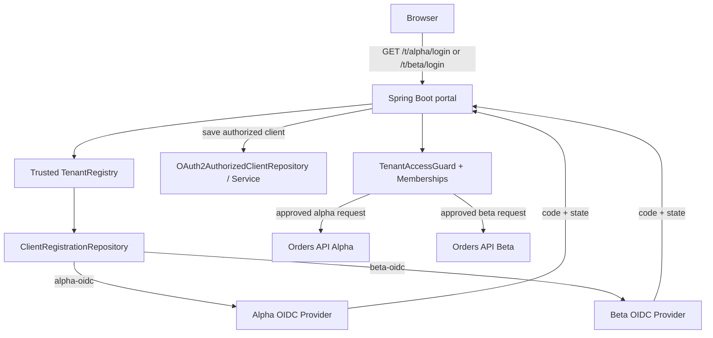
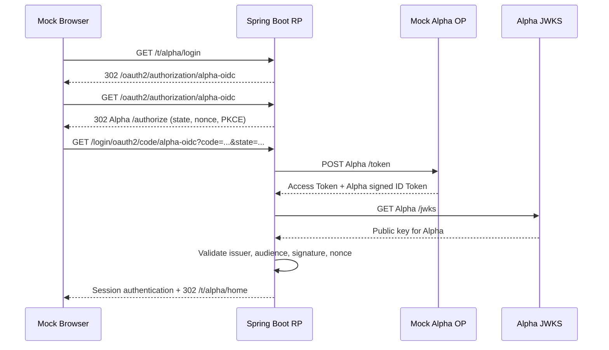

# 34.11. Ứng dụng nhiều tenant với cấu hình client tách biệt

Một ứng dụng **Spring Security OAuth 2.0/OIDC Client** có thể phục vụ nhiều khách hàng doanh nghiệp (tenants), mỗi khách hàng sử dụng một OpenID Provider (OP) hoặc một OAuth client registration riêng.

Ví dụ:

- Tenant **alpha** đăng nhập qua `https://idp.alpha.example/realms/alpha` bằng OAuth client `portal-alpha`.
- Tenant **beta** đăng nhập qua `https://idp.beta.example/realms/beta` bằng OAuth client `portal-beta`.
- Cả hai truy cập cùng ứng dụng Spring Boot tại `https://portal.example.org`.
- Mỗi tenant có `client-id`, `client-secret`, issuer, scope và authorized client riêng.
- Dữ liệu nghiệp vụ, quyền truy cập và outbound API tokens phải **không bị trộn** giữa hai tenant.

Đây là một bài thực hành triển khai ứng dụng đa tenant bằng **Spring Security OAuth2 Login trên Servlet stack**, sử dụng hai `ClientRegistration` tĩnh để làm rõ luồng trước khi bàn đến đăng ký tenant động.

**Thông điệp quan trọng nhất:** chọn được `ClientRegistration` theo tenant **không đồng nghĩa đã cấp quyền truy cập dữ liệu tenant đó**. Sau khi đăng nhập, ứng dụng vẫn phải xác minh registration/issuer/subject và membership/permissions ở từng request nghiệp vụ.

---

## 1. Mục tiêu và kết quả cần có

Sau khi thực hành, bạn có thể:

1. Khai báo hai `ClientRegistration` tách biệt trong Spring Boot.
2. Giải thích quan hệ `tenantSlug → registrationId → issuer/clientId/secret`.
3. Tạo URL bắt đầu đăng nhập `/t/{tenant}/login` chỉ chọn từ danh sách tenant đã được phê duyệt.
4. Sử dụng Spring Security `oauth2Login()` cho nhiều providers trên cùng ứng dụng.
5. Gắn callback nhận authorization code với đúng registration.
6. Điều hướng sau đăng nhập theo registration đáng tin cậy, không dùng URL do browser chỉ định.
7. Kiểm tra `OAuth2AuthenticationToken`, `OidcUser`, `iss`, `sub` và tenant membership.
8. Ngăn request tenant Alpha đọc dữ liệu Beta dù user đã đăng nhập.
9. Tìm `OAuth2AuthorizedClient` theo registration/principal đúng và không gửi token nhầm API.
10. Phân biệt session-level Authentication với authorized-client storage.
11. Test hai tenants, sai issuer, sai registration, thiếu membership và tenant slug không hợp lệ.
12. Thiết kế mở rộng dynamic registrations, secret rotation, multi-node rollout và monitoring.

### 1.1. Giới hạn bài lab

Bài sử dụng:

| Thành phần | Lựa chọn |
|---|---|
| Language | Java 17+ |
| Web stack | Spring MVC / Servlet |
| Security | Spring Security OAuth2 Client + OIDC Login |
| Framework example | Spring Boot 3.x, Spring Security 6.x style |
| Tenants | `alpha` và `beta` |
| Providers | Hai OIDC issuers độc lập |
| Tenant registry | Allowlisted in-memory entries cho bài lab |
| Membership | In-memory demo implementation, thay bằng database/service ở production |
| Session | Browser session của ứng dụng |
| API token | `OAuth2AuthorizedClientRepository` |
| Test | JUnit 5, Spring Security Test/MockMvc, có thể thêm WireMock |

Đây là một **mẫu thực hành đầy đủ theo kiến trúc và các đoạn code cốt lõi**, không phải một repository đã cấu hình sẵn toàn bộ thư viện/OP production. Khi chạy thật, bạn cần một OP test/staging với hai client registrations, hoặc mock OP theo hướng dẫn trong phần kiểm thử tích hợp.

## 2. Bài toán cụ thể

Một cổng thông tin SaaS vận hành dưới cùng domain:

```text
https://portal.example.org
```

Có hai đường dẫn:

```text
Tenant Alpha:
  https://portal.example.org/t/alpha/home
  https://portal.example.org/t/alpha/orders

Tenant Beta:
  https://portal.example.org/t/beta/home
  https://portal.example.org/t/beta/orders
```

Các thông tin xác thực:

| Thuộc tính | Alpha | Beta |
|---|---|---|
| Tenant slug | `alpha` | `beta` |
| Registration ID | `alpha-oidc` | `beta-oidc` |
| Issuer | `https://idp.alpha.example/realms/alpha` | `https://idp.beta.example/realms/beta` |
| Client ID | `portal-alpha` | `portal-beta` |
| Client authentication | `client_secret_basic` | `client_secret_basic` |
| Grant | `authorization_code` | `authorization_code` |
| Scopes | `openid profile email` | `openid profile email` |
| Callback | `/login/oauth2/code/alpha-oidc` | `/login/oauth2/code/beta-oidc` |
| Downstream Orders API | `https://orders.alpha.example/api/orders` | `https://orders.beta.example/api/orders` |

Các hostname `.example` được dùng làm tài liệu minh họa. Để chạy bài lab, thay bằng hai OP test/tenant registrations thực sự do bạn kiểm soát.

### 2.1. Yêu cầu chức năng

- `GET /t/alpha/login` khởi tạo đăng nhập Alpha.
- `GET /t/beta/login` khởi tạo đăng nhập Beta.
- OP trả code/state đến đúng callback.
- Sau xác thực thành công, user được chuyển đến home của tenant tương ứng.
- `GET /t/alpha/home` yêu cầu principal từ registration Alpha, issuer Alpha và membership Alpha.
- Đăng nhập Beta rồi truy cập Alpha phải bị từ chối.
- Tenant không có trong registry không được tạo client registration hay issuer URL mới.

### 2.2. Yêu cầu an ninh

- Không chọn issuer từ một query string tùy ý.
- Không đưa `client-secret` vào Git, JavaScript hoặc browser.
- Authorization Code Flow dùng state, PKCE theo profile và OIDC ID Token validation.
- Không nhận ID Token issuer/Audience từ client khác.
- Không đồng nhất user theo email mà bỏ qua issuer/subject.
- Không sử dụng outbound token của tenant A gọi API của tenant B.
- Authorization trên dữ liệu nghiệp vụ luôn kiểm tra tenant ID và permissions.
- Không log access token, refresh token, client secret, authorization code hoặc state.

## 3. Kiến trúc tổng thể



### 3.1. Luồng Alpha

```text
GET /t/alpha/login
    |
    v
TenantRegistry: alpha -> alpha-oidc
    |
    v
302 /oauth2/authorization/alpha-oidc
    |
    v
Spring OAuth2AuthorizationRequestRedirectFilter
    |
    v
Alpha OP /authorize?client_id=portal-alpha&state=...
    |
    v
Browser callback:
GET /login/oauth2/code/alpha-oidc?code=...&state=...
    |
    v
Spring exchanges code at Alpha Token Endpoint
    |
    v
Validate ID Token using Alpha issuer/JWKS/clientId
    |
    v
Authentication: registrationId=alpha-oidc
    |
    v
302 /t/alpha/home
    |
    v
TenantAccessGuard verifies Alpha + membership
```

### 3.2. Luồng Beta tương ứng nhưng độc lập

```text
beta -> beta-oidc -> Beta OP -> Beta token/JWKS -> /t/beta/home
```

Không lấy một authorization code phát bởi Alpha để đổi token tại Beta Token Endpoint. Callback, state, registration và provider metadata phải gắn với cùng authorization transaction.

## 4. Phân biệt ba loại định danh

Ba chuỗi hay bị trộn:

```text
tenantSlug    = alpha
registrationId = alpha-oidc
clientId      = portal-alpha
```

| Giá trị | Ai định nghĩa? | Dùng ở đâu? |
|---|---|---|
| Tenant slug | Ứng dụng/domain registry | Routing `/t/{tenant}` và domain authorization |
| Registration ID | Spring OAuth2 Client | `ClientRegistrationRepository`, authorization start URL |
| Client ID | Authorization Server | OAuth authorization/token requests, ID Token `aud` |

### 4.1. Tenant slug không tự có quyền

`/t/alpha/home` là một resource path, không phải proof user thuộc Alpha.

### 4.2. Registration ID không phải issuer

Có thể có hai registrations dùng **cùng issuer** nhưng client IDs/secrets khác. Bởi vậy không lấy issuer làm cache key duy nhất cho authorized clients.

### 4.3. Client ID không phải secret

`client_id` thường xuất hiện trong browser authorize request; confidential `client_secret` phải chỉ được giữ server-side.

## 5. Cấu trúc project gợi ý

```text
src/
  main/
    java/com/example/portal/
      PortalApplication.java
      security/
        TenantDefinition.java
        TenantRegistry.java
        SecurityConfiguration.java
        TenantLoginSuccessHandler.java
        TenantAccessGuard.java
        TenantMemberships.java
        DemoTenantMemberships.java
      web/
        TenantLoginController.java
        TenantHomeController.java
        TenantOrdersController.java
      orders/
        TenantOrdersGateway.java
    resources/
      application.yml
  test/
    java/com/example/portal/
      security/
        TenantAccessGuardTest.java
      web/
        TenantWebMvcTest.java
    resources/
      application-test.yml
```

Trong production, thay `DemoTenantMemberships` bằng repository/service có dữ liệu tenant membership thật và chính sách cấp quyền theo tổ chức.

## 6. Dependencies Gradle

Nếu dự án đã có Spring Boot Gradle plugin/BOM, khai báo:

```groovy
dependencies {
    implementation 'org.springframework.boot:spring-boot-starter-web'
    implementation 'org.springframework.boot:spring-boot-starter-security'
    implementation 'org.springframework.boot:spring-boot-starter-oauth2-client'

    testImplementation 'org.springframework.boot:spring-boot-starter-test'
    testImplementation 'org.springframework.security:spring-security-test'
}
```

Khi dùng Spring Boot 3.x, mã nguồn Java 17+ phù hợp. Để dependency management của Boot chọn phiên bản Spring Security tương thích.

Không thêm starter Resource Server chỉ vì ứng dụng là OAuth2 Client: hai vai trò khác nhau. Nếu cùng ứng dụng cũng nhận inbound Bearer token, cấu hình Resource Server riêng và kiểm tra filter chain ordering.

## 7. Spring Boot cấu hình hai client registrations

`src/main/resources/application.yml`:

```yaml
server:
  port: 8080

spring:
  security:
    oauth2:
      client:
        registration:
          alpha-oidc:
            provider: alpha
            client-id: ${ALPHA_OIDC_CLIENT_ID}
            client-secret: ${ALPHA_OIDC_CLIENT_SECRET}
            client-authentication-method: client_secret_basic
            authorization-grant-type: authorization_code
            redirect-uri: "{baseUrl}/login/oauth2/code/{registrationId}"
            scope:
              - openid
              - profile
              - email

          beta-oidc:
            provider: beta
            client-id: ${BETA_OIDC_CLIENT_ID}
            client-secret: ${BETA_OIDC_CLIENT_SECRET}
            client-authentication-method: client_secret_basic
            authorization-grant-type: authorization_code
            redirect-uri: "{baseUrl}/login/oauth2/code/{registrationId}"
            scope:
              - openid
              - profile
              - email

        provider:
          alpha:
            issuer-uri: "https://idp.alpha.example/realms/alpha"
          beta:
            issuer-uri: "https://idp.beta.example/realms/beta"
```

Để chạy với OP thật, phải tạo hai clients trong các OP/realms đã định và cấu hình chính xác hai callback URIs.

### 7.1. Vì sao dùng `provider` tách biệt?

Các `ClientRegistration` tham chiếu provider metadata riêng. Khi sử dụng `issuer-uri`, Spring có thể tải OIDC discovery metadata từ issuer đó và xác định Authorization Endpoint, Token Endpoint, JWKS URI, UserInfo Endpoint.

### 7.2. Client secrets tách biệt

```text
ALPHA_OIDC_CLIENT_ID
ALPHA_OIDC_CLIENT_SECRET

BETA_OIDC_CLIENT_ID
BETA_OIDC_CLIENT_SECRET
```

Đừng tái sử dụng cùng client secret chỉ để tiết kiệm cấu hình, đặc biệt nếu hai registrations thuộc các tenant trust domains khác nhau.

### 7.3. Issuer URI là trusted config

`issuer-uri` không phải secret, nhưng **security-sensitive**. Không cho user nhập một URL issuer tùy ý rồi tải discovery/tin endpoint phát sinh từ đó.

### 7.4. Redirect URI do Spring template tạo

`"{baseUrl}/login/oauth2/code/{registrationId}"` có thể tạo:

```text
http://localhost:8080/login/oauth2/code/alpha-oidc
http://localhost:8080/login/oauth2/code/beta-oidc
```

khi chạy local, hoặc HTTPS production URIs theo trusted deployment/proxy settings.

### 7.5. Scopes cần theo hợp đồng từng tenant

Trong demo hai tenants dùng `openid profile email`. Production có thể khác:

```yaml
alpha-oidc:
  scope: openid,profile,orders.read

beta-oidc:
  scope: openid,email,orders.view
```

Không tự suy ra scopes của một tenant có cùng ý nghĩa hoặc audience tại tenant khác.

## 8. Đăng ký đúng callback tại từng OP

Với ứng dụng public:

```text
https://portal.example.org
```

Đăng ký:

| OP | Client ID | Exact redirect URI |
|---|---|---|
| Alpha | `portal-alpha` | `https://portal.example.org/login/oauth2/code/alpha-oidc` |
| Beta | `portal-beta` | `https://portal.example.org/login/oauth2/code/beta-oidc` |

Không dùng wildcard callback như:

```text
https://portal.example.org/*
```

hoặc cho caller tự cung cấp `redirect_uri`.

### 8.1. Một registration ID gắn với callback

`alpha-oidc` xuất hiện trong authorization start và callback path. Spring Security có thể dùng saved authorization request + `state` để gắn callback với request ban đầu.

### 8.2. Không tự thiết lập callback bằng tenant query

Không thiết kế:

```text
/login/oauth2/code?tenant=<untrusted>&code=...
```

rồi quyết định Token Endpoint theo query đó. Spring/OAuth authorization transaction phải chọn provider từ trusted registration và correlation state.

### 8.3. PKCE và nonce

Authorization Code + PKCE được khuyến nghị; OIDC cần validate ID Token issuer, audience, expiry, signature và nonce khi áp dụng. Không bỏ state/PKCE/nonce để làm callback hoạt động.

## 9. Tạo TenantDefinition — cấu hình immutable

Mỗi tenant chứa đúng những metadata ứng dụng cần:

```java
package com.example.portal.security;

import java.net.URI;

public record TenantDefinition(
        String slug,
        String registrationId,
        String expectedIssuer,
        URI ordersApiUri
) {}
```

Ví dụ:

```text
TenantDefinition(
  slug="alpha",
  registrationId="alpha-oidc",
  expectedIssuer="https://idp.alpha.example/realms/alpha",
  ordersApiUri="https://orders.alpha.example/api/orders"
)
```

### 9.1. Vì sao có expectedIssuer trong registry?

Code nghiệp vụ cần biết trust domain mong đợi khi user truy cập `/t/alpha/*`. Mặc dù Spring OIDC client đã validate ID Token theo registration, thêm một kiểm tra explicit trong tenant guard giúp bảo vệ against misrouting/configuration mismatch.

### 9.2. ordersApiUri không nhận từ browser

Outbound OAuth token phải đi đến trusted Resource Server. Không sử dụng `@RequestParam String url` làm destination cho Bearer token.

### 9.3. Registry là source of truth domain-side

Spring `ClientRegistrationRepository` biết đăng ký OAuth client. `TenantRegistry` biết tenant nào được gắn với registration nào và API resource nào. Hai nguồn phải được giữ nhất quán và test đối chiếu.

## 10. TenantRegistry allowlist

Ví dụ class:

```java
package com.example.portal.security;

import java.net.URI;
import java.util.Map;

import org.springframework.http.HttpStatus;
import org.springframework.stereotype.Component;
import org.springframework.web.server.ResponseStatusException;
import org.springframework.security.access.AccessDeniedException;

@Component
public final class TenantRegistry {

    private final Map<String, TenantDefinition> bySlug =
        Map.of(
            "alpha",
            new TenantDefinition(
                "alpha",
                "alpha-oidc",
                "https://idp.alpha.example/realms/alpha",
                URI.create("https://orders.alpha.example/api/orders")
            ),
            "beta",
            new TenantDefinition(
                "beta",
                "beta-oidc",
                "https://idp.beta.example/realms/beta",
                URI.create("https://orders.beta.example/api/orders")
            )
        );

    private final Map<String, TenantDefinition> byRegistration =
        Map.of(
            "alpha-oidc", bySlug.get("alpha"),
            "beta-oidc", bySlug.get("beta")
        );

    public TenantDefinition requireSlug(String slug) {
        TenantDefinition tenant = bySlug.get(slug);
        if (tenant == null) {
            throw new ResponseStatusException(
                HttpStatus.NOT_FOUND,
                "Unknown tenant"
            );
        }
        return tenant;
    }

    public TenantDefinition requireRegistrationId(
            String registrationId) {

        TenantDefinition tenant = byRegistration.get(registrationId);
        if (tenant == null) {
            throw new AccessDeniedException(
                "Unknown OIDC client registration"
            );
        }
        return tenant;
    }
}
```

### 10.1. Vì sao không nối chuỗi để tạo registration ID?

Không dùng:

```java
String registrationId = request.getParameter("tenant") + "-oidc";
```

rồi tin rằng mọi giá trị là hợp lệ. Với allowlist, browser chỉ có thể chọn một **key đã tồn tại** trong registry.

### 10.2. Không tạo issuer URL động từ slug

Tránh:

```java
String issuer = "https://" + tenant + ".identity.example";
```

khi `tenant` chưa được xác minh. Tên tenant có thể không tương ứng hostname; quan trọng hơn, arbitrary issuer discovery tạo bề mặt SSRF/phishing/metadata trust confusion.

### 10.3. Định nghĩa immutable

`Map.of(...)` trong ví dụ immutable. Ở production có thể dùng database/cache snapshot và metadata signing/versioning; không cho một request thay registry.

### 10.4. 404 và 403 khác nhau

- Tenant slug không biết tới: `404` có thể phù hợp để tránh lộ thông tin.
- Registration ID không hợp lệ sau authentication: `AccessDeniedException`, không cho fallback sang tenant khác.

Policy status cuối cùng có thể tùy ứng dụng, nhưng **không được tự dùng registration tùy ý**.

## 11. Route bắt đầu đăng nhập theo tenant

Spring Security mặc định hỗ trợ:

```text
/oauth2/authorization/{registrationId}
```

Ta tạo route thân thiện:

```text
/t/{tenant}/login
```

Code:

```java
package com.example.portal.web;

import java.net.URI;

import com.example.portal.security.TenantDefinition;
import com.example.portal.security.TenantRegistry;

import org.springframework.http.HttpStatus;
import org.springframework.http.ResponseEntity;
import org.springframework.web.bind.annotation.GetMapping;
import org.springframework.web.bind.annotation.PathVariable;
import org.springframework.web.bind.annotation.RestController;

@RestController
public final class TenantLoginController {

    private final TenantRegistry tenants;

    public TenantLoginController(TenantRegistry tenants) {
        this.tenants = tenants;
    }

    @GetMapping("/t/{tenant}/login")
    public ResponseEntity<Void> login(
            @PathVariable String tenant) {

        TenantDefinition selected = tenants.requireSlug(tenant);

        URI authorizationStart = URI.create(
            "/oauth2/authorization/" + selected.registrationId()
        );

        return ResponseEntity.status(HttpStatus.FOUND)
            .location(authorizationStart)
            .build();
    }
}
```

### 11.1. Tại sao chỉ redirect nội bộ?

Controller không tự tạo `state`, PKCE challenge, nonce hoặc authorization URL. Nó chuyển người dùng đến filter của Spring Security để framework tạo authorization request đúng.

### 11.2. Không tự gọi OP authorization endpoint

Nếu tự ghép:

```java
String location = issuer + "/authorize?client_id=" + ...;
```

rất dễ quên state, PKCE, nonce, encoding và login request persistence.

### 11.3. Tenant không tồn tại

`GET /t/unknown/login` phải trả lỗi có kiểm soát, không bắt đầu discovery tới `unknown` hay dùng Alpha làm default.

### 11.4. Nếu dùng subdomain routing

Bạn có thể ánh xạ:

```text
alpha.portal.example.org -> alpha
beta.portal.example.org  -> beta
```

nhưng chỉ sau trusted host normalization và reverse-proxy allowlist. Không lấy raw `X-Forwarded-Host` từ client chưa xác minh để chọn tenant.

## 12. SecurityFilterChain cho ứng dụng

```java
package com.example.portal.security;

import org.springframework.context.annotation.Bean;
import org.springframework.context.annotation.Configuration;
import org.springframework.security.config.Customizer;
import org.springframework.security.config.annotation.web.builders.HttpSecurity;
import org.springframework.security.web.SecurityFilterChain;

@Configuration
public class SecurityConfiguration {

    @Bean
    SecurityFilterChain portalSecurity(
            HttpSecurity http,
            TenantRegistry registry) throws Exception {

        http
            .authorizeHttpRequests(auth -> auth
                .requestMatchers(
                    "/",
                    "/error",
                    "/assets/**",
                    "/t/*/login"
                ).permitAll()
                .anyRequest().authenticated()
            )
            .oauth2Login(oauth2 -> oauth2
                .successHandler(
                    new TenantLoginSuccessHandler(registry)
                )
            );

        return http.build();
    }
}
```

### 12.1. Những URLs của OAuth2 Login

Spring OAuth2 Login filters thường xử lý:

```text
/oauth2/authorization/alpha-oidc
/oauth2/authorization/beta-oidc

/login/oauth2/code/alpha-oidc
/login/oauth2/code/beta-oidc
```

Đây là protocol endpoints do security filters xử lý, không phải endpoints cần tự viết controller.

### 12.2. Đừng thay authenticated() bằng permitAll()

`anyRequest().authenticated()` chỉ là lớp bảo vệ **authentication**, chưa kiểm tra tenant. Các route nghiệp vụ còn phải gọi `TenantAccessGuard` hoặc dùng authorization infrastructure tương đương.

### 12.3. CSRF

Ứng dụng browser/session vẫn cần chính sách CSRF thích hợp cho state-changing operations. Không tắt CSRF toàn bộ chỉ vì OAuth2 Login dùng redirects.

### 12.4. Multiple security chains

Nếu ứng dụng còn có `/api/**` nhận Bearer JWT, có thể dùng chain riêng với `securityMatcher("/api/**")`. Cần chú ý ordering để OAuth callback vẫn thuộc web login chain.

### 12.5. Lưu ý dependency injection

`TenantLoginSuccessHandler` ở phần sau nhận registry đã xác thực; đây không phải handler lấy arbitrary redirect URL từ query string.

## 13. Login success handler dùng registration đáng tin

Sau callback được xử lý thành công, Spring Security tạo `OAuth2AuthenticationToken` có `authorizedClientRegistrationId` của flow vừa hoàn tất.

Ta dùng registration ID này để chọn trang landing của tenant.

```java
package com.example.portal.security;

import java.io.IOException;

import jakarta.servlet.ServletException;
import jakarta.servlet.http.HttpServletRequest;
import jakarta.servlet.http.HttpServletResponse;

import org.springframework.security.core.Authentication;
import org.springframework.security.oauth2.client.authentication
    .OAuth2AuthenticationToken;
import org.springframework.security.web.authentication
    .AuthenticationSuccessHandler;
import org.springframework.security.web.DefaultRedirectStrategy;
import org.springframework.security.web.RedirectStrategy;

public final class TenantLoginSuccessHandler
        implements AuthenticationSuccessHandler {

    private final TenantRegistry registry;

    private final RedirectStrategy redirects =
        new DefaultRedirectStrategy();

    public TenantLoginSuccessHandler(TenantRegistry registry) {
        this.registry = registry;
    }

    @Override
    public void onAuthenticationSuccess(
            HttpServletRequest request,
            HttpServletResponse response,
            Authentication authentication)
            throws IOException, ServletException {

        if (!(authentication instanceof OAuth2AuthenticationToken oauth)) {
            response.sendError(
                HttpServletResponse.SC_FORBIDDEN,
                "Unsupported authentication"
            );
            return;
        }

        TenantDefinition tenant = registry.requireRegistrationId(
            oauth.getAuthorizedClientRegistrationId()
        );

        redirects.sendRedirect(
            request,
            response,
            "/t/" + tenant.slug() + "/home"
        );
    }
}
```

### 13.1. Tại sao an toàn hơn redirect từ query?

Sai:

```java
response.sendRedirect(request.getParameter("returnTo"));
```

Một `returnTo=https://attacker.example` có thể tạo open redirect. Success handler ở đây chỉ dùng slug đến từ immutable registry.

### 13.2. Success handler không đủ cho domain authorization

Một user có thể đăng nhập thành công tại OP Beta nhưng **không** thuộc tenant Beta theo ứng dụng. Handler chuyển tới `/t/beta/home`; tenant guard phải từ chối truy cập dữ liệu nếu membership không hợp lệ.

Nếu yêu cầu deny ngay lúc login, có thể thiết kế một authentication success flow có membership validation và cleanup session theo policy; không đơn giản gửi 403 rồi để một unauthorized session chứa dữ liệu nhạy cảm.

### 13.3. Không đọc registration từ request parameter

`authentication.getAuthorizedClientRegistrationId()` là kết quả flow do Spring hoàn tất, không phải `?tenant=...` do browser tự đưa vào sau callback.

### 13.4. Deep link sau login

Trong ứng dụng thực tế, user có thể bắt đầu từ `/t/alpha/orders/123`. Nếu cần quay lại deep link, hãy lưu một **server-side validated destination** thuộc đúng tenant; không tin arbitrary saved URL hay query. Ví dụ handler hiện tại luôn về home để đơn giản và tránh open redirect.

## 14. Xác định danh tính OIDC đa tenant

Sau OIDC Login, Spring có thể cung cấp:

- `OAuth2AuthenticationToken`: authenticated principal + registration ID.
- `OidcUser`: ID Token claims và tùy cấu hình UserInfo claims.
- `OidcIdToken`: issuer, subject, audience, times, nonce/claims.

Một identity key nên dựa vào:

```text
(issuer, subject)
```

Không chỉ:

```text
email
preferred_username
display_name
```

### 14.1. Vì sao issuer là một phần của identity?

Hai OP có thể cùng phát:

```text
sub = 123
```

nhưng user thuộc hai trust domains khác nhau:

```text
(https://idp.alpha.example/realms/alpha, 123)
(https://idp.beta.example/realms/beta, 123)
```

Đó **không tự động** là cùng một user.

### 14.2. Client registration khác user membership

User được Alpha OP xác thực không có nghĩa user có mọi quyền nghiệp vụ ở Alpha. Tùy domain, membership có thể cần check qua ứng dụng hoặc một trusted group/entitlement source.

### 14.3. Không map role trực tiếp từ unverified claims

Spring OIDC Login phải xác minh ID Token. Nếu custom user service dùng UserInfo/group claims, cần kiểm tra provider trust, subject matching, claim types và tenant policy.

## 15. TenantMemberships: abstraction cho business authorization

Mô hình dữ liệu gợi ý:

```text
tenant_slug | issuer                                   | subject   | app_user_id | role
------------+------------------------------------------+-----------+-------------+-------
alpha       | https://idp.alpha.example/realms/alpha    | alpha-u1  | 1001        | USER
beta        | https://idp.beta.example/realms/beta      | beta-u1   | 2001        | USER
```

Interface:

```java
package com.example.portal.security;

public interface TenantMemberships {

    boolean isMember(
        String tenantSlug,
        String issuer,
        String subject
    );
}
```

### 15.1. Demo implementation

```java
package com.example.portal.security;

import java.util.Set;
import org.springframework.stereotype.Component;

@Component
public final class DemoTenantMemberships
        implements TenantMemberships {

    private static final Set<TenantMemberKey> MEMBERS = Set.of(
        new TenantMemberKey(
            "alpha",
            "https://idp.alpha.example/realms/alpha",
            "alpha-u1"
        ),
        new TenantMemberKey(
            "beta",
            "https://idp.beta.example/realms/beta",
            "beta-u1"
        )
    );

    @Override
    public boolean isMember(
            String tenantSlug,
            String issuer,
            String subject) {

        return MEMBERS.contains(
            new TenantMemberKey(tenantSlug, issuer, subject)
        );
    }

    private record TenantMemberKey(
        String tenantSlug,
        String issuer,
        String subject
    ) {}
}
```

### 15.2. Production implementation

Trong production, thay bằng database/service kiểm tra:

- Tenant account đang active.
- User có membership hợp lệ.
- Vai trò và permissions tại tenant.
- Tình trạng khóa/deprovision user.
- Chính sách tenant-specific.
- Object ownership/row-level authorization.

### 15.3. Deny by default

Nếu membership service không trả được kết quả đáng tin, không tự cấp quyền vì login OIDC đã thành công. Quyết định timeout/failure status có thể khác nhau, nhưng không được fail-open trên dữ liệu nhạy cảm.

## 16. TenantAccessGuard kiểm tra mỗi request

Đây là lớp quan trọng nhất để tránh **cross-tenant access**.

Record kết quả:

```java
package com.example.portal.security;

public record TenantIdentity(
    String tenantSlug,
    String registrationId,
    String issuer,
    String subject
) {}
```

Guard:

```java
package com.example.portal.security;

import org.springframework.security.access.AccessDeniedException;
import org.springframework.security.core.Authentication;
import org.springframework.security.oauth2.client.authentication
    .OAuth2AuthenticationToken;
import org.springframework.security.oauth2.core.oidc.user.OidcUser;
import org.springframework.stereotype.Service;

@Service
public final class TenantAccessGuard {

    private final TenantRegistry tenants;
    private final TenantMemberships memberships;

    public TenantAccessGuard(
            TenantRegistry tenants,
            TenantMemberships memberships) {

        this.tenants = tenants;
        this.memberships = memberships;
    }

    public TenantIdentity require(
            String requestedSlug,
            Authentication authentication) {

        TenantDefinition requested = tenants.requireSlug(
            requestedSlug
        );

        if (!(authentication instanceof OAuth2AuthenticationToken oauth)) {
            throw new AccessDeniedException(
                "OIDC authentication required"
            );
        }

        String authenticatedRegistration =
            oauth.getAuthorizedClientRegistrationId();

        if (!requested.registrationId().equals(
                authenticatedRegistration)) {

            throw new AccessDeniedException(
                "OIDC registration does not match requested tenant"
            );
        }

        if (!(oauth.getPrincipal() instanceof OidcUser user)) {
            throw new AccessDeniedException(
                "OIDC principal required"
            );
        }

        if (user.getIdToken().getIssuer() == null) {
            throw new AccessDeniedException(
                "Missing trusted issuer"
            );
        }

        String issuer = user.getIdToken().getIssuer().toString();
        String subject = user.getSubject();

        if (!requested.expectedIssuer().equals(issuer)) {
            throw new AccessDeniedException(
                "OIDC issuer does not match tenant"
            );
        }

        if (subject == null || subject.isBlank()) {
            throw new AccessDeniedException(
                "OIDC subject is missing"
            );
        }

        if (!memberships.isMember(
                requestedSlug,
                issuer,
                subject)) {

            throw new AccessDeniedException(
                "Tenant membership required"
            );
        }

        return new TenantIdentity(
            requestedSlug,
            requested.registrationId(),
            issuer,
            subject
        );
    }
}
```

### 16.1. Bốn kiểm tra tách biệt

1. **Tenant slug hợp lệ:** `TenantRegistry.requireSlug`.
2. **Đúng ClientRegistration:** Alpha path yêu cầu `alpha-oidc`.
3. **Đúng issuer/subject:** user xuất phát từ OP được kỳ vọng.
4. **Đúng membership:** user được ứng dụng cấp quyền trên tenant.

Một user có role `ROLE_USER` chung vẫn không được xem là member của mọi tenants.

### 16.2. Vì sao không kiểm tra email?

Email có thể đổi, không verified hoặc trùng giữa providers. `(iss,sub)` ổn định hơn theo OIDC identity model, sau đó liên kết đến local user.

### 16.3. IdP đã validate issuer, sao còn check?

Spring Security ID Token validator đã xác minh token theo selected registration. Guard kiểm tra thêm **business routing consistency**, nhằm đảm bảo request `/t/alpha/*` không được xử lý dưới một authenticated registration/issuer khác do configuration/coding mistakes.

### 16.4. Nếu một user có tài khoản ở cả hai tenants

Browser session hiện tại vẫn chỉ có một active Authentication theo mặc định. User phải thực hiện login tương ứng khi chuyển tenant, hoặc ứng dụng cần thiết kế rõ multi-account context; không mặc định một session có đồng thời hai identities.

## 17. Home controller áp dụng guard

```java
package com.example.portal.web;

import java.util.Map;

import com.example.portal.security.TenantAccessGuard;
import com.example.portal.security.TenantIdentity;

import org.springframework.security.core.Authentication;
import org.springframework.web.bind.annotation.GetMapping;
import org.springframework.web.bind.annotation.PathVariable;
import org.springframework.web.bind.annotation.RestController;

@RestController
public final class TenantHomeController {

    private final TenantAccessGuard guard;

    public TenantHomeController(TenantAccessGuard guard) {
        this.guard = guard;
    }

    @GetMapping("/t/{tenant}/home")
    public Map<String, String> home(
            @PathVariable String tenant,
            Authentication authentication) {

        TenantIdentity identity = guard.require(
            tenant,
            authentication
        );

        return Map.of(
            "tenant", identity.tenantSlug(),
            "issuer", identity.issuer(),
            "subject", identity.subject()
        );
    }
}
```

### 17.1. Không trả token trong JSON

Response không có access token, refresh token, client secret hay raw ID Token.

### 17.2. Có nên trả issuer/subject ngoài production?

Ví dụ giúp quan sát lab. Trong production, có thể chỉ trả display name/local user ID và các fields được phép công khai. Dữ liệu định danh vẫn cần privacy/retention policy.

### 17.3. Đừng quên guard ở các endpoints khác

Nếu chỉ bảo vệ `/t/{tenant}/home` nhưng quên `/t/{tenant}/orders`, hệ thống vẫn có thể lộ dữ liệu. Trong production, dùng cả service-layer/domain authorization hoặc một authorization manager có kiểm tra tenant trên mọi request và data operation.

## 18. Kết quả mong đợi khi truy cập

| Active login session | Request | Expected outcome |
|---|---|---|
| Alpha, `alpha-u1`, approved membership | `/t/alpha/home` | 200 |
| Alpha, `alpha-u1` | `/t/beta/home` | 403 |
| Beta, `beta-u1`, approved membership | `/t/beta/home` | 200 |
| Beta, `beta-u1` | `/t/alpha/home` | 403 |
| No login | `/t/alpha/home` | Redirect to login hoặc authentication entry point |
| No login | `/t/alpha/login` | 302 bắt đầu Alpha authorization |
| Any | `/t/unknown/login` | 404 |
| Alpha registration, wrong issuer | `/t/alpha/home` | Denied |
| Alpha registration, no membership | `/t/alpha/home` | Denied |

Status HTTP cho unauthorized browser requests có thể khác theo entry point, content negotiation và exception handling. Quan trọng là không cấp quyền truy cập chéo.

## 19. Lưu authorized client sau login

Spring OAuth2 Login thường tạo `OAuth2AuthorizedClient` sau khi đổi authorization code tại Token Endpoint.

```text
OAuth2AuthorizedClient
  registrationId = alpha-oidc
  principalName  = <current trusted principal name>
  accessToken    = AT-ALPHA
  refreshToken   = RT-ALPHA (when issued)
```

Một login Beta tạo authorized client khác:

```text
registrationId = beta-oidc
accessToken    = AT-BETA
```

### 19.1. Các abstractions

- `OAuth2AuthorizedClientRepository`: request/session-oriented retrieval/persistence.
- `OAuth2AuthorizedClientService`: service-oriented storage, often keyed by registration ID và principal name.
- `OAuth2AuthorizedClientManager`: authorize/re-authorize/refresh theo grant provider.

### 19.2. Không dùng một token variable toàn cục

Sai:

```java
static String currentAccessToken;
```

Nó có thể làm user A/tenant A dùng token của B khi concurrency xảy ra.

### 19.3. Không cache chỉ theo issuer

Hai registrations có thể cùng issuer nhưng client IDs khác. Storage key cần ít nhất registration/principal context phù hợp và có thể thêm tenant/domain identifiers.

## 20. Đọc authorized client tương ứng tenant

Một MVC controller có thể nạp authorized client từ `OAuth2AuthorizedClientRepository` sau khi guard xác nhận principal/registration.

```java
package com.example.portal.web;

import jakarta.servlet.http.HttpServletRequest;

import com.example.portal.security.TenantAccessGuard;
import com.example.portal.security.TenantIdentity;
import com.example.portal.security.TenantRegistry;
import com.example.portal.security.TenantDefinition;

import org.springframework.http.HttpStatus;
import org.springframework.security.core.Authentication;
import org.springframework.security.oauth2.client.OAuth2AuthorizedClient;
import org.springframework.security.oauth2.client.web.OAuth2AuthorizedClientRepository;
import org.springframework.web.server.ResponseStatusException;

public final class TenantAuthorizedClientLookup {

    private final TenantAccessGuard guard;
    private final TenantRegistry tenants;
    private final OAuth2AuthorizedClientRepository authorizedClients;

    public TenantAuthorizedClientLookup(
            TenantAccessGuard guard,
            TenantRegistry tenants,
            OAuth2AuthorizedClientRepository authorizedClients) {
        this.guard = guard;
        this.tenants = tenants;
        this.authorizedClients = authorizedClients;
    }

    public OAuth2AuthorizedClient requireClient(
            String slug,
            Authentication authentication,
            HttpServletRequest request) {

        TenantIdentity identity = guard.require(
            slug,
            authentication
        );

        TenantDefinition tenant = tenants.requireSlug(
            identity.tenantSlug()
        );

        OAuth2AuthorizedClient client =
            authorizedClients.loadAuthorizedClient(
                tenant.registrationId(),
                authentication,
                request
            );

        if (client == null) {
            throw new ResponseStatusException(
                HttpStatus.CONFLICT,
                "Please reconnect your tenant account"
            );
        }

        return client;
    }
}
```

Class này là **một helper Java để trình bày data flow**. Để đưa vào ứng dụng và inject vào controllers, thêm `@Component`/`@Service` hoặc khai báo `@Bean` theo style project.

### 20.1. Tại sao dùng đúng registration ID?

`OAuth2AuthorizedClientRepository.loadAuthorizedClient` nhận `clientRegistrationId`; ta lấy từ trusted `TenantDefinition` sau guard, không lấy từ request parameter.

### 20.2. Nếu không có client?

Không dùng token tenant khác làm fallback. Đưa người dùng tới reconnect flow được kiểm soát, hoặc để manager authorize lại theo policy.

### 20.3. Đừng giả định mọi repository lưu token giống nhau

Spring có thể dùng session-backed repository/service-backed repository hoặc custom implementation. Khi triển khai đa node, cần shared storage và consistency phù hợp.

## 21. Outbound Orders API: không để token đi nhầm đích

`TenantDefinition` đã có một trusted `ordersApiUri`.

Service:

```java
package com.example.portal.orders;

import java.net.URI;

import org.springframework.security.oauth2.core.OAuth2AccessToken;
import org.springframework.stereotype.Service;
import org.springframework.web.client.RestClient;

@Service
public final class TenantOrdersGateway {

    private final RestClient restClient;

    public TenantOrdersGateway(RestClient.Builder builder) {
        this.restClient = builder.build();
    }

    public String fetchOrders(
            URI trustedOrdersUri,
            OAuth2AccessToken accessToken) {

        return restClient.get()
            .uri(trustedOrdersUri)
            .headers(headers -> headers.setBearerAuth(
                accessToken.getTokenValue()))
            .retrieve()
            .body(String.class);
    }
}
```

### 21.1. Quan trọng: URI đến từ trusted registry

Không làm:

```java
@GetMapping("/proxy")
public String proxy(@RequestParam String url) {
    return restClient.get()
        .uri(url)
        .headers(h -> h.setBearerAuth(accessToken))
        .retrieve()
        .body(String.class);
}
```

Nếu caller điều khiển `url`, access token có thể bị gửi đến host của attacker.

### 21.2. Redirects và DNS

Ngay cả với trusted URL ban đầu, cần kiểm tra behavior của HTTP client khi downstream trả redirect đến origin khác hoặc DNS bị thay. Test no-cross-origin token forwarding theo threat model và HTTP client implementation.

### 21.3. Audience và scopes

Access token Alpha không được gửi Beta API. Resource Server vẫn phải xác minh audience/issuer/scope, không chỉ nhìn Bearer header.

## 22. Orders controller kết hợp guard, repository và gateway

```java
package com.example.portal.web;

import jakarta.servlet.http.HttpServletRequest;

import com.example.portal.orders.TenantOrdersGateway;
import com.example.portal.security.TenantAccessGuard;
import com.example.portal.security.TenantDefinition;
import com.example.portal.security.TenantRegistry;

import org.springframework.security.core.Authentication;
import org.springframework.security.oauth2.client.OAuth2AuthorizedClient;
import org.springframework.security.oauth2.client.web.OAuth2AuthorizedClientRepository;
import org.springframework.web.bind.annotation.GetMapping;
import org.springframework.web.bind.annotation.PathVariable;
import org.springframework.web.bind.annotation.RestController;
import org.springframework.http.HttpStatus;
import org.springframework.web.server.ResponseStatusException;

@RestController
public final class TenantOrdersController {

    private final TenantRegistry tenants;
    private final TenantAccessGuard guard;
    private final OAuth2AuthorizedClientRepository clients;
    private final TenantOrdersGateway gateway;

    public TenantOrdersController(
            TenantRegistry tenants,
            TenantAccessGuard guard,
            OAuth2AuthorizedClientRepository clients,
            TenantOrdersGateway gateway) {
        this.tenants = tenants;
        this.guard = guard;
        this.clients = clients;
        this.gateway = gateway;
    }

    @GetMapping("/t/{tenant}/orders")
    public String orders(
            @PathVariable String tenant,
            Authentication authentication,
            HttpServletRequest request) {

        guard.require(tenant, authentication);

        TenantDefinition definition =
            tenants.requireSlug(tenant);

        OAuth2AuthorizedClient client =
            clients.loadAuthorizedClient(
                definition.registrationId(),
                authentication,
                request
            );

        if (client == null) {
            throw new ResponseStatusException(
                HttpStatus.CONFLICT,
                "Tenant account must be reconnected"
            );
        }

        return gateway.fetchOrders(
            definition.ordersApiUri(),
            client.getAccessToken()
        );
    }
}
```

### 22.1. Đây là minh họa fetch đã có authorized client

Ví dụ dùng repository để tải token hiện có; nó **không tự giải quyết mọi trường hợp token expired**. Production thường cần `OAuth2AuthorizedClientManager`/provider để reauthorize hoặc refresh trước khi gọi API.

### 22.2. Kiểm tra API response

Không trả downstream response mù quáng nếu nó chứa dữ liệu của tenant khác. Đặc biệt nếu backend API cho phép chọn `tenantId` qua query, Resource Server/gateway cũng phải enforce đúng tenant.

### 22.3. Không đưa access token vào browser

Ở BFF/confidential web architecture, token nên được backend giữ và chỉ gửi qua `Authorization: Bearer` đến trusted API.

## 23. Khi cần refresh/reauthorization: dùng manager

`OAuth2AuthorizedClientManager` là abstraction cấp hoặc cấp lại authorized client.

Ví dụ Servlet manager:

```java
@Bean
OAuth2AuthorizedClientManager authorizedClientManager(
        ClientRegistrationRepository registrations,
        OAuth2AuthorizedClientRepository repository) {

    DefaultOAuth2AuthorizedClientManager manager =
        new DefaultOAuth2AuthorizedClientManager(
            registrations,
            repository
        );

    OAuth2AuthorizedClientProvider provider =
        OAuth2AuthorizedClientProviderBuilder.builder()
            .authorizationCode()
            .refreshToken()
            .build();

    manager.setAuthorizedClientProvider(provider);
    return manager;
}
```

### 23.1. Cần đúng request context

`DefaultOAuth2AuthorizedClientManager` phù hợp với Servlet request. Khi gọi trực tiếp, cung cấp `OAuth2AuthorizeRequest` có principal và servlet request/response context phù hợp implementation, hoặc dùng framework-integrated resolver/HTTP interceptor.

### 23.2. Không tự dùng Client Credentials để thay user login

Một user-delegated Orders API token khác service token. Nếu không có user authorization, không dùng `client_credentials` token có quyền rộng làm fallback.

### 23.3. Service manager cho background jobs

Nếu một background task của tenant cần token service, `AuthorizedClientServiceOAuth2AuthorizedClientManager` thường phù hợp vì không có Servlet request. Nhưng principal key phải ổn định và phân biệt tenant/registration.

### 23.4. Refresh rotation

Khi OP rotate refresh token, repository/service phải lưu token mới và tránh stale-delete do concurrent refresh. Tách token lifecycle tests khỏi controller tests.

## 24. Một browser session có thể đăng nhập hai tenants đồng thời không?

**Mặc định, không theo cách bạn thường tưởng.**

Spring Security Servlet web session chứa một active `SecurityContext`/`Authentication`. Nếu user đang login Alpha rồi hoàn tất login Beta trong cùng session, Authentication có thể chuyển thành Beta.

```text
Session S:
  Step 1: Authentication alpha-oidc
  Step 2: Authentication beta-oidc
  Active:   beta-oidc
```

Authorized client repository có thể còn lưu cả hai records, nhưng **điều đó không tự có nghĩa session hiện tại đã xác thực đồng thời cho Alpha và Beta**.

### 24.1. Hành vi mong muốn trong bài lab

Khi active login là Beta:

```text
GET /t/beta/home -> allowed if Beta membership
GET /t/alpha/home -> denied
```

### 24.2. Nếu cần multi-account trong cùng session

Phải thiết kế riêng mô hình session identity/tenant switching, có kiểm tra reauthentication, token ownership, CSRF/session semantics và UI rõ ràng. Không chỉ bỏ kiểm tra registration ID khỏi `TenantAccessGuard`.

### 24.3. Multi-tab

Hai tab bắt đầu login tới hai providers trong cùng session có thể làm pending authorization request/state bị ghi đè tùy repository implementation. Test multi-tab login và đưa UX retry, hoặc thiết kế authorization request storage hỗ trợ concurrent transactions.

## 25. Vì sao chỉ dùng path-based tenant là chưa đủ?

Một anti-pattern:

```java
@GetMapping("/t/{tenant}/orders")
public List<Order> orders(@PathVariable String tenant) {
    return orderRepository.findByTenantSlug(tenant);
}
```

Nếu Spring Security chỉ kiểm tra `authenticated()`, user đã login Alpha có thể thay URL thành `/t/beta/orders`.

### 25.1. Nguyên tắc guard theo domain data

```text
Authenticated principal
   + verified registration
   + verified issuer/subject
   + active tenant membership
   + domain permission for object
   = allowed data access
```

### 25.2. Kiểm tra cả object ownership

`GET /t/alpha/orders/123` cần kiểm tra order 123 thuộc tenant Alpha. Không đủ kiểm tra user là member Alpha nếu repository truy vấn theo order ID mà quên `tenant_id` filter.

Ví dụ ý tưởng SQL:

```sql
SELECT *
FROM orders
WHERE tenant_id = :authorizedTenantId
  AND id = :orderId;
```

`:authorizedTenantId` phải được lấy từ trusted identity/domain authorization, không chỉ từ unverified request parameter.

## 26. Một issuer, nhiều client registrations

Không phải multi-tenant lúc nào cũng có nhiều OP.

Ví dụ:

```text
issuer = https://login.company.example

clientId for alpha = alpha-portal
clientId for beta  = beta-portal

registrationId:
  alpha-oidc
  beta-oidc
```

Hai registrations dùng cùng issuer nhưng khác client IDs, secrets, scopes và redirects.

### 26.1. Vẫn phải tách authorized clients

Không cache theo issuer đơn lẻ. Cần giữ registration ID và principal context để không reuse token sai client.

### 26.2. `sub` giống nhau có thể là cùng End-User

Nếu issuer giống nhau, subject giống nhau có thể trỏ một user của OP. Nhưng user đó vẫn không tự có membership cả Alpha/Beta.

### 26.3. `aud` theo client ID

ID Token của Alpha phải được xác minh dành cho Alpha client ID, không nhận token được phát cho Beta client ID chỉ vì issuer/sub giống.

## 27. Một tenant, nhiều providers

Một tenant lớn có thể cho đăng nhập qua:

```text
alpha-employees
alpha-partners
```

Khi đó mapping một-tenant–một-registration trong bài lab cần mở rộng thành:

```text
Tenant
  -> Set<ApprovedClientRegistration>
  -> Approved issuer/client metadata per registration
  -> Identity-to-membership mapping
```

### 27.1. Không bỏ registration verification

Guard cần kiểm tra active registration **thuộc tập approved registrations của tenant**, chứ không yêu cầu một registration duy nhất. Đồng thời vẫn phải kiểm tra issuer/subject mapping từng provider.

### 27.2. Không đồng nhất cùng email

Một employee và một partner cùng email có thể là hai principals khác nhau. Account linking phải dựa trusted proof và local policy.

### 27.3. Provider selection UX

Cho phép tenant hiển thị “Sign in with Company SSO” và “Sign in with Partner ID” từ trusted registry. Không nhận arbitrary issuer URL từ browser.

## 28. Mở rộng dynamic ClientRegistrationRepository

Khi có vài tenants, `application.yml` đủ. Với hàng trăm/thousands tenants, cấu hình tĩnh khó bảo trì.

Một thiết kế khác:

```text
Trusted onboarding workflow
  -> validate issuer and security metadata
  -> store tenant registration configuration
  -> store client secret reference in secret manager
  -> publish immutable configuration version
  -> ClientRegistrationRepository snapshot/cache
  -> Spring OAuth2 Login filters use registrationId
```

### 28.1. Tách onboarding khỏi browser login

**Không** dùng mỗi browser login request để gọi arbitrary `ClientRegistrations.fromIssuerLocation(userInputIssuer)`. Discovery có thể gây SSRF/metadata poisoning và load ở thời điểm không kiểm soát.

### 28.2. Chỉ onboarding issuer được phê duyệt

Quy trình admin:

1. Xác minh tenant ownership.
2. Xác minh domain/issuer qua kênh đáng tin.
3. Kiểm tra TLS certificate/metadata trust.
4. Cho phép scopes/auth method/algorithms phù hợp policy.
5. Đăng ký exact redirect URI tại OP.
6. Lưu client ID và secret reference.
7. Kiểm tra Token Endpoint và JWKS trong staging.
8. Publish registration ID immutable.
9. Audit ai tạo/sửa.
10. Hỗ trợ disable/revoke và rollback.

### 28.3. Ví dụ xây registration có kiểm soát

```java
ClientRegistration registration =
    ClientRegistrations
        .fromIssuerLocation(approvedIssuer)
        .registrationId(approvedRegistrationId)
        .clientId(approvedClientId)
        .clientSecret(secretManagerValue)
        .authorizationGrantType(
            AuthorizationGrantType.AUTHORIZATION_CODE)
        .redirectUri(
            "{baseUrl}/login/oauth2/code/{registrationId}")
        .scope("openid", "profile")
        .build();
```

Đây là đoạn minh họa **trusted onboarding/runtime snapshot**. `fromIssuerLocation` có thể thực hiện network discovery, vì vậy issuer phải được phê duyệt và kiểm soát kết nối trước khi gọi.

### 28.4. Không dùng một map mutable tùy ý

Nếu `ClientRegistrationRepository` reload động, cần atomic snapshots và thread safety. Không thay issuer/client ID/secret từng field trong lúc callback có authorization transaction đang chờ.

### 28.5. Đổi registrationId có hậu quả

Authorized-client storage thường dựa trên registration ID. Nếu đổi ID, token/session records cũ có thể không còn resolve; lên kế hoạch migration hoặc reauthentication.

## 29. Quản lý secret riêng cho từng tenant

Production:

```text
prod/portal/tenants/alpha/oidc/client-secret
prod/portal/tenants/beta/oidc/client-secret
```

Mỗi credential nên có:

- Source of truth rõ.
- Workload identity/least-privilege read.
- Version metadata.
- Rotation/rollback plan.
- Audit read/write.
- Không xuất hiện trong logs/Actuator/CI.
- Chính sách cross-tenant access rõ.

### 29.1. Không đưa client secret vào browser

Authorization Code Flow của confidential backend dùng client secret khi backend gọi Token Endpoint. Frontend JavaScript không được nhận secret.

### 29.2. Không cấp mọi secret cho mọi Pod nếu không cần

Với tenant trust boundaries chặt, có thể phân chia services/workload identities hoặc ít nhất ACL theo resource, thay vì một runtime credential có quyền đọc tất cả tenants.

### 29.3. Rotation nhiều nodes

Nếu một replica còn Alpha secret v1 và OP Alpha đã revoke v1, chỉ một phần requests Alpha có thể gặp `invalid_client`. Quan sát credential version metadata và rolling rollout.

### 29.4. Refresh tokens là một loại bí mật khác

Client secret thuộc registration; refresh token thuộc authorized client/principal. Không gom mọi user refresh tokens vào cùng `client-secret` key.

## 30. Authorized-client store tách biệt tenant

Một schema khái niệm:

```text
registration_id | principal_name | encrypted_access_token | encrypted_refresh_token
----------------+----------------+------------------------+------------------------
alpha-oidc      | alpha-u1       | ...                    | ...
beta-oidc       | beta-u1        | ...                    | ...
```

Production có thể cần các cột:

```text
tenant_id
issuer
subject
token_version
expires_at
updated_at
encryption_key_id
```

### 30.1. Không lấy principalName tùy ý từ query

Sai:

```java
authorizedClientService.loadAuthorizedClient(
    request.getParameter("registrationId"),
    request.getParameter("principalName")
);
```

Cần dùng trusted Authentication và approved tenant registration.

### 30.2. Token encryption và access controls

Database encryption at rest, application IAM, row-level restrictions và audit cần phù hợp sensitivity của access/refresh tokens.

### 30.3. Khi logout

Xóa local web session chưa chắc revoke token tại OP. Tùy security policy, còn phải revoke authorized client/token hoặc OIDC RP-initiated logout.

### 30.4. Không tin một global singleton authorized client

Nhiều users/tenants có thể xử lý song song. Không để shared mutable field chứa token cuối cùng được cấp.

## 31. Session fixation và tenant switching

Spring Security có session protection và authentication persistence. Khi user đăng nhập từ Alpha rồi Beta:

- Active Authentication của session có thể bị thay thế.
- Authorized-client records có thể vẫn tồn tại.
- Tenant UI phải phản ánh active tenant hiện tại.
- Session cookies không tự tạo isolation giữa tenants trên cùng origin.

### 31.1. Không lưu tenant trong một attribute mà quên xác minh lại

Sai:

```java
session.setAttribute("tenant", request.getParameter("tenant"));
```

rồi dùng nó làm authority. Tenant selection trước login chỉ là intent; quyền thật cần xác minh sau authentication.

### 31.2. Nếu muốn switch tenant

Các lựa chọn:

- Buộc đăng nhập lại vào target tenant.
- Tạo explicit identity/session context switching flow.
- Dùng separate browser profiles/subdomains/session partitions nếu mô hình yêu cầu.

Mỗi cách cần threat model, UX và tests; không mặc định một OIDC login đủ cho mọi tenants.

## 32. Cookie, CSRF và reverse proxy

Khi public origin là:

```text
https://portal.example.org
```

nhưng app chạy behind proxy trên `http://portal:8080`, cần cấu hình forwarded-header trust đúng để redirect URI không bị sai scheme/host.

### 32.1. Không tin X-Forwarded-Host từ internet tùy ý

Proxy phải xóa/ghi đè forwarded headers từ client untrusted. Nếu không, attacker có thể tác động `{baseUrl}` hoặc URLs được trả.

### 32.2. SameSite và OIDC callback

Cookie browser phải được gửi lại khi OP redirect sang RP. Test trên trình duyệt thật, đặc biệt với cross-site flows.

### 32.3. CSRF cho state-changing actions

`state` của OAuth authorization flow không thay thế CSRF token của POST/PUT/DELETE trong ứng dụng sau login.

### 32.4. Multi-tab callback

Hai tab login cho hai providers có thể cạnh tranh về saved OAuth authorization request trong cùng session. Kiểm tra framework repository behavior và thiết kế UX retry hoặc concurrent request storage nếu cần.

## 33. Kiểm thử unit TenantAccessGuard không cần OP thật

Một test logic domain security có thể tạo `OidcIdToken` và `OAuth2AuthenticationToken` trực tiếp. Nó **không kiểm tra cryptographic OIDC validation**, mà kiểm tra mapping tenant/issuer/registration/membership.

Ví dụ fixture:

```java
package com.example.portal.security;

import java.time.Instant;
import java.util.List;
import java.util.Map;

import org.springframework.security.core.Authentication;
import org.springframework.security.core.authority.SimpleGrantedAuthority;
import org.springframework.security.oauth2.client.authentication
    .OAuth2AuthenticationToken;
import org.springframework.security.oauth2.core.oidc.OidcIdToken;
import org.springframework.security.oauth2.core.oidc.user.DefaultOidcUser;
import org.springframework.security.oauth2.core.oidc.user.OidcUser;

public final class TenantAuthenticationFixtures {

    private TenantAuthenticationFixtures() {}

    public static Authentication oidc(
            String registrationId,
            String issuer,
            String subject) {

        Instant now = Instant.now();

        OidcIdToken token = new OidcIdToken(
            "test-id-token",
            now.minusSeconds(30),
            now.plusSeconds(600),
            Map.of(
                "iss", issuer,
                "sub", subject,
                "aud", "test-client-id"
            )
        );

        OidcUser user = new DefaultOidcUser(
            List.of(new SimpleGrantedAuthority("OIDC_USER")),
            token,
            "sub"
        );

        return new OAuth2AuthenticationToken(
            user,
            user.getAuthorities(),
            registrationId
        );
    }
}
```

### 33.1. Unit tests

```java
package com.example.portal.security;

import static org.junit.jupiter.api.Assertions.*;

import org.junit.jupiter.api.Test;
import org.springframework.security.access.AccessDeniedException;
import org.springframework.security.core.Authentication;

class TenantAccessGuardTest {

    TenantRegistry registry = new TenantRegistry();
    TenantMemberships memberships = new DemoTenantMemberships();
    TenantAccessGuard guard =
        new TenantAccessGuard(registry, memberships);

    @Test
    void alphaMemberCanAccessAlpha() {
        Authentication auth = TenantAuthenticationFixtures.oidc(
            "alpha-oidc",
            "https://idp.alpha.example/realms/alpha",
            "alpha-u1"
        );

        TenantIdentity identity = guard.require("alpha", auth);

        assertEquals("alpha", identity.tenantSlug());
        assertEquals("alpha-u1", identity.subject());
    }

    @Test
    void alphaLoginCannotAccessBeta() {
        Authentication auth = TenantAuthenticationFixtures.oidc(
            "alpha-oidc",
            "https://idp.alpha.example/realms/alpha",
            "alpha-u1"
        );

        assertThrows(
            AccessDeniedException.class,
            () -> guard.require("beta", auth)
        );
    }

    @Test
    void wrongIssuerIsRejected() {
        Authentication auth = TenantAuthenticationFixtures.oidc(
            "alpha-oidc",
            "https://idp.beta.example/realms/beta",
            "alpha-u1"
        );

        assertThrows(
            AccessDeniedException.class,
            () -> guard.require("alpha", auth)
        );
    }

    @Test
    void missingMembershipIsRejected() {
        Authentication auth = TenantAuthenticationFixtures.oidc(
            "alpha-oidc",
            "https://idp.alpha.example/realms/alpha",
            "unknown-user"
        );

        assertThrows(
            AccessDeniedException.class,
            () -> guard.require("alpha", auth)
        );
    }
}
```

### 33.2. Tại sao fixture issuer sai vẫn tạo Authentication?

Đây là **unit test cho guard**, không phải OIDC token validation test. Trong production, Spring Security phải từ chối ID Token sai issuer **trước** khi Authentication được tạo. Test cố ý tạo Authentication giả để chứng minh guard vẫn không cho cross-tenant access nếu configuration hoặc tầng trước có vấn đề.

### 33.3. Không dùng fixture này làm bằng chứng signature validation

ID Token có giá trị `"test-id-token"` không phải signed JWS. Cần test OP/JWKS để kiểm thử OIDC cryptographic validation.

## 34. MockMvc test với oidcLogin()

Spring Security Test cung cấp `oidcLogin()` để dựng authenticated OIDC principal cho một request, không cần OP thật.

Ví dụ:

```java
import static org.springframework.security.test.web.servlet.request
    .SecurityMockMvcRequestPostProcessors.oidcLogin;
import static org.springframework.test.web.servlet.request
    .MockMvcRequestBuilders.get;
import static org.springframework.test.web.servlet.result
    .MockMvcResultMatchers.status;

mvc.perform(get("/t/alpha/home")
        .with(oidcLogin()
            .clientRegistration(alphaRegistration)
            .idToken(token -> token
                .claim(
                    "iss",
                    "https://idp.alpha.example/realms/alpha"
                )
                .claim("sub", "alpha-u1")
            )))
    .andExpect(status().isOk());
```

`alphaRegistration` là `ClientRegistration` có registration ID `alpha-oidc` được cấp trong test context. Nếu project có những custom user mappings/security configurations, có thể cần thêm authorities hoặc test beans.

### 34.1. Test cross-tenant denial

```java
mvc.perform(get("/t/beta/home")
        .with(oidcLogin()
            .clientRegistration(alphaRegistration)
            .idToken(token -> token
                .claim(
                    "iss",
                    "https://idp.alpha.example/realms/alpha"
                )
                .claim("sub", "alpha-u1")
            )))
    .andExpect(status().isForbidden());
```

### 34.2. Test authentication requirements

Request không có `oidcLogin()` đến `/t/alpha/home` phải bị chặn theo configured security entry point. MVC web login có thể redirect, không nhất thiết luôn là 401.

### 34.3. Test context tránh gọi OP production

Nếu main `application.yml` chứa `issuer-uri`, Spring Boot có thể thực hiện Discovery lúc application context startup. Với `@SpringBootTest` offline, dùng test profile cấu hình static provider endpoints hoặc mock OP **trước** context initialization. Không chỉ thêm `oidcLogin()` rồi giả định mọi network bị tắt.

## 35. Test cấu hình OIDC clients không cần network discovery

Một `application-test.yml` có thể dùng static endpoints test, thay `issuer-uri` để không cần discovery trong các controller unit/slice tests:

```yaml
spring:
  security:
    oauth2:
      client:
        registration:
          alpha-oidc:
            provider: alpha
            client-id: alpha-test-client
            client-secret: alpha-test-secret
            authorization-grant-type: authorization_code
            client-authentication-method: client_secret_basic
            redirect-uri: "{baseUrl}/login/oauth2/code/{registrationId}"
            scope: openid,profile
          beta-oidc:
            provider: beta
            client-id: beta-test-client
            client-secret: beta-test-secret
            authorization-grant-type: authorization_code
            client-authentication-method: client_secret_basic
            redirect-uri: "{baseUrl}/login/oauth2/code/{registrationId}"
            scope: openid,profile
        provider:
          alpha:
            authorization-uri: https://idp.alpha.example/authorize
            token-uri: https://idp.alpha.example/token
            jwk-set-uri: https://idp.alpha.example/jwks
          beta:
            authorization-uri: https://idp.beta.example/authorize
            token-uri: https://idp.beta.example/token
            jwk-set-uri: https://idp.beta.example/jwks
```

### 35.1. Không dùng profile test này làm OIDC protocol test

Profile trên chỉ tránh remote Discovery khi test giả lập Authentication. Nó không chứng minh các OP thực tế có đúng issuer/JWKS. Với integration test OIDC thật, phải mock Discovery/JWKS/Token/UserInfo và signed ID Tokens.

### 35.2. Không dùng test secrets ở production

Values `alpha-test-secret`/`beta-test-secret` chỉ dành cho test. Production đọc credentials qua secret manager.

### 35.3. Đối chiếu expectedIssuer

`TenantRegistry` đang dùng expected issuer static. Test `oidcLogin()` phải đặt `iss` claim tương ứng; nếu khác, guard từ chối.

## 36. Test full Authorization Code Flow với hai mock OP

Để kiểm tra flow thực:

1. Start hai WireMock/test OP servers trên dynamic ports.
2. Stub Discovery của từng issuer trước Spring context startup.
3. Mỗi OP trả Authorization Endpoint, Token Endpoint, JWKS và UserInfo URL khác nhau.
4. Mỗi OP có RSA signing keypair riêng.
5. Cung cấp issuer-uri tương ứng bằng `@DynamicPropertySource` hoặc controlled test config.
6. Start `GET /oauth2/authorization/alpha-oidc` bằng MockMvc.
7. Lấy `state`, `nonce` và PKCE challenge từ redirect.
8. Tạo signed ID Token Alpha có `iss`/`aud`/`nonce` hợp lệ.
9. Stub Alpha Token Endpoint, callback cùng session.
10. Assert authenticated Alpha, redirect `/t/alpha/home`.
11. Lặp lại Beta riêng biệt.
12. Test callback Alpha với token issuer/key Beta phải fail.

### 36.1. Sequence test



### 36.2. Mismatch tests

- Callback Alpha trả `state` do Beta transaction tạo.
- Alpha Token Endpoint trả ID Token ký bằng Beta key.
- Alpha ID Token có `iss` Beta.
- Alpha ID Token có `aud` Beta client ID.
- Alpha ID Token `nonce` sai.
- UserInfo Alpha trả `sub` khác signed ID Token.
- Token Endpoint Alpha trả `invalid_client`.
- Token Endpoint Alpha trả `invalid_grant`.

### 36.3. Không cho mock server tự che lỗi

Một Token Endpoint stub trả success với mọi `code` không tự kiểm tra PKCE/code reuse. Để kiểm tra client gửi đúng verifier, verify request; để kiểm tra AS enforcement, dùng stateful mock hoặc test AS thực.

## 37. Chạy ứng dụng trong môi trường local/staging

Sau khi cung cấp hai OP test/staging và secrets:

```text
ALPHA_OIDC_CLIENT_ID=...
ALPHA_OIDC_CLIENT_SECRET=...
BETA_OIDC_CLIENT_ID=...
BETA_OIDC_CLIENT_SECRET=...
```

Khởi động Spring Boot bằng cách chạy project theo build hiện có.

Trình duyệt:

```text
http://localhost:8080/t/alpha/login
```

Nếu OP Alpha đã đăng ký callback local đúng, trình duyệt sẽ được redirect tới Alpha OP, rồi quay về:

```text
http://localhost:8080/login/oauth2/code/alpha-oidc
```

Sau successful authentication, app redirect:

```text
/t/alpha/home
```

### 37.1. Thử Beta

```text
http://localhost:8080/t/beta/login
```

Sau login Beta, app dùng Beta registration/issuer. Nếu cùng browser session, active Authentication có thể chuyển thành Beta, khiến Alpha protected route bị guard từ chối.

### 37.2. Không dùng production client secrets trong local

Tạo hai OAuth clients riêng trong OP dev/staging. Không đưa secrets vào repository hoặc shell history nếu có secret manager/injection method phù hợp.

### 37.3. Nếu thấy invalid_redirect_uri

Kiểm tra public base URL, callback path, proxy headers và exact redirect URI đã đăng ký tại đúng OP/client.

## 38. Kịch bản kiểm thử thủ công

| Bước | Hành động | Kết quả kỳ vọng |
|---|---|---|
| 1 | Vào `/t/alpha/login` | Redirect bắt đầu `alpha-oidc` |
| 2 | Đăng nhập Alpha user thuộc tenant | Thành công, về `/t/alpha/home` |
| 3 | Đọc home Alpha | Hiển thị Alpha identity |
| 4 | Đổi path sang `/t/beta/home` | Bị từ chối |
| 5 | Vào `/t/beta/login` | Redirect bắt đầu `beta-oidc` |
| 6 | Đăng nhập Beta user thuộc tenant | Về `/t/beta/home` |
| 7 | Đọc home Beta | Hiển thị Beta identity |
| 8 | Đổi path sang Alpha | Bị từ chối |
| 9 | Vào `/t/unknown/login` | 404; không discovery issuer mới |
| 10 | Login user không có membership | Không xem được protected tenant data |
| 11 | Gọi Orders Alpha bằng Alpha token | Chỉ Alpha API nhận Bearer token |
| 12 | Thử URL downstream không trusted | Token không được gửi đi |

### 38.1. Không dùng HTTP 200 làm điều kiện duy nhất

Cần assert registration, issuer/subject, membership, data scope và outbound token destination.

### 38.2. Không yêu cầu một browser session tự chứng minh hai tenants độc lập hoàn toàn

Nếu muốn hai active sessions song song, dùng hai browser profiles hoặc separate cookie jars để kiểm thử.

## 39. Bài tập mở rộng 1: Thêm tenant gamma

Thực hiện:

1. Thêm approved tenant `gamma` vào registry.
2. Đăng ký `gamma-oidc` ClientRegistration.
3. Đặt gamma issuer và client credentials riêng.
4. Tạo callback `/login/oauth2/code/gamma-oidc`.
5. Tạo gamma membership records.
6. Cấu hình gamma Orders API trusted endpoint.
7. Test Alpha/Beta users không truy cập Gamma.
8. Test unknown tenant vẫn bị từ chối.

**Tiêu chí:** việc thêm Gamma không được làm thay đổi provider/secret/token mapping của Alpha và Beta.

## 40. Bài tập mở rộng 2: Một issuer, nhiều tenant clients

Đổi Alpha/Beta cùng issuer nhưng client IDs khác.

Kiểm tra:

- Alpha `aud` phải là Alpha client ID.
- Beta `aud` phải là Beta client ID.
- Authorized client storage không dùng issuer làm key duy nhất.
- Guard kiểm tra registration ID và membership.
- Cả hai dùng chung OP không tạo quyền chéo tenant.

## 41. Bài tập mở rộng 3: Mỗi tenant có hai providers

Thêm:

```text
alpha-employees -> Alpha employee OP
alpha-partners  -> Partner OP
```

Thiết kế `TenantRegistry` lưu tập approved registrations, mapping expected issuers và policies.

Cần giải quyết:

- UI provider selection.
- Principal identity linking.
- Phân quyền employees/partners.
- Không tin email làm key duy nhất.
- Outbound API token selection theo grant/scopes phù hợp.
- Logout account/provider-specific.

## 42. Bài tập mở rộng 4: Chuyển registry sang database

Một model:

```sql
CREATE TABLE tenant_oidc_registration (
    tenant_slug          VARCHAR(100) NOT NULL,
    registration_id      VARCHAR(150) NOT NULL,
    issuer_uri           VARCHAR(500) NOT NULL,
    client_id            VARCHAR(255) NOT NULL,
    secret_reference     VARCHAR(500),
    status               VARCHAR(30) NOT NULL,
    config_version       BIGINT NOT NULL,
    PRIMARY KEY (registration_id)
);
```

### 42.1. Không lưu plaintext client secret

`secret_reference` trỏ secret manager, còn actual secret được workload identity/IAM cấp.

### 42.2. Không cho tenant user sửa issuer trực tiếp

Một request admin thay issuer phải qua onboarding approval, SSRF/redirect URI/TLS checks và audit.

### 42.3. Versioned snapshot

Khi config thay đổi, publish immutable snapshot; không để một request dùng issuer mới nhưng secret cũ.

## 43. Bài tập mở rộng 5: Token refresh và concurrent requests

Với Alpha user có RT-1:

```text
Request A -> refresh RT-1 -> RT-2
Request B -> concurrently refresh RT-1 -> invalid_grant
```

Thiết kế:

- `OAuth2AuthorizedClientManager` với refresh provider.
- Shared token store, encryption at rest.
- Conditional update/delete.
- Per-key refresh coordination khi OP strict rotation.
- Retry/reconnect policy.
- Metrics phase=TOKEN_REFRESH.

Test đảm bảo failure handler từ B không xóa RT-2 vừa lưu bởi A.

## 44. Bài tập mở rộng 6: BFF thay vì token trong browser

Giữ access/refresh tokens server-side. Browser chỉ có session cookie bảo vệ.

```text
Browser cookie
    |
    v
Spring BFF session
    |
    v
Authorized client for current tenant
    |
    v
Trusted tenant Orders API
```

Cần thêm CSRF protection, session lifecycle, logout, token storage và Trusted Host/Redirect security. Không đưa ID Token/access token vào URL hoặc localStorage chỉ để frontend thuận tiện.

## 45. Vấn đề mở rộng số lượng tenants

Với 2 tenants, YAML đủ. Với 2.000 tenants, cần cân nhắc:

- ClientRegistrationRepository có lookup/cache hiệu quả.
- Không discovery mọi issuer trên mỗi request.
- Onboarding được phê duyệt, tránh SSRF.
- Secret manager versioning/IAM.
- Cấu hình nhiều provider auth methods.
- Cache invalidation/atomic reload.
- Rate limiting của OP/secret manager.
- Distributed sessions/authorized client store.
- Audit per registration/tenant.
- Config skew giữa Pods.
- Token refresh pressure và thundering herd.
- Operational offboarding/revocation.
- Data residency/tenant-specific compliance.

### 45.1. Không fetch issuer metadata theo request path

Nó vừa chậm vừa nguy hiểm. Discovery chỉ được thực hiện cho approved issuers với cache/lifecycle rõ.

### 45.2. Tránh unbounded caching

Mỗi tenant có JWKS/cache/token metadata; cần eviction/TTL/limits và visibility về cache errors mà không tiết lộ secret.

### 45.3. Offboard tenant

Disable registration; revoke client credentials/tokens theo OP policy; xóa memberships/authorized clients; giữ audit theo retention policy. Không dùng lại registration ID của tenant cũ cho tenant mới.

## 46. Các lỗi thường gặp

| Triệu chứng | Nguyên nhân có thể | Kiểm tra |
|---|---|---|
| Alpha login đi tới Beta OP | Mapping registry sai | `alpha → alpha-oidc`, provider binding |
| `invalid_redirect_uri` | Callback chưa được đăng ký | Exact redirect URI tại đúng OP/client |
| `invalid_client` | Client ID/secret/auth method sai | Secret version, Token Endpoint, client registration |
| `invalid_grant` | Code/PKCE/redirect mismatch | State, code, verifier, redirect binding |
| Login callback trả lỗi state | Session mất, tab concurrency | Cookie, request repository, session store |
| ID Token issuer mismatch | Sai OP/realm | Trusted issuer và JWKS |
| ID Token audience mismatch | Dùng client ID khác | `aud` phải chứa expected client ID |
| UserInfo `sub` mismatch | Provider trả user khác | OIDC user service validation |
| Beta truy cập Alpha được | Thiếu tenant guard | Registration/issuer/membership check trên mọi route |
| Token Alpha gửi Beta API | URI từ user hoặc mapping sai | Trusted target registry, outbound HTTP tests |
| Controller không tìm được authorized client | Sai registration/principal/store | Repository/service mapping |
| Login thành công nhưng `/home` 403 | User không có membership | Local tenant membership/authorization |
| Sau deploy một số Pods login lỗi | Config/secret skew | Credential/config version per node |
| Khi chuyển tenant mất Alpha session | Một active Authentication trong session | Thiết kế tenant switching/session |
| Application boot fail | Issuer Discovery không khả dụng | OP availability/test stub timing |
| OAuth test gọi OP production | Test dùng `issuer-uri` production | Static mock provider/test profile |

## 47. Threat model cần xem xét

### 47.1. Tenant spoofing

Browser tự chọn `/t/beta`; cần kiểm tra active trusted identity có được quyền Beta không.

### 47.2. Issuer confusion

Một token Alpha không được chấp nhận như token Beta, kể cả `sub`/email trùng.

### 47.3. Token audience confusion

Access token cho Alpha API không được dùng làm Bearer token cho Beta API.

### 47.4. Arbitrary issuer discovery / SSRF

Không nhận issuer URL tùy ý từ browser hoặc dữ liệu tenant chưa được phê duyệt.

### 47.5. Open redirect

Không trả về `Location` từ user-supplied `returnTo`/`redirect_uri` không kiểm soát.

### 47.6. Refresh token replay

Nhiều requests và token rotation có thể gây stale reuse/invalidation.

### 47.7. Cross-tenant data access

Mọi queries cần tenant constraints lấy từ server-side authorized context.

### 47.8. Secret blast radius

Một workload đọc được credentials của mọi tenants sẽ tạo rủi ro lớn nếu bị compromise.

### 47.9. Session fixation/cookie misconfiguration

Cookie/CSRF/state problems có thể làm user login vào một tenant nhưng tiếp tục dùng security context không đúng.

### 47.10. Logging secrets

Không log token, authorization code, state, nonce, client secret, Basic auth header hay raw OIDC claims nhạy cảm.

## 48. Checklist hoàn thành bài thực hành

1. Đã có `alpha-oidc` và `beta-oidc` riêng chưa?
2. Hai registrations có đúng client ID/secret/issuer?
3. OP đã đăng ký hai exact callbacks?
4. `/t/{tenant}/login` chỉ chọn từ allowlist?
5. Tenant không tồn tại trả lỗi thay vì fallback?
6. Authorization request dùng Spring Security filters?
7. Callback kiểm tra state và OIDC validations?
8. Success redirect dựa verified registration, không tin raw query?
9. Tenant guard kiểm tra registration ID?
10. Tenant guard kiểm tra issuer của ID Token?
11. Tenant guard kiểm tra subject không rỗng?
12. Membership/permissions được xác minh server-side?
13. Tenant route khác cũng dùng guard/service policies?
14. Data queries bị giới hạn đúng tenant ID?
15. Authorized client lookup dùng approved registration?
16. Principal name/token store không gây cross-user token reuse?
17. Orders API URI do trusted registry cấp?
18. Token không gửi sang arbitrary host hoặc redirect?
19. Token không xuất hiện trong browser response?
20. Refresh/token expiry có policy đúng?
21. Multiple login cùng browser session được hiểu đúng?
22. Test user Alpha truy cập Beta phải bị từ chối?
23. Test user Beta truy cập Alpha phải bị từ chối?
24. Test wrong issuer và missing membership?
25. Test unknown tenant/registration?
26. Test callback state/nonce/audience/signature failures?
27. Test OP Discovery/JWKS/Token/UserInfo với signed ID Tokens?
28. Secrets được quản lý qua trusted platform/secret manager?
29. Rollout/rotation có version tracking không?
30. Logs/metrics không lộ credentials hoặc PII không cần thiết?

## 49. Tổng kết

Một ứng dụng **Spring Security OAuth2/OIDC Client đa tenant** không chỉ cần nhiều dòng `registration:` trong YAML.

Thiết kế an toàn phải tạo chuỗi liên kết:

```text
Untrusted tenant route
    |
    v
Trusted TenantRegistry
    |
    v
Approved ClientRegistration
    |
    v
Spring OAuth2/OIDC authorization + callback validation
    |
    v
Authenticated OAuth2AuthenticationToken / OidcUser
    |
    v
TenantAccessGuard
  = registration + issuer + subject + membership
    |
    v
AuthorizedClientRepository for approved registration
    |
    v
Bearer token to trusted tenant API
    |
    v
Tenant-scoped data authorization
```

Bài lab đã minh họa:

- Hai ClientRegistrations `alpha-oidc`/`beta-oidc` tách issuer, client ID và secret.
- Tenant login route chỉ redirect tới registration đã được duyệt.
- Success handler điều hướng dựa registration từ Authentication.
- Guard chặn cross-tenant access kể cả khi user đã đăng nhập.
- Authorized-client lookup và outbound API token selection theo trusted tenant.
- Tests tích cực/tiêu cực, hướng mở rộng dynamic registry và vận hành multi-node.

**Quy tắc cần ghi nhớ:** OAuth2/OIDC xác thực user và cấp token theo client/provider; **tenant authorization** là trách nhiệm riêng của ứng dụng và phải được thực thi ở mọi data boundary.

## 50. Tài liệu tham khảo

- [Spring Security — OAuth 2.0 Login, Servlet](https://docs.spring.io/spring-security/reference/servlet/oauth2/login/index.html): `oauth2Login`, authorization redirect và callback.
- [Spring Security — OAuth 2.0 Client, Servlet](https://docs.spring.io/spring-security/reference/servlet/oauth2/client/index.html): registrations, authorized client management.
- [Spring Security — Servlet Configuration](https://docs.spring.io/spring-security/reference/servlet/configuration/java.html): `SecurityFilterChain` và matchers.
- [Spring Security — OAuth2 Login Testing](https://docs.spring.io/spring-security/reference/servlet/test/mockmvc/oauth2.html): `oidcLogin()`, `oauth2Client()`.
- [Spring Security — ClientRegistration API](https://docs.spring.io/spring-security/site/docs/current/api/org/springframework/security/oauth2/client/registration/ClientRegistration.html): registration ID và provider details.
- [Spring Security — OAuth2AuthenticationToken API](https://docs.spring.io/spring-security/site/docs/current/api/org/springframework/security/oauth2/client/authentication/OAuth2AuthenticationToken.html): client registration binding.
- [Spring Security — OAuth2AuthorizedClientRepository API](https://docs.spring.io/spring-security/site/docs/current/api/org/springframework/security/oauth2/client/web/OAuth2AuthorizedClientRepository.html): load/save authorized clients.
- [Spring Security — OAuth2AuthorizedClientManager API](https://docs.spring.io/spring-security/site/docs/current/api/org/springframework/security/oauth2/client/OAuth2AuthorizedClientManager.html): authorization/reauthorization.
- [Spring Boot — Externalized Configuration](https://docs.spring.io/spring-boot/reference/features/external-config.html): configuration properties và secrets delivery.
- [Spring Boot — Testing](https://docs.spring.io/spring-boot/reference/testing/index.html): `@SpringBootTest`/`@AutoConfigureMockMvc`.
- [OpenID Connect Core 1.0](https://openid.net/specs/openid-connect-core-1_0.html): issuer, subject, audience, ID Token validation, UserInfo.
- [OpenID Connect Discovery 1.0](https://openid.net/specs/openid-connect-discovery-1_0.html): trusted issuer metadata.
- [RFC 6749 — OAuth 2.0 Authorization Framework](https://www.rfc-editor.org/rfc/rfc6749): Authorization Code, client registration và token flows.
- [RFC 7636 — PKCE](https://www.rfc-editor.org/rfc/rfc7636): verifier/challenge.
- [RFC 9700 — OAuth 2.0 Security Best Current Practice](https://www.rfc-editor.org/rfc/rfc9700): mix-up, redirect và token security guidance.
- [OWASP — OAuth2 Cheat Sheet](https://cheatsheetseries.owasp.org/cheatsheets/OAuth2_Cheat_Sheet.html): OAuth2 integration.
- [OWASP — Authorization Cheat Sheet](https://cheatsheetseries.owasp.org/cheatsheets/Authorization_Cheat_Sheet.html): deny by default và tenant/object authorization.
- [OWASP — Secrets Management Cheat Sheet](https://cheatsheetseries.owasp.org/cheatsheets/Secrets_Management_Cheat_Sheet.html): client credential protection and rotation.
