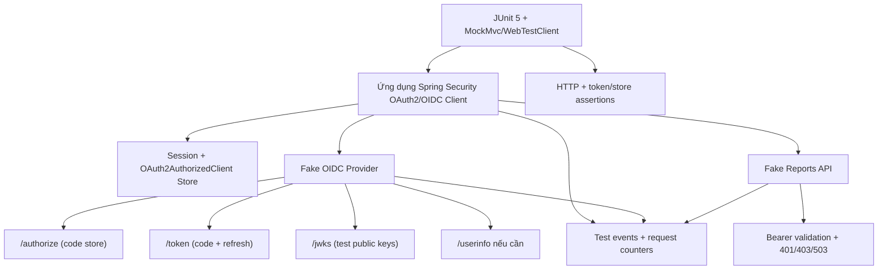
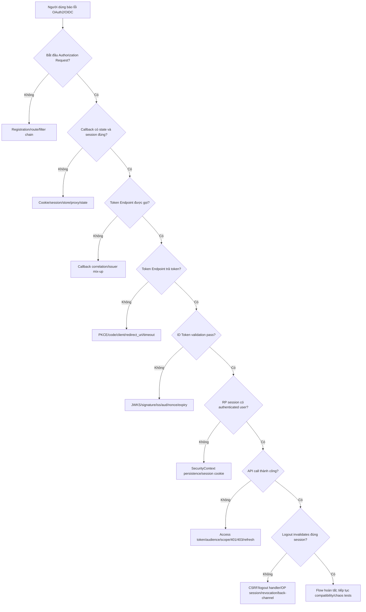
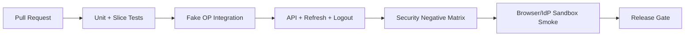

# 34.12. Bộ kiểm thử hoàn chỉnh và kịch bản chẩn đoán sự cố

## 1. Bài thực hành tổng hợp: chứng minh OAuth2/OIDC Client hoạt động từ đầu đến cuối

Trong các bài thử nghiệm đơn lẻ, ta có thể đã kiểm tra cấu hình `ClientRegistration`, đăng nhập bằng OpenID Connect, gọi API có Bearer token, làm mới access token và đăng xuất. Nhưng ở một hệ thống thực, những chức năng này nằm trong **cùng một chuỗi phụ thuộc**. Một thay đổi nhỏ ở cookie, callback URI, OAuth2 authorized-client store hay HTTP filter có thể làm hỏng nhiều bước dù unit test từng phần vẫn xanh.

Bài thực hành này hướng dẫn thiết kế **bộ kiểm thử tổng hợp có khả năng chẩn đoán sự cố**, tập trung vào Spring Security OAuth 2.0/OIDC Client:

```text
Browser bắt đầu login
    -> RP tạo state, PKCE, nonce
    -> OP phát authorization code
    -> RP đổi code lấy tokens
    -> RP xác minh signed ID Token
    -> RP lưu phiên và authorized client
    -> User gọi API downstream bằng access token
    -> Token gần hết hạn, authorized client được refresh
    -> API nhận access token mới
    -> User logout, session bị hủy
    -> Các tình huống sai state/nonce/code/token/tenant bị từ chối
```

**RP** là Relying Party, tức ứng dụng Spring Security của chúng ta. **OP** là OpenID Provider/Authorization Server thử nghiệm. **API** là Resource Server phía downstream.

Một bài kiểm thử được coi là tốt khi không chỉ trả `200`, mà còn **chứng minh nơi phát sinh token, nơi token được gửi tới, ràng buộc issuer/audience/subject, việc tiêu thụ code một lần, vòng đời refresh và tác động của logout**.

### 1.1. Kết quả cần đạt

Sau khi hoàn thành bài, bạn có thể:

1. Xây một môi trường test độc lập khỏi OP production.
2. Chạy một happy-path OIDC Authorization Code Flow từ redirect đến authenticated session.
3. Kiểm tra `state`, PKCE S256 và OIDC nonce theo transaction.
4. Tạo ID Token ký bằng private key test và xuất public JWKS.
5. Kiểm tra chữ ký, `iss`, `aud`, expiry, claims và UserInfo.
6. Kiểm thử `OAuth2AuthorizedClient` được lưu và dùng để gọi API đúng nơi.
7. Kiểm thử refresh token, token rotation và trường hợp chưa đến hạn refresh.
8. Phân biệt API `401 invalid_token` với `403 insufficient_scope`.
9. Kiểm thử local logout, CSRF, RP-Initiated Logout và back-channel logout khi ứng dụng hỗ trợ.
10. Tạo các kịch bản lỗi có thể tái hiện: sai callback, sai issuer, JWKS unavailable, refresh race, cookie mất, API timeout.
11. Tổ chức các tests theo mức unit, slice, integration, contract và browser E2E.
12. Dùng MockMvc cho Servlet hoặc WebTestClient cho WebFlux mà không nhầm hai hệ.
13. Chẩn đoán sự cố dựa trên dấu vết từng giai đoạn, không đọc/log toàn bộ tokens.
14. Thiết kế CI gates, tiêu chí pass/fail, dữ liệu thử nghiệm và quy trình rollback.
15. Biết giới hạn của mỗi test và không tuyên bố quá mức về bảo mật.

### 1.2. Điều kiện và phạm vi

Các mẫu Java dưới đây chủ yếu dùng **Servlet Spring MVC + Spring Security OAuth2 Client**, JUnit 5, MockMvc, OkHttp MockWebServer và Nimbus JOSE + JWT; phần cuối nêu biến thể WebFlux. Chúng sử dụng Java 17+ và các API Spring Security hiện đại. Tên package, annotation test và một số extension point có thể khác nhau giữa Spring Boot 3.x/4.x và Spring Security versions; chọn versions bằng BOM của dự án.

Một số phần là **mã đầy đủ của một thành phần**; các phần khác được ghi rõ là **khung test cần kết nối với test fixture**. Bài không giả định mọi snippet có thể copy riêng lẻ vào một class rồi chạy, vì một test tích hợp cần đầy đủ application context, test registrations và fake servers.

**Đừng dùng thông tin đăng nhập production.** Tất cả issuer, subject, client ID, access/refresh tokens và RSA keys trong lab là dữ liệu tổng hợp.

## 2. Định nghĩa “hoàn chỉnh” bằng các hợp đồng có thể kiểm tra

Một suite không cần mô phỏng toàn bộ Internet để đủ giá trị, nhưng phải đo được các ranh giới bảo mật quan trọng.

| Hợp đồng | Input | Assertion quan trọng |
| --- | --- | --- |
| Login initiation | `GET /oauth2/authorization/lab` | 302 tới approved OP; đúng client, callback, state, PKCE, nonce |
| Authorization callback | `code` + đúng `state` + RP session | RP chỉ đổi code khi pending authorization request khớp |
| Token exchange | One-time code + PKCE verifier | OP thấy đúng client/redirect URI/challenge, nhận đúng một request |
| OIDC validation | Signed ID Token | Verify chữ ký, `iss`, `aud`, `exp`, nonce, `sub` |
| Principal mapping | Valid OIDC response | `OidcUser` và authorities đúng, không lấy email làm security key mặc định |
| Session | Cookie của RP sau login | Request sau đó có authentication đúng; session fixation theo policy |
| Authorized client | Access/refresh tokens | Lưu đúng registration và principal; không cross-tenant |
| API call | OAuth2AuthorizedClient | Gửi **access token**, đúng API host/audience/scope, không gửi ID Token |
| Refresh | Expired/near-expiry access token | Refresh đúng một lần theo policy; persist A2/R2 và không replay R1 |
| API error | 401/403/503 | Bounded recovery, không retry vô hạn hoặc gửi token tới host khác |
| Logout | POST logout + CSRF | Hủy RP session; các cơ chế OP logout/revocation được kiểm tra riêng |
| Fault cases | Wrong state/nonce/issuer/aud/keys | Fail closed; không cấp quyền bằng token không thể xác minh |
| Observability | Traces và metrics | Ghi stage, status, registration alias; không ghi secrets |

### 2.1. Ba lớp bằng chứng khác nhau

**Lớp A — Controller/SecurityContext.** Mock principal bằng `oidcLogin()` hoặc `mockOidcLogin()` để kiểm tra controller nhận `OidcUser`, DTO và method security. Nó **không** đi qua code exchange.

**Lớp B — Integration giao thức.** Dùng Spring Security filter chain thật và fake OP có `/token`/`jwks` cùng ID Token ký thật. Nó kiểm tra code, PKCE, nonce, JWT validation, session và token lifecycle.

**Lớp C — Browser/Provider E2E.** Dùng browser thật và OP sandbox để kiểm tra cross-site cookies, redirects, TLS, ingress, MFA, consent, logout UX và provider-specific behavior.

Bài lab sẽ xây **lớp B** rồi bổ sung A/C khi phù hợp.

## 3. Kiến trúc môi trường thử nghiệm



Những thành phần cần tồn tại **thực sự** trong test tích hợp:

- Security filter chain của ứng dụng.
- `ClientRegistrationRepository` hoặc reactive equivalent.
- Authorization request repository giữ state/nonce/PKCE.
- OAuth2 token response client thật của Spring Security.
- ID Token decoder/validator thật với JWKS test.
- Authorized-client repository/service thật trong phạm vi test.
- Một HTTP server fake đủ thông minh để **từ chối** code/verifier sai.
- HTTP API fake ghi nhận Bearer token và phản hồi lỗi có kiểm soát.

Có thể mock database nghiệp vụ hoặc email notifier vì đó không phải đối tượng đang kiểm thử.

## 4. Cấu trúc project lab

Một cấu trúc đề xuất:

```text
oidc-client-regression-lab/
├── build.gradle
├── src/main/java/example/oidclab/
│   ├── LabApplication.java
│   ├── SecurityConfiguration.java
│   ├── web/MeController.java
│   ├── web/ReportsController.java
│   └── api/ReportsGateway.java
├── src/main/resources/
│   └── application.yml
├── src/test/java/example/oidclab/
│   ├── support/FakeOidcProvider.java
│   ├── support/TestRegistrations.java
│   ├── support/ProtocolAssertions.java
│   ├── LoginFlowIT.java
│   ├── RefreshFlowIT.java
│   ├── ApiCallIT.java
│   ├── LogoutIT.java
│   └── SecurityFailureIT.java
└── src/test/resources/
    └── application-test.yml
```

Tên `FakeOidcProvider`, `TestRegistrations`, `ProtocolAssertions` là classes **do lab định nghĩa**, không phải Spring Security API có sẵn.

### 4.1. Dependencies Gradle

Ví dụ cho Spring Boot Servlet:

```gradle
plugins {
    id 'java'
    id 'org.springframework.boot' version '<spring-boot-version>'
    id 'io.spring.dependency-management' version '<compatible-version>'
}

java {
    toolchain {
        languageVersion = JavaLanguageVersion.of(17)
    }
}

dependencies {
    implementation 'org.springframework.boot:spring-boot-starter-web'
    implementation 'org.springframework.boot:spring-boot-starter-security'
    implementation 'org.springframework.boot:spring-boot-starter-oauth2-client'

    testImplementation 'org.springframework.boot:spring-boot-starter-test'
    testImplementation 'org.springframework.security:spring-security-test'

    // Chọn phiên bản thông qua version catalog/BOM phù hợp.
    testImplementation 'com.squareup.okhttp3:mockwebserver:<version>'
    testImplementation 'com.nimbusds:nimbus-jose-jwt:<version>'
}

tasks.named('test') {
    useJUnitPlatform()
}
```

Các chuỗi `<...>` là placeholders, **không phải Gradle version có thể build nguyên văn**. Spring Boot 4 tổ chức một số test starters khác Boot 3; kiểm tra chính xác dependency management/annotation package trong project đang sử dụng. Không trộn Spring Security Test version lệch runtime.

Nếu dùng Maven, tương đương cần `spring-security-test`, JUnit Jupiter, Spring Boot Test, MockWebServer và Nimbus JOSE + JWT trong test scope.

### 4.2. Nhận diện đúng stack

- Servlet MVC: `HttpSecurity`, `SecurityFilterChain`, `MockMvc`, `HttpSession`.
- WebFlux: `ServerHttpSecurity`, `SecurityWebFilterChain`, `WebTestClient`, `WebSession`.
- `WebClient` có thể được dùng trong **cả** ứng dụng Servlet lẫn Reactive như outbound HTTP client; chỉ thấy dependency WebFlux không chứng minh web server đang Reactive.
- Không dùng `oidcLogin()` của MockMvc với `WebTestClient` hoặc ngược lại.

## 5. Mã ứng dụng Servlet tối thiểu

### 5.1. Main application

```java
package example.oidclab;

import org.springframework.boot.SpringApplication;
import org.springframework.boot.autoconfigure.SpringBootApplication;

@SpringBootApplication
public class LabApplication {

    public static void main(String[] args) {
        SpringApplication.run(LabApplication.class, args);
    }
}
```

### 5.2. Security configuration

```java
package example.oidclab;

import org.springframework.context.annotation.Bean;
import org.springframework.context.annotation.Configuration;
import org.springframework.security.config.Customizer;
import org.springframework.security.config.annotation.web.builders.HttpSecurity;
import org.springframework.security.web.SecurityFilterChain;

@Configuration
public class SecurityConfiguration {

    @Bean
    SecurityFilterChain securityFilterChain(HttpSecurity http)
            throws Exception {

        return http
            .authorizeHttpRequests(auth -> auth
                .requestMatchers("/", "/signed-out").permitAll()
                .requestMatchers("/api/**").authenticated()
                .anyRequest().authenticated())
            .oauth2Login(Customizer.withDefaults())
            .oauth2Client(Customizer.withDefaults())
            .logout(logout -> logout
                .logoutSuccessUrl("/signed-out"))
            .build();
    }
}
```

Lab giữ **local logout** đơn giản để tách hồi quy local session khỏi OP logout. Ta bổ sung RP-Initiated Logout ở phần sau.

Không disable CSRF. Với session-based browser app, request `POST /logout` phải cung cấp CSRF token theo chính sách.

### 5.3. Controller hiển thị danh tính tối thiểu

```java
package example.oidclab.web;

import org.springframework.http.ResponseEntity;
import org.springframework.security.core.annotation.AuthenticationPrincipal;
import org.springframework.security.oauth2.core.oidc.user.OidcUser;
import org.springframework.web.bind.annotation.GetMapping;
import org.springframework.web.bind.annotation.RestController;

@RestController
public class MeController {

    @GetMapping("/api/me")
    ResponseEntity<Me> me(
            @AuthenticationPrincipal OidcUser user) {

        if (user == null) {
            return ResponseEntity.status(401).build();
        }

        return ResponseEntity.ok(
            new Me(
                user.getSubject(),
                user.getIdToken().getClaimAsString("iss")));
    }

    public record Me(String subject, String issuer) {}
}
```

Controller **không** trả nguyên `OidcUser`, raw ID Token, access token hoặc UserInfo claims; đây là một security contract cần giữ khi nâng cấp.

Trong test không đăng nhập, Spring Security thường chặn request **trước khi** chạy controller. Với OAuth2 Login entry point, response có thể là `302` đến login page thay vì `401`.

### 5.4. Gateway gọi API bằng access token

Để lab minh bạch, gateway nhận access token đã được resolver cung cấp:

```java
package example.oidclab.api;

import org.springframework.web.client.RestClient;

public final class ReportsGateway {

    private final RestClient client;

    public ReportsGateway(RestClient client) {
        this.client = client;
    }

    public Report get(String accessToken) {
        return client.get()
            .uri("/reports/me")
            .headers(headers ->
                headers.setBearerAuth(accessToken))
            .retrieve()
            .body(Report.class);
    }

    public record Report(String id, String owner) {}
}
```

Và controller:

```java
package example.oidclab.web;

import example.oidclab.api.ReportsGateway;
import org.springframework.security.oauth2.client.OAuth2AuthorizedClient;
import org.springframework.security.oauth2.client.annotation.RegisteredOAuth2AuthorizedClient;
import org.springframework.web.bind.annotation.GetMapping;
import org.springframework.web.bind.annotation.RestController;

@RestController
public class ReportsController {

    private final ReportsGateway gateway;

    public ReportsController(ReportsGateway gateway) {
        this.gateway = gateway;
    }

    @GetMapping("/api/reports/me")
    ReportsGateway.Report report(
        @RegisteredOAuth2AuthorizedClient("lab")
        OAuth2AuthorizedClient authorizedClient) {

        return gateway.get(
            authorizedClient.getAccessToken().getTokenValue());
    }
}
```

**Lưu ý:** `@RegisteredOAuth2AuthorizedClient` resolve authorized client, **không lấy ID Token**. Trong production nên có adapter/domain service kiểm soát resource/tenant và security policy; lab giữ dữ liệu ít để test nhìn rõ boundary.

Vì đây là Servlet application, `RestClient` synchronous phù hợp hơn việc `.block()` trong WebFlux event loop. Outbound HTTP client phải có trusted base URL, HTTPS production, timeout và redirect policy phù hợp.

## 6. Test ClientRegistration và ReportsGateway beans

Để tránh gọi discovery production, test có thể xây `ClientRegistration` từ cấu hình rõ ràng:

```java
@TestConfiguration
public class LabFixtureConfiguration {

    @Bean
    ClientRegistrationRepository testRegistrations(
            @Value("${lab.op.base-url}") String opBase) {

        ClientRegistration registration =
            ClientRegistration.withRegistrationId("lab")
                .clientId("lab-client")
                .clientAuthenticationMethod(
                    ClientAuthenticationMethod.NONE)
                .authorizationGrantType(
                    AuthorizationGrantType.AUTHORIZATION_CODE)
                .redirectUri(
                    "{baseUrl}/login/oauth2/code/{registrationId}")
                .scope("openid")
                .issuerUri("https://issuer.example.test")
                .authorizationUri(opBase + "/authorize")
                .tokenUri(opBase + "/token")
                .jwkSetUri(opBase + "/jwks")
                .clientName("Lab OIDC Provider")
                .build();

        return new InMemoryClientRegistrationRepository(
            registration);
    }

    @Bean
    OAuth2AuthorizedClientService authorizedClientService(
        ClientRegistrationRepository registrations) {

        return new InMemoryOAuth2AuthorizedClientService(
            registrations);
    }

    @Bean
    ReportsGateway reportsGateway(
            @Value("${lab.op.base-url}") String opBase) {

        RestClient client = RestClient.builder()
            .baseUrl(opBase)
            .build();

        return new ReportsGateway(client);
    }
}
```

Các imports của `ClientRegistration`, `ClientRegistrationRepository`, `ClientAuthenticationMethod`, `AuthorizationGrantType`, `RestClient`, Spring `@Bean`, `@Value` và `@TestConfiguration` cần lấy từ modules tương ứng. Lớp này nằm trong test sources và được import vào integration-test context.

### 6.1. Vì sao dùng public client trong lab?

`ClientAuthenticationMethod.NONE` giúp thấy rõ PKCE S256 mà không phải xử lý client secret trong fake OP. Trong Spring Security hiện đại, public Authorization Code client thường được bật PKCE tự động; ở các phiên bản hỗ trợ có thể cấu hình `ClientRegistration.ClientSettings.requireProofKey(true)`.

**Không dựa vào giả định**; test phải assert `code_challenge_method=S256` thật. Khi ứng dụng production dùng confidential client, thêm một fixture kiểm tra **cả client authentication và PKCE**.

Issuer logic ở đây là HTTPS `https://issuer.example.test`, trong khi endpoint giao tiếp của fake OP chạy localhost HTTP. Đây **chỉ là cấu hình test** với trusted fixtures; production phải tuân thủ issuer metadata/TLS/egress policy.

### 6.2. Bean collisions và test auto-configuration

Nếu app còn tự định nghĩa `ClientRegistrationRepository`, `OAuth2AuthorizedClientService` hoặc `ReportsGateway`, cần **override bằng cơ chế phù hợp** (`@Primary`, test profile, bean override) chứ không tạo hai beans rồi mong Spring chọn đúng.

Nếu một `@SpringBootTest` đọc `issuer-uri` và khởi động discovery trước khi fake server sẵn sàng, hãy cung cấp explicit endpoint registrations như trên hoặc khởi động fake OP trước context. Không tắt validation issuer để test khởi động dễ hơn.

## 7. Fake OpenID Provider: các yêu cầu chức năng

Mục tiêu là một OP test không tùy tiện trả token cho bất cứ request nào. Nó cần:

1. Cấp một authorization code **dùng một lần**.
2. Lưu `client_id`, `redirect_uri`, `code_challenge`, OIDC `nonce`.
3. Từ chối wrong client, wrong URI và wrong PKCE verifier.
4. Ký ID Token bằng private key test.
5. Công bố public key ở `/jwks`.
6. Cấp access token và refresh token giả.
7. Rotate refresh token khi được yêu cầu.
8. Phát `401 invalid_token` hoặc `403 insufficient_scope` ở fake Reports API.
9. Ghi request counts và giai đoạn thất bại.
10. Có fault flags để thử wrong nonce, wrong issuer, timeout và token errors.

Để bài vẫn dễ hiểu, ví dụ dưới đây dùng **OkHttp MockWebServer** cho `/token`, `/jwks` và `/reports/me`. Authorization Endpoint được **quan sát qua Location header** do RP phát, rồi test chủ động yêu cầu fake OP cấp code. Cách này kiểm tra Spring Security backend filter/token exchange thật, nhưng **không mô phỏng browser UI của OP**; browser E2E cần một test bổ sung.

### 7.1. Thư viện và test fixtures

Một bản phác thảo triển khai:

```java
public final class FakeOidcProvider
        implements AutoCloseable {

    private final MockWebServer server =
        new MockWebServer();

    private final RSAKey signingKey;
    private final Map<String, PendingCode> codes =
        new ConcurrentHashMap<>();

    private final Set<String> validRefreshTokens =
        ConcurrentHashMap.newKeySet();

    private final Set<String> issuedAccessTokens =
        ConcurrentHashMap.newKeySet();

    private final AtomicInteger codeExchanges =
        new AtomicInteger();

    private final AtomicInteger refreshExchanges =
        new AtomicInteger();

    private final AtomicInteger apiCalls =
        new AtomicInteger();

    private final AtomicReference<String> lastCodeVerifier =
        new AtomicReference<>();

    private final AtomicReference<String> lastBearer =
        new AtomicReference<>();

    private volatile boolean wrongNonce;
    private volatile boolean wrongIssuer;
    private volatile boolean reportsUnauthorized;

    private final String issuer =
        "https://issuer.example.test";

    public FakeOidcProvider() throws Exception {
        signingKey = new RSAKeyGenerator(2048)
            .keyID("lab-key-1")
            .generate();

        server.setDispatcher(new Dispatcher() {
            @Override
            public MockResponse dispatch(
                    RecordedRequest request) {
                return handle(request);
            }
        });

        server.start();
    }

    public String baseUrl() {
        String value = server.url("/").toString();
        return value.substring(0, value.length() - 1);
    }

    public String issuer() {
        return issuer;
    }

    public int codeExchanges() {
        return codeExchanges.get();
    }

    public int refreshExchanges() {
        return refreshExchanges.get();
    }

    public int apiCalls() {
        return apiCalls.get();
    }

    public String lastCodeVerifier() {
        return lastCodeVerifier.get();
    }

    public String lastBearer() {
        return lastBearer.get();
    }

    public void wrongNonce(boolean value) {
        wrongNonce = value;
    }

    public void wrongIssuer(boolean value) {
        wrongIssuer = value;
    }

    public void reportsUnauthorized(boolean value) {
        reportsUnauthorized = value;
    }

    // Các methods issueCode, handle và helpers
    // được triển khai ở các mục tiếp theo.

    @Override
    public void close() throws IOException {
        server.shutdown();
    }
}
```

Các imports gợi ý: `okhttp3.mockwebserver.*`, `com.nimbusds.jose.*`, `com.nimbusds.jose.jwk.*`, `com.nimbusds.jose.jwk.gen.*`, `com.nimbusds.jwt.*`, `java.util.concurrent.*`, `java.time.*` và `java.io.IOException`.

Đừng log `lastCodeVerifier()` và `lastBearer()`; chúng chỉ dùng để assert **trong memory**. Trong production, không triển khai một recorder lưu token vào biến global.

### 7.2. Lưu authorization code

Định nghĩa test record:

```java
record PendingCode(
    String clientId,
    String redirectUri,
    String codeChallenge,
    String nonce,
    String subject,
    Instant expiresAt) {}
```

Hàm cấp code:

```java
public String issueCode(
        String clientId,
        String redirectUri,
        String challenge,
        String nonce,
        String subject) {

    String code = "C-" + UUID.randomUUID();

    codes.put(code, new PendingCode(
        clientId,
        redirectUri,
        challenge,
        nonce,
        subject,
        Instant.now().plusSeconds(90)));

    return code;
}
```

Ở fake OP “thật hơn”, `/authorize` tự gọi logic này sau khi validate request và session người dùng. Trong `MockMvc` test, ta có thể đi thẳng từ parsed Authorization Request sang `issueCode(...)`, sau đó giả lập browser callback.

### 7.3. Test helper tính PKCE

```java
static String s256(String verifier) {
    try {
        byte[] digest = MessageDigest
            .getInstance("SHA-256")
            .digest(
                verifier.getBytes(
                    StandardCharsets.US_ASCII));

        return Base64.getUrlEncoder()
            .withoutPadding()
            .encodeToString(digest);
    }
    catch (GeneralSecurityException ex) {
        throw new IllegalStateException(ex);
    }
}
```

Verifer hợp lệ theo RFC 7636 có 43–128 ký tự `[A-Za-z0-9._~-]`. Với `S256`:

\[
\text{challenge} = \operatorname{BASE64URL}_{\text{no padding}}
 (\operatorname{SHA256}(\operatorname{ASCII}(\text{verifier})))
\]

Test vector công khai:

```text
verifier:
dBjftJeZ4CVP-mB92K27uhbUJU1p1r_wW1gFWFOEjXk

challenge:
E9Melhoa2OwvFrEMTJguCHaoeK1t8URWbuGJSstw-cM
```

Không dùng test vector này làm verifier production.

### 7.4. Ký ID Token từ fake OP

```java
private String signedIdToken(
        PendingCode transaction,
        String nonce) {

    try {
        Instant now = Instant.now();

        JWTClaimsSet claims =
            new JWTClaimsSet.Builder()
                .issuer(
                    wrongIssuer
                        ? "https://wrong-issuer.example.test"
                        : issuer)
                .subject(transaction.subject())
                .audience(transaction.clientId())
                .issueTime(Date.from(now))
                .expirationTime(
                    Date.from(now.plusSeconds(300)))
                .claim("nonce", nonce)
                .build();

        JWSHeader header = new JWSHeader.Builder(
            JWSAlgorithm.RS256)
            .keyID(signingKey.getKeyID())
            .build();

        SignedJWT jwt = new SignedJWT(header, claims);

        jwt.sign(new RSASSASigner(
            signingKey.toPrivateKey()));

        return jwt.serialize();
    }
    catch (Exception ex) {
        throw new IllegalStateException(
            "Could not sign lab ID Token", ex);
    }
}
```

Khi `wrongNonce = false`, gọi:

```java
signedIdToken(code, code.nonce())
```

Khi `wrongNonce = true`, dùng một chuỗi khác nonce OP đã nhận.

**Lưu ý nonce:** một số phiên bản Spring Security sinh nonce gốc, lưu nội bộ, nhưng gửi **hash của nonce gốc** tới OP. Fake OP phải đưa vào ID Token **đúng giá trị `nonce` nhìn thấy ở Authorization Request**, không tự hash lần thứ hai.

### 7.5. Handler cho JWKS

```java
private MockResponse jwks() {
    String body =
        new JWKSet(
            signingKey.toPublicJWK()).toString();

    return new MockResponse()
        .setResponseCode(200)
        .setHeader(
            "Content-Type", "application/json")
        .setBody(body);
}
```

JWKS chỉ chứa **public key**; không xuất `signingKey` có private material ra HTTP response.

### 7.6. Handler cho Token Endpoint

Test-only dispatcher có thể phân luồng:

```java
private MockResponse handle(
        RecordedRequest request) {

    String path =
        request.getRequestUrl().encodedPath();

    if (path.equals("/jwks")
            && request.getMethod().equals("GET")) {
        return jwks();
    }

    if (path.equals("/token")
            && request.getMethod().equals("POST")) {

        Map<String, String> form =
            decodeForm(request.getBody().readUtf8());

        String grant = form.get("grant_type");

        if ("authorization_code".equals(grant)) {
            return exchangeCode(form);
        }

        if ("refresh_token".equals(grant)) {
            return exchangeRefresh(form);
        }

        return oauthError("unsupported_grant_type");
    }

    if (path.equals("/reports/me")
            && request.getMethod().equals("GET")) {
        return report(request);
    }

    return new MockResponse().setResponseCode(404);
}
```

`decodeForm(...)` là utility test parse URL-encoded form:

```java
static Map<String, String> decodeForm(String body) {
    Map<String, String> out = new LinkedHashMap<>();

    if (body == null || body.isBlank()) {
        return out;
    }

    for (String item : body.split("&")) {
        String[] pair = item.split("=", 2);

        String key = URLDecoder.decode(
            pair[0], StandardCharsets.UTF_8);

        String value = URLDecoder.decode(
            pair.length == 2 ? pair[1] : "",
            StandardCharsets.UTF_8);

        if (out.putIfAbsent(key, value) != null) {
            throw new IllegalArgumentException(
                "Duplicate form key");
        }
    }

    return out;
}
```

Nếu user-supplied input chạy vào production parser thì cần error handling khác; đây là utility chỉ dành cho test. Phát hiện duplicate params giúp tránh test thành công sai do request chứa nhiều giá trị `code_verifier`/`client_id`.

### 7.7. One-time authorization code exchange

```java
private MockResponse exchangeCode(
        Map<String, String> form) {

    codeExchanges.incrementAndGet();

    String codeValue = form.get("code");

    // Atomic consume: code chỉ được dùng một lần.
    PendingCode code = codes.remove(codeValue);

    if (code == null) {
        return oauthError("invalid_grant");
    }

    if (Instant.now().isAfter(code.expiresAt())) {
        return oauthError("invalid_grant");
    }

    if (!Objects.equals(
            form.get("client_id"), code.clientId())) {
        return oauthError("invalid_client");
    }

    if (!Objects.equals(
            form.get("redirect_uri"),
            code.redirectUri())) {
        return oauthError("invalid_grant");
    }

    String verifier = form.get("code_verifier");
    lastCodeVerifier.set(verifier);

    if (verifier == null
            || !verifier.matches(
                "[A-Za-z0-9._~-]{43,128}")
            || !s256(verifier)
                .equals(code.codeChallenge())) {

        return oauthError("invalid_grant");
    }

    String accessToken = "AT-" + UUID.randomUUID();
    String refreshToken = "RT-" + UUID.randomUUID();

    issuedAccessTokens.add(accessToken);
    validRefreshTokens.add(refreshToken);

    String nonce = wrongNonce
        ? "some-other-nonce"
        : code.nonce();

    String idToken = signedIdToken(code, nonce);

    return json(200, """
        {
          "access_token": "%s",
          "token_type": "Bearer",
          "expires_in": 300,
          "scope": "openid",
          "refresh_token": "%s",
          "id_token": "%s"
        }
        """.formatted(
            accessToken, refreshToken, idToken));
}
```

Trong production, private keys và tokens được phát bởi OP, không phải ứng dụng RP. Ở fake OP, ta kiểm tra client/redirect/PKCE để integration test không thể pass nếu Spring Security gửi sai verifier.

Đối với confidential client, thêm bước kiểm tra `Authorization: Basic ...` hoặc client assertion phù hợp. **Không gửi secret vào log**.

### 7.8. Handler cho Refresh Token Grant

```java
private MockResponse exchangeRefresh(
        Map<String, String> form) {

    refreshExchanges.incrementAndGet();

    String previous = form.get("refresh_token");

    // remove() là atomic consume đối với Concurrent Set.
    if (previous == null
            || !validRefreshTokens.remove(previous)) {
        return oauthError("invalid_grant");
    }

    String accessToken = "AT-" + UUID.randomUUID();
    String refreshToken = "RT-" + UUID.randomUUID();

    issuedAccessTokens.add(accessToken);
    validRefreshTokens.add(refreshToken);

    return json(200, """
        {
          "access_token": "%s",
          "token_type": "Bearer",
          "expires_in": 300,
          "scope": "openid",
          "refresh_token": "%s"
        }
        """.formatted(accessToken, refreshToken));
}
```

**Điểm quan trọng:** test OP **consume** old refresh token, nếu sử dụng lại nó phải trả `invalid_grant`. Cách này giúp phát hiện refresh rotation race.

Một OP thật có thể có grace window, session policy hoặc phát ID Token mới khi refresh; hãy thêm contract test theo provider. Không mặc định tất cả OP hành xử hệt fixture tối giản.

### 7.9. Fake Reports API và OAuth2 errors

```java
private MockResponse report(
        RecordedRequest request) {

    apiCalls.incrementAndGet();

    String authorization =
        request.getHeader("Authorization");

    lastBearer.set(authorization);

    if (reportsUnauthorized) {
        return new MockResponse()
            .setResponseCode(401)
            .setHeader(
                "WWW-Authenticate",
                "Bearer error=\"invalid_token\"");
    }

    if (authorization == null
            || !authorization.startsWith("Bearer ")) {
        return new MockResponse()
            .setResponseCode(401);
    }

    String token =
        authorization.substring("Bearer ".length());

    if (!issuedAccessTokens.contains(token)) {
        return new MockResponse()
            .setResponseCode(401)
            .setHeader(
                "WWW-Authenticate",
                "Bearer error=\"invalid_token\"");
    }

    return json(200, """
        {"id":"r-1","owner":"test-user-17"}
        """);
}
```

Bản lab trên dùng **opaque access token aliases** và in-memory allowlist để thử việc RP forwarding. Nó **chưa kiểm tra JWT access token audience/issuer/signature**. Để test Resource Server security thực, dùng `spring-boot-starter-oauth2-resource-server`, test JWT/JWKS hoặc introspection với validators đúng, rồi thêm wrong-audience/wrong-scope cases.

### 7.10. Response helpers

```java
private static MockResponse json(
        int status, String body) {

    return new MockResponse()
        .setResponseCode(status)
        .setHeader(
            "Content-Type", "application/json")
        .setHeader("Cache-Control", "no-store")
        .setBody(body);
}

private static MockResponse oauthError(String error) {
    return json(400, """
        {"error":"%s"}
        """.formatted(error));
}
```

Các helpers này phục vụ deterministic tests. Khi fault injection, có thể trả `503`, trì hoãn response hoặc drop connection **sau khi** code/refresh token đã được consume.

## 8. Khởi động fake OP trước Spring context

`ClientRegistration` cần URL thực của fake server, ví dụ:

```text
http://127.0.0.1:51545/token
http://127.0.0.1:51545/jwks
```

Port được hệ điều hành cấp khi `MockWebServer.start()` chạy. Nếu Spring context khởi tạo repository trước, có thể nhận URL sai.

Một pattern:

```java
@SpringBootTest
@AutoConfigureMockMvc
@Import(LabFixtureConfiguration.class)
class LoginFlowIT {

    private static final FakeOidcProvider OP =
        createProvider();

    @DynamicPropertySource
    static void registerProperties(
            DynamicPropertyRegistry properties) {

        properties.add(
            "lab.op.base-url", OP::baseUrl);
    }

    private static FakeOidcProvider createProvider() {
        try {
            return new FakeOidcProvider();
        }
        catch (Exception ex) {
            throw new ExceptionInInitializerError(ex);
        }
    }

    @AfterAll
    static void stopProvider() throws Exception {
        OP.close();
    }

    @Autowired
    MockMvc mvc;
}
```

Spring Boot/Spring Test context có thể được cache giữa các test classes; tránh để một context giữ bean trỏ đến fake port đã bị tắt trước khi suite khác sử dụng. Các lựa chọn:

- Dùng một reusable fixture trong test suite và dừng ở đúng lifecycle.
- Cấu hình context key riêng cho mỗi fake OP.
- Không bật parallel execution cho classes chia sẻ stateful OP nếu chưa có isolation.
- Tạo server ở test application context lifecycle thay vì JUnit static nếu cần quản lý chính xác hơn.

Đây là một trong những lỗi phổ biến của integration tests: chạy từng class thì pass, chạy toàn suite thì fail.

## 9. Bắt Authorization Request và giữ session

Servlet test không dùng `oidcLogin()`; request thật phải đi qua OAuth2 Login filter chain:

```java
MvcResult started = mvc.perform(
        get("/oauth2/authorization/lab")
            .secure(true)
            .scheme("https")
            .serverName("portal.example.test")
            .serverPort(443))
    .andExpect(status().is3xxRedirection())
    .andExpect(
        header().exists(HttpHeaders.LOCATION))
    .andReturn();

String redirect =
    started.getResponse()
        .getHeader(HttpHeaders.LOCATION);

MockHttpSession session =
    (MockHttpSession)
        started.getRequest().getSession(false);
```

Nếu `session == null`, kiểm tra authorization request repository, filter chain và test session setup.

### 9.1. Parse redirect URL

Có thể dùng Spring `UriComponentsBuilder`:

```java
URI uri = URI.create(redirect);

MultiValueMap<String, String> query =
    UriComponentsBuilder.fromUri(uri)
        .build()
        .getQueryParams();

String state = query.getFirst("state");
String challenge =
    query.getFirst("code_challenge");
String nonce = query.getFirst("nonce");
String redirectUri = query.getFirst("redirect_uri");
```

Nếu parser trả query values còn percent-encoded, decode **đúng một lần** hoặc dùng một utility chuẩn cho URL form query. Tránh double decoding và duplicate parameters. Khi so URL, nên so parsed scheme/host/path và decoded URI theo hợp đồng.

### 9.2. Assertions ở Authorization Request

```java
assertThat(uri.getHost())
    .isIn("127.0.0.1", "localhost");

assertThat(query.getFirst("response_type"))
    .isEqualTo("code");

assertThat(query.getFirst("client_id"))
    .isEqualTo("lab-client");

assertThat(query.getFirst("scope"))
    .contains("openid");

assertThat(query.getFirst("code_challenge_method"))
    .isEqualTo("S256");

assertThat(state).isNotBlank();
assertThat(nonce).isNotBlank();
assertThat(challenge).isNotBlank();

assertThat(query).doesNotContainKey("code_verifier");
```

`uri.getHost()` ở ví dụ phù hợp fake server loopback. Trong production test, expected host phải là **approved OP host**, không chấp nhận mọi host localhost một cách tùy tiện.

**Không đưa raw `redirect` hoặc `state` vào logs.** Có thể log một sanitized event: `registrationId=lab`, `statePresent=true`, `pkce=S256`.

## 10. Chạy một vòng login OIDC đầy đủ

Giả sử fake OP cấp code theo Authorization Request:

```java
String code = OP.issueCode(
    query.getFirst("client_id"),
    query.getFirst("redirect_uri"),
    challenge,
    nonce,
    "test-user-17");
```

Sau đó mô phỏng browser quay về callback **với đúng RP session**:

```java
MvcResult callback = mvc.perform(
        get("/login/oauth2/code/lab")
            .session(session)
            .secure(true)
            .scheme("https")
            .serverName("portal.example.test")
            .serverPort(443)
            .param("code", code)
            .param("state", state))
    .andReturn();
```

Spring Security lúc này phải:

1. Load authorization request theo state.
2. Đối chiếu callback và pending request.
3. Gửi Token Request tới fake OP.
4. Gửi `code_verifier` mà OP kiểm tra S256.
5. Nhận signed ID Token.
6. Tải public JWKS và xác minh chữ ký/issuer/audience/expiry/nonce.
7. Tạo `OidcUser`/`OAuth2AuthenticationToken`.
8. Lưu session và authorized client.

Không dùng `@WithMockUser`, `oidcLogin()` hoặc manually `SecurityContextHolder.setContext(...)` trong **test này**: chúng có thể bypass flow.

### 10.1. Assertions sau callback

```java
assertThat(OP.codeExchanges())
    .isEqualTo(1);

assertThat(OP.lastCodeVerifier())
    .matches("[A-Za-z0-9._~-]{43,128}");

assertThat(s256(OP.lastCodeVerifier()))
    .isEqualTo(challenge);
```

Và lấy session sau login (nếu có session fixation rotation):

```java
MockHttpSession authenticatedSession =
    (MockHttpSession)
        callback.getRequest().getSession(false);

assertThat(authenticatedSession).isNotNull();

mvc.perform(get("/api/me")
        .session(authenticatedSession))
    .andExpect(status().isOk())
    .andExpect(
        jsonPath("$.subject")
            .value("test-user-17"))
    .andExpect(
        jsonPath("$.issuer")
            .value("https://issuer.example.test"));
```

**Session ID có thể đổi** khi authentication thành công. Đừng assert ID trước và sau login phải bằng nhau. Nếu fake OP dùng code `C1`, kiểm tra code đã bị consume và callback replay không tạo authenticated session mới.

### 10.2. Nếu callback không thành công

Không chỉ nhìn HTTP `302`: success handler **và** failure handler đều có thể redirect. Kiểm tra:

- Token Endpoint có được gọi không?
- OP trả token hay OAuth2 error?
- JWKS có được tải không?
- Session có chứa authentication không?
- Request tiếp theo tới `/api/me` có thành công không?
- Failure handler đưa user đến trang nào?
- Có user/tenant/token nào bị lưu sai không?

## 11. Kiểm thử state và PKCE chống replay

Một vòng login đúng chưa đủ. Tạo các cases:

### 11.1. Callback sai state

```java
mvc.perform(
        get("/login/oauth2/code/lab")
            .session(session)
            .param("code", code)
            .param("state", "not-the-issued-state"))
    .andReturn();

assertThat(OP.codeExchanges()).isZero();
```

Expected: RP từ chối trước token exchange; không tạo session authenticated mới.

### 11.2. Callback từ browser khác

Dùng `MockHttpSession` mới hoặc không có session chứa pending request. Gửi `code` và `state` lấy từ browser A.

Expected: không đổi code thành token, không thiết lập authentication cho browser B.

### 11.3. Authorization code bị dùng lại

Sau một successful callback, gửi lại cùng `code`. Fake OP phải trả `invalid_grant` nếu tới Token Endpoint lần hai; RP cũng không được coi callback replay là một login mới.

Phân biệt **session đã được xác thực từ lần đầu** với **lần replay tạo authentication mới**; test replay nên chạy trong session/correlation độc lập để tránh false positive.

### 11.4. Wrong PKCE verifier

Tạo test fake OP ràng buộc code với một challenge khác so với `S256(verifier)` RP gửi; OP trả `invalid_grant`. Không tạo ID Token hoặc authorized client.

Kịch bản này chứng minh **AS kiểm tra PKCE** và RP xử lý token failure đúng; bản happy path chứng minh RP tạo đúng verifier/challenge.

### 11.5. Wrong redirect URI

Code được fake OP cấp cho:

```text
https://portal.example.test/login/oauth2/code/lab
```

Nhưng Token Request dùng URI khác → OP từ chối. Test bắt được các regression do reverse proxy, context path, TLS termination hoặc registration mismatch.

## 12. Kiểm thử ID Token validation thật

`mockOidcLogin()` chỉ tạo principal; trong integration suite phải dùng signed ID Token và trusted JWKS như fake OP ở trên.

### 12.1. Bảng negative cases

| Case | Fake OP trả gì? | Expected |
| --- | --- | --- |
| V01 | Signed ID Token đúng issuer/aud/nonce | Login thành công |
| V02 | ID Token ký bằng wrong private key | Reject |
| V03 | `iss` khác expected issuer | Reject |
| V04 | `aud` không chứa client ID | Reject |
| V05 | `nonce` khác giá trị Authorization Request | Reject |
| V06 | Nonce thiếu dù RP đã gửi nonce | Reject |
| V07 | ID Token expired | Reject |
| V08 | `iat`/`auth_time` không phù hợp với policy | Reject theo validator |
| V09 | `alg` không được phép hoặc `none` | Reject |
| V10 | `kid` mới nhưng JWKS không có key | Reject nếu không lấy được trusted key |
| V11 | JWKS endpoint timeout, không có cached key | Fail closed |
| V12 | UserInfo `sub` khác ID Token `sub` | Reject OIDC consistency |
| V13 | Multiple audiences với `azp` sai | Reject theo OIDC rules |
| V14 | Wrong authorization-response `iss` | Reject trước Token Request nếu RFC 9207 được dùng |

### 12.2. Một test cho nonce mismatch

```java
@Test
void rejectsIdTokenWithWrongNonce()
        throws Exception {

    OP.wrongNonce(true);

    // startFlow() phải thực sự gửi Authorization Request,
    // giữ session và yêu cầu OP cấp one-time code.
    PendingLogin login = startFlow();

    mvc.perform(get("/login/oauth2/code/lab")
            .session(login.session())
            .param("code", login.code())
            .param("state", login.state()))
        .andReturn();

    assertThat(OP.codeExchanges()).isEqualTo(1);

    // Xác minh bằng subsequent request:
    // Không có authenticated OidcUser mới.
}
```

`PendingLogin` và `startFlow()` là helpers do test class tự định nghĩa theo mục 9–10; không phải framework methods.

Quan trọng: Token Endpoint có thể trả `200` và JWT chữ ký đúng, nhưng RP vẫn phải từ chối ID Token vì **nonce không khớp transaction**. Đây là lý do không thể chỉ test HTTP status của Token Endpoint.

### 12.3. Test sự khác nhau giữa ID Token và Access Token

OIDC ID Token `aud` phải chứa OAuth2 `client_id` của RP. Một API downstream có audience riêng, ví dụ `reports-api`; **không gửi ID Token cho API**, dù cả hai đều là JWT với `sub`.

Nếu fake API chỉ so chuỗi opaque token, hãy thêm **Resource Server integration suite** với signed JWT access token và `JwtDecoder` có `JwtValidators.createDefaultWithIssuer(...)` cùng audience validator riêng. `mockJwt()` của Spring Security Test **không kiểm tra chữ ký/audience thật**.

## 13. Kiểm thử API call từ authenticated session

Sau successful login, gọi:

```java
mvc.perform(
        get("/api/reports/me")
            .session(authenticatedSession))
    .andExpect(status().isOk())
    .andExpect(jsonPath("$.id").value("r-1"))
    .andExpect(
        jsonPath("$.owner").value("test-user-17"));

assertThat(OP.apiCalls()).isEqualTo(1);

assertThat(OP.lastBearer())
    .startsWith("Bearer AT-");
```

Assertion chuỗi trên chỉ phù hợp **test token aliases** của fake OP. Trong production test không nên in raw bearer token vào CI failure messages. Có thể so equality trong test memory hoặc dùng một deterministic token ID không nhạy cảm của fixture.

### 13.1. Điều phải xác minh bên cạnh HTTP 200

- `Authorization` được gửi đến **approved Reports API host**.
- Dùng access token từ authorized client, không phải ID Token.
- Authorized client có đúng registration/principal/tenant.
- Không tự động gắn bearer token vào mọi outbound requests.
- API được gọi một lần khi không có retry.
- Không retry `401/403` vô hạn.
- API response được map theo DTO/schema của app.
- Security exception được chuyển thành response hợp đồng, không lộ token.
- Một token dành cho Billing không được gửi đến Reports API.

### 13.2. Chẩn đoán HTTP 401

Giả lập API trả:

```http
HTTP/1.1 401 Unauthorized
WWW-Authenticate: Bearer error="invalid_token"
```

Xác minh app:

1. Không coi lỗi thành công.
2. Có error/failure handler phù hợp cho authorized client nếu đã cấu hình.
3. Không lặp cùng access token 10 lần.
4. Nếu token thực sự expired, xử lý reauthorization/refresh **có giới hạn**.
5. Không đưa raw token vào response/logs.
6. Không đổi `tokenUri`/`issuer` để thử provider khác.

### 13.3. Chẩn đoán HTTP 403

```http
HTTP/1.1 403 Forbidden
WWW-Authenticate: Bearer error="insufficient_scope"
```

Một token được xác minh hợp lệ nhưng không đủ scope **khác** token không hợp lệ. Không mặc định refresh cùng scopes sẽ tạo thêm quyền. Cần kiểm tra client registration/consent/entitlement/domain authorization.

### 13.4. Kiểm tra redirect và SSRF

Nếu API trả `302 Location: https://untrusted.example/...`, outbound HTTP client không được tùy tiện chuyển `Authorization: Bearer ...` đến host đó. Sử dụng fixed approved base URL, request factory redirect policy và test proxy/host pinning. Không để user-controlled URI ghi đè trusted resource endpoint.

## 14. Refresh token: test riêng trên actual manager

Để kiểm tra refresh **không phụ thuộc browser callback**, có thể tạo một `OAuth2AuthorizedClient` đã hết hạn và gọi real manager với fake Token Endpoint.

Ví dụ cho Servlet service context:

```java
ClientRegistration registration =
    registrations.findByRegistrationId("lab");

OAuth2AuthorizedClientService store =
    new InMemoryOAuth2AuthorizedClientService(
        registrations);

Authentication principal =
    new UsernamePasswordAuthenticationToken(
        "test-user-17",
        "N/A",
        List.of(
            new SimpleGrantedAuthority("ROLE_USER")));

Instant now = Instant.now();

OAuth2AccessToken expiredAccessToken =
    new OAuth2AccessToken(
        OAuth2AccessToken.TokenType.BEARER,
        "AT-EXPIRED",
        now.minusSeconds(7200),
        now.minusSeconds(3600),
        Set.of("openid"));

OAuth2RefreshToken refreshToken =
    new OAuth2RefreshToken(
        "RT-SEED",
        now.minusSeconds(7200));

OAuth2AuthorizedClient oldClient =
    new OAuth2AuthorizedClient(
        registration,
        principal.getName(),
        expiredAccessToken,
        refreshToken);

store.saveAuthorizedClient(oldClient, principal);

OAuth2AuthorizedClientProvider provider =
    OAuth2AuthorizedClientProviderBuilder.builder()
        .refreshToken()
        .build();

AuthorizedClientServiceOAuth2AuthorizedClientManager manager =
    new AuthorizedClientServiceOAuth2AuthorizedClientManager(
        registrations,
        store);

manager.setAuthorizedClientProvider(provider);
```

Trước khi gọi `authorize()`, fake OP cần `seedRefreshToken("RT-SEED")`, tức thêm R1 test vào store hợp lệ. Hàm này **do lab tự bổ sung** vào FakeOidcProvider; không có sẵn trong MockWebServer.

```java
OAuth2AuthorizeRequest request =
    OAuth2AuthorizeRequest
        .withClientRegistrationId("lab")
        .principal(principal)
        .build();

OAuth2AuthorizedClient refreshed =
    manager.authorize(request);

assertThat(refreshed).isNotNull();

assertThat(refreshed.getAccessToken().getTokenValue())
    .startsWith("AT-");

assertThat(refreshed.getRefreshToken().getTokenValue())
    .startsWith("RT-");

assertThat(OP.refreshExchanges())
    .isEqualTo(1);
```

**Quan trọng:** `AuthorizedClientServiceOAuth2AuthorizedClientManager` phù hợp cho service/background context; Servlet request-aware manager là `DefaultOAuth2AuthorizedClientManager`. Khi app dùng manager custom, thêm tests cho repository/failure handler thực.

### 14.1. Các trường hợp phải có

| Case | Seed | Expected |
| --- | --- | --- |
| F01 | Access token còn hạn | Không refresh |
| F02 | Access token gần hết hạn theo skew | Refresh nếu provider có R1 |
| F03 | Access token đã hết hạn | Không dùng A1 cho API |
| F04 | OP trả A2/R2 | Store A2/R2 đúng principal |
| F05 | OP trả A2 nhưng không R2 | Xử lý refresh token theo provider/framework contract |
| F06 | `invalid_grant` | Không retry R1 vô hạn |
| F07 | Network timeout sau consume R1 | Không blind replay R1 |
| F08 | N requests cần refresh cùng lúc | Single-flight/locking theo yêu cầu |
| F09 | Hai users cùng registration | Không cross-user overwrite |
| F10 | Hai registrations cùng principal | Không cross-registration overwrite |
| F11 | Restart app | Load authorized client từ persistent store đúng |
| F12 | Logout xong | Không dùng token store trái cleanup policy |

### 14.2. Tại sao rotating refresh token phải đặc biệt cẩn trọng?

Ví dụ:

```text
RP: POST /token(refresh_token=R1)
OP: consume R1, issue A2/R2
Network: response mất
RP: retry R1
OP: invalid_grant hoặc replay detection
```

Timeout không chứng minh request đầu chưa được xử lý. Một retry filter chung bao quanh `manager.authorize()` có thể gây lặp rotating refresh grant. Test fault injection nên assert **một request R1**, không phải “cuối cùng cũng nhận token bằng mọi giá”.

### 14.3. Concurrency

Nếu có 20 request API đồng thời với cùng authorized client sắp hết hạn, một thiết kế có single-flight/distributed coordination nên bảo đảm:

```text
R1 used at most once for same token key.
R2 persisted atomically.
No lost update.
No cross-user / cross-tenant token mixing.
```

**Không giả định** Spring Security manager của mọi version/storage tự có distributed single-flight. Với multi-pod, cần test CAS/optimistic locking hoặc coordination được ứng dụng triển khai.

## 15. Local logout test và CSRF

Với Spring Security Servlet session và CSRF mặc định, kiểm tra:

```java
mvc.perform(
        post("/logout")
            .session(authenticatedSession)
            .with(csrf()))
    .andExpect(status().is3xxRedirection());
```

Sau logout:

- Session local bị hủy theo policy.
- Request mới không tự trở thành authenticated.
- `SecurityContext` cũ không được reuse.
- Authorized client data được xóa/giữ theo **chính sách lưu trữ thực tế**.
- Không mặc định OP đã logout hoặc refresh token đã bị revoke.

### 15.1. Thiếu CSRF phải bị chặn khi policy yêu cầu

```java
mvc.perform(
        post("/logout")
            .session(authenticatedSession))
    .andExpect(status().isForbidden());
```

Test này giả định CSRF enabled và route dùng `POST /logout`. Nếu ứng dụng có custom logout matcher/CSRF policy, assert đúng contract của nó. **Không chuyển logout sang GET chỉ vì dễ test**.

### 15.2. Old session cookie

Trong browser integration test, sau logout hãy gửi lại **cookie session cũ** và xác minh route protected không truy cập được. Với MockMvc, `MockHttpSession` có thể đã invalidated; cố gắn object invalidated vào request có thể gây test-specific exception. Điều nên khẳng định là **session không còn hợp lệ**, không nhất thiết một HTTP status cụ thể từ việc tái dùng một MockHttpSession object đã hủy.

Nếu dùng Spring Session/Redis, test cookie replay ở tầng HTTP thật đặc biệt có giá trị.

## 16. RP-Initiated Logout và các dạng logout khác

OIDC logout có ít nhất các cơ chế tách biệt:

1. **Local logout:** xóa RP authentication/session.
2. **RP-Initiated Logout:** RP redirect browser đến OP `end_session_endpoint`.
3. **Back-Channel Logout:** OP gửi Logout Token tới RP để kết thúc session được xác định.
4. **Token Revocation:** RP gọi revocation endpoint nếu product policy yêu cầu.

Không dùng một test local logout để tuyên bố cả bốn cơ chế hoạt động.

### 16.1. RP-Initiated Logout Servlet

Khi OP hỗ trợ `end_session_endpoint`, cấu hình:

```java
OidcClientInitiatedLogoutSuccessHandler handler =
    new OidcClientInitiatedLogoutSuccessHandler(
        clientRegistrationRepository);

handler.setPostLogoutRedirectUri(
    "{baseUrl}/signed-out");
```

Trong DSL:

```java
.logout(logout -> logout
    .logoutSuccessHandler(handler))
```

Test `Location` sau logout:

```text
Host/path = approved OP end_session_endpoint
post_logout_redirect_uri = public RP allowlisted URI
id_token_hint = ID Token của đúng OIDC session nếu provider/flow dùng
state = khớp callback policy nếu app dùng logout state
```

Không in raw `Location` header: `id_token_hint` có thể mang ID Token. Nếu OP outage, local session vẫn phải được hủy theo contract; remote SSO logout outcome phải được thể hiện trung thực.

### 16.2. Revocation

Nếu cần revoke refresh token:

```text
POST /revoke
token=R1
token_type_hint=refresh_token
```

Test phải quan sát **fake OP token store**: R1 không thể dùng để refresh nữa. HTTP 200 đơn lẻ có thể không nói token trước đó đang active theo RFC 7009.

Remote revocation timeout cần security/runbook riêng; không để browser logout chờ vô hạn hoặc lưu refresh token trong queue thiếu bảo vệ.

### 16.3. Back-channel logout

Nếu Spring Security version và stack hỗ trợ, fake OP gửi **signed Logout Token** có:

```json
{
  "iss": "https://issuer.example.test",
  "aud": "lab-client",
  "iat": 1780000000,
  "jti": "logout-event-1",
  "sid": "op-session-1",
  "events": {
    "http://schemas.openid.net/event/backchannel-logout": {}
  }
}
```

Số `iat` chỉ minh họa; fixture thật dùng clock hợp lệ. Logout Token phải được xác minh:

- Chữ ký/JWKS.
- Issuer/audience.
- Required claims/events.
- `sid` hoặc `sub` theo contract.
- `nonce` không được xuất hiện.
- Replay/correlation constraints theo implementation.

Test có hai RP sessions `sid=S1` và `sid=S2`; Logout Token chỉ định `S1` phải **không xóa nhầm S2** nếu scope session-specific. Nếu dùng Spring Session và cookie khác mặc định, registry/cookie correlation là một điểm cần kiểm thử.

### 16.4. Reactive khác Servlet

`OidcClientInitiatedServerLogoutSuccessHandler` dành cho WebFlux; `OidcClientInitiatedLogoutSuccessHandler` dành cho Servlet. Không hoán đổi hai class. Tính sẵn có và cấu hình back-channel logout cần đối chiếu đúng Spring Security version.

## 17. Bộ tests cho controller: nhanh nhưng không thay thế protocol integration

Để suite không chạy fake OP cho mọi JSON assertion, dùng test helper riêng.

Servlet:

```java
@WebMvcTest(MeController.class)
class MeControllerTest {

    @Autowired
    MockMvc mvc;

    @Test
    void readsSubjectFromOidcPrincipal()
            throws Exception {

        mvc.perform(get("/api/me")
                .with(oidcLogin()
                    .idToken(t -> t
                        .claim("sub", "slice-user")
                        .claim("iss",
                            "https://issuer.example.test"))))
            .andExpect(status().isOk())
            .andExpect(jsonPath("$.subject")
                .value("slice-user"));
    }
}
```

Với `@WebMvcTest`, cần nạp security config phù hợp và mock dependencies nếu controller có service. Nếu security chain import quá rộng gây thiếu registration/OP, dùng test-only chain để kiểm tra **controller** và giữ production security integration trong test class khác.

### 17.1. `@WithMockUser` không tương đương OIDC Login

`@WithMockUser` thường dựng `UserDetails` principal, không phải `OidcUser`. Nếu controller nhận:

```java
@AuthenticationPrincipal OidcUser user
```

thì test nên dùng `oidcLogin()`/custom `OidcUser`, không mặc định `@WithMockUser` là đúng loại.

### 17.2. Bộ unit/controller cases tối thiểu

```text
OIDC principal đúng loại -> DTO đúng sub/issuer
Optional email thiếu -> response đúng contract
Issuer + sub ở hai tenants khác nhau -> không trộn user
Authorities thiếu -> protected action 403
Anonymous -> 401/302 theo entry point
Wrong principal Java type -> fail controlled
Controller không serialize raw token/PII
```

## 18. Reactive WebFlux biến thể

Ứng dụng Reactive thay:

| Servlet | WebFlux |
| --- | --- |
| `SecurityFilterChain` | `SecurityWebFilterChain` |
| `HttpSecurity` | `ServerHttpSecurity` |
| `ClientRegistrationRepository` | `ReactiveClientRegistrationRepository` |
| `OAuth2AuthorizedClientManager` | `ReactiveOAuth2AuthorizedClientManager` |
| `OAuth2AuthorizedClientRepository` | `ServerOAuth2AuthorizedClientRepository` |
| `MockMvc` | `WebTestClient` |
| `HttpSession` | `WebSession` |
| `SecurityContextHolder` | `ReactiveSecurityContextHolder` |
| `oidcLogin()` | `mockOidcLogin()` |
| `jwt()` | `mockJwt()` |

### 18.1. WebTestClient và Spring Security

Tự tạo in-process client:

```java
WebTestClient client = WebTestClient
    .bindToApplicationContext(applicationContext)
    .apply(springSecurity())
    .configureClient()
    .baseUrl("https://portal.example.test")
    .build();
```

`springSecurity()` ở đây là reactive configurator thuộc `SecurityMockServerConfigurers`, **không phải** MockMvc configurator.

Test controller nhanh:

```java
client.mutateWith(mockOidcLogin()
        .idToken(token ->
            token.claim("sub", "reactive-user")))
    .get()
    .uri("/api/me")
    .exchange()
    .expectStatus().isOk()
    .expectBody()
    .jsonPath("$.subject")
        .isEqualTo("reactive-user");
```

Nhưng test **Authorization Code Flow thật** không được dùng `mockOidcLogin()`: phải bắt redirect, giữ `SESSION` cookie từ WebSession, gửi callback với code/state và cho Spring Security Reactive gọi fake OP Token/JWKS endpoints.

### 18.2. Reactive full-flow checklist

- [ ] `SecurityWebFilterChain` thật được nạp.
- [ ] `ReactiveClientRegistrationRepository` trỏ fake OP.
- [ ] `WebTestClient` bound đúng ApplicationContext hoặc HTTP server.
- [ ] Authorization Redirect có `state`, PKCE S256, nonce.
- [ ] Cookie `SESSION` được mang qua callback.
- [ ] Token Request có đúng code verifier.
- [ ] Signed ID Token được verify đúng issuer/audience/nonce.
- [ ] `ReactiveSecurityContextHolder` có authentication trong reactive chain.
- [ ] `ServerOAuth2AuthorizedClientRepository` lưu đúng client.
- [ ] `ReactiveOAuth2AuthorizedClientManager` refresh theo policy.
- [ ] Outbound WebClient gọi đúng Resource Server.
- [ ] Reactive logout invalidates WebSession theo policy.
- [ ] Không `.block()` trong WebFlux production handlers.

Với `WebTestClient.bindToServer()` và server thật, test mutators chỉ dành cho mocked exchange **không tự trở thành credentials qua network**. Cần real browser cookies/Authorization headers/OP sandbox.

## 19. Ma trận kiểm thử toàn diện

Dùng một bảng có ID để quản lý coverage. Các dòng là **hợp đồng**, không phải số test methods bắt buộc.

| ID | Nhóm | Trường hợp | Điều kiện đạt |
| --- | --- | --- | --- |
| LG-01 | Login | Initiation | Redirect đúng approved OP |
| LG-02 | Login | Redirect URI | Public HTTPS callback đúng |
| LG-03 | Login | PKCE S256 | Challenge/verifier khớp |
| LG-04 | Login | `state` | Khớp pending transaction |
| LG-05 | Login | OIDC nonce | Khớp claim trong signed ID Token |
| LG-06 | Login | Valid ID Token | Session authenticated |
| LG-07 | Login | Invalid signature | Reject |
| LG-08 | Login | Wrong issuer | Reject |
| LG-09 | Login | Wrong audience | Reject |
| LG-10 | Login | Expired token | Reject |
| LG-11 | Login | Wrong state | 0 Token Requests |
| LG-12 | Login | Missing state/session | Reject |
| LG-13 | Login | Code replay | Không login mới |
| LG-14 | Login | Wrong verifier | `invalid_grant` |
| LG-15 | Login | Wrong redirect URI | `invalid_grant` |
| LG-16 | Login | Wrong response issuer | Không gửi code sai AS |
| LG-17 | Login | UserInfo sub mismatch | Reject |
| LG-18 | Login | Session fixation | Không dùng được session bị fixation |
| LG-19 | Login | Cookie/forwarded headers | Browser callback hoạt động |
| LG-20 | Login | Multi-provider | Issuer/registration đúng |
| AC-01 | Authorized client | Stored after login | Có token đúng registration/user |
| AC-02 | Authorized client | Persistent store | Đọc lại sau restart đúng |
| AC-03 | Authorized client | Wrong principal | Không trả token của user khác |
| AC-04 | Authorized client | Wrong tenant | Không cross-tenant token |
| RF-01 | Refresh | A1 vẫn còn hạn | 0 Refresh Requests |
| RF-02 | Refresh | A1 hết hạn | 1 Refresh Request theo policy |
| RF-03 | Refresh | A2/R2 response | Persist và dùng token mới |
| RF-04 | Refresh | No R2 returned | Đúng provider behavior |
| RF-05 | Refresh | invalid_grant | No retry loop |
| RF-06 | Refresh | R1 consumed + response lost | No blind replay |
| RF-07 | Refresh | Concurrent refresh | Không duplicate rotating R1 |
| RF-08 | Refresh | Multi-instance store | No lost update |
| RF-09 | Refresh | Token expired | Không gửi A1 tới API |
| API-01 | API | Bearer forwarding | Đúng access token |
| API-02 | API | ID Token misuse | Không dùng ID Token làm API bearer |
| API-03 | API | Wrong audience | Resource Server rejects |
| API-04 | API | Wrong scope | 403 theo policy |
| API-05 | API | Wrong issuer/signature | 401 |
| API-06 | API | 401 invalid_token | Bounded recovery |
| API-07 | API | 403 insufficient_scope | Không refresh vô hạn |
| API-08 | API | GET 503/timeout | Retry bounded nếu safe |
| API-09 | API | POST unknown outcome | Không blind retry |
| API-10 | API | Redirect foreign host | Không chuyển token |
| API-11 | API | Different downstreams | Token audience đúng mỗi API |
| API-12 | API | Response schema drift | Mapper contract phát hiện |
| LO-01 | Logout | Local POST + CSRF | Session invalid |
| LO-02 | Logout | Missing CSRF | Reject nếu CSRF enabled |
| LO-03 | Logout | Old session reuse | Protected API không accessible |
| LO-04 | Logout | RP-Initiated | Đúng OP end_session |
| LO-05 | Logout | post_logout_redirect_uri | Approved URI |
| LO-06 | Logout | OP unavailable | Local cleanup không fail open |
| LO-07 | Logout | Revocation | Token không refresh được |
| LO-08 | Logout | Back-channel valid token | Đúng session bị hủy |
| LO-09 | Logout | Back-channel wrong JWT | Reject |
| LO-10 | Logout | Wrong `sid`/tenant | Session khác không bị hủy |
| OPS-01 | Upgrade | Spring Session serializer | Old/new schema compatible |
| OPS-02 | Upgrade | Two pods | Callback/session cross-pod |
| OPS-03 | Upgrade | Signing key rotation | JWKS refresh theo policy |
| OPS-04 | Upgrade | TLS/proxy | Trust và redirect URI đúng |
| OPS-05 | Upgrade | Logs | Không có code/token/secret/PII |
| OPS-06 | Upgrade | Metrics | Chỉ ra stage và lỗi |
| OPS-07 | Upgrade | Chaos 429/503 | Không retry storm |
| OPS-08 | Upgrade | Rollback | Không phá authorized-client data |

Không kỳ vọng tất cả cases đều ở mỗi PR; gắn labels `fast`, `integration`, `browser`, `migration`, `nightly`, `security-gate` để chạy theo rủi ro.

## 20. Fault injection: thiết kế lỗi có khả năng chẩn đoán

Một fake OP/Resource Server hữu ích nên có fault switches:

```java
enum Fault {
    WRONG_NONCE,
    WRONG_ISSUER,
    WRONG_AUDIENCE,
    WRONG_SIGNATURE,
    EXPIRED_ID_TOKEN,
    JWKS_503,
    TOKEN_503,
    TOKEN_RESPONSE_LOST_AFTER_CODE_CONSUMED,
    REFRESH_RESPONSE_LOST_AFTER_ROTATION,
    REFRESH_INVALID_GRANT,
    API_401,
    API_403,
    API_503,
    LOGOUT_503
}
```

Mỗi test chỉ bật **một fault chính**, trừ khi mục tiêu là interaction giữa hai faults. Nếu bật đồng thời wrong issuer, wrong nonce và JWKS unavailable, kết quả fail có thể đúng nhưng **không biết control nào đã phát hiện lỗi**.

### 20.1. Sự khác nhau giữa lỗi trước gửi và sau commit

**Before-send failure:**

```text
Connection refused trước khi Token Endpoint nhận request.
```

**Unknown-outcome failure:**

```text
Token Endpoint nhận code/refresh token, consume và phát token,
nhưng response bị mất trước khi RP đọc được.
```

Hai tình huống không tương đương. Với authorization code hoặc rotating refresh token, **không tự retry** khi không biết AS đã consume credential hay chưa.

### 20.2. Ghi request counters theo endpoint

Các counters:

```text
authorizationCodeExchanges
refreshTokenExchanges
clientCredentialsExchanges
jwksGets
userInfoGets
reportsApiGets
logoutRequests
revocationRequests
```

Giúp xác minh:

```text
Wrong state -> tokenExchanges = 0.
Happy login -> authorizationCodeExchanges = 1.
Rotating refresh -> refreshTokenExchanges = 1.
Breaker OPEN -> outbound requests không tăng.
Logout local -> remote revocation count tùy config, không mặc định 1.
```

Không dùng request counters thay cho việc assert **authentication/authorization outcome**; cả hai phải phù hợp.

## 21. Kịch bản chẩn đoán 1: login luôn quay về `/login?error`

### Triệu chứng

Browser nhập đúng credentials tại OP, callback về RP nhưng xuất hiện trang lỗi.

### Tách giai đoạn

```text
Authorization Request phát ra?
    -> Có: state/PKCE/nonce đúng chưa?
Callback có code/state?
    -> Có: RP load được pending request không?
Token Endpoint được gọi?
    -> Có: HTTP status/OAuth error nào?
ID Token đã nhận?
    -> Có: issuer/audience/signature/nonce?
Authenticated session được lưu?
    -> Có: browser có gửi cookie tiếp theo?
```

### Dấu hiệu chẩn đoán

- **Không có Token Request:** thường liên quan state/session/callback route/issuer guard.
- **Token Endpoint `invalid_grant`:** code expired/reused, PKCE mismatch, wrong redirect URI hoặc client binding.
- **Token Endpoint `invalid_client`:** secret/cert/client assertion method/config.
- **Token 200 nhưng login fail:** ID Token/JWKS/nonce/UserInfo consistency.
- **Callback thành công nhưng request sau anonymous:** session persistence/cookie/proxy.

### Kết quả đúng

Không có authenticated session nếu OIDC token chưa được xác minh. Không “cứu login” bằng cách tắt nonce/issuer/signature validation.

## 22. Kịch bản chẩn đoán 2: callback sai `redirect_uri`

Ví dụ OP nhận:

```text
redirect_uri=http://portal-internal:8080/login/oauth2/code/lab
```

trong khi client đã đăng ký:

```text
https://portal.example.test/login/oauth2/code/lab
```

### Nguyên nhân phổ biến

- TLS terminate tại ingress nhưng RP thấy internal HTTP.
- Forwarded headers không được xử lý đúng.
- Reverse proxy không nằm trong trusted proxy list.
- App context path hoặc callback registration mismatch.
- Port `443` không được suy ra đúng.
- Spring Security/Base URL behavior thay đổi sau upgrade.

### Các bước

1. Bắt Authorization Request `Location`, decode `redirect_uri` một lần.
2. So **scheme, host, port, path** với OP registration.
3. Kiểm tra forward-header strategy và trusted proxy headers.
4. Kiểm tra callback base URI và registration ID.
5. Nếu token request bị từ chối, so cùng URI ở authorization/token steps.
6. Test browser thật qua ingress, không chỉ MockMvc `secure(true)`.

Không mở wildcard redirect URI ở OP hoặc nhận Host/Forwarded headers tùy ý từ public Internet để “sửa lỗi”.

## 23. Kịch bản chẩn đoán 3: PKCE `invalid_grant`

Triệu chứng:

```text
POST /token -> 400 invalid_grant
```

### Checklist

- Authorization Request có `code_challenge_method=S256`?
- Có `code_challenge` không?
- Token Request có `code_verifier` không?
- S256(verifier) có bằng challenge đã gửi không?
- Có mất authorization request attributes do session storage/serialization không?
- Browser có mang đúng session cookie qua callback không?
- Code có bị sử dụng trước đó hoặc hết hạn?
- Token Request `redirect_uri` có bằng URI lúc authorize không?
- Code có được cấp cho đúng `client_id` không?
- Custom resolver có vô tình thay PKCE customizer không?

**Không** retry cùng authorization code khi `invalid_grant`: code là one-time. Chẩn đoán bằng sanitized request metadata và S256 boolean, không in raw verifier/code.

## 24. Kịch bản chẩn đoán 4: nonce mismatch sau OP upgrade

Một số Spring Security implementations lưu nonce gốc trong request store nhưng gửi **nonce đã băm** trên front channel. OP phải đưa **giá trị nó nhận** vào claim `nonce` của ID Token.

Nếu fake OP tự hash nonce lần nữa:

```text
RP Authorization Request nonce = N
OP ID Token nonce = SHA256(N)
```

thì OIDC nonce validation có thể fail.

### Cách kiểm tra

1. Bắt nonce ở Authorization Request.
2. Giải mã ID Token test **sau khi kiểm tra chữ ký**.
3. So claim nonce với giá trị OP nhận.
4. Xác minh pending authorization request không bị mất.
5. Không lưu raw nonce/ID Token trong logs.

Đừng tự tắt nonce validation nếu login flow đã gửi nonce.

## 25. Kịch bản chẩn đoán 5: JWKS outage hoặc key rotation

### Triệu chứng

ID Token mới có `kid=new-key`, cache hiện chỉ có `old-key`. Khi refresh JWKS, OP trả `503`.

### Đường xử lý đúng

```text
Known trusted key in valid cache?
   -> Verify signature nếu phù hợp key/TTL.
Unknown kid?
   -> Fetch trusted JWKS with bounded policy.
Still unavailable?
   -> Reject token; do not skip signature.
```

### Kiểm thử

- Có key cũ hợp lệ: token ký key cũ được verify theo policy.
- Token ký key mới, JWKS trả new key: validate thành công.
- Token ký unknown key, JWKS unavailable: reject.
- JWKS URI trỏ host khác do token header `jku`: không tự follow untrusted URL.
- Metadata `issuer` thay đổi: không coi như availability failure.

Không gắn chung JWKS cache cho unrelated issuers/tenants chỉ vì cùng hostname.

## 26. Kịch bản chẩn đoán 6: login được nhưng gọi API 401

Đầu tiên phân biệt **OIDC Login Authentication** với **downstream API authorization**.

### Chuỗi nguyên nhân

```text
OIDC Login success
    -> OidcUser valid
    -> OAuth2AuthorizedClient exists?
    -> Access token selected?
    -> Access token expired?
    -> Audience correct for API?
    -> Scope sufficient?
    -> Resource Server issuer/signature/exp validator?
```

### Sai lầm phổ biến

- Gửi `id_token` cho API thay `access_token`.
- Gửi token của registration `billing` tới `reports`.
- Access token không dành cho API audience.
- OAuth2 authorized-client manager không load đúng principal name.
- API kỳ vọng `SCOPE_reports.read` nhưng token thiếu scope.
- `401` bị client retry vô hạn với cùng invalid token.
- Redirect tới host khác rồi token bị gửi sai nơi.

### Test nên có

```text
Login thành công -> /api/me 200.
Reports GET -> fake API nhận access token đúng.
Wrong audience -> Resource Server reject.
401 invalid_token -> bounded failure/recovery.
403 insufficient_scope -> no privilege escalation.
```

## 27. Kịch bản chẩn đoán 7: refresh token rotation race

### Triệu chứng

Một số requests thành công, số khác `invalid_grant`, nhất là khi access token gần hết hạn hoặc nhiều pods scale-out.

### Flow lỗi

```text
Pod A reads R1
Pod B reads R1
Pod A refreshes R1 -> A2/R2
Pod B refreshes R1 -> invalid_grant / reuse detection
Pod B might remove authorized client A2/R2 mistakenly
```

### Hướng kiểm tra

- Có single-flight theo `(registrationId, principalName, tenant/resource)`?
- Storage có atomic compare-and-swap/versioning không?
- Failure handler của `invalid_grant` có thể xóa record mới do pod khác đã ghi không?
- Hai requests có dùng cùng refresh token hay đã được cấp token riêng?
- Refresh token rotation/grace policy của OP?
- Store có ghi đè R2 bằng R1 do race không?
- Retry filter có gửi lại rotating R1 sau timeout không?

### Test

Chạy 20 concurrent refresh requests với fake OP consume R1 một lần. Assert policy hệ thống bảo đảm không mất A2/R2 và không xóa token của user khác. **Không** mặc định framework manager cung cấp distributed locking.

## 28. Kịch bản chẩn đoán 8: logout thành công nhưng người dùng vẫn vào được hệ thống

Trước tiên hỏi: **vẫn truy cập bằng cái gì?**

- Browser RP session cookie cũ?
- OP SSO cookie khiến user login lại im lặng?
- Access token JWT còn hạn được Resource Server chấp nhận?
- Refresh token vẫn còn trong server-side store?
- Nút Back trên browser hiển thị cached page?
- Một tab khác vẫn còn session?
- Một pod khác còn session do Redis invalidation chậm?

### Hợp đồng cần phân biệt

```text
Local logout       -> RP session không còn authenticated.
RP-Initiated       -> OP SSO logout được khởi tạo/hoàn tất theo provider.
Token revocation   -> token bị thu hồi nếu cơ chế thực sự chạy.
Back-channel       -> OP thông báo RP invalidate selected sessions.
Browser cache      -> trang nhạy cảm không bị hiển thị trái policy.
```

**Không** giải quyết bằng cách xóa cookie trong frontend rồi cho rằng access token ở mọi API đã revoked.

## 29. Kịch bản chẩn đoán 9: logout nhầm tenant/user

Đặc biệt nguy hiểm trong multi-provider/multi-tenant.

```text
Issuer Acme:
    sub=user-17
    sid=op-session-1

Issuer Beta:
    sub=user-17
    sid=op-session-1
```

Giá trị `sub` và `sid` có thể trùng giữa issuers. Không dùng chỉ `sub` hoặc `sid` như khóa global.

### Test bắt buộc

- Logout Token `iss` Acme chỉ tác động session gắn Acme.
- `aud` phải chứa đúng RP client ID.
- Signed Logout Token từ Beta không được áp dụng cho Acme registration.
- Session `S1` bị hủy theo `sid`; `S2` khác `sid` giữ nguyên nếu protocol scope yêu cầu.
- Replay Logout Token không mở lại hoặc xóa ngoài phạm vi.
- Remote RP-Initiated Logout đến đúng OP đã login.

## 30. Kịch bản chẩn đoán 10: 302 login loop

Chuỗi thường gặp:

```text
GET /api/me -> redirect login
Callback -> redirect /api/me
GET /api/me -> redirect login again
```

Khả năng:

- Session cookie không được browser gửi.
- Cookie `SameSite`/`Secure`/domain/path không phù hợp.
- Session storage không giữ `SecurityContext`.
- Reverse proxy nhiều pods không chia sẻ session.
- Spring Security filters khác nhau cho `/login/**` và `/api/**`.
- Saved request cache/redirect target sai.
- Logout vừa diễn ra nhưng browser vẫn quay về page requiring auth.
- Browser có policy ngăn third-party cookies hoặc callback mode đặc biệt.

**Phân biệt:** Nếu Token Endpoint chỉ được gọi một lần nhưng login loop xảy ra ở subsequent GET, thường nghiêng về session persistence. Nếu mỗi vòng gọi Token Endpoint mới, hãy xem login initiation/saved request và cookie behavior.

## 31. Kịch bản chẩn đoán 11: login chỉ lỗi sau rolling upgrade

Ví dụ:

```text
Pod N:
    lưu pending authorization request vào session.

Pod N+1:
    nhận callback cùng cookie nhưng không đọc được request.
```

Có thể do:

- Spring Session serializer không tương thích.
- Session attribute class/namespace đổi.
- Redis prefix/TTL đổi.
- Different signing/encryption keys.
- Cookie name/path đổi.
- Different `ClientRegistration` catalogue/issuer.
- Các pods dùng library versions khác không đọc được session serialized bytes.

### Test migration

1. Start flow trên phiên bản N.
2. Callback trên N+1 cùng session store.
3. Assert state/nonce/PKCE verifier vẫn được đọc.
4. Assert token được đổi và user authenticated.
5. Reverse direction nếu rollback yêu cầu.
6. Refresh authorized client cũ bằng phiên bản mới.
7. Logout trên một pod và kiểm tra pod còn lại không tiếp tục tin session cũ.

Khi không bảo đảm schema compatibility, có thể cần session drain/switch-over strategy, thay vì giữ rolling deployment lâu trong trạng thái hỗn hợp.

## 32. Kịch bản chẩn đoán 12: `client_credentials` không giống OIDC Login

Một workload dùng:

```text
grant_type=client_credentials
```

không có browser, state, PKCE authorization request, OIDC nonce hay end-user `OidcUser` như Authorization Code OIDC Login.

Regression suite cần test riêng:

- Client authentication và scopes.
- Token Endpoint request đúng.
- Authorized client cache key cho service principal.
- Token expiry/new acquisition.
- API audience.
- No end-user session assumption.
- No inappropriate refresh-token expectation.
- Bounded retry chỉ nếu provider contract cho phép.

Đừng tạo `mockOidcLogin()` để “test” machine-to-machine token acquisition.

## 33. Kịch bản chẩn đoán 13: Resource Server báo invalid JWT khi OP vẫn healthy

Một access token là JWT có thể bị từ chối vì:

- `iss` khác expected Resource Server issuer.
- `aud` không chứa API resource identifier.
- Signature/JWKS key không phù hợp.
- `exp`/`nbf` sai theo clock/skew.
- Scope mapper sai.
- API yêu cầu một token type khác.
- OP đổi signing algorithm hoặc `kid`.
- Token dành cho user info hay client khác.
- App gửi ID Token thay access token.

Test Resource Server nên dùng **signed test JWT** và validators thật. `mockJwt()` chỉ kiểm tra controller/authorization layer với principal giả lập, không kiểm tra decoder.

## 34. Kịch bản chẩn đoán 14: API gọi đúng nhưng timeout và retry storm

Một global retry filter có thể lặp:

```text
GET /reports
POST /token authorization_code
POST /token refresh_token
POST /revoke
```

với cùng policy — nguy hiểm.

### Chính sách theo endpoint

| Operation | Retry khuyến nghị |
| --- | --- |
| JWKS/Discovery GET | Bounded transient retry + trusted cache |
| UserInfo GET | Có điều kiện, khi replay safe |
| Downstream GET | Có điều kiện, backoff/jitter/budget |
| Authorization Code Token POST | **Không blind retry** |
| Rotating Refresh Token POST | **Không blind retry** |
| Client Credentials Token POST | Chỉ theo provider contract |
| Introspection | Theo AS contract; fail closed nếu không xác minh được token |
| Revocation | Best effort theo policy; không claim remote success nếu chưa xác nhận |
| Payment/side-effecting API POST | Chỉ khi server hỗ trợ idempotency key thật |

Kiểm tra **physical attempts** chứ không chỉ logical success. Circuit breaker OPEN không được bị retry `CallNotPermittedException` liên tục.

## 35. Một sơ đồ quyết định chẩn đoán



Một kỹ sư có thể bắt đầu từ bước lỗi đầu tiên thay vì đọc toàn bộ source code một cách ngẫu nhiên.

## 36. Test dữ liệu và tính độc lập

### 36.1. Mỗi test nên có state riêng

Đối với fake OP:

```text
Test A:
    code A, state A, nonce A, subject A
Test B:
    code B, state B, nonce B, subject B
```

Không để test B vô tình dùng refresh token hợp lệ của test A. Các lựa chọn:

- New FakeOidcProvider per test class và reset counters trước mỗi method.
- Randomized test subjects/codes.
- Test profile và repositories isolated.
- Không chạy parallel các tests chia sẻ một mutable fake OP khi chưa có locking.
- Không dùng một static authenticated `MockHttpSession` cho toàn suite.
- Không leak `SecurityContextHolder` giữa manually managed unit tests.

### 36.2. Không phụ thuộc thời gian thực không cần thiết

- Không `Thread.sleep(...)` để đợi token hết hạn nhiều phút.
- Seed access tokens với controlled expiry.
- Dùng `Clock` injectable cho app code tự viết.
- Test near-boundary skew bằng tolerance phù hợp.
- Đừng hard-code ID Token `exp` đã ở quá khứ rồi dùng cho happy path.

### 36.3. Không đòi test OP hành xử khác specification

Một fake OP bỏ qua code one-time semantics, `redirect_uri` hoặc PKCE có thể làm test RP pass sai. Cần unit tests cho chính fake OP:

```text
Correct verifier -> token.
Wrong verifier -> invalid_grant.
Code reuse -> invalid_grant.
Wrong client_id -> reject.
Wrong redirect_uri -> reject.
Expired code -> reject.
Wrong refresh token -> invalid_grant.
Used rotating refresh token -> invalid_grant.
JWKS includes only public keys.
```

## 37. Cách tổ chức CI

Một pipeline có thể phân thành:



### 37.1. Fast PR gate

Chạy:

- Controller `@AuthenticationPrincipal` mapping.
- URL/method security.
- PKCE S256 math helper.
- Token expiry/refresh thresholds.
- API adapter bearer forwarding.
- Error mapping 401/403.
- Logout CSRF/local session behavior.

### 37.2. Integration gate

Chạy:

- Full login với signed ID Token/JWKS.
- Wrong state/nonce/issuer/audience/signature.
- Code replay/PKCE verifier mismatch.
- Authorized-client persistence.
- Refresh rotation/`invalid_grant`.
- API 401/403/503/redirect.
- Logout local + OP feature tests.
- Cross-tenant policy.

### 37.3. Nightly/release gate

Chạy:

- Browser sandbox login/logout.
- Multi-instance shared session.
- Cross-version session/authorized-client migration.
- JWKS key rotation, OP outage.
- Concurrent refresh.
- Network fault injection.
- Proxy/cookie/SameSite/HTTPS.
- Provider-specific client authentication.
- Canary metrics.

### 37.4. Tiêu chí chặn release

Ngăn release khi:

- Login bypass state/PKCE/nonce/JWT validation.
- Code hoặc rotating refresh token bị replay vô điều kiện.
- Token sai issuer/audience vẫn được chấp nhận.
- Bearer token bị gửi đến untrusted host.
- Cross-tenant identity/authorized-client/session bị trộn.
- Logout không hủy session đúng policy.
- Old/new version không đọc được session/token store trong rollout đã chọn.
- OAuth2 secrets xuất hiện trong logs hoặc error responses.

Không sửa tests bằng cách tắt CSRF, signature validation, issuer checking hoặc SecurityFilterChain để đạt status xanh.

## 38. Observability: ghi đủ để tìm lỗi, không lộ credentials

### 38.1. Event names minh họa

```text
event=oauth2_login
registrationId=lab
stage=authorization_request
statePresent=true
pkceMethod=S256
noncePresent=true
outcome=started

event=oauth2_login
registrationId=lab
stage=token_exchange
requestCount=1
outcome=success

event=oidc_id_token_validation
registrationId=lab
issuerMatch=true
audienceMatch=true
nonceMatch=false
outcome=rejected

event=oauth2_refresh
registrationId=lab
rotated=true
attemptCount=1
outcome=success

event=oauth2_api_call
downstream=reports
result=401
failureCategory=invalid_token

event=oidc_logout
mechanism=local
sessionInvalidated=true
remoteLogoutConfirmed=false
```

Đây là event names **do ứng dụng tự định nghĩa**, không phải Spring Security mặc định.

### 38.2. Những dữ liệu tuyệt đối không log

```text
authorization code
raw state
PKCE code_verifier
raw OIDC nonce
ID Token
access token
refresh token
client_secret
signed client assertion
Authorization: Bearer/Basic header
session cookie/Set-Cookie value
id_token_hint URL parameter
full callback URL chứa code
```

Nếu assertion framework có thể in actual/expected token values khi fail, ưu tiên test-generated aliases hoặc comparison boolean không phơi dữ liệu. Hạn chế ghi HTTP wire logs đầy đủ ở CI. Không dùng raw `sub`/email làm metric labels nếu có privacy/cardinality requirements.

### 38.3. Chẩn đoán với counters không chứa secrets

Một test có thể assert:

```text
state mismatch:
    token_requests = 0

happy login:
    code_exchanges = 1
    jwks_gets >= 0 (có thể cache)

refresh:
    refresh_exchanges = 1
    access_token_changed = true

API 401:
    api_attempts <= budget

logout:
    local_session_invalidated = true
```

JWKS request count có thể bằng 0 nếu key đã cache; đừng gắn cứng “mỗi login phải fetch JWKS” khi cache là hành vi đúng.

## 39. Một test report dễ sử dụng

Sau suite, report nên trả:

| Nhóm | Tổng tests | Passed | Failed | Điểm cần điều tra |
| --- | ---: | ---: | ---: | --- |
| Login | Theo suite | Từ JUnit | Từ JUnit | Callback/state/PKCE/JWT |
| Refresh | Theo suite | Từ JUnit | Từ JUnit | Expiry/rotation/race |
| API calls | Theo suite | Từ JUnit | Từ JUnit | Bearer/audience/scope/errors |
| Logout | Theo suite | Từ JUnit | Từ JUnit | Session/OP/CSRF |
| Infrastructure | Theo suite | Từ JUnit | Từ JUnit | Proxy/cookie/session/cache |
| Security negative | Theo suite | Từ JUnit | Từ JUnit | Fail-closed controls |

**Không điền số pass giả**. Report lấy từ lần chạy tests thật, kèm app/Spring Security/OP fixture version và test environment. Các trường lỗi nên trỏ tới stage/diagnostic IDs, không đính raw token payload.

## 40. Bài tập thực hành theo mức độ

### Bài A — Happy OIDC Login

Tạo fake OP và `ClientRegistration` test. Gửi:

```text
GET /oauth2/authorization/lab
```

Assert redirect có `state`, PKCE S256 và nonce. Fake OP cấp code, callback với đúng session. Assert Token Endpoint nhận verifier tương ứng và `/api/me` trả đúng subject/issuer.

### Bài B — State và nonce negative

Lặp lại với:

```text
Wrong callback state:
    token_exchanges = 0
    no new authenticated session

Wrong signed ID Token nonce:
    token_exchanges = 1
    OIDC authentication rejected
```

Giải thích vì sao hai lỗi phát sinh ở **hai giai đoạn khác nhau**.

### Bài C — Refresh token rotation

Seed expired access token A1 và refresh token R1. Fake OP trả A2/R2. Assert next API call dùng A2, store lưu R2 và R1 không được dùng lại.

### Bài D — API authorization

Dùng fake Resource Server có audience/scope policy. Gửi access token đúng, sai audience và thiếu scope. Kỳ vọng 200/401/403 theo chuẩn và cấu hình.

### Bài E — Logout

POST `/logout` có CSRF, assert session invalidated. Thêm OP `end_session_endpoint`, assert redirect phù hợp và không log `id_token_hint`.

### Bài F — Session migration

Chạy hai app versions với shared session/token store. Login qua phiên bản N, callback và refresh qua N+1. Thử chiều ngược lại nếu rollback support. Assert không lẫn user/tenant.

### Bài G — Fault injection

Fake Token Endpoint consume code rồi drop response. Assert client không gửi lại code. Fake refresh endpoint consume R1 rồi drop response; assert không blind retry R1.

### Bài H — Reactive port

Chuyển `SecurityFilterChain` thành `SecurityWebFilterChain`; dùng `WebTestClient` + cookie `SESSION`; giữ cùng các hợp đồng `state`, PKCE, nonce, authorized client, API và logout.

## 41. Câu hỏi ôn tập

**1. Vì sao không thể gọi `oidcLogin()` là integration test đầy đủ?**  
Vì helper tạo sẵn authenticated principal, không thực hiện Authorization Code Token Exchange hay JWT signature/nonce validation.

**2. Full-flow login tối thiểu phải kiểm tra gì?**  
Authorization redirect, state/PKCE/nonce, Token Request, signed ID Token validation và authenticated session sau callback.

**3. Fake OP cần từ chối điều gì?**  
Code đã dùng/hết hạn, wrong client/redirect/verifier và refresh token invalid/reused.

**4. Vì sao không nên assert một `302` là login thành công?**  
Success handler và failure handler đều có thể redirect.

**5. Khi callback state sai, Token Endpoint nên nhận mấy request?**  
Zero khi RP từ chối trước code exchange.

**6. Vì sao nonce trong ID Token phải bằng giá trị OP thấy?**  
Nonce liên kết ID Token với Authorization Request cụ thể; OP chỉ biết nonce RP gửi.

**7. JWKS cache miss có được bỏ chữ ký không?**  
Không; nếu không có trusted key phù hợp thì reject.

**8. Khác nhau giữa ID Token và access token?**  
ID Token xác thực danh tính tại RP; access token dùng cho Resource Server tương ứng.

**9. Vì sao API 403 không tự động được sửa bằng refresh?**  
Vì insufficient scope/permission không đồng nghĩa expired token.

**10. Vì sao một access token vẫn có thể dùng sau local logout?**  
Vì token đã phát có lifecycle riêng, cần revocation/introspection/expiry policy nếu muốn chấm dứt sớm.

**11. Tại sao rotating refresh token không thể retry mù quáng?**  
Request đầu có thể đã consume token và phát token mới nhưng response bị mất.

**12. Single-flight refresh dùng để làm gì?**  
Giảm các refresh attempts đồng thời cho cùng authorized-client key.

**13. Spring Security manager có tự khóa refresh xuyên pods không?**  
Không nên giả định; cần test storage/coordination theo architecture.

**14. `@RegisteredOAuth2AuthorizedClient` lấy gì?**  
Authorized client chứa access/refresh tokens, khác `@AuthenticationPrincipal`.

**15. Vì sao phải test token đi đúng host?**  
Để ngăn bearer leakage và cross-resource misuse.

**16. Local logout và RP-Initiated Logout có giống nhau không?**  
Không. Một bên hủy RP session; một bên điều hướng browser đến OP logout flow.

**17. Back-channel Logout Token cần validate gì?**  
Chữ ký, issuer, audience, events, time, `sid`/`sub`, replay/session rules.

**18. Vì sao không dùng chỉ `sub` làm identity key cho multi-issuer?**  
`sub` chỉ có ý nghĩa trong phạm vi issuer, có thể trùng giữa OPs.

**19. Lỗi chỉ xuất hiện sau rolling upgrade có thể do gì?**  
Session/authorized-client serialization, cookie config, registration drift, shared store hoặc version-specific filter behavior.

**20. Một bộ test “hoàn chỉnh” có nghĩa là mọi test đều browser E2E không?**  
Không. Cần nhiều tầng bằng chứng, mỗi tầng kiểm tra đúng contract và giới hạn của nó.

**21. Khi nào cần `MockMvc`?**  
Khi ứng dụng dùng Servlet Spring MVC và cần test HTTP/filter integration.

**22. Khi nào cần `WebTestClient`?**  
Khi ứng dụng dùng WebFlux hoặc muốn test HTTP endpoints bằng WebTestClient; khi tự bind context phải apply reactive Spring Security setup.

**23. Test resource JWT bằng `mockJwt()` có kiểm tra signature/audience thật không?**  
Không. Cần JWT decoder/Resource Server integration tests.

**24. Vì sao test fake OP cũng cần unit tests?**  
Nếu fake OP luôn cấp token dù verifier sai, integration test không thể phát hiện lỗi PKCE.

**25. Khi HTTP timeout sau code consumed, có nên retry?**  
Không tự động; code one-time và outcome không rõ.

**26. Vì sao không snapshot raw state/nonce/token?**  
Chúng là dữ liệu ngẫu nhiên/nhạy cảm; assert properties/binding và bảo vệ logs.

**27. Khi JWT `kid` thay đổi, expected behavior là gì?**  
Tải trusted JWKS theo policy, xác minh chữ ký; nếu không lấy được key thì reject.

**28. Logout có cần CSRF không?**  
Với browser session app, thường có theo configured CSRF/logout matcher; test cả valid và missing CSRF.

**29. Vì sao production secure failure có thể dẫn đến 401 hoặc 302 khác nhau?**  
`AuthenticationEntryPoint`/login configuration quyết định response; contract cần phù hợp API hay browser.

**30. Điều cốt lõi của chẩn đoán OAuth2/OIDC là gì?**  
Xác định **bước đầu tiên bị lỗi**: authorization, callback, token exchange, JWT validation, session, refresh, downstream API hoặc logout; sau đó dùng evidence có kiểm soát để điều tra mà không phá trust boundary.

## 42. Checklist bàn giao bài thực hành

### 42.1. Kỹ thuật

- [ ] Có OP test độc lập, không cần credentials production.
- [ ] Test OP cấp one-time authorization code, refresh token và signed ID Token.
- [ ] OP test công bố public JWKS, không lộ private key.
- [ ] Test SecurityFilterChain/SecurityWebFilterChain thật.
- [ ] Login positive/negative tests xác minh state/PKCE/nonce.
- [ ] Token Request có verifier khớp S256 challenge.
- [ ] ID Token validate signature/issuer/audience/expiry/nonce.
- [ ] Subsequent protected request authenticated đúng user.
- [ ] Authorized client store đúng registration/principal.
- [ ] Refresh expiry/rotation/invalid_grant/concurrency cases.
- [ ] Fake API kiểm tra Bearer token và 401/403 behavior.
- [ ] Token không gửi sai host/resource.
- [ ] Local logout invalidates RP session.
- [ ] OP logout/revocation/back-channel được kiểm tra riêng khi hỗ trợ.
- [ ] Servlet/Reactive integration khác nhau được tôn trọng.

### 42.2. Chẩn đoán và bảo mật

- [ ] Có fault injection cho wrong state/nonce/JWT/PKCE.
- [ ] Có outage tests cho Token Endpoint/JWKS/UserInfo/API.
- [ ] Có unknown-outcome case sau code/refresh consume.
- [ ] Có test shared session/cookie/proxy nếu deployment yêu cầu.
- [ ] Có test cross-tenant/issuer/registration isolation.
- [ ] Mọi negative security case fail closed.
- [ ] Retry không replay one-time credentials.
- [ ] Test/report không chứa raw code/token/secret/PII.
- [ ] Metrics/trace chỉ ra operation/stage/outcome.
- [ ] CI gate không chấp nhận regressions làm suy yếu validation.
- [ ] Có runbook/rollback plan cho framework hoặc OP upgrades.

## 43. Tài liệu tham khảo

### Chuẩn và thực hành bảo mật

- [RFC 6749 — OAuth 2.0 Authorization Framework](https://www.rfc-editor.org/rfc/rfc6749)
- [RFC 7636 — Proof Key for Code Exchange](https://www.rfc-editor.org/rfc/rfc7636)
- [RFC 9700 — OAuth 2.0 Security Best Current Practice](https://www.rfc-editor.org/rfc/rfc9700)
- [RFC 9207 — Authorization Server Issuer Identification](https://www.rfc-editor.org/rfc/rfc9207)
- [RFC 6750 — Bearer Token Usage](https://www.rfc-editor.org/rfc/rfc6750)
- [RFC 7009 — Token Revocation](https://www.rfc-editor.org/rfc/rfc7009)
- [RFC 7662 — Token Introspection](https://www.rfc-editor.org/rfc/rfc7662)
- [RFC 9068 — JWT Profile for OAuth2 Access Tokens](https://www.rfc-editor.org/rfc/rfc9068)
- [OpenID Connect Core 1.0](https://openid.net/specs/openid-connect-core-1_0.html)
- [OpenID Connect Discovery 1.0](https://openid.net/specs/openid-connect-discovery-1_0.html)
- [OpenID Connect RP-Initiated Logout 1.0](https://openid.net/specs/openid-connect-rpinitiated-1_0.html)
- [OpenID Connect Back-Channel Logout 1.0](https://openid.net/specs/openid-connect-backchannel-1_0.html)
- [OWASP OAuth 2.0 Cheat Sheet](https://cheatsheetseries.owasp.org/cheatsheets/OAuth2_Cheat_Sheet.html)

### Spring Security và kiểm thử

- [Spring Security — Servlet OAuth2 Login](https://docs.spring.io/spring-security/reference/servlet/oauth2/login/index.html)
- [Spring Security — Servlet OAuth2 Client](https://docs.spring.io/spring-security/reference/servlet/oauth2/client/index.html)
- [Spring Security — Servlet OAuth2 Testing](https://docs.spring.io/spring-security/reference/servlet/test/mockmvc/oauth2.html)
- [Spring Security — Servlet OIDC Logout](https://docs.spring.io/spring-security/reference/servlet/oauth2/login/logout.html)
- [Spring Security — Reactive OAuth2 Login](https://docs.spring.io/spring-security/reference/reactive/oauth2/login/index.html)
- [Spring Security — Reactive OAuth2 Client](https://docs.spring.io/spring-security/reference/reactive/oauth2/client/index.html)
- [Spring Security — Reactive OAuth2 Testing](https://docs.spring.io/spring-security/reference/reactive/test/web/oauth2.html)
- [Spring Security — Reactive WebTestClient Setup](https://docs.spring.io/spring-security/reference/reactive/test/web/setup.html)
- [Spring Security — Authorized Clients (Servlet)](https://docs.spring.io/spring-security/reference/servlet/oauth2/client/authorized-clients.html)
- [Spring Security — Authorized Clients (Reactive)](https://docs.spring.io/spring-security/reference/reactive/oauth2/client/authorized-clients.html)
- [Spring Framework — MockMvc](https://docs.spring.io/spring-framework/reference/testing/spring-mvc-test-framework.html)
- [Spring Framework — WebTestClient](https://docs.spring.io/spring-framework/reference/testing/webtestclient.html)
- [Spring Boot — Testing](https://docs.spring.io/spring-boot/reference/testing/spring-boot-applications.html)
- [Spring Session Reference](https://docs.spring.io/spring-session/reference/index.html)
- [Nimbus JOSE + JWT](https://connect2id.com/products/nimbus-jose-jwt)
- [OkHttp MockWebServer](https://square.github.io/okhttp/features/mockwebserver/)

**Ghi nhớ:** Bộ kiểm thử OAuth2/OIDC Client chỉ có giá trị bảo mật khi phân biệt được **login flow thật** với mock principal, kiểm tra **PKCE/state/nonce và ID Token signature/issuer/audience**, theo dõi authorized-client storage, **refresh token rotation và lỗi unknown outcome**, xác minh **access token được gửi đúng Resource Server**, và kiểm tra **local logout cùng các cơ chế OP logout/revocation được cấu hình thực tế**. Hãy ghi lại các dấu hiệu của từng giai đoạn, tạo negative tests chứng minh hệ thống **fail closed**, và tổ chức các tầng unit, integration, browser, multi-instance hợp lý. Không dùng test 200/302 đơn lẻ, không disable bảo mật để qua test và không để secrets xuất hiện trong logs.
