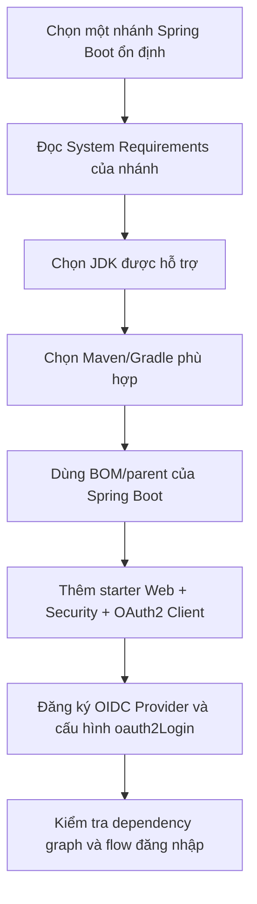

# 4.1. Chọn Spring Boot, Spring Security và Java tương thích

Khi tạo dự án **Spring Security OAuth 2.0/OIDC Client**, quyết định đầu tiên không phải là viết `SecurityFilterChain` hay cấu hình `client-id`, mà là **chọn một bộ phiên bản Spring Boot, Spring Security, Java và công cụ build hoạt động cùng nhau**. Chọn đúng bộ phiên bản giúp ứng dụng khởi động ổn định, nhận được các bản vá bảo mật, dùng được OAuth2 Login/OIDC hiện đại và tránh phải tự xử lý xung đột thư viện.

Bài học này tập trung vào cách lựa chọn phiên bản cho một ứng dụng **OAuth2 Client/OIDC Relying Party**: ứng dụng điều hướng người dùng đăng nhập qua Google, Microsoft Entra ID, Keycloak hoặc một OpenID Provider khác; nhận authorization code; đổi lấy token; rồi tạo phiên đăng nhập với Spring Security. Ví dụ sử dụng Java, Spring MVC (Servlet), Maven hoặc Gradle.

> **Mốc tham chiếu phiên bản:** 16/11/2026. Spring Boot, Spring Security và Java tiếp tục có bản vá/bản mới. Các số phiên bản dưới đây minh họa những tổ hợp được phát hành ở thời điểm này; khi triển khai thực tế, cần kiểm tra lại tài liệu System Requirements, BOM và lịch hỗ trợ của nhánh đã chọn.

## 1. Vì sao phải chọn phiên bản theo cả “bộ”?

Spring Boot quản lý nhiều thành phần liên quan:

- **Spring Boot:** cấu hình tự động, starter, Maven/Gradle plugin và quản lý dependency.
- **Spring Framework:** nền tảng IoC, Spring MVC/WebFlux, HTTP, session và các API cốt lõi.
- **Spring Security:** filter chain, xác thực/phân quyền, OAuth2 Login, OAuth2 Client, OIDC.
- **Java JDK/JRE:** môi trường biên dịch và thực thi bytecode.
- **Maven/Gradle:** công cụ giải dependency, biên dịch, đóng gói, chạy ứng dụng.
- **Servlet container hoặc reactive runtime:** ví dụ Tomcat khi dùng Spring MVC.
- **Thư viện phụ trợ:** Jackson, Nimbus JOSE/JWT, HTTP client, logging và test libraries.

Trong OAuth2/OIDC, Spring Security cần phối hợp với tầng HTTP, session, URL redirect, JSON và mã hóa token. Lấy `spring-security-oauth2-client` từ một đời mới ghép vào Spring Boot đời cũ có thể khiến class/method không còn tương thích, dù Maven hoặc Gradle vẫn tải dependency thành công.

Nguyên tắc dễ áp dụng nhất là:

**Chọn phiên bản Spring Boot trước → để Spring Boot quản lý phiên bản Spring Framework và Spring Security → chọn JDK và build tool được nhánh Boot đó hỗ trợ → thêm đúng OAuth2 Client starter.**



BOM (*Bill of Materials*) là tập quy tắc quản lý phiên bản dependency. Khi sử dụng Boot parent/BOM, ứng dụng khai báo `spring-boot-starter-security-oauth2-client` hoặc `spring-boot-starter-oauth2-client` **mà không tự gắn version**; Boot lựa chọn phiên bản thư viện tương ứng.

## 2. Hai nhánh lựa chọn điển hình

### 2.1. Bảng tương thích tại mốc tham chiếu

| Thành phần | Nhánh Spring Boot 3.5 | Nhánh Spring Boot 4.1 |
|---|---|---|
| Ví dụ bản vá ổn định | **3.5.16** | **4.1.2** |
| Spring Framework do Boot quản lý | 6.2.x | 7.0.x |
| Spring Security do Boot quản lý | **6.5.11** | **7.1.2** |
| Java tối thiểu theo Spring Boot | **17** | **17** |
| Java tối đa được tài liệu nhánh ghi nhận tại mốc này | **25** | **27** |
| Java phù hợp cho ví dụ học | **21 LTS** | **21 LTS** hoặc **25 LTS** |
| Maven | 3.6.3 trở lên | 3.6.3 trở lên |
| Gradle được hỗ trợ chính thức | 7.6.4+ trong nhánh 7.x, hoặc 8.4+ trong nhánh 8.x | 8.14+ trong nhánh 8.x, hoặc nhánh 9.x |
| Servlet container mặc định trong web starter | Tomcat 10.1.x | Tomcat 11.0.x |
| Spring MVC starter | `spring-boot-starter-web` | `spring-boot-starter-webmvc` |
| OAuth2/OIDC Client starter | `spring-boot-starter-oauth2-client` | `spring-boot-starter-security-oauth2-client` |

Các giá trị chi tiết dựa trên tài liệu System Requirements, Managed Dependency Coordinates và danh sách starter của từng phiên bản:

- [Spring Boot 3.5 System Requirements](https://docs.spring.io/spring-boot/3.5/system-requirements.html).
- [Spring Boot 3.5 Managed Dependency Coordinates](https://docs.spring.io/spring-boot/3.5/appendix/dependency-versions/coordinates.html).
- [Spring Boot 4.1 System Requirements](https://docs.spring.io/spring-boot/system-requirements.html).
- [Spring Boot 4.1 Managed Dependency Coordinates](https://docs.spring.io/spring-boot/appendix/dependency-versions/coordinates.html).
- [Spring Boot 4.0 Migration Guide — starter renames](https://github.com/spring-projects/spring-boot/wiki/Spring-Boot-4.0-Migration-Guide).

Bảng không có nghĩa mọi phiên bản Java giữa giới hạn tối thiểu và tối đa đều là LTS, hay mọi thư viện bên thứ ba đều hoạt động trên tất cả các Java đó. Đây là tương thích của **Spring Boot**; thư viện và hạ tầng bổ sung còn có yêu cầu riêng.

### 2.2. Nên chọn nhánh nào cho dự án?

**Dự án mới, muốn học hệ sinh thái hiện tại:** ưu tiên **Spring Boot 4.1.x + Spring Security 7.1.x + Java 21 hoặc 25 LTS**, khi toàn bộ thư viện mà ứng dụng cần hỗ trợ Boot 4. Nhánh 4 sử dụng cấu trúc starter được đổi tên và Spring Framework 7.

**Dự án đang ở Boot 3, hoặc có thư viện chưa sẵn sàng cho Boot 4:** chọn **Spring Boot 3.5.x + Spring Security 6.5.x + Java 21 LTS** là lựa chọn phù hợp để tiếp tục phát triển, nâng cấp và chuẩn bị migration có kiểm soát.

**Dự án đang ở Boot 2.x:** nên lập kế hoạch nâng cấp nền tảng riêng. Boot 2 dùng thế hệ `javax.*` trong nhiều API Servlet cũ, còn Boot 3/4 chuyển sang `jakarta.*`. Không chỉ thay một số version rồi chờ OAuth2 Login hoạt động.

**Bản preview như milestone, release candidate hay snapshot:** phù hợp cho thử tính năng hoặc chuẩn bị nâng cấp; không chọn mặc định cho ví dụ nhập môn hoặc hệ thống production nếu không có mục tiêu thử nghiệm rõ ràng.

Không cần chạy phiên bản cao nhất bằng mọi giá. Bộ phiên bản đồng nhất, được hỗ trợ, có bản vá bảo mật và tương thích với IdP/hạ tầng hiện tại mới là tiêu chí quan trọng.

## 3. Chọn Java đúng: JDK build, mức ngôn ngữ và JVM chạy

### 3.1. Phân biệt ba khái niệm

| Khái niệm | Ví dụ | Quyết định điều gì? |
|---|---|---|
| **JDK biên dịch** | JDK 21 | Chứa `javac` và công cụ build cần thiết |
| **Mức ngôn ngữ/bytecode mục tiêu** | Java 21 (`--release 21`) | Cú pháp và API Java được phép dùng, định dạng class được tạo |
| **JVM runtime** | Java 21 hoặc bản mới tương thích | Thực thi ứng dụng đã được đóng gói |

Ví dụ, nếu xây ứng dụng bằng JDK 25 nhưng target Java 21, các class được biên dịch ở mức Java 21 và có thể chạy trên JVM 21 khi dependencies cũng đáp ứng điều kiện. Nếu dùng JDK 21 để tạo bytecode Java 21 rồi chạy trên JVM 17, ứng dụng có thể gặp `UnsupportedClassVersionError`.

**Java 21 LTS** là mốc thực hành cân bằng cho cả hai nhánh trong bảng. **Java 25 LTS** cũng phù hợp nếu dự án và hệ sinh thái cần dùng JDK LTS mới hơn; nên kiểm tra cả build tool, IDE và toàn bộ dependency tương ứng.

### 3.2. Không suy luận khả năng hỗ trợ từ “Java chạy được”

Giả sử một ứng dụng Boot 3.5 tình cờ khởi động trên JVM mới hơn mức được tài liệu xác nhận. Điều đó **không** tự biến JVM ấy thành cấu hình được hỗ trợ chính thức. Ngược lại, nếu dự án chạy trên Java 17 nhưng plugin build yêu cầu Gradle mới, chỉ nâng JDK là chưa đủ.

Các lớp tương thích cần kiểm tra đồng thời:

1. Spring Boot System Requirements của đúng nhánh và bản vá.
2. Phiên bản Gradle/Maven tương ứng.
3. Phiên bản JDK mà IDE, build runner, CI, Docker image và production sử dụng.
4. Bytecode target do Maven Compiler Plugin hoặc Gradle Java toolchain quy định.
5. Yêu cầu Java của thư viện ngoài Spring và Java agent (nếu có).

### 3.3. Cấu hình Java bằng Maven

Trong dự án dùng Spring Boot Maven parent, thuộc tính sau là điểm bắt đầu đơn giản:

```xml
<properties>
    <java.version>21</java.version>
</properties>
```

Sử dụng **JDK 21** cho Maven build là cách dễ hiểu nhất khi học. Nếu muốn dùng JDK mới để biên dịch nhưng target cũ hơn, cần kiểm tra cấu hình `maven-compiler-plugin` và sử dụng `--release` phù hợp thay vì chỉ chỉnh biến môi trường một cách tùy tiện.

### 3.4. Cấu hình Java toolchain bằng Gradle

```groovy
java {
    toolchain {
        languageVersion = JavaLanguageVersion.of(21)
    }
}
```

Toolchain làm rõ JDK mà tác vụ biên dịch cần. Máy chạy Gradle vẫn phải dùng một JDK tương thích với **chính phiên bản Gradle**. Hai việc này có thể dùng các JDK khác nhau: Gradle daemon chạy trên JDK A, còn `compileJava` dùng toolchain JDK B. Trong CI, nên chuẩn hóa cả hai để tránh lỗi chỉ xảy ra ở một máy.

### 3.5. Lệnh quan sát môi trường

Các lệnh tham khảo khi tự kiểm tra môi trường:

```bash
java -version
javac -version
mvn -version
gradle --version
```

Nếu dự án đã có **Maven Wrapper** hoặc **Gradle Wrapper**, ưu tiên wrapper để nhóm phát triển sử dụng cùng phiên bản build:

```bash
./mvnw -version
./gradlew --version
```

Trên Windows PowerShell/cmd, dùng `mvnw.cmd` và `gradlew.bat`. Kiểm tra đường dẫn JDK mà Maven/Gradle thực sự đang sử dụng; nó có thể khác JDK mà IDE dùng khi chạy ứng dụng.

## 4. Chọn starter đúng với vai trò OAuth2/OIDC Client

Ứng dụng có thể liên quan đến OAuth2 theo nhiều vai trò khác nhau:

| Vai trò | Nhu cầu | Thành phần Spring Security |
|---|---|---|
| **OAuth2/OIDC Client** | Điều hướng người dùng tới IdP; nhận code/token; quản lý đăng nhập | OAuth2 Client và `oauth2Login` |
| **OAuth2 Resource Server** | Nhận và kiểm tra access token ở API | `oauth2ResourceServer` |
| **Authorization Server** | Phát hành authorization code, access token, ID Token | Spring Security Authorization Server |
| **Web application** | Có endpoint, session và callback URL | Spring MVC hoặc WebFlux theo mô hình ứng dụng |

Một ứng dụng có thể giữ nhiều vai trò, nhưng **starter OAuth2 Client không tự biến nó thành Authorization Server**, cũng không tự làm cho mọi endpoint của ứng dụng trở thành resource server.

### 4.1. Với Spring Boot 3.5

Phần tối thiểu cho web login trên Servlet thường gồm:

```text
org.springframework.boot:spring-boot-starter-web
org.springframework.boot:spring-boot-starter-security
org.springframework.boot:spring-boot-starter-oauth2-client
```

Trong đó starter OAuth2 Client đưa các module cần thiết lên classpath để cấu hình OAuth2/OIDC Login. Starter Security thể hiện rõ ứng dụng dùng Spring Security; starter Web cung cấp nền tảng Spring MVC và servlet container.

### 4.2. Với Spring Boot 4.1

Các tên starter được chuẩn hóa:

```text
org.springframework.boot:spring-boot-starter-webmvc
org.springframework.boot:spring-boot-starter-security
org.springframework.boot:spring-boot-starter-security-oauth2-client
```

Trong Spring Boot 4, các tên cũ như `spring-boot-starter-web` và `spring-boot-starter-oauth2-client` vẫn được cung cấp trong giai đoạn chuyển đổi nhưng đã **deprecated**. Với dự án mới trên Boot 4, dùng tên mới để giảm việc phải đổi sau này.

Spring Boot 4 còn chia nhỏ một số starter và auto-configuration. Nếu nâng cấp ứng dụng Boot 3 có nhiều tích hợp, có thể phải bổ sung module cụ thể cho tính năng đang dùng; một dependency cũ không còn là đảm bảo rằng toàn bộ thành phần sẽ tự xuất hiện trên classpath.

### 4.3. Servlet hay Reactive?

Bài thực hành của module có thể chọn **Spring MVC/Servlet** để hiểu session-based OAuth2 Login và đường dẫn callback mặc định. Nếu chọn WebFlux, ứng dụng sẽ sử dụng WebFilter và cấu hình reactive như `SecurityWebFilterChain`, `ServerHttpSecurity`. **Không sao chép nguyên cấu hình `HttpSecurity`/`SecurityFilterChain` của Servlet sang WebFlux**.

Chọn một mô hình nhất quán theo yêu cầu dự án:

- Ứng dụng web MVC với view, controller, HTTP session: `web` (Boot 3) hoặc `webmvc` (Boot 4).
- Ứng dụng reactive thực sự: `webflux` và cấu hình reactive OAuth2 Login.
- Một ứng dụng OAuth2 Client thuần dùng token để gọi API có thể không cần đầy đủ flow web login, nhưng vẫn phải chọn dependency và cách quản lý authorized client tương ứng.

## 5. Cách dependency management bảo vệ tính tương thích

Ví dụ trên Spring Boot 4.1.2, BOM quản lý cùng một họ:

```text
spring-boot-*                  4.1.2
spring-framework-*             7.0.x
spring-security-*              7.1.2
```

Với Spring Boot 3.5.16:

```text
spring-boot-*                  3.5.16
spring-framework-*             6.2.x
spring-security-*              6.5.11
```

Nếu thêm starter nhưng khai báo thủ công một phiên bản Security khác, dependency graph có thể chứa những phiên bản lệch nhau hoặc một API chưa được Boot hiện tại tích hợp thử nghiệm. Vì vậy:

- **Không** gắn `<version>` vào từng Spring Boot starter khi đã dùng Maven parent/BOM.
- **Không** gắn version cho từng `spring-security-*` nếu không có lý do và quy trình kiểm tra tương thích cụ thể.
- **Không** trộn Spring Framework/Spring Security từ hai major line trong một ứng dụng.
- **Không** thêm thư viện `spring-security-oauth` đời cũ để thực hiện OIDC Login hiện đại; dùng các module `spring-security-oauth2-*` do Spring Security hiện tại quản lý.
- Khi cần vá một dependency ngoài chu kỳ Boot, cập nhật có kiểm soát và kiểm tra dependency graph, thay vì áp dụng nâng phiên bản hàng loạt.

### 5.1. Maven parent và Maven BOM

Nếu sử dụng `spring-boot-starter-parent`, phiên bản được quản lý tự động. Nếu dự án bắt buộc kế thừa một parent nội bộ khác, có thể import `spring-boot-dependencies` ở `dependencyManagement`:

```xml
<dependencyManagement>
    <dependencies>
        <dependency>
            <groupId>org.springframework.boot</groupId>
            <artifactId>spring-boot-dependencies</artifactId>
            <version>4.1.2</version>
            <type>pom</type>
            <scope>import</scope>
        </dependency>
    </dependencies>
</dependencyManagement>
```

Đây là một lựa chọn **thay cho việc kế thừa starter parent** trong dự án cần parent khác. Lưu ý BOM quản lý dependency versions, còn một số plugin/build defaults được starter parent cung cấp riêng; dự án không kế thừa parent phải tự quản lý phần plugin cần thiết.

### 5.2. Gradle dependency management

Với Spring Boot Gradle plugin, có thể dùng `io.spring.dependency-management` hoặc native BOM support của Gradle. Khi áp dụng dependency-management plugin, Boot tự import BOM phù hợp với phiên bản Boot plugin. Không cần ghi phiên bản cho từng starter.

Một lựa chọn dùng native Gradle BOM:

```groovy
dependencies {
    implementation platform(
        org.springframework.boot.gradle.plugin.SpringBootPlugin.BOM_COORDINATES
    )

    implementation 'org.springframework.boot:spring-boot-starter-security'
    implementation 'org.springframework.boot:spring-boot-starter-security-oauth2-client'
}
```

Nếu chọn native BOM, cần bảo đảm BOM cũng có hiệu lực với các configuration khác có dependency cần quản lý, ví dụ `testImplementation`. Hai cách quản lý dependency đều có thể dùng; chọn một cơ chế rõ ràng, tránh import hai BOM trái phiên bản.

## 6. Ví dụ Maven hoàn chỉnh: Spring Boot 4.1.2 + Java 21

Giả sử cần tạo ứng dụng web đăng nhập qua một OIDC Provider. File `pom.xml` có thể bắt đầu như sau:

```xml
<?xml version="1.0" encoding="UTF-8"?>
<project xmlns="http://maven.apache.org/POM/4.0.0"
         xmlns:xsi="http://www.w3.org/2001/XMLSchema-instance"
         xsi:schemaLocation="
           http://maven.apache.org/POM/4.0.0
           https://maven.apache.org/xsd/maven-4.0.0.xsd">

    <modelVersion>4.0.0</modelVersion>

    <parent>
        <groupId>org.springframework.boot</groupId>
        <artifactId>spring-boot-starter-parent</artifactId>
        <version>4.1.2</version>
        <relativePath/>
    </parent>

    <groupId>com.example</groupId>
    <artifactId>oidc-client-demo</artifactId>
    <version>0.0.1-SNAPSHOT</version>
    <name>oidc-client-demo</name>

    <properties>
        <java.version>21</java.version>
    </properties>

    <dependencies>
        <!-- Spring MVC + embedded servlet container -->
        <dependency>
            <groupId>org.springframework.boot</groupId>
            <artifactId>spring-boot-starter-webmvc</artifactId>
        </dependency>

        <!-- Core Spring Security -->
        <dependency>
            <groupId>org.springframework.boot</groupId>
            <artifactId>spring-boot-starter-security</artifactId>
        </dependency>

        <!-- OAuth 2.0 Client / OpenID Connect login -->
        <dependency>
            <groupId>org.springframework.boot</groupId>
            <artifactId>spring-boot-starter-security-oauth2-client</artifactId>
        </dependency>

        <!-- Test dependencies -->
        <dependency>
            <groupId>org.springframework.boot</groupId>
            <artifactId>spring-boot-starter-test</artifactId>
            <scope>test</scope>
        </dependency>
        <dependency>
            <groupId>org.springframework.boot</groupId>
            <artifactId>spring-boot-starter-security-test</artifactId>
            <scope>test</scope>
        </dependency>
    </dependencies>

    <build>
        <plugins>
            <plugin>
                <groupId>org.springframework.boot</groupId>
                <artifactId>spring-boot-maven-plugin</artifactId>
            </plugin>
        </plugins>
    </build>
</project>
```

Lưu ý không có version riêng cho Security, Servlet, Jackson hoặc token/JWT library. Spring Boot parent quản lý chúng theo BOM.

Dạng cấu trúc dự án tiêu biểu:

```text
oidc-client-demo/
├── .mvn/
│   └── wrapper/
├── mvnw
├── mvnw.cmd
├── pom.xml
└── src/
    ├── main/
    │   ├── java/com/example/oidcclient/
    │   │   ├── OidcClientDemoApplication.java
    │   │   └── SecurityConfig.java
    │   └── resources/
    │       └── application.yml
    └── test/
        └── java/com/example/oidcclient/
```

Các thư mục wrapper chỉ tồn tại nếu đã tạo dự án kèm Maven Wrapper. Không cần tự tạo class OAuth2 Login callback handler cho flow mặc định vì Spring Security có filter xử lý.

## 7. Ví dụ Gradle hoàn chỉnh: Spring Boot 4.1.2 + Java 21

Tương đương với Maven, file `build.gradle` Groovy DSL có thể viết:

```groovy
plugins {
    id 'java'
    id 'org.springframework.boot' version '4.1.2'
}

// Boot plugin đưa io.spring.dependency-management lên classpath.
apply plugin: 'io.spring.dependency-management'

group = 'com.example'
version = '0.0.1-SNAPSHOT'

java {
    toolchain {
        languageVersion = JavaLanguageVersion.of(21)
    }
}

repositories {
    mavenCentral()
}

dependencies {
    implementation 'org.springframework.boot:spring-boot-starter-webmvc'
    implementation 'org.springframework.boot:spring-boot-starter-security'
    implementation 'org.springframework.boot:spring-boot-starter-security-oauth2-client'

    testImplementation 'org.springframework.boot:spring-boot-starter-test'
    testImplementation 'org.springframework.boot:spring-boot-starter-security-test'
}

tasks.named('test') {
    useJUnitPlatform()
}
```

Có thể thêm file `settings.gradle`:

```groovy
rootProject.name = 'oidc-client-demo'
```

Với Spring Boot 4.1, chọn Gradle Wrapper ở nhánh **8.14+** hoặc **9.x** đã được tài liệu hỗ trợ. Không chọn Gradle 7.x cho dự án Boot 4.1 chỉ vì một dự án cũ vẫn dùng nó.

Ví dụ một dự án có thể để bản Gradle Wrapper trong:

```text
gradle/wrapper/gradle-wrapper.properties
gradlew
gradlew.bat
```

Phiên bản trong `distributionUrl` là nguồn sự thật khi dùng wrapper. IDE, máy phát triển và CI nên gọi wrapper thay vì phụ thuộc Gradle cài toàn hệ thống.

## 8. Nếu đang dùng Spring Boot 3.5: giữ đúng bộ dependency

Trong một dự án Boot 3.5.16, phần Maven tương ứng dùng starter tên cũ:

```xml
<parent>
    <groupId>org.springframework.boot</groupId>
    <artifactId>spring-boot-starter-parent</artifactId>
    <version>3.5.16</version>
    <relativePath/>
</parent>

<properties>
    <java.version>21</java.version>
</properties>

<dependencies>
    <dependency>
        <groupId>org.springframework.boot</groupId>
        <artifactId>spring-boot-starter-web</artifactId>
    </dependency>
    <dependency>
        <groupId>org.springframework.boot</groupId>
        <artifactId>spring-boot-starter-security</artifactId>
    </dependency>
    <dependency>
        <groupId>org.springframework.boot</groupId>
        <artifactId>spring-boot-starter-oauth2-client</artifactId>
    </dependency>
</dependencies>
```

Đây là phần trích từ `pom.xml`, không phải file POM độc lập. Nếu dùng Gradle Boot 3.5, phần khai báo plugin và dependencies tương ứng có thể là:

```groovy
plugins {
    id 'java'
    id 'org.springframework.boot' version '3.5.16'
}

apply plugin: 'io.spring.dependency-management'

java {
    toolchain {
        languageVersion = JavaLanguageVersion.of(21)
    }
}

repositories {
    mavenCentral()
}

dependencies {
    implementation 'org.springframework.boot:spring-boot-starter-web'
    implementation 'org.springframework.boot:spring-boot-starter-security'
    implementation 'org.springframework.boot:spring-boot-starter-oauth2-client'
}
```

Spring Boot 3.5 quản lý Spring Security 6.5.x; không ép `spring-security-oauth2-client:7.1.x` vào ứng dụng Boot 3.5. Nếu muốn dùng Security 7.1.x, hãy đánh giá nâng lên nhánh Boot 4 tương thích, đi kèm các yêu cầu chuyển đổi khác.

## 9. Cấu hình OIDC Login tối thiểu trên bộ phiên bản đã chọn

Khi build đã có đúng starter, cấu hình OIDC cơ bản gần như giữ nguyên về ý tưởng qua hai nhánh Boot 3.5 và Boot 4.1.

### 9.1. Đăng ký Client và Provider

Ví dụ `src/main/resources/application.yml`:

```yaml
spring:
  security:
    oauth2:
      client:
        registration:
          company:
            provider: company
            client-id: ${OIDC_CLIENT_ID}
            client-secret: ${OIDC_CLIENT_SECRET}
            authorization-grant-type: authorization_code
            scope:
              - openid
              - profile
              - email
            redirect-uri: "{baseUrl}/login/oauth2/code/{registrationId}"
        provider:
          company:
            issuer-uri: https://id.example.test/realms/company
```

Các giá trị có dạng `example.test` dùng để minh họa; môi trường thật cần IdP và tài khoản Client đã được tạo sẵn. `OIDC_CLIENT_ID` và `OIDC_CLIENT_SECRET` được cung cấp dưới dạng biến môi trường hoặc secrets của hệ thống triển khai. Không commit secret thật lên repository.

Trong đăng nhập OIDC:

1. Người dùng đi tới `/oauth2/authorization/company` để bắt đầu flow.
2. Spring tạo authorization request và điều hướng trình duyệt sang Authorization Endpoint do provider công bố.
3. Provider xác thực người dùng rồi đưa trình duyệt về `/login/oauth2/code/company`.
4. Spring đổi authorization code lấy token ở Token Endpoint và xác minh ID Token theo OIDC.
5. Spring Security tạo principal đã xác thực và lưu trong phiên ứng dụng, nếu flow thành công.

Đây là **OAuth2 Client Login**. Nếu ứng dụng có REST API riêng nhận `Authorization: Bearer ...` từ bên ngoài, việc xác minh token cho API đó là trách nhiệm của phần **Resource Server**, cần thiết kế và dependency tương ứng.

### 9.2. SecurityFilterChain cơ bản cho Servlet

```java
package com.example.oidcclient;

import org.springframework.context.annotation.Bean;
import org.springframework.context.annotation.Configuration;
import org.springframework.security.config.Customizer;
import org.springframework.security.config.annotation.web.builders.HttpSecurity;
import org.springframework.security.web.SecurityFilterChain;

@Configuration
public class SecurityConfig {

    @Bean
    SecurityFilterChain securityFilterChain(HttpSecurity http) throws Exception {
        http
            .authorizeHttpRequests(authorize -> authorize
                .requestMatchers("/", "/error").permitAll()
                .anyRequest().authenticated()
            )
            .oauth2Login(Customizer.withDefaults());

        return http.build();
    }
}
```

Đoạn code giả định ứng dụng Spring MVC/Servlet và đã có OIDC Client registration. Với cấu hình login mặc định, Spring Security cung cấp các filter thích hợp; không tạo controller `@GetMapping("/login/oauth2/code/company")` chỉ để tự đổi code trong flow này.

### 9.3. Main application class

```java
package com.example.oidcclient;

import org.springframework.boot.SpringApplication;
import org.springframework.boot.autoconfigure.SpringBootApplication;

@SpringBootApplication
public class OidcClientDemoApplication {

    public static void main(String[] args) {
        SpringApplication.run(OidcClientDemoApplication.class, args);
    }
}
```

Nếu chọn Boot 4.1 hoặc 3.5 với Java 21, các API cơ bản nêu trên không phụ thuộc cú pháp Java mới hơn mức đã chọn. Khi sao chép một ví dụ khác trên Internet, cần xem nó viết cho Spring Security 5, 6 hay 7; một số API hoặc package có thể khác.

## 10. Cách chọn nhanh với Spring Initializr

[Spring Initializr](https://start.spring.io/) là công cụ thuận tiện để tạo bộ khung ứng dụng với phiên bản tương thích. Quy trình đề xuất:

1. Chọn **Project = Maven** hoặc **Gradle**.
2. Chọn **Language = Java**.
3. Chọn **Spring Boot** ở nhánh stable mong muốn (ví dụ 4.1.x hoặc 3.5.x), không vô tình chọn `SNAPSHOT`/`RC`.
4. Chọn **Java = 21** (hoặc một JDK được nhánh đó xác nhận hỗ trợ).
5. Thêm dependency **Spring Web / Spring Web MVC**, **Spring Security**, **OAuth2 Client** theo cách đặt tên của nhánh Boot.
6. Generate project, mở bằng IDE, giữ lại wrapper.
7. Đăng ký Client tại IdP, điền `issuer-uri`, `client-id`, secret và callback phù hợp.

Dùng Initializr để xác định bộ khởi đầu tốt, sau đó đọc `pom.xml` hoặc `build.gradle` vừa được sinh ra để biết chính xác những dependency được khai báo. Không nên sao chép starter từ một bài viết dành cho Boot 3 vào project Boot 4 mà bỏ qua phần đổi tên.

## 11. Thực hành đọc dependency graph

Ngay cả khi khai báo đúng, một dependency bắc cầu hoặc BOM thứ hai có thể tác động đến version cuối cùng được giải quyết. Lệnh sau là các ví dụ để **người học tự kiểm tra tại dự án của mình**; bước soạn tài liệu này không thực thi build.

### 11.1. Với Maven

```bash
./mvnw -version
./mvnw dependency:tree
```

Nếu muốn tập trung vào Spring Security:

```bash
./mvnw dependency:tree -Dincludes=org.springframework.security
```

Trong PowerShell/cmd trên Windows:

```powershell
.\mvnw.cmd -version
.\mvnw.cmd dependency:tree "-Dincludes=org.springframework.security"
```

Điều cần nhìn: các module Spring Security quan trọng trong cùng một họ phiên bản do BOM quản lý; không xuất hiện một nhóm Security 6.x lẫn với Security 7.x do override nhầm.

### 11.2. Với Gradle

```bash
./gradlew --version
./gradlew dependencies --configuration runtimeClasspath
./gradlew dependencyInsight --dependency spring-security-oauth2-client --configuration runtimeClasspath
```

Trên Windows:

```powershell
.\gradlew.bat --version
.\gradlew.bat dependencies --configuration runtimeClasspath
.\gradlew.bat dependencyInsight --dependency spring-security-oauth2-client --configuration runtimeClasspath
```

`dependencyInsight` giúp truy ngược lý do một version được chọn. Nếu IDE hiển thị version này nhưng command line giải version khác, cần kiểm tra Gradle sync, repositories, cached metadata và bản wrapper thực tế.

### 11.3. Nhìn vào cấu hình Java

Ví dụ project chọn Java 21 thì mong đợi:

```text
Maven/Gradle chạy bằng JDK được build tool hỗ trợ
Java compilation target: 21
Runtime production: Java 21 hoặc Java tương thích cao hơn
Spring Boot: đúng nhánh, đúng bản vá
Spring Security: version do Boot BOM quản lý
```

Nếu Docker runtime chỉ có Java 17 trong khi build sinh bytecode Java 21, việc dependency graph đúng không giải quyết được lỗi runtime. Cấu hình container image và CI cũng thuộc quyết định về tương thích phiên bản.

## 12. Những lỗi tương thích thường gặp

| Triệu chứng | Nguyên nhân hay gặp | Hướng xử lý |
|---|---|---|
| `UnsupportedClassVersionError` | JDK/JRE chạy cũ hơn bytecode biên dịch | So sánh target Java, toolchain và image runtime |
| `Unsupported class file major version` ở Gradle/plugin | Gradle/JDK không hợp nhau hoặc plugin chưa hỗ trợ class version | Chọn wrapper Gradle được Boot hỗ trợ và JDK phù hợp |
| `NoSuchMethodError` hoặc `NoClassDefFoundError` ở Spring | Trộn các phiên bản Spring Framework/Security khác dòng | Kiểm tra dependency graph, loại bỏ override thủ công |
| Không resolve được OAuth2 starter Boot 4 mới | Dùng nhầm artifact, repository hoặc phiên bản Boot plugin cũ | Dùng `spring-boot-starter-security-oauth2-client` với Boot 4 |
| Starter Boot 3 bị đánh dấu deprecated khi sang Boot 4 | Starter đã đổi tên ở Boot 4 | Thay starter cũ bằng tên mới và kiểm tra module cần thiết |
| `javax.servlet.*` không tồn tại | Code/thư viện cũ chưa chuyển sang `jakarta.servlet.*` | Đánh giá nâng dependency, đổi imports theo Servlet API mới |
| Đổi Boot 3 → 4 làm thiếu class auto-configuration | Boot 4 modular hóa và đổi package | Xem Migration Guide; dùng starter/module mới phù hợp |
| `SecurityFilterChain` không nhận `HttpSecurity` đúng loại | Ứng dụng dùng WebFlux nhưng sao chép cấu hình Servlet | Dùng `SecurityWebFilterChain` và `ServerHttpSecurity` cho reactive |
| Đăng nhập chuyển đến IdP nhưng callback lỗi | Redirect URI, issuer hoặc client registration sai | Kiểm tra cấu hình IdP; phân biệt lỗi OAuth2 với lỗi version |
| Token OIDC không xác minh được | Issuer, JWKS, audience, đồng hồ hệ thống hoặc cấu hình provider sai | Kiểm tra metadata OIDC và xác minh token; không tùy tiện bỏ kiểm tra |
| IDE chạy được nhưng CI build lỗi | IDE/CI dùng JDK hoặc wrapper khác | Chuẩn hóa JDK, wrapper và build cache cho các môi trường |
| Maven/Gradle kéo dependency trái phiên bản | BOM khác ghi đè hoặc có version cụ thể ở module khác | Tìm nơi khai báo version, thống nhất BOM của Spring Boot |

Không phải lỗi OAuth2/OIDC nào cũng do version. Ví dụ `invalid_client`, `invalid_grant`, `redirect_uri_mismatch` hoặc `invalid_scope` thường nằm ở quá trình đăng ký Client và tương tác với Authorization Server. Chỉ nghi ngờ dependency khi có dấu hiệu rõ như class/method thiếu, package đổi hoặc framework không khởi tạo được.

## 13. Nâng cấp từ Boot 3.5 lên Boot 4.1: không chỉ thay một số version

Spring Boot 4 và Spring Security 7 là bước chuyển major, cần coi đó là một đợt migration có phạm vi kỹ thuật rõ ràng.

### 13.1. Những điểm cần chuyển đổi

- **Dependency:** `spring-boot-starter-web` → `spring-boot-starter-webmvc`, `spring-boot-starter-oauth2-client` → `spring-boot-starter-security-oauth2-client`.
- **Spring Security:** 6.x → 7.x; xem các API bị loại bỏ, cấu hình filter chain, xử lý authorization và các thay đổi có liên quan trong tài liệu nâng cấp.
- **Spring Framework:** 6.2 → 7.0; xem sự tương thích các thư viện và extension tích hợp Spring.
- **Servlet container:** nhánh Boot 4 dùng Tomcat 11 (Servlet 6.1) thay vì Tomcat 10.1 trong bộ mặc định của Boot 3.5; xác nhận container và các servlet filter ngoài Spring hỗ trợ tương ứng.
- **Auto-configuration:** Boot 4 modular hóa cấu trúc; một số package hoặc dependency cần được cập nhật trong mã và build.
- **Build:** Gradle wrapper cũ có thể không còn phù hợp; cần kiểm tra System Requirements cho nhánh Boot 4.
- **Integration tests:** đăng nhập OIDC, callback, session, lưu token, user mapping và phân quyền cần được xác nhận lại sau migration.

### 13.2. Thứ tự nâng cấp thực tế

1. Trên nhánh Boot 3.5 hiện tại, cập nhật tới bản vá phù hợp và giữ dependency graph nhất quán.
2. Đọc Spring Boot 4 Migration Guide và Spring Security 7 Migration Guide cho API ứng dụng đang sử dụng.
3. Chọn JDK và wrapper được Boot 4 hỗ trợ.
4. Đổi Boot parent/plugin version và tên starter.
5. Sửa code, imports, custom security configuration hoặc auto-configuration theo thay đổi phiên bản.
6. Xác minh build và hành vi OAuth2/OIDC từ đầu đến cuối trong môi trường thử nghiệm.
7. Cập nhật CI, Docker image, runtime production và triển khai theo kế hoạch của nhóm.

Nếu ứng dụng có nhiều thư viện bên thứ ba, nên kiểm tra chúng đã hỗ trợ Spring Framework 7 và Boot 4 trước khi quyết định nâng. Không giải quyết bằng cách trộn lại các JAR Security 6 vào Boot 4.

## 14. Về tương thích giao thức OAuth2/OIDC

Chọn Boot/Security/Java tương thích giúp **Client chạy đúng nền tảng**. Tuy nhiên, đăng nhập còn phụ thuộc **Authorization Server/OpenID Provider**.

Một Client hiện đại cần IdP có các đặc điểm phù hợp:

- Cung cấp Authorization Endpoint và Token Endpoint theo OAuth 2.0.
- Nếu dùng OIDC, hỗ trợ `openid`, ID Token và metadata issuer/JWKS để xác minh token theo tiêu chuẩn.
- Hỗ trợ authorization code grant theo cấu hình đăng ký Client.
- Cấu hình được callback/redirect URI chính xác.
- Có chính sách client authentication phù hợp (ví dụ confidential web client dùng client secret hoặc cơ chế mạnh hơn).
- Hỗ trợ PKCE theo yêu cầu Client và chính sách bảo mật triển khai.
- Sử dụng TLS/HTTPS và những tham số, thuật toán, phương thức xác thực mà Client hỗ trợ.

Một IdP “cũ” không nhất thiết lỗi chỉ vì Client chạy Boot 4; ngược lại, một IdP cấu hình OIDC không chuẩn có thể không hoạt động ngay cả khi dependency graph hoàn toàn đúng. Cần phân biệt **tương thích Java/Spring**, **tương thích giao thức OAuth2/OIDC** và **cấu hình đăng ký Client**.

### 14.1. Phân biệt OAuth2 Login, OAuth2 Client và Resource Server

Trong thực tế:

- `oauth2Login`: dùng Spring Security xác thực người dùng qua redirect/callback và tạo phiên.
- `oauth2Client`: hỗ trợ Client lấy, lưu, làm mới hoặc sử dụng authorized client và access token để gọi downstream API theo thiết kế.
- `oauth2ResourceServer`: dùng khi chính ứng dụng cung cấp API cần xác minh bearer access token gửi đến.

Cùng một ứng dụng có thể sử dụng nhiều tính năng. Nhưng khi chọn dependency từ Initializr, cần biết **bài toán cụ thể** để không đưa quá nhiều thành phần không liên quan vào bài thực hành.

## 15. Các quyết định nền tảng khác có tác động đến version

### 15.1. Maven hay Gradle?

Cả hai đều được Spring Boot hỗ trợ. Nên chọn theo tiêu chuẩn repository và mức độ quen thuộc của nhóm:

| Tiêu chí | Maven | Gradle |
|---|---|---|
| Khai báo dependency | `pom.xml` XML | `build.gradle` Groovy hoặc `build.gradle.kts` Kotlin DSL |
| Quản lý phiên bản | Parent và BOM `dependencyManagement` | Boot plugin + dependency-management plugin hoặc native BOM |
| Cấu hình Java | `java.version`/Compiler Plugin | Java toolchain |
| Wrapper | `mvnw`/`mvnw.cmd` | `gradlew`/`gradlew.bat` |
| Xem dependency | `dependency:tree` | `dependencies` / `dependencyInsight` |

Không cần chọn Gradle chỉ vì học Spring Security OAuth2/OIDC; Maven vẫn đáp ứng đầy đủ. Điều quan trọng là **khóa wrapper version**, dùng BOM và giữ kết quả build nhất quán giữa môi trường.

### 15.2. Java LTS và lịch nâng cấp

JDK LTS thích hợp cho ứng dụng dài hạn vì có hệ sinh thái hỗ trợ rộng. Với ví dụ Boot 3.5/4.1, Java 21 là lựa chọn thực hành đơn giản. Nếu tổ chức đã chuyển sang Java 25, có thể chọn Java 25 với nhánh được hỗ trợ và kiểm tra các thành phần bên thứ ba.

Không sử dụng Java preview features cho bài OIDC nhập môn nếu không có yêu cầu cụ thể; chúng khiến cấu hình biên dịch/chạy phức tạp hơn mà không đóng góp gì cho nguyên tắc OAuth2 Login.

### 15.3. Production runtime và container

Nếu ứng dụng được biên dịch ở Java 21, container runtime cũng cần chạy Java 21 hoặc mới hơn ở mức tương thích. Mẫu lệnh dựng ảnh container chỉ để minh họa:

```dockerfile
FROM eclipse-temurin:21-jre
WORKDIR /app
COPY target/oidc-client-demo-0.0.1-SNAPSHOT.jar app.jar
ENTRYPOINT ["java", "-jar", "app.jar"]
```

Ví dụ này giả định JAR đã được Maven đóng gói đúng tên và phiên bản. Hệ thống production nên quản lý base image, kiến trúc CPU và bản cập nhật bảo mật theo quy định triển khai; chọn Boot 4.1 không tự đồng bộ Java runtime bên trong container.

### 15.4. Spring Cloud và thư viện bên thứ ba

Nếu có Spring Cloud, Spring Data, database driver, observability agent hoặc thư viện starter ngoài Spring, cần kiểm tra **compatibility matrix riêng** của từng dự án. Đặc biệt, các starter tự viết hoặc thư viện phụ thuộc mạnh vào auto-configuration có thể phải đổi code khi chuyển Boot 3 sang Boot 4.

Không nên sử dụng version trôi như `latest.release` hoặc `+` cho các dependency nền tảng. Một bản phát hành mới của thư viện có thể thay đổi classpath giữa hai lần build dù mã nguồn không đổi.

## 16. Một vài tình huống chọn phiên bản cụ thể

### Tình huống A: bài lab OIDC Client mới, dùng Maven

Yêu cầu: web login, redirect tới IdP, hiển thị thông tin người dùng, Java LTS.

**Bộ đề xuất:** Boot 4.1.x, Security do Boot quản lý (7.1.x), Java 21, Maven Wrapper; starters `webmvc`, `security`, `security-oauth2-client`.

Lý do: đây là cấu trúc starter hiện tại của Boot 4; không cần tự quản lý version Security/JWT.

### Tình huống B: ứng dụng nội bộ đang ở Boot 3.5

Yêu cầu: bổ sung đăng nhập OIDC vào ứng dụng MVC đã chạy ổn định.

**Bộ đề xuất:** Giữ Boot 3.5.x, Java 21 và Security 6.5.x do BOM quản lý; thêm `spring-boot-starter-oauth2-client`. Lập kế hoạch lên Boot 4 khi dependency ngoài Spring sẵn sàng và thời gian nâng cấp phù hợp.

Lý do: việc tích hợp OIDC không bắt buộc phải thay major line của cả ứng dụng trước.

### Tình huống C: CI dùng Java 17 nhưng lập trình viên dùng Java 25

Yêu cầu: đóng gói Boot 4.1 cho production chạy Java 21.

**Hướng xử lý:** định nghĩa target Java 21; cung cấp JDK 21 phù hợp trong CI/toolchain và Java runtime tương thích. Nếu CI chỉ có JDK 17 và không thể cấp toolchain Java 21, bản build nhắm Java 21 có thể thất bại. Không giải quyết bằng cách giảm bytecode target tùy tiện khi mã đang dùng API Java 21.

### Tình huống D: đang chạy Boot 3.5 nhưng thêm Security 7 trực tiếp

Yêu cầu: dùng một API mới trong Security 7.

**Hướng xử lý:** đánh giá migration Boot 4 và toàn bộ hệ liên quan. Nếu chưa nâng được Boot, ưu tiên API tương ứng trong Security 6.5 hoặc thay đổi thiết kế tương thích, thay vì ép version Security 7 vào dependency graph của Boot 3.5.

## 17. Bảng quyết định thực hành

Khi bắt đầu một dự án Spring Security OAuth 2.0/OIDC Client, có thể tự điền bảng này:

| Câu hỏi | Ví dụ câu trả lời |
|---|---|
| Dự án mới hay nâng cấp? | Mới |
| Chọn major Spring Boot nào? | 4.1.x |
| Security sẽ lấy từ đâu? | BOM Spring Boot → 7.1.x |
| JDK build và runtime nào? | Java 21 LTS |
| Maven hay Gradle? | Maven Wrapper |
| Web stack nào? | Spring MVC/Servlet |
| Starter OAuth2 Client đúng tên? | `spring-boot-starter-security-oauth2-client` |
| Ứng dụng đóng vai trò gì? | OIDC Relying Party/OAuth2 Client |
| OIDC Provider có hỗ trợ discovery? | Có `issuer-uri` và metadata |
| Redirect URI đã đăng ký? | `https://app.example.test/login/oauth2/code/company` |
| Có override dependency phiên bản riêng? | Không, trừ khi có lý do và kiểm chứng |
| CI/Docker có cùng target Java không? | Java 21 |

Đối với Boot 3.5, các câu trả lời về nhánh Security và tên starter cần đổi tương ứng. Bảng này hữu ích để rà lại quyết định trước khi bắt đầu triển khai flow đăng nhập.

## 18. Tài liệu nguồn để kiểm tra theo thời điểm

Các trang dưới đây là nguồn tham khảo chính thức; nên dùng URL gắn với **nhánh đang triển khai**, không chỉ truy cập trang `current` vì trang này sẽ chuyển sang bản mới theo thời gian:

1. [Spring Boot 4 — System Requirements](https://docs.spring.io/spring-boot/system-requirements.html): Java, Maven, Gradle, Servlet container của bản ổn định hiện hành.
2. [Spring Boot 3.5 — System Requirements](https://docs.spring.io/spring-boot/3.5/system-requirements.html): yêu cầu riêng cho nhánh 3.5.
3. [Spring Boot 4 — Managed Dependency Coordinates](https://docs.spring.io/spring-boot/appendix/dependency-versions/coordinates.html): phiên bản cụ thể của Spring Framework, Spring Security và các thư viện do BOM quản lý.
4. [Spring Boot 3.5 — Managed Dependency Coordinates](https://docs.spring.io/spring-boot/3.5/appendix/dependency-versions/coordinates.html): BOM của nhánh 3.5.
5. [Spring Boot — Build Systems và danh sách starters](https://docs.spring.io/spring-boot/reference/using/build-systems.html): các starter có tên mới trong Boot 4.
6. [Spring Boot 4.0 Migration Guide](https://github.com/spring-projects/spring-boot/wiki/Spring-Boot-4.0-Migration-Guide): thay đổi starter, modularization và các điểm cần nâng cấp.
7. [Spring Boot Gradle Plugin — Managing Dependencies](https://docs.spring.io/spring-boot/gradle-plugin/managing-dependencies.html): BOM trong Gradle và dependency-management plugin.
8. [Spring Security — Getting Spring Security](https://docs.spring.io/spring-security/reference/getting-spring-security.html): dependency management và nguyên tắc dùng Spring Security với Boot.
9. [Spring Security — OAuth2 Login (Servlet)](https://docs.spring.io/spring-security/reference/servlet/oauth2/login/core.html): cấu hình OIDC/OAuth2 Login trên Spring MVC.
10. [Spring Initializr](https://start.spring.io/): tạo project phù hợp theo nhánh Boot và build tool.

## 19. Ghi nhớ trọng tâm

**Spring Boot là điểm neo phiên bản.** Chọn Boot trước, dùng parent/BOM để lấy Spring Security và Spring Framework tương ứng, chọn JDK/build tool theo System Requirements và dùng đúng starter cho major line.

Với ví dụ tại mốc tháng 11/2026, hai bộ dễ hiểu là:

```text
Spring Boot 3.5.16
    + Spring Security 6.5.11 (Boot BOM)
    + Java 21 LTS
    + spring-boot-starter-web
    + spring-boot-starter-oauth2-client
```

hoặc:

```text
Spring Boot 4.1.2
    + Spring Security 7.1.2 (Boot BOM)
    + Java 21 LTS
    + spring-boot-starter-webmvc
    + spring-boot-starter-security-oauth2-client
```

Cả hai đều có thể xây dựng ứng dụng OAuth2/OIDC Client. Độ tin cậy đến từ **bộ phiên bản nhất quán và các tính năng được cấu hình đúng**, không phải từ việc ghép thủ công các bản phát hành mới nhất của từng thư viện.
