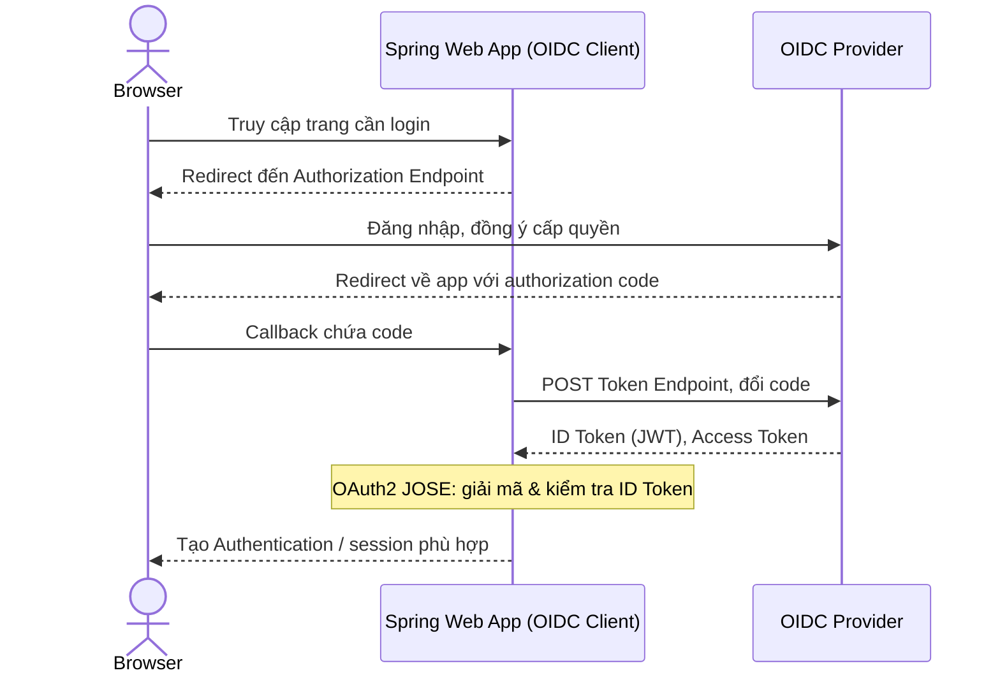
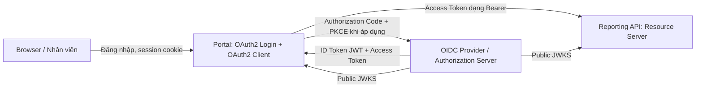

# 4.4. Vai trò OAuth2 JOSE trong xử lý OIDC và JWT

Khi thiết lập một ứng dụng **Spring Security OAuth 2.0 / OpenID Connect (OIDC) Client**, chúng ta thường gặp module `spring-security-oauth2-jose`. Tên module dễ khiến người học nghĩ đây là thành phần thực hiện đăng nhập, gọi API hoặc tự phát hành access token. Thực tế, **OAuth2 JOSE cung cấp các năng lực mật mã và xử lý JWT cần thiết để ứng dụng đọc và xác minh token theo chuẩn JOSE**. Nó hỗ trợ OAuth2 Client, OIDC Login và JWT Resource Server ở những thời điểm khác nhau trong vòng đời request.

Để hiểu vai trò của module này, cần tách bốn khái niệm:

- **OAuth 2.0** quy định cách client nhận quyền truy cập tài nguyên và sử dụng access token; chuẩn không bắt buộc mọi access token đều là JWT.
- **OIDC** mở rộng OAuth 2.0 để cung cấp cơ chế đăng nhập/xác thực danh tính; OIDC sử dụng **ID Token** có cấu trúc JWT.
- **JWT (JSON Web Token)** là định dạng biểu diễn claims dưới dạng token; JWT có thể được ký (JWS) hoặc mã hóa (JWE) theo chuẩn liên quan.
- **JOSE (JSON Object Signing and Encryption)** là họ tiêu chuẩn quy định cách ký, mã hóa và mô tả khóa/thuật toán cho dữ liệu JSON, gồm JWS, JWE, JWK và JWA.

**Thông điệp chính:** `spring-security-oauth2-jose` là **mảnh ghép xử lý token mật mã** trong Spring Security. Nó không thay thế `spring-security-oauth2-client` hoặc `spring-security-oauth2-resource-server`, và không tự biến ứng dụng thành Authorization Server.

## 1. Định vị OAuth2 JOSE trong hệ sinh thái Spring Security

| Module / thành phần | Nhiệm vụ chính | Quan hệ với JOSE |
| --- | --- | --- |
| `spring-security-oauth2-client` | Đăng ký OAuth2 client, thực hiện các luồng cấp quyền, quản lý authorized client; hỗ trợ `oauth2Login()` | Khi đăng nhập qua **OIDC**, cần xác minh ID Token dạng JWT bằng năng lực JOSE |
| `spring-security-oauth2-jose` | Cung cấp API và triển khai xử lý JWT, JWS, JWK, `JwtDecoder` / `JwtEncoder` | Là lớp hỗ trợ token ký/mật mã, không tự làm login hoặc ủy quyền |
| `spring-security-oauth2-resource-server` | Trích xuất bearer token từ HTTP request, xác thực và xây `Authentication`, phân quyền API | Với **JWT bearer token**, thường sử dụng `JwtDecoder` của JOSE để kiểm tra chữ ký và claims |
| Spring Authorization Server | Cấp token và cung cấp metadata/JWKS theo cấu hình của máy chủ cấp quyền | Có thể sử dụng năng lực JOSE khi phát hành JWT, nhưng là ứng dụng/thành phần khác |

Hai trường hợp cần phân biệt ngay từ đầu:

1. **OIDC Login:** client nhận **ID Token** từ nhà cung cấp danh tính. Ứng dụng cần kiểm tra token để tạo thông tin xác thực người dùng trong quá trình đăng nhập.
2. **JWT Resource Server:** API nhận **access token dạng JWT** từ bên gọi. API cần kiểm tra chữ ký, các claims bắt buộc và điều kiện phân quyền trước khi phục vụ tài nguyên.

Một **OAuth2 Client chỉ gửi access token đến API khác** có thể không cần giải mã JWT đó. Nếu access token là chuỗi opaque, client vẫn chuyển token nguyên vẹn qua `Authorization: Bearer ...`. Việc token có thể đọc thành JSON hay không **không quyết định** nó có dùng được để gọi API hay không.

## 2. JOSE gồm những gì?

### 2.1. JWT: container chứa claims

Một JWT thường mô tả thông tin như:

```json
{
  "iss": "https://idp.example.com/realms/acme",
  "sub": "user-183",
  "aud": "reporting-api",
  "scope": "reports.read",
  "iat": 1794800000,
  "exp": 1794803600
}
```

Đây là **ví dụ payload minh họa**; các giá trị thời gian là Unix epoch, không đại diện cho token thật. Ý nghĩa phổ biến:

| Claim | Ý nghĩa | Vì sao cần quan tâm? |
| --- | --- | --- |
| `iss` (*issuer*) | Bên phát hành token | Chỉ tin token từ issuer được cấu hình |
| `sub` (*subject*) | Chủ thể mà token mô tả | Là định danh kỹ thuật, không mặc định là email |
| `aud` (*audience*) | Bên nhận/token dành cho ai | Ngăn dùng token cấp cho dịch vụ khác tại API của mình |
| `iat` (*issued at*) | Thời điểm phát hành | Có thể dùng trong chính sách thời gian |
| `exp` (*expiration*) | Thời điểm hết hạn | Không tiếp nhận token đã hết hạn |
| `nbf` (*not before*) | Token chỉ có hiệu lực từ thời điểm xác định | Ngăn dùng token quá sớm |
| `scope` / `scp` | Phạm vi được cấp, tùy nhà phát hành | Ánh xạ sang authorities để phân quyền |

**JWT chỉ là cách đóng gói claims.** Một chương trình đọc được payload JWT chưa chứng minh token hợp lệ. Các chuỗi Base64URL trong JWT có thể được giải mã dễ dàng; **xác minh chữ ký, thuật toán, issuer, audience, thời hạn và quyền** mới là phần bảo mật quan trọng.

### 2.2. JWS: ký để bảo đảm tính toàn vẹn và nguồn gốc

Trường hợp rất phổ biến là **JWT được ký dưới dạng JWS Compact Serialization**:

```text
BASE64URL(header).BASE64URL(payload).BASE64URL(signature)
```

Ví dụ header:

```json
{
  "alg": "RS256",
  "typ": "JWT",
  "kid": "signing-key-2026-11"
}
```

- `alg` cho biết thuật toán chữ ký; **server phải giới hạn thuật toán được tin cậy**, không chấp nhận mù quáng theo header.
- `kid` giúp chọn đúng khóa trong tập JWK khi nhà cung cấp có nhiều khóa hoặc đang xoay khóa.
- `typ` là gợi ý về kiểu đối tượng; giá trị này không thay cho việc xác minh token có đúng mục đích sử dụng.
- Với `RS256`, Authorization Server ký bằng **private key**; Resource Server dùng **public key** tương ứng để xác minh. Public key không thể tạo chữ ký hợp lệ thay private key.

Chữ ký bảo đảm nội dung **không bị sửa đổi mà vẫn được chấp nhận** với các thuật toán/khóa đã tin cậy; nó **không làm claims trở nên bí mật**. Không cho rằng dữ liệu bên trong JWT ký là được mã hóa.

### 2.3. JWE: mã hóa là một khái niệm khác

JOSE còn có **JWE (JSON Web Encryption)**, thường dùng compact serialization gồm **năm phần** phân tách bằng dấu chấm, thay vì ba phần của JWS:

```text
protectedHeader.encryptedKey.iv.ciphertext.authenticationTag
```

JWE nhằm giữ bí mật nội dung, trong khi JWS nhằm cung cấp chữ ký/xác minh tính toàn vẹn. **Không suy ra rằng vì JOSE có JWE nên Spring Security Resource Server tự hỗ trợ mọi loại JWE/JWT mã hóa.** Cấu hình JWT thông thường với `NimbusJwtDecoder` chủ yếu xử lý signed JWT/JWS; JWT mã hóa cần thiết kế giải mã và tích hợp riêng phù hợp với nhà cung cấp.

### 2.4. JWK và JWKS: mô tả/tra cứu khóa

**JWK (JSON Web Key)** là cách biểu diễn khóa bằng JSON. **JWKS (JSON Web Key Set)** là tập các JWK, thường được Authorization Server công bố qua endpoint HTTPS.

Một JWKS chứa khóa công khai RSA có thể có dạng rút gọn:

```json
{
  "keys": [
    {
      "kty": "RSA",
      "use": "sig",
      "kid": "signing-key-2026-11",
      "alg": "RS256",
      "n": "<modulus-base64url>",
      "e": "AQAB"
    }
  ]
}
```

Các giá trị `<...>` là placeholder, không phải khóa dùng được. Những field đáng chú ý:

- `kty`: loại khóa (`RSA`, `EC`, ...).
- `kid`: mã nhận diện khóa, thường khớp `kid` ở header JWT.
- `use`: mục đích sử dụng khóa (ví dụ `sig` cho chữ ký).
- `n`, `e`: các tham số công khai của RSA; **không** chứa private key trong JWKS công khai.

Nhờ JWKS, Resource Server có thể xác minh JWT của Authorization Server mà không cần chia sẻ private signing key. Khi Authorization Server **xoay khóa**, JWKS có thể công bố thêm khóa mới; decoder phải làm mới khóa theo cơ chế cache/refresh và khả năng truy cập endpoint. Ứng dụng nên dùng HTTPS và chỉ tin JWKS endpoint thuộc issuer đã cấu hình, tránh lấy khóa từ URL tùy ý trong token.

### 2.5. JWA: tập thuật toán

**JWA (JSON Web Algorithms)** định nghĩa tên và cách dùng các thuật toán JOSE như `RS256`, `ES256`, `PS256`, `HS256`. Trong triển khai thực tế, Authorization Server và ứng dụng xác minh phải thống nhất thuật toán được cho phép:

| Thuật toán ví dụ | Loại khóa / cơ chế | Ghi chú triển khai |
| --- | --- | --- |
| `RS256` | RSA chữ ký bất đối xứng | Thường dùng khi Resource Server chỉ giữ public key |
| `ES256` | ECDSA bất đối xứng | Cần khóa EC phù hợp và cấu hình decoder chấp nhận thuật toán |
| `PS256` | RSA-PSS bất đối xứng | Cần nhà phát hành và decoder cùng hỗ trợ |
| `HS256` | HMAC đối xứng | Bên phát hành và bên kiểm tra cùng biết secret; không dùng cơ chế JWKS public-key như RSA |

Không kích hoạt tất cả thuật toán một cách tùy tiện. **Chọn thuật toán từ hợp đồng tin cậy với nhà phát hành**, không từ một header token chưa xác thực.

## 3. OAuth2 JOSE tham gia vào OIDC Login ở đâu?

### 3.1. Đi theo một authorization code flow



Khi application nhận ID Token, Spring Security cần kiểm tra những yêu cầu của OIDC, ví dụ:

- Chữ ký của ID Token và thuật toán/chìa khóa được nhà cung cấp hỗ trợ.
- `iss` là issuer đã tin cậy.
- `aud` chứa `client_id` thích hợp và ràng buộc `azp` khi điều kiện OIDC yêu cầu.
- `exp`, `iat` và các ràng buộc thời gian liên quan.
- `nonce` khi được gửi trong authentication request, để gắn kết phản hồi với luồng đăng nhập ban đầu.

**Phân công trách nhiệm:** OAuth2/OIDC Login triển khai **giao thức đăng nhập, state/callback và xây principal**; module JOSE cung cấp năng lực **xử lý JWT/kiểm tra chữ ký** mà quy trình đó cần. Không nên tự viết lại bước xác thực ID Token bằng cách `Base64.decode` rồi tin claims.

> **ID Token không phải access token.** ID Token có đối tượng nhận chính là **OIDC client**, dùng để xác thực thông tin đăng nhập. Access token có đối tượng nhận là **Resource Server/API** và dùng để cấp quyền truy cập. Dù cả hai đều có thể là JWT, không gửi ID Token thay bearer access token vào API.

### 3.2. Thiết lập OIDC Client trong Spring Boot

Với Spring Boot dùng hệ sinh thái Spring Security hiện đại, dependency khởi đầu phổ biến là:

```gradle
dependencies {
    implementation 'org.springframework.boot:spring-boot-starter-web'
    implementation 'org.springframework.boot:spring-boot-starter-security'
    implementation 'org.springframework.boot:spring-boot-starter-oauth2-client'
}
```

Starter `spring-boot-starter-oauth2-client` thông thường đưa vào các module Security cần cho OAuth2/OIDC Client, **bao gồm năng lực JOSE dưới dạng dependency chuyển tiếp**. Để tránh khai báo trùng lặp, hãy xem dependency graph của đúng phiên bản Spring Boot đang sử dụng trước khi thêm `spring-security-oauth2-jose` thủ công.

Ví dụ `application.yml`:

```yaml
spring:
  security:
    oauth2:
      client:
        registration:
          corporate:
            provider: corporate
            client-id: ${OIDC_CLIENT_ID}
            client-secret: ${OIDC_CLIENT_SECRET}
            authorization-grant-type: authorization_code
            scope:
              - openid
              - profile
              - email
        provider:
          corporate:
            issuer-uri: https://idp.example.com/realms/acme
```

Trong OIDC Discovery, `issuer-uri` cho phép Spring tải metadata của provider (các endpoints và thông tin JWKS liên quan). URI phải khớp issuer mà provider công bố. Các giá trị `OIDC_CLIENT_ID`/`OIDC_CLIENT_SECRET` là biến môi trường; không hard-code secret trong repository. Bên OIDC Provider cần đăng ký callback đúng với ứng dụng, ví dụ `/login/oauth2/code/corporate` tại hostname triển khai thực tế.

Ví dụ cấu hình `SecurityFilterChain`:

```java
@Configuration
class OidcWebSecurityConfig {
    @Bean
    SecurityFilterChain webSecurity(HttpSecurity http) throws Exception {
        http
            .authorizeHttpRequests(auth -> auth
                .requestMatchers("/", "/public/**").permitAll()
                .anyRequest().authenticated()
            )
            .oauth2Login(Customizer.withDefaults());

        return http.build();
    }
}
```

Đoạn Java minh họa dạng DSL hiện đại, lược bỏ imports tương ứng từ Spring Framework và Spring Security. Khi user truy cập `/oauth2/authorization/corporate`, ứng dụng bắt đầu đăng nhập; trong callback, Spring Security OIDC sẽ xử lý ID Token. Ứng dụng thường nhận principal kiểu `OidcUser`:

```java
@RestController
class CurrentUserController {

    @GetMapping("/me")
    Map<String, String> currentUser(@AuthenticationPrincipal OidcUser oidcUser) {
        return Map.of(
            "sub", oidcUser.getSubject(),
            "issuer", oidcUser.getIssuer().toString()
        );
    }
}
```

`OidcUser` chỉ nên dùng trên endpoint đã yêu cầu xác thực theo cấu hình phù hợp. Các profile claims trả ra ứng dụng phải tuân thủ yêu cầu riêng tư và phân quyền.

### 3.3. Nếu hệ thống chỉ dùng OAuth2 Login không có OIDC?

Khi nhà cung cấp là một OAuth2 provider không triển khai OIDC và ứng dụng không yêu cầu scope `openid`, quy trình có thể dùng `OAuth2User` và user-info API của provider. **Không có bước xác minh ID Token OIDC nếu provider không cấp ID Token.** Tuy nhiên dependency OAuth2 Client vẫn có thể kéo JOSE vào ứng dụng do cách starter đóng gói; điều đó không biến phản hồi OAuth2 thành OIDC.

## 4. OAuth2 JOSE tham gia vào JWT Resource Server ở đâu?

### 4.1. Luồng API nhận bearer JWT

```mermaid
sequenceDiagram
    participant C as OAuth2 Client
    participant A as API (Resource Server)
    participant K as OIDC/OAuth2 Provider JWKS
    C->>A: GET /api/reports + Bearer access token
    Note over A: BearerTokenAuthenticationFilter trích token
    A->>K: Tải/làm mới JWKS khi cần
    K-->>A: Public JWKs
    Note over A: NimbusJwtDecoder kiểm tra JWS & claims
    Note over A: JwtAuthenticationProvider / converter tạo Authentication
    A-->>C: 200 nếu đủ quyền; 401/403 nếu không
```

Các thành phần xử lý có trách nhiệm khác nhau:

| Bước | Thành phần Spring Security điển hình | Vai trò |
| --- | --- | --- |
| Tìm bearer token trong incoming request | `BearerTokenAuthenticationFilter` | Đọc `Authorization: Bearer ...` |
| Xác thực JWT | `JwtAuthenticationProvider` cùng `JwtDecoder` | Điều phối xác minh và chuyển JWT hợp lệ thành thông tin xác thực |
| Giải mã/xác minh JWS | `NimbusJwtDecoder` (trong hỗ trợ OAuth2 JOSE) | Kiểm tra chữ ký bằng khóa tin cậy, chạy validators theo cấu hình |
| Ánh xạ claims thành authorities | `JwtAuthenticationConverter` | Ví dụ `scope: reports.read` → `SCOPE_reports.read` |
| Quyết định endpoint có được truy cập | `AuthorizationFilter` và rules | Áp dụng `hasAuthority`, `hasRole`, policy tương ứng |

Thứ tự rất quan trọng: **chữ ký đúng không đồng nghĩa đủ quyền**, còn `scope` đúng không đồng nghĩa token có đúng `aud` hoặc `iss`. Cần cả xác thực token lẫn phân quyền tài nguyên.

### 4.2. Dependency cần khai báo

```gradle
dependencies {
    implementation 'org.springframework.boot:spring-boot-starter-web'
    implementation 'org.springframework.boot:spring-boot-starter-security'
    implementation 'org.springframework.boot:spring-boot-starter-oauth2-resource-server'
}
```

Starter Resource Server thông thường bao gồm hai phần cần cho JWT bearer authentication:

- `spring-security-oauth2-resource-server`: HTTP bearer authentication và các integration bảo vệ API.
- `spring-security-oauth2-jose`: xử lý/kiểm tra JWT có chữ ký, JWK và decoder.

Nếu quản lý dependency ở mức từng module thay vì dùng Spring Boot starter, cần bảo đảm **cả hai module** thực sự có trên classpath khi muốn Resource Server xác thực JWT. Chỉ thêm JOSE không tự cài đặt bearer filter; chỉ thêm thành phần Resource Server mà thiếu xử lý JOSE cũng không đủ cho luồng JWT.

### 4.3. Cấu hình JWT API với issuer và audience

Ví dụ `application.yml` cho `reporting-api`:

```yaml
spring:
  security:
    oauth2:
      resourceserver:
        jwt:
          issuer-uri: https://idp.example.com/realms/acme
          audiences:
            - reporting-api
```

- `issuer-uri` trỏ đến issuer đáng tin cậy; thông thường Spring dùng OIDC/OAuth metadata để tìm endpoint JWKS và kiểm tra claim `iss`.
- `audiences` yêu cầu token có `aud` phù hợp với chính API. Thuộc tính này được Spring Boot hỗ trợ trong các dòng phiên bản hiện đại; nếu phiên bản đang dùng không có property đó, hãy cấu hình validator `aud` bằng Java.
- Với một số triển khai cần tránh phụ thuộc discovery tại thời điểm khởi tạo, có thể cung cấp đồng thời `issuer-uri` và `jwk-set-uri` được kiểm soát để khai báo rõ nguồn public keys **mà vẫn kiểm tra issuer**. URI JWKS không phải một giá trị lấy trực tiếp từ JWT chưa được xác thực.

Ví dụ security rule:

```java
@Configuration
class ReportingApiSecurityConfig {

    @Bean
    SecurityFilterChain apiSecurity(HttpSecurity http) throws Exception {
        http
            .authorizeHttpRequests(auth -> auth
                .requestMatchers("/api/reports/**")
                    .hasAuthority("SCOPE_reports.read")
                .anyRequest().authenticated()
            )
            .oauth2ResourceServer(resourceServer ->
                resourceServer.jwt(Customizer.withDefaults()));

        return http.build();
    }
}
```

Trong cấu hình mặc định phổ biến, scope `reports.read` trong claim `scope` hoặc `scp` của JWT được ánh xạ thành authority `SCOPE_reports.read`. Quy tắc trên là **phân quyền ở API**; nó không nằm trong `JwtDecoder` và không tự xuất hiện chỉ vì đã bật JOSE.

Client có thể gọi:

```http
GET /api/reports/quarterly HTTP/1.1
Host: reporting-api.example.com
Authorization: Bearer <access-token>
```

API thường trả `401 Unauthorized` khi không có token hoặc token không hợp lệ, và `403 Forbidden` khi token đã xác thực nhưng thiếu quyền. Từng ứng dụng có thể tùy chỉnh cách trả lỗi nhưng không nên chuyển API machine-to-machine thành redirect đăng nhập OIDC.

### 4.4. Khi cần validator riêng cho audience

Nếu phần cấu hình properties chưa đáp ứng đầy đủ yêu cầu xác thực, có thể tạo `JwtDecoder` bean và thêm validator. Đoạn sau dùng endpoint JWKS đáng tin cậy cùng validator mặc định có issuer:

```java
@Configuration
class JwtDecoderConfig {

    @Bean
    JwtDecoder jwtDecoder() {
        String issuer = "https://idp.example.com/realms/acme";
        String jwksUri = "https://idp.example.com/realms/acme/protocol/openid-connect/certs";

        NimbusJwtDecoder decoder = NimbusJwtDecoder
            .withJwkSetUri(jwksUri)
            .build();

        OAuth2TokenValidator<Jwt> issuerAndTimes =
            JwtValidators.createDefaultWithIssuer(issuer);

        OAuth2TokenValidator<Jwt> audience = jwt ->
            jwt.getAudience().contains("reporting-api")
                ? OAuth2TokenValidatorResult.success()
                : OAuth2TokenValidatorResult.failure(
                    new OAuth2Error("invalid_token", "Invalid audience", null));

        decoder.setJwtValidator(
            new DelegatingOAuth2TokenValidator<>(issuerAndTimes, audience));

        return decoder;
    }
}
```

Những điểm cần hiểu trong ví dụ:

1. `NimbusJwtDecoder` dùng public keys từ một **JWKS URI cố định do ứng dụng tin cậy**; URI là ví dụ và phải thay bằng endpoint chính xác của IdP.
2. `JwtValidators.createDefaultWithIssuer(issuer)` giữ những kiểm tra mặc định liên quan đến issuer và thời hạn; sau đó bổ sung audience validator bằng `DelegatingOAuth2TokenValidator`.
3. `getAudience()` là danh sách vì claim `aud` có thể có nhiều đối tượng nhận.
4. Ví dụ không tự viết chữ ký hoặc tự giải mã Base64URL. Framework giữ trách nhiệm xác minh chữ ký; ứng dụng bổ sung **ràng buộc nghiệp vụ**.
5. Cần thống nhất thuật toán ký được cho phép, thông số cache/JWKS và chính sách xoay khóa với nhà cung cấp. Với mặc định JWK decoder, hỗ trợ thuật toán không nên được mở rộng mà không có lý do.

Ví dụ trên dùng URL JWKS theo một cấu trúc thường thấy ở các IdP; mỗi nhà cung cấp có thể dùng URL khác. Với JWT từ nhiều issuer, phải định tuyến đến decoder/trust configuration tương ứng; không nên gộp mọi issuer vào một bộ public keys bất kỳ.

## 5. Phân biệt luồng nhận ID Token và access token JWT

Đây là một trong những nguồn gây lỗi thiết kế lớn nhất khi học OAuth2/OIDC:

| Tiêu chí | **ID Token của OIDC** | **Access Token dạng JWT** |
| --- | --- | --- |
| Ai tiêu thụ? | Ứng dụng **OIDC Client** đăng nhập người dùng | **Resource Server** cung cấp API |
| Mục tiêu | Xác nhận sự kiện đăng nhập và thông tin danh tính | Cho phép gọi tài nguyên theo scope/quyền được cấp |
| `aud` thường trỏ đến | Client ID của ứng dụng đăng nhập | API/resource identifier, tùy thiết kế IdP |
| Claims cần chú ý | `iss`, `sub`, `aud`, `exp`, `iat`, `nonce`, `azp` theo ngữ cảnh OIDC | `iss`, `sub`, `aud`, `exp`, `nbf`, `scope`/`scp` hoặc claims phân quyền |
| Spring xử lý ở đâu? | OIDC Login filter/provider, phối hợp JOSE để xác minh JWT | Resource Server filter/provider, phối hợp JOSE decoder |
| Có thể thay thế cho nhau? | **Không** | **Không** |

Hai token đều có thể là JWS, đều có dấu chấm phân cách và đều xác minh được bằng JWKS của cùng issuer. **Chữ ký hợp lệ không làm chúng có cùng ý nghĩa**. Nếu API chỉ kiểm tra chữ ký và bỏ qua `aud`, nó có thể vô tình chấp nhận một ID Token hoặc token dành cho dịch vụ khác. Vì vậy Resource Server cần audience validation phù hợp và không dùng token nhận sai mục đích.

## 6. Kiến trúc kết hợp OIDC Client và JWT API

Giả sử người dùng đăng nhập vào cổng quản trị bằng OIDC rồi cổng gọi API báo cáo:



Ở **Portal**:

- OIDC Login dùng JOSE để xác minh **ID Token**; kết quả là `OidcUser`/`Authentication` của người dùng trong portal.
- OAuth2 Client giữ và gửi **access token** khi gọi Reporting API. Portal không cần tự đọc access token để có thể chuyển token đến API.
- Session cookie portal là cơ chế giữ trạng thái đăng nhập của browser, **không phải** bearer token để API khác tự chấp nhận.

Ở **Reporting API**:

- Resource Server nhận access token và dùng JOSE để kiểm tra JWT theo issuer, audience, thời hạn, khóa/thuật toán.
- Sau xác thực, API áp dụng chính sách scope/authority cho từng endpoint.
- Nếu Authorization Server cấp **opaque access token** thay vì JWT, API phải dùng cơ chế **opaque token introspection** thích hợp; JOSE JWT decoder không được dùng để đoán hoặc “giải mã” chuỗi opaque.

Một ứng dụng có thể cùng lúc đảm nhiệm OAuth2 Login, OAuth2 Client và Resource Server. Khi cần phục vụ cả browser lẫn API, nên cấu hình rõ các `SecurityFilterChain` theo phạm vi URL, tránh để redirect đăng nhập cho API hoặc áp dụng session policy của browser cho bearer API. JOSE vẫn chỉ phụ trách lớp JWT/JWS được sử dụng trong các luồng đó.

## 7. Cấu hình phụ thuộc cho ba trường hợp thường gặp

Chọn dependency theo **vai trò của ứng dụng**, không theo việc token “trông giống JWT”.

| Trường hợp dự án | Starter thông thường | Cần JOSE để làm gì? |
| --- | --- | --- |
| Website đăng nhập nhân viên bằng OIDC | `spring-boot-starter-oauth2-client`, `spring-boot-starter-security` | Xác minh **OIDC ID Token** |
| Backend chỉ dùng `client_credentials` và gửi access token đến API | `spring-boot-starter-oauth2-client` | Không nhất thiết phải giải mã access token; JOSE có thể vẫn là dependency chuyển tiếp |
| REST API nhận bearer JWT | `spring-boot-starter-oauth2-resource-server`, `spring-boot-starter-security` | Xác minh chữ ký/claims của **JWT access token** |
| REST API chỉ nhận opaque bearer token | `spring-boot-starter-oauth2-resource-server`, `spring-boot-starter-security` | Thường không cần JWT decoder; dùng introspection theo hợp đồng IdP |
| Ứng dụng vừa OIDC Login vừa cung cấp JWT API | Cả OAuth2 Client và Resource Server starters | Xử lý ID Token ở phía login và access token ở phía inbound API |

Khi dùng Spring Boot starters, **không tự thêm mọi `spring-security-*` module với version rời rạc**. Nên để dependency management của Spring Boot đồng bộ các phiên bản. Khi điều tra lỗi classpath, kiểm tra dependency tree của ứng dụng để biết `spring-security-oauth2-jose` và thư viện triển khai JWT như Nimbus JOSE + JWT đã có hay chưa.

Ví dụ khai báo module riêng trong một ứng dụng Spring Security không dựa vào starter:

```gradle
dependencies {
    implementation 'org.springframework.security:spring-security-oauth2-resource-server'
    implementation 'org.springframework.security:spring-security-oauth2-jose'
}
```

Đây chỉ là **hai dependency liên quan đến JWT Resource Server**, không phải toàn bộ cấu hình cho một ứng dụng web. Các Spring Security integration khác, HTTP server và dependency management vẫn cần được cung cấp bởi dự án.

## 8. Những tình huống dễ sai khi dùng OAuth2 JOSE

### 8.1. “Đọc được JWT tức là token đã hợp lệ”

Sai. Chỉ decode Base64URL để lấy JSON không xác minh được chữ ký. Token có thể đã hết hạn, bị sửa nội dung, đến từ issuer giả mạo hoặc cấp cho API khác. **Dùng `JwtDecoder` đã cấu hình trust và validators**, không tự parse payload rồi tin vào `role`/`scope`.

### 8.2. “Có `spring-security-oauth2-jose` là tự bảo vệ endpoint”

Sai. JOSE cung cấp xử lý token, còn việc trích Bearer header, tạo `Authentication` và áp dụng endpoint rules cần thành phần **Resource Server** và cấu hình `SecurityFilterChain` thích hợp.

### 8.3. “Bật `oauth2Login()` thì mọi API sẽ nhận JWT”

Sai. `oauth2Login()` thiết lập đăng nhập người dùng của ứng dụng web. Nếu cần API nhận bearer token từ service khác, dùng `oauth2ResourceServer()` ở chain API phù hợp.

### 8.4. “Token có chữ ký từ cùng IdP nên dùng cho API nào cũng được”

Sai. JWT có thể có issuer giống nhau nhưng **audience, token type, scope, tenant và quyền** khác nhau. Cần ràng buộc `aud`, `iss`, chính sách về quyền và các claims phù hợp với API.

### 8.5. “Có JWKS URL nghĩa là server sẽ không bao giờ gặp lỗi khóa”

Sai. Có thể gặp lỗi mạng, chứng thư HTTPS, cache/JWKS cũ khi xoay khóa, `kid` không tìm thấy hoặc thuật toán không được phép. Cần giám sát lỗi xác thực và vận hành cơ chế xoay khóa ổn định; không tắt chữ ký để “chữa” sự cố.

### 8.6. “JWT được ký nghĩa là thông tin bên trong bí mật”

Sai. Chữ ký JWS không mã hóa payload. Không đưa dữ liệu nhạy cảm vào JWT chỉ vì có chữ ký; sử dụng TLS, giảm dữ liệu trong token và cân nhắc cơ chế mã hóa/thiết kế token phù hợp nếu có yêu cầu bảo mật nội dung.

### 8.7. “Access token luôn là JWT và ID Token luôn gọi được API”

Sai. Access token có thể là JWT hoặc opaque; ID Token thuộc OIDC Login và không dùng thay access token. Thiết kế client và Resource Server theo **hợp đồng token thực tế** của nhà cung cấp.

## 9. Gợi ý xử lý lỗi thực tế

| Triệu chứng | Nguyên nhân có thể | Hướng kiểm tra |
| --- | --- | --- |
| JWT Resource Server không tạo được `JwtDecoder` hoặc thiếu lớp xử lý JWT | Dependency JOSE/JWT thiếu hoặc không tương thích | Kiểm tra starter, dependency graph và phiên bản Spring Security |
| Không khởi động được với `issuer-uri` | Discovery URL sai, không truy cập được metadata, issuer không khớp | Kiểm tra issuer chính xác, TLS, metadata và kết nối mạng |
| API trả `401` dù JWT giải mã được bằng công cụ online | Chữ ký, `kid`, issuer, audience, thời hạn hoặc thuật toán không hợp lệ | Kiểm tra JWT header/claims an toàn, config trust và log xác thực |
| API trả `403` với JWT hợp lệ | Thiếu scope/authority theo security rule | Kiểm tra claim `scope`/`scp` và `JwtAuthenticationConverter` |
| OIDC Login lỗi ở bước xử lý ID Token | `iss`, `aud`, `nonce`, thời hạn, chữ ký hoặc metadata không hợp lệ | Kiểm tra client registration, redirect URI, provider metadata và đồng bộ thời gian |
| Token ký bằng `ES256` nhưng decoder chỉ tin thuật toán khác | Mismatch thuật toán/khóa | Điều chỉnh decoder có kiểm soát theo thuật toán IdP cam kết |
| Token cũ hoạt động, token mới lỗi sau key rotation | JWKS cache/endpoint hoặc `kid` chưa đồng bộ | Kiểm tra JWKS hiện tại, cache refresh và chiến lược xoay khóa |

Không ghi **raw access token, ID Token, client secret hoặc private key** vào log để debug. Nếu cần đối chiếu, chỉ log metadata an toàn (ví dụ issuer đã xác minh, loại lỗi, correlation ID, `kid` khi phù hợp) và che các credential nhạy cảm.

## 10. Câu hỏi ôn tập

**Câu 1.** Ứng dụng Spring Boot đăng nhập bằng OIDC và nhận ID Token dạng JWT. Thành phần nào chịu trách nhiệm đăng nhập, phần nào kiểm tra chữ ký JWT?

**Trả lời:** OAuth2/OIDC Login thực hiện flow và tạo `Authentication`; năng lực OAuth2 JOSE/JWT decoder được dùng để giải mã/xác minh ID Token theo quy tắc OIDC.

**Câu 2.** Một API dùng `oauth2ResourceServer().jwt()` nhưng dự án chỉ thêm `spring-security-oauth2-resource-server`, thiếu JOSE. Điều gì cần xem lại?

**Trả lời:** JWT decoder và các lớp JOSE có thể chưa có trên classpath. Dùng starter `spring-boot-starter-oauth2-resource-server` hoặc khai báo đầy đủ module Resource Server và JOSE phù hợp với phiên bản của dự án.

**Câu 3.** Token có ba đoạn `header.payload.signature`, có thể đọc `scope` nhưng không tìm thấy `kid` trong JWKS. Có thể tin scope và cho qua không?

**Trả lời:** Không. Chưa xác minh được chữ ký bằng khóa đáng tin cậy thì không được tin các claims. Cần kiểm tra issuer, JWKS, `kid`, thuật toán và quá trình xoay khóa.

**Câu 4.** Cùng IdP phát hành ID Token cho web app và JWT access token cho API. Có được dùng ID Token gọi API không?

**Trả lời:** Không. ID Token dành cho client xác thực phiên đăng nhập; API cần access token có audience và quyền tương ứng. Việc hai token có cùng issuer hoặc cùng khóa ký không biến chúng thành nhau.

**Câu 5.** Nếu API dùng opaque token introspection, có cần tự giải mã bằng `NimbusJwtDecoder` không?

**Trả lời:** Không. Resource Server cấu hình opaque-token introspection để xác nhận token theo nhà phát hành. `NimbusJwtDecoder` dành cho luồng xác minh JWT thích hợp.

## 11. Tài liệu tham khảo

- [Spring Security Reference — OAuth 2.0 Client](https://docs.spring.io/spring-security/reference/servlet/oauth2/client/index.html)
- [Spring Security Reference — OAuth 2.0 Login](https://docs.spring.io/spring-security/reference/servlet/oauth2/login/index.html)
- [Spring Security Reference — OAuth 2.0 Resource Server JWT](https://docs.spring.io/spring-security/reference/servlet/oauth2/resource-server/jwt.html)
- [Spring Security Reference — Opaque Token](https://docs.spring.io/spring-security/reference/servlet/oauth2/resource-server/opaque-token.html)
- [RFC 7515 — JSON Web Signature (JWS)](https://www.rfc-editor.org/rfc/rfc7515)
- [RFC 7516 — JSON Web Encryption (JWE)](https://www.rfc-editor.org/rfc/rfc7516)
- [RFC 7517 — JSON Web Key (JWK)](https://www.rfc-editor.org/rfc/rfc7517)
- [RFC 7518 — JSON Web Algorithms (JWA)](https://www.rfc-editor.org/rfc/rfc7518)
- [RFC 7519 — JSON Web Token (JWT)](https://www.rfc-editor.org/rfc/rfc7519)
- [OpenID Connect Core 1.0 — ID Token](https://openid.net/specs/openid-connect-core-1_0.html)

**Ghi nhớ khi thiết lập dự án:** chọn **OAuth2 Client** để đăng nhập/gọi API theo ủy quyền, chọn **Resource Server** để bảo vệ API nhận bearer token, và hiểu **OAuth2 JOSE** là nền tảng đọc/xác minh JWT/JWS, JWK mà các chức năng trên sử dụng khi token có định dạng phù hợp. Bảo mật phụ thuộc cả **chữ ký, issuer, audience, thời gian hiệu lực và phân quyền**, chứ không chỉ phụ thuộc việc JWT có thể giải mã thành JSON.
