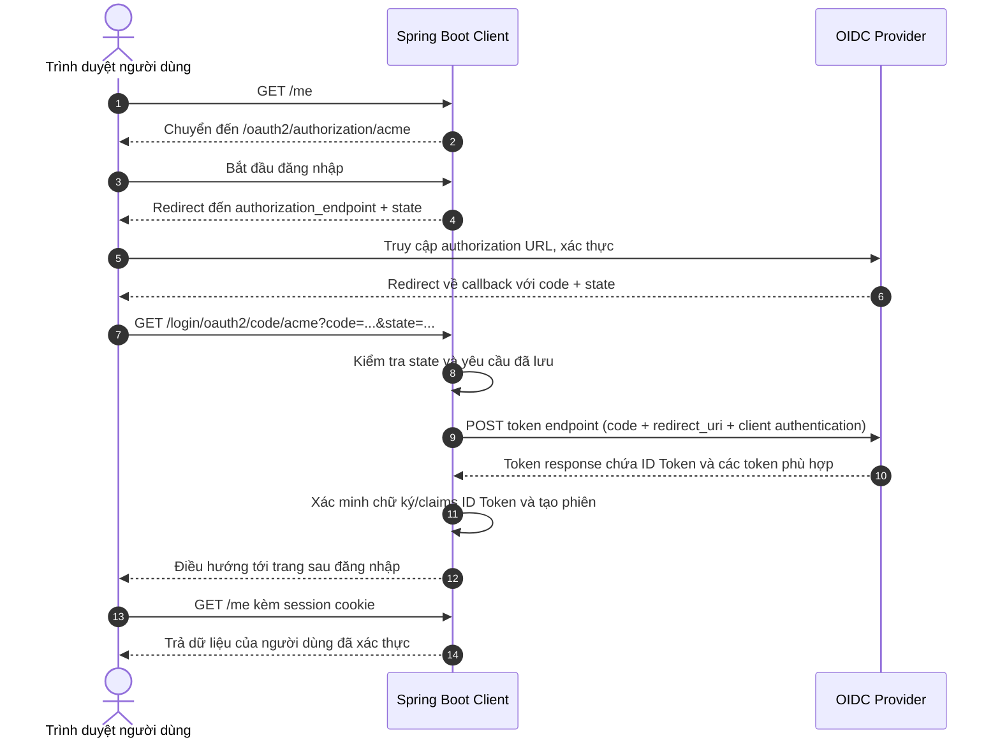

# 4.6. Đăng ký ứng dụng tại nhà cung cấp OAuth/OIDC

## 1. Mục tiêu và bối cảnh

Trước khi ứng dụng Spring Security có thể chuyển hướng người dùng đến một nhà cung cấp để đăng nhập bằng OAuth 2.0/OpenID Connect (OIDC), **ứng dụng phải được đăng ký tại nhà cung cấp**. Bước đăng ký giúp Authorization Server/Identity Provider biết:

- Ứng dụng nào đang yêu cầu xác thực, được nhận diện bằng **client ID**.
- Ứng dụng thuộc loại nào, có thể bảo vệ **client secret** hay không.
- Người dùng được chuyển về **redirect URI** nào sau khi xác thực.
- Ứng dụng được phép sử dụng **grant type** và **scope** nào.
- Những chính sách nào áp dụng cho ứng dụng, chẳng hạn tài khoản được phép đăng nhập, thời hạn token, màn hình đồng ý cấp quyền hoặc phương thức xác thực client.

Trong module **Spring Security OAuth 2.0 OIDC Client**, hãy hình dung một ứng dụng Spring Boot phục vụ trang web nội bộ `employee-portal`. Người dùng mở cổng thông tin, được chuyển đến nhà cung cấp OIDC để đăng nhập, sau đó quay lại ứng dụng. Spring Security xử lý Authorization Code flow, xác thực ID Token và thiết lập phiên đăng nhập.

Bài này tập trung vào **công việc đăng ký client tại nhà cung cấp và kết nối kết quả đăng ký vào Spring Security**. Các địa chỉ, client ID và giá trị minh họa bên dưới cần được thay bằng dữ liệu thực của dự án.

### Kết quả cần có sau khi đăng ký

Một cấu hình OIDC đăng nhập thành công thường có những đầu ra sau:

| Thông tin | Ví dụ minh họa | Vai trò |
| --- | --- | --- |
| **Issuer URI** | `https://id.example.com/realms/acme` | Xác định nhà cung cấp OIDC đáng tin cậy |
| **Client ID** | `employee-portal` | Định danh ứng dụng tại nhà cung cấp |
| **Client secret** | `<secret-tu-secret-manager>` | Xác thực confidential client với token endpoint |
| **Redirect URI** | `http://localhost:8080/login/oauth2/code/acme` | Nơi nhà cung cấp trả người dùng về sau khi cấp authorization code |
| **Grant** | `authorization_code` | Cho phép đăng nhập qua authorization code |
| **Scopes** | `openid profile email` | Đề nghị xác thực OIDC và truy cập các thông tin profile cần thiết |
| **Client authentication method** | `client_secret_basic` hoặc phương thức được hỗ trợ | Cách backend trình thông tin xác thực tại token endpoint |
| **OIDC metadata** | Được công bố qua Discovery | Cung cấp endpoint xác thực, token, JWKS, UserInfo... |

Không phải nhà cung cấp nào cũng hiển thị tất cả các trường với cùng tên. Có nơi gọi ứng dụng là *application*, *client*, *app registration*, *OAuth client*, *service principal* hoặc *relying party*. Hãy đối chiếu **ý nghĩa của trường** thay vì phụ thuộc vào tên nút của một phiên bản giao diện quản trị.

## 2. Hiểu rõ vai trò trước khi tạo client

Một luồng OIDC login thông dụng gồm:

| Vai trò | Trong ví dụ | Trách nhiệm |
| --- | --- | --- |
| **End User** | Nhân viên sử dụng website | Đăng nhập và quyết định cấp quyền khi cần |
| **OIDC Client / Relying Party** | Spring Boot `employee-portal` | Khởi tạo đăng nhập, nhận authorization code, đổi token, xác minh ID Token |
| **OpenID Provider (OP)** | `https://id.example.com` | Xác thực người dùng, cấp token và công bố metadata/khóa công khai |
| **Resource Server** (nếu có) | Profile API, Employee API | Nhận access token và bảo vệ tài nguyên/API |

**Đăng ký OAuth/OIDC client không phải tạo tài khoản người dùng.** Quản trị viên đăng ký **ứng dụng**, sau đó người dùng mới dùng tài khoản của họ để đăng nhập theo chính sách OP.

### Phân biệt OAuth 2.0 với OIDC khi đăng ký

- **OAuth 2.0** tập trung vào việc cấp quyền để một client truy cập tài nguyên. Sau Authorization Code flow, client nhận access token để gọi API theo scope được cấp.
- **OpenID Connect** mở rộng OAuth 2.0 để chuẩn hóa việc xác thực danh tính người dùng. Với yêu cầu có scope `openid`, một OIDC authentication response hợp lệ sẽ dẫn tới **ID Token** chứa các claim danh tính/cấu trúc xác thực.
- **Access token** dành cho API/Resource Server, còn **ID Token** dành cho OIDC Client. Không sử dụng access token như bằng chứng đăng nhập thay cho ID Token, và không gửi ID Token thay access token để gọi API.
- Có nhà cung cấp chỉ hỗ trợ OAuth 2.0 cho một sản phẩm/API nhưng không hỗ trợ OIDC đầy đủ. Khi muốn đăng nhập chuẩn OIDC với `oauth2Login`, cần xác nhận nhà cung cấp cung cấp OIDC Discovery, ID Token, JWKS và các endpoint/claim liên quan.

## 3. Chọn loại ứng dụng và flow phù hợp

Đây là quyết định nên đưa ra **trước khi tạo app registration**.

| Kiểu ứng dụng | Khả năng giữ bí mật | Cách đăng ký thông dụng | Flow nên dùng |
| --- | --- | --- | --- |
| **Spring Boot web server** xử lý đăng nhập và giữ phiên ở backend | Có thể giữ secret trong backend | **Confidential / Web application** | **Authorization Code**; kết hợp PKCE khi được hỗ trợ/yêu cầu |
| **SPA** chạy JavaScript trong trình duyệt | Không bảo vệ được client secret | **Public / Browser / SPA** | **Authorization Code + PKCE** |
| **Mobile/desktop app** | Không bảo vệ được secret đóng gói trong app | **Public / Native app** | **Authorization Code + PKCE** và redirect được cho phép |
| **Backend service** gọi API không có người dùng | Có thể giữ secret/khóa | **Machine-to-machine / Confidential client** | **Client Credentials** |
| **Thiết bị hạn chế nhập liệu** | Phụ thuộc thiết kế | Client theo thiết bị/nhà cung cấp | Device Authorization Grant nếu OP hỗ trợ |

Bài này triển khai trường hợp **Spring Boot web server, Authorization Code flow và OIDC login**. Nếu dự án chỉ cần giao tiếp giữa hai dịch vụ, cấu hình sẽ khác: sử dụng `client_credentials` và thường không đăng ký redirect URI hay scope `openid`.

### Confidential client và public client

**Confidential client** chạy ở môi trường backend được kiểm soát, có thể bảo vệ `client_secret` hoặc sử dụng xác thực client bằng khóa riêng/mTLS. Secret chỉ lưu trên server.

**Public client** như SPA, mobile hay desktop **không có bí mật lâu dài an toàn**; không đưa secret vào source code JavaScript, file build, ứng dụng mobile hoặc các biến môi trường được đóng gói ra client. Public client dùng PKCE nhằm ràng buộc authorization code với bên đã khởi tạo yêu cầu.

PKCE cũng hữu ích cho confidential client, nhưng **PKCE không thay thế client authentication** khi nhà cung cấp yêu cầu confidential client xác thực tại token endpoint. Không chọn Implicit flow hoặc Resource Owner Password Credentials chỉ để tránh cấu hình redirect/callback; hai cách này không phù hợp làm lựa chọn mặc định cho ứng dụng mới.

## 4. Chuẩn bị trước khi đăng ký tại nhà cung cấp

Trước khi truy cập cổng quản trị OP, xác định các thông số:

1. **Môi trường:** local, staging, production. Ưu tiên client registration riêng cho từng môi trường.
2. **Địa chỉ ứng dụng:** ví dụ local `http://localhost:8080` và production `https://portal.example.com`.
3. **Registration ID của Spring:** ví dụ `acme`. ID này xuất hiện trong login initiation URL và callback mặc định.
4. **Redirect URI chính xác:** `{baseUrl}/login/oauth2/code/{registrationId}`, sau khi thay tham số thành URI thực.
5. **Loại ứng dụng và grant:** confidential web client, `authorization_code`.
6. **Scope tối thiểu:** `openid` (bắt buộc để yêu cầu OIDC login), thêm `profile`, `email` nếu thực sự cần.
7. **Issuer của OP:** ví dụ `https://id.example.com/realms/acme`.
8. **Tài khoản/nhóm thử nghiệm:** ai được phép đăng nhập và có cần quản trị viên phê duyệt consent hay không.

Ví dụ với Spring Boot chạy cổng 8080:

```text
Base URL:          http://localhost:8080
Registration ID:   acme
Redirect URI:      http://localhost:8080/login/oauth2/code/acme

Base URL:          https://portal.example.com
Registration ID:   acme
Redirect URI:      https://portal.example.com/login/oauth2/code/acme
```

**Redirect URI là địa chỉ callback**, không phải trang login của nhà cung cấp và cũng không phải trang chủ của ứng dụng. Trong Spring Security OAuth2 Login, endpoint callback mặc định là `/login/oauth2/code/{registrationId}`. Thường ứng dụng cũng có URL **bắt đầu đăng nhập** `/oauth2/authorization/{registrationId}`; hai URL có chức năng khác nhau.

### Vì sao redirect URI phải khớp?

Authorization Server chỉ được chuyển authorization code về địa chỉ đã đăng ký theo chính sách xác thực redirect URI. Việc đối chiếu chính xác ngăn kẻ tấn công thay redirect sang website do họ kiểm soát để đánh cắp code.

Các sai khác thường làm phát sinh `redirect_uri_mismatch`:

- `http` so với `https`;
- `localhost` so với `127.0.0.1`;
- khác cổng `8080` và `8081`;
- khác chữ hoa/thường ở path hoặc path suffix;
- có hoặc thiếu dấu `/` cuối URL;
- khai báo `/callback` nhưng Spring gửi `/login/oauth2/code/acme`;
- Spring Boot chạy sau reverse proxy nên tạo redirect dùng địa chỉ nội bộ thay vì domain bên ngoài.

Một số OP có quy tắc đặc biệt cho localhost hoặc native app; hãy dùng các dạng URI được nhà cung cấp cho phép. Đối với production, ưu tiên HTTPS và danh sách callback rõ ràng. Tránh sử dụng wildcard redirect URI trong production.

## 5. Quy trình đăng ký ứng dụng tại OAuth/OIDC Provider

Đa số nhà cung cấp có quy trình tương tự nhau, dù giao diện quản trị khác nhau.

### Bước 1 — Chọn tenant/realm/organization phù hợp

Đăng nhập bằng tài khoản có quyền quản trị ứng dụng tại OP. Chọn đúng **tenant**, **realm**, **organization** hoặc **project** mà người dùng của hệ thống sẽ xác thực.

Đây là bước quan trọng vì một máy chủ có thể chứa nhiều tenant hoặc realm với issuer, danh sách user, chính sách truy cập và ứng dụng đăng ký hoàn toàn khác nhau.

Ví dụ minh họa:

```text
Provider host: https://id.example.com
Realm/Tenant: acme
Issuer:       https://id.example.com/realms/acme
```

Không suy đoán issuer chỉ từ tên miền; lấy issuer chính xác từ metadata hoặc giao diện cấu hình chính thức của nhà cung cấp.

### Bước 2 — Tạo application/client registration

Chọn tính năng tạo client/app registration, đặt một tên dễ nhận biết, ví dụ:

```text
Display name: Employee Portal (Development)
Client ID:    employee-portal-dev
Environment:  Development
Application:  Web / Server-side
Protocol:     OpenID Connect
```

Một số OP tự sinh **client ID**; nơi khác cho phép nhập. **Display name** là nhãn quản trị, còn **client ID** là giá trị ứng dụng sẽ gửi trong OAuth request và dùng để kiểm tra audience của ID Token. Chúng không nhất thiết giống nhau.

Nếu hệ thống có nhiều ứng dụng độc lập, thường nên tạo **client riêng cho từng ứng dụng** để quản trị quyền, bí mật và lịch rotation độc lập.

### Bước 3 — Chọn authentication flow

Bật:

- **Authorization Code Grant** (một số UI gọi *Standard Flow*).
- **OIDC** hoặc các tính năng OIDC tương đương.
- **PKCE (S256)** khi OP yêu cầu hoặc khi thiết kế ứng dụng dùng PKCE.

Đối với web backend confidential, bật cơ chế **client authentication** phù hợp, chẳng hạn `client_secret_basic`, `client_secret_post` hoặc xác thực bằng private key nếu OP hỗ trợ. Không đồng thời bật các grant không cần thiết như password grant, implicit grant hay client credentials chỉ vì UI cung cấp tùy chọn đó.

Lưu ý: **Grant cấp cho ứng dụng** và **scope cho từng yêu cầu** là hai khái niệm khác nhau. Grant cho biết kiểu trao đổi token được cho phép; scope biểu diễn thông tin/quyền mà client xin.

### Bước 4 — Khai báo redirect URI và các URL liên quan

Với ví dụ local:

```text
Allowed redirect URIs:
  http://localhost:8080/login/oauth2/code/acme

Allowed logout redirect URIs (nếu dùng logout qua OP):
  http://localhost:8080/

Application/Home URL:
  http://localhost:8080/
```

Trên production:

```text
Allowed redirect URIs:
  https://portal.example.com/login/oauth2/code/acme

Allowed logout redirect URIs (nếu dùng):
  https://portal.example.com/

Application/Home URL:
  https://portal.example.com/
```

**Logout redirect URI** khác callback đăng nhập: chỉ cấu hình khi sử dụng chức năng logout của OP và theo yêu cầu riêng của OP. **Post-login success URL** trong ứng dụng cũng khác OAuth callback: Spring Security có thể nhận code ở callback trước, rồi mới chuyển người dùng đến trang mong muốn.

**Allowed origins/CORS/Web origins** là một cấu hình khác redirect URI. Với ứng dụng Spring Boot server-side, trình duyệt thường chỉ đi qua HTTP redirect đến OP, còn việc đổi authorization code lấy token diễn ra ở backend. Vì vậy không tự mở CORS cho tất cả origin; chỉ thêm origin khi kiến trúc thực sự cần browser gọi cross-origin.

### Bước 5 — Cấp scopes, quyền và consent

Với OIDC login cơ bản:

| Scope | Ý nghĩa dự kiến | Ghi chú |
| --- | --- | --- |
| `openid` | Yêu cầu đăng nhập theo OIDC, có ID Token | Cần cho OIDC login |
| `profile` | Đề nghị các claim hồ sơ tiêu chuẩn | Claim thực tế phụ thuộc OP và chính sách |
| `email` | Đề nghị claim email/email_verified | Không đảm bảo mọi user luôn có email |
| Scope API riêng | Ví dụ `employee.read` để gọi Employee API | Chỉ đăng ký khi API, OP và mô hình cấp quyền hỗ trợ |

Scope có thể phải được **cấu hình/cho phép tại OP**, sau đó mới được yêu cầu bởi ứng dụng. Nếu OP có màn hình consent, hãy chuẩn bị tên ứng dụng, mô tả, logo hoặc chính sách quyền riêng tư tùy quy định của nhà cung cấp. Một số dịch vụ công khai yêu cầu kiểm chứng ứng dụng hoặc giới hạn người dùng thử nghiệm trước khi public.

Chỉ xin quyền cần thiết. Không giả định scope `profile` hoặc `email` đồng nghĩa với quyền gọi API riêng của doanh nghiệp; quyền API phải được cấu hình riêng nếu cần.

### Bước 6 — Nhận client ID, secret và metadata

Sau khi lưu ứng dụng, thu thập:

- **Client ID** để cấu hình `spring.security.oauth2.client.registration.*.client-id`.
- **Client secret** hoặc thông tin client authentication tương đương, chỉ dùng cho confidential client; có thể chỉ hiển thị một lần.
- **Issuer URI** để Spring Security tự khám phá OIDC endpoints.
- **Allowed scopes**, **token endpoint auth method**, thông tin chính sách/consent nếu có.

Không dán client secret vào tài liệu công khai, issue tracker, screenshot hoặc repository. Dùng secret manager, biến môi trường được quản lý an toàn, và cơ chế xoay secret của hạ tầng.

### Bước 7 — Cho phép user thử nghiệm, kiểm tra chính sách đăng nhập

Tùy nhà cung cấp, client có thể chỉ hoạt động với:

- Người dùng thuộc tenant/organization nội bộ;
- Nhóm ứng dụng hoặc vai trò được gán;
- Danh sách tài khoản test khi ứng dụng còn ở trạng thái development/testing;
- Người dùng hoàn tất MFA, tuân thủ conditional access hoặc được quản trị viên cho phép consent.

Nếu đăng nhập thất bại dù redirect URI và secret đúng, cần kiểm tra chính sách truy cập, trạng thái tài khoản và việc gán ứng dụng. Những vấn đề này không sửa được chỉ bằng cách thay `application.yml` của Spring.

## 6. Ví dụ đăng ký tại Keycloak theo nguyên tắc chung

Keycloak là một nhà cung cấp hỗ trợ OIDC; ví dụ dùng mô hình **realm** và **client**. Tên tab/tùy chọn có thể khác nhau theo phiên bản Keycloak, vì vậy mô tả dưới đây tập trung vào thông số tương ứng.

Giả sử:

| Thông số | Giá trị minh họa |
| --- | --- |
| Realm | `acme` |
| OIDC Issuer | `https://id.example.com/realms/acme` |
| Client ID | `employee-portal-dev` |
| Client type/protocol | `OpenID Connect` |
| Client authentication | Bật, do Spring Boot backend giữ secret |
| Standard/Authorization Code flow | Bật |
| Valid redirect URI | `http://localhost:8080/login/oauth2/code/acme` |
| Client secret | Do Keycloak tạo hoặc theo phương thức auth đã chọn |
| Scope | `openid`; `profile`, `email` khi được cho phép |

Các bước khái quát:

1. Vào realm `acme`, tạo OIDC client mang ID `employee-portal-dev`.
2. Chọn confidential client bằng cách bật client authentication; bật Authorization Code/Standard Flow.
3. Đăng ký callback của Spring Boot, khai báo thêm post-logout redirect nếu cần.
4. Lưu và lấy client credentials theo cách bảo mật.
5. Xác nhận issuer từ OIDC Discovery, kiểm tra metadata có authorization endpoint, token endpoint, JWKS URI.
6. Dùng một tài khoản thử nghiệm thuộc realm để đăng nhập qua Spring Boot.

Keycloak có thể có các tuỳ chọn **client scopes**, **consent required**, **PKCE code challenge method**, **service accounts** và các flow khác. Chỉ bật phần liên quan tới tính năng cần triển khai; **service account/Client Credentials không cần thiết** cho đăng nhập người dùng thông thường.

### So sánh khi đăng ký ở nhà cung cấp khác

| Nhà cung cấp/loại dịch vụ | Khác biệt cần lưu ý |
| --- | --- |
| **Google Identity** | Thường cần cấu hình dự án, OAuth consent screen, loại OAuth client *Web application*, authorized redirect URIs; một số quyền và chế độ public cần xét duyệt |
| **Microsoft identity platform / Entra ID** | App registration gắn với tenant và supported account types; chọn platform Web, redirect URI, certificates/secrets, delegated/API permissions và consent |
| **Auth0** | Application type, Allowed Callback URLs, Allowed Logout URLs, Allowed Web Origins và các policy kết nối người dùng |
| **Keycloak** | Realm, client authentication, flows, valid redirect URIs, client scopes và keys/metadata tại realm |
| **Nhà cung cấp OAuth 2.0 không có OIDC** | Có thể không có ID Token/issuer metadata chuẩn OIDC; cần cấu hình OAuth2 Client riêng và cơ chế lấy user info phù hợp nếu muốn login |

Từng sản phẩm cập nhật UI và yêu cầu xác thực theo thời gian; nên sử dụng tài liệu quản trị tương ứng với tenant/version đang triển khai, đồng thời giữ nguyên các nguyên tắc về client type, redirect, scope và bảo vệ secret.

## 7. Dùng thông tin đăng ký trong Spring Boot

Ví dụ dùng **Spring Boot 3.x / Spring Security 6.x**, ứng dụng Servlet (MVC) với `oauth2Login`. Các hostname, issuer và registration ID dưới đây là dữ liệu minh họa.

### 7.1. Khai báo dependencies

Với Maven:

```xml
<dependencies>
    <dependency>
        <groupId>org.springframework.boot</groupId>
        <artifactId>spring-boot-starter-web</artifactId>
    </dependency>
    <dependency>
        <groupId>org.springframework.boot</groupId>
        <artifactId>spring-boot-starter-security</artifactId>
    </dependency>
    <dependency>
        <groupId>org.springframework.boot</groupId>
        <artifactId>spring-boot-starter-oauth2-client</artifactId>
    </dependency>
</dependencies>
```

Spring Security OAuth2 Client xử lý cấu hình client registration, gửi authorization request, đổi code lấy token và xử lý OIDC login. Với một nhà cung cấp OIDC cung cấp Discovery metadata hợp lệ, việc khai báo `issuer-uri` đơn giản hơn việc chép riêng từng endpoint.

### 7.2. Cấu hình `application.yml`

```yaml
server:
  port: 8080

spring:
  security:
    oauth2:
      client:
        registration:
          acme:
            provider: acme-idp
            client-id: ${OIDC_CLIENT_ID}
            client-secret: ${OIDC_CLIENT_SECRET}
            client-authentication-method: client_secret_basic
            authorization-grant-type: authorization_code
            redirect-uri: "{baseUrl}/login/oauth2/code/{registrationId}"
            scope:
              - openid
              - profile
              - email
        provider:
          acme-idp:
            issuer-uri: https://id.example.com/realms/acme
```

Ý nghĩa các trường:

| Thuộc tính | Giải thích |
| --- | --- |
| `registration.acme` | **Registration ID** cục bộ. URL đăng nhập mặc định là `/oauth2/authorization/acme` |
| `provider: acme-idp` | Liên kết registration với phần cấu hình nhà cung cấp |
| `client-id` | Giá trị lấy từ app registration tại OP |
| `client-secret` | Secret của **confidential client**, nạp từ môi trường an toàn |
| `client-authentication-method` | Phải tương thích với cách client được đăng ký tại token endpoint; `client_secret_basic` chỉ là ví dụ |
| `authorization-grant-type` | `authorization_code` cho luồng đăng nhập trình duyệt |
| `redirect-uri` | URI mà Spring gửi trong authorize request; phải trùng callback cho phép tại OP |
| `scope` | Scope Spring yêu cầu; `openid` giúp nhận diện OIDC login |
| `provider.acme-idp.issuer-uri` | Issuer OIDC dùng để Discovery và xác thực ID Token |

Lưu ý: `acme` (registration ID), `acme-idp` (provider ID) và `employee-portal-dev` (client ID tại OP) là **ba định danh khác nhau**. Ví dụ callback `/login/oauth2/code/acme` sử dụng **registration ID**, không phải client ID.

Nếu OP quy định auth method khác `client_secret_basic`, cần chọn đúng phương thức được hỗ trợ. Nếu ứng dụng là public client, không cấu hình secret như confidential client; chọn cơ chế PKCE và client authentication phù hợp với loại client/phiên bản Spring Security.

### 7.3. Cung cấp client credentials an toàn

Trên máy phát triển, có thể cấp giá trị qua biến môi trường theo cơ chế của shell hoặc môi trường chạy ứng dụng. Ví dụ PowerShell minh họa:

```powershell
$env:OIDC_CLIENT_ID = "employee-portal-dev"
$env:OIDC_CLIENT_SECRET = "<lay-tu-secret-manager>"
```

Hoặc thiết lập secret qua công cụ triển khai/secret store để không gõ trực tiếp vào lịch sử lệnh. Giá trị minh họa trong ví dụ không phải secret thật.

Trong container/Kubernetes/cloud, dùng dịch vụ quản lý secret, identity, cơ chế phân quyền và rotation tương ứng. **Không commit `application.yml` chứa secret thật**, không in biến secret ra log, không chuyển secret xuống HTML hoặc JavaScript frontend.

### 7.4. Cấu hình security filter chain

```java
import org.springframework.context.annotation.Bean;
import org.springframework.context.annotation.Configuration;
import org.springframework.security.config.Customizer;
import org.springframework.security.config.annotation.web.builders.HttpSecurity;
import org.springframework.security.web.SecurityFilterChain;

@Configuration
public class SecurityConfiguration {

    @Bean
    SecurityFilterChain securityFilterChain(HttpSecurity http) throws Exception {
        http.authorizeHttpRequests(authorize -> authorize
                .requestMatchers("/", "/public/**").permitAll()
                .anyRequest().authenticated());

        http.oauth2Login(Customizer.withDefaults());

        return http.build();
    }
}
```

`oauth2Login` đăng ký các cơ chế cần thiết để khởi tạo OAuth2/OIDC login và xử lý callback mặc định. Một request đến trang cần xác thực sẽ kích hoạt login; với nhiều client registration, có thể sử dụng trang chọn nhà cung cấp. Để kiểm tra trực tiếp registration `acme`, mở:

```text
http://localhost:8080/oauth2/authorization/acme
```

Sau khi xác thực thành công ở OP, trình duyệt được trả về:

```text
http://localhost:8080/login/oauth2/code/acme?code=<authorization-code>&state=<state>
```

**Spring Security xử lý callback này** và gửi yêu cầu đổi code lấy token ở backend. Không viết controller thủ công nhận code rồi tự đổi token nếu đang dùng cơ chế `oauth2Login` mặc định.

### 7.5. Đọc danh tính sau đăng nhập

Ví dụ controller nhận `OidcUser` đã được Spring Security xác thực:

```java
import java.util.Map;

import org.springframework.security.core.annotation.AuthenticationPrincipal;
import org.springframework.security.oauth2.core.oidc.user.OidcUser;
import org.springframework.web.bind.annotation.GetMapping;
import org.springframework.web.bind.annotation.RestController;

@RestController
public class ProfileController {

    @GetMapping("/me")
    public Map<String, Object> me(@AuthenticationPrincipal OidcUser user) {
        return Map.of(
                "subject", user.getSubject(),
                "issuer", user.getIssuer().toString()
        );
    }
}
```

`sub` là định danh người dùng theo issuer; không nên dùng email làm khóa định danh bền vững chỉ vì đã xin scope `email`. Email có thể thay đổi hoặc không có trong token; nếu dùng email để hiển thị/ánh xạ dữ liệu nghiệp vụ, cần xử lý các trường hợp thiếu và trạng thái xác minh email theo chính sách.

### 7.6. Sơ đồ đăng nhập đầy đủ



Đối với flow có PKCE, client còn tạo `code_verifier`, gửi `code_challenge` ở authorization request và gửi `code_verifier` khi đổi code. Việc PKCE có được bật tự động hay cần cấu hình thêm phụ thuộc phiên bản Spring Security và loại client registration; cần đáp ứng yêu cầu thực tế của OP.

## 8. OIDC Discovery: lấy endpoint chính xác từ issuer

Một OP hỗ trợ OIDC công bố tài liệu **OpenID Provider Configuration** (Discovery). Trong ví dụ dạng realm, có thể quan sát tài liệu tại:

```text
https://id.example.com/realms/acme/.well-known/openid-configuration
```

Phản hồi rút gọn minh họa:

```json
{
  "issuer": "https://id.example.com/realms/acme",
  "authorization_endpoint": "https://id.example.com/realms/acme/protocol/openid-connect/auth",
  "token_endpoint": "https://id.example.com/realms/acme/protocol/openid-connect/token",
  "userinfo_endpoint": "https://id.example.com/realms/acme/protocol/openid-connect/userinfo",
  "jwks_uri": "https://id.example.com/realms/acme/protocol/openid-connect/certs",
  "response_types_supported": ["code"],
  "id_token_signing_alg_values_supported": ["RS256"]
}
```

Các endpoint trên mô phỏng cấu trúc Keycloak. **Issuer phải khớp chính xác với giá trị `issuer` được OP công bố**. Ví dụ issuer chứa realm/tenant khác sẽ khiến xác thực ID Token sai ngay cả khi client ID và secret đúng.

Ý nghĩa của những endpoint:

- **Authorization endpoint:** trình duyệt được chuyển đến để xác thực và cấp authorization code.
- **Token endpoint:** backend đổi authorization code lấy token; đây thường là lời gọi server-to-server.
- **UserInfo endpoint:** lấy thêm claim về người dùng bằng access token khi flow và provider hỗ trợ.
- **JWKS URI:** công bố public key cho client kiểm tra chữ ký ID Token được ký bằng thuật toán bất đối xứng.

Để xem Discovery trên môi trường được quyền truy cập:

```bash
curl --fail --silent --show-error \
  "https://id.example.com/realms/acme/.well-known/openid-configuration"
```

Cấu hình `issuer-uri` giúp Spring Security sử dụng Discovery. Khi OP không cung cấp Discovery chuẩn, có thể phải khai báo các endpoint thủ công theo loại OAuth2 Client, nhưng khi ấy **không tự coi nhà cung cấp là OIDC** nếu không có ID Token và các điều kiện của OIDC.

Không chấp nhận issuer/JWKS URL tùy ý từ input của người dùng hoặc từ JWT chưa xác minh. Ứng dụng phải định sẵn nhà cung cấp tin cậy và dựa trên kết nối HTTPS hợp lệ.

## 9. Đăng ký và triển khai trên nhiều môi trường

Một lỗi phổ biến là đăng ký client cho `localhost` rồi lấy nguyên client ID/secret sang production. Cách đó dễ gây nhầm lẫn redirect, quyền truy cập, quản trị secret và khả năng thu hồi theo môi trường.

Ví dụ tổ chức đăng ký:

| Môi trường | Client ID minh họa | Callback |
| --- | --- | --- |
| **Local** | `employee-portal-local` | `http://localhost:8080/login/oauth2/code/acme` |
| **Staging** | `employee-portal-staging` | `https://staging.portal.example.com/login/oauth2/code/acme` |
| **Production** | `employee-portal-prod` | `https://portal.example.com/login/oauth2/code/acme` |

Issuer của từng môi trường có thể giống hoặc khác nhau tùy thiết kế tenant/realm. Nếu dùng issuer chung, cần bảo đảm chính sách user/consent/redirect theo môi trường vẫn được giới hạn đúng.

### Spring Boot sau reverse proxy hoặc load balancer

Khi public URL là `https://portal.example.com` nhưng Spring Boot phía sau proxy nhận request HTTP từ nội bộ, giá trị `{baseUrl}` tính từ request có thể bị sai nếu ứng dụng không xử lý proxy headers phù hợp.

Với hạ tầng proxy đáng tin cậy, cấu hình chuyển tiếp các header `Forwarded`/`X-Forwarded-*` và chính sách tin cậy ở proxy/application. Tùy Spring Boot và môi trường, có thể dùng:

```yaml
server:
  forward-headers-strategy: framework
```

Cấu hình này chỉ nên bật khi triển khai có ranh giới tin cậy proxy đúng; không chấp nhận header forwarded tùy tiện từ Internet. Mục tiêu là Spring tạo redirect URI bằng **external origin** thực của người dùng, không phải hostname/port nội bộ.

Với cấu hình callback có chủ đích cố định, có thể khai báo redirect URI cụ thể cho từng môi trường thay vì dùng `{baseUrl}`, miễn là OP cũng đăng ký chính xác URI đó.

## 10. Thử nghiệm đăng nhập sau khi đăng ký

Sau khi cấu hình OP và ứng dụng, thực hiện các bước thử nghiệm theo trình tự.

### 10.1. Lần đăng nhập thành công

1. Chạy ứng dụng Spring Boot và xác nhận trang public truy cập được.
2. Mở `http://localhost:8080/oauth2/authorization/acme` trong trình duyệt riêng tư.
3. Quan sát redirect đến đúng OP/issuer và authorization endpoint.
4. Đăng nhập bằng tài khoản đã được cho phép; hoàn tất MFA/consent nếu OP yêu cầu.
5. Xác nhận OP chuyển về `/login/oauth2/code/acme`.
6. Sau khi Spring Security xử lý callback, truy cập `/me` và kiểm tra ứng dụng xác định được `sub` và issuer đã cấu hình.
7. Đóng phiên/đăng xuất theo cơ chế của ứng dụng, thử lại để bảo đảm luồng đăng nhập hoạt động nhất quán.

### 10.2. Đối chiếu các tham số trong authorization request

Trong Network tab của trình duyệt, authorization URL gửi đến OP thông thường chứa:

| Tham số | Cần quan sát |
| --- | --- |
| `client_id` | Chính xác client ID đã đăng ký |
| `response_type` | `code` trong Authorization Code flow |
| `redirect_uri` | Trùng một callback được phép tại OP |
| `scope` | Có `openid` cho OIDC login và các scope khác nếu cần |
| `state` | Giá trị ngẫu nhiên gắn với yêu cầu; được kiểm tra ở callback |
| `nonce` | Có thể hiện diện theo cơ chế OIDC Client, dùng để liên kết ID Token với yêu cầu |
| `code_challenge` và `code_challenge_method` | Có khi sử dụng PKCE; `S256` là phương thức nên dùng |

Không dán authorization code, ID Token, access token hoặc client secret thật vào tài liệu bug report. `state` và `nonce` cũng cần được quản lý theo phiên để chống giả mạo và phát lại.

### 10.3. Các trường hợp từ chối nên kiểm tra

- Callback không được đăng ký: OP phải từ chối authorization request.
- Tài khoản không có quyền truy cập ứng dụng: OP phải áp dụng đúng policy.
- Scope chưa được cấp: OP từ chối hoặc giới hạn phạm vi theo cấu hình.
- Client secret sai/không hợp lệ: token exchange thất bại.
- ID Token có issuer/audience không khớp: client phải từ chối xác thực.
- `state`/`nonce` không hợp lệ: flow phải thất bại, không tạo phiên đăng nhập.
- Logout và đăng nhập lại: kiểm tra hành vi session tại ứng dụng và OP theo yêu cầu sản phẩm.

Đây là những tình huống cần **kiểm thử trong môi trường được cho phép**, không phải khẳng định đã chạy chúng cho ví dụ ở bài.

## 11. Lỗi thường gặp và cách truy tìm nguyên nhân

| Triệu chứng/mã lỗi | Khả năng nguyên nhân | Nơi kiểm tra |
| --- | --- | --- |
| `redirect_uri_mismatch` hoặc `invalid_redirect_uri` | Callback Spring gửi không trùng URI đã đăng ký; sai protocol/domain/port/path | OP app registration, `redirect-uri`, reverse proxy |
| `invalid_client` khi gọi token endpoint | Sai client ID/secret hoặc client authentication method | Secret store, OP credentials, `client-authentication-method` |
| `unauthorized_client` | Grant `authorization_code` chưa được bật hoặc client không phù hợp với flow | Cấu hình grant/flow tại OP |
| `invalid_scope` | Scope chưa được phép hoặc tên scope khác | OP client scopes, Spring `scope` |
| `invalid_grant` | Code hết hạn, đã dùng lại, redirect URI/verifier sai hoặc chính sách không cho phép | Token exchange, callback, PKCE, thời gian |
| `invalid_request` / PKCE required | Thiếu `code_challenge` hoặc dùng phương thức PKCE không được chấp nhận | Cấu hình PKCE của OP và Spring |
| Không đăng nhập được dù tài khoản hợp lệ | Chưa gán quyền/ứng dụng, giới hạn tenant, MFA/consent, test users | Policy và trạng thái đăng ký ứng dụng tại OP |
| `issuer mismatch` hoặc lỗi `iss` | Dùng sai realm/tenant/issuer, lẫn endpoint giữa môi trường | `issuer-uri` và OIDC Discovery |
| Lỗi chữ ký/JWKS | OP/issuer sai, không lấy được JWKS, khóa thay đổi, thuật toán không được cho phép | `jwks_uri`, cache, TLS, thuật toán |
| `state` không khớp, lặp vòng đăng nhập | Mất session/cookie, callback bị sửa, reverse proxy hoặc load balancer không giữ state/session | Cookie, session store, state, proxy |
| Báo chưa có ID Token hoặc chỉ nhận OAuth2User | Không yêu cầu `openid` hoặc provider không hỗ trợ OIDC đầy đủ | Scopes, provider metadata, token response |
| UserInfo lỗi hoặc thiếu claim email | Thiếu quyền/claim, endpoint khác, consent/policy của OP | `userinfo_endpoint`, scope, claim mapper |
| Callback thành công nhưng trang bị 403 | Đã đăng nhập nhưng thiếu authority/role nghiệp vụ | Role mapping và cấu hình phân quyền Spring |

Một số mã lỗi do OP trả về, còn các lỗi như `issuer mismatch`, chữ ký hoặc state thường được Spring Security phát hiện khi xử lý callback. Dựa vào **đúng giai đoạn phát sinh lỗi** sẽ xác định nên sửa ở OP, ở cấu hình Spring hay ở mạng/proxy.

### Cách đọc luồng khi xử lý sự cố

```text
(1) Trình duyệt có được redirect đến đúng authorization endpoint?
       |
       +-- Không → Spring registration / proxy / đường dẫn login
       |
       +-- Có
             |
             v
(2) OP có chấp nhận client_id, redirect_uri, scopes và user?
       |
       +-- Không → App registration / consent / policy / grant
       |
       +-- Có
             |
             v
(3) Callback đến đúng /login/oauth2/code/{registrationId}?
       |
       +-- Không → Redirect URI / proxy / callback path
       |
       +-- Có
             |
             v
(4) Spring đổi code lấy token thành công?
       |
       +-- Không → Client authentication / secret / PKCE / code
       |
       +-- Có
             |
             v
(5) ID Token xác minh được, claim hợp lệ và session được tạo?
       |
       +-- Không → Issuer / JWKS / audience / nonce / cookie-session
       |
       +-- Có → Chuyển sang kiểm tra phân quyền nghiệp vụ (nếu còn lỗi)
```

Nên bật mức log phù hợp ở môi trường kiểm thử và chỉ lưu **định danh registration, correlation ID, loại lỗi, HTTP status, issuer đã được tin cậy**. Không bật logging để in nguyên authorization header, client secret hoặc token. Khi báo lỗi cho nhà cung cấp, loại bỏ thông tin bí mật trước khi đính kèm ảnh chụp hay log.

## 12. Một số quyết định bảo mật cần chốt cùng app registration

Đăng ký đúng trường không bảo đảm hệ thống hoàn toàn an toàn. Các chính sách sau nên được quyết định từ lúc thiết lập:

- **Quyền tối thiểu:** chỉ đăng ký flow/scope cần thiết; tách client cho các ứng dụng và môi trường.
- **Bảo vệ secret:** giữ trong backend/secret manager, phân quyền truy cập, có kế hoạch xoay vòng và thu hồi.
- **Redirect URI nghiêm ngặt:** chỉ khai báo địa chỉ thực sự dùng; không dùng wildcard rộng ở production.
- **PKCE:** dùng cho public client và theo chính sách OP; xem xét bật cho confidential web client để tăng bảo vệ code.
- **State/nonce:** dùng cơ chế của thư viện uy tín; không tắt để “sửa” lỗi đăng nhập.
- **HTTPS:** bắt buộc cho endpoint production; kiểm soát TLS và header forwarded ở proxy.
- **Phân quyền nội bộ:** OIDC xác thực user, còn ứng dụng vẫn phải kiểm tra vai trò và quyền truy cập dữ liệu. Không suy ra người dùng là admin chỉ vì đăng nhập thành công.
- **Tách loại token:** API xác thực access token dành cho Resource Server; web client dùng ID Token cho OIDC login.
- **Vòng đời ứng dụng:** có quy trình thu hồi client, xoay client secret, cập nhật redirect URI và ghi nhận người chịu trách nhiệm.

Một số provider còn có giới hạn về số lượng redirect URI, URL được cho phép cho mobile app, consent verification, domain verification hoặc chính sách single-tenant/multi-tenant. Những điều này cần được giải quyết tại provider để yêu cầu OAuth/OIDC của Spring có thể được chấp nhận.

## 13. Liên hệ với Client Credentials và các cấu hình khác

Một dự án Spring có thể đồng thời triển khai:

- **OIDC login** cho người dùng bằng `authorization_code` và scope `openid`;
- **OAuth2 Client** gọi API thay mặt người dùng bằng access token đã nhận;
- **Client Credentials** cho worker/service gọi API bằng danh tính ứng dụng;
- **Resource Server** cho API của chính dự án xác thực Bearer access token đến từ client khác.

Các chức năng có thể cùng dùng một OP nhưng không nhất thiết cùng **app registration**, grant hoặc scope. Ví dụ bảng:

| Nghiệp vụ | Grant / cách dùng | Redirect URI | Cần ID Token? |
| --- | --- | --- | --- |
| Nhân viên đăng nhập Employee Portal | `authorization_code` với OIDC | Có | Có |
| Order Service tự gọi Inventory API | `client_credentials` | Không | Thường không |
| API kiểm tra token từ service gọi tới | OAuth2 Resource Server | Không phải client redirect | Không dùng ID Token thay access token |

Đặc biệt, **đăng ký ứng dụng OIDC tại OP** có thể cấp client ID, secret và issuer, nhưng Spring Security cần **cấu hình đúng vai trò**. Đổi `authorization_code` thành `client_credentials` không biến một ứng dụng thành đăng nhập OIDC dành cho người dùng.

## 14. Tổng kết cấu hình hoàn chỉnh

Với Spring Boot web application đăng nhập qua OIDC Provider, luồng đăng ký và tích hợp được tóm lại như sau:

1. Chọn đúng tenant/realm và lấy **issuer** của OIDC Provider.
2. Đăng ký một **Web/confidential client** tương ứng với ứng dụng, bật **Authorization Code flow** và chính sách PKCE phù hợp.
3. Khai báo **redirect URI** khớp callback Spring `/login/oauth2/code/{registrationId}` cho từng môi trường.
4. Cho phép các **scope tối thiểu**, trong đó có `openid` để đăng nhập OIDC.
5. Nhận **client ID**, bảo vệ **client secret**, xác định client authentication method và policy người dùng.
6. Ánh xạ thông tin vào `spring.security.oauth2.client.registration` và `provider.*.issuer-uri`; bật `oauth2Login`.
7. Thử đăng nhập qua `/oauth2/authorization/{registrationId}` và quan sát quá trình nhận authorization code, xác minh ID Token, tạo session.
8. Xử lý lỗi theo giai đoạn: authorization request tại OP, token exchange tại backend, ID Token validation và phân quyền ở Spring.

**Kết nối thành công không chỉ là việc ứng dụng có client ID và secret**: OIDC Provider phải cho phép đúng flow, redirect, scope và người dùng, trong khi Spring Security phải tin đúng issuer, xử lý callback an toàn và xác minh ID Token trước khi cấp phiên đăng nhập.
