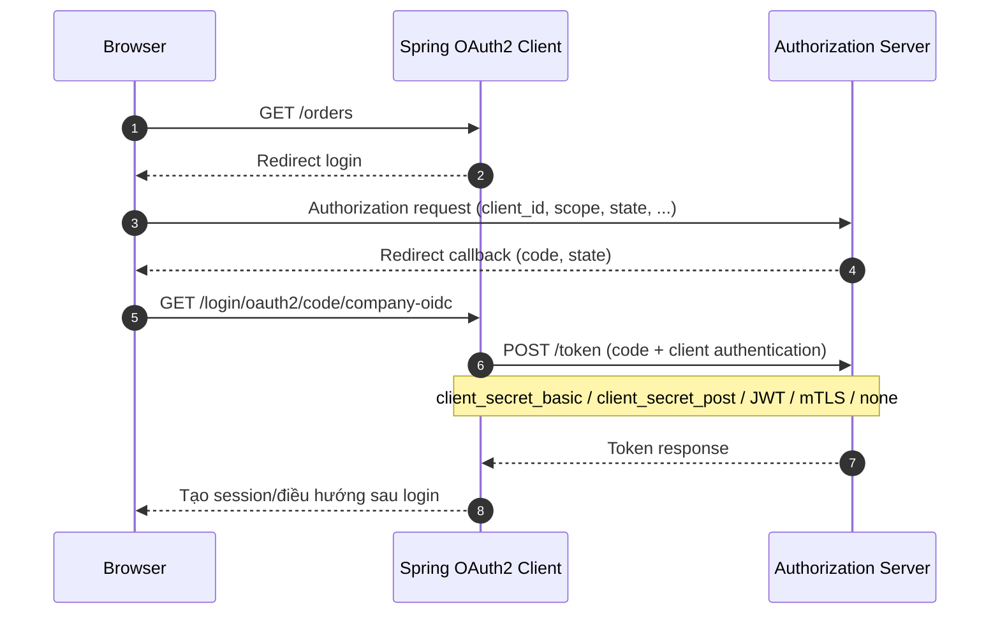

# 4.7. Khai báo client ID, client secret và phương thức xác thực client

Khi tích hợp **Spring Security OAuth 2.0 Client** với một Authorization Server hoặc OpenID Provider (OP), ứng dụng Spring cần biết mình được đăng ký dưới danh tính nào và phải chứng minh danh tính đó ra sao. Ba thông tin liên quan trực tiếp là **`client-id`**, **`client-secret`** (nếu có) và **`client-authentication-method`**.

Chúng xuất hiện trong phần cấu hình `spring.security.oauth2.client.registration` của Spring Boot, được ánh xạ thành `ClientRegistration` trong Spring Security. Khai báo đúng ba trường này giúp ứng dụng đổi authorization code lấy token, làm mới access token hoặc lấy token theo `client_credentials` theo phương thức mà provider cho phép. Khai báo sai thường dẫn đến lỗi `invalid_client`, ngay cả khi người dùng đã đăng nhập thành công tại trang của provider.

> **Phạm vi:** Bài này tập trung vào cấu hình OAuth2/OIDC **Client** sử dụng Spring Boot và Spring Security; ứng dụng đóng vai trò kết nối tới Authorization Server. Cấu hình đăng ký client *ở phía Authorization Server* là một công việc khác, nhưng hai phía phải khớp thông số.

## 1. Phân biệt các khái niệm trước khi cấu hình

| Khái niệm | Là gì? | Có phải thông tin bí mật không? |
|---|---|---|
| `registrationId` | Tên nội bộ trong Spring, ví dụ `company-oidc`. Dùng để tìm `ClientRegistration` và khởi động login qua `/oauth2/authorization/{registrationId}`. | Không. |
| `client-id` | Định danh mà Authorization Server cấp cho một ứng dụng client đã đăng ký. | Thông thường không được coi là bí mật; vẫn cần quản trị đúng phạm vi sử dụng. |
| `client-secret` | Mật khẩu chia sẻ giữa confidential client và Authorization Server để xác thực client. | **Có**. Cần lưu và truyền theo cơ chế bảo vệ secret. |
| `client-authentication-method` | Cách client trình credentials hoặc bằng chứng xác thực tại token endpoint, ví dụ `client_secret_basic`. | Bản thân tên phương thức không phải bí mật. |
| `authorization-grant-type` | Cơ chế xin quyền/token, ví dụ `authorization_code` hoặc `client_credentials`. | Không; đây là khái niệm khác với phương thức xác thực client. |
| `redirect-uri` | Điểm nhận callback của `authorization_code`; provider so sánh với URI đã đăng ký. | Không, nhưng phải khớp và được kiểm soát chặt chẽ. |
| `scope` | Các quyền/phạm vi ứng dụng yêu cầu; OIDC sử dụng scope `openid`. | Không; giá trị phải được provider cho phép. |

`client-id` **không phải** tên tài khoản hay mật khẩu người dùng đăng nhập. `client-secret` **không phải** password của người dùng. Cũng không nên nhầm `client-secret` với khóa ký ID Token của OpenID Provider hoặc access token mà provider cấp sau khi ủy quyền.

Một ứng dụng có thể có nhiều registration, ví dụ `employee-login` dùng cho đăng nhập OIDC và `billing-service` dùng `client_credentials`. Mỗi registration có thể có `client-id`, phương thức xác thực, scope và provider riêng.

### 1.1. Confidential client và public client

**Confidential client** có môi trường thực thi đủ tin cậy để giữ credentials ở phía server: ví dụ Spring MVC backend, Spring WebFlux backend hoặc Backend for Frontend (BFF). Provider có thể cấp `client-secret` cho loại client này, hoặc yêu cầu xác thực bằng khóa bất đối xứng/mTLS.

**Public client** không thể giữ credential lâu dài một cách bí mật, ví dụ ứng dụng JavaScript chạy trong browser hoặc ứng dụng native cài trên thiết bị người dùng. Những client này thường dùng `client-authentication-method: none` kết hợp Authorization Code + **PKCE**. Chèn `client-secret` vào JavaScript, bundle frontend hoặc ứng dụng native không biến ứng dụng thành confidential client vì người dùng có thể trích xuất secret.

Một ứng dụng Spring chạy hoàn toàn trên server thường là confidential client, nhưng loại client phải được xác lập trong cấu hình provider và kiến trúc triển khai. Không nên chọn `none` chỉ để bỏ qua lỗi khi secret bị sai.

### 1.2. Grant type khác client authentication

Hai trục lựa chọn độc lập:

- `authorization_code`: nhận code từ callback sau khi browser được chuyển tới provider; client thường xác thực tại token endpoint khi đổi code lấy token.
- `client_credentials`: ứng dụng xin token đại diện cho chính mình, không có người dùng tương tác.
- `refresh_token`: xin access token mới từ refresh token; nếu client thuộc loại confidential, provider có thể tiếp tục yêu cầu xác thực client.
- `client_secret_basic`, `client_secret_post`, `private_key_jwt`,… là **phương thức xác thực client**, có thể được dùng với grant type phù hợp mà provider đã đăng ký.

Ví dụ, `authorization_code + client_secret_basic` là cách đăng nhập OIDC phổ biến cho backend; `client_credentials + client_secret_basic` lại là cách gọi service-to-service. Hai trường hợp dùng cùng phương thức xác thực client nhưng khác grant type và mục đích.

## 2. Lấy thông tin đăng ký từ Authorization Server

Trước khi sửa `application.yml`, cần đăng ký một OAuth2/OIDC application trong trang quản trị của provider và thu thập các thông tin tương ứng:

1. **Issuer URI** hoặc bộ authorization/token/JWK endpoints của provider. Với OIDC hỗ trợ discovery, issuer thường đủ để Spring tìm metadata.
2. **Client ID** do provider cấp, đúng với ứng dụng và môi trường đang triển khai.
3. **Client secret** nếu provider đăng ký confidential client dùng secret. Một số hệ thống chỉ hiển thị giá trị này một lần khi tạo hoặc xoay vòng.
4. **Token endpoint authentication method** mà provider chấp nhận, chẳng hạn `client_secret_basic` hay `client_secret_post`. Nhiều provider có mặc định khác nhau.
5. **Grant types**, **redirect URIs** và **scopes** đã cho phép. Với login OIDC, cần grant `authorization_code` và scope `openid`.
6. Nếu chọn `private_key_jwt`: thông tin khóa công khai/JWKS mà provider cần, thuật toán ký được cho phép và quy tắc audience. Nếu dùng mTLS: chứng thư client, khóa riêng và yêu cầu TLS của provider.

Tại Authorization Server, registration phải cho phép cùng phương thức mà Spring gửi. Việc chỉ thay property bên Spring sẽ không tự thay đổi cấu hình đã lưu ở provider.

```text
  Spring OAuth2/OIDC Client                  Authorization Server
  -------------------------                 --------------------
  registrationId: "company-oidc"            Registered application
  client-id: <issued-client-id>    <------> client_id: <issued-client-id>
  client-secret: <protected-secret> <------> credential của client
  method: client_secret_basic      <------> cho phép client_secret_basic
  grant: authorization_code        <------> cho phép authorization_code
  redirect: /login/oauth2/code/... <------> redirect URI được đăng ký
```

OIDC discovery metadata có thể quảng bá `token_endpoint_auth_methods_supported`. Thuộc tính này mô tả phương thức được server hỗ trợ nói chung; ứng dụng cụ thể vẫn phải được đăng ký và cấp quyền sử dụng phương thức thích hợp. Không suy ra từ tên provider rằng mọi tenant/client đều có cùng cấu hình.

## 3. Khai báo trong Spring Boot bằng `application.yml`

### 3.1. Dependency

Với dự án Spring Boot có starter web tương ứng (Spring MVC hoặc WebFlux), cần thêm OAuth2 Client và Spring Security:

```groovy
// build.gradle: ví dụ Spring MVC
dependencies {
    implementation 'org.springframework.boot:spring-boot-starter-web'
    implementation 'org.springframework.boot:spring-boot-starter-security'
    implementation 'org.springframework.boot:spring-boot-starter-oauth2-client'
}
```

Nếu là ứng dụng Reactive, dùng `spring-boot-starter-webflux` thay cho `spring-boot-starter-web`. Các thuộc tính `spring.security.oauth2.client.*` bên dưới được Spring Boot hỗ trợ cho cả hai stack; khác biệt nằm ở các bean và security chain mà framework tạo.

### 3.2. Mẫu cho confidential OIDC client sử dụng HTTP Basic

Ví dụ `src/main/resources/application.yml`:

```yaml
spring:
  security:
    oauth2:
      client:
        registration:
          company-oidc:
            provider: company-idp
            client-id: "${OIDC_CLIENT_ID}"
            client-secret: "${OIDC_CLIENT_SECRET}"
            client-authentication-method: client_secret_basic
            authorization-grant-type: authorization_code
            redirect-uri: "{baseUrl}/login/oauth2/code/{registrationId}"
            scope:
              - openid
              - profile
              - email
        provider:
          company-idp:
            issuer-uri: "https://login.example.org/realms/company"
```

Đây là cấu hình minh họa, cần thay issuer và các giá trị do provider cấp:

- `company-oidc` là **registration ID** do ứng dụng đặt; nó được dùng trong đường dẫn `/oauth2/authorization/company-oidc` và trong đoạn callback `/login/oauth2/code/company-oidc`.
- `company-idp` là ID cấu hình provider, được registration tham chiếu qua `provider`.
- `${OIDC_CLIENT_ID}` và `${OIDC_CLIENT_SECRET}` là placeholder để Spring resolve từ nguồn cấu hình runtime, chẳng hạn environment variables. Không đưa secret thật trực tiếp vào file commit lên Git.
- `client-authentication-method: client_secret_basic` chỉ định gửi thông tin xác thực client bằng HTTP Basic tại token endpoint.
- `redirect-uri` dùng biến mẫu `{baseUrl}` và `{registrationId}` của Spring Security; URL thực tế phải trùng với URL mà provider đã cho phép.
- Scope `openid` kích hoạt ngữ nghĩa OIDC. `profile` và `email` chỉ là scope ví dụ, phải nằm trong danh sách được provider hỗ trợ/cho phép.
- `issuer-uri` chỉ tới **issuer của provider**, không phải URL callback, cũng không phải URL API mà ứng dụng sẽ gọi bằng access token.

Nếu ứng dụng được truy cập công khai tại `https://app.example.org`, callback tương ứng là:

```text
https://app.example.org/login/oauth2/code/company-oidc
```

Callback URL đó phải được cấu hình ở provider cho client ID tương ứng. Với môi trường local, thường đăng ký URI riêng như `http://localhost:8080/login/oauth2/code/company-oidc` nếu provider cho phép HTTP loopback.

### 3.3. Cú pháp trong `application.properties`

Cùng thông tin trên có thể được khai báo theo dạng properties:

```properties
spring.security.oauth2.client.registration.company-oidc.provider=company-idp
spring.security.oauth2.client.registration.company-oidc.client-id=${OIDC_CLIENT_ID}
spring.security.oauth2.client.registration.company-oidc.client-secret=${OIDC_CLIENT_SECRET}
spring.security.oauth2.client.registration.company-oidc.client-authentication-method=client_secret_basic
spring.security.oauth2.client.registration.company-oidc.authorization-grant-type=authorization_code
spring.security.oauth2.client.registration.company-oidc.redirect-uri={baseUrl}/login/oauth2/code/{registrationId}
spring.security.oauth2.client.registration.company-oidc.scope=openid,profile,email
spring.security.oauth2.client.provider.company-idp.issuer-uri=https://login.example.org/realms/company
```

Spring Boot tự bind các property thành `ClientRegistration`. Đối với Servlet, bean truy xuất registration có thể có kiểu `ClientRegistrationRepository`; đối với Reactive là `ReactiveClientRegistrationRepository`. Trong trường hợp cấu hình thông dụng, không cần tự tạo bean chỉ để truyền client ID và secret.

### 3.4. Đưa credentials vào môi trường chạy

Ví dụ trong PowerShell khi chạy local:

```powershell
# Chỉ minh họa tên biến; cấp giá trị qua cơ chế secret được chọn.
$env:OIDC_CLIENT_ID = "<client-id-from-provider>"
$env:OIDC_CLIENT_SECRET = "<secret-from-secure-source>"
./gradlew bootRun
```

Lệnh trên thể hiện cách Spring đọc environment variables; trong thực tế tránh nhập secret trực tiếp vào một lệnh sẽ bị lưu trong shell history, log CI hoặc nhật ký terminal được chia sẻ. IDE run configuration, secret manager, CI protected variables hoặc cơ chế cấp secret của nền tảng triển khai là các lựa chọn thường gặp.

Với container, có thể inject credentials từ secret store của hệ thống điều phối:

```yaml
# Trích phần cấu hình container của Kubernetes Deployment
env:
  - name: OIDC_CLIENT_ID
    valueFrom:
      secretKeyRef:
        name: company-oidc-credentials
        key: client-id
  - name: OIDC_CLIENT_SECRET
    valueFrom:
      secretKeyRef:
        name: company-oidc-credentials
        key: client-secret
```

Đoạn này giả định Secret `company-oidc-credentials` đã tồn tại và được quản lý bằng cách an toàn. Kubernetes Secret tự nó không đồng nghĩa với mã hóa toàn diện: vẫn cần quyền RBAC phù hợp, mã hóa at-rest theo môi trường và giới hạn ai được đọc/ghi. Không commit manifest có giá trị secret dạng cleartext hoặc base64 mà có thể giải mã dễ dàng.

> File `.env` nằm cạnh dự án không được Spring Boot tự đọc trong mọi cách khởi chạy. Cần công cụ hoặc runtime nạp file vào environment/nguồn cấu hình; nếu dùng file local, phải hạn chế quyền đọc và loại khỏi Git.

## 4. Các phương thức xác thực client

Giá trị `client-authentication-method` được truyền vào `ClientRegistration` và xác định cách Spring dựng request đến token endpoint. Mỗi phương thức phải tương thích với cấu hình tại Authorization Server.

| Phương thức | Bằng chứng client gửi đến token endpoint | Trường hợp thường dùng |
|---|---|---|
| `client_secret_basic` | `client_id` và `client_secret` qua HTTP `Authorization: Basic ...`. | Confidential client trên backend; thường là lựa chọn đơn giản nếu provider hỗ trợ. |
| `client_secret_post` | `client_id` và `client_secret` trong body form URL-encoded của token request. | Provider chỉ nhận credentials trong body. |
| `none` | Không gửi secret để xác thực client; vẫn khai báo `client_id` khi giao thức yêu cầu. | Public client, phối hợp Authorization Code + PKCE. |
| `client_secret_jwt` | JWT client assertion được ký đối xứng bằng secret chia sẻ. | Provider hỗ trợ JWT client authentication và cần assertion. |
| `private_key_jwt` | JWT client assertion được ký bằng private key của client; provider xác minh bằng public key. | Confidential client muốn dùng xác thực bất đối xứng. |
| `tls_client_auth` / `self_signed_tls_client_auth` | Chứng thư client qua kết nối mutual TLS. | Tích hợp doanh nghiệp/provider yêu cầu xác thực bằng chứng thư, tùy phiên bản và hỗ trợ phía provider. |

**Không có phương thức nào cho phép bỏ HTTPS khi gửi secret hoặc token qua mạng.** HTTP Basic chỉ mã hóa credentials dưới dạng Base64, không mã hóa thông tin; TLS mới bảo vệ dữ liệu trên đường truyền. `client_secret_post` cũng không làm secret “biến mất”: nó chỉ đổi vị trí truyền trong HTTP request.

### 4.1. `client_secret_basic`

Khi đổi authorization code lấy token, request ở mức ý tưởng có dạng:

```http
POST /oauth2/token HTTP/1.1
Host: login.example.org
Authorization: Basic <redacted>
Content-Type: application/x-www-form-urlencoded

grant_type=authorization_code&code=<authorization-code>&redirect_uri=<callback-uri>
```

Spring Security tạo header xác thực từ `client-id` và `client-secret` theo yêu cầu của OAuth2; không cần tự mã hóa Base64 hoặc tự gắn header vào các token request mặc định. Cách sử dụng:

```yaml
client-id: "${OIDC_CLIENT_ID}"
client-secret: "${OIDC_CLIENT_SECRET}"
client-authentication-method: client_secret_basic
```

Lựa chọn này phù hợp khi provider khai báo token endpoint authentication method là `client_secret_basic`. Nếu provider yêu cầu một cách encode client credentials đặc biệt, Spring Security có cơ chế tùy chỉnh token request HTTP headers; chỉ áp dụng sau khi đối chiếu chính thức với tài liệu provider.

### 4.2. `client_secret_post`

Với `client_secret_post`, client credentials đi trong body của POST request:

```http
POST /oauth2/token HTTP/1.1
Host: login.example.org
Content-Type: application/x-www-form-urlencoded

grant_type=authorization_code&code=<authorization-code>&redirect_uri=<callback-uri>&client_id=<redacted-id>&client_secret=<redacted-secret>
```

Cấu hình khác biệt duy nhất so với ví dụ cơ bản là:

```yaml
client-authentication-method: client_secret_post
```

Spring Security hỗ trợ cách này mà không đòi hỏi tự viết bộ tạo token request trong trường hợp thông dụng. Chỉ dùng khi provider chấp nhận/đòi hỏi nó. Không log nguyên body của token request, vì body chứa secret.

### 4.3. `none` cho public client và PKCE

Nếu provider đăng ký client là public client, **bỏ `client-secret`**, đồng thời khai báo:

```yaml
spring:
  security:
    oauth2:
      client:
        registration:
          public-app:
            provider: company-idp
            client-id: "${PUBLIC_CLIENT_ID}"
            client-authentication-method: none
            authorization-grant-type: authorization_code
            redirect-uri: "{baseUrl}/login/oauth2/code/{registrationId}"
            scope: openid,profile
        provider:
          company-idp:
            issuer-uri: "https://login.example.org/realms/company"
```

Spring Security có hỗ trợ **PKCE (Proof Key for Code Exchange)** và tự kích hoạt PKCE cho public client khi `client-secret` bị bỏ trống và `client-authentication-method` là `none`. PKCE dùng một `code_verifier` ngẫu nhiên và `code_challenge` tương ứng để ràng buộc authorization code với client khởi tạo yêu cầu. Điều này ngăn kẻ đánh cắp authorization code đổi code mà không có verifier.

`none` không có nghĩa ứng dụng bỏ qua xác thực **người dùng**; OIDC Login vẫn có thể yêu cầu người dùng đăng nhập qua provider. Nó chỉ nói rằng client không dùng một phương thức xác thực bí mật tại token endpoint. PKCE cũng không biến một public client thành confidential client hoặc thay cho việc bảo vệ redirect/callback.

### 4.4. `client_secret_jwt`

Thay vì gửi secret trực tiếp bằng Basic/body, client dùng secret để ký một JWT assertion rồi gửi assertion như bằng chứng xác thực client. Token request thường có các tham số:

```text
client_assertion_type=urn:ietf:params:oauth:client-assertion-type:jwt-bearer
client_assertion=<signed-JWT>
grant_type=client_credentials
```

JWT assertion thường chứa `iss`, `sub`, `aud`, `jti`, `iat` và `exp`. Provider quyết định thuật toán HMAC, chính sách key và audience được chấp nhận. JWT này **không phải** ID Token hay access token do provider cấp.

Ví dụ chọn phương thức:

```yaml
spring:
  security:
    oauth2:
      client:
        registration:
          reporting-service:
            provider: company-idp
            client-id: "${REPORT_CLIENT_ID}"
            client-secret: "${REPORT_CLIENT_SECRET}"
            client-authentication-method: client_secret_jwt
            authorization-grant-type: client_credentials
            scope: reports.read
```

Cấu hình này chỉ thể hiện ý định chọn `client_secret_jwt`. Để token request thực sự có JWT assertion hợp lệ, cần thiết lập token response client/converter ký assertion tương thích với phiên bản Spring Security đang dùng, chẳng hạn các biến thể của `NimbusJwtClientAuthenticationParametersConverter` cùng nguồn khóa HMAC. Không được giả định chỉ thêm property là đủ trong mọi phiên bản và mọi luồng grant.

### 4.5. `private_key_jwt`

Với `private_key_jwt`, client ký assertion bằng private key của mình; Authorization Server xác minh chữ ký bằng public key hoặc JWK tương ứng đã đăng ký. Ưu điểm là không phải chia sẻ một secret đối xứng với provider; đổi lại cần quản trị key pair, thuật toán, `kid` và chính sách xoay khóa.

Ví dụ cấu hình registration cấp cao:

```yaml
client-id: "${PARTNER_CLIENT_ID}"
client-authentication-method: private_key_jwt
authorization-grant-type: client_credentials
```

Ngoài những thuộc tính này, cần cấp private key an toàn và cấu hình bộ ký JWT assertion cho token request; provider phải có public key/JWKS và cho phép phương thức tương ứng. **Không đặt private key trong `application.yml` hoặc commit tệp khóa riêng lên repository.**

### 4.6. Xác thực client bằng mutual TLS

Với `tls_client_auth` hoặc `self_signed_tls_client_auth`, client phải thiết lập kết nối TLS có client certificate phù hợp. Phương thức này còn yêu cầu cấu hình HTTP client và certificate/key store, không thể hoàn tất chỉ bằng một trường `client-authentication-method`. Provider có thể kiểm tra chain PKI hoặc so khớp chứng thư đã đăng ký theo quy tắc riêng.

Đây là cấu hình nâng cao, hữu ích với hệ thống có yêu cầu định danh ứng dụng qua chứng thư. Cần xác minh Spring Security, HTTP client, runtime TLS và Authorization Server đều hỗ trợ phương thức đó trước khi chọn.

## 5. Khai báo `ClientRegistration` bằng Java khi cần tùy chỉnh

Đối với cấu hình thông thường, ưu tiên properties/YAML và Spring Boot auto-configuration. Tuy nhiên, hiểu `ClientRegistration` giúp biết Spring sử dụng ba giá trị vừa khai báo như thế nào.

```java
import org.springframework.security.oauth2.client.registration.ClientRegistration;
import org.springframework.security.oauth2.client.registration.ClientRegistrations;
import org.springframework.security.oauth2.core.ClientAuthenticationMethod;
import org.springframework.security.oauth2.core.AuthorizationGrantType;

ClientRegistration registration = ClientRegistrations
        .fromIssuerLocation("https://login.example.org/realms/company")
        .registrationId("company-oidc")
        .clientId(System.getenv("OIDC_CLIENT_ID"))
        .clientSecret(System.getenv("OIDC_CLIENT_SECRET"))
        .clientAuthenticationMethod(ClientAuthenticationMethod.CLIENT_SECRET_BASIC)
        .authorizationGrantType(AuthorizationGrantType.AUTHORIZATION_CODE)
        .redirectUri("{baseUrl}/login/oauth2/code/{registrationId}")
        .scope("openid", "profile", "email")
        .build();
```

`ClientRegistrations.fromIssuerLocation(...)` sử dụng metadata discovery của provider để điền thông số endpoint. Trong ứng dụng chạy thực tế, không đặt đoạn code rời trong controller: nếu chọn cách khai báo programmatic, cần đăng ký `ClientRegistrationRepository` hoặc `ReactiveClientRegistrationRepository` phù hợp, xử lý cấu hình và lifecycle của bean. Đối với dự án Spring Boot thông thường, YAML ở phần trước ngắn và dễ quản lý hơn.

Trong API Java:

- `ClientAuthenticationMethod.CLIENT_SECRET_BASIC` tương ứng giá trị YAML `client_secret_basic`.
- `ClientAuthenticationMethod.CLIENT_SECRET_POST` tương ứng `client_secret_post`.
- `ClientAuthenticationMethod.NONE` tương ứng `none`, thông thường dùng với client không có secret.
- `ClientAuthenticationMethod.PRIVATE_KEY_JWT` và `CLIENT_SECRET_JWT` thể hiện các phương thức JWT nhưng token client cần khả năng ký assertion như đã nêu.

Không log `registration.getClientSecret()`, không trả toàn bộ `ClientRegistration` qua API kiểm tra cấu hình, và không in object chứa secret trong lỗi startup.

## 6. Tích hợp registration với OAuth2 Login

Với Servlet/Spring MVC, một cấu hình bảo mật tối thiểu có thể là:

```java
import org.springframework.context.annotation.Bean;
import org.springframework.context.annotation.Configuration;
import org.springframework.security.config.Customizer;
import org.springframework.security.config.annotation.web.builders.HttpSecurity;
import org.springframework.security.web.SecurityFilterChain;

@Configuration
class SecurityConfiguration {
    @Bean
    SecurityFilterChain securityFilterChain(HttpSecurity http) throws Exception {
        return http
                .authorizeHttpRequests(auth -> auth
                        .requestMatchers("/", "/error").permitAll()
                        .anyRequest().authenticated())
                .oauth2Login(Customizer.withDefaults())
                .oauth2Client(Customizer.withDefaults())
                .build();
    }
}
```

Với registration `company-oidc`, đường dẫn bắt đầu đăng nhập mặc định là:

```text
GET /oauth2/authorization/company-oidc
```

Spring Security nhận `ClientRegistration` và tạo authorization request; khi browser trở về `/login/oauth2/code/company-oidc`, framework đổi authorization code lấy token tại token endpoint bằng phương thức xác thực client đã cấu hình. `oauth2Login()` thực hiện login tương tác, còn `oauth2Client()` hỗ trợ quản lý authorized client để dùng token khi gọi downstream API.

Ứng dụng Reactive/WebFlux có DSL tương đương nhưng kiểu bean khác:

```java
import org.springframework.context.annotation.Bean;
import org.springframework.context.annotation.Configuration;
import org.springframework.security.config.Customizer;
import org.springframework.security.config.annotation.web.reactive.EnableWebFluxSecurity;
import org.springframework.security.config.web.server.ServerHttpSecurity;
import org.springframework.security.web.server.SecurityWebFilterChain;

@Configuration
@EnableWebFluxSecurity
class ReactiveSecurityConfiguration {
    @Bean
    SecurityWebFilterChain securityWebFilterChain(ServerHttpSecurity http) {
        return http
                .authorizeExchange(auth -> auth
                        .pathMatchers("/", "/error").permitAll()
                        .anyExchange().authenticated())
                .oauth2Login(Customizer.withDefaults())
                .oauth2Client(Customizer.withDefaults())
                .build();
    }
}
```

Hai ví dụ trên là cấu hình cho **hai loại ứng dụng khác nhau**; không đưa cả `SecurityFilterChain` và `SecurityWebFilterChain` vào dự án chỉ để hỗ trợ cùng một registration. Phần khai báo client ID/secret/method trong `application.yml` có thể giống nhau, nhưng triển khai quản lý token và HTTP client của hai stack khác nhau.

## 7. Cấu hình riêng cho `client_credentials`

Nếu Spring cần lấy token để gọi API ở hậu trường, không có browser và không có OIDC login, có thể khai báo một client cho service-to-service:

```yaml
spring:
  security:
    oauth2:
      client:
        registration:
          audit-api:
            provider: company-idp
            client-id: "${AUDIT_CLIENT_ID}"
            client-secret: "${AUDIT_CLIENT_SECRET}"
            client-authentication-method: client_secret_basic
            authorization-grant-type: client_credentials
            scope:
              - audit.write
        provider:
          company-idp:
            issuer-uri: "https://login.example.org/realms/company"
```

`client_credentials` không cần `redirect-uri`, scope `openid` hay đăng nhập người dùng; token đại diện cho ứng dụng theo quyền mà provider cấp. Application code phải sử dụng `OAuth2AuthorizedClientManager` (Servlet) hoặc `ReactiveOAuth2AuthorizedClientManager` (Reactive) phù hợp để lấy và dùng token. Với các tác vụ không có web request, nên dùng biến thể manager dựa trên `OAuth2AuthorizedClientService` / `ReactiveOAuth2AuthorizedClientService` thay vì manager đòi hỏi servlet request hoặc `ServerWebExchange`.

Đoạn cấu hình này không tự gọi API. Nó đăng ký cách nhận token; HTTP client và authorized-client manager sẽ phụ trách thực hiện token request khi ứng dụng cần.

## 8. Vì sao không nên hard-code secret?

Ví dụ sau **không phù hợp** để commit vào repository:

```yaml
spring:
  security:
    oauth2:
      client:
        registration:
          company-oidc:
            client-id: "real-production-client-id"
            client-secret: "real-production-password"
```

Vấn đề không chỉ là Git có thể công khai. Secret còn có thể lộ qua bản sao repository, image container, file cấu hình đi kèm artifact, log debug, công cụ theo dõi hoặc dump bộ nhớ. Ngay cả khi đổi giá trị trong commit sau, phiên bản cũ vẫn có thể nằm trong lịch sử Git.

Các nguyên tắc áp dụng cho dự án:

1. **Cấp secret tại runtime**, chẳng hạn từ secret manager, cơ chế injection của nền tảng, hoặc protected environment variables. Giới hạn người/quy trình có quyền đọc.
2. **Tách môi trường**: dev, staging và production dùng client ID/secret riêng, redirect URI và scope theo môi trường. Không dùng lại một production secret cho máy cá nhân.
3. **Dùng HTTPS** cho authorization, token và callback trên môi trường triển khai; kiểm tra cấu hình reverse proxy, chứng thư và host công khai.
4. **Ẩn secret khỏi log**: tránh ghi HTTP Authorization header, token request body, biến môi trường và giá trị configuration properties khi bật debug/trace.
5. **Quản lý vòng đời**: xoay secret khi hết hạn, nhân viên/nhà cung cấp thay đổi, hoặc nghi ngờ bị lộ. Nếu provider hỗ trợ song song hai credentials, thực hiện quá trình chuyển đổi tránh downtime.
6. **Giảm đặc quyền**: cấp cho client đúng grant types, redirect URIs và scopes cần thiết; không cấp quyền rộng chỉ để thử đăng nhập.
7. **Bảo vệ khóa ký**: nếu dùng `private_key_jwt`, lưu private key trong kho khóa/secret manager phù hợp, công bố và xoay public key/JWK theo quy trình.
8. **Xử lý sự cố lộ lọt**: thu hồi/rotate credential, điều tra nơi secret xuất hiện và kiểm tra việc sử dụng client bất thường; chỉ xóa chuỗi khỏi file hiện tại là chưa đủ.

Lưu ý: phía **Authorization Server** có thể lưu client secret dưới dạng hash để kiểm tra; phía **OAuth2 Client** cần có secret sử dụng được để tạo client authentication request. Không lấy cấu hình ví dụ của `spring.security.oauth2.authorizationserver.client.*` rồi áp dụng nguyên xi cho `spring.security.oauth2.client.registration.*`.

## 9. Xem luồng giao tiếp để biết credentials được gửi ở đâu



Trong luồng Authorization Code/OIDC:

- `client_id` thường xuất hiện ở authorization request qua browser, vì provider cần biết client nào đang xin quyền. Điều này bình thường.
- `client_secret` của confidential client được dùng khi **Spring backend gọi token endpoint**. Nó không được đưa vào authorization URL và không được truyền về browser.
- `state` và, với PKCE, `code_challenge` ở authorization request có mục đích khác với secret. `code_verifier` được dùng khi đổi code lấy token.
- ID Token và access token được cấp **sau** khi đổi code thành công; chúng không thay thế client credentials.

Đối với `client_credentials`, bỏ các bước có browser và authorization code: ứng dụng gọi trực tiếp token endpoint bằng grant `client_credentials` và phương thức xác thực client được cấu hình.

## 10. Kiểm tra cấu hình mà không làm lộ secret

Sau khi cấu hình, có thể xác minh theo thứ tự sau:

1. **Xác định registration có tồn tại**: ứng dụng khởi chạy với `spring-boot-starter-oauth2-client` và có `registrationId` đúng. Nếu gặp lỗi placeholder không resolve, kiểm tra tên environment variable và cơ chế injection.
2. **Kiểm tra issuer/discovery**: `issuer-uri` trỏ đúng issuer, metadata endpoint của provider có thể truy cập từ máy chạy ứng dụng, certificate TLS hợp lệ.
3. **Kiểm tra redirect đầu tiên**: mở `/oauth2/authorization/company-oidc` trên ứng dụng có OAuth2 Login; browser phải được chuyển tới authorization endpoint của đúng provider với `client_id` và `redirect_uri` mong đợi.
4. **Thực hiện login trong môi trường kiểm thử**: sau callback, kiểm tra có phiên đăng nhập. Nếu chỉ lỗi ở bước đổi code lấy token, ưu tiên xem registration ID, client ID, secret và authentication method.
5. **Đối chiếu provider**: xác nhận client ID thuộc đúng tenant/environment, token endpoint chấp nhận method đã chọn, grant type và redirect URI được cấp quyền.
6. **Kiểm tra log an toàn**: chỉ lưu error code, correlation ID, trạng thái HTTP đã loại bỏ dữ liệu nhạy cảm. Không bật dump nguyên HTTP body/header của token endpoint.

Với Servlet có thể tra cứu registration theo ID mà chỉ đọc metadata không nhạy cảm:

```java
import org.springframework.security.oauth2.client.registration.ClientRegistration;
import org.springframework.security.oauth2.client.registration.ClientRegistrationRepository;

ClientRegistration registration =
        repository.findByRegistrationId("company-oidc");

if (registration == null) {
    throw new IllegalStateException("Missing OAuth2 registration: company-oidc");
}

String method = registration.getClientAuthenticationMethod().getValue();
// Có thể kiểm tra method trong cấu hình; tuyệt đối không in getClientSecret().
```

Đoạn code giả định biến `repository` là bean `ClientRegistrationRepository` đã được inject trong ứng dụng Servlet. Với Reactive, tương đương là `ReactiveClientRegistrationRepository.findByRegistrationId(...)` trả về `Mono<ClientRegistration>`. Đây là cách minh họa truy xuất metadata cấu hình, không cần tự viết “health endpoint” công khai chứa thông tin đăng ký.

### 10.1. Lỗi thường gặp

| Hiện tượng | Nguyên nhân đáng kiểm tra | Hướng khắc phục |
|---|---|---|
`invalid_client` hoặc HTTP 401 tại token endpoint | Sai client ID/secret; secret hết hạn; provider không cho phép phương thức đã chọn; đôi khi cách encode credentials không tương thích. | Đối chiếu registration provider và Spring; rotate secret nếu cần; xác nhận `client_secret_basic` hay `client_secret_post`. |
`unauthorized_client` | Client không được phép sử dụng grant type hoặc chính sách provider. | Cấp đúng `authorization_code`/`client_credentials` ở provider. |
`unsupported_grant_type` | Grant type không được endpoint/provider hỗ trợ. | Kiểm tra `authorization-grant-type` và tài liệu provider. |
`redirect_uri_mismatch` | Redirect URI thực tế khác URI đã đăng ký, có thể sai domain/port/scheme khi sau reverse proxy. | Đồng bộ URI tại provider, `redirect-uri` và forwarded headers có kiểm soát. |
`invalid_scope` | Yêu cầu scope chưa được cấp; thiếu `openid` khi muốn login OIDC. | Sửa scopes theo chính sách provider và mục đích ứng dụng. |
`invalid_grant` | Code đã sử dụng/hết hạn, redirect URI hoặc PKCE verifier không phù hợp, refresh token không còn hợp lệ. | Kiểm tra vòng đời code, đồng bộ callback, session/PKCE và thời gian hệ thống. |
Không nhận được `client_id`/callback phù hợp | Sai `registrationId`, tham chiếu `provider` hoặc đường dẫn login mặc định đã bị tùy chỉnh. | Kiểm tra mapping giữa ID nội bộ và provider, URL bắt đầu login. |
Lỗi ký/xác minh JWT client assertion | Sai key, `kid`, thuật toán, audience, clock skew hoặc claim `exp`/`jti`. | Cập nhật signer/JWK và tham số assertion theo tài liệu provider. |
Client secret chạy local nhưng lỗi trên production | Missing env, sai tên key, secret sai namespace, container chưa được cấp quyền truy cập. | Kiểm tra cơ chế cấp secret tại runtime mà không in giá trị ra log. |

Một lỗi `invalid_client` không đủ chứng minh secret sai; cần kiểm tra đồng thời cách ứng dụng **gửi** credentials và phương thức được **provider cho phép**.

## 11. Checklist khi triển khai một registration mới

| Cần xác nhận | Ví dụ/ghi chú |
|---|---|
Loại client | Confidential backend hay public client? |
Môi trường & issuer | `company-idp` có đúng issuer của dev/staging/prod không? |
Client ID | Đúng ứng dụng/tenant, được cấp từ provider. |
Client secret hoặc private key | Có nếu method yêu cầu, được cấp an toàn, chưa hết hạn. |
Authentication method | Khớp chính xác với method provider cho phép. |
Grant type | `authorization_code` cho OIDC login; `client_credentials` cho dịch vụ tự gọi. |
Redirect URI | Khớp URL thực, chỉ cần với grant có redirect. |
Scopes | Có `openid` khi login OIDC; quyền API theo nhu cầu. |
PKCE | Bắt buộc với nhiều public clients, có thể yêu cầu thêm với confidential clients. |
Deployment | Secret injection, TLS, reverse proxy, session storage nếu cần. |
Quan sát lỗi | Có thể phát hiện thất bại đăng nhập/token mà không lộ credentials/token. |

## 12. Câu hỏi củng cố

1. Vì sao `registrationId` và `client-id` thường có giá trị khác nhau, dù đều được gọi là “ID”?
2. `client_secret_basic` khác `client_secret_post` ở vị trí truyền secret như thế nào? Vì sao cả hai đều cần HTTPS?
3. Một SPA chạy trong trình duyệt có thể bảo vệ `client-secret` chỉ bằng cách giấu nó trong biến môi trường khi build không?
4. Vì sao `authorization_code` và `client_secret_basic` không thể xem là hai lựa chọn thay thế cho nhau?
5. Nếu provider đăng ký `client_secret_post` mà Spring cấu hình `client_secret_basic`, lỗi có thể xảy ra ở bước nào của OIDC Login?
6. Với `private_key_jwt`, provider cần công khai/nắm giữ phần nào của key pair, còn ứng dụng Spring phải giữ bí mật phần nào?
7. Nếu gọi `client_credentials` trong scheduled job không có HTTP request, nên sử dụng dạng authorized-client manager nào?

## Tài liệu tham khảo

- [Spring Boot — OAuth2 Client properties và registration](https://docs.spring.io/spring-boot/reference/security/oauth2.html)
- [Spring Security — Client Authentication Support (Servlet)](https://docs.spring.io/spring-security/reference/servlet/oauth2/client/client-authentication.html)
- [Spring Security — Client Authentication Support (Reactive)](https://docs.spring.io/spring-security/reference/reactive/oauth2/client/client-authentication.html)
- [Spring Security — Authorization Grants (Servlet), bao gồm Public Client và PKCE](https://docs.spring.io/spring-security/reference/servlet/oauth2/client/authorization-grants.html)
- [Spring Security — OAuth2 Client Core Model](https://docs.spring.io/spring-security/reference/servlet/oauth2/client/core.html)
- [RFC 6749 — The OAuth 2.0 Authorization Framework](https://www.rfc-editor.org/rfc/rfc6749)
- [RFC 7636 — Proof Key for Code Exchange (PKCE)](https://www.rfc-editor.org/rfc/rfc7636)
- [OpenID Connect Core 1.0 — Client Authentication](https://openid.net/specs/openid-connect-core-1_0.html#ClientAuthentication)
