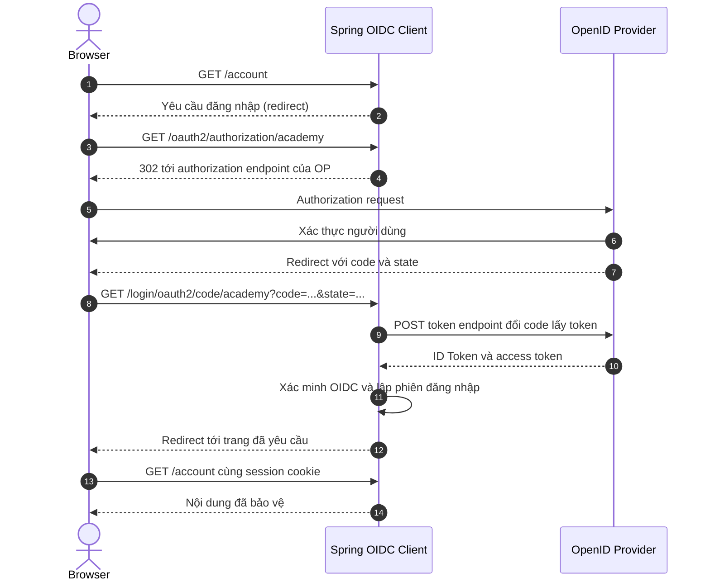

# 4.9. Cấu hình tối thiểu bằng application.yml hoặc application.properties

Để một ứng dụng **Spring Security OAuth 2.0 / OpenID Connect (OIDC) Client** đăng nhập qua nhà cung cấp danh tính, phần cấu hình thiết yếu thường nằm trong `application.yml` **hoặc** `application.properties` của Spring Boot. Bạn cần cho Spring Security biết **ứng dụng là client nào**, **sử dụng OpenID Provider (OP) nào**, **đề nghị những scope nào** và **nhận callback ở đâu**. Phần lớn công việc còn lại của Authorization Code Flow, bao gồm điều hướng trình duyệt, đổi authorization code và xử lý OIDC login, có thể giao cho Spring Security.

Bài học này sử dụng bối cảnh **Spring Boot 3.x, Spring Security 6.x và ứng dụng web Servlet/Spring MVC**. Các URL, client ID, secret và tên provider chỉ là ví dụ. Tên thuộc tính có thể còn được sử dụng ở các phiên bản gần kề, nhưng khi làm việc với một dự án cụ thể hãy đối chiếu tài liệu đúng phiên bản.

## 1. Đầu vào tối thiểu trước khi viết cấu hình

Giả sử có ứng dụng:

- **Spring application:** `http://localhost:8080` khi chạy local; khi triển khai dùng `https://app.example.com`.
- **Registration ID** trong Spring: `academy`. Đây là tên tùy chọn, giúp phân biệt từng OAuth2 Client Registration trong cùng ứng dụng.
- **OpenID Provider:** issuer minh họa `https://idp.example.com/realms/academy`.
- **Client ID:** giá trị do OP cấp khi đăng ký ứng dụng, ví dụ `academy-web`.
- **Client secret:** bí mật do OP cấp cho ứng dụng backend dạng **confidential client**; không ghi trực tiếp vào tài liệu hay Git.
- **Authorization grant:** `authorization_code`, có browser redirect và callback.
- **Scopes:** tối thiểu phải có `openid` để đây là **OIDC login**; có thể thêm `profile` và `email` khi cần.

Tại OP, ứng dụng phải được đăng ký callback URI tương ứng với nơi chạy. Với đường dẫn Spring Security mặc định:

```text
Local:
http://localhost:8080/login/oauth2/code/academy

Production:
https://app.example.com/login/oauth2/code/academy
```

OP thường yêu cầu danh sách **redirect URI cho phép**; URI được gửi trong authorization request phải khớp theo quy tắc của OP. Không tự cho phép redirect đến domain bất kỳ. Nhiều OP cho phép HTTP trên loopback để phát triển nhưng **môi trường public/production phải dùng HTTPS**.

Điều kiện cơ bản để ví dụ hoạt động:

1. Ứng dụng có dependency OAuth2 Client và phần web phù hợp.
2. OP hỗ trợ **OIDC Discovery** (có metadata từ issuer) và **Authorization Code Flow**.
3. Client ID/secret được cấp đúng cho OP và redirect URI của ứng dụng đã được cho phép.
4. Ứng dụng kết nối được tới issuer/authorization/token/JWKS endpoint qua TLS hợp lệ.
5. Có ít nhất một cơ chế `SecurityFilterChain` phù hợp để bật `oauth2Login()`, hoặc dùng cấu hình đăng nhập mặc định của Spring Boot khi chưa tự định nghĩa chain.

## 2. Dependency cho Spring Boot OIDC Client

Với Maven và dependency management của Spring Boot, dependency quan trọng nhất:

```xml
<dependency>
    <groupId>org.springframework.boot</groupId>
    <artifactId>spring-boot-starter-oauth2-client</artifactId>
</dependency>
```

Với ứng dụng Spring MVC, thường có thêm:

```xml
<dependency>
    <groupId>org.springframework.boot</groupId>
    <artifactId>spring-boot-starter-web</artifactId>
</dependency>
```

Với Gradle:

```groovy
dependencies {
    implementation 'org.springframework.boot:spring-boot-starter-web'
    implementation 'org.springframework.boot:spring-boot-starter-oauth2-client'
}
```

OAuth2 Client starter cung cấp những thành phần để cấu hình client registration, bắt đầu login, tiếp nhận authorization code và tích hợp OIDC. Nếu không có starter tương ứng, việc khai báo các property `spring.security.oauth2.client.*` **không tự làm xuất hiện** các filter và cơ chế OAuth2 Login.

> Phạm vi bài này là **website phía server dùng OIDC login**, có thể giữ session đăng nhập tại backend. Nếu ứng dụng là API thuần nhận `Authorization: Bearer <token>`, cần xem cấu hình **OAuth2 Resource Server**, không dùng cấu hình OIDC login như một sự thay thế.

## 3. Cách 1 — `application.yml`: phiên bản rõ ràng và dễ đọc

Tạo hoặc mở `src/main/resources/application.yml`:

```yaml
spring:
  security:
    oauth2:
      client:
        registration:
          academy:
            provider: academy-provider
            client-id: ${OIDC_CLIENT_ID}
            client-secret: ${OIDC_CLIENT_SECRET}
            authorization-grant-type: authorization_code
            scope:
              - openid
              - profile
              - email
            redirect-uri: "{baseUrl}/login/oauth2/code/{registrationId}"
        provider:
          academy-provider:
            issuer-uri: ${OIDC_ISSUER_URI}
```

Ở đây:

- `registration.academy` định nghĩa **một client registration**. `academy` chính là `registrationId` được dùng trong URL bắt đầu login và callback.
- `provider: academy-provider` chỉ đến nhóm `provider.academy-provider` phía dưới. Tên provider alias có thể khác tên registration.
- `client-id` và `client-secret` là credential của ứng dụng được OP cung cấp; các placeholder `${...}` được Spring Boot lấy từ nguồn cấu hình có sẵn, chẳng hạn environment variables.
- `authorization-grant-type: authorization_code` chọn luồng đổi code lấy token, phổ biến cho ứng dụng web OIDC.
- `scope` là danh sách scope yêu cầu. `openid` biến OAuth 2.0 authorization request thành OIDC authentication request; `profile` và `email` chỉ yêu cầu thông tin bổ sung khi OP cho phép.
- `redirect-uri` xác định callback của ứng dụng. `{baseUrl}` và `{registrationId}` là placeholder do **Spring Security** xử lý trong URI template; chúng khác với `${OIDC_CLIENT_ID}` do cơ chế cấu hình Spring xử lý.
- `issuer-uri` là **OIDC issuer identifier** do OP công bố. Spring Security có thể dùng issuer discovery để tìm authorization endpoint, token endpoint, JWKS URI và các metadata liên quan.

Giá trị `issuer-uri` **không phải URL trang đăng nhập tùy ý** và không mặc định chính là `/authorize` hay `/token`. Hãy lấy issuer chính xác từ tài liệu OP hoặc metadata, ví dụ một OP có thể công bố issuer có path `/realms/academy`. `issuer` trong metadata và claim `iss` của ID Token phải phù hợp với giá trị cấu hình.

### 3.1. Có thể viết scope ngắn hơn

Spring Boot hỗ trợ cấu hình danh sách theo YAML:

```yaml
scope: [openid, profile, email]
```

Hoặc giữ kiểu xuống dòng như ví dụ chính. Hai cách tương đương. Đặt toàn bộ nhiều scope thành một chuỗi không đúng định dạng có thể khiến OP nhận scope sai và trả `invalid_scope`.

### 3.2. Những trường nào thực sự có thể bỏ bớt?

Nếu muốn dùng đúng các mặc định của Spring Security, giá trị `redirect-uri` trong ví dụ có thể bỏ vì đường dẫn mặc định cho OAuth2 Login trên Servlet là:

```text
{baseUrl}/login/oauth2/code/{registrationId}
```

Tương tự, một số giá trị có thể được lấy từ thông tin provider hoặc quy ước của Spring Boot. Tuy vậy, trong bài học cấu hình đầu tiên, **khai báo tường minh `authorization-grant-type` và `redirect-uri`** giúp người đọc thấy rõ flow và callback. Khi rút gọn, chỉ xóa những property đã xác nhận được framework/provider cung cấp mặc định tương ứng.

Đối với confidential client, `client-secret` thường được OP yêu cầu. Nếu dùng public client không có khả năng giữ secret, cấu hình sẽ khác: `client-authentication-method: none`, PKCE và điều kiện hỗ trợ của OP; **không bỏ secret một cách tùy tiện khỏi ví dụ backend** rồi cho rằng flow vẫn giữ nguyên mức bảo vệ.

## 4. Cách 2 — `application.properties`: cấu hình tương đương

Nếu dự án dùng `src/main/resources/application.properties`, chuyển cấu trúc YAML thành các khóa có dấu chấm:

```properties
spring.security.oauth2.client.registration.academy.provider=academy-provider
spring.security.oauth2.client.registration.academy.client-id=${OIDC_CLIENT_ID}
spring.security.oauth2.client.registration.academy.client-secret=${OIDC_CLIENT_SECRET}
spring.security.oauth2.client.registration.academy.authorization-grant-type=authorization_code
spring.security.oauth2.client.registration.academy.scope=openid,profile,email
spring.security.oauth2.client.registration.academy.redirect-uri={baseUrl}/login/oauth2/code/{registrationId}

spring.security.oauth2.client.provider.academy-provider.issuer-uri=${OIDC_ISSUER_URI}
```

**Hai ví dụ YAML và properties mô tả cùng một client registration.** Chọn một định dạng mà dự án đang dùng để tránh các cấu hình chồng lấp khó theo dõi. Khi ứng dụng có cả `application.yml` và `application.properties`, Spring Boot có quy tắc thứ tự nguồn cấu hình; đừng dựa vào hai file chứa giá trị khác nhau cho cùng thuộc tính nếu không chủ ý quản lý độ ưu tiên.

So sánh nhanh:

| Cách viết | `application.yml` | `application.properties` |
| --- | --- | --- |
| Nhóm thuộc tính | Thụt lề theo cây `spring → security → oauth2` | Ghi đường dẫn khóa đầy đủ trên một dòng |
| Danh sách scope | `scope: [openid, profile, email]` hoặc YAML list | `scope=openid,profile,email` |
| Placeholder environment | `client-id: ${OIDC_CLIENT_ID}` | `client-id=${OIDC_CLIENT_ID}` |
| Callback template | `redirect-uri: "{baseUrl}/..."` | `redirect-uri={baseUrl}/...` |
| Phát sinh lỗi thường gặp | Sai mức thụt lề, tab, kiểu YAML | Gõ sai tên khóa, trùng khóa hoặc thiếu dấu phân cách |

YAML **phải dùng khoảng trắng để thụt lề**, tránh tab. Cấu trúc `provider` phải ngang cấp với `registration` trong `client`; nếu đặt `provider` vào bên trong `registration.academy`, Spring không còn nhìn thấy phần cấu hình như mong đợi.

## 5. Bí mật và biến môi trường: phần cần làm trước khi chạy

Trong ví dụ, Spring Boot tìm những biến:

```text
OIDC_CLIENT_ID
OIDC_CLIENT_SECRET
OIDC_ISSUER_URI
```

Giả sử giá trị thực do OP cung cấp là:

```text
OIDC_CLIENT_ID=academy-web
OIDC_CLIENT_SECRET=<secret-gia-lap-khong-su-dung-that>
OIDC_ISSUER_URI=https://idp.example.com/realms/academy
```

Đây chỉ là ví dụ minh họa tên biến và URI. Khi chạy ứng dụng phải thay bằng giá trị thực của môi trường; tránh chia sẻ client secret qua chat, tài liệu công khai hoặc commit.

Ví dụ **Windows PowerShell**, gán biến trong shell chỉ cho tiến trình hiện tại và các tiến trình con của nó:

```powershell
$env:OIDC_CLIENT_ID = "academy-web"
$env:OIDC_CLIENT_SECRET = "<secret-thuc-tu-op>"
$env:OIDC_ISSUER_URI = "https://idp.example.com/realms/academy"

# Chạy ứng dụng từ shell này bằng Maven Wrapper nếu dự án dùng Maven:
./mvnw.cmd spring-boot:run
```

Ví dụ **bash/zsh** trên Linux hoặc macOS:

```bash
export OIDC_CLIENT_ID='academy-web'
export OIDC_CLIENT_SECRET='<secret-thuc-tu-op>'
export OIDC_ISSUER_URI='https://idp.example.com/realms/academy'

# Nếu dự án có Maven Wrapper:
./mvnw spring-boot:run
```

Chỉ chạy khi đã thay các chuỗi giả lập bằng thông tin hợp lệ. Với Gradle, có thể dùng `./gradlew bootRun` hoặc `gradlew.bat bootRun` tùy hệ điều hành.

### 5.1. Vì sao dùng `${OIDC_CLIENT_SECRET}`?

Spring Boot xử lý placeholder bằng hệ thống **Externalized Configuration**. Điều này cho phép cùng mã nguồn chạy trên local, staging và production với những giá trị khác nhau. Client secret có thể được cấp qua:

- Environment variables ở tiến trình ứng dụng.
- Secret manager / cơ chế cấp secret của nền tảng triển khai.
- Một nguồn cấu hình bảo mật được quản lý ngoài Git.

Không đưa secret thực vào `application.yml`/`application.properties` đã commit, ảnh chụp màn hình hoặc log. Một file `.env` chứa biến **không tự động được Spring Boot nạp chỉ vì nó nằm cạnh `application.yml`**; phải có cơ chế tải biến môi trường hoặc tích hợp cấu hình tương ứng.

Nếu placeholder bắt buộc chưa có giá trị, quá trình khởi tạo/binding của ứng dụng có thể thất bại. Điều này tốt hơn việc vô tình khởi động với client ID hoặc secret rỗng mà khó phát hiện. Cũng không nên đặt secret giả làm fallback trong production như `${OIDC_CLIENT_SECRET:demo}`.

### 5.2. Phân biệt ID, secret và issuer

| Biến/khóa | Bản chất | Có thể công khai? |
| --- | --- | --- |
| `client-id` | Định danh của OAuth2 client khi đăng ký với OP | Thường không phải bí mật |
| `client-secret` | Credential để backend xác thực client với OP | **Không**; phải bảo vệ |
| `issuer-uri` | Định danh issuer và nguồn tra cứu metadata của OP | Thường công khai, nhưng phải là nguồn đáng tin cậy |
| `registrationId` | Bí danh nội bộ của Spring như `academy` | Không phải credential |
| `redirect-uri` | Endpoint callback của ứng dụng | Public URL, nhưng phải được đăng ký/kiểm soát |

Không nhầm **client secret** với **authorization code**, **access token**, **ID Token** hoặc **session cookie**. Mỗi giá trị được dùng ở một bước khác nhau và có yêu cầu bảo mật riêng.

## 6. Spring Security sử dụng những property này ra sao?

Spring Boot bind các khóa `spring.security.oauth2.client.registration.*` thành cấu hình client registration mà Spring Security dùng trong quá trình login. Khi OP hỗ trợ discovery theo issuer, các metadata cần thiết được truy xuất dựa trên `issuer-uri`.

Một chu trình ở cấu hình ví dụ:



Hai endpoint quan trọng thường có sẵn qua filter Spring Security:

| URL | Nhiệm vụ |
| --- | --- |
| `GET /oauth2/authorization/academy` | Bắt đầu OAuth2/OIDC login với registration ID `academy`. |
| `GET /login/oauth2/code/academy` | Tiếp nhận authorization code callback (response mode `query`). |
| `GET /login` | Trang đăng nhập do Spring Security cung cấp mặc định trong một số cấu hình nếu chưa tạo trang riêng. |

Không cần viết controller cho callback mặc định. Spring Security dùng các filter để liên kết authorization response với request ban đầu (ví dụ qua `state`), trao đổi code, xác minh ID Token và tạo đối tượng `Authentication`/principal theo cơ chế OIDC.

**Callback endpoint cần khớp cấu hình.** Với `registrationId=academy`, callback mặc định thường là `/login/oauth2/code/academy`, không phải `/login/oauth2/code/academy-provider`. `academy-provider` chỉ là provider alias dùng trong property.

## 7. Có cần tự viết `SecurityFilterChain` không?

### 7.1. Khi chưa có cấu hình security riêng

Với ứng dụng Spring Boot Servlet cơ bản có starter OAuth2 Client và registration hợp lệ, Spring Boot có thể cấu hình các thành phần bảo mật mặc định cho OAuth2 Login nếu ứng dụng **chưa tự định nghĩa bean `SecurityFilterChain`**. Đây là cách nhanh để thử đăng nhập và kiểm tra client registration.

Tuy nhiên, với ứng dụng thực tế, thường bạn muốn phân định URL public và URL cần xác thực. Khi đó hãy tạo một chain rõ ràng.

### 7.2. Khi đã có `SecurityFilterChain`

Ví dụ Java:

```java
import org.springframework.context.annotation.Bean;
import org.springframework.context.annotation.Configuration;
import org.springframework.security.config.Customizer;
import org.springframework.security.config.annotation.web.builders.HttpSecurity;
import org.springframework.security.web.SecurityFilterChain;

@Configuration
public class SecurityConfig {

    @Bean
    SecurityFilterChain securityFilterChain(HttpSecurity http) throws Exception {
        http
            .authorizeHttpRequests(auth -> auth
                .requestMatchers("/", "/error", "/assets/**").permitAll()
                .anyRequest().authenticated()
            )
            .oauth2Login(Customizer.withDefaults());

        return http.build();
    }
}
```

Nếu bạn tự định nghĩa `SecurityFilterChain` mà quên `oauth2Login()`, các property client registration **không tự bảo đảm** rằng ứng dụng sẽ xử lý OIDC login như mong muốn. Với ứng dụng nhiều chain, phải xác định request matcher và thứ tự chain sao cho các endpoint `/oauth2/authorization/**` và `/login/oauth2/code/**` được xử lý bởi chain có OAuth2 Login.

Không tắt `csrf()` chỉ để một demo login chạy được. `state` của OAuth2 và CSRF protection cho form/request dùng session bảo vệ những vấn đề khác nhau.

### 7.3. Đọc thông tin người dùng đã đăng nhập

Khi flow đã cấu hình đúng, một controller Spring MVC có thể nhận OIDC principal:

```java
import java.util.Map;

import org.springframework.security.core.annotation.AuthenticationPrincipal;
import org.springframework.security.oauth2.core.oidc.user.OidcUser;
import org.springframework.web.bind.annotation.GetMapping;
import org.springframework.web.bind.annotation.RestController;

@RestController
public class MeController {

    @GetMapping("/me")
    public Map<String, String> me(@AuthenticationPrincipal OidcUser user) {
        return Map.of(
            "subject", user.getSubject(),
            "name", user.getFullName() != null
                ? user.getFullName() : "(không được cung cấp)"
        );
    }
}
```

Đoạn code giả định endpoint chỉ cho phép người dùng đã đăng nhập **bằng OIDC**; nếu ứng dụng còn hỗ trợ cơ chế xác thực khác, cần xử lý kiểu principal tương ứng. Không đưa nguyên ID Token, access token, refresh token hoặc các claim nhạy cảm ra response.

## 8. Thử cấu hình trên môi trường local

Sau khi OP đã đăng ký callback và ứng dụng chạy thành công, có thể đi theo trình tự sau:

1. Mở một cửa sổ browser sạch hoặc private window để dễ nhận biết phiên đăng nhập mới.
2. Truy cập `http://localhost:8080/oauth2/authorization/academy`. Browser phải được điều hướng tới authorization endpoint của issuer đã cấu hình.
3. Quan sát authorization request ở Network tab: có `client_id` đúng, `redirect_uri` đúng, `response_type=code`, `scope` chứa `openid` và `state` không rỗng.
4. Đăng nhập tại OP bằng tài khoản thử nghiệm; chấp nhận consent nếu OP yêu cầu.
5. Browser phải quay về `http://localhost:8080/login/oauth2/code/academy` cùng authorization code và state. Spring Security xử lý callback và thiết lập phiên.
6. Truy cập `/me` hoặc URL cần xác thực để thấy ứng dụng nhận diện principal OIDC.

Đối với client dùng PKCE, request đi tới OP còn có thể có `code_challenge` và `code_challenge_method=S256`. **Không suy ra PKCE chắc chắn đã bật chỉ từ việc OAuth2 Login hoạt động**; cơ chế bật PKCE tùy loại client, phiên bản Spring Security, customizer và yêu cầu của OP. Nếu OP bắt buộc PKCE, hãy cấu hình/kiểm chứng nó đúng cách; không bỏ qua yêu cầu bảo vệ của OP.

### 8.1. Spring Security phải thấy đúng issuer

OIDC metadata thường được phát hiện từ issuer bằng các quy tắc well-known discovery, chẳng hạn tài liệu metadata mà OP công bố. Kết quả thường có:

```json
{
  "issuer": "https://idp.example.com/realms/academy",
  "authorization_endpoint": "https://idp.example.com/realms/academy/protocol/openid-connect/auth",
  "token_endpoint": "https://idp.example.com/realms/academy/protocol/openid-connect/token",
  "jwks_uri": "https://idp.example.com/realms/academy/protocol/openid-connect/certs"
}
```

Đây là **ví dụ cấu trúc** của metadata, không khẳng định các đường dẫn tương ứng là bắt buộc ở mọi OP. Khi OP có discovery hoạt động, bạn thường **không cần tự nhập từng endpoint** trong `application.yml`. Nếu discovery không được hỗ trợ, các endpoint có thể phải cấu hình tường minh theo khả năng của Spring Security và tài liệu OP; khi đó không còn là biến thể issuer-only đơn giản của bài học.

### 8.2. Tại sao local cần callback chính xác?

Giả sử ứng dụng chạy cổng 8080 nhưng ở OP chỉ đăng ký:

```text
http://localhost:9090/login/oauth2/code/academy
```

Dù `client-id` và `client-secret` đúng, OP vẫn có thể trả lỗi `redirect_uri_mismatch` hoặc `invalid_redirect_uri` vì ứng dụng gửi `http://localhost:8080/login/oauth2/code/academy`. Thay port, hostname, scheme hay context path đều ảnh hưởng URI; hãy so **URI thực tế xuất hiện trong authorization request** với allowlist ở OP.

## 9. Những cấu hình chỉ thêm khi có nhu cầu

Mục tiêu là bắt đầu từ **cấu hình tối thiểu** rồi bổ sung trường cần thiết theo yêu cầu của ứng dụng hoặc OP.

### 9.1. Khi OP yêu cầu phương thức client authentication cụ thể

Thông thường confidential client dùng một trong các cơ chế như `client_secret_basic` hoặc `client_secret_post`. Nếu OP chỉ hỗ trợ một kiểu cụ thể, có thể khai báo dưới registration:

**YAML:**

```yaml
spring:
  security:
    oauth2:
      client:
        registration:
          academy:
            client-authentication-method: client_secret_basic
```

**Properties:**

```properties
spring.security.oauth2.client.registration.academy.client-authentication-method=client_secret_basic
```

Hai đoạn chỉ minh họa **khóa bổ sung** cho cấu hình đầy đủ ở phần 3/4, không đủ để hoạt động một mình. Chọn đúng phương thức OP và loại client đã đăng ký. Không tự chuyển `client_secret_basic` sang `client_secret_post` để tránh lỗi khi chưa biết nguyên nhân.

### 9.2. Khi không dùng discovery qua issuer

Có OP hỗ trợ OAuth2 nhưng không cung cấp OIDC discovery đầy đủ hoặc có các endpoint tùy biến. Spring Security hỗ trợ khai báo provider endpoint tường minh, chẳng hạn:

```yaml
spring:
  security:
    oauth2:
      client:
        provider:
          academy-provider:
            authorization-uri: https://idp.example.com/oauth2/authorize
            token-uri: https://idp.example.com/oauth2/token
            jwk-set-uri: https://idp.example.com/oauth2/keys
            user-info-uri: https://idp.example.com/oidc/userinfo
            user-name-attribute: sub
```

Các URI trên chỉ là ví dụ. **Không sử dụng cấu hình endpoint giả này như cấu hình production.** Với OIDC, phải bảo đảm dữ liệu issuer, thuật toán xác minh ID Token và endpoint phù hợp với provider thật; khi có discovery, dùng `issuer-uri` là hướng đơn giản và giảm sai lệch giữa các URL.

Nếu dùng client thuần OAuth2 không có `openid`, ứng dụng có thể nhận `OAuth2User` thay vì `OidcUser`. OAuth2 Login và OIDC Login không hoàn toàn đồng nghĩa.

### 9.3. Khi ứng dụng chạy sau reverse proxy

Ứng dụng public có thể là `https://app.example.com` nhưng backend nội bộ nhận HTTP trên `localhost:8080`. Nếu Spring suy ra `{baseUrl}` sai, authorization request có thể chứa callback `http://localhost:8080/login/oauth2/code/academy` thay vì HTTPS public URL.

Ví dụ Spring Boot có thể cần:

```yaml
server:
  forward-headers-strategy: framework
  servlet:
    session:
      cookie:
        secure: true
        http-only: true
        same-site: lax
```

Chỉ dùng thiết lập forwarded headers với **reverse proxy tin cậy**, đã loại bỏ/ghi đè header do client bên ngoài giả mạo. Cookie `SameSite=Lax` thường phù hợp với callback top-level GET; nếu OP dùng `form_post`, cần xem xét chính sách cookie phù hợp với response mode. Đây là các quyết định triển khai, không phải thuộc tính bắt buộc cho ví dụ local tối thiểu.

### 9.4. Khi có nhiều OIDC provider

Mỗi nhà cung cấp có thể có một `registrationId` và `provider` riêng:

```yaml
spring:
  security:
    oauth2:
      client:
        registration:
          academy:
            provider: academy-provider
            client-id: ${ACADEMY_CLIENT_ID}
            client-secret: ${ACADEMY_CLIENT_SECRET}
            scope: [openid, profile]
            authorization-grant-type: authorization_code
          partner:
            provider: partner-provider
            client-id: ${PARTNER_CLIENT_ID}
            client-secret: ${PARTNER_CLIENT_SECRET}
            scope: [openid, profile]
            authorization-grant-type: authorization_code
        provider:
          academy-provider:
            issuer-uri: ${ACADEMY_ISSUER_URI}
          partner-provider:
            issuer-uri: ${PARTNER_ISSUER_URI}
```

Khi đó hai URL bắt đầu login khác nhau:

```text
/oauth2/authorization/academy
/oauth2/authorization/partner
```

Callback tương ứng theo mặc định là `/login/oauth2/code/academy` và `/login/oauth2/code/partner`. Mỗi registration phải được đăng ký callback và credential đúng ở OP của nó. Đây là **mở rộng**, không phải cấu hình cần thiết cho một provider duy nhất.

## 10. Dùng profile để tách local, staging và production

Spring Boot cho phép đặt các giá trị theo profile, chẳng hạn `application-local.yml`, `application-staging.yml` hoặc `application-prod.yml`. Phần thuộc tính chung như client registration ID, scope hay redirect template có thể đặt ở `application.yml`; chỉ những giá trị thay đổi theo môi trường mới cần override.

Ví dụ một phần cấu hình chỉ dành cho local:

```yaml
# application-local.yml
server:
  port: 8080

logging:
  level:
    org.springframework.security: INFO
```

Chạy với profile `local` thông qua `spring.profiles.active=local` hoặc môi trường `SPRING_PROFILES_ACTIVE=local`. **Đừng đặt client secret thật trong các file profile được commit**. Secret vẫn nên đến từ biến môi trường/secret manager tương ứng.

Các nguồn cấu hình trong Spring Boot có **thứ tự ưu tiên**, ví dụ environment và command-line có thể ghi đè những giá trị trong file cấu hình. Để tránh khó debug, chỉ có một nguồn định nghĩa rõ ràng cho mỗi thông số bí mật trong từng môi trường và biết chính xác nguồn nào đang được dùng.

## 11. Những lỗi cấu hình thường gặp

| Triệu chứng | Điểm cần kiểm tra | Ví dụ nguyên nhân và cách xử lý |
| --- | --- | --- |
| Ứng dụng không khởi động vì không tìm thấy cấu hình | Placeholder/environment | `OIDC_CLIENT_ID` hoặc `OIDC_ISSUER_URI` chưa được cung cấp; environment không được nạp vào tiến trình thực tế. |
| Bấm đăng nhập nhưng không đến OP | Starter, filter chain, URL | Thiếu `spring-boot-starter-oauth2-client`, tự viết `SecurityFilterChain` quên `oauth2Login()` hoặc gọi nhầm registration ID. |
| OP trả `invalid_client` | Client ID/secret, phương thức xác thực | Secret sai, client đăng ký nhầm tenant, client authentication method không đúng hoặc client chưa được cấp quyền dùng grant. |
| OP trả `invalid_redirect_uri` | `redirect-uri` và danh sách cho phép | Sai host/port/path/scheme, proxy làm Spring tính `{baseUrl}` không đúng. |
| OP trả `invalid_scope` | `scope` | Scope không được provider cho phép, khai báo sai cú pháp hoặc thiếu cấu hình ứng dụng tại OP. |
| OP báo không hỗ trợ flow | `authorization-grant-type` | Client chưa bật Authorization Code Flow hoặc OP yêu cầu PKCE mà client chưa gửi challenge. |
| Lỗi discovery / issuer không trùng | `issuer-uri`, metadata | Issuer sai, sai tenant/path, metadata không truy cập được hoặc `iss` của ID Token không khớp. |
| SSL handshake thất bại | HTTPS/TLS | Chứng chỉ hết hạn, hostname sai hoặc trust store thiếu CA thích hợp; không vô hiệu hóa kiểm tra TLS. |
| Callback trả lỗi state/session | Session cookie, load balancing | Cookie không quay về, session hết hạn, SameSite/Path không phù hợp, nhiều instance không chia sẻ session. |
| Login thành công nhưng lại hỏi login | Lưu phiên và `SecurityContext` | Session không duy trì được, cookie `Secure`/domain sai hoặc chain tùy biến không phù hợp. |
| Đăng nhập OIDC được nhưng gọi API thất bại | OAuth2 Client vs Resource Server | API cần access token/audience/scope riêng; session cookie và ID Token không tự thay cho access token. |

Trong quá trình debug có thể xem log cấu hình và các bước redirect, nhưng **tránh log giá trị `client-secret`, `Authorization: Bearer`, code callback, ID Token, refresh token, session ID hoặc `code_verifier`**. Khi cần gửi log để hỗ trợ, hãy che thông tin nhạy cảm trước.

## 12. Bài thực hành nhỏ

### Bài tập A — Chuyển YAML sang properties

Cho đoạn:

```yaml
spring:
  security:
    oauth2:
      client:
        registration:
          training:
            client-id: ${TRAINING_CLIENT_ID}
            scope: [openid, profile]
```

Bản `application.properties` tương đương:

```properties
spring.security.oauth2.client.registration.training.client-id=${TRAINING_CLIENT_ID}
spring.security.oauth2.client.registration.training.scope=openid,profile
```

Đây là **trích đoạn để luyện cú pháp**, chưa đủ để tạo client hoạt động nếu không có provider, thông tin grant và cấu hình cần thiết khác.

### Bài tập B — Đổi registration ID từ `academy` thành `training`

Nếu thay:

```yaml
registration:
  training:
    provider: academy-provider
```

thì điểm bắt đầu đăng nhập mặc định đổi thành:

```text
/oauth2/authorization/training
```

Và callback mặc định thành:

```text
/login/oauth2/code/training
```

Tên `academy-provider` vẫn có thể giữ vì đó là provider alias. **Nhớ cập nhật danh sách redirect URI tại OP** nếu callback mới được dùng.

### Bài tập C — Bỏ scope `openid`

Nếu cấu hình chỉ có `profile` và `email`, đây **không còn là yêu cầu OIDC login chuẩn**. Spring Security có thể xử lý theo hướng OAuth2 Login nếu provider hỗ trợ, nhưng không thể mặc định có ID Token hoặc `OidcUser`. Muốn học và kiểm chứng OIDC, luôn bắt đầu bằng `openid`.

### Bài tập D — Viết đúng callback production

Ứng dụng chạy public ở `https://portal.example.com`, registration ID là `sso` và dùng redirect URI template mặc định. Callback cần đăng ký với OP là:

```text
https://portal.example.com/login/oauth2/code/sso
```

Không dùng host nội bộ của container hoặc port 8080 nếu đó không phải URL public. Nếu ứng dụng có context path hoặc proxy rewrite đặc biệt, phải kiểm tra URL thực sự được phát ra trong authorization request.

## 13. Gợi ý cấu hình xuất phát cho dự án mới

Với **một OIDC provider có issuer discovery** và **confidential web client**, có thể bắt đầu bằng đúng một trong hai biến thể sau.

**`application.yml`:**

```yaml
spring:
  security:
    oauth2:
      client:
        registration:
          academy:
            provider: academy-provider
            client-id: ${OIDC_CLIENT_ID}
            client-secret: ${OIDC_CLIENT_SECRET}
            authorization-grant-type: authorization_code
            scope: [openid, profile, email]
            redirect-uri: "{baseUrl}/login/oauth2/code/{registrationId}"
        provider:
          academy-provider:
            issuer-uri: ${OIDC_ISSUER_URI}
```

**`application.properties`:**

```properties
spring.security.oauth2.client.registration.academy.provider=academy-provider
spring.security.oauth2.client.registration.academy.client-id=${OIDC_CLIENT_ID}
spring.security.oauth2.client.registration.academy.client-secret=${OIDC_CLIENT_SECRET}
spring.security.oauth2.client.registration.academy.authorization-grant-type=authorization_code
spring.security.oauth2.client.registration.academy.scope=openid,profile,email
spring.security.oauth2.client.registration.academy.redirect-uri={baseUrl}/login/oauth2/code/{registrationId}
spring.security.oauth2.client.provider.academy-provider.issuer-uri=${OIDC_ISSUER_URI}
```

Sau khi cấp ba biến môi trường, đăng ký callback đúng ở OP và bảo đảm Spring Security xử lý `oauth2Login()`, bạn có thể bắt đầu từ `/oauth2/authorization/academy` rồi xác nhận kết quả ở một URL cần đăng nhập. Khi cần mở rộng, hãy thay đổi từng yếu tố một: phạm vi quyền, redirect URI, provider, phương thức client authentication, PKCE, session/cookie hoặc reverse proxy.

### Tài liệu chính thức để tra cứu thêm

- [Spring Boot Reference — OAuth2 Client](https://docs.spring.io/spring-boot/reference/web/spring-security.html), phần cấu hình OAuth2 Client.
- [Spring Security Reference — OAuth 2.0 Login](https://docs.spring.io/spring-security/reference/servlet/oauth2/login/index.html).
- [Spring Security Reference — OAuth 2.0 Client](https://docs.spring.io/spring-security/reference/servlet/oauth2/client/index.html).
- [Spring Security Reference — OAuth2 Login Advanced](https://docs.spring.io/spring-security/reference/servlet/oauth2/login/advanced.html), tùy chỉnh login và authorization endpoint.
- [OpenID Connect Discovery 1.0](https://openid.net/specs/openid-connect-discovery-1_0.html), metadata và issuer discovery.
- [OpenID Connect Core 1.0](https://openid.net/specs/openid-connect-core-1_0.html), Authorization Code Flow, scope `openid` và ID Token.
