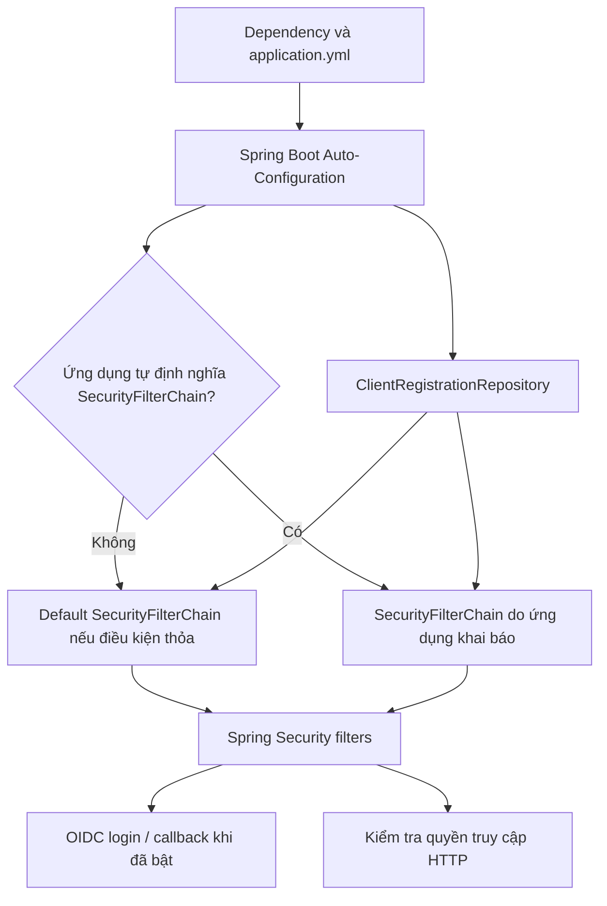
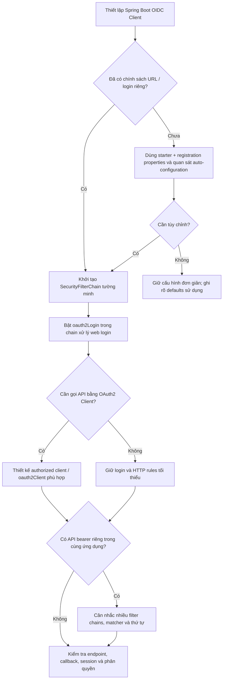

# 4.10. Đối chiếu auto-configuration và cấu hình Security tường minh

> **Module:** Spring Security OAuth 2.0 OIDC Client  
> **Chương:** 4. Thiết lập dự án  
> **Trọng tâm:** Hiểu Spring Boot tự cấu hình những gì khi dùng OAuth 2.0/OIDC Client, điều gì thay đổi khi khai báo `SecurityFilterChain`, và cách chuyển từ cấu hình mặc định sang cấu hình chủ động mà vẫn giữ đúng luồng đăng nhập.

Khi xây dựng ứng dụng Spring Boot đăng nhập qua OpenID Connect (OIDC), bạn có thể bắt đầu với dependency và vài thuộc tính trong `application.yml`. Ứng dụng đã có thể chuyển hướng người dùng đến nhà cung cấp danh tính và xử lý callback dù chưa viết lớp cấu hình bảo mật.

Tuy nhiên, khi cần mở trang công khai, giới hạn đường dẫn quản trị, dùng trang đăng nhập riêng, gọi API bằng access token hoặc phân chia nhiều `SecurityFilterChain`, ứng dụng thường phải khai báo cấu hình Security tường minh. Lúc này, một thay đổi nhỏ như bổ sung bean `SecurityFilterChain` có thể làm mất hành vi đăng nhập OIDC mà trước đó Spring Boot cung cấp mặc định nếu bạn quên gọi `oauth2Login()`.

Bài học trình bày hai cách cấu hình như **hai mức điều khiển của cùng hệ thống**. Auto-configuration giúp tạo các thành phần phù hợp khi điều kiện thỏa mãn; cấu hình Security tường minh quyết định chính sách HTTP và những cơ chế đăng nhập/ủy quyền được bật trong filter chain.

## 1. Mục tiêu học tập

Sau bài này, bạn có thể:

1. Nhận diện vai trò của **Spring Boot auto-configuration**, **Spring Security**, và các thuộc tính `spring.security.oauth2.client.*`.
2. Phân biệt đăng ký OAuth 2.0 Client (`ClientRegistration`) với cấu hình bảo vệ HTTP (`SecurityFilterChain`).
3. Giải thích vì sao khai báo một bean `SecurityFilterChain` thường khiến Spring Boot nhường quyền định nghĩa chuỗi filter mặc định cho ứng dụng.
4. Giữ nguyên OIDC login khi thay đổi chính sách truy cập bằng `authorizeHttpRequests()` và `oauth2Login()`.
5. Phân biệt `oauth2Login()` với `oauth2Client()`, tránh nghĩ rằng bật Client để gọi API sẽ tự bật đăng nhập người dùng.
6. Thiết kế chuỗi filter phù hợp cho ứng dụng web và API, đồng thời tránh bỏ sót callback, login URL và đường dẫn không được bảo vệ.
7. Kiểm tra hành vi thực tế bằng điều hướng browser, log có kiểm soát và dấu hiệu của các bean trong ApplicationContext.

## 2. Ba lớp cấu hình cần tách rõ

Không nên gộp toàn bộ chức năng OAuth 2.0/OIDC Client vào một khái niệm “Spring Security đã cấu hình”. Có ít nhất ba lớp phối hợp với nhau.

| Lớp | Ví dụ | Quyết định chính |
|---|---|---|
| **Dependency / classpath** | `spring-boot-starter-oauth2-client`, `spring-boot-starter-security` | Những tính năng và loại bean nào có thể được tự cấu hình |
| **Client registration / provider metadata** | `spring.security.oauth2.client.registration.corp.*`; `provider.corp.issuer-uri` | Client đăng ký với OP nào, dùng client ID, redirect URI và scope gì |
| **HTTP Security / filter chain** | Bean `SecurityFilterChain` với `authorizeHttpRequests()` và `oauth2Login()` | Endpoint nào cần xác thực; request nào được redirect login; luồng login và filter nào có hiệu lực |

Bên dưới, Spring Security xây dựng `FilterChainProxy` và các security filter phù hợp để xử lý request. Spring Boot giúp kết nối dependency, cấu hình properties và các bean mặc định khi điều kiện cho phép.

Mối quan hệ có thể hình dung như sau:



**Điểm quan trọng:** cung cấp `SecurityFilterChain` riêng thường thay thế **chuỗi filter mặc định** do Boot tạo, nhưng **không đồng nghĩa xóa cấu hình client registration từ properties**. Nếu vẫn để Boot tạo `ClientRegistrationRepository` từ cấu hình hợp lệ, bean ấy tiếp tục có thể được `oauth2Login()` và `oauth2Client()` sử dụng trong chain tường minh.

## 3. Auto-configuration là gì trong trường hợp này?

Spring Boot sử dụng các lớp tự cấu hình và những điều kiện như có class/dependency phù hợp, có thuộc tính tương ứng, hoặc **chưa có bean do người dùng định nghĩa**. Mục tiêu là có một cấu hình chạy được ngay với ít mã nguồn.

Với ứng dụng **Servlet Spring MVC** trên Spring Boot 3.x / Spring Security 6.x, ví dụ điển hình là:

- Khi Spring Security có trên classpath, Boot có cơ chế bảo vệ HTTP mặc định nếu ứng dụng chưa tự cung cấp `SecurityFilterChain`.
- Khi OAuth 2.0 Client được cấu hình đúng với các client registrations, Boot và Spring Security có thể kích hoạt luồng OAuth 2.0/OIDC login mặc định trong ứng dụng web.
- Từ `spring.security.oauth2.client.registration.*` và `provider.*`, Boot có thể tạo `ClientRegistrationRepository` phù hợp.
- Spring Security dùng các thành phần client để xây dựng authorization request, xử lý callback, trao đổi authorization code và quản lý đối tượng đã được xác thực khi cơ chế login được bật.

Chi tiết bean nào thuộc Boot hoặc Spring Security, và các điều kiện kích hoạt, có thể thay đổi theo phiên bản. Bài này lấy **Spring Boot 3.x và Spring Security 6.x (Servlet stack)** làm bối cảnh minh họa; khi dùng Spring Boot 4.x hoặc nhánh khác, phải đối chiếu reference documentation của đúng nhánh.

### 3.1. Spring Boot quyết định dựa trên điều kiện, không “đọc ý định” của lập trình viên

Ví dụ bạn khai báo:

```java
@Bean
SecurityFilterChain securityFilterChain(HttpSecurity http) throws Exception {
    return http.build();
}
```

Dù chỉ vài dòng, đây vẫn là một bean `SecurityFilterChain` do ứng dụng cung cấp. Việc Boot nhường quyền tạo default chain không phụ thuộc vào việc đoạn mã “đã đủ bảo mật” hay chưa.

Đoạn ví dụ trên **không phải mẫu cấu hình hoàn chỉnh**: nó không chủ động đặt quy tắc bảo vệ endpoint hoặc bật login. Nó chỉ minh họa một nguyên nhân thường gặp khiến người học tưởng Spring Boot “tự nhiên ngừng OAuth login” sau khi thêm lớp cấu hình.

Do đó, cần hiểu nguyên tắc: **khi tự cung cấp chain, bạn chịu trách nhiệm khai báo cơ chế và quy tắc của chain đó**.

### 3.2. Auto-configuration khác với các giá trị mặc định của Spring Security

Hai khái niệm thường bị nhầm:

- **Spring Boot auto-configuration:** quyết định có tạo các bean mặc định hay không, dựa trên classpath, thuộc tính và bean đang tồn tại.
- **Spring Security defaults:** khi một cấu hình như `oauth2Login(Customizer.withDefaults())` được gọi, Spring Security thêm các filter và sử dụng các giá trị mặc định của tính năng đó, trừ khi ứng dụng tùy chỉnh.

Một chain tường minh vẫn có thể dùng **rất nhiều default của Spring Security**. Tường minh không bắt buộc phải cấu hình thủ công từng endpoint OAuth hoặc từng filter.

## 4. Chuẩn bị dự án mẫu chung cho hai phương án

Để so sánh công bằng, dùng chung một dự án Spring Boot web và cùng một OIDC Provider. Đặt giả thiết phòng lab:

| Thành phần | Giá trị minh họa |
|---|---|
| Web Client | `http://localhost:8080` |
| OIDC Provider / issuer | `http://localhost:9000/realms/learning` |
| Registration ID | `learning` |
| Client ID | `spring-web-client` |
| Redirect URI được đăng ký | `http://localhost:8080/login/oauth2/code/learning` |
| Scope | `openid`, `profile`, `email` |

Đây chỉ là tên và cổng dùng để học. Nhà cung cấp danh tính (IdP/OP) thực tế có thể dùng URL, đường dẫn issuer, yêu cầu client authentication, scope và cách cấp token khác. Trong môi trường không phải localhost, sử dụng HTTPS.

### 4.1. Dependencies

Ví dụ Maven, không ghim version nếu dự án đã quản lý phiên bản qua Spring Boot parent/BOM:

```xml
<dependencies>
    <dependency>
        <groupId>org.springframework.boot</groupId>
        <artifactId>spring-boot-starter-web</artifactId>
    </dependency>
    <dependency>
        <groupId>org.springframework.boot</groupId>
        <artifactId>spring-boot-starter-security</artifactId>
    </dependency>
    <dependency>
        <groupId>org.springframework.boot</groupId>
        <artifactId>spring-boot-starter-oauth2-client</artifactId>
    </dependency>
</dependencies>
```

Ở một số dự án, starter OAuth 2.0 Client đã kéo theo các dependency Spring Security cần thiết. Việc ghi rõ starter security ở đây làm rõ mục tiêu học tập. Nếu dùng WebFlux, cách cấu hình dùng `SecurityWebFilterChain` và API reactive khác; không sao chép nguyên bean `HttpSecurity` của Servlet sang WebFlux.

### 4.2. Registration bằng properties

File `src/main/resources/application.yml`:

```yaml
server:
  port: 8080

spring:
  security:
    oauth2:
      client:
        registration:
          learning:
            provider: learning
            client-id: spring-web-client
            client-secret: ${OIDC_CLIENT_SECRET}
            authorization-grant-type: authorization_code
            redirect-uri: "{baseUrl}/login/oauth2/code/{registrationId}"
            scope:
              - openid
              - profile
              - email
        provider:
          learning:
            issuer-uri: http://localhost:9000/realms/learning
```

Tại OP, đăng ký client ID và redirect URI tương ứng, tạo tài khoản thử nghiệm và cung cấp `OIDC_CLIENT_SECRET` qua biến môi trường hoặc secret manager. Không lưu client secret thật trong Git.

Các phần cần hiểu:

- `registration.learning` xác định đăng ký Client có ID `learning`.
- `provider.learning.issuer-uri` xác định OP và hỗ trợ discovery OIDC khi provider công bố metadata hợp lệ.
- `scope: openid` làm yêu cầu đăng nhập dùng OIDC, thay vì chỉ OAuth 2.0.
- `redirect-uri` dùng placeholder Spring Security, tạo callback mặc định theo registration ID.
- Client registration xác định thông số **giao thức với OP**, không quyết định rằng `/admin` được phép truy cập hay không.

Nếu OP không khởi động, issuer URI không truy cập được hoặc metadata sai, quá trình khám phá provider có thể thất bại. Đó là vấn đề cấu hình provider, không nhất thiết là lỗi `authorizeHttpRequests()`.

### 4.3. Controller quan sát

Để nhìn rõ khác biệt giữa một trang công khai và trang yêu cầu đăng nhập, dùng controller tối giản:

```java
package example.web;

import java.util.Map;
import org.springframework.security.core.annotation.AuthenticationPrincipal;
import org.springframework.security.oauth2.core.oidc.user.OidcUser;
import org.springframework.web.bind.annotation.GetMapping;
import org.springframework.web.bind.annotation.RestController;

@RestController
class DemoController {

    @GetMapping("/")
    String home() {
        return "Public home";
    }

    @GetMapping("/me")
    Map<String, String> me(@AuthenticationPrincipal OidcUser user) {
        return Map.of(
            "subject", user.getSubject(),
            "issuer", user.getIdToken().getIssuer().toString()
        );
    }

    @GetMapping("/admin")
    String admin() {
        return "Admin area";
    }
}
```

Trong bài này `/me` được dùng sau OIDC login thành công. Nếu sau này cho phép kiểu xác thực khác hoặc endpoint này có thể được gọi không có `OidcUser`, cần xử lý principal tương ứng để tránh giả định sai. Không trả raw ID token, access token, refresh token hoặc session cookie từ endpoint quan sát.

## 5. Phương án A — Dựa vào auto-configuration

Với dependencies và `application.yml` ở mục 4, **chưa viết lớp `SecurityConfig` hoặc bean `SecurityFilterChain`**. Khi các điều kiện tự cấu hình của phiên bản Spring Boot đang dùng thỏa mãn, Boot cung cấp cấu hình bảo mật mặc định cho ứng dụng có OAuth 2.0 Client registration.

### 5.1. Trải nghiệm thường thấy

1. Khởi động Spring Boot sau khi OP đã sẵn sàng.
2. Truy cập `http://localhost:8080/me` ở cửa sổ chưa đăng nhập.
3. Ứng dụng đưa người dùng vào luồng đăng nhập, có thể qua trang login mặc định hoặc đường dẫn bắt đầu ủy quyền `/oauth2/authorization/learning`.
4. Browser chuyển đến OP, người dùng xác thực, OP chuyển về `/login/oauth2/code/learning` với authorization code.
5. Spring Security xử lý callback, xác minh kết quả OIDC và xây dựng trạng thái xác thực/phiên cho ứng dụng web.
6. Khi truy cập lại `/me`, controller có thể nhận `OidcUser`.

Các đường dẫn mặc định thông dụng của Spring Security OAuth2 Login:

| Chức năng | Đường dẫn mặc định |
|---|---|
| Bắt đầu authorization request | `/oauth2/authorization/{registrationId}` |
| Nhận OAuth2 login callback | `/login/oauth2/code/{registrationId}` |
| Trang đăng nhập mặc định | `/login`, tùy cấu hình login page và cơ chế login |

Không nên cứng nhắc rằng browser phải đi qua đúng một thứ tự URL hoặc mọi phiên bản đều hiển thị trang `/login` giống nhau. Khi cần xác nhận, quan sát response headers và Network tab của chính ứng dụng.

### 5.2. Ưu điểm

- Ít mã nguồn, thuận tiện chứng minh tích hợp OP có hoạt động hay không.
- Client configuration tập trung ở properties; đổi Client ID, issuer, scope không đòi viết lại filter chain.
- Giảm nguy cơ cấu hình thủ công thiếu filter trong giai đoạn khởi tạo.
- Dễ dùng làm baseline để đối chiếu hành vi trước và sau khi tùy chỉnh.

### 5.3. Hạn chế

Auto-configuration phục vụ trường hợp phổ biến, không đoán được chính sách từng sản phẩm:

- Không biết `/`, `/docs/**` hay `/pricing` có nên công khai hay không.
- Không tự suy ra `/admin/**` phải dành cho vai trò nào.
- Không biết ứng dụng muốn custom login page, logout behavior, access denied page hoặc session policy gì.
- Không tự hiểu hệ thống cần tách API stateless khỏi giao diện browser có session.
- Không thay thế quyết định mapping groups/roles từ OP thành quyền trong ứng dụng.

Khi cần những hành vi này, nên chuyển sang **cấu hình Security tường minh**.

## 6. Phương án B — Khai báo SecurityFilterChain tường minh

Giữ nguyên dependencies, controller và `application.yml`. Chỉ thêm lớp cấu hình:

```java
package example.web;

import org.springframework.context.annotation.Bean;
import org.springframework.context.annotation.Configuration;
import org.springframework.security.config.Customizer;
import org.springframework.security.config.annotation.web.builders.HttpSecurity;
import org.springframework.security.web.SecurityFilterChain;

@Configuration
class SecurityConfig {

    @Bean
    SecurityFilterChain webSecurityFilterChain(HttpSecurity http) throws Exception {
        return http
            .authorizeHttpRequests(authorize -> authorize
                .requestMatchers("/", "/error", "/assets/**").permitAll()
                .requestMatchers("/admin", "/admin/**").hasRole("ADMIN")
                .anyRequest().authenticated()
            )
            .oauth2Login(Customizer.withDefaults())
            .build();
    }
}
```

Giải thích từng phần:

- `@Bean SecurityFilterChain`: ứng dụng tự cung cấp chuỗi filter. Boot thường không tạo chain mặc định thay thế chain này.
- `authorizeHttpRequests()`: ghi rõ chính sách truy cập các URL mà chain áp dụng.
- `permitAll()`: request vẫn đi qua security chain nhưng được phép vào endpoint công khai. Nó không tạo endpoint mới; `/assets/**` phải thực sự được phục vụ nếu muốn tải tài nguyên.
- `hasRole("ADMIN")`: yêu cầu authority tương ứng với role có tiền tố chuẩn `ROLE_` theo cấu hình mặc định. Đăng nhập OIDC **không tự đảm bảo** principal có role này.
- `anyRequest().authenticated()`: các URL còn lại phải có authentication hợp lệ.
- `oauth2Login(Customizer.withDefaults())`: chủ động bật đăng nhập OAuth2/OIDC trong chain, dùng registration `learning` đã có.
- `build()`: xây dựng `SecurityFilterChain` từ cấu hình `HttpSecurity`.

**Không nhất thiết thêm `@EnableWebSecurity`** chỉ để khai báo bean trong ứng dụng Spring Boot Servlet được cấu hình theo quy ước. Nếu dự án dùng thiết lập Security khác hoặc cần cấu hình đặc thù, cân nhắc theo tài liệu của phiên bản cụ thể.

### 6.1. Những thành phần vẫn được dùng lại

Sau khi có `SecurityFilterChain` riêng, Spring Boot vẫn có thể cung cấp `ClientRegistrationRepository` từ `application.yml`, miễn không bị thay bằng bean tự tạo. Khi `oauth2Login()` được bật, Spring Security dùng repository để biết client ID, provider endpoints, scope và redirect URI.

Vì vậy **không cần chuyển mọi giá trị từ YAML sang Java** chỉ vì đã tự định nghĩa filter chain.

| Thành phần | Vẫn ở `application.yml` | Nên khai báo trong `SecurityConfig` |
|---|---|---|
| `client-id`, `client-secret` | Có | Không cần sao chép |
| `issuer-uri` / provider endpoints | Có | Không cần sao chép |
| OAuth2 registration scopes | Có | Không cần sao chép |
| Quy tắc `/`, `/admin/**` | Không | Có, qua `authorizeHttpRequests` |
| Bật OIDC login cho HTTP chain | Thuộc default nếu Boot tự cấu hình chain | Có, qua `oauth2Login` |
| Custom login page / login success handler | Thường cần Java hoặc thành phần tùy chỉnh | Có, nếu phát sinh yêu cầu |
| Chiến lược cho API và web ở nhiều chain | Không đủ chỉ với registration | Có, qua security matchers và thứ tự chain |

### 6.2. Vì sao bỏ quên oauth2Login là lỗi phổ biến?

So sánh hai phiên bản:

**Chưa đầy đủ — chỉ xác thực HTTP, chưa bật cơ chế OIDC login:**

```java
@Bean
SecurityFilterChain missingOidcLogin(HttpSecurity http) throws Exception {
    return http
        .authorizeHttpRequests(auth -> auth.anyRequest().authenticated())
        .build();
}
```

**Có OIDC login — cùng chính sách nhưng kích hoạt luồng đăng nhập:**

```java
@Bean
SecurityFilterChain withOidcLogin(HttpSecurity http) throws Exception {
    return http
        .authorizeHttpRequests(auth -> auth.anyRequest().authenticated())
        .oauth2Login(Customizer.withDefaults())
        .build();
}
```

Đừng dùng hai bean trên đồng thời; chúng là các **phương án đối chiếu**, không phải mã cùng lúc đưa vào một ứng dụng.

Ở phương án đầu, việc có `spring.security.oauth2.client.registration.learning` chỉ nói rằng **Client registration tồn tại**; filter chain chưa được yêu cầu cài đặt cơ chế login. Kết quả HTTP chính xác phụ thuộc những cơ chế authentication/filter khác có mặt, nhưng bạn **không thể mặc định trông đợi OAuth2 Login hoạt động như khi Boot dựng chain mặc định**.

Ở phương án sau, `oauth2Login()` bảo đảm chuỗi filter tường minh được cấu hình với cơ chế OAuth 2.0/OIDC Login. Security vẫn cần registration và provider hợp lệ.

## 7. So sánh trực diện hai phương án

| Tiêu chí | Auto-configuration | Security tường minh |
|---|---|---|
| Khởi tạo dự án | Chủ yếu dependency + properties | Dependency + properties + bean `SecurityFilterChain` |
| Ai quyết định HTTP rules? | Quy tắc mặc định khi điều kiện tự cấu hình thỏa | Ứng dụng quyết định trong `authorizeHttpRequests` |
| OIDC login | Có thể được bật mặc định khi OAuth2 Client registration được cấu hình phù hợp | Phải chủ động gọi `oauth2Login()` ở chain cần login |
| Client registration | Thường Boot bind từ properties | Có thể tiếp tục dùng repository từ properties |
| Trang công khai / admin | Hành vi mặc định, không gắn với nghiệp vụ | Khai báo chính xác URL và yêu cầu quyền |
| Custom login/logout | Hạn chế nếu chỉ dựa vào defaults | Chủ động cấu hình handler, URL, hành vi |
| Nhiều nhóm URL với chính sách khác nhau | Không phải mục tiêu mặc định | Dùng nhiều chain với `securityMatcher` và `@Order` |
| Lượng mã | Thấp | Tăng theo mức tùy chỉnh |
| Rủi ro triển khai | Dễ hiểu nhầm defaults, thiếu chính sách ứng dụng | Dễ bỏ quên login, callback hoặc chain fallback nếu cấu hình sai |
| Phù hợp | POC, lab, ứng dụng đơn giản | Ứng dụng sản phẩm có yêu cầu rõ ràng về truy cập và phiên |

Không có “mức an toàn” cố định gắn với việc nhiều hay ít dòng mã. Mức an toàn phụ thuộc vào **bảo vệ đúng endpoint, kiểm tra giao thức đúng và áp dụng chính sách quyền phù hợp**. Auto-configuration tạo baseline thuận tiện; Security tường minh cho phép hiện thực chính sách có chủ đích.

## 8. Phân biệt oauth2Login và oauth2Client trong cấu hình tường minh

Hai DSL có tên gần nhau nhưng giải quyết việc khác nhau:

| DSL | Mục đích | Kết quả chính |
|---|---|---|
| `oauth2Login()` | Đăng nhập người dùng vào web app thông qua Authorization Code và có thể OIDC | Tạo `Authentication`; với OIDC thường có `OidcUser` |
| `oauth2Client()` | Hỗ trợ tác vụ Client được ủy quyền để truy cập API | Tích hợp việc lưu/truy xuất authorized client và các chức năng liên quan đến việc sử dụng OAuth2 Client |
| `oauth2ResourceServer()` | Ứng dụng đóng vai API nhận bearer access token | Kiểm tra token của request và thực thi quyền đối với tài nguyên |

Khi chỉ cần login OIDC, thông thường có thể bắt đầu với `oauth2Login()`. Khi Client còn cần dùng access token để gọi API, hãy tìm hiểu cơ chế `OAuth2AuthorizedClient`, `OAuth2AuthorizedClientRepository`/`OAuth2AuthorizedClientService` và `OAuth2AuthorizedClientManager` tùy luồng và kiến trúc.

Ví dụ mở rộng trong cùng một chain:

```java
@Bean
SecurityFilterChain browserChain(HttpSecurity http) throws Exception {
    return http
        .authorizeHttpRequests(auth -> auth
            .requestMatchers("/").permitAll()
            .anyRequest().authenticated()
        )
        .oauth2Login(Customizer.withDefaults())
        .oauth2Client(Customizer.withDefaults())
        .build();
}
```

`oauth2Client()` **không thay cho `oauth2Login()`**. Chỉ gọi `oauth2Client()` không tự tạo một trang login OIDC và user session tương ứng. Ngược lại, `oauth2Login()` thực hiện login, nhưng logic gọi API và xử lý các trường hợp refresh token vẫn cần được thiết kế đúng cho Client.

### 8.1. Hai trạng thái cần quan sát độc lập

Sau một lần OIDC login thành công, ứng dụng web có thể có phiên đã xác thực. Việc gọi một API khác vẫn phụ thuộc **access token được cấp cho đúng Resource Server và scope**. API có thể trả 401/403 dù người dùng vẫn đang đăng nhập trong web app.

Cần tránh dùng **ID token** làm bearer token để gọi API. ID token dành cho Client xác minh danh tính; access token được cấp để truy cập Resource Server. Tường minh hay tự động đều không thay đổi ranh giới này.

## 9. Khi nào cần tạo ClientRegistrationRepository bằng Java?

Cấu hình `application.yml` thường đủ khi Client ID, issuer, scope và redirect URI được biết trước. Nhưng có những ứng dụng cần đăng ký nhiều tenant động, lấy thông tin từ kho cấu hình riêng hoặc cần cấu trúc registration khác với binding thông thường.

Lúc đó có thể tạo bean `ClientRegistrationRepository` (ví dụ một `InMemoryClientRegistrationRepository`), hoặc một implementation phù hợp để giải quyết Client theo ngữ cảnh.

**Lưu ý điểm mở rộng:** nếu ứng dụng đã tự khai báo một bean `ClientRegistrationRepository`, cơ chế tự cấu hình repository từ properties có thể **nhường quyền** cho bean đó. Vì vậy, thêm repository thủ công không phải là thay đổi chỉ ảnh hưởng một dòng mà có thể thay đổi tất cả registrations được nhìn thấy.

Sự khác biệt giữa hai thao tác:

| Bạn thêm | Tác động chính |
|---|---|
| `@Bean SecurityFilterChain` | Ứng dụng nắm quyền xác định các HTTP filter và chính sách bảo mật; Boot có thể bỏ qua chain mặc định |
| `@Bean ClientRegistrationRepository` | Ứng dụng nắm quyền cung cấp bộ OAuth2 Client registrations; cần bảo đảm các registration mong muốn vẫn tồn tại |

Đừng tạo custom `ClientRegistrationRepository` chỉ để mở `/public`. Đó là việc của `authorizeHttpRequests`. Ngược lại, đừng tạo thêm filter chain để giải quyết trường hợp issuer/client ID cần chọn theo tenant: trách nhiệm đó thuộc lớp registration/provider selection và có thể cần cơ chế phù hợp cho multi-tenancy.

## 10. Custom login page: thay đổi nhỏ nhưng cần đủ các điểm nối

Khi sản phẩm muốn một trang đăng nhập riêng thay vì màn hình mặc định, có thể khai báo:

```java
@Bean
SecurityFilterChain customLoginChain(HttpSecurity http) throws Exception {
    return http
        .authorizeHttpRequests(auth -> auth
            .requestMatchers("/", "/login", "/css/**", "/images/**").permitAll()
            .anyRequest().authenticated()
        )
        .oauth2Login(oauth2 -> oauth2
            .loginPage("/login")
        )
        .build();
}
```

Bây giờ **ứng dụng phải cung cấp endpoint/view `/login`**. Cấu hình `loginPage("/login")` không tự tạo giao diện HTML của sản phẩm.

Trong view tự triển khai, link đăng nhập OIDC thường là:

```html
<a href="/oauth2/authorization/learning">Đăng nhập bằng tài khoản tổ chức</a>
```

Khi người dùng chọn link này, Spring Security tạo authorization request dựa trên registration `learning` rồi redirect đến OP.

Đường dẫn callback mặc định vẫn là `/login/oauth2/code/learning` trừ khi bạn chủ động thay đổi cấu hình. Không nên đổi tùy tiện redirect URI trong một nơi và quên cập nhật nơi còn lại ở IdP. Với trang web qua reverse proxy, `{baseUrl}` phải được diễn giải theo URL công khai hợp lệ; cấu hình forwarded headers chỉ khi proxy đáng tin cậy và theo hướng dẫn Spring Boot.

## 11. Multiple SecurityFilterChain: khi web và API khác chính sách

Một ứng dụng có thể vừa phục vụ giao diện dùng browser login, vừa cung cấp REST API nhận bearer token. Nếu tất cả request dùng cùng một chain bật `oauth2Login()`, client API không đăng nhập có thể nhận redirect đến trang HTML thay vì phản hồi 401 như hợp đồng API mong đợi.

Khi cần hai chính sách rõ ràng, dùng nhiều chain với `@Order` và `securityMatcher`. Ví dụ minh họa mở rộng dự án có Resource Server (cần thêm dependency `spring-boot-starter-oauth2-resource-server` và cấu hình JWT verifier phù hợp):

```java
import org.springframework.context.annotation.Bean;
import org.springframework.context.annotation.Configuration;
import org.springframework.core.annotation.Order;
import org.springframework.security.config.Customizer;
import org.springframework.security.config.annotation.web.builders.HttpSecurity;
import org.springframework.security.config.http.SessionCreationPolicy;
import org.springframework.security.web.SecurityFilterChain;

@Configuration
class TwoChainsConfig {

    @Bean
    @Order(1)
    SecurityFilterChain apiChain(HttpSecurity http) throws Exception {
        return http
            .securityMatcher("/api/**")
            .authorizeHttpRequests(auth -> auth
                .anyRequest().authenticated()
            )
            .sessionManagement(session -> session
                .sessionCreationPolicy(SessionCreationPolicy.STATELESS)
            )
            .oauth2ResourceServer(resource -> resource
                .jwt(Customizer.withDefaults())
            )
            .build();
    }

    @Bean
    @Order(2)
    SecurityFilterChain webChain(HttpSecurity http) throws Exception {
        return http
            .authorizeHttpRequests(auth -> auth
                .requestMatchers("/", "/login", "/error").permitAll()
                .anyRequest().authenticated()
            )
            .oauth2Login(Customizer.withDefaults())
            .build();
    }
}
```

**Các điểm cần hiểu trước khi áp dụng:**

1. Spring Security thử các chain theo thứ tự; chain có request matcher phù hợp được sử dụng. `@Order(1)` bắt `/api/**` trước; `@Order(2)` là chain cho các URL còn lại.
2. `securityMatcher()` xác định **các request mà toàn bộ chain xử lý**. Nó khác `requestMatchers()` bên trong `authorizeHttpRequests()`, vốn là quy tắc cho phép/từ chối trong chain đã được chọn.
3. Web chain không đặt `securityMatcher` hẹp nên đóng vai trò **fallback** cho `/oauth2/authorization/learning` và `/login/oauth2/code/learning`. Nếu cả hai chain đều chỉ bắt một vài đường dẫn, các request bên ngoài có nguy cơ không đi qua Security filter chain nào.
4. API chain dùng cơ chế **Resource Server** để xác thực bearer access token; nó không cần redirect tới OP để đăng nhập trình duyệt. Đoạn này chỉ minh họa phối hợp với Client, không biến module web Client thành Resource Server một cách tự động.
5. Với API stateless, chính sách CSRF, CORS, exception handling và public endpoints cần được thiết kế theo kiểu client và phương thức xác thực thực tế. Không nên vô hiệu hóa CSRF toàn ứng dụng để giải quyết một yêu cầu API riêng.
6. API bảo vệ bằng JWT cần cấu hình verifier hợp lệ, ví dụ issuer URI/JWK theo provider và audience policy nếu áp dụng; đoạn code trên không thay thế cấu hình đó.

Đây là lý do cấu hình tường minh có giá trị khi ứng dụng chuyển từ demo đăng nhập sang sản phẩm đa chức năng.

## 12. So sánh các điểm “back-off” thường gặp

Trong Spring Boot, **back-off** nghĩa là auto-configuration nhận thấy ứng dụng đã cung cấp một thành phần tương đương và không tạo bean mặc định của mình. Có thể dùng bảng sau để đọc thay đổi:

| Thay đổi ứng dụng | Thứ có thể nhường quyền | Thứ không nên mặc định biến mất |
|---|---|---|
| Thêm `SecurityFilterChain` | Default web security chain của Boot | Client registrations từ YAML nếu vẫn có cấu hình hợp lệ |
| Thêm `ClientRegistrationRepository` | Repository được tự cấu hình từ properties | HTTP chain nếu không có yếu tố khác làm thay đổi điều kiện |
| Thay login page với `oauth2Login().loginPage(...)` | Giao diện login mặc định | Registration, authorization request và callback nếu URL phù hợp |
| Thêm `@Order` / `securityMatcher` | Cách lựa chọn chain theo URL do ứng dụng kiểm soát | Không tự tạo fallback chain nếu ứng dụng không định nghĩa |
| Thêm `oauth2Client()` | Bổ sung tính năng OAuth2 Client trong chain | Không tự bật OIDC Login nếu thiếu `oauth2Login()` |

Đây là **mô hình khái niệm**, không phải danh sách bất biến của mọi class auto-configuration ở mọi phiên bản. Để xác định chính xác tại dự án đang chạy, dùng condition report và quan sát bean thực tế.

### 12.1. Chọn đúng nơi để sửa cấu hình

Một số yêu cầu quen thuộc:

| Yêu cầu | Điểm chỉnh sửa hợp lý |
|---|---|
| Đổi Client ID/secret | `spring.security.oauth2.client.registration.*` hoặc nguồn secret |
| Đổi IdP/issuer | `spring.security.oauth2.client.provider.*.issuer-uri` và đăng ký IdP liên quan |
| Thêm scope `email` | Thuộc tính registration scope; kiểm tra chính sách IdP |
| Mở `/pricing` công khai | `authorizeHttpRequests().requestMatchers("/pricing").permitAll()` |
| Chặn `/admin/**` với role riêng | HTTP rules và ánh xạ authorities/roles đúng nguồn |
| Tạo trang login tùy chỉnh | `oauth2Login().loginPage(...)` cùng controller/view và public assets |
| Thay URL callback | Cấu hình redirection/endpoint Spring Security và đăng ký OP phải thống nhất |
| Gọi API khác sau login | `oauth2Client()` khi phù hợp, authorized client/token handling và API client |
| Web login và API bearer độc lập | Cân nhắc nhiều SecurityFilterChain với matcher và thứ tự |
| Chọn registrations theo tenant động | Lớp repository/resolver chuyên biệt, không chỉ HTTP rules |

## 13. Kịch bản thực hành đối chiếu trước và sau

Ba bài thử sau dùng cùng một cấu hình OP và cùng controller ở mục 4. Chỉ thay đổi cách khai báo Security để người học nhìn rõ tác động.

### Lab A — Không định nghĩa SecurityFilterChain

**Mục tiêu:** quan sát hành vi khi Spring Boot được phép tạo default chain.

**Điều kiện:**

- Đã khai báo starter web, security, OAuth2 Client.
- Client registration `learning` và issuer hoạt động.
- Không có bean `SecurityFilterChain` hay cấu hình bảo mật khác can thiệp.

**Các bước:**

1. Khởi động OP rồi khởi động ứng dụng.
2. Mở browser riêng tư, truy cập `/me`.
3. Quan sát redirect/login, đăng nhập và callback.
4. Truy cập `/me` lần nữa, ghi lại `subject` và `issuer` (không ghi token).
5. Thử `/` và `/admin` để xác định hiện trạng mặc định, không coi đây là chính sách nghiệp vụ đã được thiết kế.

**Kết quả mong đợi:** luồng OIDC Login có thể chạy với cấu hình mặc định khi điều kiện auto-configuration của phiên bản sử dụng thỏa. Phương án này dùng làm baseline để so sánh, không mặc định đáp ứng phân quyền `/admin`.

**Câu hỏi:** phần nào đến từ YAML, phần nào đến từ default HTTP Security?

### Lab B — Có SecurityFilterChain nhưng quên oauth2Login

**Mục tiêu:** nhìn thấy tác động của việc ứng dụng tự cung cấp chain.

**Các bước:**

1. Thêm cấu hình tường minh dùng `authorizeHttpRequests(auth -> auth.anyRequest().authenticated())` và `build()`, **chưa gọi `oauth2Login()`**.
2. Khởi động lại ứng dụng.
3. Truy cập `/me` bằng cửa sổ riêng tư.
4. So sánh Network/redirect với Lab A. Không suy luận chính xác mã HTTP khi dự án có thêm cơ chế xác thực khác.
5. Bổ sung `.oauth2Login(Customizer.withDefaults())`, chạy lại và quan sát luồng OIDC.

**Kết quả mong đợi:** khi thiếu `oauth2Login()`, chain mới không được cấu hình với login OIDC như kỳ vọng; sau khi thêm DSL và giữ registration hợp lệ, luồng login hoạt động lại.

**Câu hỏi:** tại sao YAML vẫn chứa `registration.learning` nhưng behavior login đổi? Đâu là điểm Boot back-off?

### Lab C — Chính sách công khai và quyền admin

**Mục tiêu:** biến default thành chính sách ứng dụng có chủ đích.

**Các bước:**

1. Dùng cấu hình đầy đủ ở mục 6.
2. Khi chưa đăng nhập, kiểm tra `/` có thể truy cập.
3. Khi chưa đăng nhập, kiểm tra `/me` bắt đầu yêu cầu đăng nhập.
4. Đăng nhập OIDC bằng tài khoản lab, kiểm tra `/me`.
5. Truy cập `/admin` với tài khoản chưa được ánh xạ `ROLE_ADMIN`.
6. Cấu hình ánh xạ role/authority đúng theo thiết kế ứng dụng và IdP, sau đó thử lại với tài khoản thật sự có quyền.

**Kết quả mong đợi:** `/` công khai; `/me` yêu cầu login; `/admin` chỉ được phép khi authentication có authority phù hợp. Việc có ID token hợp lệ không tự cấp role `ADMIN`.

**Câu hỏi:** nếu login thành công nhưng `/admin` bị 403, nên kiểm tra `issuer-uri` hay authority mapping trước?

### Lab D — Web login và API bearer độc lập

**Mục tiêu:** kiểm tra lựa chọn chain cho hai nhóm URL.

**Điều kiện:** đã bổ sung Resource Server starter, JWT verifier hoặc cơ chế bearer token phù hợp.

**Các bước:**

1. Dùng cấu hình hai chain ở mục 11.
2. Gọi `/api/example` không kèm bearer token, ghi nhận response API.
3. Mở `/me` bằng browser chưa đăng nhập, quan sát luồng OIDC.
4. Gửi access token hợp lệ đến API; quan sát việc Resource Server kiểm tra token và quyền.
5. Kiểm tra request đến `/oauth2/authorization/learning` và callback đi vào web chain, không bị bắt nhầm bởi API chain.

**Kết quả mong đợi:** API và web có cơ chế xác thực độc lập đúng mục tiêu. Không dùng ID token thay access token để gọi API.

## 14. Phương pháp quan sát và chẩn đoán

Khi nghi ngờ một auto-configuration không còn hiệu lực, nên kiểm tra **bean và request thực tế**, thay vì chỉ đọc YAML.

### 14.1. Kiểm tra condition report của Spring Boot

Spring Boot hỗ trợ chế độ debug cho báo cáo điều kiện auto-configuration. Với môi trường phát triển, có thể khởi động ứng dụng với `--debug` hoặc cấu hình mức log phù hợp theo tài liệu Boot. Báo cáo giúp xác định auto-configuration nào matched hoặc không matched và lý do, ví dụ bean đã được ứng dụng cung cấp.

Đọc báo cáo như **dữ liệu điều kiện ở phiên bản hiện tại**, không dùng nó thay cho việc quan sát HTTP behavior. Cần tránh chia sẻ toàn bộ log nếu chứa environment properties hoặc dữ liệu nhạy cảm.

Nếu dự án dùng Spring Boot Actuator, endpoint conditions có thể hỗ trợ kiểm tra trong môi trường được kiểm soát; phải giới hạn quyền truy cập endpoint chẩn đoán, nhất là production.

### 14.2. Quan sát chuỗi filter

Bật log Security ở mức đủ dùng trong môi trường lab, chẳng hạn:

```yaml
logging:
  level:
    org.springframework.security: DEBUG
```

Log có thể cho biết request đi qua chuỗi filter và được xử lý tại đâu. Không bật TRACE hoặc log token, authorization code, cookie và secret trong môi trường có dữ liệu thật. Chỉ dùng log đã làm sạch khi viết tài liệu.

### 14.3. Quan sát bằng browser và HTTP

Trong Developer Tools → Network, có thể theo dõi:

- Browser có nhận redirect khi vào đường dẫn bảo vệ không?
- Authorization request gửi đến OP có `client_id`, `redirect_uri` và `scope` phù hợp không? Không lưu nguyên giá trị `state` hay code.
- Callback đi về đúng hostname, port và path đã đăng ký không?
- Sau callback, ứng dụng có session và trả dữ liệu principal đúng mong đợi không?
- Quy tắc `permitAll`, `authenticated` và role có hoạt động ở những đường dẫn dự kiến không?

Hãy tách lỗi theo lớp:

| Hiện tượng | Khả năng cần kiểm tra trước |
|---|---|
| Sau khi thêm SecurityConfig, browser không vào OIDC login | Chain mới có `oauth2Login()` không? URL có match chain đó không? |
| Ứng dụng lỗi lúc khởi động liên quan provider | `issuer-uri`, discovery metadata, kết nối đến OP, cấu hình registration |
| OP báo `redirect_uri` không hợp lệ | Giá trị callback thực tế so với URI đăng ký ở OP |
| `/login` tùy chỉnh trả 404 | Ứng dụng đã tạo endpoint/view login chưa? |
| Login thành công nhưng `/admin` bị từ chối | Role/authority mapping và rules cho `/admin`; không suy ra role từ login |
| API nhận redirect HTML thay vì 401 | Cách chọn chain và authentication entry point cho đường dẫn API |
| Một đường dẫn không bị filter nào xử lý | `securityMatcher` của các chain có bỏ sót URL không? Có fallback chain không? |
| Cookie/session hoạt động nhưng gọi API lỗi | Access token, scope, audience, verifier và chính sách của Resource Server |

## 15. Các lựa chọn cấu hình dễ sai

### 15.1. Cho rằng registration là đủ sau khi đã có custom chain

Cấu hình client ID và issuer chỉ tạo **thông tin đăng ký**, chưa bảo đảm OIDC login được bật trong chain do ứng dụng tự định nghĩa. Khi muốn login, gọi `oauth2Login()` ở chain nhận các browser requests cần đăng nhập.

### 15.2. Dùng requestMatchers và securityMatcher như nhau

`requestMatchers()` trong `authorizeHttpRequests()` giúp xét chính sách cho request **sau khi đã chọn chain**. `securityMatcher()` ở cấp `HttpSecurity` chọn **chain có áp dụng cho request hay không**. Lỗi nhầm hai cấp này có thể khiến login callback hoặc URL quản trị không đi qua các filter dự kiến.

### 15.3. Dùng WebSecurityCustomizer để “mở” URL mà không hiểu tác động

Khi yêu cầu chỉ là cho phép URL công khai, thường ưu tiên `permitAll()` để request vẫn đi qua Security filter chain. Cấu hình bỏ qua hoàn toàn bằng `web.ignoring()` có thể khiến request không được các filter bảo mật xử lý. Chỉ bỏ qua ở trường hợp có chủ đích và hiểu hệ quả.

### 15.4. Tắt CSRF cho toàn bộ web app để POST hoạt động

Ứng dụng dùng browser session và cookie có thể cần CSRF protection. Nếu có API stateless tách riêng, hãy thiết kế chính sách CSRF riêng theo kiến trúc, thay vì vô hiệu hóa cho mọi URL chỉ để một request thử nghiệm trả 200. Các request POST logout hoặc form HTML phải được xử lý theo cơ chế CSRF đang bật.

### 15.5. Hardcode client secret và token trong mã nguồn

Client secret thuộc cấu hình nhạy cảm. Không đưa secret thật vào `application.yml` đã commit, không ghi raw access token/refresh token/ID token trong log và không đặt thông tin nhạy cảm vào URL hoặc ảnh chụp màn hình. Dùng environment variables hoặc secret store.

### 15.6. Tưởng OIDC login tự có quyền quản trị

`OidcUser` cho phép ứng dụng truy cập danh tính và claims đã được xử lý theo OIDC. Nhưng `hasRole("ADMIN")` kiểm tra authority trong Spring Security. Nếu provider trả custom roles/groups, cần thiết kế mapping phù hợp và có nguồn dữ liệu đáng tin; không giả định mọi OP đều trả `roles` với cùng cấu trúc.

### 15.7. Chuyển toàn bộ registration sang Java không có lý do

Sự có mặt của bean `SecurityFilterChain` không bắt buộc phải khai báo `ClientRegistrationRepository` thủ công. Giữ thông số giao thức và secret trong cơ chế cấu hình phù hợp giúp code điều khiển Security tập trung vào chính sách, giảm sao chép và giảm sai khác giữa môi trường.

## 16. Cách ra quyết định khi bắt đầu và khi mở rộng dự án



Phương án thực tế có thể đi theo lộ trình:

1. **Khởi đầu:** thêm OAuth2 Client starter và registration OIDC, bảo đảm login hoạt động với default chain.
2. **Bắt đầu có nghiệp vụ:** tạo `SecurityFilterChain`, mô tả các URL công khai/cần login/vai trò, thêm `oauth2Login()`.
3. **Tích hợp API:** thiết kế cách lấy, lưu, refresh và sử dụng access token qua authorized client khi cần; giữ ID token dành cho xác thực ở Client.
4. **Mở rộng kiến trúc:** tách API bearer và browser OIDC thành các chain có matcher rõ ràng; bổ sung fallback, xử lý lỗi, kiểm tra CSRF/CORS/session theo từng loại request.
5. **Vận hành:** lưu tài liệu về cấu hình provider, quyền, callback URL và cách chẩn đoán; đối chiếu hành vi sau mỗi lần nâng phiên bản framework.

## 17. Câu hỏi tự kiểm tra

**Câu 1.** Bạn đã khai báo `spring.security.oauth2.client.registration.learning` trong YAML. Sau đó thêm một bean `SecurityFilterChain` chỉ có `anyRequest().authenticated()`. Tại sao login OIDC có thể ngừng hoạt động?

*Gợi ý:* default chain có thể đã back-off; chain mới thiếu `oauth2Login()`.

**Câu 2.** Thêm `SecurityFilterChain` riêng có bắt buộc viết lại toàn bộ client ID, issuer và scope trong Java không?

*Gợi ý:* không. Registration từ properties có thể tiếp tục được Boot cung cấp, nếu không có bean thay thế.

**Câu 3.** Khác biệt giữa `securityMatcher("/api/**")` và `requestMatchers("/api/**").authenticated()` là gì?

*Gợi ý:* một cái quyết định chain nào được chọn, một cái đặt chính sách ở trong chain đã chọn.

**Câu 4.** Bạn muốn nút “Đăng nhập bằng công ty” trên trang `/login` riêng. Ngoài `loginPage("/login")`, cần làm gì?

*Gợi ý:* tạo endpoint/view, cho phép truy cập trang/assets và link tới `/oauth2/authorization/{registrationId}`; bảo đảm callback vẫn được xử lý.

**Câu 5.** Khi một người dùng đăng nhập OIDC thành công, điều đó có đủ để `/admin` mở ra không?

*Gợi ý:* không. Role/authority mapping và chính sách endpoint phải cho phép.

**Câu 6.** Nếu web session hoạt động nhưng API trả 401, có nhất thiết phải sửa cấu hình OIDC login không?

*Gợi ý:* chưa chắc. Hãy kiểm tra access token và cách Resource Server nhận, xác minh token.

**Câu 7.** Khi nào cần `oauth2Client()` ngoài `oauth2Login()`?

*Gợi ý:* khi ứng dụng cần các chức năng OAuth2 Client để quản lý quyền được cấp và gọi tài nguyên bảo vệ theo một luồng phù hợp.

## 18. Tài liệu tham khảo chính thức

- [Spring Boot Reference — Spring Security](https://docs.spring.io/spring-boot/reference/web/spring-security.html): cách Boot cấu hình bảo mật web mặc định và điểm mở rộng bằng bean do ứng dụng khai báo.
- [Spring Boot Reference — OAuth2](https://docs.spring.io/spring-boot/reference/web/spring-security.html#web.security.oauth2): cơ chế tích hợp OAuth 2.0 trong ứng dụng Boot, tùy phiên bản.
- [Spring Security — OAuth 2.0 Login](https://docs.spring.io/spring-security/reference/servlet/oauth2/login/index.html): `oauth2Login()`, cấu hình authorization request và login callback.
- [Spring Security — OAuth 2.0 Client](https://docs.spring.io/spring-security/reference/servlet/oauth2/client/index.html): `ClientRegistrationRepository` và authorized client.
- [Spring Security — Authorize HTTP Requests](https://docs.spring.io/spring-security/reference/servlet/authorization/authorize-http-requests.html): `authorizeHttpRequests()` và URL authorization.
- [Spring Security — Java Configuration](https://docs.spring.io/spring-security/reference/servlet/configuration/java.html): `SecurityFilterChain`, nhiều chain và `securityMatcher`.
- [OpenID Connect Core 1.0](https://openid.net/specs/openid-connect-core-1_0.html): yêu cầu giao thức xác thực OIDC, ID token và các bước xác minh.

**Điểm cần nhớ khi làm dự án:** hãy xem **Client registration** và **SecurityFilterChain** là hai quyết định khác nhau. Spring Boot giúp tạo cấu hình hợp lý khi ứng dụng chưa can thiệp; khi tự viết chain, bạn cần chủ động bật OIDC Login và đặt chính sách URL đúng nhu cầu, đồng thời có thể tái sử dụng client registration từ properties.
