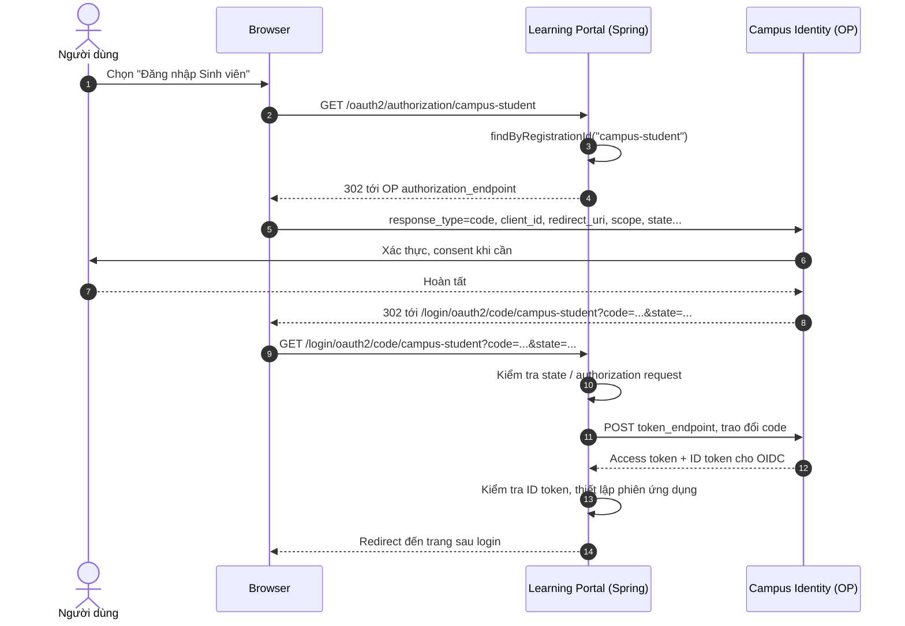
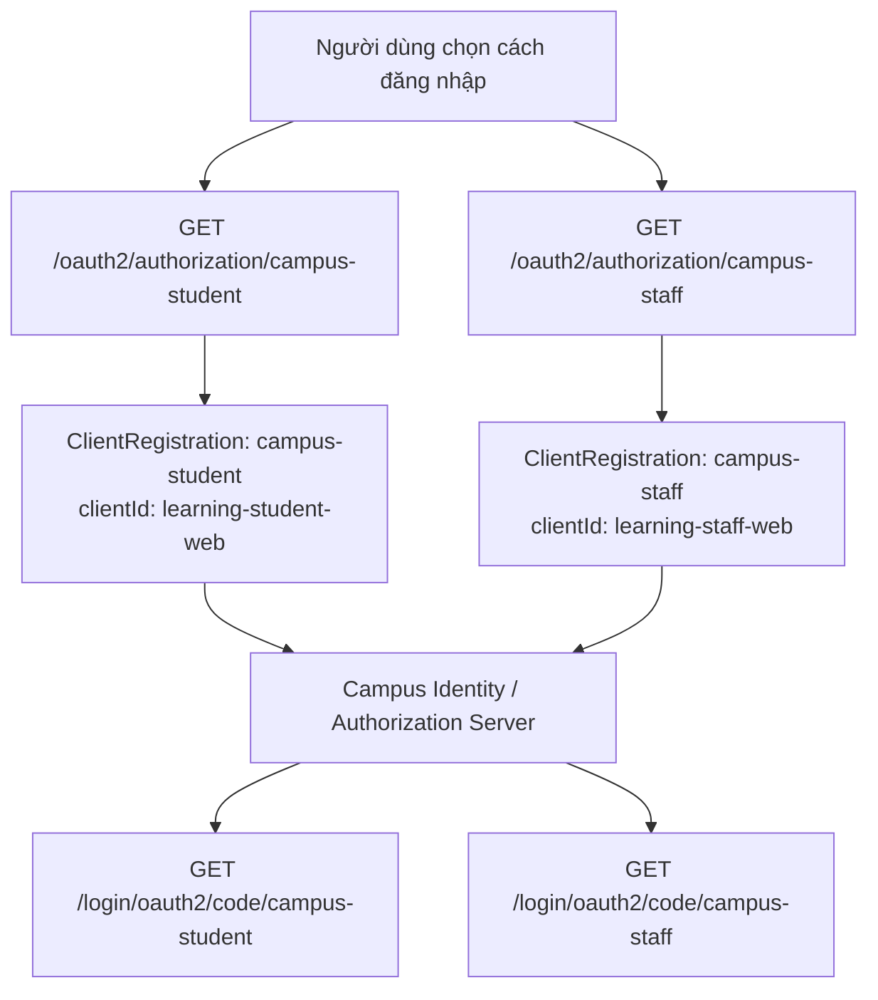

# 5.2. Registration ID, client name và ý nghĩa trong các URL

## Mục tiêu bài học

Sau bài học này, bạn có thể:

- Phân biệt **`registrationId`**, **`clientName`**, **`clientId`** và **provider ID** trong cấu hình `ClientRegistration` của Spring Security OAuth 2.0/OIDC Client.
- Giải thích tại sao URL bắt đầu đăng nhập thường có dạng `/oauth2/authorization/{registrationId}`, còn URL callback thường có dạng `/login/oauth2/code/{registrationId}`.
- Truy vết cách Spring chọn đúng `ClientRegistration`, chuyển hướng đến Authorization Server, rồi xử lý authorization code trả về.
- Cấu hình hai đăng ký client cùng dùng một OpenID Provider mà vẫn có URL đăng nhập và callback riêng.
- Tự xây dựng trang login với nhãn hiển thị từ `clientName`, hiểu tác động khi đổi `registrationId` hoặc tùy biến URL.
- Nhận diện các lỗi phổ biến như registration ID không khớp, `redirect_uri_mismatch`, đường dẫn callback sai, proxy làm thay đổi `baseUrl`, và nhầm lẫn tên hiển thị với định danh OAuth.

## 1. Bối cảnh: một nhà cung cấp đăng nhập, nhiều cách đặt tên

Giả sử ứng dụng **Learning Portal** là một Spring Boot web application cho người dùng đăng nhập qua hệ thống **Campus Identity**. Có hai nhóm người dùng: sinh viên và giảng viên. Cả hai đăng nhập tại cùng OpenID Provider nhưng ứng dụng tạo hai **client registration** khác nhau, với chính sách và client ID riêng.

Ta đặt tên cục bộ trong Learning Portal như sau:

| Thuộc tính | Đăng nhập sinh viên | Đăng nhập giảng viên |
| --- | --- | --- |
| `registrationId` | `campus-student` | `campus-staff` |
| `clientName` | `Campus Identity - Sinh viên` | `Campus Identity - Giảng viên` |
| `clientId` | `learning-student-web` | `learning-staff-web` |
| Provider alias trong cấu hình | `campus` | `campus` |
| Issuer OIDC | `https://id.campus.example.org` | `https://id.campus.example.org` |
| URL bắt đầu đăng nhập ở Portal | `/oauth2/authorization/campus-student` | `/oauth2/authorization/campus-staff` |
| Redirect URI do Portal đăng ký với OP | `https://portal.example.org/login/oauth2/code/campus-student` | `https://portal.example.org/login/oauth2/code/campus-staff` |

Những giá trị này có ý nghĩa khác nhau. `registrationId` là **khóa nội bộ Spring** để chọn client registration; `clientName` là **tên dễ đọc**, thường phục vụ giao diện; `clientId` là **mã của ứng dụng tại Authorization Server**; còn `campus` trong mục `provider` là **khóa cấu hình provider cục bộ** dùng chung cho hai registration.

Đây là nguyên tắc chính của bài:

> Trong Spring Security, phần `{registrationId}` của các URL mặc định chủ yếu giúp ứng dụng **chọn đúng cấu hình OAuth2 Client**. Nó không tự động trở thành `client_id` của yêu cầu OAuth và cũng không phải tên đăng nhập của người dùng.

## 2. `ClientRegistration` biểu diễn điều gì?

Spring Security sử dụng lớp `org.springframework.security.oauth2.client.registration.ClientRegistration` để mô tả một OAuth2/OIDC Client đã được đăng ký với một nhà cung cấp.

Một `ClientRegistration` bao gồm:

- **Định danh cục bộ:** `registrationId`.
- **Tên hiển thị:** `clientName`.
- **Thông tin đăng ký tại Authorization Server:** `clientId`, phương thức xác thực client, `clientSecret` nếu có.
- **Đặc tả luồng:** `authorizationGrantType`, `redirectUri`, `scopes`.
- **Chi tiết provider:** authorization URI, token URI, issuer, JWK Set URI, UserInfo URI và những thông tin cần thiết khác tùy loại provider.

Spring Security đặt các registration trong `ClientRegistrationRepository` để tìm theo `registrationId`. Một ứng dụng có thể chứa một hoặc nhiều registration.

Ví dụ về interface/API chính:

```java
ClientRegistration clientRegistration =
    clientRegistrationRepository.findByRegistrationId("campus-student");

String localKey = clientRegistration.getRegistrationId();
String displayName = clientRegistration.getClientName();
String oauthClientId = clientRegistration.getClientId();
String redirectTemplate = clientRegistration.getRedirectUri();
String authorizationUri =
    clientRegistration.getProviderDetails().getAuthorizationUri();
```

Ở đây:

- `findByRegistrationId("campus-student")` tra cứu **registration của Spring**, không gửi request đến OP.
- `getClientName()` là tên được cấu hình để hiển thị; nó không quyết định OP có chấp nhận client không.
- `getClientId()` là giá trị sẽ được gửi trong tham số OAuth `client_id`.
- `getRedirectUri()` thường là một **URI template** sẽ được Spring mở rộng ở thời điểm khởi tạo authorization request.
- `getProviderDetails().getAuthorizationUri()` là endpoint thực của Authorization Server, khác với đường dẫn bắt đầu đăng nhập nằm trên Learning Portal.

### 2.1. Bốn tên dễ nhầm

| Tên | Phạm vi định danh | Ví dụ | Xuất hiện ở đâu? |
| --- | --- | --- | --- |
| `registrationId` | Khóa nội bộ của Spring Client | `campus-student` | YAML dưới `registration`, URL mặc định của Spring, lookup repository, authorized-client key |
| `clientName` | Nhãn đọc được cho registration | `Campus Identity - Sinh viên` | Giao diện đăng nhập do ứng dụng hoặc Spring tạo, tùy cấu hình |
| `clientId` | Định danh OAuth Client tại Authorization Server | `learning-student-web` | Tham số `client_id` của authorization request; client authentication/token exchange theo phương thức cấu hình |
| Provider alias | Khóa liên kết cấu hình provider của Spring Boot | `campus` | YAML `registration.<id>.provider` và `provider.<alias>` |

Ngoài ra còn có **`issuer-uri`** của OIDC Provider, **tên người dùng** từ OIDC `preferred_username`, và **`client_name`** trong một số giao thức đăng ký client ở phía Authorization Server. Chúng không mặc nhiên trùng với `ClientRegistration.clientName` trong ứng dụng Spring.

### 2.2. `registrationId` thuộc Spring, không phải một trường bắt buộc của OAuth 2.0

OAuth 2.0 định nghĩa `client_id`, authorization endpoint, token endpoint và quy tắc cấp quyền. Nó **không yêu cầu** mỗi client phải có trường tên `registrationId`. Đây là định danh Spring Security dùng để quản lý nhiều OAuth client configuration trong một ứng dụng.

Ví dụ một OP cấp `client_id = learning-student-web`. Ở Learning Portal, đội phát triển có thể đặt registration ID là `campus-student` để biểu đạt ý nghĩa nghiệp vụ. Hai chuỗi không cần trùng nhau.

Dù vậy, `registrationId` nên ổn định và dễ đọc. Vì nó được đưa vào các URL mặc định, hãy chọn chuỗi phù hợp làm một URL path segment, chẳng hạn `google`, `campus`, `github` hoặc `campus-student`. Tránh khoảng trắng, ký tự cần escape phức tạp và giá trị không nhất quán giữa các môi trường.

## 3. Cấu hình Spring Boot: `registrationId` là tên key dưới `registration`

Một cấu hình minh họa cho **Spring Boot + Spring Security OAuth2 Login**:

```yaml
spring:
  security:
    oauth2:
      client:
        registration:
          campus-student:
            provider: campus
            client-id: ${CAMPUS_STUDENT_CLIENT_ID}
            client-secret: ${CAMPUS_STUDENT_CLIENT_SECRET}
            client-authentication-method: client_secret_basic
            authorization-grant-type: authorization_code
            redirect-uri: "{baseUrl}/login/oauth2/code/{registrationId}"
            client-name: "Campus Identity - Sinh viên"
            scope:
              - openid
              - profile
              - email

          campus-staff:
            provider: campus
            client-id: ${CAMPUS_STAFF_CLIENT_ID}
            client-secret: ${CAMPUS_STAFF_CLIENT_SECRET}
            client-authentication-method: client_secret_basic
            authorization-grant-type: authorization_code
            redirect-uri: "{baseUrl}/login/oauth2/code/{registrationId}"
            client-name: "Campus Identity - Giảng viên"
            scope:
              - openid
              - profile
              - email

        provider:
          campus:
            issuer-uri: https://id.campus.example.org
```

Đây là các URL và tên miền **minh họa**, không phải cấu hình sản xuất. Ví dụ giả định hai confidential clients giữ bí mật ở backend và OP hỗ trợ OIDC Discovery. Cần thêm dependency OAuth2 Client thích hợp, cấp các biến môi trường chứa client credentials, và đăng ký redirect URI thực tế tại OP.

Giải thích chính xác cấu trúc key:

```text
spring.security.oauth2.client
  |
  +-- registration
  |     |
  |     +-- campus-student    <-- registrationId số 1
  |     |     +-- client-id    <-- clientId do OP cấp
  |     |     +-- client-name  <-- clientName dùng để hiển thị
  |     |     +-- provider: campus
  |     |
  |     +-- campus-staff      <-- registrationId số 2
  |           +-- client-id
  |           +-- client-name
  |           +-- provider: campus
  |
  +-- provider
        |
        +-- campus            <-- khóa cấu hình provider, không phải registrationId
              +-- issuer-uri
```

Hai mục `registration` cùng trỏ đến `provider.campus` nhưng giữ **hai `client-id` khác nhau**. Cũng có thể có nhiều registration trỏ tới cùng một provider với các scope hoặc phương thức xác thực khác nhau nếu provider và chính sách cho phép.

### 3.1. Nếu không đặt `client-name`?

Trong cách xây `ClientRegistration` thông dụng của Spring Security, `clientName` được dùng làm tên hiển thị và có thể mặc định từ `registrationId` khi không đặt tên riêng. Với registration tên `campus-student`, nhãn mặc định có thể kém thân thiện hơn `Campus Identity - Sinh viên`.

Vì vậy, nếu ứng dụng có trang chọn nhà cung cấp đăng nhập, nên đặt `client-name` có nghĩa với người dùng. Nó chỉ là nhãn giao diện; đổi nhãn không làm đổi `client-id`, registration ID, token endpoint hay callback URL.

### 3.2. `provider` là tham chiếu cấu hình

Trong ví dụ:

```yaml
registration:
  campus-student:
    provider: campus
```

`campus` là khóa để Spring Boot tra cứu:

```yaml
provider:
  campus:
    issuer-uri: https://id.campus.example.org
```

Khi provider hỗ trợ discovery, Spring có thể lấy metadata chứa authorization endpoint, token endpoint, JWK Set URI, UserInfo endpoint... bằng issuer được tin cậy.

**Không suy luận** rằng vì `provider: campus`, đường dẫn `/oauth2/authorization/campus` sẽ tự động tồn tại. URL mặc định này phải sử dụng một **registration ID đang có**; ở cấu hình hiện tại, chỉ có `campus-student` và `campus-staff`.

## 4. Hai URL mặc định của Spring Security OAuth2 Login

Khi dùng cấu hình mặc định của `oauth2Login()`, có hai nhóm URL thường gặp nhất.

| URL | Ứng dụng nào sở hữu? | Vai trò trong flow |
| --- | --- | --- |
| `/oauth2/authorization/{registrationId}` | **Spring Client** (Learning Portal) | Bắt đầu OAuth authorization request; chọn registration theo `{registrationId}` và redirect sang OP |
| `/login/oauth2/code/{registrationId}` | **Spring Client** (Learning Portal) | Nhận authorization response/callback từ OP (thường là `code`, `state`); Spring xử lý login |
| `authorization_endpoint` của OP | **Authorization Server** (Campus Identity) | Hiển thị/điều phối xác thực, consent khi cần; trả authorization code |
| `token_endpoint` của OP | **Authorization Server** | Client đổi authorization code lấy token |
| `userinfo_endpoint` của OP | **OpenID Provider** | Client dùng access token lấy claims hồ sơ khi cần và được phép |

Hai URL bắt đầu và callback ở hàng đầu **không phải endpoint của Authorization Server**. Chúng là endpoint phía ứng dụng Spring, do filter trong `SecurityFilterChain` xử lý khi cấu hình OAuth2 Login phù hợp.

### 4.1. URL bắt đầu đăng nhập: `/oauth2/authorization/{registrationId}`

Mặc định, Spring Security hỗ trợ yêu cầu bắt đầu ủy quyền ở dạng:

```text
https://portal.example.org/oauth2/authorization/campus-student
```

Trong ví dụ:

- Phần `/oauth2/authorization/` là **authorization request base URI** do Spring Security đặt mặc định.
- `campus-student` là **registration ID** mà Spring dùng tìm `ClientRegistration`.
- Spring sẽ xây dựng authorization request từ registration đó và trả HTTP redirect đến **authorization endpoint của OP**.

Một yêu cầu GET đến Learning Portal:

```http
GET /oauth2/authorization/campus-student HTTP/1.1
Host: portal.example.org
```

Có thể được trả bằng HTTP 302 có `Location` tương tự (rút gọn để dễ đọc):

```text
https://id.campus.example.org/oauth2/authorize
  ?response_type=code
  &client_id=learning-student-web
  &redirect_uri=https%3A%2F%2Fportal.example.org%2Flogin%2Foauth2%2Fcode%2Fcampus-student
  &scope=openid%20profile%20email
  &state=<random-state>
```

Nếu dùng PKCE, request có thể thêm `code_challenge` và `code_challenge_method=S256`; trong OIDC có thể có `nonce`. Endpoint thực và tham số chính xác phụ thuộc provider, registration và cơ chế bảo vệ được bật. Các giá trị đặt trong `<...>` là chỗ giữ chỗ, không dùng cố định.

Điều cần thấy:

```text
Spring URL path:
    /oauth2/authorization/campus-student
                              ^ registrationId

OAuth request đến OP:
    client_id=learning-student-web
              ^ clientId của registration được chọn
```

**Registration ID không được gửi lên OP như một tham số bắt buộc tên `registration_id`**. OP quan tâm tới `client_id`, `redirect_uri`, scope, PKCE và các tham số chuẩn khác.

### 4.2. URL callback: `/login/oauth2/code/{registrationId}`

Sau khi người dùng xác thực và OP xử lý yêu cầu, với Authorization Code Flow, trình duyệt được chuyển hướng về redirect URI đã đăng ký:

```text
https://portal.example.org/login/oauth2/code/campus-student?code=<code>&state=<state>
```

Trong cấu hình mặc định của Spring Security, nhóm callback có mẫu `/login/oauth2/code/*`. `registrationId` trong mẫu thường khớp registration đã khởi tạo yêu cầu. Spring đọc trạng thái authorization request đã lưu, kiểm tra tương quan `state`, dùng registration phù hợp rồi trao đổi code tại token endpoint.

Không nên tưởng rằng Spring chỉ nhìn vào đoạn cuối URL và tin mọi tham số callback. Cơ chế login còn phải ràng buộc response với authorization request, kiểm tra state, code, redirect URI và các điều kiện OAuth/OIDC tương ứng.

### 4.3. Sơ đồ đường đi



Hai lần 302 trong sơ đồ phục vụ các mục đích khác nhau: lần đầu chuyển từ Spring sang OP để xin ủy quyền, lần sau đưa authorization result từ OP về redirect URI của Spring.

### 4.4. Login OIDC vẫn sử dụng hai URL này

OIDC xây trên OAuth 2.0. Khi registration có scope `openid` và provider hỗ trợ OIDC, Spring Security có thể xử lý ID Token, user identity và UserInfo theo luồng OIDC. Tuy nhiên, URL mặc định để **bắt đầu** login và **nhận callback** vẫn theo các quy ước của OAuth2 Login.

Ví dụ:

```text
GET /oauth2/authorization/campus-student
  -> xác thực tại OP
  -> GET /login/oauth2/code/campus-student?code=...&state=...
  -> OAuth2/OIDC Client hoàn thành login
```

Không có yêu cầu rằng phải đặt callback là `/oidc/callback`, hay phải đưa `openid` vào tên registration ID.

## 5. URI template: `{baseUrl}` và `{registrationId}`

Trong YAML, một redirect URI thường dùng là:

```yaml
redirect-uri: "{baseUrl}/login/oauth2/code/{registrationId}"
```

Đây là template để Spring mở rộng cho từng authorization request, ví dụ:

```text
baseUrl         = https://portal.example.org
registrationId  = campus-student

redirect_uri    = https://portal.example.org/login/oauth2/code/campus-student
```

Nếu web app triển khai dưới context path `/learning`, `baseUrl` có thể bao gồm phần context path đó, tùy cách triển khai và forwarded headers:

```text
baseUrl         = https://portal.example.org/learning
registrationId  = campus-student

redirect_uri    = https://portal.example.org/learning/login/oauth2/code/campus-student
```

Spring Security hỗ trợ các biến redirect URI template thông dụng như `{baseUrl}`, `{baseScheme}`, `{baseHost}`, `{basePort}`, `{basePath}` và `{registrationId}`. Khi dùng template, hãy hiểu **URL thực tế sau mở rộng** và đăng ký chính URL đó với nhà cung cấp.

### 5.1. Vì sao redirect URI phải được đăng ký chính xác?

Authorization Server thường yêu cầu redirect URI của OAuth Client phải khớp danh sách URI đã đăng ký theo chính sách bảo mật của nó.

Ví dụ OP đã đăng ký:

```text
https://portal.example.org/login/oauth2/code/campus-student
```

Nhưng request thực tế gửi:

```text
http://portal-internal:8080/login/oauth2/code/campus-student
```

Có thể bị từ chối bằng lỗi `redirect_uri_mismatch`, `invalid_request` hoặc thông báo tương đương, tùy provider.

Nguyên nhân thường gặp là ứng dụng chạy sau reverse proxy/ingress: bên ngoài người dùng truy cập HTTPS, nhưng Spring nhìn thấy kết nối nội bộ HTTP. Cần cấu hình trusted forwarded headers và proxy đúng cách để Spring xây external base URL chuẩn. Trong Spring Boot, tùy mô hình triển khai có thể cần cấu hình thích hợp như:

```yaml
server:
  forward-headers-strategy: framework
```

Đây là ví dụ tùy môi trường; phải đảm bảo proxy chỉ chuyển tiếp/ghi đè các forwarded headers đáng tin cậy. **Không** tin mù quáng `X-Forwarded-Host` do client Internet tự gửi.

### 5.2. `registrationId` trong callback không phải một bí mật

URL callback nhìn thấy được bởi browser, log reverse proxy và cấu hình tại OP. Giá trị `registrationId` vì vậy phải được coi là định danh cục bộ **công khai**, không dùng nó để lưu client secret hay thông tin cá nhân.

Cơ chế bảo vệ giao dịch không đến từ việc giấu `campus-student`; nó đến từ HTTPS, ràng buộc redirect URI, `state`, PKCE, xác thực client khi cần, kiểm tra authorization code và ID Token theo quy tắc OIDC.

### 5.3. Thay `registrationId` sẽ làm thay đổi những gì?

Nếu đổi tên registration từ:

```yaml
registration:
  campus-student:
```

thành:

```yaml
registration:
  campus-learner:
```

và vẫn dùng các URI template mặc định, ta có:

```text
Trước:
  /oauth2/authorization/campus-student
  /login/oauth2/code/campus-student

Sau:
  /oauth2/authorization/campus-learner
  /login/oauth2/code/campus-learner
```

Các liên kết đăng nhập ở frontend cần đổi theo. OP cũng phải được cập nhật danh sách redirect URI nếu callback thay đổi. Các chỗ lookup bằng registration ID như annotation, manager hoặc kho lưu authorized client cần được điều chỉnh tương ứng.

**Đổi `registrationId` không tự đổi `clientId`** của ứng dụng ở OP, nhưng có thể khiến người dùng không đăng nhập được nếu callback và các tham chiếu cũ chưa được cập nhật đồng bộ.

## 6. `clientName` dùng để làm gì?

`clientName` là tên thân thiện của registration. Nó hữu ích đặc biệt khi ứng dụng cho người dùng chọn giữa nhiều nhà cung cấp hoặc nhiều phương thức đăng nhập.

Ví dụ:

```yaml
registration:
  campus-student:
    client-name: "Campus Identity - Sinh viên"
  campus-staff:
    client-name: "Campus Identity - Giảng viên"
```

Giao diện có thể hiển thị:

```text
Chọn phương thức đăng nhập

[Campus Identity - Sinh viên]
[Campus Identity - Giảng viên]
```

Trong các cấu hình Spring Security mà trang login mặc định được tự sinh, Spring có thể lấy client name làm nhãn liên kết OAuth2 Login. Điều này phụ thuộc loại registration, repository và việc trang login tự sinh có được sử dụng.

Khi tự xây dựng trang login, ứng dụng quyết định nhãn và liên kết. `clientName` không tự đổi endpoint `/oauth2/authorization/{registrationId}`.

### 6.1. `clientName` không phải thông tin định danh của người dùng

Phân biệt:

- `clientName = "Campus Identity - Sinh viên"`: tên hiển thị của **OAuth client registration**.
- `OidcUser.getFullName()` hoặc claim `name`: tên hồ sơ của **người dùng đã xác thực**.
- `clientId = "learning-student-web"`: mã **OAuth client** đăng ký tại OP.
- `registrationId = "campus-student"`: khóa **đăng ký cục bộ** của Spring.

Không dùng `clientName` làm tên tài khoản, không gửi nó thay `client_id`, cũng không coi nó là claim đã được OP xác thực.

### 6.2. `clientName` có phải là tên hiển thị bên phía OP?

Không nhất thiết. Màn hình consent hoặc trang xác nhận đăng nhập tại OP có thể hiển thị **tên client mà OP đã đăng ký**, theo cơ chế quản lý client của OP. Chuỗi `client-name` ở YAML của Spring không tự động cập nhật tên hiển thị của ứng dụng ở OP.

Ví dụ:

```text
Tại Learning Portal:
    clientName = "Campus Identity - Sinh viên"

Tại OP:
    Application display name = "Learning Portal Student"
```

Hai tên có thể khác nhau. Muốn đổi nội dung OP hiển thị, cần chỉnh registration phía OP hoặc quy trình đăng ký động phù hợp, không chỉ sửa YAML của Learning Portal.

## 7. Trang đăng nhập được tạo tự động và trang đăng nhập tùy chỉnh

### 7.1. Trang login mặc định

Nếu ứng dụng bật `oauth2Login()` và đang dùng trang đăng nhập mặc định phù hợp, Spring Security có thể sinh trang login với danh sách liên kết đến các client registration đã cấu hình.

Để sinh liên kết cho nhiều OAuth2 Client, Spring cần liệt kê được các registration, ví dụ một `Iterable<ClientRegistration>` repository như `InMemoryClientRegistrationRepository`. Trường `clientName` thường là nhãn hiển thị trong trang được sinh.

Ví dụ security chain:

```java
@Configuration
class SecurityConfiguration {

    @Bean
    SecurityFilterChain webSecurity(HttpSecurity http) throws Exception {
        http
            .authorizeHttpRequests(authorize -> authorize
                .requestMatchers("/", "/assets/**").permitAll()
                .anyRequest().authenticated()
            )
            .oauth2Login(Customizer.withDefaults());

        return http.build();
    }
}
```

Người dùng truy cập trang được bảo vệ có thể được chuyển đến login mặc định để chọn provider/registration. Tên liên kết phản ánh `clientName` khi Spring sinh link; đích của liên kết vẫn dựa trên `registrationId`.

### 7.2. Trang login tùy chỉnh

Nhiều sản phẩm muốn tự kiểm soát logo, nhãn, ngôn ngữ và thứ tự lựa chọn. Khi đó, trang login tự tạo có thể có liên kết:

```html
<a href="/oauth2/authorization/campus-student">
  Đăng nhập với tài khoản sinh viên
</a>

<a href="/oauth2/authorization/campus-staff">
  Đăng nhập với tài khoản giảng viên
</a>
```

Các `href` cần dùng registration ID chính xác. Phần văn bản nằm giữa `<a>...</a>` chỉ là nhãn UI và có thể khác `clientName` mà không đổi luồng OAuth.

Ví dụ Spring Security khi tự chỉ định trang login:

```java
@Bean
SecurityFilterChain webSecurity(HttpSecurity http) throws Exception {
    http
        .authorizeHttpRequests(authorize -> authorize
            .requestMatchers("/", "/login", "/assets/**").permitAll()
            .anyRequest().authenticated()
        )
        .oauth2Login(oauth2 -> oauth2
            .loginPage("/login")
        );

    return http.build();
}
```

Ứng dụng phải cung cấp controller/view hoặc một handler tương ứng cho `/login`. Khi đặt custom login page, không thể trông đợi Spring luôn sinh ra nội dung HTML giống trang login mặc định.

Nếu dùng Spring MVC với controller `/login`, cần trả view template và cấu hình view rendering phù hợp dự án. Ví dụ đoạn HTML trên giả định ứng dụng triển khai ở root path; nếu có context path hoặc base path khác, cần tạo link phù hợp.

### 7.3. Lấy thông tin đăng ký để sinh link động

Nếu muốn hiển thị danh sách đăng nhập từ `ClientRegistrationRepository`, có thể lấy các đăng ký được cấu hình và xây URL tương ứng:

```java
@GetMapping("/login-options")
List<Map<String, String>> loginOptions(
        ClientRegistrationRepository repository) {

    if (!(repository instanceof Iterable<?> iterable)) {
        throw new IllegalStateException(
            "Configured repository does not support iteration"
        );
    }

    List<Map<String, String>> options = new ArrayList<>();

    for (Object candidate : iterable) {
        ClientRegistration registration = (ClientRegistration) candidate;

        if (!AuthorizationGrantType.AUTHORIZATION_CODE.equals(
                registration.getAuthorizationGrantType())) {
            continue;
        }

        options.add(Map.of(
            "registrationId", registration.getRegistrationId(),
            "clientName", registration.getClientName(),
            "authorizationStartUrl",
            "/oauth2/authorization/" + registration.getRegistrationId()
        ));
    }

    return options;
}
```

Đây là ví dụ minh họa cách sử dụng thông tin registration trong một ứng dụng có repository iterable; mã thực tế cần import, xử lý context path và giới hạn danh sách registration được phép hiển thị. Một ứng dụng không nên tự động hiển thị mọi cấu hình service client hoặc những OAuth client không có chủ đích cho người dùng đăng nhập.

Việc xây link như trên phụ thuộc **authorization base URI mặc định**; nếu ứng dụng thay base URI, cần thay đường dẫn được sinh tương ứng.

## 8. Tùy biến authorization start URL

Mặc định:

```text
/oauth2/authorization/{registrationId}
```

Có thể đổi authorization request base URI, ví dụ thành `/signin/oauth2`:

```java
@Bean
SecurityFilterChain securityFilterChain(HttpSecurity http) throws Exception {
    http
        .authorizeHttpRequests(authorize -> authorize
            .requestMatchers("/login", "/assets/**").permitAll()
            .anyRequest().authenticated()
        )
        .oauth2Login(oauth2 -> oauth2
            .loginPage("/login")
            .authorizationEndpoint(endpoint -> endpoint
                .baseUri("/signin/oauth2")
            )
        );

    return http.build();
}
```

Khi đó link đăng nhập mà frontend phải dùng là:

```text
/signin/oauth2/campus-student
/signin/oauth2/campus-staff
```

Đây là **đường dẫn nhận yêu cầu ở Client**, không phải authorization endpoint của OP. Chỉ thay đổi base URI ở Spring nhưng quên đổi `<a href>` của custom login page sẽ gây lỗi bắt đầu login.

Trong các ứng dụng cần hành vi đặc biệt, Spring cũng cho phép tùy biến `OAuth2AuthorizationRequestResolver`; khi làm vậy cần bảo toàn các giá trị và bảo vệ OAuth/OIDC thiết yếu như `state`, redirect URI, PKCE và nonce khi áp dụng.

## 9. Tùy biến callback/redirection URL

Mặc định:

```text
/login/oauth2/code/{registrationId}
```

Nếu muốn callback dạng `/signin/callback/{registrationId}`, phải phối hợp **cả nơi nhận authorization response** và **redirect URI gửi đến provider**.

Ví dụ với Spring Security:

```java
@Bean
SecurityFilterChain securityFilterChain(HttpSecurity http) throws Exception {
    http
        .authorizeHttpRequests(authorize -> authorize
            .anyRequest().authenticated()
        )
        .oauth2Login(oauth2 -> oauth2
            .redirectionEndpoint(endpoint -> endpoint
                .baseUri("/signin/callback/*")
            )
        );

    return http.build();
}
```

Và cùng lúc trong registration:

```yaml
spring:
  security:
    oauth2:
      client:
        registration:
          campus-student:
            redirect-uri: "{baseUrl}/signin/callback/{registrationId}"
```

Provider phải được đăng ký callback thực tế, ví dụ:

```text
https://portal.example.org/signin/callback/campus-student
```

Nếu cấu hình `redirectionEndpoint().baseUri(...)` và `redirect-uri` của client registration không khớp, OP có thể redirect đúng theo URI đã đăng ký nhưng Spring không có filter nhận callback ở đường dẫn đó.

**Cẩn thận với wildcard:** Trong API cấu hình redirection endpoint, mẫu như `/signin/callback/*` dùng để khớp path; còn `redirect-uri` gửi đến OP phải là URI thực tế sau mở rộng, thường không chứa wildcard.

### 9.1. Có thể bỏ `{registrationId}` khỏi callback không?

Có những hệ thống chọn một redirect URI cố định như:

```text
https://portal.example.org/oauth/callback
```

Đây có thể là cấu hình khả thi nếu client/framework được tùy biến đúng cách để tìm lại authorization request và registration phù hợp, đồng thời endpoint callback khớp chính xác. Nhưng với cấu hình nhiều `ClientRegistration`, template `{registrationId}` là lựa chọn dễ hiểu và thuận tiện: mỗi registration có URI xác định, giảm nhầm lẫn lúc đăng ký provider và vận hành.

Không xóa `{registrationId}` chỉ vì muốn URL ngắn hơn mà bỏ qua cơ chế Spring xác định registration từ authorization response. Với code mặc định, nên dùng template mà Spring Security hỗ trợ và giữ các đường dẫn đồng bộ.

## 10. `registrationId` ở các API khác của Spring Security

Tên này xuất hiện xuyên suốt đời sống của một OAuth2 Client, không chỉ trong URL.

### 10.1. Tra cứu từ `ClientRegistrationRepository`

```java
ClientRegistration registration =
    clientRegistrationRepository.findByRegistrationId("campus-student");
```

Nếu registration ID không tồn tại, repository thường trả `null` hoặc cơ chế gọi cao hơn có thể phát sinh lỗi. Khi cấu hình nhiều provider, đừng dùng `clientName` hay `clientId` làm khóa để gọi API tra cứu theo registration ID.

### 10.2. Khi làm việc với `OAuth2AuthorizedClient`

Sau khi một principal được ủy quyền, Spring có thể lưu trạng thái trong `OAuth2AuthorizedClient` và truy xuất bằng registration ID cộng với principal.

Ví dụ controller:

```java
@GetMapping("/oauth-client-info")
Map<String, String> oauthClientInfo(
        @RegisteredOAuth2AuthorizedClient("campus-student")
        OAuth2AuthorizedClient authorizedClient) {

    return Map.of(
        "registrationId",
        authorizedClient.getClientRegistration().getRegistrationId(),
        "clientName",
        authorizedClient.getClientRegistration().getClientName()
    );
}
```

Ví dụ giả định có authorized client phù hợp trong ngữ cảnh xác thực hiện tại và endpoint được bảo vệ. Không trả access token hoặc refresh token từ controller chỉ để debug.

### 10.3. Khi dùng `OAuth2AuthorizedClientManager`

Một lời gọi authorize cũng dùng registration ID:

```java
OAuth2AuthorizeRequest request =
    OAuth2AuthorizeRequest
        .withClientRegistrationId("campus-student")
        .principal(authentication)
        .build();

OAuth2AuthorizedClient client =
    authorizedClientManager.authorize(request);
```

Manager sử dụng registration ID để chọn client và xử lý những grant được cấu hình; nó **không tìm theo nhãn `clientName`**. Trong ứng dụng Servlet, hoạt động thực tế còn phụ thuộc request context, authentication và kho lưu authorized client.

### 10.4. Khi chọn mặc định một registration

Một ứng dụng có nhiều registration nhưng muốn nút “Đăng nhập” chính luôn dẫn đến một lựa chọn có thể tự link tới:

```text
/oauth2/authorization/campus-student
```

Không cần đổi `clientName`, cũng không cần đổi issuer. Chọn registration là lựa chọn cấp ứng dụng: dựa trên nhu cầu nghiệp vụ, không dựa vào việc OP có cùng domain.

## 11. Nhiều registration cùng một provider: vì sao hữu ích?

Một provider có thể đăng ký nhiều OAuth Client cho các mục đích khác nhau:

- **Student Portal:** access/scope phù hợp sinh viên.
- **Staff Portal:** các scope hoặc chính sách xác thực khác, nếu OP hỗ trợ.
- **Environment:** dev, staging, production thường có client ID và callback khác nhau.
- **Kiến trúc:** web backend confidential client, mobile public client là các client riêng ở OP.
- **Tenant hoặc đối tác:** có thể dùng issuer khác nhau hoặc cùng issuer tùy thiết kế.

Ví dụ trong một ứng dụng:



Cùng issuer không làm mất ý nghĩa của registration ID; mỗi registration vẫn đại diện cho một đăng ký client cụ thể.

### 11.1. Thời điểm không nên tạo thêm registration

Không phải mỗi role hoặc user type đều cần một OAuth client riêng. Nếu mọi người dùng đăng nhập cùng OP, có cùng chính sách OAuth/OIDC và ứng dụng áp dụng authorization bằng role nội bộ sau login, một registration có thể đã đủ. Đừng tạo nhiều registration chỉ để suy ra quyền từ URL người dùng đã chọn: quyền thực tế phải dựa trên dữ liệu đáng tin cậy và chính sách của ứng dụng/Resource Server.

Đặc biệt, đăng nhập qua đường dẫn `/oauth2/authorization/campus-staff` **không tự chứng minh** người dùng là giảng viên. Phải xác minh danh tính và quyền nghiệp vụ sau xác thực, kể cả khi registration có tên `staff`.

## 12. Quản lý URL khi triển khai thực tế

### 12.1. Reverse proxy, HTTPS và host công khai

Một triển khai thường có:

```text
Browser (HTTPS)
    |
    v
https://portal.example.org
    |
    v
Ingress / reverse proxy
    |
    v
Spring Boot tại http://portal-service:8080
```

Nếu Spring tự tạo redirect URI từ địa chỉ nội bộ, provider có thể không chấp nhận. Khi triển khai, cần xác định:

1. Host và scheme công khai của ứng dụng.
2. Context path/base path mà người dùng thực sự thấy.
3. Cách server xử lý trusted forwarded headers.
4. Redirect URI chính xác đã đăng ký tại OP.
5. Callback filter pattern mà Spring đang lắng nghe.

Những kiểm tra này quan trọng hơn chuyện `clientName` có đẹp hay không, vì **redirect URI là một ranh giới bảo mật** của OAuth.

### 12.2. Context path

Nếu cấu hình:

```yaml
server:
  servlet:
    context-path: /learning
```

đường dẫn ngoài có thể là:

```text
https://portal.example.org/learning/oauth2/authorization/campus-student
https://portal.example.org/learning/login/oauth2/code/campus-student
```

Các link HTML hard-code `/oauth2/authorization/campus-student` sẽ bỏ qua `/learning` khi browser resolve từ root host. Nên sinh URL có xét context path, hoặc cung cấp base path từ server cho frontend.

### 12.3. Đổi registration ID trong môi trường có người dùng đang đăng nhập

Đổi `registrationId` có thể ảnh hưởng tới các request OAuth đang diễn ra, các link login cũ, callback đã đăng ký và authorized client lưu theo registration ID. Nếu đang chuyển đổi môi trường sản xuất, cần thiết kế triển khai đồng bộ hoặc giai đoạn chuyển tiếp phù hợp để không làm hỏng các luồng đang dang dở.

Bộ đôi `(registrationId, principal)` thường được dùng để xác định OAuth2 authorized client trong kho lưu của Spring. Thay ID vì mục đích đổi tên UI có thể làm token lưu trước đây không được tra cứu theo khóa mới. **Muốn chỉ đổi nhãn, hãy thay `clientName` thay vì rename `registrationId`.**

### 12.4. URL do frontend cung cấp không được tự động trở thành quyền

Ví dụ frontend có hai nút:

```text
Student login -> /oauth2/authorization/campus-student
Staff login   -> /oauth2/authorization/campus-staff
```

Đường dẫn chỉ chọn **registration**. Sau callback, ứng dụng vẫn phải xác thực ID Token, ràng buộc issuer/subject, rồi áp dụng quy tắc phân quyền. Kẻ tấn công có thể truy cập URL của nút Staff trực tiếp; endpoint này không thể là phép kiểm tra role.

## 13. Lỗi thường gặp và cách tìm nguyên nhân

| Triệu chứng | Nguyên nhân có thể | Cần kiểm tra |
| --- | --- | --- |
| Bấm nút đăng nhập nhưng không chuyển tới OP | Link dùng registration ID sai, hoặc authorization request base URI đã được tùy biến | So sánh `<a href>` với `registration.<id>` và `authorizationEndpoint().baseUri` |
| `/oauth2/authorization/campus` không chạy | Có provider alias `campus` nhưng không có registration ID `campus` | Kiểm tra danh sách key dưới `registration` |
| OP báo `invalid_client` | Client ID/secret/phương thức xác thực không khớp | Kiểm tra cấu hình đăng ký ở OP và `client-id`, không thay bằng registration ID |
| OP báo `redirect_uri_mismatch` | Callback URL thực tế sai host/scheme/path hoặc chưa đăng ký | Kiểm tra URI sau khi template mở rộng và danh sách callback tại OP |
| Callback tới Portal nhưng 404/không được xử lý | Redirection filter pattern và đường dẫn callback lệch nhau | So sánh `redirect-uri` với `redirectionEndpoint().baseUri(...)` |
| Trang login có nhãn lạ hoặc chỉ hiện mã kỹ thuật | Không khai báo `client-name`, hoặc trang UI không dùng giá trị này | Cập nhật `client-name` hoặc template login |
| Đã đổi `client-name` nhưng OP vẫn hiện tên cũ | Tên đăng ký hiển thị tại OP được quản lý riêng | Chỉnh display name trong cấu hình OP nếu cần |
| Đổi `registrationId` xong link cũ lỗi | URL bắt đầu/callback, annotation, manager hoặc authorized-client key vẫn dùng ID cũ | Cập nhật đồng bộ mọi tham chiếu và redirect URI tại OP |
| Dev đăng nhập được, production lỗi callback | Host/proxy/context path/forwarded headers khác | Đối chiếu external base URL và URI đã đăng ký ở OP |
| Chọn nút Staff nhưng vào được tài khoản Student | OP xác thực danh tính hợp lệ; URL chọn registration không phải role gate | Kiểm tra authorization nội bộ sau login |
| Có nhiều registration nhưng trang mặc định không liệt kê đúng | Repository không liệt kê được hoặc trang login đã được custom | Kiểm tra iterable repository, grant type và cơ chế login page đang dùng |

### 13.1. Quy trình đọc một lỗi `redirect_uri_mismatch`

Giả sử log hoặc thông báo ở OP cho thấy request có:

```text
client_id    = learning-student-web
redirect_uri = http://localhost:8080/login/oauth2/code/campus-student
```

Trong khi OP được đăng ký:

```text
https://portal.example.org/login/oauth2/code/campus-student
```

Ta có thể suy ra:

- Spring đã chọn registration `campus-student` nếu `client_id` đúng.
- Bất đồng nằm ở **host và scheme của callback**, không phải `clientName`.
- Cần kiểm tra `baseUrl`, reverse proxy và cấu hình forward headers, sau đó xác nhận URI cuối cùng khớp tại OP.

Nếu OP báo lỗi client ID không tồn tại, lỗi nằm ở cấu hình **`client-id`** hoặc đăng ký phía OP; đổi text của `client-name` sẽ không xử lý được.

### 13.2. Phân biệt các loại 404

Nếu request ban đầu:

```text
GET /oauth2/authorization/campus-student
```

trả 404, hãy kiểm tra ứng dụng có `SecurityFilterChain` bật OAuth2 Login, có registration tương ứng và endpoint base URI có bị thay đổi.

Nếu OP đã redirect về:

```text
GET /login/oauth2/code/campus-student?code=...&state=...
```

nhưng 404, hãy kiểm tra cấu hình redirection endpoint, context path và reverse proxy routing. Hai lỗi có đường đi khác nhau nên không nên chẩn đoán giống nhau.

## 14. Nguyên tắc an toàn khi dùng registration ID trong URL

- **Dùng HTTPS** cho production redirect URI và các endpoint liên quan; giới hạn đúng các URI được đăng ký.
- **Giữ `clientSecret` ở backend** của confidential client. Client ID và registration ID không phải mật khẩu, nhưng secret và token phải được bảo vệ.
- **Không xem registration ID là quyền:** người dùng có thể trực tiếp gọi URL của bất kỳ nút login nào; phân quyền phải thực hiện sau xác thực.
- **Không tự chấp nhận callback tùy ý:** `state`, PKCE, ràng buộc redirect URI, xác thực client và OIDC ID Token validation phải được thư viện xử lý đúng.
- **Không dựng `redirect_uri` từ host header không tin cậy** trong môi trường proxy công khai; phải có cấu hình host/proxy đáng tin.
- **Tách cấu hình theo môi trường:** dev và production thường cần client ID, secret và redirect URI riêng; tránh vô tình dùng callback của localhost ở production.
- **Không gửi token vào URL ứng dụng:** Authorization Code Flow mặc định chỉ chuyển authorization code trong callback; token được trao đổi qua kênh trực tiếp phù hợp.

## 15. Bài tập thực hành

### Bài tập 1: Phân tích YAML

Cho cấu hình:

```yaml
spring:
  security:
    oauth2:
      client:
        registration:
          my-sso:
            provider: corp-idp
            client-id: office-portal-prod
            client-name: "Tài khoản công ty"
            authorization-grant-type: authorization_code
            redirect-uri: "{baseUrl}/login/oauth2/code/{registrationId}"
            scope: [openid, profile]
        provider:
          corp-idp:
            issuer-uri: https://login.company.example
```

Giả sử app chạy tại `https://portal.company.example`. Hãy xác định:

1. Registration ID là gì?
2. Client name là gì?
3. Giá trị gửi dưới tên `client_id` là gì?
4. URL bắt đầu login mặc định là gì?
5. Callback URL dự kiến là gì?
6. Provider alias là gì?

**Đáp án:**

| Câu | Giá trị |
| --- | --- |
| 1 | `my-sso` |
| 2 | `Tài khoản công ty` |
| 3 | `office-portal-prod` |
| 4 | `https://portal.company.example/oauth2/authorization/my-sso` |
| 5 | `https://portal.company.example/login/oauth2/code/my-sso` |
| 6 | `corp-idp` |

### Bài tập 2: Đổi tên nút đăng nhập

Product muốn nút từ “Tài khoản công ty” thành “Đăng nhập SSO”. Không thay đổi luồng OAuth hay cấu hình phía OP.

**Giải pháp phù hợp:** cập nhật `client-name` hoặc nhãn UI của trang login. Giữ nguyên `registrationId`, `client-id` và `redirect-uri` nếu không có lý do kỹ thuật để đổi.

### Bài tập 3: Thay registration ID

Đội kỹ thuật đổi `my-sso` thành `enterprise-sso` nhưng quên chỉnh provider.

**Cần cập nhật:** link `/oauth2/authorization/enterprise-sso`, callback `/login/oauth2/code/enterprise-sso` nếu dùng template, danh sách redirect URI cho client ở OP và mọi tham chiếu Java/config đến registration ID cũ. Provider alias `corp-idp` có thể **giữ nguyên** nếu vẫn dùng issuer và endpoint cũ.

### Bài tập 4: Có thể suy ra vai trò người dùng từ URL?

Một người chọn:

```text
/oauth2/authorization/campus-staff
```

Sau login, ứng dụng có thể tự gán role `STAFF` không?

**Không.** Registration ID chỉ chọn client registration. Quyền `STAFF` phải dựa trên kết quả xác thực và nguồn phân quyền đáng tin cậy, theo chính sách ứng dụng.

### Bài tập 5: Tùy biến bắt đầu login

Ứng dụng đã thay authorization endpoint base URI thành `/auth/start`. Liên kết nào đúng với registration `my-sso`?

**Đáp án:** `/auth/start/my-sso`. Link `/oauth2/authorization/my-sso` chỉ đúng khi vẫn dùng authorization base URI mặc định hoặc có cấu hình tương thích riêng.

## 16. Câu hỏi ôn tập

**1. `registrationId` có phải `client_id` gửi lên Authorization Server không?**

> Không. `registrationId` là khóa cục bộ của Spring. Spring tra cứu cấu hình rồi gửi `clientId` của registration đó trong tham số OAuth `client_id`.

**2. Vì sao hai registration cùng provider có hai URL `/oauth2/authorization/...` khác nhau?**

> Vì mỗi URL chọn một `ClientRegistration` khác nhau. Cả hai có thể trỏ tới cùng Authorization Server nhưng giữ client ID, scope và redirect URI riêng.

**3. `client-name` thay đổi thì URL mặc định có thay đổi không?**

> Không. URL mặc định gắn với `registrationId`; `clientName` chỉ phục vụ tên hiển thị.

**4. Nếu OP cho phép callback `/login/oauth2/code/google` nhưng application đăng ký `registrationId=campus`, callback tự khớp không?**

> Không. Khi dùng redirect URI template mặc định, callback của `campus` là `/login/oauth2/code/campus`. Cần đăng ký đúng URI thực tế hoặc tùy biến đồng bộ.

**5. Nếu `registration.provider: campus` thì `/oauth2/authorization/campus` có chắc hoạt động không?**

> Không. `campus` là provider alias, trong khi phần cuối URL là key nằm dưới `registration`. Chỉ có URL tương ứng với một registration thực tế mới được chọn.

**6. Nếu ứng dụng có `/login` custom nhưng vẫn không gọi được OP, cần kiểm tra gì?**

> Kiểm tra `href` trong trang login, key `registrationId`, security chain có bật `oauth2Login()` và authorization request base URI có bị tùy biến hay không.

**7. Có thể dựa vào `/oauth2/authorization/admin` để gán quyền admin không?**

> Không. Đây chỉ là tên registration. Phải xác thực danh tính và áp dụng quy tắc phân quyền nghiệp vụ riêng.

---

## Ghi nhớ

Trong Spring Security OAuth2/OIDC Client, **`registrationId` là định danh cục bộ của một `ClientRegistration`**, dùng để tra cứu cấu hình và thường nằm trong hai URL mặc định: **`/oauth2/authorization/{registrationId}`** để bắt đầu đăng nhập và **`/login/oauth2/code/{registrationId}`** để nhận callback. **`clientName` là tên hiển thị** có thể đặt tự do cho UX; **`clientId` là mã OAuth Client mà Authorization Server nhận trong `client_id`**; **provider alias** chỉ giúp Spring tham chiếu cấu hình của nhà cung cấp. Khi đổi registration ID hoặc URI, phải cập nhật đồng bộ link, template callback, cấu hình phía OP và những chỗ tra cứu authorized client.
