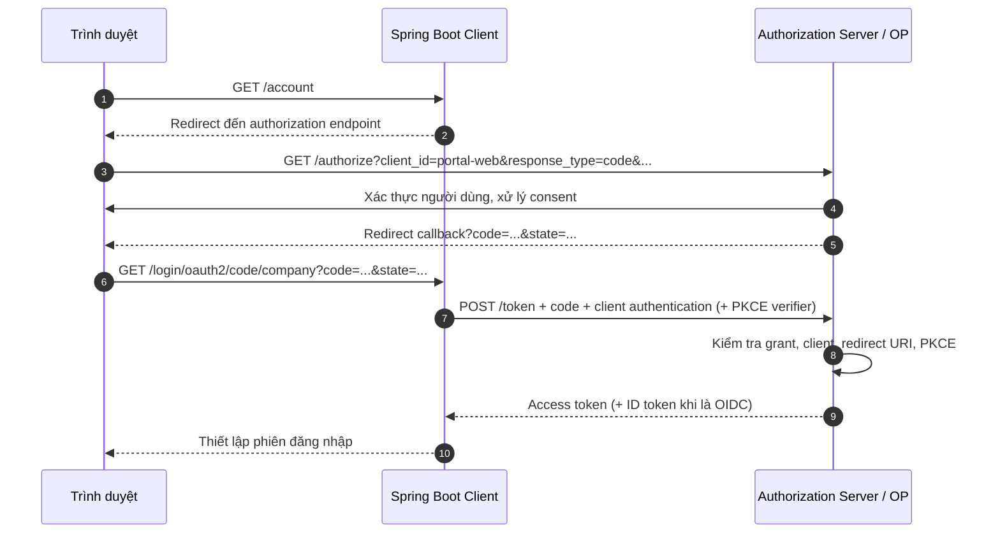

# 5.3. Client ID, client secret và ClientAuthenticationMethod

Trong **Spring Security OAuth 2.0/OIDC Client**, mỗi `ClientRegistration` mô tả cách ứng dụng được đăng ký với một Authorization Server (AS) hoặc OpenID Provider (OP). Ba thuộc tính dễ bị nhầm lẫn nhất là **`clientId`**, **`clientSecret`** và **`clientAuthenticationMethod`**. Chúng liên quan trực tiếp đến việc AS nhận diện và, nếu phù hợp, xác thực *ứng dụng khách* trước khi cấp token.

Ba thuộc tính trả lời ba câu hỏi khác nhau:

| Thuộc tính | Câu hỏi chính | Ví dụ |
|---|---|---|
| **Client ID** — `clientId` | Ứng dụng khách nào đang thực hiện yêu cầu? | `portal-web` |
| **Client secret** — `clientSecret` | Ứng dụng có một thông tin bí mật được cấp khi đăng ký không? | Giá trị bí mật lưu trong secret manager |
| **Client authentication method** — `clientAuthenticationMethod` | Ứng dụng phải chứng minh danh tính của mình với AS bằng **cách nào**? | `client_secret_basic`, `client_secret_post` hoặc `none` |

**Client ID không phải mật khẩu. Client secret không phải mật khẩu người dùng. Client authentication không thay thế cho đăng nhập người dùng hoặc PKCE.** Hiểu đúng ba lớp này giúp tránh lỗi `invalid_client`, tránh để lộ bí mật trong frontend, và chọn cấu hình Spring Security phù hợp với mô hình triển khai.

## 1. Đặt ba thuộc tính vào đúng vị trí của luồng OAuth 2.0

Một OAuth 2.0/OIDC Client có thể tương tác với AS qua hai điểm chính:

1. **Authorization endpoint:** nơi trình duyệt được chuyển tới để người dùng đăng nhập/đồng ý cấp quyền, thường sử dụng `client_id` để AS biết yêu cầu bắt nguồn từ registration nào.
2. **Token endpoint:** nơi client đổi authorization code, refresh token hoặc một grant hợp lệ để lấy token; tại đây AS có thể yêu cầu **client authentication**.

Ví dụ ứng dụng Spring MVC sử dụng OIDC Authorization Code Flow:



Trong ví dụ này, `client_id` xuất hiện ở authorization request. `client_secret` nếu có được gửi **từ backend trực tiếp đến token endpoint**, theo phương thức đã đăng ký; không đưa vào URL chuyển hướng qua trình duyệt.

Luồng **Client Credentials Grant** không có trình duyệt hoặc người dùng cuối, nhưng vẫn cần AS xác định và thường xác thực client tại token endpoint. Ngược lại, SPA hoặc ứng dụng native là **public client** không được giả định có khả năng bảo mật client secret; chúng thường dùng Authorization Code + PKCE với client authentication method là `none`.

## 2. Client ID: định danh của một OAuth client

### 2.1. Client ID có ý nghĩa gì?

`client_id` là **mã định danh mà Authorization Server cấp cho một client registration**. AS sử dụng nó để tra cấu hình như:

- Những grant type được phép: `authorization_code`, `client_credentials` hoặc loại khác.
- Redirect URI nào đã đăng ký, chẳng hạn `https://portal.example.org/login/oauth2/code/company`.
- Scope, audience, chính sách consent hoặc policy áp dụng.
- Client thuộc loại public hay confidential và phương thức xác thực client nào được cho phép.
- Các thông số OIDC như ID token signing/encryption, logout URI và thuộc tính nhận diện client, nếu hệ thống hỗ trợ.

Với OIDC, `client_id` còn là giá trị mà Relying Party thường đối chiếu trong **audience (`aud`)** của ID token. Điều đó bảo đảm ID token được phát cho đúng ứng dụng, khác với access token có audience dành cho API.

Ví dụ nhiều ứng dụng cùng dùng một OP:

| Registration | `client_id` minh họa | Loại triển khai |
|---|---|---|
| `company-web` | `portal-web-prod` | Spring Boot web confidential client |
| `company-spa` | `portal-spa-prod` | SPA thuần public client |
| `company-mobile` | `portal-mobile-prod` | Native mobile public client |
| `reporting-job` | `reporting-worker-prod` | Backend service confidential client |

Các ID khác nhau cho phép AS phân biệt redirect URI, vòng đời credential, scope và chính sách. Một sản phẩm có thể cần **nhiều registration** thay vì dùng chung một client ID cho backend, SPA và mobile.

### 2.2. Client ID có phải bí mật không?

**Không.** Client ID thường xuất hiện trong các URL chuyển hướng, cấu hình JavaScript, log request hoặc discovery của hệ thống. Bất kỳ ai biết client ID cũng chưa có quyền hành động như một **confidential client** nếu AS thực thi client authentication đúng cách.

Client ID cũng **không phải ID của người dùng**. Các giá trị khác nhau:

| Giá trị | Định danh ai/cái gì? |
|---|---|
| `client_id` | OAuth client/application registration |
| OIDC `sub` | Người dùng cuối trong phạm vi issuer và chính sách subject |
| Access token `aud` | Resource Server/API dự định nhận access token |
| OIDC ID token `aud` | RP/client dự định nhận ID token |
| `registrationId` trong Spring | Tên cục bộ để Spring tìm `ClientRegistration` |

Một lỗi thường gặp là nhầm `registrationId` và `clientId`. Trong cấu hình:

```yaml
spring:
  security:
    oauth2:
      client:
        registration:
          company:
            client-id: portal-web-prod
```

- `company` là **registration ID**, do ứng dụng Spring đặt; endpoint mặc định để bắt đầu login có thể là `/oauth2/authorization/company`.
- `portal-web-prod` là **client ID** thực sự phải được đăng ký ở AS; nó được gửi qua tham số `client_id`.

Đổi tên `company` trong cấu hình Spring không đồng nghĩa đổi client ID tại AS. Nhưng đổi `client-id` thường cần cập nhật registration tại AS và kiểm tra lại chính sách, redirect URI cũng như audience của ID token.

## 3. Client secret: credential dành cho confidential client

### 3.1. Client secret làm gì?

`client_secret` là một credential do AS và confidential client cùng biết, thường là một chuỗi có entropy cao. Nó giúp client xác thực với AS tại token endpoint (và những endpoint khác nếu giao thức/chính sách yêu cầu).

Ví dụ:

- Spring Boot chạy trên máy chủ tổ chức kiểm soát có thể giữ secret trong secret manager rồi gửi nó đến token endpoint bằng HTTPS.
- Một cron job chạy trong hạ tầng được quản lý có thể dùng secret khi nhận access token bằng `client_credentials`.
- JavaScript SPA, APK, desktop binary hoặc CLI phân phối đến người dùng **không thể bảo vệ một secret chung trước người dùng có quyền kiểm soát môi trường chạy**.

**Bí mật của client không phải mật khẩu tài khoản người dùng.** AS xác thực client không đồng nghĩa đã xác thực người dùng. Trong Authorization Code Flow, OP vẫn xử lý đăng nhập của End-User; trong Client Credentials Grant, token thường đại diện quyền của client, không gắn với một phiên người dùng tương tác.

### 3.2. Khi nào không được dùng client secret?

Không đặt một client secret dùng chung trong:

- Bundle React/Vue/Angular được phục vụ cho trình duyệt.
- Biến môi trường build như `VITE_CLIENT_SECRET` hay `NEXT_PUBLIC_CLIENT_SECRET`; các giá trị được đưa vào bundle client vẫn có thể bị đọc.
- APK/IPA, ứng dụng desktop/CLI phát hành cho người dùng.
- JavaScript gửi request từ browser tới token endpoint.
- URL authorization, query parameter, thông báo lỗi hoặc log ứng dụng.

Việc **obfuscate/minify** mã hoặc đóng gói `client_secret` thành một chuỗi mã hóa kèm khóa giải mã cũng không làm nó trở thành bí mật nếu client phải tự giải mã trong môi trường của người dùng.

Public client dùng **`ClientAuthenticationMethod.NONE`** (chuỗi cấu hình `none`) và thường kết hợp **Authorization Code + PKCE** trong quy trình đăng nhập. PKCE dùng `code_verifier` khác nhau cho mỗi phiên yêu cầu, giúp hạn chế kẻ đánh cắp authorization code đổi token; **PKCE không biến public client thành confidential client**.

### 3.3. Confidential client cũng không thể chỉ dựa vào client secret

Backend được phép giữ credential khi có biện pháp bảo vệ:

- HTTPS/TLS cho mọi request tới AS.
- Không commit secret vào Git, artifact hoặc image công khai.
- Quyền truy cập secret giới hạn cho tiến trình cần sử dụng.
- Không ghi secret vào application log, stack trace, tracing hay telemetry.
- Có cơ chế **rotation** và thu hồi khi nghi lộ.
- Secret khác nhau giữa các môi trường và, khi thích hợp, giữa các ứng dụng/dịch vụ.

Nếu người vận hành mất quyền kiểm soát host/container hoặc kẻ tấn công truy cập được secret manager và runtime của ứng dụng, confidential client vẫn có thể bị giả mạo. Tính “confidential” là đặc tính **khả năng quản lý credential trong môi trường triển khai**, không phải một bảo đảm tuyệt đối.

## 4. ClientAuthenticationMethod: cách client xác thực tại token endpoint

Trong Spring Security, `ClientAuthenticationMethod` là một **value object** biểu diễn phương thức xác thực client. Ví dụ phổ biến:

```java
ClientAuthenticationMethod.CLIENT_SECRET_BASIC
ClientAuthenticationMethod.CLIENT_SECRET_POST
ClientAuthenticationMethod.NONE
```

Spring Boot có property tương ứng:

```yaml
client-authentication-method: client_secret_basic
```

**Phương thức này phải khớp với phương thức được đăng ký/hỗ trợ tại Authorization Server.** Có secret mà khai báo `none`, hoặc AS đòi `client_secret_basic` nhưng client gửi theo `client_secret_post`, đều có thể khiến token request bị từ chối.

### 4.1. Các phương thức thường gặp

| Giá trị giao thức | Client gửi gì? | Mô hình sử dụng | Lưu ý |
|---|---|---|---|
| `client_secret_basic` | Client ID và secret trong HTTP Basic Authorization header | Confidential client dùng shared secret | Phổ biến, thường được ưu tiên khi AS hỗ trợ |
| `client_secret_post` | `client_id` và `client_secret` trong body `application/x-www-form-urlencoded` | Confidential client dùng shared secret | Chỉ dùng khi phù hợp với AS; hạn chế log body |
| `none` | Không gửi client credential xác thực | Public client | Vẫn gửi `client_id` theo yêu cầu token endpoint |
| `client_secret_jwt` | JWT assertion ký bằng client secret | Confidential client | Cần tạo/ký assertion đúng chuẩn và quản lý shared key |
| `private_key_jwt` | JWT assertion ký bằng private key của client | Confidential client | Client giữ private key; AS kiểm tra public key đã đăng ký |
| mTLS, ví dụ `tls_client_auth` | Chứng thư client qua TLS mutual authentication | Confidential client yêu cầu bảo mật cao | Cần hỗ trợ ở AS, HTTP/TLS stack và phiên bản thư viện |

Cần phân biệt **giá trị chuẩn/protocol** với **hằng số sẵn có trong một phiên bản Spring Security cụ thể**. Ba hằng số Basic/Post/None thường dùng trực tiếp và ổn định; các phương thức JWT hoặc mTLS có thể cần cấu hình HTTP client, signing key, token client converter và khả năng hỗ trợ thích hợp theo phiên bản.

### 4.2. `client_secret_basic`

Client xác thực tại token endpoint qua header HTTP:

```http
POST /oauth2/token HTTP/1.1
Host: login.example.org
Content-Type: application/x-www-form-urlencoded
Authorization: Basic <base64-encoded-client-id-and-secret>

grant_type=authorization_code&code=<authorization-code>&redirect_uri=https%3A%2F%2Fapp.example.org%2Flogin%2Foauth2%2Fcode%2Fcompany
```

Phần HTTP Basic theo OAuth 2.0 dùng client ID/secret được xử lý theo quy tắc form-url-encoding trước khi tạo chuỗi `username:password` và Base64. **Base64 không phải mã hóa an toàn**; TLS mới bảo vệ đường truyền.

Spring Security token client sẽ tạo đúng định dạng khi dùng các converter phù hợp; không nên tự ghép Basic header một cách thủ công nếu framework đã hỗ trợ.

Lưu ý rằng `Authorization: Basic ...` ở đây là **xác thực OAuth client với Authorization Server**, khác hoàn toàn với `Authorization: Bearer ...` mà client gửi cho Resource Server để gọi API.

### 4.3. `client_secret_post`

Với phương thức này, thông tin xác thực xuất hiện trong form body:

```http
POST /oauth2/token HTTP/1.1
Host: login.example.org
Content-Type: application/x-www-form-urlencoded

grant_type=authorization_code
&code=<authorization-code>
&redirect_uri=https%3A%2F%2Fapp.example.org%2Flogin%2Foauth2%2Fcode%2Fcompany
&client_id=portal-web
&client_secret=<server-held-secret>
```

Ví dụ body được xuống dòng để dễ đọc; HTTP request thực tế sẽ form-encode các trường trong cùng payload. Vì secret nằm trong request body, phải cẩn thận với reverse proxy, HTTP instrumentation hoặc bộ ghi log form data.

Không tự đổi sang `client_secret_post` chỉ vì thấy cơ chế Basic có header “Authorization”; hai phương thức vẫn là client authentication và phải khớp cấu hình AS. Theo RFC 6749, đưa secret trong request body chỉ nên là lựa chọn khi phương pháp HTTP Basic không thể dùng/không được AS hỗ trợ.

### 4.4. `none`

Public client không có client authentication credential. Token request ví dụ:

```http
POST /oauth2/token HTTP/1.1
Host: login.example.org
Content-Type: application/x-www-form-urlencoded

grant_type=authorization_code
&client_id=browser-spa
&code=<authorization-code>
&redirect_uri=https%3A%2F%2Fspa.example.org%2Fcallback
&code_verifier=<verifier-created-for-this-request>
```

**`client_id` vẫn có giá trị định danh**, dù client không chứng minh mình bằng secret. Authorization Server thực thi kiểm tra grant, registered redirect URI và PKCE verifier đối với authorization code tương ứng.

Không có lý do thêm header Basic trống hoặc gửi `client_secret=undefined` trong request. Một client đã đăng ký `none` phải thực hiện đúng public-client flow mà AS hỗ trợ.

### 4.5. `private_key_jwt` và `client_secret_jwt`

Đây là hai phương thức xác thực client bằng **JWT assertion** thay cho việc gửi client secret nguyên văn qua Basic hoặc body:

- `client_secret_jwt`: client ký assertion bằng shared secret theo thuật toán đối xứng được AS chấp nhận.
- `private_key_jwt`: client ký assertion bằng private key; AS xác minh chữ ký dựa trên public key/JWKS hoặc chứng thư đã đăng ký.

Một assertion thường mang các claim như:

| Claim | Ý nghĩa điển hình |
|---|---|
| `iss` | Client ID của bên phát assertion |
| `sub` | Client ID đang xác thực |
| `aud` | Audience mà AS yêu cầu, thường gắn với token endpoint/issuer theo profile được AS hỗ trợ |
| `exp` | Thời hạn rất ngắn của assertion |
| `iat` / `jti` | Hỗ trợ thời gian và chống tái sử dụng theo chính sách |

Một token request có thể có:

```text
grant_type=client_credentials
client_id=reporting-worker
client_assertion_type=urn:ietf:params:oauth:client-assertion-type:jwt-bearer
client_assertion=<signed-JWT-assertion>
```

Giá trị assertion phải được ký bằng khóa mà AS đã biết và được xác minh theo chính sách. **Đổi một dòng YAML sang `private_key_jwt` không tự động tạo khóa, đăng ký JWKS, ký assertion hay cấu hình TLS/HTTP client**. Cần phần tích hợp token response client và bộ ký JWT phù hợp với phiên bản Spring Security được dùng.

## 5. ClientAuthenticationMethod khác gì với grant type, PKCE và đăng nhập người dùng?

Bốn khái niệm thường nằm gần nhau trong cấu hình, nhưng phục vụ những mục tiêu khác nhau.

| Thành phần | Trả lời câu hỏi | Ví dụ |
|---|---|---|
| `authorizationGrantType` | Client đang xin token theo **quy trình cấp quyền** nào? | `authorization_code`, `client_credentials` |
| `clientAuthenticationMethod` | Client **xác thực chính nó** với AS bằng cách nào? | `client_secret_basic`, `none` |
| **PKCE** | Người đổi authorization code có chứng minh được đã khởi tạo yêu cầu tương ứng không? | `code_challenge` + `code_verifier` |
| **Xác thực người dùng (OIDC)** | OP đã xác thực End-User nào cho RP? | ID token với `iss`, `sub`, `aud` |

Một số tổ hợp thực tế:

| Tình huống | Grant type | Client authentication | PKCE | Người dùng? |
|---|---|---|---|---|
| Spring MVC web đăng nhập OIDC, có secret | `authorization_code` | `client_secret_basic` | Nên dùng | Có |
| SPA thuần đăng nhập OIDC | `authorization_code` | `none` | Phải dùng theo thực hành hiện đại | Có |
| Ứng dụng mobile native | `authorization_code` | `none` | Phải dùng | Có |
| Spring background job gọi API | `client_credentials` | `client_secret_basic` hoặc cơ chế mạnh hơn | Không áp dụng | Không |
| Backend đổi refresh token | `refresh_token` | Theo yêu cầu của loại client/registration | Không áp dụng cho chính request refresh | Không phải bước đăng nhập mới |

**Không được** dùng `client_credentials` làm đăng nhập thay mặt một người dùng cuối. Client authentication thành công tại token endpoint không tạo phiên OIDC cho người dùng.

Tương tự, PKCE vẫn có giá trị đối với confidential client trong Authorization Code Flow: credential xác thực danh tính client, còn PKCE ràng buộc việc đổi authorization code với yêu cầu authorization đã khởi tạo.

## 6. Cấu hình Spring Boot: confidential OIDC client

### 6.1. Dependencies

Ví dụ ứng dụng Spring Boot MVC có giao diện đăng nhập qua OIDC:

```groovy
dependencies {
    implementation 'org.springframework.boot:spring-boot-starter-security'
    implementation 'org.springframework.boot:spring-boot-starter-oauth2-client'
}
```

Đây là ví dụ cho **Servlet-based web app**. Nếu ứng dụng chỉ là REST Resource Server nhận bearer token, nó không nhất thiết phải đăng ký OAuth client hoặc giữ client secret.

### 6.2. `application.yml`

```yaml
spring:
  security:
    oauth2:
      client:
        registration:
          company:
            provider: company
            client-id: ${COMPANY_OIDC_CLIENT_ID}
            client-secret: ${COMPANY_OIDC_CLIENT_SECRET}
            client-authentication-method: client_secret_basic
            authorization-grant-type: authorization_code
            redirect-uri: "{baseUrl}/login/oauth2/code/{registrationId}"
            scope:
              - openid
              - profile
              - email
        provider:
          company:
            issuer-uri: ${COMPANY_OIDC_ISSUER_URI}
```

Giải nghĩa:

- `registration.company` tạo registration ID cục bộ `company`.
- `client-id` phải khớp client ID được OP cấp.
- `client-secret` được lấy từ biến môi trường/secret injection **ở server**.
- `client-authentication-method` phải khớp method của OP; ở đây chọn HTTP Basic.
- `authorization-grant-type` chỉ định Authorization Code Flow, độc lập với phương thức client authentication.
- `redirect-uri` là callback RP; OP phải cho phép URI cuối cùng sau khi Spring mở rộng placeholders.
- `scope: openid` cho biết yêu cầu OIDC; `profile`, `email` là các claim scopes bổ sung theo chính sách OP.
- `issuer-uri` dùng cho OIDC discovery nếu OP hỗ trợ.

Biến môi trường được đưa vào server runtime **không làm mất yêu cầu quản lý secret**. Không in tất cả environment variables vào log; không đưa `COMPANY_OIDC_CLIENT_SECRET` vào Docker build args, frontend environment hoặc debug dump công khai.

Với cấu hình trên, đường dẫn bắt đầu đăng nhập mặc định thường là:

```text
GET /oauth2/authorization/company
```

Sau khi OP redirect về `/login/oauth2/code/company`, Spring Security dùng `ClientRegistration` đã khai báo để đổi code lấy token.

### 6.3. SecurityFilterChain tối thiểu

```java
import org.springframework.context.annotation.Bean;
import org.springframework.context.annotation.Configuration;
import org.springframework.security.config.Customizer;
import org.springframework.security.config.annotation.web.builders.HttpSecurity;
import org.springframework.security.web.SecurityFilterChain;

@Configuration
public class SecurityConfig {

    @Bean
    SecurityFilterChain securityFilterChain(HttpSecurity http) throws Exception {
        http
            .authorizeHttpRequests(auth -> auth
                .requestMatchers("/", "/error").permitAll()
                .anyRequest().authenticated())
            .oauth2Login(Customizer.withDefaults());

        return http.build();
    }
}
```

Spring Boot có thể tự tạo `ClientRegistrationRepository` từ các properties trên. Spring Security `oauth2Login()` sử dụng repository để chọn registration, tạo authorization request, xử lý callback, trao đổi code và xử lý principal OIDC.

**Lưu ý về PKCE:** cho confidential client, nên chủ động áp dụng PKCE với `S256` nếu Authorization Server hỗ trợ; mức tự động bật PKCE có thể phụ thuộc phiên bản Spring Security và kiểu registration. Có thể cấu hình `OAuth2AuthorizationRequestCustomizers.withPkce()` thông qua authorization request resolver để yêu cầu PKCE nhất quán.

### 6.4. Xác thực client xảy ra ở token request, không phải ở màn hình đăng nhập

Ví dụ client `company` đã đăng ký `client_secret_basic`:

- Trình duyệt **không nhận** `COMPANY_OIDC_CLIENT_SECRET`.
- Khi callback mang authorization code về Spring Boot, backend gửi request HTTPS đến token endpoint.
- Token client đặt credential vào HTTP Basic header theo cấu hình.
- AS từ chối nếu credential sai, method không được phép hoặc grant/code không hợp lệ.
- Khi login OIDC hoàn tất, Spring Security xác minh ID token và tạo session cho End-User.

Một ứng dụng có thể có client secret đúng nhưng **OIDC Login vẫn thất bại** vì redirect URI, issuer, ID token audience, PKCE hoặc điều kiện người dùng không hợp lệ. Không nên quy mọi lỗi token/login về sai secret.

## 7. Cấu hình Spring Boot: public client không dùng secret

Một public client khai báo:

```yaml
spring:
  security:
    oauth2:
      client:
        registration:
          public-client:
            provider: company
            client-id: company-public-client
            client-authentication-method: none
            authorization-grant-type: authorization_code
            redirect-uri: "{baseUrl}/login/oauth2/code/{registrationId}"
            scope:
              - openid
              - profile
        provider:
          company:
            issuer-uri: ${COMPANY_OIDC_ISSUER_URI}
```

Ở đây cố ý **không có `client-secret`**. Public registration phía OP cũng phải được cấu hình không dùng client authentication, với redirect URI và grant type tương ứng.

Ví dụ cấu hình Spring Security Servlet để **chủ động bật PKCE** trên authorization requests:

```java
import org.springframework.context.annotation.Bean;
import org.springframework.context.annotation.Configuration;
import org.springframework.security.config.Customizer;
import org.springframework.security.config.annotation.web.builders.HttpSecurity;
import org.springframework.security.oauth2.client.registration.ClientRegistrationRepository;
import org.springframework.security.oauth2.client.web.DefaultOAuth2AuthorizationRequestResolver;
import org.springframework.security.oauth2.client.web.OAuth2AuthorizationRequestCustomizers;
import org.springframework.security.web.SecurityFilterChain;

@Configuration
public class PublicClientSecurityConfig {

    @Bean
    SecurityFilterChain publicClientFilterChain(
            HttpSecurity http,
            ClientRegistrationRepository registrations) throws Exception {

        var resolver = new DefaultOAuth2AuthorizationRequestResolver(
            registrations, "/oauth2/authorization");

        resolver.setAuthorizationRequestCustomizer(
            OAuth2AuthorizationRequestCustomizers.withPkce());

        http
            .authorizeHttpRequests(auth -> auth
                .requestMatchers("/", "/error").permitAll()
                .anyRequest().authenticated())
            .oauth2Login(login -> login
                .authorizationEndpoint(endpoint ->
                    endpoint.authorizationRequestResolver(resolver)));

        return http.build();
    }
}
```

Đoạn mã là ví dụ **Spring Security Servlet OAuth client** thực hiện Authorization Code Flow trên máy chủ, nhưng khai báo `none` về client authentication. Nó không có nghĩa một SPA JavaScript thuần tự nhiên dùng Spring `oauth2Login()`: nếu JavaScript là thành phần trực tiếp thực hiện OIDC, SPA cần thư viện OIDC của frontend và Spring API thường đóng vai **Resource Server**.

Nếu xây SPA + Backend for Frontend (BFF), BFF có thể được đăng ký như **confidential client** và giữ token ở backend; browser chỉ làm việc với BFF qua session cookie. Loại client phụ thuộc nơi chạy phần **thực sự đổi code lấy token và bảo vệ credential**.

## 8. Tạo ClientRegistration bằng Java

`ClientRegistration` là đối tượng mô tả client registration trong Spring Security. `ClientRegistrationRepository` (thường là `InMemoryClientRegistrationRepository` trong cấu hình đơn giản) lưu hoặc tra cứu các registration qua `registrationId`.

### 8.1. Tạo từ OIDC issuer metadata

Khi OP hỗ trợ discovery, có thể xây một registration từ issuer:

```java
import org.springframework.context.annotation.Bean;
import org.springframework.context.annotation.Configuration;
import org.springframework.security.oauth2.client.registration.ClientRegistration;
import org.springframework.security.oauth2.client.registration.ClientRegistrations;
import org.springframework.security.oauth2.client.registration.ClientRegistrationRepository;
import org.springframework.security.oauth2.client.registration.InMemoryClientRegistrationRepository;
import org.springframework.security.oauth2.core.ClientAuthenticationMethod;
import org.springframework.security.oauth2.core.AuthorizationGrantType;

@Configuration
public class OAuth2ClientRegistrationConfig {

    @Bean
    ClientRegistrationRepository clientRegistrationRepository() {
        String issuer = System.getenv("COMPANY_OIDC_ISSUER_URI");
        String clientId = System.getenv("COMPANY_OIDC_CLIENT_ID");
        String clientSecret = System.getenv("COMPANY_OIDC_CLIENT_SECRET");

        ClientRegistration company = ClientRegistrations
            .fromIssuerLocation(issuer)
            .registrationId("company")
            .clientId(clientId)
            .clientSecret(clientSecret)
            .clientAuthenticationMethod(ClientAuthenticationMethod.CLIENT_SECRET_BASIC)
            .authorizationGrantType(AuthorizationGrantType.AUTHORIZATION_CODE)
            .redirectUri("{baseUrl}/login/oauth2/code/{registrationId}")
            .scope("openid", "profile", "email")
            .build();

        return new InMemoryClientRegistrationRepository(company);
    }
}
```

`ClientRegistrations.fromIssuerLocation(...)` dùng khả năng khám phá metadata của nhà cung cấp khi được hỗ trợ; nó **không đăng ký mới client trên OP**. AS/OP phải có registration với đúng client ID, secret, authentication method, grant type và redirect URI.

Trong ứng dụng thực tế, nên dùng Spring Boot configuration properties/secret manager cùng kiểm tra cấu hình bắt buộc trước startup. Nếu tự định nghĩa `ClientRegistrationRepository` bean, cần chú ý hành vi auto-configuration để không vô tình tạo hai nguồn cấu hình không đồng nhất.

### 8.2. Client Credentials Grant với shared secret

Một client backend gọi API trong chế độ service-to-service có thể tạo registration như sau:

```java
import org.springframework.security.oauth2.client.registration.ClientRegistration;
import org.springframework.security.oauth2.core.AuthorizationGrantType;
import org.springframework.security.oauth2.core.ClientAuthenticationMethod;

ClientRegistration inventory = ClientRegistration
    .withRegistrationId("inventory-service")
    .clientId("inventory-sync-service")
    .clientSecret(System.getenv("INVENTORY_CLIENT_SECRET"))
    .clientAuthenticationMethod(ClientAuthenticationMethod.CLIENT_SECRET_BASIC)
    .authorizationGrantType(AuthorizationGrantType.CLIENT_CREDENTIALS)
    .tokenUri("https://auth.example.org/oauth2/token")
    .scope("inventory.read")
    .build();
```

Ở đây không có `redirectUri` hoặc `authorizationUri` vì `client_credentials` không chuyển hướng người dùng. Client cần `OAuth2AuthorizedClientManager`/cơ chế token client phù hợp để lấy token khi gọi API; **chỉ tạo ClientRegistration chưa tự động kích hoạt một request lấy token**.

Một registration khác có thể dùng `CLIENT_SECRET_POST` nếu AS yêu cầu, nhưng tuyệt đối không đổi method chỉ để che một lỗi khác mà chưa xác minh cấu hình AS.

### 8.3. Ý nghĩa của các getter

```java
ClientRegistration registration =
    clientRegistrationRepository.findByRegistrationId("company");

String registrationId = registration.getRegistrationId();
String clientId = registration.getClientId();
ClientAuthenticationMethod method =
    registration.getClientAuthenticationMethod();
AuthorizationGrantType grant =
    registration.getAuthorizationGrantType();
```

Không ghi `registration.getClientSecret()` vào log, response JSON, actuator endpoint hoặc trang debug. Khi cần kiểm tra cấu hình, chỉ log các trường không nhạy cảm như registration ID, loại grant/method và issuer đã biết; client ID thông thường không bí mật nhưng vẫn cần cân nhắc chính sách thông tin nội bộ.

### 8.4. Một `ClientRegistrationRepository` có thể giữ nhiều registration

Ứng dụng backend vừa đăng nhập người dùng qua OIDC, vừa gọi một API trong chế độ service-to-service có thể có:

```yaml
spring:
  security:
    oauth2:
      client:
        registration:
          company-login:
            provider: company
            client-id: ${LOGIN_CLIENT_ID}
            client-secret: ${LOGIN_CLIENT_SECRET}
            client-authentication-method: client_secret_basic
            authorization-grant-type: authorization_code
            redirect-uri: "{baseUrl}/login/oauth2/code/{registrationId}"
            scope: openid,profile
          inventory-job:
            provider: inventory-as
            client-id: ${JOB_CLIENT_ID}
            client-secret: ${JOB_CLIENT_SECRET}
            client-authentication-method: client_secret_basic
            authorization-grant-type: client_credentials
            scope: inventory.read
        provider:
          company:
            issuer-uri: ${COMPANY_OIDC_ISSUER_URI}
          inventory-as:
            token-uri: https://auth.example.org/oauth2/token
```

Hai registration độc lập cho phép:

- Đặt **scope** và **grant type** đúng mục đích.
- Cấp/revoke/rotate credential của job mà không phá đăng nhập người dùng.
- Phân tách quyền của người dùng với quyền của workload.
- Dùng hai AS hoặc một AS với hai policy khác nhau.

Không nên dùng chung một client ID/secret cho nhiều chức năng khi yêu cầu phân quyền, quản lý vòng đời hoặc môi trường triển khai khác nhau.

## 9. Registration tại AS phải tương thích với cấu hình Spring

Giả sử phía Spring Boot khai báo:

```yaml
client-id: portal-web
client-secret: ${PORTAL_SECRET}
client-authentication-method: client_secret_basic
authorization-grant-type: authorization_code
redirect-uri: "{baseUrl}/login/oauth2/code/{registrationId}"
```

Phía Authorization Server tối thiểu cần có thông tin tương ứng:

| Cấu hình phía AS | Phải phù hợp với Spring |
|---|---|
| Client identifier | `portal-web` |
| Client type | Confidential |
| Authentication method tại token endpoint | `client_secret_basic` |
| Credential | Bí mật tương ứng với `PORTAL_SECRET` |
| Grant type | `authorization_code` |
| Redirect URI | URI tuyệt đối sau khi template Spring được mở rộng |
| Scope | Những scope RP yêu cầu và được AS cho phép |
| PKCE policy | Phải tương thích với việc Spring gửi `code_challenge`/`code_verifier` |
| ID token claims/issuer (nếu OIDC) | Phù hợp issuer, client ID và chính sách OP |

Đổi password của người dùng sẽ **không tự cập nhật client secret**. Ngược lại, rotate client secret không nhất thiết khiến các session người dùng hiện hành hết hiệu lực.

Trong môi trường staging/production, redirect URI thường khác nhau. Tốt nhất quản lý registration và secret riêng theo môi trường để tránh deploy staging vô tình sử dụng credential production hoặc ngược lại.

### 9.1. Reverse proxy và `{baseUrl}`

Khi Spring Boot chạy sau proxy:

```text
Browser -> https://portal.example.org -> reverse proxy -> http://app:8080
```

Template `{baseUrl}/login/oauth2/code/{registrationId}` phải được tính theo **public origin** mà OP đã đăng ký. Nếu ứng dụng suy ra `http://app:8080/...`, OP có thể từ chối redirect URI.

Cần cấu hình forwarded headers từ proxy đáng tin cậy theo Spring Boot/hạ tầng. Không mặc định tin `X-Forwarded-Host`/`Forwarded` do client Internet bất kỳ đưa vào.

Sai `redirect_uri` thường gây lỗi authorization/token exchange, dù `client_id` và `client_secret` hoàn toàn chính xác.

## 10. Vòng đời và bảo vệ client secret

### 10.1. Nơi giữ secret

Đối với confidential Spring Boot client:

| Vị trí | Khuyến nghị |
|---|---|
| Secret manager tích hợp với runtime | Thích hợp; hỗ trợ access control, audit và rotation |
| Environment variable của tiến trình backend | Có thể sử dụng nếu hạ tầng giới hạn quyền đọc, log và dump |
| File cấu hình chỉ backend đọc được | Có thể dùng nếu được bảo vệ và quản lý vòng đời |
| `application.yml` commit vào Git | Tránh đặt giá trị thực |
| Dockerfile `ENV`/build args đưa vào artifact | Tránh làm lộ secret trong image/build history |
| Frontend `.env`/bundle JavaScript | Không được dùng cho confidential secret |
| CI/CD log, exception, tracing | Không được tiết lộ credential |

Một file `.env` được Git ignore vẫn có thể bị lộ qua backup, máy phát triển, CI artifacts hoặc log. Cần xem cả **vòng đời secret**, không chỉ việc có commit vào repository hay không.

### 10.2. Rotation và thu hồi

Một quy trình thay client secret thường có các bước:

1. Tạo credential mới ở AS/OP, nếu hệ thống hỗ trợ nhiều secret hoạt động đồng thời.
2. Cập nhật secret manager và workload configuration.
3. Triển khai/restart/refresh các instance Spring Boot đang dùng secret cũ.
4. Kiểm tra request tới token endpoint có thể xác thực bằng secret mới.
5. Thu hồi secret cũ khi mọi instance đã chuyển đổi.

Nếu AS chỉ cho phép một secret hoạt động tại một thời điểm, rotation có thể đòi hỏi một cửa sổ chuyển đổi hoặc cơ chế rollout khác. Không giả định mọi nhà cung cấp hỗ trợ hai secret đồng thời.

Đối với `private_key_jwt`, cần quản lý key ID, key rotation và JWKS/public key tương ứng; cơ chế đó khác với thay một chuỗi `client_secret`.

### 10.3. Hạn chế tác động khi lộ credential

Secret bị lộ có thể cho phép đối tượng khác giả danh confidential client tại token endpoint. Mức ảnh hưởng phụ thuộc grant type, policy, scope và khả năng kiểm tra token.

Ví dụ với `client_credentials`, client secret bị lộ có thể tạo điều kiện để kẻ tấn công lấy access token cho quyền của workload. Với `authorization_code`, attacker còn cần một authorization code hợp lệ và những điều kiện tương ứng, nhưng việc lộ secret vẫn là sự cố cần xử lý.

Các biện pháp phòng vệ bổ sung gồm: scope tối thiểu, audience cụ thể, token TTL phù hợp, PKCE cho Authorization Code, mTLS/private key assertion khi cần, giám sát token endpoint và thu hồi credential nhanh chóng.

## 11. Đọc lỗi xác thực client đúng nguyên nhân

Khi token endpoint trả lỗi, nên xác định **thời điểm lỗi xảy ra** và **phương thức authentication mà client thật sự gửi**.

| Hiện tượng | Khả năng thường gặp | Hướng xử lý |
|---|---|---|
| `invalid_client` khi đổi code/token | ID/secret sai; method không khớp; credential bị rotate; JWT assertion sai; client không tồn tại | Kiểm tra registration phía AS và cấu hình method/credential ở backend; log an toàn |
| `unauthorized_client` | Client không được phép dùng grant type hoặc chính sách tương ứng | Kiểm tra allowed grant types, client type, AS policy |
| `invalid_grant` khi đổi code | Code hết hạn/đã dùng; redirect URI sai; PKCE verifier không khớp | Kiểm tra transaction, redirect URI, PKCE và thời gian |
| Login redirect bị từ chối trước token request | Redirect URI, client ID, scope, policy authorization endpoint | Kiểm tra URL redirect và registered client ở AS |
| `invalid_scope` | Scope không được AS cho phép | So sánh scope Spring yêu cầu và allowed scopes |
| Token request không gửi Basic header dù AS đòi Basic | `client-authentication-method` khai báo `none`/`post` hoặc converter khác | Đặt đúng method; kiểm tra cấu hình token client |
| Token request gửi Basic nhưng AS chỉ cho `client_secret_post` | Không khớp phương thức đã đăng ký | Đối chiếu OP documentation/config và Spring |
| Public client bị lỗi vì “thiếu secret” | AS khai báo client confidential nhưng frontend là public | Đăng ký public client với `none` và PKCE, hoặc đưa OAuth vào BFF |
| Thử `private_key_jwt` nhưng AS từ chối assertion | Chưa đăng ký public key, sai `aud`/`exp`/`alg` hoặc chưa có bộ ký đúng | Hoàn thiện JWT client assertion integration |
| Đổi secret xong chỉ một số request lỗi | Nhiều instance còn credential cũ hoặc config cache | Kiểm tra rollout/rotation theo từng instance |

**`invalid_client` khác `invalid_grant`.** Client authentication sai chủ yếu liên quan credential/method; authorization code/PKCE sai liên quan grant. Dù nhà cung cấp đôi khi trả thông báo không đầy đủ, phân biệt khái niệm giúp điều tra đúng tầng.

### 11.1. Quan sát mà không tiết lộ bí mật

Có thể log metadata định danh và cấu hình không nhạy cảm:

```java
ClientRegistration registration = repository.findByRegistrationId("company");

if (registration == null) {
    throw new IllegalStateException("Missing OAuth2 registration: company");
}

logger.info("OAuth2 registration={} authMethod={} grantType={}",
        registration.getRegistrationId(),
        registration.getClientAuthenticationMethod().getValue(),
        registration.getAuthorizationGrantType().getValue());
```

Đoạn ví dụ giả sử lớp có sẵn `logger` và biến `repository`. Không đưa `getClientSecret()`, `Authorization` header, token request body hoặc access/refresh token vào log. Với logging mức DEBUG/TRACE của HTTP stack, cần cấu hình masking/redaction phù hợp.

Nếu cần kiểm tra token endpoint trên môi trường thử nghiệm, hãy tạo một client credential riêng có scope hạn chế; không sao chép secret production vào terminal history, bug report hoặc công cụ chia sẻ.

## 12. Các trường hợp thiết kế cần cân nhắc

### 12.1. Spring MVC SSR hoặc BFF

**Nên dùng confidential client** nếu backend thực sự thực hiện OAuth, giữ secret/private key an toàn, và token không bị chuyển ra browser.

```text
Browser --session cookie--> Spring MVC/BFF (client ID + secret riêng)
                                     |
                                     | HTTPS, client_secret_basic
                                     v
                              Authorization Server
```

Browser không trực tiếp giữ client secret. Khi sử dụng Authorization Code Flow, frontend/browser vẫn trải qua authorization redirect nhưng backend thực hiện token exchange.

### 12.2. React SPA gọi Spring REST API trực tiếp

**SPA là public client**, nên OIDC SDK phía frontend dùng Authorization Code + PKCE với `client_id` công khai và **không có client secret**.

```text
SPA (client_id; PKCE; client auth = none)
      |
      +---- Authorization Server / OP
      |
      +---- Bearer access token ----> Spring Resource Server API
```

Ở mô hình này, Spring REST API là Resource Server; việc API kiểm tra bearer access token **không đòi API phải dùng cùng client ID/secret như SPA**. Audience của access token phải dành cho API và được API xác minh.

### 12.3. Service-to-service không có người dùng

**Confidential client** phù hợp với backend job hoặc service. Grant thường là `client_credentials`, kèm một phương thức client authentication được AS cho phép.

Phân biệt account của workload với người dùng cuối: access token có thể không chứa `sub` đại diện một người dùng đăng nhập, và không có ID token OIDC cho quy trình service-to-service thông thường.

### 12.4. Nhiều tenant hoặc nhiều identity provider

Một ứng dụng hỗ trợ nhiều tenant/OP có thể cần **nhiều ClientRegistration** để tách issuer, client ID, credential và phương thức authentication. Không chọn issuer hoặc token endpoint tùy ý từ dữ liệu chưa kiểm soát; ánh xạ tenant sang danh sách OP đã tin cậy.

Nếu OP A dùng `client_secret_basic` và OP B dùng `private_key_jwt`, đây là hai cấu hình client authentication khác nhau; không nên ép mọi registration dùng chung một method chỉ vì chúng đều đăng nhập bằng OIDC.

## 13. Checklist thiết kế một ClientRegistration

Trước khi đưa một OAuth/OIDC client vào triển khai, có thể tự trả lời các câu hỏi sau:

1. **Ai là OAuth client thực tế?** Browser JavaScript, mobile app, Spring backend hay một background job?
2. **Client đó có giữ credential an toàn khỏi người dùng cuối không?** Nếu không, đăng ký public client với `none` và flow phù hợp; không nhúng secret.
3. **`client_id` nào đã được AS/OP cấp?** Nó có đúng với môi trường, tenant và client registration cần dùng?
4. **AS yêu cầu client authentication method nào?** `client_secret_basic`, `client_secret_post`, JWT assertion, mTLS hay `none`?
5. **Nếu có secret/private key, nó được quản lý thế nào?** Secret store, TLS, access control, rotation, thu hồi, logging.
6. **Grant type nào được cho phép?** Authorization Code (và PKCE), Client Credentials hay use case khác?
7. **Redirect URI và token endpoint có khớp?** Chú ý proxy, public base URL, HTTPS và registration ID của Spring.
8. **Scope/audience/issuer có đúng mục đích?** OIDC Login cần `openid`; API phải nhận access token đúng audience; quyền API không tự đến từ client authentication.
9. **Khi lỗi, đã phân biệt client authentication và grant validation chưa?** Xem lỗi từ authorization endpoint, token endpoint và các thành phần xác minh riêng.
10. **Có phân tách registration theo ứng dụng và môi trường không?** Tránh một secret dùng chung trên quá nhiều hệ thống.

**Nguyên tắc cần nhớ:** `clientId` nhận diện ứng dụng, `clientSecret` là credential có thể có của confidential client, còn `ClientAuthenticationMethod` xác định **cách ứng dụng trình credential cho Authorization Server**. Phần này hoàn toàn khác việc OIDC xác thực người dùng, khác PKCE và khác việc Resource Server xác minh access token.

## 14. Tài liệu tham khảo

- [RFC 6749 — The OAuth 2.0 Authorization Framework](https://www.rfc-editor.org/rfc/rfc6749): định nghĩa client identifier, client credentials, public/confidential client và xác thực tại token endpoint.
- [RFC 7636 — Proof Key for Code Exchange by OAuth Public Clients](https://www.rfc-editor.org/rfc/rfc7636): PKCE trong Authorization Code Flow.
- [RFC 7523 — JWT Profile for OAuth 2.0 Client Authentication and Authorization Grants](https://www.rfc-editor.org/rfc/rfc7523): JWT assertion cho client authentication.
- [RFC 8705 — OAuth 2.0 Mutual-TLS Client Authentication and Certificate-Bound Access Tokens](https://www.rfc-editor.org/rfc/rfc8705): mTLS client authentication.
- [RFC 9700 — Best Current Practice for OAuth 2.0 Security](https://www.rfc-editor.org/rfc/rfc9700): khuyến nghị bảo mật OAuth hiện đại.
- [OpenID Connect Core 1.0](https://openid.net/specs/openid-connect-core-1_0.html): OIDC client và các phương thức token endpoint authentication.
- [Spring Security — OAuth 2.0 Client](https://docs.spring.io/spring-security/reference/servlet/oauth2/client/index.html): `ClientRegistration`, `ClientRegistrationRepository`, cấu hình và token client.
- [Spring Security — OAuth 2.0 Login](https://docs.spring.io/spring-security/reference/servlet/oauth2/login/index.html): tích hợp OAuth 2.0/OIDC login trong ứng dụng Servlet.
