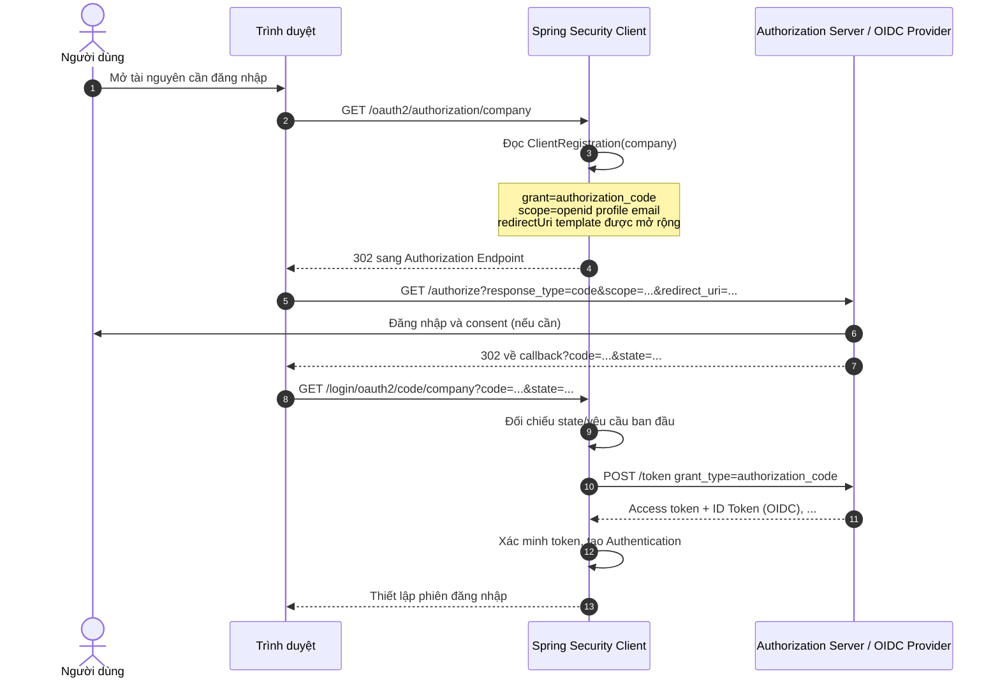

# 5.4. AuthorizationGrantType, scope và Redirect URI template

Trong Spring Security OAuth 2.0/OIDC Client, một đối tượng **`ClientRegistration`** mô tả ứng dụng Client đã đăng ký với một Authorization Server hoặc OpenID Provider (OP). Bên cạnh `client-id`, `client-secret` và thông tin endpoint của nhà cung cấp, ba thuộc tính ảnh hưởng trực tiếp đến cách Client làm việc là **`authorizationGrantType`**, **`scopes`** và **`redirectUri`**.

Ba thuộc tính này trả lời ba câu hỏi:

1. **`AuthorizationGrantType`:** Client nhận quyền và token bằng *luồng OAuth 2.0 nào*?
2. **`scope`:** Client yêu cầu *những quyền truy cập hoặc nhóm thông tin nào*?
3. **Redirect URI template:** Sau khi xử lý authorization request, Authorization Server phải đưa trình duyệt *quay về chính xác URL nào của Client*?

Đối với ứng dụng web đăng nhập qua OIDC, một tổ hợp phổ biến là:

```yaml
authorization-grant-type: authorization_code
scope:
  - openid
  - profile
  - email
redirect-uri: "{baseUrl}/login/oauth2/code/{registrationId}"
```

Các giá trị chỉ có ý nghĩa khi đặt trong một **ClientRegistration hoàn chỉnh**, đồng bộ với cấu hình tại nhà cung cấp danh tính và đường dẫn mà Spring Security thực sự xử lý.

## 1. Ba thuộc tính nằm ở đâu trong ClientRegistration?

Spring Security biểu diễn Client bằng lớp `org.springframework.security.oauth2.client.registration.ClientRegistration`. Các phương thức liên quan:

| Thuộc tính trong Java | Kiểu dữ liệu | Spring Boot configuration property | Ý nghĩa |
|---|---|---|---|
| `getAuthorizationGrantType()` | `AuthorizationGrantType` | `authorization-grant-type` | Chỉ định grant type được dùng cho registration |
| `getScopes()` | `Set<String>` | `scope` | Tập scope Client yêu cầu |
| `getRedirectUri()` | `String` | `redirect-uri` | URI hoặc mẫu URI callback của Client |

Ví dụ đầy đủ một phần cấu hình:

```yaml
spring:
  security:
    oauth2:
      client:
        registration:
          company:
            client-id: ${OIDC_CLIENT_ID}
            client-secret: ${OIDC_CLIENT_SECRET}
            provider: company
            client-authentication-method: client_secret_basic
            authorization-grant-type: authorization_code
            scope:
              - openid
              - profile
              - email
            redirect-uri: "{baseUrl}/login/oauth2/code/{registrationId}"
        provider:
          company:
            issuer-uri: https://id.example.test/realms/company
```

Ở đây:

- `company` dưới `registration` là **`registrationId`**, khóa mà ứng dụng Spring sử dụng để tìm đúng ClientRegistration.
- `client-id` là định danh Client được nhà cung cấp cấp phát, **không nhất thiết trùng** với `registrationId`.
- `provider.company.issuer-uri` giúp Spring khám phá Authorization Endpoint, Token Endpoint, JWK Set và metadata OIDC, nếu nhà cung cấp hỗ trợ discovery.
- `client-authentication-method` mô tả **cách Client xác thực với Token Endpoint**; đây là thuộc tính khác với `authorization-grant-type`.
- `scope` và `redirect-uri` thuộc registration cụ thể. Hai registration cùng dùng một provider vẫn có thể yêu cầu scope khác nhau hoặc có callback riêng.

Trong ứng dụng Spring Boot dùng `spring.security.oauth2.client.registration.*`, Boot ánh xạ các thuộc tính cấu hình này thành `ClientRegistration` và lưu chúng trong `ClientRegistrationRepository`. Với cấu hình tùy biến bằng Java, lập trình viên có thể tạo ClientRegistration bằng builder; quy tắc OAuth 2.0 vẫn giống nhau.

## 2. Nhìn tổng thể trước khi đi vào từng thuộc tính

Với **Authorization Code Grant**, nơi `authorization-grant-type=authorization_code` và `scope=openid profile email`, quá trình đăng nhập có dạng:



Ba thuộc tính tham gia ở các điểm khác nhau:

- **Grant type:** quyết định Client khởi tạo luồng nào. Với authorization code, authorization request có `response_type=code` và token request có `grant_type=authorization_code`.
- **Scope:** được đưa vào authorization request (ví dụ `scope=openid%20profile%20email`). Provider sẽ quyết định scope nào được cấp.
- **Redirect URI template:** được Spring mở rộng thành URL callback cụ thể rồi gửi trong authorization request. IdP dùng URL đó để chuyển trình duyệt trở lại Client.

Nếu chọn **Client Credentials Grant** để một dịch vụ gọi API bằng danh tính của chính nó, các bước qua trình duyệt và Redirect URI nói trên không còn áp dụng. Vì vậy phải xét ba thuộc tính **trong cùng một flow**, không tách rời từng dòng cấu hình.

## 3. `AuthorizationGrantType`: chọn cơ chế nhận token

### 3.1. Grant type trong OAuth 2.0 là gì?

Grant type biểu diễn cách OAuth2 Client nhận quyền để yêu cầu token. Nó ảnh hưởng đến endpoint được sử dụng, tham số bắt buộc, cách xác thực Client và việc có cần người dùng tương tác hay không.

Trong Spring Security, grant type là một giá trị `AuthorizationGrantType`, chẳng hạn:

```java
import org.springframework.security.oauth2.core.AuthorizationGrantType;

AuthorizationGrantType loginGrant =
    AuthorizationGrantType.AUTHORIZATION_CODE;

AuthorizationGrantType serviceGrant =
    AuthorizationGrantType.CLIENT_CREDENTIALS;
```

Trong Spring Boot YAML, giá trị dùng dạng chuỗi chuẩn OAuth 2.0:

```yaml
authorization-grant-type: authorization_code
```

hoặc:

```yaml
authorization-grant-type: client_credentials
```

**Phải chọn grant type phù hợp với mục tiêu của ứng dụng và những grant mà Authorization Server cho phép đối với Client đã đăng ký.** Việc Spring có constant không có nghĩa IdP sẽ cấp quyền dùng grant đó cho mọi Client.

### 3.2. Các grant thường gặp

| Grant type | Có người dùng tương tác? | Có Redirect URI trong flow? | Trường hợp phù hợp |
|---|---|---|---|
| `authorization_code` | Có; qua trình duyệt và màn hình đăng nhập/đồng ý khi cần | **Có** | Web application đăng nhập bằng OAuth2/OIDC |
| `client_credentials` | Không; Client xác thực với Token Endpoint | **Không** | Service-to-service, batch job, backend gọi API bằng danh tính ứng dụng |
| `refresh_token` | Không trong bước làm mới | Không có bước redirect mới | Dùng refresh token hợp lệ để lấy access token mới, không phải cách bắt đầu đăng nhập tương tác |
| `implicit` (legacy) | Có | Có, nhưng token có thể được chuyển qua front channel | Flow cũ; **không nên chọn** cho thiết kế mới |
| `password` (legacy) | Không dùng redirect; Client trực tiếp nhận mật khẩu người dùng | Không | Không phù hợp với OIDC Login hiện đại; tránh sử dụng trong dự án mới |

Spring Security có thể hỗ trợ các grant khác hoặc extension theo phiên bản và cấu hình. Tuy nhiên, khi xây dựng **ứng dụng đăng nhập OIDC bằng `oauth2Login`**, lựa chọn cơ bản là **`AuthorizationGrantType.AUTHORIZATION_CODE`**.

`refresh_token` cần được phân biệt với thuộc tính grant type của ClientRegistration: một registration ban đầu dùng `authorization_code` có thể nhận refresh token nếu nhà cung cấp cho phép, và khi cần làm mới, OAuth2 Client sẽ dùng grant `refresh_token` tại Token Endpoint. Không đổi registration sang `refresh_token` chỉ để “bật refresh token”.

### 3.3. Vì sao Authorization Code phù hợp với OIDC Login?

Một lần OIDC Login cần xác minh danh tính người dùng thông qua OpenID Provider. Authorization Code Flow trao đổi dữ liệu qua hai kênh:

1. **Front channel:** trình duyệt được điều hướng tới Authorization Endpoint và trở lại callback Client với authorization code.
2. **Back channel:** Spring Client trao đổi code với Token Endpoint qua kết nối trực tiếp, nhận token và xác thực ID Token.

Authorization code là mã ngắn hạn, thường dùng một lần; không phải access token dùng để gọi API. Trong các triển khai hiện đại, **PKCE** giúp liên kết code với yêu cầu của Client và giảm nguy cơ code bị lấy cắp rồi đổi lấy token.

`authorization-grant-type=authorization_code` **không tự thay thế** các cơ chế `state`, `nonce` (OIDC), PKCE, HTTPS hoặc kiểm tra redirect URI. Chúng giải quyết những yêu cầu bảo mật khác nhau.

### 3.4. Client Credentials khác Authorization Code ra sao?

Client Credentials dùng khi ứng dụng A gọi API B mà **không đại diện cho một người dùng đang đăng nhập**. Ví dụ một batch job đọc báo cáo tự động:

```yaml
spring:
  security:
    oauth2:
      client:
        registration:
          reporting-job:
            provider: reporting-api
            client-id: ${REPORT_JOB_CLIENT_ID}
            client-secret: ${REPORT_JOB_CLIENT_SECRET}
            client-authentication-method: client_secret_basic
            authorization-grant-type: client_credentials
            scope:
              - reports.read
        provider:
          reporting-api:
            token-uri: https://api.example.test/oauth2/token
```

Với registration này:

- Client gửi yêu cầu token có `grant_type=client_credentials`.
- Không có `response_type=code` hoặc trình duyệt quay về callback.
- Không cần `redirect-uri` để hoàn tất grant.
- Scope `reports.read` là ví dụ quyền truy cập API; provider/API phải thực sự định nghĩa và cho phép nó.
- Không dùng `oauth2Login` như flow đăng nhập người dùng cho registration này.

Access token nhận được đại diện cho quyền của Client theo chính sách provider, không xác nhận rằng có một người cụ thể đã đăng nhập. Vì vậy, `openid` không phải scope nên mặc định thêm vào một registration chỉ làm Client Credentials.

### 3.5. Phân biệt grant type và phương thức xác thực Client

Hai thuộc tính thường đứng cạnh nhau trong YAML:

```yaml
authorization-grant-type: authorization_code
client-authentication-method: client_secret_basic
```

Chúng giải quyết hai câu hỏi độc lập:

- `authorization_code`: Client **lấy quyền/token bằng luồng nào**?
- `client_secret_basic`: Client **chứng minh danh tính với Token Endpoint bằng cách nào**?

Một **confidential client** chạy trên backend có thể dùng authorization code và xác thực Token Endpoint bằng client secret hoặc cơ chế được IdP chấp nhận. Một **public client** không bảo vệ được secret cần dùng cơ chế phù hợp, thường có PKCE; không được nhúng client secret vào JavaScript hoặc ứng dụng phân phối cho người dùng.

## 4. `scope`: Client đang yêu cầu quyền gì?

### 4.1. Scope là tập tên, không phải danh sách claim chắc chắn nhận được

OAuth 2.0 dùng tham số `scope` để diễn đạt phạm vi Client mong muốn. Spring Security lưu thông tin này dưới dạng `Set<String>` trong `ClientRegistration`.

Trong YAML:

```yaml
scope:
  - openid
  - profile
  - email
```

Trong Java builder:

```java
.scope("openid", "profile", "email")
```

Khi tạo authorization request, Spring mã hóa danh sách scope theo cú pháp OAuth 2.0, điển hình:

```text
scope=openid%20profile%20email
```

Dấu cách giữa scope được URL-encode trong URL. Tên scope là token có ý nghĩa theo giao thức/provider: ví dụ `openid` là scope OIDC tiêu chuẩn, còn `orders.read` là ví dụ scope API tự định nghĩa. Không dùng tên tùy ý nếu Authorization Server không biết hoặc không cho phép.

### 4.2. Scope chuẩn OIDC

Trong ứng dụng OIDC Client, có các scope quen thuộc:

| Scope | Ý nghĩa |
|---|---|
| `openid` | Yêu cầu xác thực OIDC; thường cần để nhận ID Token trong Authorization Code Flow |
| `profile` | Yêu cầu nhóm claim hồ sơ như `name`, `preferred_username`, `picture`, `locale` |
| `email` | Yêu cầu `email` và `email_verified` |
| `address` | Yêu cầu claim `address` dạng object |
| `phone` | Yêu cầu `phone_number` và `phone_number_verified` |
| `offline_access` | Theo OIDC, dùng yêu cầu khả năng truy cập khi người dùng không còn hiện diện; việc cấp refresh token còn phụ thuộc chính sách và điều kiện provider |

Trong OIDC, **`openid` là tín hiệu phân biệt yêu cầu xác thực với OAuth 2.0 thuần túy**. Các scope còn lại là tùy chọn theo yêu cầu thực tế.

Ví dụ trang quản trị chỉ cần hiển thị tên và email:

```yaml
scope:
  - openid
  - profile
  - email
```

Không cần mặc định xin `address`, `phone` hoặc `offline_access` chỉ để đăng nhập. Xin quá nhiều scope có thể làm trải nghiệm consent kém hơn, vượt nhu cầu xử lý dữ liệu và gây lỗi `invalid_scope` nếu provider không hỗ trợ.

### 4.3. Scope được yêu cầu và scope được cấp có thể khác nhau

Giả sử Client yêu cầu:

```text
openid profile email phone
```

Provider có thể chỉ chấp thuận:

```text
openid profile email
```

hoặc trả lỗi nếu Client không có quyền xin `phone`. Nếu provider trả tập scope đã cấp trong token response, cần sử dụng thông tin đó đúng ngữ cảnh. Không nên giả định scope trong YAML đồng nghĩa với quyền thực tế của access token.

Tương tự, scope `email` chỉ biểu thị yêu cầu nhóm claim email. Nhà cung cấp không nhất thiết trả email hoặc `email_verified` vì dữ liệu có thể thiếu, chưa được cho phép hoặc chính sách giới hạn. Claim hồ sơ có thể nằm trong ID Token, UserInfo response hoặc chỉ một trong hai nguồn.

### 4.4. Scope không đồng nghĩa với vai trò trong Spring Security

Ví dụ access token có scope `reports.read` không tự tạo một `GrantedAuthority` `ROLE_ADMIN` trong session của ứng dụng. Cần phân biệt:

- **OAuth2 scope:** phạm vi quyền truy cập do Authorization Server cấp cho token hoặc nhóm claim OIDC Client yêu cầu.
- **Role/authority nội bộ:** quyền mà ứng dụng dùng để cho phép truy cập một màn hình hoặc hành động.
- **Audience của token:** tài nguyên/API mà token hướng đến; scope đúng nhưng audience sai vẫn không làm token phù hợp với API.

Nếu ứng dụng là **Resource Server**, việc biến scope thành authority (ví dụ prefix `SCOPE_` trong một số cấu hình mặc định) là chuyện ở tầng xác minh access token/API. Nó không đồng nghĩa mọi scope trong ClientRegistration tự xuất hiện thành vai trò của người dùng khi `oauth2Login` hoàn tất.

### 4.5. Nên xử lý scope tùy biến như thế nào?

Scope nhà cung cấp có thể đặt tên theo nhiều mẫu:

```text
read:invoices
invoices.read
https://api.example.test/scopes/orders.read
api://resource-id/access_as_user
```

Chúng là ví dụ minh họa, không phải các scope phổ quát. Cần tra đúng tài liệu của provider, kiểm tra quyền Client đã được cấp và yêu cầu consent. Trong mã nguồn, nên gom tên scope thành cấu hình có ý nghĩa, tránh rải literal khắp controller và service.

Một ClientRegistration có **một tập scope mặc định** cho các authorization request được tạo từ registration đó. Khi cần xin scope theo từng tính năng, có thể cấu hình tùy biến authorization request hoặc registration riêng phù hợp với thiết kế; không tự nối thêm query parameter vào URL tùy tiện rồi giả định Spring sẽ quản lý state/authorized client đúng.

## 5. Redirect URI template: callback được tạo từ request hiện tại

### 5.1. Redirect URI thực sự là gì?

Redirect URI (còn gọi callback URL) là địa chỉ **thuộc ứng dụng Client**, nơi Authorization Server gửi trình duyệt quay lại sau bước authorization. Với Authorization Code Flow, callback thường nhận:

```text
https://app.example.test/login/oauth2/code/company?code=ONE_TIME_CODE&state=RANDOM_STATE
```

Ở đây, **redirect URI được đăng ký** và được đưa vào authorization request là phần URL **không bao gồm** `code` và `state`:

```text
https://app.example.test/login/oauth2/code/company
```

Query parameter `code` và `state` được Authorization Server thêm vào **sau khi xử lý authorization request**.

Với Spring Security Servlet OAuth2 Login, callback mặc định được xử lý qua `OAuth2LoginAuthenticationFilter` theo mẫu:

```text
/login/oauth2/code/*
```

Do đó template phổ biến là:

```yaml
redirect-uri: "{baseUrl}/login/oauth2/code/{registrationId}"
```

Không cần viết một `@GetMapping` để tự nhận code trong flow `oauth2Login` mặc định. Spring Security filter xử lý callback, kiểm tra state/yêu cầu đã lưu và thực hiện token exchange.

### 5.2. Tại sao dùng template thay vì URL cố định?

Nếu ứng dụng có nhiều môi trường, host, context path hoặc nhiều registration, một mẫu có thể tự tạo URL tương ứng:

```text
Mẫu:
{baseUrl}/login/oauth2/code/{registrationId}

Với local:
http://localhost:8080/login/oauth2/code/company

Với production:
https://app.example.test/login/oauth2/code/company

Với application context path /portal:
https://app.example.test/portal/login/oauth2/code/company
```

Lưu ý **IdP vẫn phải cho phép những redirect URI thực tế** mà Client có thể dùng. Template trong Spring không tự đăng ký callback ở Authorization Server.

### 5.3. Các biến URI template được Spring hỗ trợ

Trong Spring Security ClientRegistration, những biến thường dùng:

| Biến | Ví dụ khi request đi tới `https://portal.example.test/portal` | Ý nghĩa |
|---|---|---|
| `{baseScheme}` | `https` | Scheme của địa chỉ công khai |
| `{baseHost}` | `portal.example.test` | Host của địa chỉ công khai |
| `{basePort}` | Chuỗi rỗng hoặc `:8443` nếu dùng port riêng | Port, gồm dấu `:` khi cần |
| `{basePath}` | `/portal` | Context path/base path của ứng dụng |
| `{baseUrl}` | `https://portal.example.test/portal` | Tương đương `{baseScheme}://{baseHost}{basePort}{basePath}` |
| `{registrationId}` | `company` | Khóa registration đã cấu hình trong Spring |

Lập trình viên cũng có thể gặp `{action}` trong một số mẫu lịch sử của Spring Security, khi resolver dùng `login` cho OAuth2 Login. Đối với bài thực hành hiện đại, template rõ ràng `{baseUrl}/login/oauth2/code/{registrationId}` dễ đối chiếu với đường dẫn callback mặc định hơn.

**`{baseUrl}` là địa chỉ ứng dụng Client**, không phải issuer URL hay Authorization Endpoint của IdP. Nếu IdP đặt tại `https://id.example.test` nhưng người dùng truy cập ứng dụng tại `https://portal.example.test`, callback vẫn nằm trên `portal.example.test`.

### 5.4. Quy trình mở rộng template

Giả sử:

```text
registrationId: company
URL công khai: https://portal.example.test
template: {baseUrl}/login/oauth2/code/{registrationId}
```

Khi Spring tạo authorization request, resolver mở rộng template:

```text
https://portal.example.test/login/oauth2/code/company
```

Sau đó đưa URL đã mã hóa vào tham số `redirect_uri`:

```http
GET /oauth2/authorize?response_type=code&
    client_id=portal-web&
    redirect_uri=https%3A%2F%2Fportal.example.test%2Flogin%2Foauth2%2Fcode%2Fcompany&
    scope=openid%20profile%20email&
    state=RANDOM_STATE HTTP/1.1
Host: id.example.test
```

Ví dụ được ngắt dòng để giải thích; request thật là một URL hợp lệ và còn có thể có `nonce`, PKCE challenge cùng các tham số khác.

Trong token exchange của Authorization Code Flow, Client sử dụng redirect URI tương ứng với authorization request. Provider kiểm tra sự khớp này để bảo vệ mã ủy quyền không bị đổi ở ngữ cảnh khác.

## 6. Phân biệt ba URI dễ nhầm

| Tên | Ví dụ | Thuộc về ai? | Dùng ở đâu? |
|---|---|---|---|
| **Login initiation URI** | `/oauth2/authorization/company` | Spring Client | Người dùng/trình duyệt đi vào đây để **bắt đầu** OAuth2 Login |
| **Authorization Endpoint** | `https://id.example.test/oauth2/authorize` | Authorization Server | Spring điều hướng trình duyệt tới đây |
| **Redirect URI / callback** | `https://portal.example.test/login/oauth2/code/company` | Spring Client | Authorization Server chuyển trình duyệt về đây |

Ngoài ra còn **Token Endpoint**, ví dụ `https://id.example.test/oauth2/token`, được Spring gọi trực tiếp khi đổi authorization code.

**Mọi URI không thể thay thế cho nhau.** Cấu hình `redirect-uri` bằng URL của Token Endpoint hoặc bằng URL khởi đầu `/oauth2/authorization/company` sẽ phá flow. Cấu hình `authorization-uri` bằng callback của chính Client cũng sai vì browser không đến đúng Authorization Server.

Một mẹo dễ nhớ:

- `/oauth2/authorization/{registrationId}`: **bắt đầu**.
- Authorization Endpoint của IdP: **đăng nhập/ủy quyền**.
- `/login/oauth2/code/{registrationId}`: **quay về**.
- Token Endpoint của IdP: **đổi code lấy token**.

## 7. Cấu hình hoàn chỉnh trên Spring Boot

### 7.1. Ví dụ `application.yml` cho OIDC Login

Giả sử nhà cung cấp có issuer `https://id.example.test/realms/company`, Client đã được đăng ký với Redirect URI `https://portal.example.test/login/oauth2/code/company`:

```yaml
server:
  port: 8080

spring:
  security:
    oauth2:
      client:
        registration:
          company:
            provider: company
            client-id: ${OIDC_CLIENT_ID}
            client-secret: ${OIDC_CLIENT_SECRET}
            client-authentication-method: client_secret_basic
            authorization-grant-type: authorization_code
            scope:
              - openid
              - profile
              - email
            redirect-uri: "{baseUrl}/login/oauth2/code/{registrationId}"

        provider:
          company:
            issuer-uri: https://id.example.test/realms/company
```

YAML này phù hợp với cách cấu hình chung của Spring Boot 3.x/4.x và Spring Security OAuth2 Client. Để chạy thật, cần thêm dependency OAuth2 Client phù hợp với nhánh Spring Boot, một IdP hợp lệ, Client đã đăng ký và biến môi trường cho ID/secret. Tên miền `example.test` chỉ dùng minh họa.

Spring Boot sẽ tạo ClientRegistration cho `registrationId=company`. Khi có `issuer-uri`, quá trình discovery cung cấp thông tin endpoint cần thiết cho OIDC. Không cần tự đặt tên `authorization-uri`, `token-uri` hoặc `jwk-set-uri` nếu metadata provider chính xác và Spring hỗ trợ cách cấu hình này.

**Không ghi client secret trực tiếp vào YAML được commit vào repository.** Dùng biến môi trường, secret manager hoặc cơ chế cấu hình an toàn của hệ thống triển khai.

### 7.2. Bật Spring Security OAuth2 Login (Servlet)

```java
import org.springframework.context.annotation.Bean;
import org.springframework.context.annotation.Configuration;
import org.springframework.security.config.Customizer;
import org.springframework.security.config.annotation.web.builders.HttpSecurity;
import org.springframework.security.web.SecurityFilterChain;

@Configuration
public class SecurityConfig {

    @Bean
    SecurityFilterChain securityFilterChain(HttpSecurity http) throws Exception {
        http
            .authorizeHttpRequests(authorize -> authorize
                .requestMatchers("/", "/error").permitAll()
                .anyRequest().authenticated()
            )
            .oauth2Login(Customizer.withDefaults());

        return http.build();
    }
}
```

Đây là cấu hình Spring MVC/Servlet. WebFlux dùng API reactive khác như `ServerHttpSecurity` và `SecurityWebFilterChain`.

Với cấu hình trên, URL để bắt đầu đăng nhập:

```text
http://localhost:8080/oauth2/authorization/company
```

Callback tương ứng trong môi trường local:

```text
http://localhost:8080/login/oauth2/code/company
```

Nếu dùng URL local này để thử nghiệm, phải đăng ký đúng URL ấy tại IdP khi IdP cho phép callback loopback. Ở production, dùng HTTPS và đăng ký callback theo host công khai thực tế.

### 7.3. Ý nghĩa của cấu hình từng dòng

| Dòng cấu hình | Điều gì thay đổi? |
|---|---|
| `authorization-grant-type: authorization_code` | Spring dùng Authorization Code Grant cho registration |
| `scope: [openid, profile, email]` | Spring yêu cầu xác thực OIDC và nhóm claim profile/email |
| `redirect-uri: "{baseUrl}/login/oauth2/code/{registrationId}"` | Spring tạo URL callback theo host/context path và registration cụ thể |
| `client-authentication-method: client_secret_basic` | Spring xác thực Client với Token Endpoint theo phương thức basic, nếu IdP cho phép |
| `issuer-uri: ...` | Spring khám phá metadata provider, các endpoint và thông tin xác minh token OIDC |
| `provider: company` | Registration dùng cấu hình provider có khóa `company` |

Ở đây `scope` và `redirect-uri` được gắn trực tiếp vào registration, còn các endpoint OAuth2 được cấu hình ở provider. Điều này cho phép nhiều registration cùng dùng một provider nhưng có client ID, scope hoặc callback riêng.

## 8. Tạo ClientRegistration bằng Java

Spring Boot properties là cách thông dụng, nhưng có thể khởi tạo registration bằng Java, chẳng hạn khi cấu hình được cung cấp bởi một hệ thống quản lý tenant.

Với một OIDC Provider có hỗ trợ discovery:

```java
import org.springframework.security.oauth2.client.registration.ClientRegistration;
import org.springframework.security.oauth2.client.registration.ClientRegistrations;
import org.springframework.security.oauth2.core.AuthorizationGrantType;
import org.springframework.security.oauth2.core.ClientAuthenticationMethod;

ClientRegistration registration = ClientRegistrations
    .fromIssuerLocation("https://id.example.test/realms/company")
    .registrationId("company")
    .clientId(System.getenv("OIDC_CLIENT_ID"))
    .clientSecret(System.getenv("OIDC_CLIENT_SECRET"))
    .clientAuthenticationMethod(ClientAuthenticationMethod.CLIENT_SECRET_BASIC)
    .authorizationGrantType(AuthorizationGrantType.AUTHORIZATION_CODE)
    .scope("openid", "profile", "email")
    .redirectUri("{baseUrl}/login/oauth2/code/{registrationId}")
    .build();
```

`ClientRegistrations.fromIssuerLocation(...)` khởi tạo builder từ metadata được provider công bố; các phương thức sau ghi đè hoặc bổ sung thông tin Client. Lời gọi discovery phải truy cập được provider. Ví dụ chỉ minh họa tạo đối tượng; trong một ứng dụng cần đưa registration vào `ClientRegistrationRepository` phù hợp hoặc dùng auto-configuration của Boot thay thế.

Nếu đã có đối tượng `ClientRegistration`, có thể đọc ba thuộc tính:

```java
AuthorizationGrantType grantType = registration.getAuthorizationGrantType();
var scopes = registration.getScopes();
String redirectUriTemplate = registration.getRedirectUri();

System.out.println(grantType.getValue());
System.out.println(scopes);
System.out.println(redirectUriTemplate);
```

Kết quả của `getRedirectUri()` là **mẫu URI đã cấu hình**; nó có thể vẫn chứa `{baseUrl}` và `{registrationId}`. Các placeholder được mở rộng **khi Spring tạo authorization request**, không phải chỉ bằng cách gọi getter.

### 8.1. Không tự mở rộng template bằng cách thay thế chuỗi đơn giản

Tránh logic như:

```java
// Không nên tự dùng cách này để thay toàn bộ cơ chế giải URI.
String callback = template.replace("{baseUrl}", "http://localhost:8080");
```

Cách tự thay chuỗi dễ bỏ qua proxy headers, context path, port, encoding và biến khác. Hãy để cơ chế OAuth2 authorization request của Spring xử lý việc mở rộng, hoặc sử dụng URI cố định phù hợp khi có yêu cầu rõ ràng.

### 8.2. Phân biệt bản đăng ký tĩnh và giá trị theo từng request

`ClientRegistration` lưu **cấu hình**. URL callback cuối cùng có thể phụ thuộc request thực tế:

```text
ClientRegistration.redirectUri:
{baseUrl}/login/oauth2/code/{registrationId}

Request A đến qua:
https://portal.example.test
→ https://portal.example.test/login/oauth2/code/company

Request B đến qua:
https://staging.example.test
→ https://staging.example.test/login/oauth2/code/company
```

Tính năng này hữu ích khi một deployment có nhiều host hợp lệ, nhưng cũng có rủi ro nếu host/proxy headers đến từ nguồn không đáng tin. Danh sách callback của IdP và cấu hình proxy phải khớp với tập host thực sự cho phép.

## 9. Đổi Redirect URI sang đường dẫn riêng

Giả sử ứng dụng cần callback:

```text
https://portal.example.test/auth/oidc/callback/company
```

Chỉ đổi YAML chưa đủ. Cần **đồng bộ ba nơi**.

### 9.1. Đổi redirect URI trong ClientRegistration

```yaml
spring:
  security:
    oauth2:
      client:
        registration:
          company:
            redirect-uri: "{baseUrl}/auth/oidc/callback/{registrationId}"
```

Đây là một phần của cấu hình, cần giữ các thuộc tính khác trong cấu hình đầy đủ.

### 9.2. Đổi đường dẫn Spring Security lắng nghe

```java
@Bean
SecurityFilterChain securityFilterChain(HttpSecurity http) throws Exception {
    http
        .authorizeHttpRequests(authorize -> authorize
            .requestMatchers("/", "/error").permitAll()
            .anyRequest().authenticated()
        )
        .oauth2Login(oauth2 -> oauth2
            .redirectionEndpoint(redirection -> redirection
                .baseUri("/auth/oidc/callback/*")
            )
        );

    return http.build();
}
```

`redirectionEndpoint().baseUri(...)` nói với Spring Security filter **nhận authorization response ở đường dẫn nào**. Nó phải tương thích với path thực tế của callback được template sinh ra.

### 9.3. Đăng ký URI thực tế tại IdP

Ví dụ môi trường production:

```text
https://portal.example.test/auth/oidc/callback/company
```

Nếu chưa đăng ký URL này hoặc vẫn để callback cũ, IdP có thể báo `redirect_uri_mismatch`. Nếu IdP cho phép URL nhưng Spring vẫn lắng nghe `/login/oauth2/code/*`, trình duyệt có thể quay về một đường dẫn mà OAuth2 Login filter không xử lý.

**Lưu ý:** `redirectionEndpoint` khác với `authorizationEndpoint`. Đổi đường dẫn bắt đầu đăng nhập `/oauth2/authorization/{registrationId}` là một việc riêng; không nhầm nó với callback.

## 10. Tương thích Redirect URI với reverse proxy và context path

### 10.1. Tình huống điển hình

Bên ngoài người dùng truy cập:

```text
https://portal.example.test
```

Nhưng request đi qua load balancer/reverse proxy đến ứng dụng Spring:

```text
http://app-internal:8080
```

Nếu Spring nhìn thấy host/scheme nội bộ khi mở rộng `{baseUrl}`, nó có thể gửi:

```text
http://app-internal:8080/login/oauth2/code/company
```

Trong khi IdP chỉ cho phép:

```text
https://portal.example.test/login/oauth2/code/company
```

Kết quả thường là lỗi callback do redirect URI không khớp. Nguyên nhân nằm ở **địa chỉ công khai Spring dùng khi tạo authorization request**, không phải ở scope.

### 10.2. Hướng cấu hình

Proxy cần cung cấp thông tin host/protocol công khai bằng những header thích hợp. Tùy hạ tầng, Spring Boot có thể được cấu hình xử lý forwarded headers, ví dụ:

```yaml
server:
  forward-headers-strategy: framework
```

Cách triển khai chính xác phụ thuộc reverse proxy/container và phiên bản Spring Boot. **Chỉ tin forwarded headers khi chúng được thiết lập hoặc kiểm soát bởi proxy đáng tin**, không cho bất kỳ Client bên ngoài nào giả mạo host và scheme rồi khiến ứng dụng tạo callback ngoài ý muốn.

Để tìm vấn đề, cần xem URL `redirect_uri` thực tế trong authorization request (sau khi giải mã), đối chiếu với địa chỉ công khai và cấu hình callback tại IdP.

### 10.3. Có nên dùng URL callback cố định?

Có thể dùng URI cố định cho môi trường đã biết:

```yaml
redirect-uri: "https://portal.example.test/login/oauth2/code/company"
```

Cách này giúp tránh suy luận host từ request nếu ứng dụng chỉ hoạt động trên một origin công khai, nhưng khiến cấu hình phải khác giữa local/staging/production. Khi dùng URI cố định, phải bảo đảm browser thật sự truy cập được URL đó và Spring Security lắng nghe đúng path.

Không nên dùng template wildcard tùy tiện để tiếp nhận bất kỳ redirect URL nào. Đăng ký Callback URI cụ thể tại IdP vẫn là biện pháp bảo mật cần thiết.

## 11. Nhiều ClientRegistration trên cùng ứng dụng

Một ứng dụng có thể hỗ trợ đăng nhập từ hai nhà cung cấp hoặc hai Client khác nhau:

```yaml
spring:
  security:
    oauth2:
      client:
        registration:
          partner-a:
            provider: partner-a
            client-id: ${PARTNER_A_ID}
            client-secret: ${PARTNER_A_SECRET}
            authorization-grant-type: authorization_code
            scope: [openid, profile, email]
            redirect-uri: "{baseUrl}/login/oauth2/code/{registrationId}"
          partner-b:
            provider: partner-b
            client-id: ${PARTNER_B_ID}
            client-secret: ${PARTNER_B_SECRET}
            authorization-grant-type: authorization_code
            scope: [openid]
            redirect-uri: "{baseUrl}/login/oauth2/code/{registrationId}"
        provider:
          partner-a:
            issuer-uri: https://login-a.example.test/issuer
          partner-b:
            issuer-uri: https://login-b.example.test/issuer
```

Hai URL bắt đầu đăng nhập là:

```text
/oauth2/authorization/partner-a
/oauth2/authorization/partner-b
```

Hai callback được mở rộng là:

```text
https://portal.example.test/login/oauth2/code/partner-a
https://portal.example.test/login/oauth2/code/partner-b
```

Dù cùng một template, `{registrationId}` giúp callback khác nhau. Điều này cũng có nghĩa mỗi Client ở từng IdP phải đăng ký đúng callback tương ứng. Nếu đặt `registrationId` là `partner-a` nhưng đăng ký callback với hậu tố `/partner-b`, authorization request dễ bị từ chối.

Một số provider cho phép nhiều ClientRegistration cùng trỏ tới một issuer; trong trường hợp đó, mỗi registration vẫn có client ID, scope và callback theo hợp đồng đăng ký của nó.

## 12. Lỗi cấu hình điển hình và cách xác định nguyên nhân

| Triệu chứng | Thuộc tính liên quan | Nguyên nhân thường gặp | Cách khoanh vùng |
|---|---|---|---|
| IdP báo `unsupported_grant_type` | `authorization-grant-type` | Server không hỗ trợ grant hoặc Client chưa được phép dùng | So sánh grant đã đăng ký tại IdP với token request |
| OAuth2 Login không mở trang đăng nhập | `authorization-grant-type` | Registration đặt `client_credentials` thay vì `authorization_code` | Xem registration và URL bắt đầu `/oauth2/authorization/...` |
| IdP báo `invalid_scope` | `scope` | Scope sai tên, chưa được cấp hoặc provider không hỗ trợ | Kiểm tra scope thực tế trong authorization request |
| Login được nhưng không có `email` | `scope` hoặc claim mapping | Thiếu `email`, IdP không trả, hoặc claim nằm ở UserInfo | Kiểm tra ID Token, UserInfo và scope được cấp |
| IdP báo `redirect_uri_mismatch` | `redirect-uri` | Sai scheme/host/port/path hoặc chưa đăng ký callback | Giải mã `redirect_uri` trong URL Authorization Endpoint, đối chiếu với IdP |
| Callback tới Client nhưng không được xử lý | `redirect-uri` và filter path | Tùy biến callback nhưng chưa đổi `redirectionEndpoint().baseUri` | So sánh path callback với SecurityFilterChain |
| Callback trả `invalid_grant` khi đổi code | `redirect-uri` hoặc PKCE/code | Redirect URI tại token exchange không khớp, code hết hạn/đã dùng, PKCE sai | Kiểm tra các bước của authorization code flow, không log secret/token |
| Callback thiếu hoặc sai `state` | Session/flow | Mất session hoặc callback không thuộc authorization request ban đầu | Kiểm tra cookie/session, host, proxy, request repository |
| Redirect URI chứa `http://app-internal:8080` | `{baseUrl}` và proxy | Forwarded headers chưa được xử lý đúng | Kiểm tra host/protocol công khai, cấu hình proxy |
| App có nhiều IdP nhưng quay về registration sai | `{registrationId}` | Sai registrationId trong link/callback hoặc cấu hình IdP | Đối chiếu URL start, ClientRegistration và callback được đăng ký |

Nếu gặp lỗi, đừng thay cùng lúc grant, scope và callback rồi kiểm tra lại: xác định trước **lỗi xuất hiện ở bước nào**. Ví dụ `invalid_scope` xảy ra trong yêu cầu ủy quyền thường không liên quan đến việc Spring lắng nghe callback; ngược lại lỗi 404 ở callback thường là vấn đề path/filter.

### 12.1. Cách quan sát flow an toàn trong môi trường phát triển

1. Kiểm tra URL bắt đầu đăng nhập: `/oauth2/authorization/{registrationId}`.
2. Trong trình duyệt, xem request được redirect tới Authorization Endpoint. Xác nhận các tham số **`response_type`**, `scope` và `redirect_uri`.
3. Giải mã `redirect_uri`, đối chiếu chính xác với URI được cho phép ở IdP.
4. Nếu IdP chuyển hướng trở lại Client, xác nhận path callback trùng bộ lọc Spring Security.
5. Nếu bước đổi token lỗi, kiểm tra response/lỗi từ Token Endpoint bằng phương thức quan sát an toàn; không ghi lại client secret, authorization code, session cookie hoặc token thật vào log/screenshot chia sẻ.
6. Nếu đăng nhập thành công mà thiếu thông tin người dùng, kiểm tra claim trong ID Token/UserInfo và chính sách scope/consent thay vì thay redirect URI.

`response_type=code` là tham số Authorization Endpoint trong authorization code flow; `grant_type=authorization_code` là tham số Token Endpoint để đổi code. Đừng nhầm hai tham số này khi đọc request.

## 13. Các nguyên tắc bảo mật liên quan trực tiếp

### 13.1. Redirect URI cần cụ thể và được kiểm soát

- Đăng ký callback theo URI chính xác mà Client sử dụng; tránh wildcard mở rộng quá mức.
- Dùng HTTPS cho callback production; callback loopback HTTP chỉ dùng khi phù hợp chính sách provider và môi trường phát triển/native.
- Không lấy redirect URI động từ query parameter chưa kiểm tra do người dùng cung cấp.
- Không mở redirect từ callback sang URL ngoài do người dùng tùy ý chỉ định.
- Bảo vệ HTTP session và `state` để liên kết authorization response với yêu cầu đã khởi tạo.
- Với Authorization Code Flow, dùng PKCE theo phiên bản, khả năng Client và chính sách hỗ trợ của Authorization Server.

Nếu Authorization Server phát hiện redirect URI không hợp lệ, nó không nên tự chuyển hướng tới URI chưa được xác minh để báo lỗi; việc đó có thể làm lộ code hoặc tạo đường dẫn tấn công.

### 13.2. Scope theo nguyên tắc tối thiểu

- Chỉ yêu cầu scope thật sự cần cho tính năng hiện tại.
- Không xin `address`, `phone`, `offline_access` chỉ vì provider có hỗ trợ.
- Không coi việc cấu hình scope là bằng chứng người dùng đã consent.
- Không suy ra role nội bộ chỉ từ scope Client đã yêu cầu.
- Không đưa access token, refresh token hoặc client secret vào URL của trình duyệt.

### 13.3. Không đánh đồng authorization grant và quyền truy cập dữ liệu

Grant type xác định **quy trình lấy token**. Scope xác định **quyền/nhóm thông tin yêu cầu trong quy trình đó**. Redirect URI xác định **đích callback của browser trong flow cần chuyển hướng**.

Ví dụ cùng một Client có authorization code và `scope=openid profile` không có nghĩa ứng dụng tự động được quyền gọi API `orders.write`. Muốn gọi API đó cần access token phù hợp với audience và quyền mà Authorization Server/API chấp nhận.

## 14. Các câu hỏi thực hành

### Bài tập 1: Nhận diện thuộc tính

Cho cấu hình:

```yaml
registration:
  accounting:
    authorization-grant-type: authorization_code
    scope: [openid, profile, email]
    redirect-uri: "{baseUrl}/login/oauth2/code/{registrationId}"
```

Giả sử Client nhận request từ `https://erp.example.test`, trả lời:

1. Grant type nào đang được sử dụng?
2. Scope nào biểu thị đây là yêu cầu OIDC?
3. URL callback thực tế là gì?
4. Cần đăng ký callback đó ở đâu?

**Đáp án:** grant `authorization_code`; scope `openid`; callback `https://erp.example.test/login/oauth2/code/accounting`; đăng ký URI tại Authorization Server/OpenID Provider của Client `accounting`.

### Bài tập 2: Phân biệt scope và claim

Ứng dụng cấu hình `scope: [openid, profile, email]` nhưng sau đăng nhập không thấy `email` trong ID Token. Điều này có chứng minh cấu hình sai?

**Gợi ý:** Chưa thể kết luận. Có thể provider trả `email` ở UserInfo, không có dữ liệu email, chưa cấp quyền hoặc chính sách không trả claim. Cần kiểm tra scope được cấp và nguồn claim; không được giả định scope là cam kết trả mọi claim.

### Bài tập 3: Thay đường dẫn callback

Muốn callback trở thành `/auth/callback/accounting` thì cần thay những thành phần nào?

**Đáp án:** (1) `redirect-uri` trong ClientRegistration, (2) `oauth2Login().redirectionEndpoint().baseUri(...)` để Spring lắng nghe, và (3) danh sách Redirect URI hợp lệ tại IdP. Giữ đúng `registrationId`.

### Bài tập 4: Đổi sang Client Credentials

Một batch job không có trình duyệt chỉ cần gọi API `reports.read`. Có cần `openid`, `redirect-uri` và `oauth2Login` không?

**Đáp án:** Thông thường không. Dùng `client_credentials`, yêu cầu scope API `reports.read` theo hợp đồng provider, dùng OAuth2 Client để lấy access token trực tiếp qua Token Endpoint. Việc xác thực người dùng/OIDC ID Token không thuộc flow này.

## 15. Bảng tóm lược cho ClientRegistration

| Nếu cần... | Đặt/chọn... | Kiểm tra thêm... |
|---|---|---|
| Người dùng đăng nhập qua OIDC | `authorization_code` | Provider hỗ trợ OIDC, scope `openid`, callback, PKCE/state |
| Hiển thị tên và email | `scope: [openid, profile, email]` | Provider/consent và claim thực sự có mặt |
| Backend gọi API không có người dùng | `client_credentials` | Client authentication và scope API tương ứng |
| Callback mặc định | `{baseUrl}/login/oauth2/code/{registrationId}` | IdP đăng ký đúng URI thực tế |
| Callback tùy chỉnh | Template theo path mới | Đồng bộ `redirectionEndpoint().baseUri` và IdP |
| Nhiều provider/client | `registrationId` riêng từng Client | URL start, callback, scope và client ID tương ứng |
| Chạy sau proxy | Template đúng URL công khai hoặc fixed callback | Host/scheme/port, forwarded headers từ proxy đáng tin |
| Đọc cấu hình trong Java | `getAuthorizationGrantType()`, `getScopes()`, `getRedirectUri()` | Getter trả template, chưa chắc đã là callback URL mở rộng |

## 16. Tài liệu tham khảo chính thức

- [Spring Security — Core Interfaces and Classes](https://docs.spring.io/spring-security/reference/servlet/oauth2/client/core.html): định nghĩa `ClientRegistration`, ý nghĩa từng thuộc tính và repository.
- [Spring Security — Authorization Grant Support](https://docs.spring.io/spring-security/reference/servlet/oauth2/client/authorization-grants.html): hỗ trợ authorization code, client credentials, PKCE và cách dùng redirect URI template.
- [Spring Security — OAuth2 Login Core Configuration](https://docs.spring.io/spring-security/reference/servlet/oauth2/login/core.html): authorization request, callback URL mặc định và `oauth2Login`.
- [Spring Security — OAuth2 Login Advanced Configuration](https://docs.spring.io/spring-security/reference/servlet/oauth2/login/advanced.html): tùy biến `redirectionEndpoint().baseUri(...)` và filter path.
- [Spring Security API — ClientRegistration](https://docs.spring.io/spring-security/reference/api/java/org/springframework/security/oauth2/client/registration/ClientRegistration.html): `getAuthorizationGrantType()`, `getScopes()`, `getRedirectUri()` và các placeholder được hỗ trợ.
- [Spring Security API — ClientRegistration.Builder](https://docs.spring.io/spring-security/reference/api/java/org/springframework/security/oauth2/client/registration/ClientRegistration.Builder.html): cấu hình theo Java builder.
- [RFC 6749 — The OAuth 2.0 Authorization Framework](https://www.rfc-editor.org/rfc/rfc6749): grant, scope, redirect URI và authorization code.
- [RFC 7636 — Proof Key for Code Exchange](https://www.rfc-editor.org/rfc/rfc7636): bảo vệ authorization code bằng PKCE.
- [OpenID Connect Core 1.0](https://openid.net/specs/openid-connect-core-1_0.html): scope `openid`, ID Token và các claim tiêu chuẩn.

Ba giá trị **`AuthorizationGrantType`, `scope` và Redirect URI template** phải được đọc như một tập cấu hình thống nhất: Client **dùng flow nào**, **xin quyền gì**, và **quay về đâu**. Khi nắm rõ chúng trong `ClientRegistration`, bạn có thể tự định nghĩa cấu hình login OIDC, giải thích URL redirect mà Spring tạo và khoanh vùng phần lớn lỗi ban đầu của một tích hợp OAuth2 Client.
