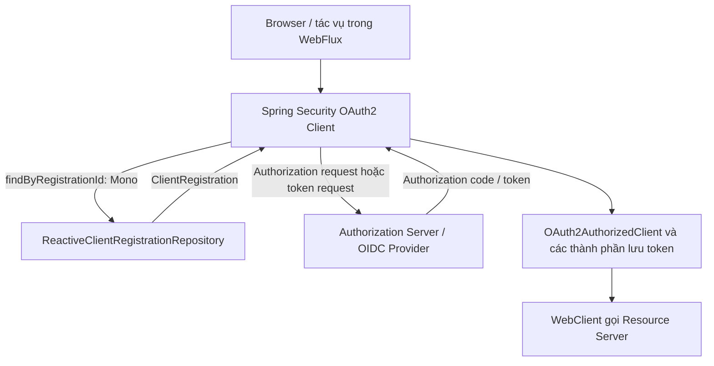
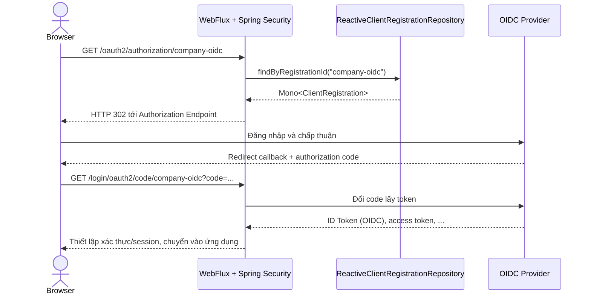

# 5.8. `ReactiveClientRegistrationRepository` trong ứng dụng WebFlux

## 1. Vì sao WebFlux cần `ReactiveClientRegistrationRepository`?

Khi một ứng dụng Spring WebFlux đóng vai trò **OAuth 2.0 Client** hoặc sử dụng **OAuth 2.0 Login/OpenID Connect (OIDC)**, ứng dụng phải biết mình được đăng ký với Authorization Server như thế nào: `client_id` là gì, được dùng grant type nào, redirect URI ở đâu, có những scope nào và Authorization Server cung cấp các endpoint nào. Spring Security gói các thông tin đó trong đối tượng **`ClientRegistration`**.

`ReactiveClientRegistrationRepository` là **hợp đồng truy xuất cấu hình các OAuth2 client** trong ngăn xếp reactive. Nó cho phép Spring Security tìm một `ClientRegistration` theo `registrationId` dưới dạng `Mono<ClientRegistration>`:

```java
public interface ReactiveClientRegistrationRepository {
    Mono<ClientRegistration> findByRegistrationId(String registrationId);
}
```

Ví dụ, khi người dùng chọn đăng nhập qua nhà cung cấp có `registrationId` là `company-oidc`, WebFlux cần tải đúng cấu hình client trước khi tạo yêu cầu chuyển hướng tới Authorization Server. Khi một service cần dùng `client_credentials` để gọi API, các thành phần quản lý token cũng cần tìm cấu hình của client theo ID tương ứng.

Tên `Reactive...` ở đây nhấn mạnh **API truy xuất phù hợp với Reactor/WebFlux**, không có nghĩa bản thân cấu hình OAuth2 được tự động đồng bộ từ xa hay refresh theo thời gian thực. Với cách triển khai trong bộ nhớ, việc tìm kiếm rất nhanh và trả về `Mono` từ dữ liệu sẵn có; với cách triển khai tự viết, nguồn dữ liệu có thể là kho cấu hình hoặc cơ sở dữ liệu reactive.

### Vị trí trong luồng OAuth2/OIDC



**Phạm vi trách nhiệm cần nhớ:** repository này lưu hoặc tìm **cấu hình đăng ký client**, **không phải** nơi lưu access token, refresh token, người dùng đăng nhập hay session. Đối tượng mang token đã được cấp là `OAuth2AuthorizedClient`; nó được quản lý bởi những thành phần khác.

## 2. `ClientRegistration` chứa những gì?

Một `ClientRegistration` mô tả quan hệ giữa **một ứng dụng OAuth2 client** và **một Authorization Server/Provider**. Những trường thường dùng gồm:

| Thuộc tính | Ý nghĩa | Ví dụ |
| --- | --- | --- |
| `registrationId` | Khóa nội bộ để Spring Security tra cứu đăng ký | `company-oidc`, `reporting` |
| `clientId` | ID mà Authorization Server cấp cho ứng dụng | `employee-portal` |
| `clientSecret` | Bí mật client nếu loại client/grant cần; phải giữ ở backend | Lấy từ biến môi trường/vault |
| `clientAuthenticationMethod` | Cách client xác thực tại Token Endpoint | `client_secret_basic`, `client_secret_post`, `none` |
| `authorizationGrantType` | Cách xin quyền/token | `authorization_code`, `client_credentials` |
| `redirectUri` | URL nhận phản hồi từ luồng có chuyển hướng | `{baseUrl}/login/oauth2/code/{registrationId}` |
| `scopes` | Những quyền/phạm vi mà client yêu cầu | `openid`, `profile`, `report.read` |
| `providerDetails` | Endpoint, issuer, thông tin JWK/UserInfo của provider | Authorization URI, Token URI, JWK Set URI |
| `clientName` | Tên hiển thị thân thiện cho đăng ký | `Corporate SSO` |

Ba định danh cần phân biệt:

- **`registrationId`** là khóa **nội bộ Spring Security**, xuất hiện trong đường dẫn `/oauth2/authorization/{registrationId}` và trong lời gọi `findByRegistrationId(...)`.
- **`clientId`** do **Authorization Server** quản lý; ứng dụng gửi nó khi thực hiện giao thức OAuth2/OIDC.
- **`issuer`** định danh **Authorization Server/OIDC Provider**; một issuer có thể phục vụ nhiều client registration khác nhau.

Ví dụ hai ứng dụng có cùng issuer nhưng khác `clientId`, `redirectUri` hoặc scopes có thể được mô tả bằng hai `ClientRegistration` độc lập.

## 3. Khác biệt giữa Servlet và WebFlux

Spring Security có hai bộ API tương ứng với hai ngăn xếp web:

| Khía cạnh | Servlet/MVC | Reactive/WebFlux |
| --- | --- | --- |
| Kho cấu hình đăng ký | `ClientRegistrationRepository` | `ReactiveClientRegistrationRepository` |
| Tra cứu | `ClientRegistration findByRegistrationId(String)` | `Mono<ClientRegistration> findByRegistrationId(String)` |
| Triển khai trong bộ nhớ | `InMemoryClientRegistrationRepository` | `InMemoryReactiveClientRegistrationRepository` |
| Cấu hình bảo mật HTTP | `HttpSecurity`, `SecurityFilterChain` | `ServerHttpSecurity`, `SecurityWebFilterChain` |
| Thành phần điều phối authorized client | `OAuth2AuthorizedClientManager` | `ReactiveOAuth2AuthorizedClientManager` |
| HTTP client tương ứng | `RestClient`/`WebClient` tùy nhu cầu | `WebClient` để giữ chuỗi reactive |

Hai interface repository **không thay thế trực tiếp cho nhau**. Nếu ứng dụng dùng WebFlux, việc khai báo bean `ClientRegistrationRepository` của Servlet không làm cho WebFlux có bean `ReactiveClientRegistrationRepository`. Tương tự, `SecurityFilterChain` của Servlet không phải `SecurityWebFilterChain` của reactive.

Điều này đặc biệt dễ nhầm khi dự án đưa cả `spring-boot-starter-web` và `spring-boot-starter-webflux` vào dependency: Spring Boot thường ưu tiên mô hình MVC/Servlet khi có cả hai, trừ khi cấu hình ứng dụng chỉ rõ web application type. Nên xác định kiến trúc web stack trước khi chọn kiểu repository và security configuration.

## 4. Cấu hình tự động trong Spring Boot WebFlux

### 4.1. Dependency cần thiết

Với một ứng dụng Spring Boot WebFlux dùng OIDC Login hoặc OAuth2 Client:

```gradle
dependencies {
    implementation 'org.springframework.boot:spring-boot-starter-webflux'
    implementation 'org.springframework.boot:spring-boot-starter-security'
    implementation 'org.springframework.boot:spring-boot-starter-oauth2-client'
}
```

`spring-boot-starter-oauth2-client` đưa các thành phần OAuth2 Client của Spring Security vào classpath. Khi chạy theo WebFlux và có cấu hình đăng ký phù hợp, Spring Boot có thể **tự tạo một `ReactiveClientRegistrationRepository`** từ `spring.security.oauth2.client.registration.*` và `spring.security.oauth2.client.provider.*`.

### 4.2. Ví dụ OIDC Provider dùng `issuer-uri`

`application.yml`:

```yaml
spring:
  security:
    oauth2:
      client:
        registration:
          company-oidc:
            provider: company
            client-id: ${COMPANY_OIDC_CLIENT_ID}
            client-secret: ${COMPANY_OIDC_CLIENT_SECRET}
            authorization-grant-type: authorization_code
            redirect-uri: "{baseUrl}/login/oauth2/code/{registrationId}"
            scope:
              - openid
              - profile
              - email
            client-name: Corporate SSO
        provider:
          company:
            issuer-uri: https://idp.example.com/realms/engineering
```

Trong ví dụ:

1. Spring Boot đọc registration có khóa **`company-oidc`**.
2. `provider: company` liên kết registration với định nghĩa provider tên `company`.
3. `issuer-uri` cho phép Spring Security khám phá metadata của Authorization Server/OIDC Provider, gồm các endpoint cần thiết khi provider hỗ trợ discovery chuẩn.
4. Spring Boot tạo `ClientRegistration` và đưa vào repository reactive phù hợp.
5. Khi cần, Spring Security truy xuất bằng `findByRegistrationId("company-oidc")`.

`issuer-uri` phải là issuer chính xác của provider, bao gồm phần path/realm nếu có. Provider phải công bố metadata theo chuẩn phù hợp và có thể truy cập được từ môi trường ứng dụng khi khám phá cấu hình. Discovery từ issuer thường diễn ra trong quá trình dựng registration/khởi động, **không phải mặc định một HTTP request đến issuer cho mỗi lần đọc repository**.

Với provider không hỗ trợ metadata discovery, có thể cấu hình rõ các endpoint của provider:

```yaml
spring:
  security:
    oauth2:
      client:
        registration:
          partner:
            provider: partner-auth
            client-id: ${PARTNER_CLIENT_ID}
            client-secret: ${PARTNER_CLIENT_SECRET}
            authorization-grant-type: authorization_code
            redirect-uri: "{baseUrl}/login/oauth2/code/{registrationId}"
            scope: read_profile
        provider:
          partner-auth:
            authorization-uri: https://auth.partner.example/authorize
            token-uri: https://auth.partner.example/token
            user-info-uri: https://api.partner.example/userinfo
            user-name-attribute: id
```

Đây là một ví dụ **OAuth2 Login dựa trên thông tin người dùng của provider**, không nhất thiết là OIDC. Nếu muốn OIDC, provider phải thực sự hỗ trợ OIDC và ứng dụng cần cấu hình các thông số xác thực/metadata thích hợp (đặc biệt scope `openid`); không nên tự gán OIDC cho mọi OAuth2 provider.

### 4.3. Kích hoạt OAuth2 Login trong WebFlux

```java
@Configuration
@EnableWebFluxSecurity
public class WebfluxSecurityConfig {

    @Bean
    SecurityWebFilterChain securityWebFilterChain(ServerHttpSecurity http) {
        return http
            .authorizeExchange(exchanges -> exchanges
                .pathMatchers("/", "/public/**").permitAll()
                .anyExchange().authenticated()
            )
            .oauth2Login(Customizer.withDefaults())
            .oauth2Client(Customizer.withDefaults())
            .build();
    }
}
```

Các kiểu được import từ `org.springframework.security.config.web.server.ServerHttpSecurity`, `org.springframework.security.web.server.SecurityWebFilterChain`, `org.springframework.security.config.annotation.web.reactive.EnableWebFluxSecurity` và các package Spring khác tương ứng. Ví dụ rút gọn phần `import` cho dễ theo dõi.

Khi người dùng mở `/oauth2/authorization/company-oidc`, Spring Security sử dụng registration đó để bắt đầu authorization-code flow. Đường dẫn callback mặc định thường là `/login/oauth2/code/company-oidc`; URI phải trùng cấu hình được cho phép ở Authorization Server. Trong ứng dụng thực tế cần dùng HTTPS, cấu hình forward headers/reverse proxy hợp lý, và bảo vệ cookie/session/CSRF theo đặc điểm web app.

`oauth2Login(...)` xử lý **đăng nhập tương tác**, còn `oauth2Client(...)` bật các phần tích hợp để ứng dụng có thể **làm OAuth2 Client**. Bean `ReactiveClientRegistrationRepository` cung cấp thông tin client registration cho cả hai luồng nhưng không tự khởi động login hoặc gọi API.

## 5. Tra cứu registration theo cách reactive

### 5.1. Sử dụng bean Spring đã cấu hình

Trong code WebFlux, inject trực tiếp interface thay vì phụ thuộc vào triển khai trong bộ nhớ:

```java
@RestController
class ClientRegistrationInfoController {

    private final ReactiveClientRegistrationRepository registrations;

    ClientRegistrationInfoController(
            ReactiveClientRegistrationRepository registrations) {
        this.registrations = registrations;
    }

    @GetMapping("/internal/oauth2/registrations/{registrationId}")
    Mono<Map<String, Object>> find(@PathVariable String registrationId) {
        return registrations.findByRegistrationId(registrationId)
            .map(registration -> Map.<String, Object>of(
                "registrationId", registration.getRegistrationId(),
                "clientName", registration.getClientName(),
                "grantType", registration.getAuthorizationGrantType().getValue(),
                "scopes", registration.getScopes()
            ))
            .switchIfEmpty(Mono.error(new ResponseStatusException(
                HttpStatus.NOT_FOUND, "Registration not found")));
    }
}
```

Các kiểu như `Mono`, `Map`, `@RestController`, `@GetMapping`, `@PathVariable`, `HttpStatus` và `ResponseStatusException` dùng `import` tương ứng. Đường dẫn `/internal/...` chỉ minh họa; **không nên công khai thông tin đăng ký client** nếu không có nhu cầu vận hành thực sự. Ví dụ cố ý chỉ trả về những trường không chứa secret; tuyệt đối không trả `clientSecret` ra API.

Giải thích chuỗi xử lý:

- `findByRegistrationId(...)` trả `Mono<ClientRegistration>` khi có registration.
- `map(...)` biến cấu hình thành thông tin cần dùng mà vẫn giữ chuỗi reactive.
- `switchIfEmpty(...)` xử lý trường hợp không tìm thấy bằng lỗi HTTP 404 ở endpoint minh họa.
- Không gọi `.block()` vì handler WebFlux vận hành trên mô hình bất đồng bộ, không chặn luồng xử lý.

Lưu ý **`Mono.empty()`** biểu diễn một truy xuất không có kết quả ở mô hình của `InMemoryReactiveClientRegistrationRepository`; nếu viết triển khai riêng, nên tuân thủ ngữ nghĩa reactive thay vì trả `null`.

### 5.2. Không nhầm `Mono` với việc tự động chạy song song

Ví dụ:

```java
Mono<ClientRegistration> registrationMono =
    registrations.findByRegistrationId("company-oidc");

return registrationMono.map(ClientRegistration::getClientName);
```

`Mono` mô tả một phép tính hoặc giá trị có thể xuất hiện bất đồng bộ. Nó giúp các thành phần WebFlux kết hợp tác vụ mà không dùng thread chờ kết quả. **Không nên hiểu rằng mỗi `Mono` được chạy trên một thread riêng.** Với repository trong bộ nhớ, việc tra cứu đơn giản có thể hoàn tất ngay khi được đăng ký xử lý. Với backend dữ liệu reactive, truy xuất có thể gồm I/O bất đồng bộ.

## 6. Tạo repository thủ công bằng `InMemoryReactiveClientRegistrationRepository`

Trường hợp client registration được xây dựng từ cấu hình riêng, có thể khai báo bean thủ công. Ví dụ một backend dùng `client_credentials` để gọi Reporting API:

```java
@Configuration
class ReportingClientRegistrationConfig {

    @Bean
    ReactiveClientRegistrationRepository clientRegistrations(
            @Value("${integration.reporting.client-id}") String clientId,
            @Value("${integration.reporting.client-secret}") String clientSecret) {

        ClientRegistration reporting = ClientRegistration
            .withRegistrationId("reporting")
            .clientId(clientId)
            .clientSecret(clientSecret)
            .clientAuthenticationMethod(
                ClientAuthenticationMethod.CLIENT_SECRET_BASIC)
            .authorizationGrantType(
                AuthorizationGrantType.CLIENT_CREDENTIALS)
            .tokenUri("https://idp.example.com/oauth2/token")
            .scope("report.read")
            .clientName("Reporting Service")
            .build();

        return new InMemoryReactiveClientRegistrationRepository(reporting);
    }
}
```

Ví dụ sử dụng các kiểu `ClientRegistration`, `InMemoryReactiveClientRegistrationRepository`, `ReactiveClientRegistrationRepository`, `ClientAuthenticationMethod`, `AuthorizationGrantType`, `@Value`, `@Configuration`, `@Bean` từ Spring/Spring Security.

Các giá trị cấu hình riêng được khai báo, chẳng hạn:

```yaml
integration:
  reporting:
    client-id: ${REPORTING_CLIENT_ID}
    client-secret: ${REPORTING_CLIENT_SECRET}
```

`client_credentials` xin token **cho ứng dụng/service**, không đăng nhập một người dùng và không cần `redirectUri`. Nếu một project vừa cần registration `company-oidc` để đăng nhập, vừa cần `reporting` để gọi API, repository phải chứa **cả hai registration**.

**Điểm rất quan trọng về auto-configuration:** Khi bạn khai báo bean `ReactiveClientRegistrationRepository` tùy chỉnh, Spring Boot có thể không còn tạo bean repository mặc định từ các thuộc tính `spring.security.oauth2.client.registration.*`. Vì vậy **đừng giả định registration trong YAML được tự động gộp thêm** vào bean custom. Hãy chọn một nguồn cấu hình thống nhất, hoặc tự xây toàn bộ các `ClientRegistration` cần thiết cho cùng repository.

### Khi nào dùng repository trong bộ nhớ?

`InMemoryReactiveClientRegistrationRepository` phù hợp khi:

- Tập client registration đã biết trước, ít thay đổi trong suốt thời gian chạy.
- Khai báo bằng file cấu hình/biến môi trường khi triển khai.
- Muốn tránh phụ thuộc kho dữ liệu từ xa trên đường xử lý đăng nhập và xin token.

Repository này lưu **các bản mô tả client** trong tiến trình ứng dụng. Nó **không tự động tiếp nhận thay đổi từ vault hoặc database** sau khi khởi tạo, và không phải token cache.

## 7. Repository tùy chỉnh và đăng ký client động

Một ứng dụng đa khách hàng (*multi-tenant*) có thể cần chọn OIDC Provider hoặc client registration dựa trên tenant. Khi đó bạn có thể viết class triển khai `ReactiveClientRegistrationRepository`, ví dụ ý tưởng kiến trúc:

```java
@Component
final class TenantClientRegistrationRepository
        implements ReactiveClientRegistrationRepository {

    private final ReactiveTenantClientStore store;

    TenantClientRegistrationRepository(ReactiveTenantClientStore store) {
        this.store = store;
    }

    @Override
    public Mono<ClientRegistration> findByRegistrationId(String registrationId) {
        return store.findByRegistrationId(registrationId)
            .map(this::toClientRegistration);
    }

    private ClientRegistration toClientRegistration(TenantClientConfig config) {
        // Chuyển cấu hình đã được kiểm chứng thành ClientRegistration.
        // Cần cung cấp clientId, grant type, provider endpoints, scope, v.v.
        throw new UnsupportedOperationException("Implement mapping here");
    }
}
```

Đoạn này là **khung thiết kế minh họa**, không phải đoạn code chạy độc lập: `ReactiveTenantClientStore` và `TenantClientConfig` là các abstraction của hệ thống, còn `toClientRegistration` cần được triển khai theo nguồn dữ liệu thực tế. Ý chính là contract trả về `Mono<ClientRegistration>` và luồng truy vấn nên dùng driver/kết nối **non-blocking** nếu backend hỗ trợ.

Khi thiết kế repository động, cần quan tâm:

1. **Định danh ổn định:** `registrationId` phải ánh xạ rõ ràng tới một đăng ký, không suy ra provider từ tham số URL không đáng tin cậy mà không kiểm chứng.
2. **Ranh giới tenant:** Người dùng của tenant A không được tự do trỏ sang registration chứa secret hoặc cấu hình của tenant B.
3. **Kho bí mật:** Client secret ở nơi quản lý bí mật phù hợp, có cơ chế rotation; hạn chế đưa vào log hoặc payload phản hồi.
4. **Cache và invalidation:** Nếu luôn truy vấn database mỗi lần xin token/đăng nhập, độ trễ và tính sẵn sàng của kho cấu hình ảnh hưởng trực tiếp tới authentication flow. Cache có TTL hoặc cơ chế cập nhật phải cân bằng hiệu năng và tính đúng sau rotation.
5. **Không chặn event loop:** Tránh JDBC đồng bộ, HTTP client đồng bộ hoặc `.block()` trong `findByRegistrationId`. Nếu bắt buộc dùng thư viện blocking, phải cô lập đúng scheduler và đánh giá chi phí, thay vì giấu `.block()` trong `Mono.just(...)`.
6. **Khi thay đổi cấu hình:** Authorized client/token đã cấp theo đăng ký cũ có thể còn được lưu ở nơi khác. Thay đổi registration/secret không mặc nhiên xóa hoặc cấp lại tất cả authorized client; cần có chính sách xử lý vòng đời token tương ứng.

Để tránh **SSRF** và chuyển hướng không mong muốn, không xây authorization URI/token URI bằng cách nối trực tiếp hostname do request bên ngoài cung cấp. Nên chỉ truy cập provider được đăng ký/cho phép theo chính sách của hệ thống; validate issuer/redirect URI và các miền liên quan.

## 8. Repository liên hệ thế nào với `OAuth2AuthorizedClient` và `WebClient`?

### 8.1. Các kiểu rất dễ bị nhầm

| Kiểu | Vai trò | Có giữ token đã được cấp? |
| --- | --- | --- |
| `ReactiveClientRegistrationRepository` | Tìm **cấu hình client** bằng `registrationId` | **Không** |
| `ClientRegistration` | Mô tả client ID, grant, scope, endpoint, v.v. | **Không** |
| `OAuth2AuthorizedClient` | Gắn `ClientRegistration` với access token và, nếu có, refresh token | **Có** |
| `ServerOAuth2AuthorizedClientRepository` | Lưu/tải authorized client trong bối cảnh request/response WebFlux | **Có**, theo triển khai |
| `ReactiveOAuth2AuthorizedClientService` | Lưu/tải authorized client bằng reactive API ngoài hoặc không phụ thuộc request cụ thể | **Có**, theo triển khai |
| `ReactiveOAuth2AuthorizedClientManager` | Điều phối việc cấp/lấy lại token và truy xuất authorized client | Không phải repository cấu hình |

Các đối tượng **không thay thế nhau**: `ClientRegistration` cho biết *làm cách nào xin token*, còn `OAuth2AuthorizedClient` mang *token cụ thể đã xin được*. Tùy ngữ cảnh web request hay background job, Spring Security sử dụng các implement khác nhau để quản lý authorized client.

### 8.2. Ví dụ trọn chuỗi `client_credentials` trong WebFlux

Giả sử bean `ReactiveClientRegistrationRepository` đã chứa registration `reporting` như phần 6. Với tác vụ service-to-service không gắn với request trình duyệt, có thể dùng `AuthorizedClientServiceReactiveOAuth2AuthorizedClientManager`:

```java
@Configuration
class ReportingAuthorizedClientConfig {

    @Bean
    ReactiveOAuth2AuthorizedClientService authorizedClientService(
            ReactiveClientRegistrationRepository registrations) {
        return new InMemoryReactiveOAuth2AuthorizedClientService(registrations);
    }

    @Bean
    ReactiveOAuth2AuthorizedClientManager authorizedClientManager(
            ReactiveClientRegistrationRepository registrations,
            ReactiveOAuth2AuthorizedClientService authorizedClients) {

        ReactiveOAuth2AuthorizedClientProvider provider =
            ReactiveOAuth2AuthorizedClientProviderBuilder.builder()
                .clientCredentials()
                .build();

        var manager =
            new AuthorizedClientServiceReactiveOAuth2AuthorizedClientManager(
                registrations, authorizedClients);
        manager.setAuthorizedClientProvider(provider);
        return manager;
    }
}
```

Lời gọi tới API sử dụng token được manager cung cấp:

```java
@Service
class ReportingApiClient {

    private final ReactiveOAuth2AuthorizedClientManager authorizedClientManager;
    private final WebClient webClient;

    ReportingApiClient(ReactiveOAuth2AuthorizedClientManager authorizedClientManager,
                       WebClient.Builder webClientBuilder) {
        this.authorizedClientManager = authorizedClientManager;
        this.webClient = webClientBuilder
            .baseUrl("https://reporting-api.example.com")
            .build();
    }

    Mono<String> fetchReport() {
        OAuth2AuthorizeRequest request = OAuth2AuthorizeRequest
            .withClientRegistrationId("reporting")
            .principal("reporting-batch")
            .build();

        return authorizedClientManager.authorize(request)
            .switchIfEmpty(Mono.error(new IllegalStateException(
                "OAuth2 client was not authorized")))
            .flatMap(authorizedClient -> webClient.get()
                .uri("/api/reports/latest")
                .headers(headers -> headers.setBearerAuth(
                    authorizedClient.getAccessToken().getTokenValue()))
                .retrieve()
                .bodyToMono(String.class));
    }
}
```

Luồng dữ liệu:

1. Manager được yêu cầu authorize `reporting`.
2. Manager lấy **`ClientRegistration`** qua `ReactiveClientRegistrationRepository`.
3. Provider cho `client_credentials` yêu cầu access token từ Token Endpoint khi cần.
4. `ReactiveOAuth2AuthorizedClientService` lưu/tải `OAuth2AuthorizedClient` tương ứng, giúp tránh xin token mới không cần thiết khi token hiện hành có thể dùng được.
5. `WebClient` gửi access token tới Reporting API; phía Reporting API phải đóng vai **Resource Server** để xác thực bearer token và phân quyền.

`principal("reporting-batch")` là khóa đại diện cho ngữ cảnh mà manager dùng để theo dõi authorized client trong lời gọi service-to-service; **không phải** một người dùng thực đã đăng nhập bằng OAuth2 Login. Trong ứng dụng nhiều instance, lựa chọn storage authorized client phải phù hợp kiến trúc; `InMemoryReactiveOAuth2AuthorizedClientService` chỉ lưu trong một tiến trình.

Để giảm thao tác đặt header thủ công, Spring Security còn cung cấp `ServerOAuth2AuthorizedClientExchangeFilterFunction` tích hợp `WebClient`. Có thể tạo filter với một `ReactiveOAuth2AuthorizedClientManager` rồi truyền `clientRegistrationId`/authorized client bằng request attributes, nhưng cần kiểm soát rõ API đích và registration được sử dụng. Không nên cấu hình một token mặc định cho mọi request WebClient rồi vô tình gửi nó đến host khác.

> **Lưu ý về an toàn:** Token dùng trong header `Authorization: Bearer ...` dành cho Resource Server phù hợp; không dùng ID Token OIDC như access token. Hạn chế ghi log token/secret và kiểm tra audience, scope, issuer ở phía Resource Server.

## 9. OAuth2 Login WebFlux và repository tương tác ra sao?

Với `company-oidc`, luồng ứng dụng web dùng authorization code (thường với OIDC) có thể hình dung:



`ReactiveClientRegistrationRepository` tham gia **cung cấp metadata cấu hình client** ở các điểm Spring Security cần nó. Việc bảo vệ `state`, PKCE khi phù hợp, xử lý token exchange, xác thực ID Token và tạo principal được đảm nhiệm bởi các thành phần khác của Spring Security/OIDC flow.

Đừng nhầm các yếu tố sau:

- **OIDC ID Token**: cung cấp thông tin xác thực cho OAuth2 client; không phải credential mặc định để gọi API.
- **OAuth2 access token**: credential dùng để gọi Resource Server theo quyền và audience được cấp.
- **Web session cookie**: phương tiện trình duyệt dùng để duy trì trạng thái đăng nhập ở ứng dụng WebFlux nếu kiến trúc sử dụng session.
- **ClientRegistration**: mô tả cách client tương tác với Authorization Server, không chứa danh tính người dùng hay token đã cấp.

## 10. Kiểm thử cách tra cứu repository

Vì đây là API reactive, Reactor Test có `StepVerifier` để kiểm chứng publisher mà không cần đưa HTTP server lên. Dependency kiểm thử:

```gradle
dependencies {
    testImplementation 'io.projectreactor:reactor-test'
    testImplementation 'org.junit.jupiter:junit-jupiter'
}
```

Ví dụ kiểm thử repository trong bộ nhớ:

```java
class ReactiveClientRegistrationRepositoryTest {

    private final ClientRegistration reporting = ClientRegistration
        .withRegistrationId("reporting")
        .clientId("test-client")
        .clientSecret("test-secret")
        .authorizationGrantType(AuthorizationGrantType.CLIENT_CREDENTIALS)
        .tokenUri("https://auth.example.test/token")
        .scope("report.read")
        .build();

    private final ReactiveClientRegistrationRepository repository =
        new InMemoryReactiveClientRegistrationRepository(reporting);

    @Test
    void findsRegistrationById() {
        StepVerifier.create(repository.findByRegistrationId("reporting"))
            .assertNext(registration -> {
                assertEquals("reporting", registration.getRegistrationId());
                assertEquals("test-client", registration.getClientId());
            })
            .verifyComplete();
    }

    @Test
    void returnsEmptyWhenMissing() {
        StepVerifier.create(repository.findByRegistrationId("missing"))
            .verifyComplete();
    }
}
```

Ví dụ dùng `StepVerifier`, JUnit Jupiter và các static import như `assertEquals`, cùng các kiểu Spring Security đã giới thiệu. Nó xác nhận **hợp đồng truy xuất cấu hình**. Để kiểm thử OAuth2 Login end-to-end hoặc WebClient dùng token thực sự, cần thêm kiểm thử ở tầng security filter/web với provider giả lập hoặc môi trường tích hợp phù hợp; repository test riêng không chứng minh toàn bộ authorization flow hoạt động.

## 11. Các lỗi thường gặp khi dùng `ReactiveClientRegistrationRepository`

| Triệu chứng | Nguyên nhân thường gặp | Hướng kiểm tra |
| --- | --- | --- |
| Không inject được `ReactiveClientRegistrationRepository` | Chưa có starter OAuth2 Client, cấu hình registration thiếu, ứng dụng không chạy đúng WebFlux, hoặc bean auto-config không được tạo | Kiểm tra dependencies, web application type, YAML và điều kiện auto-configuration |
| `/oauth2/authorization/company-oidc` không bắt đầu đúng login | Sai `registrationId`, registration không tồn tại, hoặc security chain không bật OAuth2 Login | So khớp key trong `registration`, path và `oauth2Login()` |
| Redirect callback bị từ chối | URI khai báo ở provider không trùng redirect URI được Spring tạo, lệch scheme/host khi qua proxy | Kiểm tra `redirect-uri`, HTTPS và forwarded headers |
| Provider metadata discovery thất bại | `issuer-uri` sai, endpoint `.well-known` không truy cập được, TLS/chứng chỉ hoặc metadata sai | Kiểm tra issuer chính xác và kết nối lúc khởi tạo |
| Sau khi khai báo bean custom thì SSO đăng nhập không còn registration | Bean custom thay cơ chế auto-config mặc định, chỉ chứa một registration | Gộp tất cả registration vào repository được chọn |
| Code WebFlux gọi `.block()` gây lỗi/chậm request | Dùng API blocking trên event loop/reactive chain | Trả `Mono`, dùng `flatMap`/`map`, dùng nguồn I/O reactive |
| Có `ClientRegistration` nhưng API không có bearer token | Repository chỉ chứa metadata; chưa authorize hoặc chưa cấu hình `WebClient` gửi token | Kiểm tra authorized client manager và outbound HTTP client |
| Client credentials lấy được token nhưng API trả `403` | Token không có scope/role hoặc chính sách phân quyền yêu cầu khác | Kiểm tra scope, authorities, audience và chính sách Resource Server |
| Các tenant nhìn thấy đăng ký của nhau | Kiểm soát tenant/registration ID thiếu hoặc mapping cấu hình lỏng lẻo | Ràng buộc tenant với registration được phép và chính sách truy cập |

Một quy trình xác định nguyên nhân nên đi theo đường dữ liệu: **registration có tồn tại và đúng chưa → provider endpoint đúng chưa → token có được xin thành công chưa → token có được gắn vào request đúng API chưa → Resource Server có chấp nhận token/quyền không**. Mỗi bước thuộc một lớp trách nhiệm khác nhau, giúp tránh sửa nhầm repository khi vấn đề thực sự nằm ở token hoặc phân quyền.

## 12. Gợi ý thiết kế cho ứng dụng WebFlux thực tế

**Ứng dụng ít provider, cấu hình tĩnh:** Ưu tiên khai báo registration trong `application.yml` và để Spring Boot tạo repository. Điều này giảm code custom và tận dụng cơ chế discovery từ `issuer-uri` nếu provider hỗ trợ.

**Ứng dụng cần cấu hình bằng Java:** Dùng `InMemoryReactiveClientRegistrationRepository` với danh sách `ClientRegistration` tường minh. Phải quản lý tập registration đầy đủ khi tự khai báo bean.

**Ứng dụng nhiều tenant hoặc thay đổi provider thường xuyên:** Chọn repository custom trả `Mono<ClientRegistration>`, sử dụng nguồn I/O reactive khi có thể, thực thi kiểm soát tenant, quản lý secret và thiết kế cache/invalidation. Nên cân nhắc ảnh hưởng của xoay secret và thay đổi issuer tới authorized client/token đang tồn tại.

**Dịch vụ chỉ gọi API bên ngoài:** Không cần `oauth2Login()` nếu không có đăng nhập tương tác. Vẫn cần `ReactiveClientRegistrationRepository` để khai báo client và `ReactiveOAuth2AuthorizedClientManager`/HTTP client tích hợp để xin, sử dụng access token.

**Dịch vụ chỉ nhận bearer token ở API của mình:** Đó là trách nhiệm **Resource Server**; không cần `ReactiveClientRegistrationRepository` nếu không thực hiện OAuth2 Login hay gọi API khác với vai trò OAuth2 Client.

## 13. Câu hỏi ôn tập

**Câu 1.** Một WebFlux app có `ClientRegistration` với `registrationId="company-oidc"` và `clientId="portal"`. Khi gọi `findByRegistrationId(...)` dùng giá trị nào?

**Trả lời:** Dùng **`company-oidc`** vì phương thức tra theo khóa nội bộ `registrationId`, không tra theo `clientId`.

**Câu 2.** Trong một WebFlux endpoint, có nên viết `registrations.findByRegistrationId(id).block()` để trả kết quả nhanh hơn không?

**Trả lời:** **Không.** Trả về `Mono` và kết hợp bằng toán tử reactive. `.block()` có thể làm tắc event loop hoặc gây lỗi trong ngữ cảnh non-blocking.

**Câu 3.** Đăng ký `reporting` có đầy đủ client ID/secret và token URI. Tại sao `WebClient` vẫn gọi API mà không có bearer token?

**Trả lời:** Vì **repository chỉ chứa metadata**. Cần dùng authorized client manager hoặc integration với `WebClient` để xin token và gắn token vào outbound request.

**Câu 4.** Có thể dùng `ClientRegistrationRepository` của Spring MVC inject thẳng vào cấu hình WebFlux không?

**Trả lời:** Không nên. Spring Security WebFlux làm việc với **`ReactiveClientRegistrationRepository`** và `SecurityWebFilterChain`. Hai repository là hai interface khác nhau.

**Câu 5.** Tại sao một bean `InMemoryReactiveClientRegistrationRepository` chỉ khai báo `reporting` có thể làm luồng `company-oidc` bị lỗi dù YAML vẫn tồn tại?

**Trả lời:** Vì bean tự khai báo có thể làm Boot **không tạo repository auto-config**. Spring Security chỉ thấy các registration có trong bean đang dùng; cần thêm `company-oidc` vào repository đó hoặc thống nhất dùng cấu hình Boot.

## 14. Tài liệu tham khảo

- [Spring Security Reference — Reactive OAuth 2.0 Client](https://docs.spring.io/spring-security/reference/reactive/oauth2/client/index.html)
- [Spring Security Reference — Reactive OAuth 2.0 Login](https://docs.spring.io/spring-security/reference/reactive/oauth2/login/index.html)
- [Spring Security API — `ReactiveClientRegistrationRepository`](https://docs.spring.io/spring-security/site/docs/current/api/org/springframework/security/oauth2/client/registration/ReactiveClientRegistrationRepository.html)
- [Spring Security API — `InMemoryReactiveClientRegistrationRepository`](https://docs.spring.io/spring-security/site/docs/current/api/org/springframework/security/oauth2/client/registration/InMemoryReactiveClientRegistrationRepository.html)
- [Spring Security API — `ReactiveOAuth2AuthorizedClientManager`](https://docs.spring.io/spring-security/site/docs/current/api/org/springframework/security/oauth2/client/ReactiveOAuth2AuthorizedClientManager.html)
- [Spring Boot Reference — OAuth2 Client configuration](https://docs.spring.io/spring-boot/reference/web/spring-security.html)
- [OpenID Connect Core 1.0](https://openid.net/specs/openid-connect-core-1_0.html)

**Cốt lõi:** `ReactiveClientRegistrationRepository` là điểm truy xuất `ClientRegistration` qua `Mono` trong WebFlux. Nó nói cho Spring Security biết **client của ứng dụng được cấu hình để giao tiếp với provider như thế nào**. Việc **xin, lưu và sử dụng access token** thuộc `ReactiveOAuth2AuthorizedClientManager` và các thành phần authorized client; việc **kiểm tra access token gửi tới API** thuộc Resource Server.
