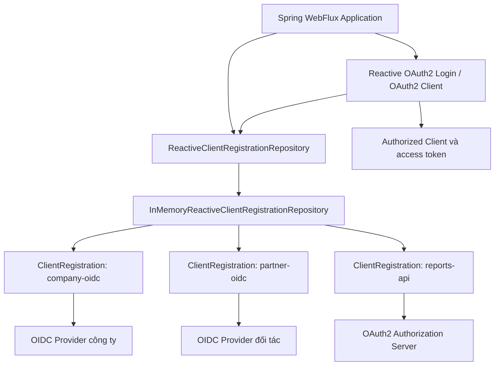
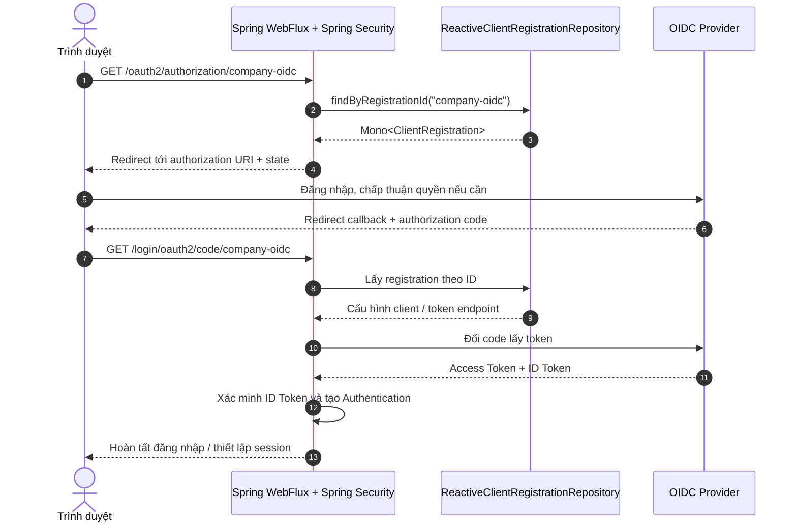

# 5.9. InMemoryReactiveClientRegistrationRepository và cấu hình bằng Java

## 1. Bối cảnh: lưu cấu hình OAuth2/OIDC Client trong ứng dụng WebFlux

Trong ứng dụng Spring Security dùng **Spring WebFlux**, trước khi đăng nhập bằng OpenID Connect (OIDC) hoặc gọi API qua OAuth 2.0 Client, hệ thống cần biết **ứng dụng đã được đăng ký với Authorization Server/OpenID Provider như thế nào**: `client_id`, grant type, scopes, các endpoint và redirect URI.

Spring Security biểu diễn mỗi cấu hình ứng dụng đó bằng một đối tượng **`ClientRegistration`**. Khi có nhiều nhà cung cấp hoặc nhiều mục đích sử dụng, Spring cần một nơi tra cứu các đối tượng `ClientRegistration` theo **`registrationId`**.

Trên reactive stack, abstraction được dùng là **`ReactiveClientRegistrationRepository`**. Implementation có sẵn và đơn giản nhất là **`InMemoryReactiveClientRegistrationRepository`**, lưu tập đăng ký trong bộ nhớ của tiến trình ứng dụng.

Ví dụ:

- `company-oidc`: đăng nhập nhân viên bằng OIDC Authorization Code.
- `partner-oidc`: đăng nhập người dùng của đối tác từ một issuer khác.
- `reports-api`: một backend client dùng grant `client_credentials` gọi Reports API không cần người dùng.

Cả ba đều có thể được khai báo bằng Java và truyền vào một `InMemoryReactiveClientRegistrationRepository`, sau đó các thành phần Spring Security chọn đúng registration theo ID.

> **Ý chính:** `InMemoryReactiveClientRegistrationRepository` quản lý **cấu hình client đăng ký với nhà cung cấp**, không phải access token của người dùng, không phải dữ liệu user và không phải Authorization Server. Token và trạng thái ủy quyền thuộc các thành phần **Authorized Client** khác.

## 2. Những khái niệm liên quan

### 2.1. Sơ đồ thành phần



Bảng phân biệt các thành phần dễ nhầm lẫn:

| Thành phần | Kiểu dữ liệu/trách nhiệm | Dùng khi nào? |
| --- | --- | --- |
| `ClientRegistration` | Thông tin client ID, grant, scopes, provider endpoints, redirect URI... của **một đăng ký** | Lúc cấu hình OAuth/OIDC Client |
| `ReactiveClientRegistrationRepository` | Interface tra cứu registration theo ID, trả `Mono<ClientRegistration>` | Trong WebFlux |
| `InMemoryReactiveClientRegistrationRepository` | Implementation lưu nhiều `ClientRegistration` trong bộ nhớ | Cấu hình cố định/ít thay đổi |
| `InMemoryClientRegistrationRepository` | Repository dành cho **Servlet**, không phải reactive | Spring MVC / Servlet |
| `OAuth2AuthorizedClient` | Một đăng ký đã được ủy quyền, kèm access token và có thể có refresh token | Sau khi đã có token |
| `ReactiveOAuth2AuthorizedClientService` / `ServerOAuth2AuthorizedClientRepository` | Nơi lưu/truy xuất **authorized client** theo ngữ cảnh phù hợp | Khi giữ và sử dụng token |
| `ReactiveOAuth2AuthorizedClientManager` | Điều phối xin, làm mới/cấp lại và sử dụng authorized client | Khi gọi API được OAuth bảo vệ |

Hai repository ở hai dòng đầu và phần lưu authorized client **không hoán đổi cho nhau**. Việc đăng ký `client_id` tại OIDC Provider cũng là một công việc khác với việc tạo đối tượng `ClientRegistration` trong code.

### 2.2. Interface và implementation

Về ý nghĩa, interface của reactive repository có phương thức chính:

```java
public interface ReactiveClientRegistrationRepository {
    Mono<ClientRegistration> findByRegistrationId(String registrationId);
}
```

`Mono<ClientRegistration>` có thể:

- Phát ra một `ClientRegistration` tương ứng ID, sau đó hoàn tất.
- Hoàn tất **không phát giá trị** nếu không tìm thấy ID trong implementation in-memory.
- Phát tín hiệu lỗi nếu repository tùy biến truy xuất thất bại.

Vì là API reactive, khi tra cứu bên trong reactive pipeline nên dùng `map`, `flatMap`, `switchIfEmpty`... thay cho gọi `block()` trên event loop.

`InMemoryReactiveClientRegistrationRepository` đồng thời triển khai `Iterable<ClientRegistration>`. Spring Security có thể duyệt các client registration khi cần tạo các lựa chọn đăng nhập; khả năng duyệt này không phải đặc điểm bắt buộc của mọi implementation tùy biến.

Có hai cách dựng repository thường dùng:

```java
new InMemoryReactiveClientRegistrationRepository(firstRegistration, secondRegistration);

// Hoặc:
new InMemoryReactiveClientRegistrationRepository(
        List.of(firstRegistration, secondRegistration));
```

Mỗi registration cần có một **`registrationId` riêng**. Các ID là khóa tra cứu **bên trong ứng dụng Spring**, khác với `clientId` mà Authorization Server cấp.

### 2.3. Tại sao có chữ `Reactive`?

Spring MVC dùng `ClientRegistrationRepository` với lookup đồng bộ. Spring WebFlux dùng `ReactiveClientRegistrationRepository` với lookup kiểu Reactor `Mono`, phù hợp khi các thành phần liên quan vận hành theo mô hình không chặn.

| Tiêu chí | Servlet / Spring MVC | Reactive / Spring WebFlux |
| --- | --- | --- |
| Interface | `ClientRegistrationRepository` | `ReactiveClientRegistrationRepository` |
| Implementation bộ nhớ | `InMemoryClientRegistrationRepository` | `InMemoryReactiveClientRegistrationRepository` |
| Tra cứu | `ClientRegistration findByRegistrationId(...)` | `Mono<ClientRegistration> findByRegistrationId(...)` |
| HTTP security | `HttpSecurity` và `SecurityFilterChain` | `ServerHttpSecurity` và `SecurityWebFilterChain` |
| OAuth2 authorization manager | `OAuth2AuthorizedClientManager` | `ReactiveOAuth2AuthorizedClientManager` |
| HTTP client thường gặp | `RestClient` / Servlet integration | `WebClient` / Reactive integration |

**Tên giống nhau không có nghĩa có thể trộn API.** Một `SecurityWebFilterChain` của WebFlux phải nhận đúng reactive repository. Nếu thêm cả `spring-boot-starter-web` và `spring-boot-starter-webflux`, Spring Boot có thể chọn kiểu ứng dụng Servlet theo cấu hình/điều kiện, gây nhầm lẫn với ví dụ reactive. Bài này chủ động sử dụng **WebFlux**.

## 3. Khi nào nên khai báo repository bằng Java?

Spring Boot đã hỗ trợ cấu hình OAuth2 Client qua `application.yml` hoặc `application.properties`. Chẳng hạn:

```yaml
spring:
  security:
    oauth2:
      client:
        registration:
          company-oidc:
            provider: company
            client-id: ${COMPANY_CLIENT_ID}
            client-secret: ${COMPANY_CLIENT_SECRET}
            authorization-grant-type: authorization_code
            scope: openid,profile,email
        provider:
          company:
            issuer-uri: https://login.example.com/realms/company
```

Khi dùng WebFlux và đáp ứng điều kiện auto-configuration, Spring Boot có thể chuyển các property này thành `ClientRegistration` và tạo `InMemoryReactiveClientRegistrationRepository` làm bean.

**Cấu hình bằng Java** có lợi khi:

- Muốn đóng gói logic tạo `ClientRegistration` thành một phương thức Java rõ ràng.
- Muốn kết hợp nhiều provider/grant hoặc tạo registration có điều kiện theo môi trường.
- Muốn dùng `ClientRegistrations.fromIssuerLocation(...)` để tạo cấu hình dựa trên Discovery.
- Phải thay đổi/ghi đè một số trường mà bộ cấu hình property không thể hiện thuận tiện.
- Không dùng cơ chế auto-configuration của Spring Boot hoặc muốn điều khiển trực tiếp bean repository.

Bù lại, khai báo bằng Java đòi hỏi ứng dụng tự quản lý mapping giữa property, secret, provider endpoint và `ClientRegistration`. Với cấu hình đơn giản, property-based configuration thường dễ bảo trì hơn.

**Một lưu ý quan trọng:** khi đã tự khai báo bean `ReactiveClientRegistrationRepository`, auto-configuration tương ứng của Spring Boot thường **lùi lại** và không tự tạo thêm repository từ các property registration. Vì vậy phải đưa **mọi registration cần dùng** vào bean Java này, hoặc thiết kế cơ chế kết hợp phù hợp, thay vì nghĩ rằng Spring sẽ tự gộp cả hai nguồn.

## 4. Bài toán thực hành và điều kiện chuẩn bị

Chúng ta sẽ cấu hình một ứng dụng **Spring WebFlux OIDC Client** với:

| Thông số | Giá trị minh họa |
| --- | --- |
| Ứng dụng | `employee-portal` |
| OIDC issuer | `https://login.example.com/realms/company` |
| Client ID tại OP | `employee-portal-web` |
| Registration ID trong Spring | `company-oidc` |
| Grant type | `authorization_code` |
| Client authentication | `client_secret_basic` |
| Scopes | `openid`, `profile`, `email` |
| Redirect URI | `{baseUrl}/login/oauth2/code/{registrationId}` |
| Local callback thực tế | `http://localhost:8080/login/oauth2/code/company-oidc` |

Trước khi chạy Spring, cần đăng ký web/confidential client tại nhà cung cấp OIDC, bật Authorization Code Grant, đăng ký đúng callback và lấy client ID/secret. Các hostname và credentials trên đều là ví dụ, không phải tài khoản thật.

### 4.1. Dependency

Ví dụ `pom.xml` với Spring Boot 3.x và Spring Security 6.x (phiên bản cụ thể do Spring Boot BOM quản lý):

```xml
<dependencies>
    <dependency>
        <groupId>org.springframework.boot</groupId>
        <artifactId>spring-boot-starter-webflux</artifactId>
    </dependency>

    <dependency>
        <groupId>org.springframework.boot</groupId>
        <artifactId>spring-boot-starter-security</artifactId>
    </dependency>

    <dependency>
        <groupId>org.springframework.boot</groupId>
        <artifactId>spring-boot-starter-oauth2-client</artifactId>
    </dependency>
</dependencies>
```

Nếu dùng Gradle Kotlin DSL, ý tưởng tương đương:

```kotlin
dependencies {
    implementation("org.springframework.boot:spring-boot-starter-webflux")
    implementation("org.springframework.boot:spring-boot-starter-security")
    implementation("org.springframework.boot:spring-boot-starter-oauth2-client")
}
```

Các thành phần thuộc `org.springframework.security.oauth2.client.registration` có thể được dùng trực tiếp nhờ OAuth2 Client starter. Không cần tự tạo WebFlux server handler để xử lý token exchange khi đã dùng `oauth2Login`.

### 4.2. Externalize cấu hình không nhạy cảm và secret

Thay vì ghi client secret trong code Java, khai báo các placeholder tại `application.yml`:

```yaml
server:
  port: 8080

app:
  oauth2:
    company:
      issuer-uri: https://login.example.com/realms/company
      client-id: ${COMPANY_OIDC_CLIENT_ID}
      client-secret: ${COMPANY_OIDC_CLIENT_SECRET}
```

Ở môi trường thực, hai biến chứa ID/secret cần được nạp qua cơ chế cấu hình vận hành an toàn. Không commit secret thật vào Git; không in secret, authorization code, ID Token hoặc access token trong log.

## 5. Cấu hình Java: tạo bean repository từ OIDC Discovery

Đây là cách gọn nhất khi nhà cung cấp hỗ trợ **OIDC Discovery** và công bố các endpoint chuẩn.

Tạo file `ReactiveOAuth2SecurityConfig.java`:

```java
import org.springframework.beans.factory.annotation.Value;
import org.springframework.context.annotation.Bean;
import org.springframework.context.annotation.Configuration;
import org.springframework.security.config.Customizer;
import org.springframework.security.config.annotation.web.reactive.EnableWebFluxSecurity;
import org.springframework.security.config.web.server.ServerHttpSecurity;
import org.springframework.security.oauth2.client.registration.ClientRegistration;
import org.springframework.security.oauth2.client.registration.ClientRegistrations;
import org.springframework.security.oauth2.client.registration.InMemoryReactiveClientRegistrationRepository;
import org.springframework.security.oauth2.client.registration.ReactiveClientRegistrationRepository;
import org.springframework.security.oauth2.core.AuthorizationGrantType;
import org.springframework.security.oauth2.core.ClientAuthenticationMethod;
import org.springframework.security.web.server.SecurityWebFilterChain;

@Configuration
@EnableWebFluxSecurity
public class ReactiveOAuth2SecurityConfig {

    @Bean
    ReactiveClientRegistrationRepository clientRegistrationRepository(
            @Value("${app.oauth2.company.issuer-uri}") String issuerUri,
            @Value("${app.oauth2.company.client-id}") String clientId,
            @Value("${app.oauth2.company.client-secret}") String clientSecret) {

        ClientRegistration company = ClientRegistrations
                .fromIssuerLocation(issuerUri)
                .registrationId("company-oidc")
                .clientId(clientId)
                .clientSecret(clientSecret)
                .clientAuthenticationMethod(
                        ClientAuthenticationMethod.CLIENT_SECRET_BASIC)
                .authorizationGrantType(
                        AuthorizationGrantType.AUTHORIZATION_CODE)
                .redirectUri(
                        "{baseUrl}/login/oauth2/code/{registrationId}")
                .scope("openid", "profile", "email")
                .clientName("Company SSO")
                .build();

        return new InMemoryReactiveClientRegistrationRepository(company);
    }

    @Bean
    SecurityWebFilterChain securityWebFilterChain(ServerHttpSecurity http) {
        return http
                .authorizeExchange(exchanges -> exchanges
                        .pathMatchers("/", "/public/**").permitAll()
                        .anyExchange().authenticated())
                .oauth2Login(Customizer.withDefaults())
                .build();
    }
}
```

Code có hai bean chính:

1. **`clientRegistrationRepository`**: tạo một `ClientRegistration` từ issuer và thông tin đăng ký rồi truyền cho `InMemoryReactiveClientRegistrationRepository`. Giá trị bean được công bố theo **interface reactive** để Spring Security tìm được.
2. **`securityWebFilterChain`**: cấu hình bảo vệ HTTP request trong WebFlux và kích hoạt OAuth2/OIDC Login.

Ở đây `ClientRegistrations.fromIssuerLocation(...)` thực hiện **lấy metadata từ nhà cung cấp khi xây dựng cấu hình**, từ đó điền các endpoint như authorization, token, JWKS, UserInfo theo khả năng/metadata của OP. Việc truy cập mạng xảy ra khi bean được tạo lúc khởi động ứng dụng; **không nên gọi Discovery theo từng request**. Nếu OP không sẵn sàng lúc khởi động, việc tạo registration có thể thất bại.

### 5.1. Diễn giải chuỗi builder

| Lời gọi Java | Ý nghĩa |
| --- | --- |
| `fromIssuerLocation(issuerUri)` | Khởi tạo builder từ metadata của issuer đáng tin cậy |
| `registrationId("company-oidc")` | Khóa tra cứu trong repository |
| `clientId(clientId)` | Client ID đã đăng ký tại OP |
| `clientSecret(clientSecret)` | Secret do backend bảo vệ |
| `clientAuthenticationMethod(...)` | Cách client xác thực ở token endpoint |
| `authorizationGrantType(AUTHORIZATION_CODE)` | Chọn Authorization Code flow |
| `redirectUri(...)` | Callback mà Spring Security sẽ tiếp nhận |
| `scope("openid", "profile", "email")` | Phạm vi được yêu cầu; `openid` kích hoạt xử lý OIDC |
| `clientName("Company SSO")` | Nhãn hiển thị có thể dùng trên trang login |
| `build()` | Kết thúc tạo `ClientRegistration` |

Một điểm cần nhớ: **`registrationId` khác `clientId`**.

```text
registrationId = company-oidc  -> URL /oauth2/authorization/company-oidc
clientId       = employee-portal-web -> giá trị gửi tới nhà cung cấp

Callback mặc định:
http://localhost:8080/login/oauth2/code/company-oidc
```

Không tạo callback từ `clientId` nếu Spring đang dùng `registrationId` trong URI template.

### 5.2. Tại sao dùng `fromIssuerLocation`?

Nếu OP hỗ trợ Discovery và issuer đúng, Spring có thể lấy thông tin chuẩn ở các tài liệu OIDC/OAuth metadata mà không cần lặp thủ công các endpoint. Một cấu trúc metadata rút gọn có thể là:

```json
{
  "issuer": "https://login.example.com/realms/company",
  "authorization_endpoint":
    "https://login.example.com/realms/company/protocol/openid-connect/auth",
  "token_endpoint":
    "https://login.example.com/realms/company/protocol/openid-connect/token",
  "jwks_uri":
    "https://login.example.com/realms/company/protocol/openid-connect/certs"
}
```

Các URL trên là ví dụ theo cách đặt đường dẫn phổ biến của một OP; ứng dụng phải sử dụng **metadata thực** từ issuer được quản trị. `fromIssuerLocation` hỗ trợ khám phá thông tin từ endpoint metadata chuẩn được Spring Security hỗ trợ; nếu chỉ muốn truy vấn OIDC Provider Configuration, có API `ClientRegistrations.fromOidcIssuerLocation(...)` ở các phiên bản có hỗ trợ.

Lợi ích:

- Ít phải sao chép URL thủ công.
- Cấu hình issuer rõ ràng để quản lý đúng realm/tenant.
- Cho phép thư viện tiếp tục sử dụng metadata để cấu hình xác minh ID Token.

Đổi lại, ứng dụng phụ thuộc vào việc metadata chính xác và kết nối tới OP tại thời điểm cấu hình. Với môi trường mạng hạn chế khởi động, có thể cấu hình tường minh các endpoint nếu kiến trúc và phiên bản thư viện cho phép.

## 6. Cấu hình Java hoàn toàn thủ công với `ClientRegistration.withRegistrationId`

Trong một số hệ thống, Authorization Server không cung cấp Discovery, hoặc người vận hành cần kiểm soát endpoint cụ thể. Khi đó có thể dùng builder `ClientRegistration.withRegistrationId(...)`.

Ví dụ sau chỉ mô tả **cách dựng một registration thay thế** cho `company` ở mục 5; không khai báo đồng thời hai bean repository trong cùng một application context.

```java
import org.springframework.security.oauth2.client.registration.ClientRegistration;
import org.springframework.security.oauth2.core.AuthorizationGrantType;
import org.springframework.security.oauth2.core.ClientAuthenticationMethod;
import org.springframework.security.oauth2.core.oidc.IdTokenClaimNames;

public class ManualRegistrationExample {

    public static ClientRegistration company(
            String clientId, String clientSecret) {

        return ClientRegistration.withRegistrationId("company-oidc")
                .clientId(clientId)
                .clientSecret(clientSecret)
                .clientAuthenticationMethod(
                        ClientAuthenticationMethod.CLIENT_SECRET_BASIC)
                .authorizationGrantType(
                        AuthorizationGrantType.AUTHORIZATION_CODE)
                .redirectUri(
                        "{baseUrl}/login/oauth2/code/{registrationId}")
                .scope("openid", "profile", "email")
                .issuerUri("https://login.example.com/realms/company")
                .authorizationUri(
                        "https://login.example.com/realms/company/protocol/openid-connect/auth")
                .tokenUri(
                        "https://login.example.com/realms/company/protocol/openid-connect/token")
                .jwkSetUri(
                        "https://login.example.com/realms/company/protocol/openid-connect/certs")
                .userInfoUri(
                        "https://login.example.com/realms/company/protocol/openid-connect/userinfo")
                .userNameAttributeName(IdTokenClaimNames.SUB)
                .clientName("Company SSO")
                .build();
    }
}
```

Khi cần dùng cách thủ công, phương thức bean ở mục 5 có thể gọi:

```java
ClientRegistration company =
        ManualRegistrationExample.company(clientId, clientSecret);

return new InMemoryReactiveClientRegistrationRepository(company);
```

Cần phân biệt những endpoint:

| Endpoint/thông số | Vai trò |
| --- | --- |
| `authorizationUri` | Trình duyệt được điều hướng đến đây để người dùng xác thực và cấp code |
| `tokenUri` | Backend trao đổi authorization code để lấy token |
| `jwkSetUri` | Công bố public keys kiểm tra chữ ký ID Token dạng JWS |
| `userInfoUri` | Nhận claims người dùng qua UserInfo endpoint theo luồng và scope |
| `issuerUri` | Định danh OP phải phù hợp với claim `iss` của ID Token |
| `redirectUri` | Callback **của ứng dụng Spring**, phải khớp nơi đăng ký tại OP |

Đừng nhầm `issuerUri` với `authorizationUri`. Trong OIDC, issuer dùng để xác định **nguồn tin cậy**, còn authorization endpoint là URL xử lý yêu cầu xác thực từ trình duyệt.

Cấu hình thủ công tăng khả năng kiểm soát nhưng cũng tăng nguy cơ sai issuer, callback, UserInfo, JWKS hoặc thông tin metadata khi OP thay đổi. Nếu sử dụng OIDC thực sự, cần đủ thông tin để xác minh ID Token theo quy định OIDC, không chỉ đặt `scope("openid")` rồi bỏ qua các điều kiện bảo mật.

## 7. Một repository chứa nhiều ClientRegistration

`InMemoryReactiveClientRegistrationRepository` có thể chứa nhiều registration để ứng dụng chọn provider hoặc grant theo yêu cầu.

### 7.1. Nhiều nhà cung cấp OIDC

Giả sử dự án đã có hai registration được tạo từ hai issuer tin cậy:

```java
ClientRegistration company = ClientRegistrations
        .fromIssuerLocation(companyIssuer)
        .registrationId("company-oidc")
        .clientId(companyClientId)
        .clientSecret(companyClientSecret)
        .clientAuthenticationMethod(
                ClientAuthenticationMethod.CLIENT_SECRET_BASIC)
        .authorizationGrantType(AuthorizationGrantType.AUTHORIZATION_CODE)
        .redirectUri("{baseUrl}/login/oauth2/code/{registrationId}")
        .scope("openid", "profile")
        .build();

ClientRegistration partner = ClientRegistrations
        .fromIssuerLocation(partnerIssuer)
        .registrationId("partner-oidc")
        .clientId(partnerClientId)
        .clientSecret(partnerClientSecret)
        .clientAuthenticationMethod(
                ClientAuthenticationMethod.CLIENT_SECRET_BASIC)
        .authorizationGrantType(AuthorizationGrantType.AUTHORIZATION_CODE)
        .redirectUri("{baseUrl}/login/oauth2/code/{registrationId}")
        .scope("openid", "profile")
        .build();

return new InMemoryReactiveClientRegistrationRepository(company, partner);
```

Đoạn trên là **phần thân minh họa** bên trong một factory method có các biến `companyIssuer`, `partnerIssuer`, `companyClientId`... đã được nạp an toàn; không phải một lớp Java độc lập. Trong ứng dụng thật, đặt nó vào **một** bean repository với các tham số nhận từ property/secret manager.

Lúc này có hai URL bắt đầu đăng nhập:

```text
/oauth2/authorization/company-oidc
/oauth2/authorization/partner-oidc
```

Và hai callback:

```text
/login/oauth2/code/company-oidc
/login/oauth2/code/partner-oidc
```

Mỗi URL callback phải được đăng ký tại provider tương ứng. Hai registration có thể dùng issuer khác nhau, client ID khác nhau và scope khác nhau. Không sử dụng cùng một `registrationId` cho hai provider; repository phải có khóa tra cứu phân biệt.

### 7.2. Thêm Client Credentials cho backend

Cùng một repository có thể chứa client dành cho **gọi API máy đến máy**:

```java
ClientRegistration reports = ClientRegistration
        .withRegistrationId("reports-api")
        .clientId(reportsClientId)
        .clientSecret(reportsClientSecret)
        .clientAuthenticationMethod(
                ClientAuthenticationMethod.CLIENT_SECRET_BASIC)
        .authorizationGrantType(AuthorizationGrantType.CLIENT_CREDENTIALS)
        .tokenUri("https://auth.example.com/oauth2/token")
        .scope("reports.read")
        .clientName("Reports API")
        .build();

return new InMemoryReactiveClientRegistrationRepository(company, reports);
```

`reportsClientId` và `reportsClientSecret` ở đây đại diện cho thông tin được cấp riêng cho backend. Client Credentials không yêu cầu redirect URI hay scope `openid`. Nó chỉ lấy access token đại diện cho client để truy cập API trong phạm vi được cấp.

**Việc đưa registration `reports-api` vào repository chưa tự kích hoạt gọi API.** Ứng dụng phải sử dụng reactive authorized client manager hoặc cơ chế WebClient integration để xin access token và gắn vào request.

### 7.3. Lựa chọn khi khởi tạo danh sách

Có thể đưa nhiều registration vào danh sách:

```java
List<ClientRegistration> registrations = List.of(
        companyRegistration,
        partnerRegistration,
        reportsRegistration
);

ReactiveClientRegistrationRepository repository =
        new InMemoryReactiveClientRegistrationRepository(registrations);
```

Các biến `companyRegistration`, `partnerRegistration` và `reportsRegistration` cần được tạo bằng builder trước đó. Repository là một **snapshot** của các registration đưa vào lúc khởi tạo. Không có API public quản lý vòng đời động cho `InMemoryReactiveClientRegistrationRepository` theo kiểu thêm/xóa/sửa từng registration đang chạy. Nếu cần hỗ trợ hàng trăm tenant hoặc thay đổi đăng ký tức thời, nên cân nhắc repository tùy biến lấy dữ liệu từ cấu hình quản lý trung tâm, cache hay database theo yêu cầu vận hành.

## 8. Tra cứu đăng ký theo ID trong reactive pipeline

`ReactiveClientRegistrationRepository` cung cấp một điểm truy cập thống nhất, cho phép code khác sử dụng registration mà không phụ thuộc implementation đang lưu trong memory, database hay nguồn từ xa.

Ví dụ service hỗ trợ tra cứu:

```java
import org.springframework.security.oauth2.client.registration.ClientRegistration;
import org.springframework.security.oauth2.client.registration.ReactiveClientRegistrationRepository;
import org.springframework.stereotype.Service;
import reactor.core.publisher.Mono;

@Service
public class ClientRegistrationLookup {

    private final ReactiveClientRegistrationRepository repository;

    public ClientRegistrationLookup(
            ReactiveClientRegistrationRepository repository) {
        this.repository = repository;
    }

    public Mono<ClientRegistration> requireRegistration(String registrationId) {
        return repository.findByRegistrationId(registrationId)
                .switchIfEmpty(Mono.error(
                        new IllegalArgumentException(
                                "Không tìm thấy registration: " + registrationId)));
    }

    public Mono<String> providerName(String registrationId) {
        return requireRegistration(registrationId)
                .map(ClientRegistration::getClientName);
    }
}
```

Khi gọi `providerName("company-oidc")`, reactive pipeline có thể trả tên `Company SSO`. Khi gọi một ID không tồn tại, `switchIfEmpty` chuyển Mono rỗng thành lỗi có thể xử lý tại tầng ứng dụng.

Hãy chú ý ba chi tiết:

1. **`Mono.empty()`** khác với lỗi truy cập mạng. Trong repository in-memory, thiếu ID là một trường hợp lookup bình thường; không nên vội coi đó là lỗi kết nối tới Authorization Server.
2. Việc lookup **không xin token**, không xác minh người dùng, không gửi HTTP request tới provider. Nó chỉ đọc cấu hình đã có.
3. Không đặt `block()` trong WebFlux request handler để lấy `ClientRegistration`. Nếu logic cần phản ứng với kết quả lookup, dùng `flatMap`, `map` và các toán tử Reactor.

### 8.1. Có cần tìm repository bằng concrete class?

Không. Bean nên được khai báo hoặc inject qua **`ReactiveClientRegistrationRepository`** để logic còn linh hoạt:

```java
@Bean
ReactiveClientRegistrationRepository clientRegistrationRepository() {
    return new InMemoryReactiveClientRegistrationRepository(
            companyRegistration());
}
```

Nếu sau này cần backend khác, code dùng `findByRegistrationId(...)` không phải đổi nhiều.

Trong khi đó, khi thực sự cần duyệt toàn bộ registration bằng `Iterable`, phải biết rằng **interface repository không bảo đảm hỗ trợ liệt kê**. Việc lặp là đặc tính của implementation `InMemoryReactiveClientRegistrationRepository`. Các trang lựa chọn login tùy biến nên xem xét việc duyệt registration theo giao diện/cơ chế phù hợp, thay vì mặc định mọi repository đều là `Iterable`.

## 9. Kết nối repository với OAuth2 Login trên WebFlux

Khi `SecurityWebFilterChain` bật:

```java
http.oauth2Login(Customizer.withDefaults());
```

Spring Security có thể sử dụng các `ClientRegistration` trong reactive repository để khởi tạo và hoàn tất OAuth2/OIDC login. Đối với registration `company-oidc`, các đường dẫn thường gặp là:

```text
Bắt đầu đăng nhập:
GET /oauth2/authorization/company-oidc

Nhận callback từ OIDC Provider:
GET /login/oauth2/code/company-oidc?code=...&state=...
```

Một chuỗi xử lý điển hình:



Trong ứng dụng thực, Spring Security còn quản lý state và các yêu cầu bảo mật OIDC/PKCE tương ứng. Sơ đồ chỉ tập trung vào vai trò repository; có thể tồn tại thêm các thành phần lưu authorization request, exchange/session và authorized client.

### 9.1. Controller sau khi đăng nhập

Ví dụ một endpoint chỉ trả về dữ liệu tối thiểu của người dùng đã được xác thực:

```java
import java.util.Map;

import org.springframework.security.core.annotation.AuthenticationPrincipal;
import org.springframework.security.oauth2.core.oidc.user.OidcUser;
import org.springframework.web.bind.annotation.GetMapping;
import org.springframework.web.bind.annotation.RestController;
import reactor.core.publisher.Mono;

@RestController
public class ProfileController {

    @GetMapping("/me")
    public Mono<Map<String, String>> me(
            @AuthenticationPrincipal OidcUser user) {

        return Mono.just(Map.of(
                "subject", user.getSubject(),
                "issuer", user.getIssuer().toString()
        ));
    }
}
```

`OidcUser` thể hiện người dùng từ cơ chế OIDC login. Ví dụ giả định endpoint `/me` chỉ cho phép truy cập qua OIDC; với hệ thống có nhiều cơ chế xác thực, cần xử lý principal tương ứng và trường hợp không phải `OidcUser`.

**Không trả ID Token hoặc access token thô về trình duyệt chỉ để hiển thị profile.** Client registration và ID Token có mục đích khác nhau: cấu hình định tuyến/ủy quyền so với chứng cứ xác thực.

### 9.2. Redirect URI khi chạy sau reverse proxy

URI template `{baseUrl}/login/oauth2/code/{registrationId}` có thể dựa trên URL của request. Nếu WebFlux chạy sau ingress/reverse proxy và thấy HTTP origin nội bộ, ứng dụng có thể tạo redirect URI khác với URL public mà OP đã đăng ký.

Tùy hạ tầng và phiên bản Spring Boot, có thể cấu hình xử lý forwarded headers ở tầng ứng dụng khi proxy đã thiết lập ranh giới tin cậy:

```yaml
server:
  forward-headers-strategy: framework
```

Chỉ tin `Forwarded`/`X-Forwarded-*` khi proxy kiểm soát nguồn header; không nhận header chuyển tiếp tùy ý từ Internet. Đối chiếu callback được OP cho phép với URI Spring **thực tế gửi trong authorization request** trước khi xử lý lỗi `redirect_uri_mismatch`.

## 10. Repository còn được dùng khi gọi API bằng WebClient

`oauth2Login` giải quyết việc đăng nhập. Khi WebFlux ứng dụng cần **gọi một API được OAuth 2.0 bảo vệ**, các `ClientRegistration` cũng được dùng bởi `ReactiveOAuth2AuthorizedClientManager` để xin và quản lý access token.

Trong lời gọi HTTP đang có ngữ cảnh request/người dùng, có thể tích hợp với `WebClient` bằng `ServerOAuth2AuthorizedClientExchangeFilterFunction`.

Ví dụ cấu hình:

```java
import org.springframework.context.annotation.Bean;
import org.springframework.context.annotation.Configuration;
import org.springframework.security.oauth2.client.ReactiveOAuth2AuthorizedClientManager;
import org.springframework.security.oauth2.client.web.reactive.function.client.ServerOAuth2AuthorizedClientExchangeFilterFunction;
import org.springframework.web.reactive.function.client.WebClient;

@Configuration
public class ApiWebClientConfig {

    @Bean
    WebClient protectedApiWebClient(
            ReactiveOAuth2AuthorizedClientManager authorizedClientManager) {

        var oauth2 = new ServerOAuth2AuthorizedClientExchangeFilterFunction(
                authorizedClientManager);

        return WebClient.builder()
                .filter(oauth2)
                .build();
    }
}
```

Ví dụ sử dụng trong một reactive controller:

```java
import static org.springframework.security.oauth2.client.web.reactive.function.client
        .ServerOAuth2AuthorizedClientExchangeFilterFunction.clientRegistrationId;

import org.springframework.web.bind.annotation.GetMapping;
import org.springframework.web.bind.annotation.RestController;
import org.springframework.web.reactive.function.client.WebClient;
import reactor.core.publisher.Mono;

@RestController
public class ReportsController {

    private final WebClient api;

    public ReportsController(WebClient protectedApiWebClient) {
        this.api = protectedApiWebClient;
    }

    @GetMapping("/reports")
    public Mono<String> reports() {
        return api.get()
                .uri("https://reports.example.com/api/summary")
                .attributes(clientRegistrationId("reports-api"))
                .retrieve()
                .bodyToMono(String.class);
    }
}
```

Ở đây:

- `clientRegistrationId("reports-api")` chỉ định registration nào dùng để xin access token. Nó **không phải** giá trị `client_id` mà OP cấp.
- Filter và authorized client manager chịu trách nhiệm lấy, tái sử dụng hoặc cấp lại token phù hợp với grant và trạng thái ủy quyền.
- Nếu grant là `client_credentials`, Authorization Server cấp access token cho danh tính ứng dụng. Nếu grant là `authorization_code`, cần ngữ cảnh ủy quyền người dùng phù hợp.
- Endpoint `/reports` trong ví dụ có thể được đặt dưới các quy tắc phân quyền riêng của hệ thống. Dịch vụ đích phải tự xác thực token và kiểm tra audience/scope/roles.

**Không nên dùng `setDefaultOAuth2AuthorizedClient(true)` hoặc một default client áp dụng cho mọi lời gọi WebClient một cách tùy tiện.** Nếu làm vậy, token có thể bị gửi tới các host/endpoint không chủ đích. Chọn registration tường minh hoặc tạo WebClient chuyên dụng với tập đích được kiểm soát.

### 10.1. Gọi Client Credentials ngoài HTTP request (scheduled job/background worker)

Ví dụ trước sử dụng filter gắn với reactive request context. Với background job không có `ServerWebExchange`, Spring Security có **`AuthorizedClientServiceReactiveOAuth2AuthorizedClientManager`** phù hợp cho service-tier/scheduler.

Một cấu hình đơn giản:

```java
import org.springframework.context.annotation.Bean;
import org.springframework.context.annotation.Configuration;
import org.springframework.security.oauth2.client.AuthorizedClientServiceReactiveOAuth2AuthorizedClientManager;
import org.springframework.security.oauth2.client.InMemoryReactiveOAuth2AuthorizedClientService;
import org.springframework.security.oauth2.client.ReactiveOAuth2AuthorizedClientManager;
import org.springframework.security.oauth2.client.ReactiveOAuth2AuthorizedClientProvider;
import org.springframework.security.oauth2.client.ReactiveOAuth2AuthorizedClientProviderBuilder;
import org.springframework.security.oauth2.client.ReactiveOAuth2AuthorizedClientService;
import org.springframework.security.oauth2.client.registration.ReactiveClientRegistrationRepository;

@Configuration
public class BackgroundOAuth2Config {

    @Bean
    ReactiveOAuth2AuthorizedClientService backgroundAuthorizedClientService(
            ReactiveClientRegistrationRepository repository) {
        return new InMemoryReactiveOAuth2AuthorizedClientService(repository);
    }

    @Bean("backgroundAuthorizedClientManager")
    ReactiveOAuth2AuthorizedClientManager backgroundAuthorizedClientManager(
            ReactiveClientRegistrationRepository repository,
            ReactiveOAuth2AuthorizedClientService backgroundAuthorizedClientService) {

        ReactiveOAuth2AuthorizedClientProvider provider =
                ReactiveOAuth2AuthorizedClientProviderBuilder.builder()
                        .clientCredentials()
                        .build();

        var manager = new AuthorizedClientServiceReactiveOAuth2AuthorizedClientManager(
                repository, backgroundAuthorizedClientService);
        manager.setAuthorizedClientProvider(provider);
        return manager;
    }
}
```

Trong dự án đã có nhiều bean `ReactiveOAuth2AuthorizedClientManager` hoặc `ReactiveOAuth2AuthorizedClientService`, phải dùng `@Qualifier` hoặc tên bean khi inject để phân biệt manager dùng trong request và manager dành cho background.

Một service sử dụng manager và WebClient:

```java
import org.springframework.beans.factory.annotation.Qualifier;
import org.springframework.security.oauth2.client.OAuth2AuthorizeRequest;
import org.springframework.security.oauth2.client.ReactiveOAuth2AuthorizedClientManager;
import org.springframework.stereotype.Service;
import org.springframework.web.reactive.function.client.WebClient;
import reactor.core.publisher.Mono;

@Service
public class ReportsGateway {

    private final ReactiveOAuth2AuthorizedClientManager manager;
    private final WebClient api = WebClient.builder()
            .baseUrl("https://reports.example.com")
            .build();

    public ReportsGateway(
            @Qualifier("backgroundAuthorizedClientManager")
            ReactiveOAuth2AuthorizedClientManager manager) {
        this.manager = manager;
    }

    public Mono<String> fetchSummary() {
        OAuth2AuthorizeRequest request = OAuth2AuthorizeRequest
                .withClientRegistrationId("reports-api")
                .principal("background-reports-job")
                .build();

        return manager.authorize(request)
                .switchIfEmpty(Mono.error(
                        new IllegalStateException("Không cấp được access token")))
                .flatMap(authorized -> api.get()
                        .uri("/api/summary")
                        .headers(headers -> headers.setBearerAuth(
                                authorized.getAccessToken().getTokenValue()))
                        .retrieve()
                        .bodyToMono(String.class));
    }
}
```

`principal("background-reports-job")` là định danh kỹ thuật **ổn định** để manager tra cứu authorized client; không phải người dùng cuối. Kết quả `manager.authorize(request)` là một `Mono`, vì thế service tạo pipeline bằng `flatMap` chứ không gọi `block()`.

Nếu chỉ cần OIDC login, ứng dụng không nhất thiết cần đoạn background manager này. Nó được đưa ra để làm rõ **cùng một repository client registration** có thể phục vụ những grant khác nhau, trong khi việc **cấp và lưu token** thuộc các thành phần riêng.

## 11. Dữ liệu ở trong bộ nhớ: phạm vi, giới hạn và vòng đời

Cụm từ **InMemory** áp dụng cho **bản sao cấu hình client registration** tại tiến trình ứng dụng:

- Repository được khởi tạo với một hoặc nhiều `ClientRegistration`.
- Lookup theo ID là thao tác đọc cấu hình đã lưu.
- Khi ứng dụng khởi động lại, code/property sẽ tạo lại repository.
- Không có tính năng mặc định tự theo dõi các thay đổi ở bảng đăng ký của Authorization Server.
- Mỗi instance WebFlux trong cụm triển khai thường có một repository riêng.
- Nó không tự chứa token, session hoặc user database.

### 11.1. Khi nào InMemory phù hợp?

| Trường hợp | Đánh giá |
| --- | --- |
| Một đến vài issuer/registration cố định | Phù hợp, dễ hiểu và cấu hình |
| Môi trường demo, học tập hoặc integration service nhỏ | Phù hợp |
| Mỗi deployment có tập registration riêng theo profile/config | Có thể phù hợp |
| Hàng trăm tenant được thêm/xóa liên tục lúc chạy | Cần cân nhắc repository tùy biến hoặc nguồn quản lý động |
| Muốn thay client secret ngay mà không restart | InMemory mặc định không tự cập nhật; cần cơ chế reload/switch registration do ứng dụng thiết kế |
| Muốn lưu access token giữa nhiều node | Cần xử lý authorized client persistence; repository registration không giải quyết |

### 11.2. Secret rotation và triển khai nhiều instance

Khi OP xoay **client secret**, các `ClientRegistration` đã dựng có thể vẫn giữ secret cũ trong memory. Nếu thay biến môi trường/secret store nhưng không tạo lại registration, ứng dụng có thể tiếp tục gửi credential cũ ở token endpoint.

Vì vậy cần thiết kế quy trình thay secret có kiểm soát: cập nhật secret store và OP, triển khai lại các instance hoặc sử dụng cơ chế refresh config được hỗ trợ, theo dõi lỗi `invalid_client` trong khoảng chuyển tiếp. Đừng ghi một giá trị bí mật mới vào một field ngẫu nhiên rồi kỳ vọng `InMemoryReactiveClientRegistrationRepository` tự biết.

### 11.3. Không tự đồng nhất repository với cache metadata/JWKS

`ClientRegistration` có thể chứa issuer và endpoint được lấy bằng Discovery. Tuy nhiên:

- **Repository InMemory** lưu cấu hình registration.
- **HTTP cache của Discovery/JWKS** phục vụ hoạt động lấy metadata và public keys.
- **Authorized client cache** phục vụ vòng đời access/refresh token.

Đây là ba mục đích khác nhau. Khi OP xoay khóa ký, sự cố `kid not found` thường liên quan **JWKS cache và xác minh token**, không nhất thiết do registration biến mất khỏi InMemory repository.

## 12. Những lỗi cấu hình thường gặp

| Triệu chứng | Nguyên nhân khả dĩ | Hướng xử lý |
| --- | --- | --- |
| `No qualifying bean of type ReactiveClientRegistrationRepository` | Không khai báo bean và auto-configuration không tạo được repository | Kiểm tra dependency WebFlux/OAuth2 Client và @Bean |
| Có bean Servlet repository nhưng WebFlux không dùng | Dùng nhầm `InMemoryClientRegistrationRepository` | Chuyển sang `InMemoryReactiveClientRegistrationRepository` |
| `findByRegistrationId("company-oidc")` không phát giá trị | Sai registration ID hoặc ID chưa được thêm vào repository | Kiểm tra `registrationId` trong Java và ID dùng ở URL |
| Endpoint `/oauth2/authorization/company-oidc` không xử lý login | Chưa bật `oauth2Login`, thiếu registration hoặc sai URL | Kiểm tra `SecurityWebFilterChain` và bean repository |
| `redirect_uri_mismatch` | Callback OP khác template/URL thực | Đối chiếu scheme, host, port, path, reverse proxy |
| `invalid_client` | Sai client ID/secret/phương thức xác thực | Kiểm tra OP registration, secret manager, `clientAuthenticationMethod` |
| `invalid_scope` | Scope không tồn tại hoặc client chưa được cấp | Đối chiếu `scope(...)` với OP |
| `authorization_code` bị từ chối | Grant chưa bật, code hết hạn/đã dùng, PKCE hoặc redirect sai | Kiểm tra token exchange/flow tại OP |
| Không đọc được Discovery | Issuer sai, metadata thiếu, DNS/TLS/OP bị lỗi | Kiểm tra URL issuer và các endpoint metadata |
| ID Token thiếu hoặc không được xử lý OIDC | Thiếu `openid` hoặc OP không hỗ trợ OIDC đúng chuẩn | Kiểm tra scopes và issuer metadata |
| Xác minh ID Token thất bại | Issuer, audience, signature, nonce, JWKS hoặc thời hạn không hợp lệ | Kiểm tra validation của OIDC Client, không tắt bảo mật |
| WebClient gửi request nhưng API trả 401 | Không gửi token, token không hợp lệ hoặc sai audience | Kiểm tra registration được chọn, client manager và Resource Server |
| WebClient gọi API trả 403 | Token hợp lệ nhưng thiếu scope/quyền API yêu cầu | Kiểm tra scope và chính sách Resource Server |
| Client Credentials hoạt động trên web request nhưng lỗi ở scheduler | Manager phụ thuộc `ServerWebExchange` hoặc principal không phù hợp | Dùng `AuthorizedClientServiceReactiveOAuth2AuthorizedClientManager` cho background |
| Thay client secret nhưng ứng dụng vẫn dùng secret cũ | Repository khởi tạo từ cấu hình cũ | Triển khai lại hoặc refresh cấu hình có kiểm soát |

Phân biệt **lỗi tìm registration** với **lỗi xin token** và **lỗi gọi API**. Chúng xảy ra ở các giai đoạn khác nhau:

```text
ClientRegistration lookup
       |
       +-- Sai ID / thiếu repository? → sửa cấu hình Spring
       |
       v
OAuth2 Authorization / Token request
       |
       +-- invalid_client / grant / scope? → sửa OP + credentials
       |
       v
OIDC Login / API call
       |
       +-- ID Token lỗi? → issuer / JWKS / nonce / audience
       |
       +-- API 401 / 403? → Bearer token / scope / resource server
```

## 13. Bảo mật khi cấu hình repository bằng Java

### 13.1. Giới hạn quyền và giữ bí mật

- Mỗi client chỉ nên nhận **grant và scope cần thiết**. Ví dụ OIDC login dùng `authorization_code` và `openid`, còn API máy đến máy dùng `client_credentials` và scope API phù hợp.
- Đưa client secret/khóa riêng vào **secret manager** hoặc cấu hình môi trường được bảo vệ; tránh lưu trực tiếp trong source, artifact, log, exception hay tài liệu công khai.
- Chỉ kết nối Authorization Server qua HTTPS/TLS đáng tin cậy. Không lấy `issuerUri` hoặc `jwkSetUri` từ input tùy ý của người dùng.
- Không đặt endpoint nội bộ cho phép trả ra toàn bộ `ClientRegistration`; nó có thể chứa `clientSecret`.
- Với nhiều provider, giữ `registrationId` ổn định và cấp quyền đọc/đăng nhập theo đúng tenant, scope và chính sách ứng dụng.
- Khi dùng WebClient, chỉ gắn Bearer token vào **đúng API đích**. Không gửi mặc định token của người dùng tới mọi outbound request.
- Xác thực ID Token bằng các kiểm tra của OIDC và kiểm tra access token tại Resource Server. Có registration hợp lệ chưa đủ để xác thực user/API request.

### 13.2. Hành vi sau reverse proxy

Vì redirect URI có thể phụ thuộc `{baseUrl}`, nếu một ứng dụng WebFlux chạy sau reverse proxy cần cấu hình cơ chế xử lý forwarded headers phù hợp **và chỉ tin proxy được quản trị**. Callback đã gửi tới OP phải khớp một URI được cho phép. Tránh khai báo wildcard redirect URI rộng để giải quyết lỗi callback.

### 13.3. Logging và quan sát

Các trường có thể ghi trong log kỹ thuật: registration ID, client name, issuer đã được cấu hình, thời điểm lỗi, HTTP status, correlation ID, lỗi OAuth. Không ghi client secret, raw ID Token, raw access token, refresh token hoặc toàn bộ `Authorization` header.

## 14. Kiểm tra hành vi sau khi cấu hình

### 14.1. Kiểm tra bean và tra cứu ID

Có thể tạo một service nội bộ như `ClientRegistrationLookup` ở mục 8 rồi kiểm tra:

- `company-oidc` có thể được tra cứu và có client name mong muốn.
- `partner-oidc` được tìm thấy nếu đã thêm vào repository.
- `reports-api` có grant `client_credentials` khi được đăng ký.
- ID không tồn tại dẫn đến một `Mono.empty()` từ repository, và service có thể chuyển thành lỗi theo nhu cầu.

Chỉ cần kiểm tra các metadata **không nhạy cảm**; không in `getClientSecret()` trong log/test output.

### 14.2. Kiểm tra login tương tác

Với client đã được đăng ký ở OP:

1. Chạy ứng dụng WebFlux trên cổng 8080 và truy cập `http://localhost:8080/oauth2/authorization/company-oidc`.
2. Xác nhận trình duyệt được chuyển đến đúng Authorization Server/issuer.
3. Kiểm tra tham số `client_id`, `redirect_uri`, `scope`, `response_type=code` và `state` trong authorization request.
4. Đăng nhập bằng tài khoản thử nghiệm được cấp quyền và hoàn tất consent nếu OP yêu cầu.
5. Xác nhận callback `/login/oauth2/code/company-oidc` được Spring Security xử lý và endpoint `/me` trả thông tin user đã xác thực.
6. Thử sai registration ID hoặc callback không nằm trong allowed redirect URI để thấy hệ thống từ chối tương ứng.

Không cần tự viết controller bắt authorization code hay tắt state/nonce validation để "đăng nhập cho nhanh". Những cơ chế này là thành phần an toàn của OAuth/OIDC flow.

### 14.3. Kiểm tra outbound API

Nếu có registration `reports-api`:

1. Gọi `ReportsGateway.fetchSummary()` trong ngữ cảnh backend đã cấu hình; manager lấy token theo `client_credentials`.
2. Resource Server kiểm tra access token và scope `reports.read`.
3. Khi token hết hạn, authorized client manager xin lại token theo grant và provider tương ứng.
4. Thử dùng scope không đủ quyền hoặc token sai audience để quan sát API từ chối truy cập.

Đây là **kịch bản hành vi cần thử**, không phải kết quả chạy trên môi trường thật của bài học.

## 15. Câu hỏi thường gặp

**1. Vì sao code chỉ tạo repository mà chưa tự đăng nhập được?**

Repository chỉ lưu registration. Ứng dụng còn cần `SecurityWebFilterChain` bật `oauth2Login`, một OP thực sự, client ID/secret đúng, redirect URI đã đăng ký và người dùng được phép xác thực.

**2. `InMemoryReactiveClientRegistrationRepository` có phải cache access token không?**

Không. `ClientRegistration` chứa **cấu hình**; `OAuth2AuthorizedClient` mới mang thông tin token sau khi được cấp. Token lưu ở `ReactiveOAuth2AuthorizedClientService` hoặc `ServerOAuth2AuthorizedClientRepository` tùy thiết kế.

**3. Tại sao dùng `InMemoryReactiveClientRegistrationRepository` thay `InMemoryClientRegistrationRepository`?**

Vì ứng dụng là **Spring WebFlux**. Reactive repository thực hiện tra cứu với `Mono` và được các thành phần OAuth2 của reactive stack sử dụng; Servlet repository thuộc stack khác.

**4. Đổi tên `registrationId` có ảnh hưởng gì?**

Có. Nó ảnh hưởng lookup trong code, URL `/oauth2/authorization/{registrationId}`, và URI callback nếu template có `{registrationId}`. Nếu thay ID, cần đồng bộ code và callback tại OP.

**5. Khai báo trong Java có ghi đè `spring.security.oauth2.client.registration.*` không?**

Thông thường bean repository khai báo trực tiếp khiến Spring Boot không tạo repository auto-configured khác. Không mặc định các registration từ YAML được hợp nhất. Hãy quyết định một nguồn cấu hình hoặc chủ động tổng hợp registration trong bean.

**6. Cần gọi `block()` để truy cập repository không?**

Không trong reactive request pipeline. `findByRegistrationId` trả `Mono<ClientRegistration>`; dùng các operator Reactor. Với implementation in-memory, tra cứu thực tế nhanh, nhưng contract reactive giúp mã không bị buộc vào implementation hiện tại.

**7. Có thể đổi registration ngay khi hệ thống đang chạy không?**

Implementation in-memory không có API quản trị động mặc định. Khi cần thêm tenant hoặc xoay secret mà không deploy lại, có thể phát triển một `ReactiveClientRegistrationRepository` tùy biến và chính sách đồng bộ/refresh phù hợp, luôn bảo vệ thông tin bí mật.

**8. Có cần OIDC Discovery khi tạo `ClientRegistration` bằng Java không?**

Không bắt buộc nếu cấu hình thủ công đầy đủ các endpoint/thông tin cần thiết. Nhưng với OP hỗ trợ Discovery, `ClientRegistrations.fromIssuerLocation(...)` giúp giảm trùng lặp và sai URL, đồng thời bảo đảm provider metadata được lấy từ issuer tin cậy.

## 16. Tổng kết

`InMemoryReactiveClientRegistrationRepository` là implementation in-memory của **`ReactiveClientRegistrationRepository`**, dùng để quản lý và tra cứu **`ClientRegistration`** trong ứng dụng **Spring Security WebFlux**. Mỗi `ClientRegistration` mô tả một client đã được đăng ký tại OAuth2/OIDC Provider, gồm client ID, grant type, scope, redirect và endpoint.

Với **cấu hình bằng Java**, các bước chính là:

1. Tạo `ClientRegistration` bằng `ClientRegistrations.fromIssuerLocation(...)` hoặc `ClientRegistration.withRegistrationId(...)`.
2. Đưa một hoặc nhiều registration có ID riêng vào `new InMemoryReactiveClientRegistrationRepository(...)`.
3. Công bố bean dưới kiểu `ReactiveClientRegistrationRepository`.
4. Bật `oauth2Login` cho đăng nhập OIDC, `oauth2Client` hoặc reactive authorized client manager khi cần gọi API.
5. Giữ credentials an toàn, đồng bộ callback/issuer với OP và phân biệt repository cấu hình với kho authorized client/token.

Từ nền tảng này, ứng dụng có thể thêm nhiều provider, chọn registration theo ngữ cảnh và dùng cùng dữ liệu cấu hình cho OIDC login hoặc OAuth2 Client, trong khi vẫn tách biệt việc **lưu client registration**, **cấp access token** và **xác thực/kiểm soát quyền ở API**.

### Tài liệu tham khảo chính thức

- [Spring Security — Reactive OAuth2 Client: Core Interfaces and Classes](https://docs.spring.io/spring-security/reference/reactive/oauth2/client/core.html)
- [Spring Security — Reactive OAuth2 Login: Core Configuration](https://docs.spring.io/spring-security/reference/reactive/oauth2/login/core.html)
- [Spring Security — Reactive OAuth2 Client: Authorized Client Features](https://docs.spring.io/spring-security/reference/reactive/oauth2/client/authorized-clients.html)
- [Spring Security — InMemoryReactiveClientRegistrationRepository API](https://docs.spring.io/spring-security/site/docs/6.5.x/api/org/springframework/security/oauth2/client/registration/InMemoryReactiveClientRegistrationRepository.html)
