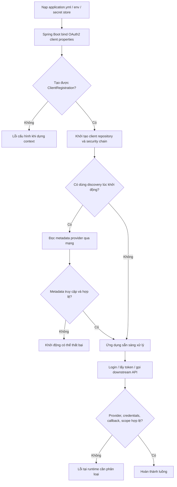
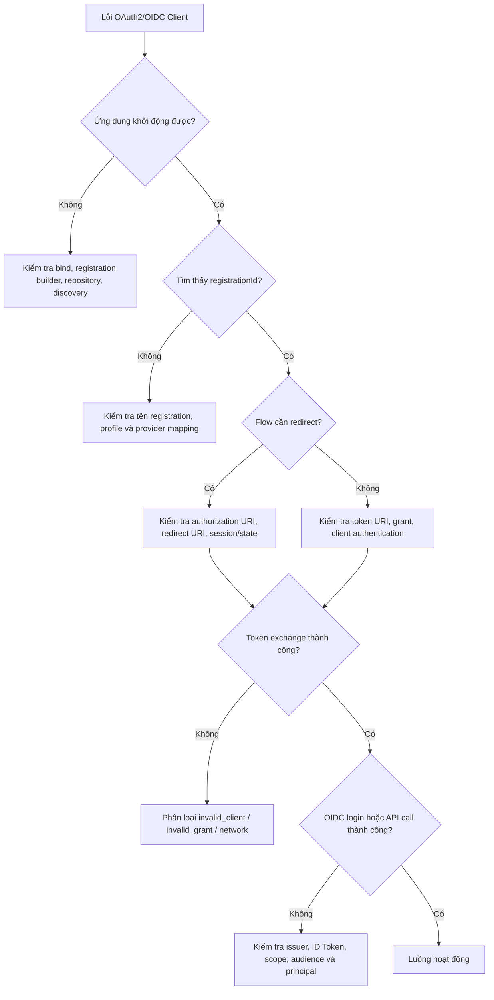

# 5.10. Ràng buộc tính hợp lệ và xử lý thiếu cấu hình

Trong Spring Security OAuth 2.0 / OpenID Connect (OIDC) Client, `ClientRegistration` mô tả cách một ứng dụng được đăng ký với Authorization Server hoặc OpenID Provider (OP). Đối tượng này xác định `clientId`, phương thức xác thực client, grant type, redirect URI, scope và các endpoint của provider. Một cấu hình sai có thể ngăn ứng dụng khởi động, khiến đăng nhập thất bại khi chuyển hướng, hoặc chỉ bộc lộ khi ứng dụng gọi API bằng access token.

**Ràng buộc tính hợp lệ** không chỉ là việc một thuộc tính có giá trị hay không. Cần phân biệt:

1. **Hợp lệ về cấu trúc:** Spring Boot bind được các property và Spring Security xây dựng được `ClientRegistration`.
2. **Hợp lệ về ngữ nghĩa OAuth 2.0/OIDC:** Các giá trị tương thích với grant type, client authentication method và metadata của provider.
3. **Hợp lệ khi vận hành:** Provider tồn tại, issuer/endpoint có thể truy cập, redirect URI được đăng ký đúng, secret còn hiệu lực, token có audience/scope phù hợp.

Một `ClientRegistration` xây dựng thành công **không bảo đảm** toàn bộ quá trình đăng nhập hoặc lấy token sẽ thành công. Ngược lại, không phải mọi trường bị bỏ trống đều là lỗi: ví dụ public client dùng `client-authentication-method: none` không có client secret, còn `client_credentials` không cần redirect URI.

## 1. Phạm vi và nguồn của một ClientRegistration

Trong Spring Boot, cấu hình thường nằm dưới hai nhánh:

- `spring.security.oauth2.client.registration.<registration-id>.*`: thông tin **ứng dụng client** và cách client xin quyền.
- `spring.security.oauth2.client.provider.<provider-id>.*`: thông tin **Authorization Server/OpenID Provider** tương ứng.

Một `registrationId` là khóa logic để ứng dụng chọn client, chẳng hạn `company-login` hoặc `inventory-service`. Nó không đồng nghĩa với `client-id` do provider cấp. Một provider có thể phục vụ nhiều registration, và một registration phải chỉ đến đúng provider.

Ví dụ:

```yaml
spring:
  security:
    oauth2:
      client:
        registration:
          company-login:
            provider: company
            client-id: "${OIDC_CLIENT_ID}"
            client-secret: "${OIDC_CLIENT_SECRET}"
            client-authentication-method: client_secret_basic
            authorization-grant-type: authorization_code
            redirect-uri: "{baseUrl}/login/oauth2/code/{registrationId}"
            scope:
              - openid
              - profile
              - email
        provider:
          company:
            issuer-uri: "https://login.example.org/realms/company"
```

Trong ví dụ này:

- `company-login` là `registrationId`, dùng trong URL khởi động đăng nhập mặc định `/oauth2/authorization/company-login`.
- `company` là `providerId`, liên kết với cấu hình ở nhánh `provider.company`.
- `client-id` và `client-secret` đến từ cấu hình ngoài ứng dụng; không điền secret thật vào mã nguồn hoặc log.
- `issuer-uri` cho phép Spring Security/Spring Boot lấy metadata từ provider hỗ trợ discovery, gồm các endpoint cần thiết.
- `redirect-uri` chứa các biến template của Spring; URL sau khi mở rộng phải khớp với callback đã đăng ký tại provider.

Mặc định, nếu `registration.<id>.provider` không được chỉ định, Spring Boot dùng registration ID để xác định provider. Cách đó có thể phù hợp với các provider phổ biến được hỗ trợ sẵn hoặc provider cùng tên, nhưng dễ sai nếu ID nội bộ và provider ID khác nhau. Khi cần, hãy cấu hình `provider` một cách tường minh.

> **Lưu ý phiên bản:** Danh sách grant type, phương thức xác thực client, quy tắc kiểm tra và giá trị mặc định có thể thay đổi theo phiên bản Spring Security/Spring Boot. Những kiểm tra tự viết trong bài là chính sách cho ứng dụng; không nên xem chúng là danh sách đầy đủ các assert nội bộ mà mọi phiên bản framework đều sử dụng.

## 2. Phân loại trường bắt buộc, có điều kiện và tùy chọn

| Thuộc tính của `ClientRegistration` | Ý nghĩa và nguyên tắc kiểm tra |
|---|---|
| `registrationId` | Phải định danh duy nhất registration trong repository. Dùng một tên ổn định, không để trống và không nhầm với client ID bên provider. |
| `clientId` | Định danh client do provider cấp. Cần giá trị có ý nghĩa; ID sai có thể chỉ bị phát hiện khi gọi authorization/token endpoint. |
| `clientSecret` | Phụ thuộc phương thức xác thực client. Thường cần cho `client_secret_basic` hoặc `client_secret_post`, **không** bắt buộc cho public client dùng `none`; các phương thức như JWT client assertion có ràng buộc khóa riêng. |
| `clientAuthenticationMethod` | Phải phù hợp với phương thức provider hỗ trợ và với kiểu client (public/confidential). |
| `authorizationGrantType` | Phải tương thích với luồng sử dụng và grant được provider cho phép, ví dụ `authorization_code` hoặc `client_credentials`. |
| `redirectUri` | Liên quan các luồng redirect như authorization code. Không tự động bắt buộc với client credentials. Giá trị thực tế phải khớp đăng ký ở provider. |
| `scopes` | Phụ thuộc yêu cầu API/provider. OIDC Login cần `openid`; thiếu scope nghiệp vụ có thể khiến đăng nhập thành công nhưng gọi API bị từ chối. |
| `providerDetails.authorizationUri` | Cần cho bước chuyển hướng người dùng trong authorization-code flow; có thể nhận qua discovery hoặc cấu hình trực tiếp. |
| `providerDetails.tokenUri` | Cần khi đổi authorization code, refresh token hoặc lấy token bằng client credentials. |
| `providerDetails.issuerUri` | Hữu ích và thường được khuyến nghị cho OIDC; phải trùng issuer mà provider công bố và dùng khi xác minh thông tin OIDC. |
| `providerDetails.jwkSetUri` | Dùng cho các trường hợp cần khóa công khai xác minh token/chữ ký; có thể lấy từ metadata nếu dùng discovery. |
| `providerDetails.userInfoEndpoint` | Phụ thuộc luồng đăng nhập và cách lấy thông tin người dùng; với OAuth2 Login không theo OIDC, có thể cần UserInfo URI và thuộc tính định danh người dùng. |
| `clientName` | Tên hiển thị cho client; không phải client ID dùng xác thực với provider. |

Không nên duy trì một danh sách “mọi trường đều required” cho tất cả registration. Hãy kiểm tra theo **grant type + client authentication method + đặc tính provider + nhu cầu ứng dụng**.

### 2.1. Authorization Code và OIDC Login

Luồng này đưa trình duyệt người dùng tới authorization endpoint rồi nhận authorization code tại callback. Những điều cần kiểm tra gồm:

1. `client-id` và provider đúng với client đã đăng ký.
2. Provider cung cấp authorization endpoint và token endpoint hợp lệ.
3. `redirect-uri` mở rộng thành URL mà provider cho phép, đúng scheme, host, port, path.
4. Phương thức xác thực client phù hợp: confidential client có thể dùng secret; public client thường dùng `none` và cần PKCE theo chính sách hiện hành của provider.
5. Với OIDC, yêu cầu scope `openid`; issuer, ID Token và khóa xác minh phải phù hợp với metadata và yêu cầu giao thức.
6. Nếu ứng dụng cần claims cụ thể, kiểm tra provider có phát hành thông tin tương ứng và thiết kế xử lý khi claim tùy chọn vắng mặt.

`profile` và `email` không thay thế `openid`. Một ID Token hợp lệ xác nhận kết quả đăng nhập cho client, còn access token có mục đích ủy quyền truy cập Resource Server. Không dùng ID Token như access token để gọi API.

### 2.2. Client Credentials

Đây là luồng máy tới máy, không có trình duyệt người dùng, callback hay ID Token của một người dùng:

```yaml
spring:
  security:
    oauth2:
      client:
        registration:
          inventory-service:
            provider: company
            client-id: "${INVENTORY_CLIENT_ID}"
            client-secret: "${INVENTORY_CLIENT_SECRET}"
            client-authentication-method: client_secret_basic
            authorization-grant-type: client_credentials
            scope:
              - inventory.read
        provider:
          company:
            token-uri: "https://login.example.org/realms/company/protocol/openid-connect/token"
```

Ở ví dụ này, `redirect-uri` và `authorization-uri` không tham gia luồng cấp token `client_credentials`. Thành phần quan trọng là token endpoint, phương thức xác thực client và scope được provider cấp. Một số nhà cung cấp yêu cầu cấu hình bổ sung, ví dụ audience/resource indicator hoặc client assertion; đó là hợp đồng riêng với provider, không phải giá trị mặc định chung.

### 2.3. OAuth2 Login không dùng OIDC

OAuth 2.0 thuần túy không tiêu chuẩn hóa ID Token. Nếu đăng nhập dựa trên thông tin user từ một OAuth2 provider, ứng dụng thường cần cấu hình endpoint lấy UserInfo/user attributes và chỉ rõ trường định danh (chẳng hạn `id` hoặc `login`) khi provider không có cấu hình mặc định tương ứng.

Không dùng logic “có `client-id` + `client-secret` là đủ để login”: bộ thuộc tính cần thiết phụ thuộc provider và giao thức xác thực được chọn.

## 3. Thiếu cấu hình có thể xuất hiện ở nhiều thời điểm



**Không nên mặc định rằng mọi lỗi cấu hình đều xảy ra lúc startup.** Các lỗi phụ thuộc vào thời điểm hệ thống thực sự sử dụng registration:

| Thời điểm | Ví dụ lỗi | Hướng xử lý |
|---|---|---|
 Bind properties | Sai cấu trúc YAML, property name không đúng, placeholder thiếu, giá trị enum/kiểu không hợp lệ | Xem nguyên nhân gốc của exception, kiểm tra nguồn property và active profile. |
 Tạo `ClientRegistration` | Thiếu dữ liệu framework cần để xây dựng registration, provider chưa xác định rõ | Bổ sung trường tương ứng với grant type, provider và phiên bản Spring đang dùng. |
 Discovery | Issuer URI sai, DNS/TLS lỗi, endpoint metadata không truy cập được, issuer trong metadata không khớp | Kiểm tra well-known endpoint, truststore, proxy, issuer chính xác và khả năng truy cập mạng. |
 Khởi tạo security | Thiếu bean `ClientRegistrationRepository` / `ReactiveClientRegistrationRepository` trong cấu hình đăng nhập tự tạo | Kiểm tra starter, web stack và điều kiện auto-configuration. |
 Chuyển hướng đăng nhập | Provider từ chối `redirect_uri`, `scope` hoặc `client_id` | So sánh URL thực tế sau khi expand template với đăng ký phía provider. |
 Callback/token exchange | `invalid_client`, `invalid_grant`, mã hết hạn, client authentication method sai | Kiểm tra secret, grant được bật, code/state và redirect URI; không log code/token. |
 Xác thực OIDC | Issuer, audience, chữ ký, thời hạn, nonce không hợp lệ | Đọc thông báo xác minh, đối chiếu metadata và cấu hình; không tắt validation. |
 Gọi Resource Server | Token thiếu scope/audience, token hết hạn hoặc client được chọn không đúng | Kiểm tra đăng ký client dùng khi gọi outbound API và quyền được provider cấp. |

Với `issuer-uri`, việc lấy metadata có thể diễn ra trong lúc khởi tạo registration. Vì thế sự cố mạng tới Identity Provider có thể khiến ứng dụng không khởi động được trong một số cấu hình. Khi muốn tách sự sẵn sàng của ứng dụng khỏi discovery tại startup, có thể cấu hình tường minh các endpoint đã được quản lý và kiểm thử, đổi lại trách nhiệm cập nhật metadata thuộc về người vận hành.

## 4. Cách xử lý trường thiếu: phân biệt “bắt buộc” và “có mặc định”

Spring Boot hỗ trợ cấu hình provider phổ biến và một số giá trị mặc định. Tuy nhiên, những mặc định đó không phải lời bảo đảm rằng registration đúng với cấu hình bên Authorization Server.

Các nguyên tắc:

- **Trường cốt lõi thiếu:** nếu ứng dụng cần registration, phát hiện sớm và báo rõ `registrationId` + tên trường; không tự sinh client ID, redirect URI hay secret giả để ứng dụng khởi động.
- **Trường chỉ cần trong một nhánh:** chỉ kiểm tra khi grant type/phương thức client authentication thực sự sử dụng nó. Ví dụ không yêu cầu redirect URI của client credentials.
- **Thông tin provider:** ưu tiên issuer discovery khi được hỗ trợ và phù hợp. Nếu cấu hình thủ công, cần cung cấp các endpoint tương ứng với luồng dùng thực tế.
- **Mặc định Spring Boot:** đọc giá trị **cuối cùng sau binding** thay vì đoán từ YAML. Provider mặc định hoặc property từ environment có thể đã tác động lên registration.
- **Tích hợp tùy chọn:** nếu một OAuth2 integration không được bật trong môi trường cụ thể, đừng để nửa bộ property OAuth2 giả làm registration hợp lệ; tách cấu hình theo profile/điều kiện thích hợp.
- **Secret tùy môi trường:** lấy từ environment, secret manager hoặc nguồn cấu hình được kiểm soát. Nếu confidential client không có secret khi được yêu cầu, dừng luồng với lỗi cấu hình rõ ràng, không thay bằng chuỗi mặc định vô nghĩa.

### 4.1. Tránh cấu hình “trông có vẻ hợp lệ”

Đoạn sau dễ gây lỗi khó phát hiện:

```yaml
# Ví dụ nên tránh
spring:
  security:
    oauth2:
      client:
        registration:
          company-login:
            client-id: "placeholder"
            client-secret: "change-me"
```

`placeholder` hoặc `change-me` vẫn là chuỗi, nên một số lớp kiểm tra chỉ về mặt cấu trúc có thể không biết chúng là giá trị giả. Khi cần chạy local không có IdP, hãy sử dụng provider thử nghiệm và credentials local riêng; khi không dùng đăng nhập, cần điều chỉnh chế độ xác thực của môi trường đó một cách có chủ đích.

### 4.2. Property placeholder không thay thế validation

```yaml
client-id: "${OIDC_CLIENT_ID}"
client-secret: "${OIDC_CLIENT_SECRET}"
```

Cú pháp trên tham chiếu biến cấu hình. Nó không kiểm tra client được đăng ký tại provider hay secret đã hết hạn chưa. Ngoài ra, các nguồn cấu hình có thứ tự ưu tiên: environment, profile, command-line arguments hoặc config server có thể khiến giá trị thực tế khác file mặc định. Khi chẩn đoán, chỉ ghi tên property và tên nguồn cấu hình, không in giá trị secret.

## 5. Kiểm tra có chủ đích ngay khi ứng dụng khởi động

Framework có kiểm tra riêng lúc bind và xây dựng registration, nhưng ứng dụng thường cần thêm các quy tắc nghiệp vụ: “phải có registration `company-login`”, “cần scope `openid`”, “confidential client yêu cầu secret”, “không dùng endpoint HTTP ngoài môi trường local”, v.v.

Ví dụ dưới đây minh họa **kiểm tra bổ sung trong ứng dụng Servlet** sau khi Spring Boot tạo `ClientRegistrationRepository`. Các import được lược bỏ; `ApplicationRunner` là một bean của Spring Boot, `StringUtils` thuộc Spring Framework:

```java
@Configuration
class OAuth2RegistrationPreflight {

    @Bean
    ApplicationRunner verifyCompanyLogin(ClientRegistrationRepository repository) {
        return args -> {
            ClientRegistration registration =
                    repository.findByRegistrationId("company-login");

            require(registration != null,
                    "Missing OAuth2 client registration: company-login");

            require(StringUtils.hasText(registration.getClientId()),
                    "company-login: client-id must be configured");

            require(AuthorizationGrantType.AUTHORIZATION_CODE.equals(
                    registration.getAuthorizationGrantType()),
                    "company-login: expected authorization_code grant");

            require(registration.getScopes().contains("openid"),
                    "company-login: OIDC Login requires openid scope");

            require(StringUtils.hasText(registration.getRedirectUri()),
                    "company-login: redirect-uri must be configured");

            var provider = registration.getProviderDetails();
            require(StringUtils.hasText(provider.getAuthorizationUri()),
                    "company-login: provider authorization-uri missing");
            require(StringUtils.hasText(provider.getTokenUri()),
                    "company-login: provider token-uri missing");

            ClientAuthenticationMethod method =
                    registration.getClientAuthenticationMethod();
            if (ClientAuthenticationMethod.CLIENT_SECRET_BASIC.equals(method)
                    || ClientAuthenticationMethod.CLIENT_SECRET_POST.equals(method)) {
                require(StringUtils.hasText(registration.getClientSecret()),
                        "company-login: confidential client secret missing");
            }
        };
    }

    private static void require(boolean condition, String message) {
        if (!condition) {
            throw new IllegalStateException(message);
        }
    }
}
```

Điểm cần hiểu về ví dụ:

1. `findByRegistrationId(...)` trả `null` khi không có registration tương ứng; fail-fast giúp tránh lỗi khó hiểu khi người dùng bắt đầu đăng nhập.
2. `ClientRegistration` đã được framework xây dựng trước khi `ApplicationRunner` chạy. Nếu quá trình bind/build/discovery thất bại sớm hơn, preflight không được gọi và phải xử lý nguyên nhân ở giai đoạn đó.
3. Không áp đặt yêu cầu secret lên public client dùng `none`. Với các phương thức xác thực nâng cao, phải kiểm tra cấu hình khóa và cơ chế ký riêng theo provider.
4. Ví dụ kiểm tra dữ liệu cần thiết của OIDC login; chưa xác minh issuer có thực sự đúng hay provider đang sẵn sàng. Để kiểm tra điều đó cần kiểm thử integration hoặc health/diagnostic phù hợp.
5. Không đưa `getClientSecret()` vào thông báo lỗi, log hoặc exception. Chỉ ghi tên registration và tên thuộc tính thiếu.

Đối với ứng dụng WebFlux, repository tương ứng là `ReactiveClientRegistrationRepository`; việc lấy registration thường trả về `Mono<ClientRegistration>`. Không bê nguyên bean và kiểu trả về của Servlet sang WebFlux, cũng không dùng `block()` trên event-loop. Nếu ứng dụng cần kiểm tra trước khi nhận traffic, hãy thiết kế bước khởi tạo được quản lý phù hợp với lifecycle Reactive.

### 5.1. Khi nào viết custom validator?

Nên thêm validator tại lớp cấu hình khi có hợp đồng ổn định và đáng kiểm tra sớm, ví dụ:

- Một registration nhất định phải tồn tại ở production.
- Một registration dành cho OIDC Login phải có scope `openid`.
- Provider production phải sử dụng issuer HTTPS đã được phê duyệt.
- Một client chỉ được phép dùng `client_credentials`, không nhận cấu hình grant type khác do nhầm profile.
- Tên client/registration phải nhất quán giữa file cấu hình, URL khởi tạo login và mã chọn authorized client.

Không nên biến validator thành bộ tiêu chuẩn OAuth2/OIDC tự chế, phủ nhận các kiểu client hợp lệ khác. Các phép kiểm tra có tính đặc thù (như yêu cầu PKCE, policy redirect URI hoặc client assertion) nên gắn với chính sách provider của hệ thống.

## 6. Kiểm tra redirect URI, issuer và endpoint

### 6.1. Redirect URI sau khi mở rộng template

Spring Security hỗ trợ URI template như:

```yaml
redirect-uri: "{baseUrl}/login/oauth2/code/{registrationId}"
```

Chẳng hạn với `baseUrl=https://app.example.org` và `registrationId=company-login`, callback dự kiến là:

```text
https://app.example.org/login/oauth2/code/company-login
```

Khi xảy ra `redirect_uri_mismatch`, cần so sánh **giá trị thực tế trong authorization request** với URI đã đăng ký ở provider, kể cả:

| Thành phần | Ví dụ sai khác |
|---|---|
| Scheme | `http` phía ứng dụng nội bộ nhưng `https` phía browser |
| Host | `localhost`, hostname nội bộ, tên miền công khai hoặc tên miền khác môi trường |
| Port | `:8080` bị đưa ra URL public không phù hợp |
| Path | `/login/oauth2/code/company-login` so với custom callback khác |
| Base path/context path | Ứng dụng nằm dưới `/app` nhưng callback thiếu hoặc thừa `/app` |
| Registration ID | Đường dẫn callback chứa ID khác ID mà ứng dụng đang dùng |

Khi đặt ứng dụng sau reverse proxy/load balancer, cấu hình xử lý forwarded headers đúng với hạ tầng, chẳng hạn theo cơ chế `server.forward-headers-strategy` của Spring Boot. Chỉ tin các header do proxy tin cậy thiết lập; không nên chấp nhận tùy ý forwarded host/scheme từ Internet.

Nếu thay đổi endpoint callback mặc định trong Spring Security, phải cập nhật **cả** `redirect-uri` của registration lẫn cấu hình redirection endpoint của security chain. Chỉ thay một phía sẽ gây lệch đường dẫn.

### 6.2. Issuer và metadata discovery

`issuer-uri` là định danh chính xác của Authorization Server/OpenID Provider, không phải một URL bất kỳ trên cùng domain. Metadata discovery cung cấp thông tin như authorization endpoint, token endpoint, JWK Set URI và các khả năng của provider.

Các tình huống sai thường gặp:

- Issuer có đường dẫn realm/tenant khác, hoặc khác dấu slash theo cách provider công bố.
- TLS certificate không được JVM tin cậy, DNS/proxy/firewall ngăn kết nối.
- Metadata trả về issuer khác với issuer đã cấu hình.
- Provider không cung cấp discovery tại vị trí dự kiến.
- Authorization endpoint và token endpoint được khai báo thủ công thuộc hai tenant khác nhau.

Với OIDC, không giải quyết lỗi issuer/audience/signature bằng cách tắt xác minh ID Token. Cần sửa cấu hình, truststore, kết nối hoặc chính registration ở provider.

### 6.3. HTTPS và ngoại lệ môi trường local

Trong production, issuer, authorization endpoint, token endpoint và redirect URI ngoài browser thường phải dùng HTTPS; provider cũng có chính sách bảo mật và quy tắc URI riêng. Đường dẫn HTTP loopback đôi khi được chấp nhận cho phát triển local theo quy tắc của provider. Không nên lấy ngoại lệ local làm mặc định trong production.

## 7. Phân biệt các lỗi thường bị gộp thành “thiếu cấu hình”

### 7.1. Không tìm thấy registration

Triệu chứng: đường dẫn `/oauth2/authorization/company-login` không khởi động flow như mong đợi, hoặc code dùng `findByRegistrationId("company-login")` nhưng nhận `null`.

Kiểm tra:

1. ID trong code/URL có đúng khóa `registration.company-login` không?
2. Profile môi trường có nạp nhánh cấu hình đó không?
3. `provider` của registration có được ánh xạ đúng không?
4. Ứng dụng đang chạy Servlet hay Reactive, có bean repository và security chain đúng loại không?
5. Có bean custom ghi đè auto-configuration hoặc điều kiện cấu hình chưa thỏa không?

Nếu ứng dụng không cấu hình bất kỳ OAuth2 client nào nhưng cố bật `oauth2Login()`, có thể phát sinh lỗi thiếu repository/registration trong khi dựng security chain. Đừng chữa bằng cách thêm registration trống.

### 7.2. `invalid_client`

Lỗi này thường đến từ Authorization Server ở bước token request hoặc client authentication. Cần kiểm tra client ID, secret, secret đã rotate chưa, phương thức `client_secret_basic` hay `client_secret_post`, grant được bật cho client, và môi trường/tenant đang gọi. **Không** in client secret hoặc Authorization header để debug.

### 7.3. `invalid_grant`

Có thể do authorization code hết hạn, bị sử dụng lại, redirect URI không khớp trong token exchange, refresh token không còn hợp lệ hoặc policy của provider. Đừng quy tất cả thành “thiếu client-secret”. Phân biệt giai đoạn lỗi từ redirect, callback, token endpoint và thông điệp provider đã được làm sạch dữ liệu nhạy cảm.

### 7.4. Thiếu `openid` hoặc OIDC metadata

Nếu mục tiêu là OIDC Login nhưng không request `openid`, ứng dụng có thể đi theo hành vi OAuth2 Login không dựa trên ID Token hoặc provider phản hồi khác mong đợi. Nếu đã có `openid` nhưng metadata/ID Token không đúng, kiểm tra issuer, JWK, khả năng provider hỗ trợ OIDC và cấu hình client ở provider.

### 7.5. Đăng nhập thành công nhưng API trả 401/403

Đây thường là lỗi **token được chọn và quyền truy cập downstream**, không nhất thiết do `ClientRegistration` không được tạo. Kiểm tra:

- Ứng dụng gửi access token hay nhầm ID Token.
- Authorized client được chọn có đúng `registrationId` và principal không.
- Scope/audience/resource mà API yêu cầu đã được provider cấp chưa.
- Access token hết hạn/bị thu hồi, hoặc cơ chế refresh/reauthorization không đáp ứng.
- Resource Server có cấu hình issuer và chính sách phân quyền phù hợp không.

### 7.6. Không thể lấy metadata khi khởi động

Sự cố này xảy ra trước cả bước đăng nhập. Hãy kiểm tra DNS, TLS, routing, proxy, URL issuer và response của discovery endpoint từ môi trường triển khai ứng dụng. Không nên sửa thành một issuer giả hoặc tắt kiểm tra token chỉ để startup thành công.

## 8. Chính sách đối với cấu hình tùy chọn và nhiều môi trường

Một hệ thống có thể có client cho đăng nhập người dùng, client dùng background job và client chỉ dùng ở một số môi trường. Cần khai báo rõ registration nào **bắt buộc** và registration nào **chỉ xuất hiện khi bật chức năng**.

Ví dụ tổ chức cấu hình:

```text
application.yml                 # cấu hình chung, không chứa credential thật
application-local.yml           # test provider/local callback hoặc chế độ local
application-staging.yml         # staging issuer và registration
application-prod.yml            # production issuer và registration
secret store / environment      # client ID, client secret, signing credentials
```

Một số nguyên tắc vận hành:

- Dùng ID rõ nghĩa: `company-login`, `billing-service`; không dùng một registration cho những vai trò khác nhau chỉ vì chung provider.
- Cấu hình ở production phải được kiểm tra đầy đủ trước khi phục vụ traffic. Đối với integration quan trọng, áp dụng fail-fast cho lỗi tĩnh như thiếu registration/credential.
- Chức năng thật sự tùy chọn nên có chế độ disabled rõ ràng và cấu hình security tương ứng. Chỉ thêm `@ConditionalOnProperty` vào một bean custom **không tự động vô hiệu hóa** mọi quá trình bind/auto-configuration OAuth2 của Spring Boot; cần kiểm soát cả nhánh property và security setup.
- Đừng xuất secret, authorization code, refresh token, access token, cookie session hoặc ID Token vào log chẩn đoán.
- Khi rotate secret, đồng bộ giá trị mới ở provider và ứng dụng theo quy trình triển khai, có tính đến thời gian chồng lấp hoặc restart/reload configuration.
- Giới hạn quyền đọc secret và quyền xem metadata cấu hình theo vai trò. Với client credentials, cấp scope tối thiểu và không sử dụng tài khoản người dùng cuối để thay thế.
- Nếu ứng dụng phụ thuộc discovery online tại startup, thiết kế rõ hành vi khi provider tạm mất kết nối. Có thể cân nhắc dữ liệu endpoint được quản trị tường minh hoặc cơ chế triển khai phù hợp với yêu cầu sẵn sàng; tránh bỏ qua xác minh bảo mật.

## 9. Chiến lược kiểm thử cấu hình

Không phải lỗi nào cũng tái hiện được bằng unit test thuần túy. Nên tách ba lớp kiểm tra theo mục tiêu:

| Cấp kiểm tra | Nội dung kiểm tra | Kết quả mong đợi |
|---|---|---|
 Cấu hình tĩnh / repository | Có đúng registration ID; grant type, scope và endpoint đã resolve đúng | Phát hiện lỗi tên property, sai profile hoặc thiếu registration trước runtime. |
 Integration với IdP kiểm thử | Discovery, PKCE nếu áp dụng, redirect/callback, token exchange, issuer và claim | Xác nhận hợp đồng giao thức giữa client và provider. |
 End-to-end | Login qua browser, session/cookie, refresh token, gọi downstream API | Bộc lộ vấn đề reverse proxy, phạm vi token, cluster, quyền truy cập. |

Ví dụ kiểm tra repository trong test Spring Boot Servlet:

```java
@SpringBootTest
class OAuth2ClientRegistrationTest {

    @Autowired
    ClientRegistrationRepository repository;

    @Test
    void companyLoginHasRequiredContract() {
        ClientRegistration registration =
                repository.findByRegistrationId("company-login");

        assertNotNull(registration);
        assertEquals(AuthorizationGrantType.AUTHORIZATION_CODE,
                registration.getAuthorizationGrantType());
        assertTrue(registration.getScopes().contains("openid"));
        assertTrue(StringUtils.hasText(
                registration.getProviderDetails().getTokenUri()));
    }
}
```

Test này xác minh registration đã được tạo trong Spring context. Nếu test dựa trên `issuer-uri` có discovery thực, quá trình dựng context có thể kết nối mạng; với unit/integration test tự động nên sử dụng metadata giả lập qua server kiểm thử hoặc cấu hình provider tường minh để có kết quả ổn định.

Ngoài đường đi thành công, hãy mô phỏng các trường hợp thiếu `client-id`, trống secret của confidential client, sai provider ID, redirect URI sai, issuer không truy cập được, token endpoint trả `invalid_client`, API từ chối do scope thiếu. Mỗi trường hợp nên có thông báo nguyên nhân đủ để người vận hành xác định thuộc tính liên quan mà không lộ secret.

## 10. Quy trình chẩn đoán có thứ tự

Khi phát sinh lỗi, hãy lần lượt trả lời các câu hỏi sau:



Thứ tự trên giúp phân biệt lỗi **cấu hình local**, lỗi **hợp đồng với Authorization Server**, lỗi **ngữ cảnh callback/session** và lỗi **truy cập Resource Server**. Trong log và cảnh báo vận hành, nên gắn `registrationId`, môi trường, bước xử lý và mã lỗi đã được làm sạch thông tin nhạy cảm; đây là những dữ liệu hữu ích hơn việc dump toàn bộ request hoặc token response.

## 11. Tình huống tổng hợp

Giả sử ứng dụng BFF có hai client:

- `company-login` dùng OIDC authorization code để người dùng đăng nhập.
- `inventory-service` dùng client credentials để BFF gọi dịch vụ quản lý tồn kho.

Khi deploy lên production, `company-login` thiếu `OIDC_CLIENT_SECRET`, còn `inventory-service` không khai báo `redirect-uri`. Một bộ validator chung bắt buộc cả hai trường trên cho mọi client sẽ báo **hai lỗi**, trong đó lỗi redirect URI của `inventory-service` là cảnh báo sai.

Hướng xử lý đúng theo ngữ nghĩa là:

1. Xác định `company-login` đang dùng `client_secret_basic` hoặc phương thức khác cần secret hay không. Nếu có, coi secret thiếu là lỗi cấu hình cần giải quyết trước khi nhận traffic.
2. Với `inventory-service`, không bắt buộc redirect URI vì `client_credentials` không có callback. Kiểm tra `token-uri`, phương thức client authentication và scope `inventory.read` thay thế.
3. Kiểm tra `company-login` có `openid` và URI callback đúng tên miền production.
4. Sau khi cấu hình tĩnh hợp lệ, kiểm thử với provider thật hoặc provider thử nghiệm để xác nhận secret được chấp nhận, issuer chính xác và token có quyền phù hợp.

Điều này cho thấy giá trị của kiểm tra **theo hợp đồng của từng registration**: tránh cả trường hợp bỏ sót cấu hình bắt buộc lẫn việc từ chối một client hợp lệ chỉ vì nó dùng grant type khác.

## 12. Câu hỏi ôn tập

1. Vì sao `ClientRegistration` được xây dựng thành công vẫn có thể thất bại ở bước đổi authorization code lấy token?
2. Trong trường hợp nào `client-secret` có thể hợp lệ khi để trống? Khi nào phải bắt buộc có giá trị?
3. Vì sao không nên yêu cầu `redirect-uri` đối với mọi registration có `authorization-grant-type=client_credentials`?
4. Khi dùng `issuer-uri`, một lỗi DNS hoặc TLS có thể ảnh hưởng quá trình khởi động ứng dụng như thế nào?
5. `registrationId`, `clientId` và `providerId` khác nhau ở điểm nào?
6. Nếu callback chạy qua reverse proxy và xuất hiện `redirect_uri_mismatch`, cần đối chiếu những thành phần URL nào?
7. Khi OIDC Login thành công nhưng downstream API trả 403, vì sao không nên lập tức sửa `client-secret`?
8. Làm thế nào để fail-fast trước lỗi cấu hình tĩnh mà vẫn tránh in bí mật vào log?

## Tài liệu tham khảo

- [Spring Boot Reference — OAuth2 Client Configuration](https://docs.spring.io/spring-boot/reference/security/oauth2.html)
- [Spring Security Reference — OAuth2 Client, Core Model](https://docs.spring.io/spring-security/reference/servlet/oauth2/client/core.html)
- [Spring Security Reference — OAuth2 Client (Reactive)](https://docs.spring.io/spring-security/reference/reactive/oauth2/client/index.html)
- [Spring Security Reference — OAuth2 Login Advanced Configuration](https://docs.spring.io/spring-security/reference/servlet/oauth2/login/advanced.html)
- [Spring Security API — ClientRegistration.Builder](https://docs.spring.io/spring-security/reference/api/java/org/springframework/security/oauth2/client/registration/ClientRegistration.Builder.html)

