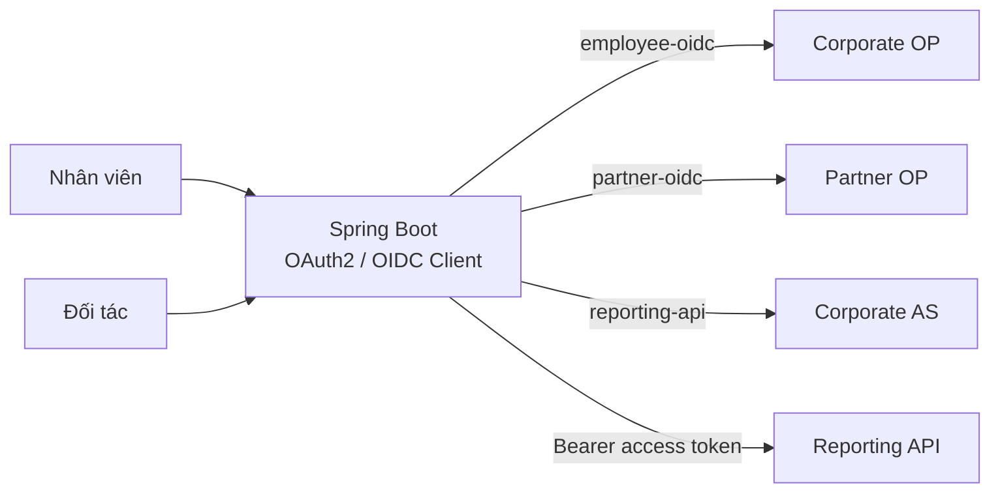
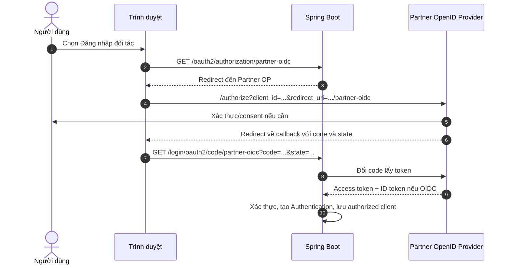

# 5.11. Quản lý nhiều registration trong cùng ứng dụng

Một ứng dụng Spring Boot có thể cần **nhiều kết nối OAuth 2.0/OIDC cùng lúc**: nhân viên đăng nhập qua Identity Provider của công ty, đối tác đăng nhập qua một nhà cung cấp khác, còn một tác vụ nền dùng **Client Credentials** để gọi API. Spring Security không yêu cầu tạo một ứng dụng riêng cho mỗi kết nối. Thay vào đó, ta khai báo nhiều **`ClientRegistration`** trong cùng **`ClientRegistrationRepository`**, sau đó lựa chọn đúng registration khi đăng nhập hoặc xin token.

Bài học này tập trung vào cách tổ chức, định danh, lựa chọn, sử dụng, lưu trữ và vận hành nhiều registration trong **Spring Security OAuth 2.0 / OIDC Client**.

## 1. Hiểu đúng một registration đại diện cho điều gì

**`ClientRegistration`** chứa cấu hình cần thiết để OAuth 2.0 Client tương tác với Authorization Server, ví dụ:

- `registrationId`: khóa định danh **nội bộ của ứng dụng Spring**.
- `clientId` và `clientSecret`: danh tính của client do Authorization Server cấp (secret tùy loại client).
- `authorizationGrantType`: cách xin quyền, như `authorization_code` hoặc `client_credentials`.
- `redirectUri`: callback nhận authorization code đối với các luồng redirect.
- `scopes`: các quyền mà client yêu cầu.
- Thông tin provider: authorization endpoint, token endpoint, issuer, JWK Set URI, UserInfo endpoint, v.v.

Một registration là **cấu hình**, chưa phải một access token. Trạng thái token sau khi được cấp được mô tả bằng **`OAuth2AuthorizedClient`**.

| Thành phần | Chứa gì? | Dùng để làm gì? |
| --- | --- | --- |
| **`ClientRegistration`** | Client ID, grant type, scope, redirect URI, endpoint | Mô tả một cách kết nối tới Authorization Server |
| **`ClientRegistrationRepository`** | Tập các `ClientRegistration` | Tra cứu cấu hình theo `registrationId` |
| **`OAuth2AuthorizedClient`** | Registration, tên principal, access token, refresh token nếu có | Biểu diễn một kết nối đã được cấp quyền/token |
| **`OAuth2AuthorizedClientRepository` / `Service`** | Các authorized client theo registration và principal | Lưu/nạp/xóa trạng thái token |
| **`OAuth2AuthorizedClientManager`** | Luồng điều phối với các provider cấp quyền | Dùng lại, xin hoặc làm mới token theo grant |

**Điểm phân biệt quan trọng:** cùng một `ClientRegistration` có thể tạo **nhiều `OAuth2AuthorizedClient`**, mỗi authorized client gắn với một principal hoặc ngữ cảnh cấp quyền phù hợp. Ngược lại, thêm một registration mới vào cấu hình **không tự đăng nhập người dùng** và **không tự sinh token**.

### 1.1. Registration ID khác Client ID

Giả sử Authorization Server cấp một client có ID `spring-web-company-prod`. Trong Spring Boot ta có thể đặt:

```yaml
spring:
  security:
    oauth2:
      client:
        registration:
          employee-oidc:
            client-id: spring-web-company-prod
```

Khi đó:

- **`employee-oidc`** là `registrationId` dùng trong ứng dụng, URL login, callback và lookup repository.
- **`spring-web-company-prod`** là `client_id` gửi tới Authorization Server.

Hai tên **không cần trùng nhau**. Đổi `registrationId` làm đổi khóa tra cứu và thường đổi cả callback URI mặc định; đổi `client-id` là thay danh tính client đã đăng ký bên Authorization Server.

### 1.2. Nhiều registration có bắt buộc là nhiều provider?

**Không.** Một provider có thể phục vụ nhiều registration để tách:

- Ứng dụng tương tác với người dùng và ứng dụng máy–máy.
- Client cho staging và production.
- Scope, audience hoặc quyền truy cập API.
- Client ID và secret của các nhóm nghiệp vụ.
- Tenant, tổ chức hoặc chính sách đăng nhập.

Ngược lại, một ứng dụng có thể khai báo nhiều registration chỉ vì người dùng đăng nhập bằng **nhiều Identity Provider khác nhau**.

## 2. Ví dụ kiến trúc: hai OIDC login và một machine client

Giả sử một cổng thông tin cần ba kết nối:

| Registration ID | Provider | Grant type | Nhu cầu |
| --- | --- | --- | --- |
| `employee-oidc` | Identity Provider nội bộ | `authorization_code` | Nhân viên đăng nhập bằng OIDC |
| `partner-oidc` | Identity Provider của đối tác | `authorization_code` | Đối tác đăng nhập bằng OIDC |
| `reporting-api` | Authorization Server nội bộ | `client_credentials` | Job nền gọi API báo cáo |



Trong ví dụ, `employee-oidc` và `reporting-api` có thể dùng **cùng provider metadata** của công ty, nhưng khác `client-id`, `client-secret`, grant type và scope.

**Ba registration không đồng nghĩa có ba phiên đăng nhập đang hoạt động.** Khi người dùng chọn một nhà cung cấp để đăng nhập, phiên web hiện tại có một `Authentication` tương ứng; các authorized client có thể được lưu theo registration/principal và vòng đời riêng.

## 3. Khai báo nhiều registration bằng Spring Boot

Ví dụ sau dùng Spring Boot 3.x và Spring Security 6.x với Servlet stack. Địa chỉ miền, client ID và secret đều là giá trị minh họa.

### 3.1. Dependencies

Nếu dùng Gradle:

```groovy
dependencies {
    implementation 'org.springframework.boot:spring-boot-starter-web'
    implementation 'org.springframework.boot:spring-boot-starter-security'
    implementation 'org.springframework.boot:spring-boot-starter-oauth2-client'
}
```

`spring-boot-starter-oauth2-client` cung cấp các thành phần OAuth2 Client và OIDC login; Spring Security Web và OAuth2 Login cần được bật đúng trong security configuration.

### 3.2. `application.yml`

```yaml
spring:
  security:
    oauth2:
      client:
        registration:
          employee-oidc:
            provider: corporate
            client-id: ${EMPLOYEE_OIDC_CLIENT_ID}
            client-secret: ${EMPLOYEE_OIDC_CLIENT_SECRET}
            authorization-grant-type: authorization_code
            redirect-uri: "{baseUrl}/login/oauth2/code/{registrationId}"
            scope:
              - openid
              - profile
              - email

          partner-oidc:
            provider: partner
            client-id: ${PARTNER_OIDC_CLIENT_ID}
            client-secret: ${PARTNER_OIDC_CLIENT_SECRET}
            authorization-grant-type: authorization_code
            redirect-uri: "{baseUrl}/login/oauth2/code/{registrationId}"
            scope:
              - openid
              - profile

          reporting-api:
            provider: corporate
            client-id: ${REPORTING_CLIENT_ID}
            client-secret: ${REPORTING_CLIENT_SECRET}
            authorization-grant-type: client_credentials
            scope:
              - reports.read

        provider:
          corporate:
            issuer-uri: https://id.corp.example.test/realms/company
          partner:
            issuer-uri: https://login.partner.example.test/realms/partners
```

**Giải thích cấu trúc:**

- `registration.employee-oidc` và `registration.reporting-api` đều khai báo `provider: corporate`: hai client khác nhau chia sẻ thông tin endpoint của cùng Authorization Server.
- `registration.partner-oidc` dùng provider khác.
- `provider.*.issuer-uri` dùng OIDC/OAuth metadata discovery khi Authorization Server hỗ trợ. Spring cần truy cập được issuer và metadata phù hợp với môi trường.
- `scope: openid` dành cho **OIDC login**. `reporting-api` chỉ xin `reports.read` theo tư cách máy–máy, không cần đăng nhập người dùng.
- `redirect-uri` dành cho flow `authorization_code`. `client_credentials` không có browser callback.
- Các biến môi trường là nơi cung cấp credentials theo môi trường triển khai; không ghi secret thật vào Git, README hoặc log.

Tên `registrationId` phải **duy nhất** trong cùng repository. Các key như `employee-oidc` và `partner-oidc` cũng xuất hiện trong URL khởi động login mặc định.

### 3.3. Không nhầm `registration` với `provider`

```text
spring.security.oauth2.client
├── registration
│   ├── employee-oidc  ------> provider: corporate
│   ├── partner-oidc   ------> provider: partner
│   └── reporting-api  ------> provider: corporate
└── provider
    ├── corporate      ------> issuer-uri: https://id.corp.example.test/...
    └── partner        ------> issuer-uri: https://login.partner.example.test/...
```

**Registration** xác định *danh tính client và loại quyền cần xin*. **Provider** xác định *hệ thống cấp quyền và endpoint sẽ giao tiếp*. Một provider có thể được dùng chung, nhưng mỗi registration vẫn cần cấu hình scope, grant, client ID và client authentication đúng.

Nếu provider không có discovery endpoint phù hợp, có thể khai báo các URL cần thiết bằng thuộc tính như `authorization-uri`, `token-uri`, `jwk-set-uri`, `user-info-uri`. Những trường thực sự cần thiết tùy flow OAuth2/OIDC.

## 4. ClientRegistrationRepository quản lý toàn bộ cấu hình

Spring Boot thường tạo một `ClientRegistrationRepository` dựa trên các mục cấu hình. Một implementation phổ biến là **`InMemoryClientRegistrationRepository`**.

API tối thiểu:

```java
ClientRegistration findByRegistrationId(String registrationId);
```

Ví dụ service tra cứu registration theo ID:

```java
import org.springframework.security.oauth2.client.registration.ClientRegistration;
import org.springframework.security.oauth2.client.registration.ClientRegistrationRepository;
import org.springframework.stereotype.Service;

@Service
public class RegistrationCatalog {

    private final ClientRegistrationRepository registrations;

    public RegistrationCatalog(ClientRegistrationRepository registrations) {
        this.registrations = registrations;
    }

    public ClientRegistration required(String registrationId) {
        ClientRegistration registration =
                registrations.findByRegistrationId(registrationId);

        if (registration == null) {
            throw new IllegalArgumentException(
                    "Unknown registration: " + registrationId);
        }
        return registration;
    }
}
```

Dùng `findByRegistrationId("employee-oidc")` để lấy cấu hình OIDC dành cho nhân viên; `findByRegistrationId("reporting-api")` trả về cấu hình machine client.

**Không dùng phương thức này để lấy access token.** `ClientRegistration` chỉ có metadata tĩnh; token nằm trong `OAuth2AuthorizedClient` và kho lưu trữ authorized-client.

### 4.1. Liệt kê registrations

Một số repository triển khai thêm `Iterable<ClientRegistration>`, trong đó có `InMemoryClientRegistrationRepository`. Ví dụ:

```java
import java.util.ArrayList;
import java.util.List;
import org.springframework.security.oauth2.client.registration.ClientRegistration;
import org.springframework.security.oauth2.client.registration.ClientRegistrationRepository;

public List<String> listConfiguredIds(ClientRegistrationRepository repository) {
    List<String> ids = new ArrayList<>();

    if (repository instanceof Iterable<?> iterable) {
        for (Object item : iterable) {
            if (item instanceof ClientRegistration registration) {
                ids.add(registration.getRegistrationId());
            }
        }
    }
    return ids;
}
```

**Không phải mọi custom repository đều hỗ trợ liệt kê**. `ClientRegistrationRepository` chỉ cam kết tra cứu theo ID; nếu ứng dụng cần danh sách dùng cho menu, bạn có thể quản lý một catalog allowlist riêng hoặc một abstraction phù hợp với dữ liệu của mình.

Khi hiện registration trên UI, phải lọc những registration **được phép dùng để đăng nhập**. Không đưa `reporting-api` với `client_credentials` vào menu chọn Identity Provider.

## 5. Cho người dùng chọn provider khi đăng nhập

### 5.1. Endpoint bắt đầu login theo registration ID

Với cấu hình mặc định của Spring Security Servlet, URL khởi động Authorization Code Flow là:

```text
/oauth2/authorization/{registrationId}
```

Ứng dụng ví dụ có hai link:

```html
<a href="/oauth2/authorization/employee-oidc">
  Đăng nhập nhân viên
</a>

<a href="/oauth2/authorization/partner-oidc">
  Đăng nhập đối tác
</a>
```

Khi người dùng chọn link, `OAuth2AuthorizationRequestRedirectFilter` tìm registration tương ứng và tạo authorization request với `client_id`, `scope`, `redirect_uri`, `state` cùng các tham số khác của provider đó.

- Chọn `employee-oidc` → chuyển hướng tới Corporate OP.
- Chọn `partner-oidc` → chuyển hướng tới Partner OP.
- Chọn `reporting-api` → không phải một lựa chọn login: đó là Client Credentials.

### 5.2. SecurityFilterChain cho nhiều OIDC login

```java
import org.springframework.context.annotation.Bean;
import org.springframework.context.annotation.Configuration;
import org.springframework.security.config.Customizer;
import org.springframework.security.config.annotation.web.builders.HttpSecurity;
import org.springframework.security.web.SecurityFilterChain;

@Configuration
public class SecurityConfig {

    @Bean
    SecurityFilterChain securityFilterChain(HttpSecurity http) throws Exception {
        return http
            .authorizeHttpRequests(authorize -> authorize
                .requestMatchers("/", "/public/**", "/error").permitAll()
                .anyRequest().authenticated()
            )
            .oauth2Login(Customizer.withDefaults())
            .oauth2Client(Customizer.withDefaults())
            .build();
    }
}
```

`oauth2Login()` xử lý người dùng đăng nhập qua Authorization Code/OIDC; `oauth2Client()` hỗ trợ chức năng OAuth2 Client khi ứng dụng cần làm việc với authorized clients. Không cần tạo riêng một SecurityFilterChain cho mỗi registration chỉ vì có hai nhà cung cấp OIDC.

Khi bạn chưa tự cấu hình một trang login, Spring Security có thể sinh trang đăng nhập mặc định liệt kê các registration Authorization Code tìm được khi repository hỗ trợ `Iterable`. Với màn hình đăng nhập thiết kế riêng, nên tạo link tường minh tới từng `/oauth2/authorization/{registrationId}`.

### 5.3. Trang đăng nhập riêng

Giả sử giao diện thực tế dùng trang `/login`:

```java
@Bean
SecurityFilterChain securityFilterChain(HttpSecurity http) throws Exception {
    return http
        .authorizeHttpRequests(authorize -> authorize
            .requestMatchers("/", "/login", "/public/**", "/error").permitAll()
            .anyRequest().authenticated()
        )
        .oauth2Login(oauth -> oauth
            .loginPage("/login")
            .permitAll()
        )
        .build();
}
```

Ứng dụng phải **phục vụ được trang GET `/login`** bằng MVC controller hoặc view phù hợp. Một template HTML có thể chứa hai link đăng nhập như trên.

Chỉ tạo link cho registration được định nghĩa trước và đúng mục đích; không xây một URL đăng nhập từ provider URL hoặc `client-id` bất kỳ do người dùng nhập.

## 6. Redirect URI của từng registration

Khi khai báo:

```yaml
redirect-uri: "{baseUrl}/login/oauth2/code/{registrationId}"
```

Spring Security tạo callback theo `registrationId`:

| Registration | Redirect URI nếu origin là `https://app.example.test` |
| --- | --- |
| `employee-oidc` | `https://app.example.test/login/oauth2/code/employee-oidc` |
| `partner-oidc` | `https://app.example.test/login/oauth2/code/partner-oidc` |

Mỗi Authorization Server phải được cấu hình cho phép đúng Redirect URI **của client ID tương ứng**. Cùng hostname ứng dụng không có nghĩa OP nào cũng chấp nhận mọi callback.



**Chú ý:** `{baseUrl}` phụ thuộc public scheme/host/port/context path. Khi chạy sau load balancer/ingress, hãy bảo đảm xử lý forwarded headers từ proxy tin cậy hoặc đặt Redirect URI tường minh theo môi trường. Nếu dùng callback path khác mặc định, đồng thời phải sửa `oauth2Login().redirectionEndpoint().baseUri(...)` cho khớp.

## 7. Biết người dùng đã đăng nhập bằng registration nào

Sau OAuth2/OIDC login thành công trong Servlet application, đối tượng `OAuth2AuthenticationToken` cung cấp:

```java
String registrationId = token.getAuthorizedClientRegistrationId();
```

Tên này giúp ứng dụng biết **nguồn đăng nhập** của phiên hiện tại.

Ví dụ endpoint hiển thị metadata phiên:

```java
import java.security.Principal;
import java.util.Map;
import org.springframework.security.oauth2.client.authentication.OAuth2AuthenticationToken;
import org.springframework.web.bind.annotation.GetMapping;
import org.springframework.web.bind.annotation.RestController;

@RestController
public class SessionController {

    @GetMapping("/api/session")
    Map<String, String> session(Principal principal) {
        if (!(principal instanceof OAuth2AuthenticationToken token)) {
            throw new IllegalStateException("Expected OAuth2/OIDC login");
        }

        return Map.of(
            "registrationId", token.getAuthorizedClientRegistrationId(),
            "principalName", token.getName()
        );
    }
}
```

Nếu người dùng vừa đăng nhập qua `partner-oidc`, `getAuthorizedClientRegistrationId()` trả về `partner-oidc`. Nếu qua `employee-oidc`, kết quả là `employee-oidc`.

Với OIDC login, principal có thể là **`OidcUser`**. Để nhận diện người dùng bền vững, nên xét bộ khóa **issuer + subject (sub)** hoặc một mapping danh tính được quản lý rõ ràng. Không mặc định hai tài khoản có cùng email từ hai issuer là cùng một người hoặc được quyền liên kết tự động.

### 7.1. Phân biệt nguồn đăng nhập và quyền ứng dụng

`registrationId` chỉ cho biết người dùng đã đi qua cấu hình login nào. Nó **không tự chứng minh người dùng là nhân viên, quản trị viên hay đối tác được phê duyệt**.

Ví dụ, đưa một tài khoản dùng `employee-oidc` vào một nhóm quyền nội bộ vẫn cần xác minh issuer, claim/role đáng tin cậy và ánh xạ authority theo chính sách. Không cấp quyền quản trị chỉ vì request chứa chuỗi `employee-oidc`.

Tương tự, nhiều Identity Provider có thể phát hành claim `groups` với ý nghĩa khác nhau. Khi cần chuyển claim thành `GrantedAuthority`, nên có mapping rõ ràng theo provider để tránh trộn quyền.

## 8. Authorized client: mỗi registration có trạng thái token riêng

**`OAuth2AuthorizedClient`** gắn một registration với một principal và các token đã được cấp. Hai người có cùng registration thường sở hữu token riêng; cùng một người có thể có authorized client riêng cho hai registration.

```text
ClientRegistrationRepository (cấu hình)
├── employee-oidc
├── partner-oidc
└── reporting-api

OAuth2AuthorizedClientRepository / Service (token runtime)
├── (employee-oidc, alice) --> access token A, refresh token A?
├── (employee-oidc, bob)   --> access token B, refresh token B?
├── (partner-oidc, carol)  --> access token C, refresh token C?
└── (reporting-api, nightly-report-job) --> access token D
```

Trong một số storage, khóa tra cứu logic là **`(registrationId, principalName)`**; repository Servlet còn nhận request/response và `Authentication` để xử lý storage theo phiên/ngữ cảnh.

### 8.1. Repository và service có khác gì?

| API | Điển hình dùng khi |
| --- | --- |
| **`OAuth2AuthorizedClientRepository`** | Đang có HTTP request/response, session hoặc web principal |
| **`OAuth2AuthorizedClientService`** | Truy cập token theo registration + principal ngoài phạm vi HTTP request |

Các implementation thường gặp gồm `HttpSessionOAuth2AuthorizedClientRepository`, `AuthenticatedPrincipalOAuth2AuthorizedClientRepository`, `InMemoryOAuth2AuthorizedClientService` và `JdbcOAuth2AuthorizedClientService`.

Khi gọi service để lấy token, nhớ rằng service là **kho lưu**. Nó không tự làm mới access token chỉ vì caller gọi `loadAuthorizedClient(...)`. Vòng đời cấp mới/refresh cần thông qua **`OAuth2AuthorizedClientManager`** cùng provider phù hợp.

### 8.2. Nạp authorized client của registration đã dùng để đăng nhập

Trong một request đã được xác thực, có thể lấy registration từ `OAuth2AuthenticationToken` rồi tra authorized client:

```java
import java.security.Principal;
import java.util.Map;
import org.springframework.security.oauth2.client.OAuth2AuthorizedClient;
import org.springframework.security.oauth2.client.web.OAuth2AuthorizedClientRepository;
import org.springframework.security.oauth2.client.authentication.OAuth2AuthenticationToken;
import org.springframework.web.bind.annotation.GetMapping;
import org.springframework.web.bind.annotation.RestController;
import jakarta.servlet.http.HttpServletRequest;

@RestController
public class ConnectionController {

    private final OAuth2AuthorizedClientRepository clients;

    public ConnectionController(OAuth2AuthorizedClientRepository clients) {
        this.clients = clients;
    }

    @GetMapping("/api/my-connection")
    Map<String, String> myConnection(
            Principal principal,
            HttpServletRequest request) {

        if (!(principal instanceof OAuth2AuthenticationToken login)) {
            throw new IllegalStateException("Expected OAuth2 login");
        }

        String registrationId = login.getAuthorizedClientRegistrationId();

        OAuth2AuthorizedClient client =
                clients.loadAuthorizedClient(registrationId, login, request);

        if (client == null) {
            return Map.of(
                "registrationId", registrationId,
                "state", "not-found"
            );
        }

        return Map.of(
            "registrationId", registrationId,
            "state", "stored",
            "expiresAt",
            String.valueOf(client.getAccessToken().getExpiresAt())
        );
    }
}
```

Ví dụ này chỉ trả metadata để minh họa. **Không trả token value trong JSON response và không ghi token vào log.**

Nếu người dùng đăng nhập qua `partner-oidc`, đoạn mã nạp authorized client của **`partner-oidc`**, không tự lấy token của `employee-oidc`. Nếu một bản ghi chưa tồn tại, cần xử lý theo nghiệp vụ thay vì tự chuyển sang registration khác.

### 8.3. Dùng annotation `@RegisteredOAuth2AuthorizedClient`

Với những endpoint mà registration được biết rõ, Spring Security hỗ trợ:

```java
import org.springframework.security.oauth2.client.OAuth2AuthorizedClient;
import org.springframework.security.oauth2.client.annotation.RegisteredOAuth2AuthorizedClient;
import org.springframework.web.bind.annotation.GetMapping;
import org.springframework.web.bind.annotation.RestController;

@RestController
public class EmployeeApiController {

    @GetMapping("/api/employee-token-metadata")
    String metadata(
        @RegisteredOAuth2AuthorizedClient("employee-oidc")
        OAuth2AuthorizedClient client
    ) {
        return "registration=" +
            client.getClientRegistration().getRegistrationId();
    }
}
```

Ví dụ chỉ phù hợp khi endpoint thực sự được thiết kế cho registration `employee-oidc` và principal có thể được authorize theo cấu hình. Nếu request thuộc phiên `partner-oidc`, không nên giả định annotation sẽ cho phép dùng token nhân viên hoặc “trao đổi” hai danh tính. Cần cơ chế cấp quyền riêng, mapping tài khoản và xử lý tình huống chưa có authorized client.

## 9. Gọi API bằng nhiều registration: chọn rõ client nào được dùng

Khi ứng dụng gọi một Resource Server, nó cần biết **registration nào được phép xin token cho API đó**. Một lỗi phổ biến là có ba registration nhưng HTTP client lấy token từ login hiện tại theo mặc định, rồi gửi sai audience hoặc scope đến API.

Quy tắc thiết kế:

- API báo cáo hệ thống dùng `reporting-api`.
- API dành riêng cho nhân viên dùng token/registration mà API chấp nhận và chính sách cho phép.
- API đối tác dùng token của provider/registration đã được ủy quyền cho API đối tác.
- Không chuyển token giữa các provider chỉ vì tất cả đều là `Bearer` token.

Resource Server kiểm tra token theo issuer, audience, scope và chính sách của mình. **OIDC ID token dành cho client đăng nhập; không gửi ID token thay access token tới API.**

### 9.1. AuthorizedClientManager và provider

`OAuth2AuthorizedClientManager` quản lý quá trình tìm authorized client, xin token hoặc làm mới token. Cơ chế này dùng các `OAuth2AuthorizedClientProvider` tương ứng với grant.

Có hai implementation thường gặp trong Servlet stack:

| Manager | Phù hợp |
| --- | --- |
| **`DefaultOAuth2AuthorizedClientManager`** | Code chạy trong ngữ cảnh HTTP Servlet request, có `OAuth2AuthorizedClientRepository` |
| **`AuthorizedClientServiceOAuth2AuthorizedClientManager`** | Service hoặc scheduled job không có HttpServletRequest/Response, dùng `OAuth2AuthorizedClientService` |

Với một ứng dụng dùng nhiều grant, manager phải có provider hỗ trợ các grant cần dùng. Ví dụ `clientCredentials()` cấp token cho machine client; `refreshToken()` dùng được khi có refresh token hợp lệ và flow/chính sách hỗ trợ.

### 9.2. Manager riêng cho `client_credentials`

Cấu hình dành cho batch không có HTTP request:

```java
import org.springframework.context.annotation.Bean;
import org.springframework.context.annotation.Configuration;
import org.springframework.security.oauth2.client.*;
import org.springframework.security.oauth2.client.registration.ClientRegistrationRepository;

@Configuration
public class ReportingOAuth2Config {

    @Bean("reportingAuthorizedClientManager")
    OAuth2AuthorizedClientManager reportingAuthorizedClientManager(
            ClientRegistrationRepository registrations,
            OAuth2AuthorizedClientService authorizedClientService) {

        OAuth2AuthorizedClientProvider provider =
            OAuth2AuthorizedClientProviderBuilder.builder()
                .clientCredentials()
                .build();

        AuthorizedClientServiceOAuth2AuthorizedClientManager manager =
            new AuthorizedClientServiceOAuth2AuthorizedClientManager(
                registrations, authorizedClientService);

        manager.setAuthorizedClientProvider(provider);
        return manager;
    }
}
```

Một service chọn rõ `registrationId` khi cần access token:

```java
import org.springframework.beans.factory.annotation.Qualifier;
import org.springframework.security.oauth2.client.OAuth2AuthorizeRequest;
import org.springframework.security.oauth2.client.OAuth2AuthorizedClient;
import org.springframework.security.oauth2.client.OAuth2AuthorizedClientManager;
import org.springframework.stereotype.Service;

@Service
public class ReportingAccessTokenProvider {

    private final OAuth2AuthorizedClientManager manager;

    public ReportingAccessTokenProvider(
        @Qualifier("reportingAuthorizedClientManager")
        OAuth2AuthorizedClientManager manager
    ) {
        this.manager = manager;
    }

    public String currentToken() {
        OAuth2AuthorizeRequest request = OAuth2AuthorizeRequest
            .withClientRegistrationId("reporting-api")
            .principal("nightly-report-job")
            .build();

        OAuth2AuthorizedClient authorized = manager.authorize(request);

        if (authorized == null) {
            throw new IllegalStateException(
                "Authorization unavailable for reporting-api"
            );
        }

        return authorized.getAccessToken().getTokenValue();
    }
}
```

Ở đây:

1. `"reporting-api"` chọn đúng **cấu hình client_credentials**.
2. `"nightly-report-job"` là tên principal **kỹ thuật** để manager/service lưu và tìm token; không phải người dùng đã đăng nhập.
3. Manager có thể dùng token còn hiệu lực hoặc xin token mới qua token endpoint khi cần.
4. Client Credentials thông thường không dựa vào refresh token; khi token hết hạn, provider dùng client credentials để xin token khác.

Trong ứng dụng thực tế, có thể tích hợp manager với **`RestClient` / `WebClient`** bằng interceptor/filter OAuth2 thích hợp để tự gắn Bearer token. Dù chọn cách nào, hãy **chỉ định registration ID cho lời gọi cần token** để tránh chọn ngầm sai client.

### 9.3. Vì sao không dùng principal tùy ý cho mỗi request?

Nếu mỗi lần gọi manager bằng một chuỗi khác nhau:

```text
(reporting-api, job-run-001)
(reporting-api, job-run-002)
(reporting-api, job-run-003)
```

service có thể giữ nhiều authorized client riêng và xin nhiều token dù cùng một workload. Dùng tên ổn định cho cùng ngữ cảnh sẽ giúp tái sử dụng token hợp lý.

Ngược lại, nếu ứng dụng thực sự dùng **nhiều tenant hoặc danh tính workload khác nhau**, không gộp tất cả vào cùng một authorized client chỉ để tiết kiệm token. Hãy tách registration/credential và principal theo biên giới bảo mật của tenant.

## 10. Một người dùng có thể liên kết nhiều tài khoản OAuth2 không?

Có thể, nhưng đây là **nghiệp vụ account linking** cần xây dựng riêng.

Giả sử người dùng đã đăng nhập qua `employee-oidc` nhưng sau đó muốn cấp quyền cho ứng dụng truy cập dữ liệu từ `partner-oidc`. Sẽ có hai vấn đề độc lập:

1. **Xác thực người đang dùng ứng dụng**: phiên web hiện tại có `Authentication` của một người dùng nội bộ.
2. **Ủy quyền thêm một kết nối bên ngoài**: ứng dụng cần tiến hành một authorization flow riêng để có authorized client và token của provider đối tác.

Chỉ có hai mục trong `ClientRegistrationRepository` **không tự biến hai tài khoản thành cùng một danh tính**. Việc liên kết phải được người dùng hoặc chính sách phê duyệt, lưu mapping có kiểm soát và phân biệt identity từ các issuer.

Ví dụ, một bảng mapping nghiệp vụ có thể được tổ chức:

| User ID nội bộ | Issuer | Subject tại issuer | Registration |
| --- | --- | --- | --- |
| `user-142` | `https://id.corp.example.test/...` | `subject-abc` | `employee-oidc` |
| `user-142` | `https://login.partner.example.test/...` | `partner-sub-789` | `partner-oidc` |

Đây là mapping minh họa, **không phải cấu trúc bảng được Spring Security tự tạo**. Nếu ứng dụng triển khai account linking, cần tránh đổi phiên đăng nhập chính ngoài ý muốn khi bắt đầu luồng cấp quyền bổ sung và có cơ chế chống CSRF, kiểm tra account ownership, token storage và thu hồi liên kết.

## 11. Tách cấu hình theo môi trường và bí mật

Khi một ứng dụng có nhiều registration, số lượng secret, callback và scope cần quản lý tăng lên. Một ma trận đơn giản giúp giảm nhầm cấu hình:

| Registration | Local | Staging | Production |
| --- | --- | --- | --- |
| `employee-oidc` | Client ID/secret local | Client ID/secret staging | Client ID/secret production |
| `partner-oidc` | Client đối tác thử nghiệm | Client đối tác staging | Client đối tác production |
| `reporting-api` | Quyền `reports.read` ở dev API | Token cho staging API | Token cho production API |

Có thể giữ cùng `registrationId` giữa các môi trường để code gọi API và đường dẫn callback không thay đổi, nhưng cấp **client ID/secret riêng theo deployment**. Khi callback dùng:

```text
{baseUrl}/login/oauth2/code/{registrationId}
```

các môi trường sẽ có URI khác nhau như:

```text
http://localhost:8080/login/oauth2/code/employee-oidc
https://staging.app.example.test/login/oauth2/code/employee-oidc
https://app.example.test/login/oauth2/code/employee-oidc
```

Cần đăng ký URI đúng với **client ID của từng môi trường** bên provider tương ứng. Provider có thể áp dụng quy tắc riêng với loopback HTTP cho local; staging và production nên dùng HTTPS.

### 11.1. Cấu hình với profile

`application.yml` có thể dùng chung cấu trúc registration và placeholder; profile hoặc environment đưa giá trị cụ thể. Nếu cần khác grant, scope hay provider URL theo môi trường, có thể dùng `application-local.yml`, `application-staging.yml` và `application-prod.yml` phù hợp.

**Tránh đặt production secret trong file profile được commit**. Dùng secrets manager hoặc biến môi trường từ hệ thống deploy. Nếu issuer có metadata discovery, hãy bảo đảm endpoint truy cập được tại thời điểm khởi tạo registration.

### 11.2. Proxy và callback URL

Nếu app chạy sau reverse proxy, `{baseUrl}` có thể sinh sai scheme hoặc host nếu backend chỉ biết URL nội bộ. Cấu hình proxy gửi forwarded headers đáng tin cậy và, tùy topology, dùng:

```yaml
server:
  forward-headers-strategy: framework
```

Chỉ tin forwarded headers từ proxy do mình kiểm soát; proxy cần ghi đè những header do client ngoài Internet tự gửi. Hoặc đặt `redirect-uri` tường minh theo môi trường khi origin công khai cố định.

Với nhiều registration, lỗi proxy có thể ảnh hưởng **tất cả callback Authorization Code**; lỗi `registrationId` hoặc allowlist có thể chỉ ảnh hưởng một provider.

## 12. Khi nào cần ClientRegistrationRepository tùy biến?

Cấu hình từ `application.yml` thường đủ khi tập registration được biết trước và thay đổi theo deployment. Trong hệ thống đa tenant hoặc nền tảng tích hợp nhiều doanh nghiệp, registration có thể cần được đọc từ database/configuration service.

Trường hợp cần một `ClientRegistrationRepository` tùy biến:

- Mỗi doanh nghiệp kết nối một issuer hoặc client ID riêng.
- Danh sách registration được thêm/bớt trong thời gian vận hành.
- Quản trị viên cần điều khiển scope hoặc client ID của một kết nối.
- Secret được lấy từ hệ thống lưu trữ an toàn theo tenant.
- Số lượng registration quá lớn để khai báo thủ công.

Một interface ví dụ:

```java
import org.springframework.security.oauth2.client.registration.ClientRegistration;
import org.springframework.security.oauth2.client.registration.ClientRegistrationRepository;

public class DatabaseClientRegistrationRepository
        implements ClientRegistrationRepository {

    @Override
    public ClientRegistration findByRegistrationId(String registrationId) {
        // 1. Tra cứu registrationId từ kho cấu hình được tin cậy.
        // 2. Kiểm tra tenant/registration được bật và có quyền sử dụng.
        // 3. Xây dựng ClientRegistration hợp lệ từ dữ liệu đã kiểm soát.
        // 4. Trả về null nếu không tìm thấy.
        throw new UnsupportedOperationException(
            "Implement with a trusted configuration store"
        );
    }
}
```

Đây là **khung minh họa abstraction**, chưa phải implementation chạy được; repository thật phải xử lý lifecycle cấu hình, caching và validation.

### Ranh giới bảo mật khi dynamic registration

- Không cho người dùng tùy ý truyền một `issuer-uri` hoặc `token-uri` rồi để backend gọi ngay, vì có thể tạo nguy cơ **SSRF**.
- Không đưa client secret ra browser hoặc log.
- Gắn registration với tenant được xác thực; không chỉ dựa vào một chuỗi `registrationId` không được kiểm soát trong URL.
- Không cho callback `redirect_uri` trỏ tới domain do người dùng nhập tự do.
- Khi thay đổi cấu hình client, cân nhắc các authorized client đã được cấp trước đó: token cũ có thể không còn hợp lệ với issuer/client ID/scope mới.
- Nếu cần menu tự động, cung cấp danh sách từ catalog tin cậy thay vì giả định repository tùy biến hỗ trợ `Iterable`.

Khi số lượng registration tăng, có thể tạo mapping **tenant → registration ID** trong server theo chính sách thay vì nhận trực tiếp registration ID từ UI mà không xác thực quyền sử dụng.

## 13. Những lỗi thường gặp khi có nhiều registration

| Biểu hiện | Nguyên nhân thường gặp | Cách xác minh và xử lý |
| --- | --- | --- |
| Link login tới `/oauth2/authorization/foo` báo lỗi | Không có registration `foo`, hoặc cấu hình không hỗ trợ Authorization Code | Kiểm tra key dưới `registration` và grant type |
| Provider A login được, provider B báo `invalid_redirect_uri` | Callback hoặc `client_id` của B chưa đúng allowlist | So sánh `redirect_uri` trong authorize request với cấu hình client B tại OP |
| Đăng nhập B nhưng app gọi API A bằng token B | HTTP client đang chọn authorized client theo phiên hiện tại | Chỉ định registration đúng; kiểm tra issuer/audience/scope token |
| Đăng nhập qua provider A nhưng lại tìm token ở registration B | Lookup sai cặp registration ID/principal | Dùng `getAuthorizedClientRegistrationId()` hoặc ID rõ ràng đúng ngữ cảnh |
| `OAuth2AuthorizedClient` trả về null | Chưa authorize, hết session, sai principal/registration, storage không khớp | Kiểm tra lần cấp quyền đầu và repository/service được dùng |
| API `401` hoặc `403` | Token sai audience, hết hạn, sai scope hoặc bị thu hồi | Xác minh token dành cho API nào, manager có hỗ trợ refresh, quyền thực tế |
| OAuth2 login bị lặp sau callback | Session/cookie không được giữ, hoặc security chain/route không nhất quán | Kiểm tra `state`, cookie, reverse proxy và session persistence |
| Tác vụ nền báo thiếu `HttpServletRequest` | Dùng Servlet manager ngoài HTTP request | Dùng `AuthorizedClientServiceOAuth2AuthorizedClientManager` |
| Batch xin token quá nhiều lần | Mỗi request dùng principal kỹ thuật khác nhau, hoặc không lưu token | Chọn principal ổn định cho cùng workload và service storage thích hợp |
| Đổi tên `registrationId` làm login đột ngột lỗi | URL callback và khóa token cũ không còn khớp | Cập nhật URL, allowlist, các caller và kế hoạch di chuyển state |
| Hai issuer có cùng email gây nhầm người dùng | Ứng dụng dùng email làm khóa danh tính duy nhất | Dùng issuer + subject hoặc mapping danh tính đã xác minh |
| Một instance nhìn thấy token, instance khác không | Authorized-client/session storage chỉ nằm trong bộ nhớ từng node | Cấu hình storage dùng chung hoặc session routing phù hợp |

### 13.1. Ví dụ sai: lấy một token mặc định cho mọi API

Giả sử người dùng vừa đăng nhập với `partner-oidc`. Ứng dụng lấy access token hiện tại và gửi nó đến Reporting API nội bộ. API trả 401.

Vấn đề không nhất thiết là token “hỏng”; token có thể **được phát hành cho provider, client hoặc resource khác**. Cần chọn `reporting-api` để xin token machine client đúng scope và audience, hoặc một flow ủy quyền người dùng phù hợp nếu API yêu cầu danh tính người dùng.

### 13.2. Ví dụ sai: xây login URL từ query tùy ý

```java
// Không nên dùng registrationId từ input mà không kiểm soát.
String loginUrl = "/oauth2/authorization/" + request.getParameter("id");
```

Nếu ứng dụng cần menu chọn login, dùng danh sách registration ID cho phép và kiểm tra quyền truy cập trước khi tạo đường dẫn. Provider URL/issuer cũng phải đến từ cấu hình tin cậy, không được coi URL tùy ý của client là một provider đã phê duyệt.

### 13.3. Ví dụ sai: cấu hình cùng tên registration cho hai client

Trong một tập cấu hình, hai registration không thể có **cùng key định danh** mà vẫn được tra cứu độc lập. Khi khai báo hai block YAML cùng `employee-oidc`, các giá trị có thể bị ghi đè hoặc làm cấu hình lỗi tùy cách parse/bind. Hãy đặt `registrationId` duy nhất và có ý nghĩa.

## 14. Quan sát và xử lý vận hành

Khi debug, ghi các metadata **không nhạy cảm** như:

- `registrationId` và môi trường.
- Tên provider/issuer đã được tin cậy, grant type.
- Thời điểm token hết hạn (nếu cần) và kết quả authorize/refresh.
- Loại lỗi từ Authorization Server, HTTP status và correlation ID.
- Mapping endpoint API → registration mong đợi.

**Không ghi access token, refresh token, client secret, authorization code, ID token hoặc nguyên Authorization header**. Một URL callback có thể chứa authorization code trong query; khi chia sẻ log, cần che các tham số nhạy cảm.

Khi token hết hạn, nếu chỉ gọi `OAuth2AuthorizedClientRepository.loadAuthorizedClient(...)`, ứng dụng có thể nhận token cũ. **Repository là nơi lưu; manager/provider mới xử lý cấp mới hoặc refresh** theo cấu hình.

Khi cần kiểm tra từng registration riêng, có thể dùng chuỗi câu hỏi:

1. Registration này có tồn tại và được bind đúng từ config không?
2. Nó thuộc provider và grant type nào?
3. URL login/callback hoặc token endpoint có đúng với provider đó không?
4. Principal hiện tại/technical principal có authorized client nào tương ứng?
5. Access token được phát hành cho API nào, có đúng scope/audience không?
6. Token còn hạn và manager có cơ chế gia hạn phù hợp không?

Đây là cách tìm nguồn lỗi theo đúng abstraction, tránh quy tất cả lỗi đăng nhập và gọi API vào một cấu hình chung.

## 15. Bài thực hành: thêm provider đối tác mà không ảnh hưởng đăng nhập nhân viên

Bắt đầu từ một ứng dụng chỉ có `employee-oidc`. Nhu cầu mới là cho đối tác đăng nhập qua một OP độc lập, đồng thời vẫn có job gọi Reporting API.

**Bước 1 — Thiết kế registration ID.** Chọn `employee-oidc`, `partner-oidc`, `reporting-api`; xác định rõ loại grant của từng registration.

**Bước 2 — Đăng ký client tại OP.** Tạo client ID/secret và callback cho hai Authorization Code client. Ví dụ:

```text
https://portal.example.test/login/oauth2/code/employee-oidc
https://portal.example.test/login/oauth2/code/partner-oidc
```

Reporting API dùng Client Credentials, vì vậy không cần browser redirect URI cho registration đó.

**Bước 3 — Thêm hai provider metadata và ba registration vào cấu hình.** Dùng issuer và scope tương ứng; đặt secret bằng environment variables.

**Bước 4 — Bật OAuth2 Login và tạo hai link.** Dùng `/oauth2/authorization/employee-oidc` và `/oauth2/authorization/partner-oidc`.

**Bước 5 — Sau login, đọc `OAuth2AuthenticationToken.getAuthorizedClientRegistrationId()`.** Ánh xạ issuer/subject và quyền theo nguồn xác thực, không mặc định hai provider có cùng mô hình claim hoặc cùng identity.

**Bước 6 — Job dùng manager riêng.** Cấp token bằng `withClientRegistrationId("reporting-api")` và principal kỹ thuật. Kiểm tra Reporting API chỉ chấp nhận token đúng issuer/audience/scope.

### Bài tự kiểm tra

**Câu 1.** Một ứng dụng khai báo ba registration nhưng người dùng mới đăng nhập qua `employee-oidc`. Có sẵn access token của `partner-oidc` không?

> Không thể mặc định là có. Registration chỉ là cấu hình; cần authorization tương ứng trước khi có authorized client và token của provider đối tác.

**Câu 2.** `employee-oidc` và `reporting-api` có được trỏ đến cùng `provider: corporate` không?

> Được, nếu cùng Authorization Server. Chúng vẫn là hai registration với client ID, grant type và scope khác nhau; một bên phục vụ OIDC login, bên còn lại phục vụ máy–máy.

**Câu 3.** Có thể dùng `reporting-api` trong link `/oauth2/authorization/reporting-api` để cho người dùng đăng nhập không?

> Không nên. `reporting-api` được thiết kế cho `client_credentials`, không phải Authorization Code/OIDC login. Nó cần manager/service cấp token máy–máy, không qua trình duyệt người dùng.

**Câu 4.** Một mã thông báo của `partner-oidc` có được gửi đến mọi API nội bộ không?

> Không. API cần token đúng issuer, audience, scope và chính sách. Chọn đúng registration hoặc thiết kế delegation phù hợp cho từng API.

**Câu 5.** Đổi `registrationId` từ `employee-oidc` thành `staff` có phải chỉ đổi tên hiển thị không?

> Không. Tên này là khóa tra cứu nội bộ, URL login, có thể nằm trong Redirect URI và khóa authorized client. Phải cập nhật các link, callback allowlist, code lookup và xử lý state đang lưu nếu cần.

**Câu 6.** Vì sao `OAuth2AuthorizedClientService` không đủ để “tự refresh token của tất cả registration”?

> Service chỉ lưu và nạp token. Việc cấp mới/refresh do `OAuth2AuthorizedClientManager` cùng provider tương ứng thực hiện khi được gọi trong ngữ cảnh phù hợp.

---

## Ghi nhớ

Với nhiều OAuth2/OIDC registration, hãy duy trì **ba tầng tách biệt nhưng liên kết**:

```text
1. ClientRegistrationRepository
   -> registrationId -> cấu hình client/provider/grant

2. OAuth2AuthorizedClientRepository / Service
   -> registrationId + principal -> access/refresh token runtime

3. OAuth2AuthorizedClientManager + HTTP client
   -> chọn registration -> cấp/dùng lại/gia hạn token -> gọi đúng API
```

Đối với đăng nhập, chọn registration bằng `/oauth2/authorization/{registrationId}` và xác định provider của phiên bằng `OAuth2AuthenticationToken.getAuthorizedClientRegistrationId()`. Đối với công việc nền, chọn `withClientRegistrationId(...)` trong `OAuth2AuthorizeRequest`. Giữ registration ID ổn định, callback và secret đúng môi trường, phân quyền theo issuer/subject, và không gửi token của registration này tùy tiện tới API dành cho registration khác.
