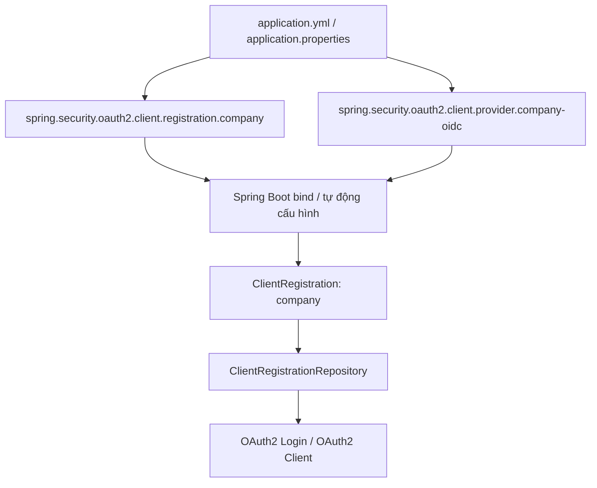

# 6.1. Nhóm thuộc tính `spring.security.oauth2.client.registration`

Khi một ứng dụng Spring Boot đóng vai trò **OAuth 2.0 Client** hoặc **OpenID Connect (OIDC) Client**, ứng dụng cần biết nó được đăng ký với Authorization Server/OpenID Provider dưới danh tính nào, sẽ sử dụng phương thức xác thực client nào, xin quyền truy cập ra sao và nhận kết quả đăng nhập ở đâu. Trong Spring Boot, phần lớn thông tin đó được khai báo dưới nhóm:

```properties
spring.security.oauth2.client.registration.<registration-id>.*
```

Đây là nhóm cấu hình mô tả **một client registration**: một bộ thông tin định danh và điều kiện giao tiếp mà ứng dụng sử dụng khi làm OAuth2/OIDC Client. Nếu ứng dụng đăng nhập qua nhiều nhà cung cấp hoặc cần nhiều cấu hình client cho những mục đích khác nhau, ứng dụng có thể khai báo nhiều registration dưới cùng một nhóm.

Cần phân biệt ngay từ đầu: **`registration` mô tả client là ai và yêu cầu điều gì; `provider` mô tả nơi client kết nối để thực hiện giao thức.** Hai nhóm liên quan chặt chẽ nhưng không thay thế nhau. Bài học tập trung vào các thuộc tính `spring.security.oauth2.client.registration`, đồng thời giải thích phần `provider` vừa đủ để thấy registration được sử dụng như thế nào.

## 1. Cấu trúc của nhóm `registration`

Một cấu hình OIDC thường gặp:

```yaml
spring:
  security:
    oauth2:
      client:
        registration:
          company:
            provider: company-oidc
            client-id: ${OIDC_CLIENT_ID}
            client-secret: ${OIDC_CLIENT_SECRET}
            client-authentication-method: client_secret_basic
            authorization-grant-type: authorization_code
            redirect-uri: "{baseUrl}/login/oauth2/code/{registrationId}"
            scope:
              - openid
              - profile
              - email
            client-name: Company SSO
        provider:
          company-oidc:
            issuer-uri: https://id.example.org/realms/company
```

Trong ví dụ:

- `registration.company`: `company` là **registration ID** do ứng dụng chọn, dùng để tham chiếu registration trong Spring Security.
- `client-id` và `client-secret`: thông tin đăng ký ứng dụng tại OpenID Provider.
- `authorization-grant-type: authorization_code`: lựa chọn Authorization Code Grant để đăng nhập qua trình duyệt.
- `scope` chứa `openid`: yêu cầu OpenID Connect, không chỉ OAuth 2.0 thuần.
- `redirect-uri`: nơi provider trả trình duyệt về sau khi cấp authorization code.
- `provider: company-oidc`: liên kết registration này với cấu hình provider mang tên `company-oidc`.
- `provider.company-oidc.issuer-uri`: xác định issuer OIDC để khám phá metadata và các endpoint tương ứng.

Hai chỗ có chữ `company` và `company-oidc` có ý nghĩa khác nhau. `company` là **tên client registration trong ứng dụng**, còn `company-oidc` là **tên nhóm cấu hình provider**. Chúng có thể giống nhau hoặc khác nhau.

Dạng `application.properties` tương đương một số mục:

```properties
spring.security.oauth2.client.registration.company.provider=company-oidc
spring.security.oauth2.client.registration.company.client-id=order-web
spring.security.oauth2.client.registration.company.authorization-grant-type=authorization_code
spring.security.oauth2.client.registration.company.scope=openid,profile,email
spring.security.oauth2.client.registration.company.redirect-uri={baseUrl}/login/oauth2/code/{registrationId}
spring.security.oauth2.client.provider.company-oidc.issuer-uri=https://id.example.org/realms/company
```

Có thể dùng YAML hoặc properties; Spring Boot bind các thuộc tính tương ứng vào mô hình cấu hình OAuth2 Client. Nếu sử dụng secret, nên lấy từ biến môi trường hoặc secret manager thay vì ghi giá trị thật vào file commit lên Git.

## 2. Spring Boot ánh xạ cấu hình thành `ClientRegistration`

Một entry `spring.security.oauth2.client.registration.<id>` tương ứng với ý tưởng **`ClientRegistration`** trong Spring Security. Đối tượng này kết hợp thông tin client và thông tin provider cần thiết cho một cách sử dụng OAuth2/OIDC.



Trong ứng dụng servlet, Spring Security sử dụng `ClientRegistrationRepository` để tra cứu `ClientRegistration` theo registration ID. Spring Boot thường tự cấu hình repository dựa trên các registration được khai báo hợp lệ.

Có thể hình dung dữ liệu sau khi được bind:

| Thuộc tính cấu hình | Thuộc tính tương ứng trong `ClientRegistration` |
|---|---|
| `registration.company.client-id` | `clientId` |
| `registration.company.client-secret` | `clientSecret` |
| `registration.company.client-authentication-method` | `clientAuthenticationMethod` |
| `registration.company.authorization-grant-type` | `authorizationGrantType` |
| `registration.company.redirect-uri` | `redirectUri` |
| `registration.company.scope` | `scopes` |
| `registration.company.client-name` | `clientName` |
| Khóa `company` sau `registration` | `registrationId` |
| `provider.company-oidc.issuer-uri` và metadata | Thông tin provider trong registration như issuer, authorization/token endpoints, JWKS, UserInfo khi có. |

Các lớp và phương thức bên dưới là **mô hình Spring Security**, không phải tất cả đều là property của nhóm `registration`. Chẳng hạn, `authorization-uri` và `token-uri` thuộc cấu hình `provider` hoặc metadata đã khám phá; chúng không phải `registration.company.authorization-uri`.

Spring Security dùng `registrationId` khi bắt đầu đăng nhập, khi tham chiếu authorized client hoặc khi ứng dụng cần chọn một provider/client cụ thể. Thay đổi registration ID có thể ảnh hưởng cả URL và các nơi tham chiếu trong code.

## 3. Những thuộc tính quan trọng của `registration`

Những property sau là cốt lõi của cấu hình client trong Spring Boot.

| Property sau tiền tố `registration.<id>.` | Vai trò | Ghi chú |
|---|---|---|
| `client-id` | Định danh client đã đăng ký ở Authorization Server/OP. | Bắt buộc cho registration hoạt động; không phải password hay secret. |
| `client-secret` | Thông tin bí mật dùng để xác thực confidential client khi phương thức tương ứng yêu cầu. | Có thể không dùng cho public client; phải bảo vệ trong môi trường backend. |
| `client-authentication-method` | Cách client xác thực tại token endpoint. | Ví dụ `client_secret_basic`, `client_secret_post`, `none`; phải khớp chính sách provider. |
| `authorization-grant-type` | OAuth2 grant type sử dụng cho registration. | Thường là `authorization_code` cho login, `client_credentials` cho server-to-server. |
| `redirect-uri` | Mẫu URI callback cho những flow cần redirect, đặc biệt Authorization Code. | Thường dùng placeholders; URI thực tế phải được provider chấp nhận. |
| `scope` | Các scope client yêu cầu khi xin cấp quyền. | Với OIDC login cần có `openid`. |
| `client-name` | Tên dễ đọc của client registration. | Chủ yếu dùng hiển thị, ví dụ ở trang đăng nhập mặc định. |
| `provider` | Tên provider configuration mà registration tham chiếu. | Là tên alias nội bộ, không phải issuer URL. |

Một số chi tiết phụ thuộc phiên bản Spring Boot/Spring Security, khả năng của provider và grant type. Vì vậy, cần hiểu **ý nghĩa giao thức** của từng thuộc tính trước khi lựa chọn giá trị.

### 3.1. `<registration-id>`: tên định danh registration trong ứng dụng

Phần `<registration-id>` là khóa động, ví dụ:

```yaml
spring:
  security:
    oauth2:
      client:
        registration:
          employee-login:
            # cấu hình client thứ nhất
          reporting-api:
            # cấu hình client thứ hai
```

Tên `employee-login` và `reporting-api` do ứng dụng lựa chọn. Chúng giúp phân biệt các registration và thường xuất hiện ở URL bắt đầu đăng nhập:

```text
/oauth2/authorization/employee-login
```

Với callback mặc định có placeholder `{registrationId}`:

```text
/login/oauth2/code/employee-login
```

Có thể định nghĩa nhiều registration dùng **cùng một provider**, hoặc nhiều registration dùng **nhiều provider**. Registration ID không nhất thiết trùng `client-id` mà provider cấp. Ví dụ registration ID là `employee-login`, còn `client-id` thực tế có thể là `order-web-prod`.

Không nên thay tên registration tùy tiện sau khi đưa vào sử dụng nếu code, URL đăng nhập, redirect URI hoặc quy trình triển khai đang tham chiếu đến nó.

### 3.2. `client-id`: định danh ứng dụng tại provider

`client-id` là giá trị do Authorization Server/OP cấp khi đăng ký ứng dụng.

```yaml
registration:
  company:
    client-id: order-management-web
```

Client ID cho provider biết ai đang xin authorization code hoặc token. Nó **không xác thực client một cách bí mật**, vì client ID thường được gửi trong authorization request đi qua trình duyệt.

Dùng sai `client-id` có thể dẫn đến các lỗi như `invalid_client`, provider không tìm thấy client hoặc authorization request bị từ chối. Client ID cũng quyết định ràng buộc `aud` của ID Token trong OIDC, nên phải cấu hình đúng registration mà OP đã tạo.

### 3.3. `client-secret`: bí mật của confidential client

Khi provider đăng ký ứng dụng là **confidential client** sử dụng client secret, backend phải giữ secret kín và dùng nó tại token endpoint theo phương thức được cấu hình.

```yaml
registration:
  company:
    client-id: ${OIDC_CLIENT_ID}
    client-secret: ${OIDC_CLIENT_SECRET}
```

Những điểm cần lưu ý:

- Spring Boot có thể đọc placeholder từ biến môi trường, ví dụ `OIDC_CLIENT_SECRET`.
- Không ghi client secret thật vào Git, ảnh chụp cấu hình, log hoặc thông số gửi cho trình duyệt.
- Không nhúng secret vào SPA, ứng dụng di động hoặc phần mềm phân phối tới máy người dùng; chúng thường là **public client**.
- Nếu provider yêu cầu một phương thức xác thực mạnh hơn như private key JWT hoặc mTLS, cấu hình và cơ chế thực hiện phải phù hợp; chỉ khai báo secret không bảo đảm đã triển khai đúng phương thức khác.
- Khi secret được xoay vòng ở provider, ứng dụng phải cập nhật secret tương ứng để tránh thất bại tại token endpoint.

Giá trị `client-secret` không thay thế `state`, PKCE, TLS hoặc việc kiểm tra ID Token. Mỗi biện pháp có nhiệm vụ riêng.

### 3.4. `client-authentication-method`: cách xác thực ở token endpoint

Một registration cần mô tả cách client xác thực khi đổi code hoặc xin token. Những giá trị phổ biến:

| Giá trị | Ý nghĩa | Trường hợp sử dụng |
|---|---|---|
| `client_secret_basic` | Gửi thông tin xác thực client theo HTTP Basic tại token endpoint. | Confidential client khi provider hỗ trợ phương thức này. |
| `client_secret_post` | Gửi `client_id` và `client_secret` trong body form POST của token request. | Provider yêu cầu/cho phép xác thực qua body. |
| `none` | Không gửi thông tin xác thực client dạng secret. | Public client; thông thường cần PKCE cho Authorization Code Flow. |

Ví dụ:

```yaml
registration:
  company:
    client-authentication-method: client_secret_basic
```

Đây là **client authentication** tại token endpoint, không phải cách người dùng đăng nhập. Chọn `client_secret_basic` không có nghĩa người dùng sẽ thấy một trang nhập mật khẩu kiểu HTTP Basic. Người dùng vẫn xác thực qua OP bằng phương thức mà OP áp dụng.

Một số phương thức nâng cao như `private_key_jwt` hoặc mTLS đòi hỏi cấu hình hỗ trợ tương ứng để tạo token request, khóa ký/chứng chỉ và cơ chế bảo mật. Không giả định chỉ thay property string là có đủ thành phần triển khai cho mọi phương thức.

### 3.5. `authorization-grant-type`: flow OAuth2 cần thực hiện

Thuộc tính này quyết định **cách client yêu cầu token**. Hai giá trị thường gặp:

| Giá trị | Đặc điểm | Phù hợp |
|---|---|---|
| `authorization_code` | Chuyển người dùng đến authorization endpoint; nhận code qua redirect; backend đổi code lấy token. | Đăng nhập web OAuth2/OIDC với người dùng. |
| `client_credentials` | Client xin Access Token bằng danh tính và thông tin xác thực của chính ứng dụng; không có user login/redirect. | Backend gọi API server-to-server. |

Ví dụ OIDC login:

```yaml
registration:
  company:
    authorization-grant-type: authorization_code
    scope:
      - openid
      - profile
```

Ví dụ gọi API giữa hai dịch vụ:

```yaml
registration:
  inventory-service:
    authorization-grant-type: client_credentials
    client-id: ${INVENTORY_CLIENT_ID}
    client-secret: ${INVENTORY_CLIENT_SECRET}
    client-authentication-method: client_secret_basic
    scope:
      - inventory.read
    provider: internal-auth
provider:
  internal-auth:
    token-uri: https://auth.example.org/oauth2/token
```

**`client_credentials` không phải OIDC login.** Grant này không đại diện cho người dùng cuối và không dùng trang đăng nhập `oauth2Login()`. Nó thường được dùng với cơ chế OAuth2 authorized client manager khi ứng dụng cần Access Token để gọi API.

Các grant type cũ như `implicit` và `password` không nên được lựa chọn cho ứng dụng mới. Đừng chọn grant type chỉ để khớp tên một endpoint; cần chọn theo kiến trúc và khả năng của Authorization Server. Khi dùng grant type nâng cao hoặc extension grant, hỗ trợ của Spring Security và cấu hình thêm có thể khác với các ví dụ thông dụng.

### 3.6. `redirect-uri`: callback sau Authorization Code Flow

Trong cấu hình Spring Security Servlet thông thường:

```yaml
registration:
  company:
    redirect-uri: "{baseUrl}/login/oauth2/code/{registrationId}"
```

Spring Security thay các placeholder bằng dữ liệu của request/registration. Với ứng dụng có public URL `https://app.example.org` và registration ID `company`, callback được tạo là:

```text
https://app.example.org/login/oauth2/code/company
```

Những placeholder thường thấy:

| Placeholder | Ý nghĩa |
|---|---|
| `{baseUrl}` | Base URL bên ngoài của ứng dụng, gồm scheme, host, port/path khi áp dụng. |
| `{registrationId}` | Khóa registration như `company`. |
| `{baseScheme}`, `{baseHost}`, `{basePort}`, `{basePath}` | Các phần của base URL khi cần dựng template tùy biến. |
| `{action}` | Placeholder dùng trong mẫu URI tổng quát của một số cấu hình Spring Security; với OAuth2 login thường là `login`. |

**Redirect URI thực tế phải khớp URI được provider cho phép.** Ví dụ provider chỉ cho `https://app.example.org/login/oauth2/code/company` nhưng ứng dụng sinh `http://localhost:8080/login/oauth2/code/company` sẽ dễ bị từ chối.

Khi ứng dụng ở sau reverse proxy/load balancer, cần cấu hình public scheme/host và cách xử lý forwarded header chỉ từ proxy tin cậy. Không mở rộng wildcard callback thiếu kiểm soát chỉ để tránh lỗi `redirect_uri_mismatch`.

Với `client_credentials`, không có browser redirect nên `redirect-uri` không tham gia grant flow.

### 3.7. `scope`: yêu cầu phạm vi truy cập

OAuth2 scope mô tả phạm vi mà client **đề nghị** Authorization Server cấp. Ví dụ:

```yaml
registration:
  company:
    scope:
      - openid
      - profile
      - email
```

Ý nghĩa một số scope OIDC tiêu chuẩn:

- `openid`: bắt buộc để yêu cầu OIDC; phản hồi token của flow này bao gồm ID Token khi thành công.
- `profile`: yêu cầu các thông tin hồ sơ tiêu chuẩn mà OP hỗ trợ.
- `email`: yêu cầu các claim liên quan email theo khả năng/chính sách OP.

Một số nhà cung cấp còn có scope riêng như `orders.read`, `calendar.read` hoặc `api://...` theo tài liệu của hệ thống đó. Những scope này không phải scope OIDC chuẩn.

Một số lưu ý:

1. **Yêu cầu scope không bảo đảm được cấp tất cả.** Provider có thể giới hạn hoặc từ chối dựa trên client, người dùng, consent và chính sách.
2. **`profile` và `email` không bảo đảm mọi claim xuất hiện trong ID Token.** Tùy OP, claim có thể nằm ở UserInfo hoặc không được trả.
3. **Scope không tự động bằng role nghiệp vụ.** Có `orders.read` chưa chắc người dùng được đọc tất cả đơn hàng; Resource Server vẫn cần kiểm tra audience, quyền và phạm vi dữ liệu.
4. **Scope thuộc từng registration.** Client đăng nhập web và client gọi API khác có thể cần tập scope khác nhau.
5. **Nếu không có `openid`**, luồng có thể là OAuth2 login thuần, không cung cấp các bảo đảm OIDC ID Token dành cho client.

Trong `application.properties`, danh sách có thể được khai báo bằng dấu phẩy:

```properties
spring.security.oauth2.client.registration.company.scope=openid,profile,email
```

### 3.8. `client-name`: tên hiển thị

`client-name` giúp giao diện và một số thành phần của ứng dụng hiển thị tên dễ hiểu cho registration:

```yaml
registration:
  company:
    client-name: Đăng nhập bằng tài khoản công ty
```

Trong trang đăng nhập do Spring Security dựng theo mặc định, tên client có thể xuất hiện ở liên kết đăng nhập khi ứng dụng có cấu hình OAuth2 Login phù hợp. Thay đổi `client-name` không thay đổi `client-id`, issuer, audience hay quyền mà provider cấp.

Nếu không chỉ định, Spring Security có thể dùng giá trị suy ra từ registration/provider, tùy cách cấu hình. Vì vậy, tên hiển thị nên được đặt rõ nếu ứng dụng có nhiều lựa chọn đăng nhập và cần nội dung thân thiện với người dùng.

### 3.9. `provider`: liên kết registration với cấu hình provider

`provider` là một **tên tham chiếu nội bộ** tới:

```properties
spring.security.oauth2.client.provider.<provider-id>.*
```

Ví dụ:

```yaml
spring:
  security:
    oauth2:
      client:
        registration:
          company:
            provider: corporate-oidc
            client-id: ${OIDC_CLIENT_ID}
            client-secret: ${OIDC_CLIENT_SECRET}
            authorization-grant-type: authorization_code
            scope: [openid, profile]
        provider:
          corporate-oidc:
            issuer-uri: https://id.example.org/realms/company
```

Tên `corporate-oidc` trong `registration.company.provider` phải khớp khóa `provider.corporate-oidc`. Nó **không phải URL** và không nhất thiết trùng registration ID hay tên hiển thị client.

Những thuộc tính như `issuer-uri`, `authorization-uri`, `token-uri`, `user-info-uri`, `jwk-set-uri` và `user-name-attribute` mô tả **provider**, nên thuộc `spring.security.oauth2.client.provider` khi khai báo trực tiếp. Tách biệt này đặc biệt hữu ích khi nhiều client registration chia sẻ cùng endpoint/issuer của một provider.

Một số provider phổ biến có cấu hình endpoint mặc định được Spring Boot hỗ trợ theo tên đã biết. Khi dùng registration ID khác hoặc provider riêng, nên liên kết rõ bằng `provider` hoặc khai báo provider metadata. Với OIDC, cấu hình `issuer-uri` thường là cách thuận tiện để khám phá những endpoint cần thiết.

## 4. Ví dụ hoàn chỉnh: một OIDC client đăng nhập cho web application

Giả sử hệ thống Spring Boot chạy tại `https://orders.example.org`, sử dụng OpenID Provider `https://login.example.org/realms/staff`. Tại OP đã tạo client confidential `orders-web` và đăng ký redirect URI `https://orders.example.org/login/oauth2/code/staff`.

### 4.1. Cấu hình `application.yml`

```yaml
spring:
  security:
    oauth2:
      client:
        registration:
          staff:
            provider: staff-oidc
            client-id: orders-web
            client-secret: ${STAFF_OIDC_CLIENT_SECRET}
            client-authentication-method: client_secret_basic
            authorization-grant-type: authorization_code
            redirect-uri: "{baseUrl}/login/oauth2/code/{registrationId}"
            scope:
              - openid
              - profile
              - email
            client-name: Tài khoản nhân viên
        provider:
          staff-oidc:
            issuer-uri: https://login.example.org/realms/staff
```

Các thành phần cần khớp nhau:

- `staff` là registration ID do Spring Boot dùng trong URL khởi tạo `/oauth2/authorization/staff` và callback `/login/oauth2/code/staff`.
- `orders-web` là `client-id` do OP cấp.
- `staff-oidc` là alias của provider; metadata từ issuer giúp xác định authorization endpoint, token endpoint và khóa.
- `client-secret` được lấy từ biến môi trường phía server; trong file YAML chỉ chứa placeholder.
- `redirect-uri` thành URL public tương ứng và phải trùng điều kiện đăng ký tại OP.
- `scope` có `openid`, vì mục tiêu là OIDC login với danh tính người dùng.

### 4.2. Bật `oauth2Login()`

```java
import org.springframework.context.annotation.Bean;
import org.springframework.context.annotation.Configuration;
import org.springframework.security.config.Customizer;
import org.springframework.security.config.annotation.web.builders.HttpSecurity;
import org.springframework.security.web.SecurityFilterChain;

@Configuration
public class SecurityConfiguration {

    @Bean
    SecurityFilterChain securityFilterChain(HttpSecurity http) throws Exception {
        http
            .authorizeHttpRequests(requests -> requests
                .requestMatchers("/", "/public/**").permitAll()
                .anyRequest().authenticated()
            )
            .oauth2Login(Customizer.withDefaults());

        return http.build();
    }
}
```

Để bắt đầu login, người dùng có thể truy cập:

```text
GET https://orders.example.org/oauth2/authorization/staff
```

Spring Security dùng registration `staff`, gửi trình duyệt sang OP, nhận authorization code qua callback, đổi code lấy token và xác minh ID Token. Sau khi xác thực thành công, Spring Security có thể tạo `OidcUser` và lưu `SecurityContext` trong phiên HTTP ứng dụng.

Nhóm `registration` **chỉ mô tả thông tin client**; nó không tự định nghĩa mọi quy tắc truy cập URL, role nghiệp vụ hay cách ứng dụng liên kết danh tính với hồ sơ nội bộ. Những việc đó thuộc cấu hình Spring Security và logic nghiệp vụ.

### 4.3. Đọc registration đã được bind

Nếu cần truy cứu cấu hình đã được Spring Boot tạo trong ứng dụng servlet, có thể inject `ClientRegistrationRepository`:

```java
import org.springframework.security.oauth2.client.registration.ClientRegistration;
import org.springframework.security.oauth2.client.registration.ClientRegistrationRepository;
import org.springframework.stereotype.Component;

@Component
public class OidcClientMetadata {

    private final ClientRegistrationRepository registrations;

    public OidcClientMetadata(ClientRegistrationRepository registrations) {
        this.registrations = registrations;
    }

    public String configuredClientId() {
        ClientRegistration registration =
            registrations.findByRegistrationId("staff");

        if (registration == null) {
            throw new IllegalStateException("Missing staff registration");
        }

        return registration.getClientId();
    }
}
```

Ví dụ chỉ đọc `clientId` để minh họa cách tra cứu. Không trả `clientSecret` hoặc token qua endpoint HTTP và không in chúng vào log. Khi registration không tồn tại, cần xử lý lỗi cấu hình rõ ràng.

## 5. Nhiều registration trong một ứng dụng

Có hai mô hình phổ biến: nhiều provider khác nhau, hoặc nhiều registration cùng dùng một provider.

### 5.1. Hai provider dùng cho hai cách đăng nhập

Ví dụ ứng dụng có đăng nhập tài khoản nhân viên và đối tác:

```yaml
spring:
  security:
    oauth2:
      client:
        registration:
          employee:
            provider: employee-idp
            client-id: ${EMPLOYEE_CLIENT_ID}
            client-secret: ${EMPLOYEE_CLIENT_SECRET}
            authorization-grant-type: authorization_code
            redirect-uri: "{baseUrl}/login/oauth2/code/{registrationId}"
            scope: [openid, profile, email]
            client-name: Nhân viên
          partner:
            provider: partner-idp
            client-id: ${PARTNER_CLIENT_ID}
            client-secret: ${PARTNER_CLIENT_SECRET}
            authorization-grant-type: authorization_code
            redirect-uri: "{baseUrl}/login/oauth2/code/{registrationId}"
            scope: [openid, profile]
            client-name: Đối tác
        provider:
          employee-idp:
            issuer-uri: https://employee-login.example.org
          partner-idp:
            issuer-uri: https://partner-login.example.org
```

Các đường bắt đầu login:

```text
/oauth2/authorization/employee
/oauth2/authorization/partner
```

Hai provider có thể cấp cùng email cho hai danh tính khác nhau. Khi liên kết người dùng với tài khoản nội bộ, nên sử dụng **cặp `(issuer, subject)`** đã xác minh thay vì dựa vào email đơn lẻ. Quyền của tài khoản nhân viên và đối tác phải có mô hình và chính sách rõ ràng tại ứng dụng.

### 5.2. Hai registration chia sẻ một provider

Một provider có thể quản lý nhiều client ID, ví dụ một registration để login quản trị và một registration để login nhân viên:

```yaml
spring:
  security:
    oauth2:
      client:
        registration:
          backoffice:
            provider: company-oidc
            client-id: ${BACKOFFICE_CLIENT_ID}
            client-secret: ${BACKOFFICE_CLIENT_SECRET}
            authorization-grant-type: authorization_code
            redirect-uri: "{baseUrl}/login/oauth2/code/{registrationId}"
            scope: [openid, profile]
          self-service:
            provider: company-oidc
            client-id: ${SELF_SERVICE_CLIENT_ID}
            client-secret: ${SELF_SERVICE_CLIENT_SECRET}
            authorization-grant-type: authorization_code
            redirect-uri: "{baseUrl}/login/oauth2/code/{registrationId}"
            scope: [openid, profile, email]
        provider:
          company-oidc:
            issuer-uri: https://login.example.org/realms/company
```

Mỗi registration có `client-id`, secret và callback của riêng nó; cả hai dùng chung provider metadata. Provider phải cho phép các callback tương ứng cho đúng client.

Không nên xem việc người dùng chọn `backoffice` là bằng chứng đủ để có quyền quản trị. Ứng dụng vẫn phải xác minh principal và quyền nghiệp vụ sau login. Registration ID là cấu hình client, không phải role bảo mật.

## 6. Registration dùng cho `client_credentials` khác với registration dùng để login

Một backend có thể đăng nhập nhân viên bằng OIDC **đồng thời** cần gọi API nội bộ không gắn với người dùng cuối. Hai nhu cầu nên được mô tả bằng những registration phù hợp.

```yaml
spring:
  security:
    oauth2:
      client:
        registration:
          staff-login:
            provider: staff-oidc
            client-id: ${STAFF_CLIENT_ID}
            client-secret: ${STAFF_CLIENT_SECRET}
            authorization-grant-type: authorization_code
            redirect-uri: "{baseUrl}/login/oauth2/code/{registrationId}"
            scope: [openid, profile]
          shipping-service:
            provider: service-auth
            client-id: ${SHIPPING_CLIENT_ID}
            client-secret: ${SHIPPING_CLIENT_SECRET}
            client-authentication-method: client_secret_basic
            authorization-grant-type: client_credentials
            scope: [shipping.read]
        provider:
          staff-oidc:
            issuer-uri: https://login.example.org/realms/staff
          service-auth:
            token-uri: https://auth.example.org/oauth2/token
```

Ở đây:

- `staff-login` tham gia `oauth2Login()`, có người dùng và redirect.
- `shipping-service` dùng grant `client_credentials`, lấy Access Token cho ứng dụng như một client dịch vụ. Không có browser redirect và không có ID Token đại diện cho nhân viên.
- `service-auth` chỉ cần token endpoint cho nhu cầu client credentials trong ví dụ, không cần giả lập authorization endpoint hoặc callback.
- Khi cần thực sự xin và sử dụng token từ `shipping-service`, ứng dụng phải có cơ chế OAuth2 authorized client manager/client HTTP được cấu hình phù hợp. Việc khai báo registration đơn thuần chưa tự gửi token đến mọi API.

Nếu muốn **truyền ngữ cảnh người dùng** sang API, cần một Access Token có ngữ nghĩa và audience phù hợp (hoặc flow ủy quyền/token exchange được thiết kế). Không thể lấy token `client_credentials` rồi mặc nhiên coi đó là quyền của người đang đăng nhập.

## 7. Public client, client secret và PKCE

Một ứng dụng browser SPA, mobile app hoặc desktop app thường không thể giữ an toàn một client secret cố định trong bản phát hành. Với loại client này, registration tại Authorization Server có thể sử dụng **public client** và phương thức xác thực `none`.

Ví dụ mang tính cấu hình:

```yaml
spring:
  security:
    oauth2:
      client:
        registration:
          public-demo:
            provider: demo-oidc
            client-id: demo-public-client
            client-authentication-method: none
            authorization-grant-type: authorization_code
            redirect-uri: "{baseUrl}/login/oauth2/code/{registrationId}"
            scope: [openid, profile]
        provider:
          demo-oidc:
            issuer-uri: https://id.example.org/realms/demo
```

Ví dụ này chỉ mô tả thông số registration tương ứng một public client, **không đủ để tự biến một backend session-based thành SPA**. Với public client, Authorization Code Flow phải được bảo vệ bằng PKCE theo yêu cầu áp dụng của provider và tiêu chuẩn hiện đại. Cơ chế tạo verifier/challenge, cách callback được tiếp nhận và nơi lưu token cần được thiết kế đúng theo nền tảng thực tế.

Trong ứng dụng Spring Security, khả năng tự thêm PKCE phụ thuộc loại client và phiên bản/cấu hình. Nếu hệ thống yêu cầu PKCE, cần bảo đảm authorization request thực tế có `code_challenge` và token request dùng đúng `code_verifier`; không mặc định chỉ khai báo `authorization-grant-type: authorization_code` là đủ cho mọi kịch bản.

Đối với ứng dụng Spring Boot server-side confidential client, dùng secret phía backend và chính sách PKCE phù hợp provider là cách thông dụng. Không đưa secret vào ứng dụng JavaScript chỉ để bắt chước cấu hình backend.

## 8. `registration` và `provider` kết hợp như thế nào?

Hai nhóm có vai trò bổ sung:

| Câu hỏi | Nhóm cấu hình trả lời |
|---|---|
| Ứng dụng này đăng ký với client ID nào? | `registration.<id>.client-id` |
| Có secret hay cơ chế xác thực client nào? | `registration.<id>.client-secret` / `client-authentication-method` |
| Sử dụng grant nào, scope nào? | `registration.<id>.authorization-grant-type` / `scope` |
| Callback về đâu? | `registration.<id>.redirect-uri` |
| Tên hiển thị của registration? | `registration.<id>.client-name` |
| Đăng nhập qua OP nào? | `registration.<id>.provider` liên kết tới `provider.<provider-id>` |
| Authorization endpoint, token endpoint, JWKS nằm ở đâu? | `provider.<provider-id>.*` hoặc metadata discovery từ `issuer-uri` |
| ID Token được phát hành bởi issuer nào? | `provider.<provider-id>.issuer-uri` và metadata OIDC tin cậy |

Ví dụ một OAuth2 provider **không hỗ trợ OIDC discovery** có thể cần khai báo endpoint thủ công:

```yaml
spring:
  security:
    oauth2:
      client:
        registration:
          external-service:
            provider: external-oauth
            client-id: ${EXTERNAL_CLIENT_ID}
            client-secret: ${EXTERNAL_CLIENT_SECRET}
            authorization-grant-type: authorization_code
            redirect-uri: "{baseUrl}/login/oauth2/code/{registrationId}"
            scope: [profile.read]
        provider:
          external-oauth:
            authorization-uri: https://accounts.example.org/oauth2/authorize
            token-uri: https://accounts.example.org/oauth2/token
            user-info-uri: https://accounts.example.org/api/userinfo
            user-name-attribute: id
```

Ở đây không có scope `openid`; ví dụ là OAuth 2.0 login dùng UserInfo theo cách provider hỗ trợ, **không phải OIDC login tiêu chuẩn**. Việc cấu hình `user-info-uri` và `user-name-attribute` thuộc provider. Không thêm `issuer-uri` OIDC không có thật hoặc coi mọi OAuth2 provider đều phát hành ID Token.

Ngược lại, với OP hỗ trợ OIDC Discovery, khai báo `issuer-uri` đáng tin cậy thường giúp client lấy các endpoint và khóa xác minh, giảm số URL phải khai báo thủ công.

## 9. Những URL, object và hành vi phụ thuộc registration ID

Sau khi ứng dụng khởi động, `registration.<id>` tham gia nhiều điểm kết nối hơn là chỉ một dòng YAML:

| Vị trí sử dụng | Ví dụ với ID `company` |
|---|---|
| Đường bắt đầu OAuth2 Login mặc định | `/oauth2/authorization/company` |
| Callback mặc định | `/login/oauth2/code/company` |
| Lookup cấu hình trong Java | `clientRegistrationRepository.findByRegistrationId("company")` |
| Chọn authorized client cho API call | Tra cứu `OAuth2AuthorizedClient` theo registration ID và principal/nguồn lưu tương ứng. |
| Tên hiển thị login | Có thể dùng `client-name` nếu ứng dụng bật giao diện login tương ứng. |
| Điều tra lỗi | Log/correlation có thể ghi registration ID để biết flow nào đang chạy, không cần log token/secret. |

Ví dụ một phương thức service tra cứu registration:

```java
import org.springframework.security.oauth2.client.registration.ClientRegistration;
import org.springframework.security.oauth2.client.registration.ClientRegistrationRepository;

public final class RegistrationLookup {

    private final ClientRegistrationRepository repository;

    public RegistrationLookup(ClientRegistrationRepository repository) {
        this.repository = repository;
    }

    public ClientRegistration require(String registrationId) {
        ClientRegistration registration =
            repository.findByRegistrationId(registrationId);

        if (registration == null) {
            throw new IllegalArgumentException(
                "Unknown client registration: " + registrationId
            );
        }

        return registration;
    }
}
```

Đoạn code là ví dụ cách tham chiếu registration theo tên. Không truyền `registrationId` trực tiếp từ request người dùng để tùy tiện chọn cấu hình nhạy cảm; nếu cho phép lựa chọn provider qua giao diện, phải giới hạn theo danh sách provider mà ứng dụng cho phép.

## 10. Biến môi trường và cấu hình theo môi trường triển khai

Một cách phổ biến để không commit secret vào mã nguồn:

```yaml
spring:
  security:
    oauth2:
      client:
        registration:
          company:
            provider: company-oidc
            client-id: ${OIDC_CLIENT_ID}
            client-secret: ${OIDC_CLIENT_SECRET}
            authorization-grant-type: authorization_code
            redirect-uri: "{baseUrl}/login/oauth2/code/{registrationId}"
            scope: [openid, profile, email]
        provider:
          company-oidc:
            issuer-uri: ${OIDC_ISSUER_URI}
```

Các placeholder được Spring Boot giải quyết từ môi trường chạy, ví dụ máy phát triển, CI/CD hoặc secret manager. Nên phân biệt:

- **Thông tin có thể nằm trong cấu hình theo môi trường:** issuer URI, registration ID, client ID, scope, redirect URI template, client-name.
- **Thông tin phải quản lý như secret:** client secret, private key dùng xác thực client, token được cấp, cookie/session ID và các credential tương ứng.
- **Giá trị cần nhất quán giữa provider và ứng dụng:** client ID, client authentication method, redirect URI được cho phép và scope có thể yêu cầu.

Một số môi trường dùng issuer và client ID riêng cho dev/staging/prod. Khi chuyển môi trường, cần thay đúng cả cặp registration + provider tương ứng; chỉ thay secret mà giữ issuer hoặc redirect URI sai vẫn khiến flow thất bại.

### 10.1. Callback phía sau reverse proxy

Ví dụ request từ trình duyệt vào:

```text
https://orders.example.org/oauth2/authorization/company
```

nhưng reverse proxy chuyển tới backend nội bộ:

```text
http://orders-service:8080/oauth2/authorization/company
```

Nếu ứng dụng dựng `{baseUrl}` từ địa chỉ nội bộ, callback có thể thành `http://orders-service:8080/login/oauth2/code/company`, không khớp OP registration và không thể dùng từ trình duyệt.

Cần cấu hình proxy và Spring Boot nhận biết public scheme/host bằng cơ chế forwarded headers chỉ từ hạ tầng tin cậy, hoặc lựa chọn redirect URI rõ ràng phù hợp kiến trúc. Không tin ngẫu nhiên các header forwarded do người dùng bên ngoài tự gửi; điều này có thể làm sai URL redirect.

### 10.2. Không để thiếu secret biến thành lỗi khó hiểu

Đối với confidential client, thiếu `client-secret` hoặc secret sai thường chỉ bộc lộ rõ ở token endpoint sau khi người dùng đã hoàn tất đăng nhập tại OP. Ứng dụng có thể trông như «đăng nhập thành công ở IdP rồi quay về lỗi».

Cấu hình runtime nên bảo đảm các biến bắt buộc được cung cấp, kiểm soát secret rotation và báo lỗi cấu hình đủ rõ để vận hành biết registration nào bị ảnh hưởng, nhưng không in raw secret.

## 11. Tình huống cấu hình sai và cách xác định đúng nguyên nhân

| Triệu chứng | Cấu hình cần xem trước | Giải thích |
|---|---|---|
| Không tìm thấy registration `company`. | Khóa `registration.company`; cách gõ registration ID. | Tên trong URL/code phải khớp khóa registration đã được tạo. |
| Provider báo `invalid_client`. | `client-id`, `client-secret`, `client-authentication-method`. | Client không được OP nhận biết hoặc xác thực ở endpoint tương ứng. |
| Provider báo `redirect_uri_mismatch`. | `redirect-uri`, public URL, redirect URI được đăng ký tại OP. | URI callback thực tế không nằm trong danh sách cho phép. |
| Bị lỗi khám phá metadata OIDC. | `provider` tham chiếu đúng alias; `provider.<id>.issuer-uri`. | Issuer sai, endpoint discovery không hỗ trợ hoặc có lỗi mạng/TLS. |
| OAuth2 Login chạy nhưng không có `OidcUser`/ID Token. | `scope` có `openid` hay không; OP có hỗ trợ OIDC hay không. | OAuth2 login thuần không tự cung cấp ngữ nghĩa OIDC. |
| Đăng nhập được nhưng không gọi được API đích. | Scope đăng ký; audience token thực tế; nơi ứng dụng gửi Access Token. | Scope cấu hình chỉ là yêu cầu; Resource Server còn phải xác minh token và quyền. |
| `client_credentials` không hiện trang login. | `authorization-grant-type`. | Đây là grant giữa các dịch vụ, không có luồng user login. |
| Callback thất bại vì `state`. | Session lưu authorization request, cookie, reverse proxy. | `state` là trạng thái của flow tại client; không chỉ là property registration. |
| Đổi code báo `invalid_grant`. | Redirect URI, PKCE, trạng thái/tuổi của code, cấu hình token endpoint. | Code có thể hết hạn, đã dùng hoặc không khớp ràng buộc. |
| Người dùng đăng nhập đúng nhưng bị `403`. | Quy tắc `authorizeHttpRequests`, authorities, role nghiệp vụ. | Registration cấu hình đăng nhập; quyền truy cập thuộc chính sách ứng dụng. |

### 11.1. Lỗi đặt thuộc tính sai nhóm

Ví dụ sai về mặt cấu trúc:

```yaml
spring:
  security:
    oauth2:
      client:
        registration:
          company:
            client-id: order-web
            issuer-uri: https://id.example.org
```

`issuer-uri` là thông tin của **provider**, không phải thuộc tính cơ bản của `registration.company`. Cách đặt phù hợp:

```yaml
spring:
  security:
    oauth2:
      client:
        registration:
          company:
            provider: corp
            client-id: order-web
            client-secret: ${OIDC_CLIENT_SECRET}
            authorization-grant-type: authorization_code
            scope: [openid]
        provider:
          corp:
            issuer-uri: https://id.example.org
```

Đặt sai cấp YAML rất dễ xảy ra vì `registration` và `provider` cùng nằm dưới `client`. Dùng cấu trúc hai nhánh rõ ràng giúp hệ thống bind đúng property.

### 11.2. Dùng sai `registrationId` trong redirect

Giả sử registration có khóa `login-company`, nhưng OP chỉ đăng ký callback `/login/oauth2/code/company` trong khi ứng dụng dùng:

```yaml
redirect-uri: "{baseUrl}/login/oauth2/code/{registrationId}"
```

Spring sẽ sinh callback `/login/oauth2/code/login-company`. OP có thể từ chối vì URI không khớp. Giải pháp là đăng ký đúng callback hoặc điều chỉnh registration/redirect URI nhất quán, không can thiệp bằng cách bỏ kiểm tra URI.

### 11.3. Dùng `scope: [profile, email]` rồi kỳ vọng OIDC

Để yêu cầu OIDC, phải có `openid`. Nếu bỏ `openid`, ứng dụng có thể hoạt động theo OAuth2 Login nhưng không thể mặc định lấy ID Token và `OidcUser` theo chuẩn OIDC.

### 11.4. Truyền `client-secret` ra frontend để sửa lỗi

Khi frontend không thể giữ secret, cần thiết kế loại client đúng (public client + PKCE hoặc mô hình backend-for-frontend tùy kiến trúc). Không xử lý lỗi `invalid_client` bằng cách đưa secret backend vào JavaScript; secret sẽ lộ cho người dùng và bên thứ ba.

### 11.5. Cấu hình `client_credentials` nhưng chờ Spring tự login người dùng

`oauth2Login()` sử dụng luồng có tương tác người dùng như Authorization Code. Đối với `client_credentials`, ứng dụng phải dùng OAuth2 Client để lấy Access Token của **ứng dụng** trước khi gọi API, không chờ redirect sang OP hay ID Token.

## 12. Quan sát cấu hình mà không làm lộ credential

Khi triển khai và chẩn đoán, có thể ghi nhận các dữ liệu **không nhạy cảm** như:

- Registration ID đang được chọn.
- Issuer/provider alias đã cấu hình.
- Authorization grant type và scope được yêu cầu.
- Callback URI public dự kiến sau khi thay placeholder.
- HTTP status/mã lỗi từ authorization endpoint hoặc token endpoint, đã loại dữ liệu xác thực.
- Thời điểm đăng nhập thành công/thất bại và correlation ID an toàn.

Không ghi `client-secret`, authorization code, Access Token, ID Token, Refresh Token, code verifier, cookie session hoặc nguyên token response vào log. Nếu xem metadata/debug endpoint, phải kiểm soát quyền truy cập và tránh phơi lộ thuộc tính nhạy cảm.

Trong ứng dụng được triển khai nhiều instance, provider/registration configuration cần nhất quán giữa các node. Với OIDC login session-based, nơi lưu authorization request và session cũng phải được thiết kế đúng; nhóm `registration` không tự giải quyết yêu cầu phân tán session.

## 13. Liên hệ với các thành phần bảo mật Spring Security khác

Một cấu hình `registration` đầy đủ mới trả lời được câu hỏi *client nào đang được sử dụng*. Để xây dựng hệ thống hoàn chỉnh, còn các phần khác:

| Thành phần | Nhiệm vụ |
|---|---|
| `oauth2Login()` | Xác thực người dùng qua OAuth2/OIDC và tạo `Authentication` cho ứng dụng web. |
| `ClientRegistrationRepository` | Tra cứu thông tin registration mà Spring Boot đã bind hoặc ứng dụng tự tạo. |
| `OAuth2AuthorizedClient` và nơi lưu tương ứng | Quản lý các token gắn với client registration và principal/ngữ cảnh phù hợp. |
| `OAuth2AuthorizedClientManager` | Hỗ trợ cấp/làm mới token theo grant type và chính sách đã cấu hình. |
| `SecurityContextRepository` | Lưu/khôi phục `SecurityContext` cho các request web theo cơ chế phiên. |
| `oauth2ResourceServer()` | Xác minh bearer Access Token khi ứng dụng đóng vai trò API Resource Server. |
| Kiểm soát truy cập và logic nghiệp vụ | Quyết định endpoint, dữ liệu và hành động nào người dùng được phép sử dụng. |

Các thành phần này có thể cùng xuất hiện trong một Spring Boot service, nhưng không được đánh đồng. Client registration không phải resource server configuration; Access Token không phải ID Token; scope không tự là quyền xem mọi bản ghi; HTTP session của ứng dụng không phải phiên SSO tại OP.

## 14. Tóm lược theo một ví dụ thực tế

Một ứng dụng Spring Boot muốn đăng nhập nhân viên qua OP sẽ đặt:

```yaml
spring:
  security:
    oauth2:
      client:
        registration:
          staff:
            provider: company
            client-id: ${STAFF_CLIENT_ID}
            client-secret: ${STAFF_CLIENT_SECRET}
            authorization-grant-type: authorization_code
            redirect-uri: "{baseUrl}/login/oauth2/code/{registrationId}"
            scope: [openid, profile, email]
            client-name: Company Login
        provider:
          company:
            issuer-uri: https://id.example.org
```

Từ cấu hình này, Spring Boot tạo thông tin client registration `staff`. Spring Security có thể dùng nó để bắt đầu đăng nhập từ `/oauth2/authorization/staff`, nhận authorization code tại callback `/login/oauth2/code/staff` và xử lý OIDC login khi được bật đúng cách.

Trong toàn bộ quá trình, `registration` trả lời **«ứng dụng đăng ký như client nào, yêu cầu loại quyền/token nào, nhận callback ở đâu?»**. `provider` trả lời **«phải làm việc với Authorization Server/OpenID Provider nào và qua các endpoint nào?»**. Cấu hình chính xác cả hai là nền tảng để OAuth 2.0/OIDC Client hoạt động, còn việc tạo phiên, lưu token và phân quyền được triển khai bởi các thành phần Spring Security và logic ứng dụng khác.

### Tài liệu tham khảo

- [Spring Security Reference — OAuth2 Client Core](https://docs.spring.io/spring-security/reference/servlet/oauth2/client/core.html)
- [Spring Security Reference — OAuth2 Login](https://docs.spring.io/spring-security/reference/servlet/oauth2/login/index.html)
- [Spring Boot Reference — Spring Security](https://docs.spring.io/spring-boot/reference/web/spring-security.html)
- [OAuth 2.0 — RFC 6749](https://www.rfc-editor.org/rfc/rfc6749)
- [OpenID Connect Core 1.0](https://openid.net/specs/openid-connect-core-1_0.html)


