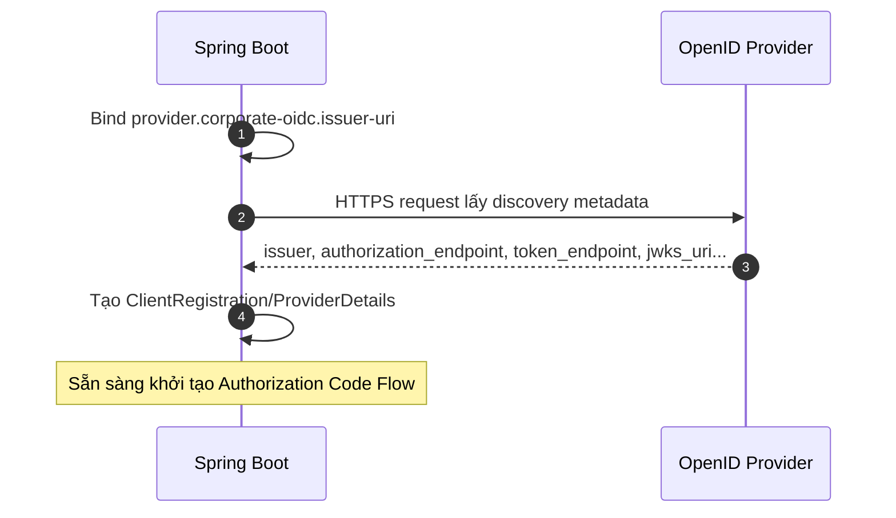

# 6.2. Nhóm thuộc tính `spring.security.oauth2.client.provider`

Trong Spring Boot, cấu hình OAuth 2.0 / OpenID Connect (OIDC) Client có hai phần thường xuất hiện cạnh nhau: **`registration`** mô tả *ứng dụng của chúng ta được đăng ký như một client ra sao*, còn **`provider`** mô tả *Authorization Server/OpenID Provider mà client sẽ giao tiếp*. Bài này tập trung vào nhóm thuộc tính:

```text
spring.security.oauth2.client.provider.<provider-id>.*
```

Hiểu đúng nhóm này giúp ứng dụng tự tìm endpoint OIDC qua **issuer discovery**, hoặc khai báo tường minh endpoint cho provider không có discovery phù hợp. Đồng thời, bạn có thể tránh nhiều lỗi thường gặp như sai issuer, token endpoint, JWKS URI, UserInfo endpoint và ánh xạ thuộc tính định danh.

Ví dụ áp dụng cho **Spring Boot 3.x, Spring Security 6.x, ứng dụng Servlet/Spring MVC** đăng nhập bằng Authorization Code Flow. Các URL dùng `example.com` chỉ mang tính minh họa; khi triển khai phải dùng metadata chính thức của provider thật.

## 1. Vị trí của `provider` trong cấu hình OAuth2 Client

Dạng tổng quát của `application.yml`:

```yaml
spring:
  security:
    oauth2:
      client:
        registration:
          portal:
            provider: corporate-oidc
            client-id: ${OIDC_CLIENT_ID}
            client-secret: ${OIDC_CLIENT_SECRET}
            authorization-grant-type: authorization_code
            scope: [openid, profile, email]
            redirect-uri: "{baseUrl}/login/oauth2/code/{registrationId}"
        provider:
          corporate-oidc:
            issuer-uri: ${OIDC_ISSUER_URI}
```

Ở đây có **hai tên riêng biệt**:

- **`portal` là registration ID**: tên của client registration trong ứng dụng Spring. Nó quyết định URL mặc định để bắt đầu login: `/oauth2/authorization/portal`, và phần cuối callback: `/login/oauth2/code/portal`.
- **`corporate-oidc` là provider ID**: tên khóa trong cấu hình, được tham chiếu bởi `registration.portal.provider`. Nó chỉ nhóm thông tin về máy chủ OIDC; không nhất thiết trùng issuer, hostname hay registration ID.

Mô hình liên kết:

```text
spring.security.oauth2.client
  |
  +-- registration.portal
  |     +-- provider: corporate-oidc --------+
  |     +-- client-id: ...                    |
  |     +-- client-secret: ...                |
  |     +-- scope: [openid, profile]          |
  |     +-- redirect-uri: ...                 |
  |                                           |
  +-- provider.corporate-oidc <---------------+
        +-- issuer-uri: https://...
        +-- [authorization-uri]
        +-- [token-uri]
        +-- [jwk-set-uri]
        +-- [user-info-uri]
        +-- [user-info-authentication-method]
        +-- [user-name-attribute]
```

Khi Spring Boot đọc các thuộc tính, nó xây dựng các `ClientRegistration` chứa thông tin `ClientRegistration.ProviderDetails`. Phần `provider` không tự tạo một client đăng nhập được: vẫn cần registration hợp lệ liên kết tới nó.

## 2. Các thuộc tính thuộc nhóm provider

Spring Boot cung cấp các khóa phổ biến dưới tiền tố:

```text
spring.security.oauth2.client.provider.<provider-id>
```

| Thuộc tính | Chức năng | Khi nào cần |
| --- | --- | --- |
| `issuer-uri` | Định danh issuer của Authorization Server/OP; dùng để tìm metadata endpoint khi provider hỗ trợ discovery. | **Ưu tiên với OIDC provider có discovery**. |
| `authorization-uri` | URL Authorization Endpoint, nơi browser được redirect tới để bắt đầu Authorization Code Flow. | Khai báo tường minh khi không dùng discovery hoặc cần cấu hình endpoint cụ thể. |
| `token-uri` | URL Token Endpoint, nơi backend đổi authorization code lấy token hoặc dùng grant phù hợp. | Cần khi không được suy ra từ metadata/cấu hình provider mặc định. |
| `jwk-set-uri` | URL JSON Web Key Set (JWKS), nơi công bố public keys hỗ trợ xác minh chữ ký token theo cơ chế thích hợp. | Quan trọng với OIDC ID Token dùng chữ ký có thể xác minh bằng khóa công khai; thông thường lấy từ discovery. |
| `user-info-uri` | URL OIDC UserInfo Endpoint hoặc endpoint thông tin người dùng của provider. | Khi flow cần lấy dữ liệu người dùng từ endpoint này. |
| `user-info-authentication-method` | Cách OAuth2 Client xác thực request gọi UserInfo endpoint, thường bằng access token. | Khi provider yêu cầu phương thức khác mặc định. |
| `user-name-attribute` | Tên thuộc tính trong response user info dùng làm định danh principal trong ngữ cảnh OAuth2 login. | Đặc biệt hữu ích khi tích hợp provider OAuth2 không theo OIDC hoặc có cấu trúc user info riêng. |

**Điểm quan trọng:** những trường trên **không phải tất cả đều bắt buộc cùng lúc**. Với OIDC discovery hoạt động, chỉ cần một `issuer-uri` chính xác trong `provider` là thường đủ để Spring tự tìm những endpoint cần thiết; phần registration vẫn cần client ID, secret (nếu là confidential client), scope và các thông tin tương ứng.

Tên khóa theo *relaxed binding* của Spring Boot thường dùng dạng kebab-case như `jwk-set-uri`, `user-info-uri`; khi dùng `application.properties` cũng nên ghi đúng dạng này để dễ theo dõi.

## 3. `issuer-uri`: điểm xuất phát được khuyến nghị cho OIDC

### 3.1. Issuer là gì?

**Issuer** là định danh của bên phát hành token, thường là một HTTPS URL và đôi khi chứa path xác định tenant/realm. Ví dụ:

```text
https://idp.example.com/realms/training
```

Nó **không phải** URL trang đăng nhập `/login`, không mặc định là `/authorize`, cũng không phải đường dẫn của token endpoint.

Trong OIDC, OP công bố metadata theo quy tắc discovery. Metadata thường chứa các trường:

```json
{
  "issuer": "https://idp.example.com/realms/training",
  "authorization_endpoint": "https://idp.example.com/realms/training/protocol/openid-connect/auth",
  "token_endpoint": "https://idp.example.com/realms/training/protocol/openid-connect/token",
  "jwks_uri": "https://idp.example.com/realms/training/protocol/openid-connect/certs",
  "userinfo_endpoint": "https://idp.example.com/realms/training/protocol/openid-connect/userinfo",
  "response_types_supported": ["code"],
  "id_token_signing_alg_values_supported": ["RS256"]
}
```

Các endpoint trong ví dụ chỉ để giải thích mối quan hệ, **không là cấu trúc URL bắt buộc cho mọi OP**. Các OP có thể dùng đường dẫn khác. Issuer dùng ở Spring phải khớp chính xác giá trị `issuer` mà OP công bố và phù hợp claim `iss` trong ID Token.

### 3.2. Spring Boot sử dụng issuer discovery như thế nào?

Khi khai báo:

```yaml
spring:
  security:
    oauth2:
      client:
        provider:
          corporate-oidc:
            issuer-uri: https://idp.example.com/realms/training
```

Spring Security có thể truy xuất metadata bằng cơ chế **OIDC Discovery** và các quy tắc discovery liên quan được hỗ trợ trong phiên bản sử dụng; từ đó xây dựng `ClientRegistration.ProviderDetails` gồm authorization endpoint, token endpoint, JWK Set URI, UserInfo URI và các dữ liệu cần thiết.

Quy trình khái quát:



Lợi ích của cách này:

- Tránh phải tự chép nhiều endpoint và giảm nguy cơ sai path.
- Một issuer nhất quán giúp kiểm tra danh tính OP; không chấp nhận metadata issuer không tương ứng với cấu hình.
- Provider có thể công bố thêm metadata cần thiết cho cách xác thực, thuật toán và endpoint.
- Khi OP đổi cách công bố các endpoint trong metadata, cấu hình ứng dụng ít phụ thuộc vào từng URL hơn.

**Lưu ý về thời điểm truy xuất:** tùy cách Spring Boot/Spring Security khởi tạo client registration, việc lấy metadata có thể diễn ra trong giai đoạn startup. Nếu DNS, TLS, proxy hoặc OP chưa sẵn sàng, ứng dụng có thể **không khởi động được**, dù browser chưa bắt đầu đăng nhập.

Không dùng `issuer-uri` lấy trực tiếp từ input không tin cậy của người dùng để tạo kết nối tùy ý, vì có thể mở ra truy cập mạng tới địa chỉ ngoài dự kiến. Với client thông thường, issuer phải là giá trị cố định hoặc đến từ hệ thống cấu hình đã được quản lý.

### 3.3. Khác biệt giữa issuer và metadata URL

Một số OP công bố metadata tại URL dạng:

```text
https://idp.example.com/realms/training/.well-known/openid-configuration
```

Tuy nhiên quy tắc tạo đường dẫn discovery từ issuer có thể khác nhau giữa OIDC Discovery và metadata của OAuth Authorization Server, nhất là issuer có path. Hãy nhập **giá trị issuer**, không lấy một URL `.well-known` rồi đặt nguyên chuỗi đó vào `issuer-uri`. Spring dùng thuật toán discovery được hỗ trợ để tìm metadata.

Nếu provider công bố tài liệu metadata nhưng Spring không thể truy xuất bằng discovery chuẩn, có thể cần khai báo endpoint rõ ràng hoặc cấu hình chuyên biệt; đừng sửa issuer thành một URL bất kỳ chỉ để request metadata trả HTTP 200.

### 3.4. Ví dụ minh họa cùng một provider theo hai định dạng

**YAML:**

```yaml
spring:
  security:
    oauth2:
      client:
        provider:
          training-idp:
            issuer-uri: ${TRAINING_ISSUER_URI}
```

**Properties:**

```properties
spring.security.oauth2.client.provider.training-idp.issuer-uri=${TRAINING_ISSUER_URI}
```

Ví dụ biến môi trường:

```text
TRAINING_ISSUER_URI=https://idp.example.com/realms/training
```

Tên `training-idp` chỉ là khóa ánh xạ trong Spring. Nó không cần trùng tên realm hay URL hostname, nhưng phải được tham chiếu đúng ở `registration.<registration-id>.provider`.

## 4. `authorization-uri`: URL nơi trình duyệt bắt đầu cấp quyền

Authorization Endpoint là nơi ứng dụng đưa browser tới bằng HTTP redirect:

```text
GET /oauth2/authorization/portal
            |
            v
Spring tạo authorization request
            |
            v
302 Location: https://idp.example.com/.../authorize?response_type=code&...
```

Nếu không có discovery/cấu hình có sẵn, có thể chỉ định:

```yaml
spring:
  security:
    oauth2:
      client:
        provider:
          corporate-oidc:
            authorization-uri: https://idp.example.com/oauth2/authorize
```

Đây là **endpoint của OP**, khác với `/oauth2/authorization/portal` **ở ứng dụng Spring**:

| Endpoint | Ai sở hữu? | Vai trò |
| --- | --- | --- |
| `/oauth2/authorization/portal` | Spring application | Kích hoạt filter OAuth2 Login của client. |
| `https://idp.example.com/oauth2/authorize` | Authorization Server / OP | Nhận authorization request từ browser và xác thực/consent. |
| `/login/oauth2/code/portal` | Spring application | Nhận authorization response/callback. |

Khi xây dựng authorization request, Spring thêm `client_id`, `response_type=code`, `redirect_uri`, `scope`, `state` và các tham số bổ sung khi cần như `nonce`, PKCE challenge.

Một authorization endpoint **không phải URL gọi login bằng POST mật khẩu trực tiếp**. Với OIDC, browser và OP xử lý tương tác xác thực; ứng dụng client không nên thu thập mật khẩu OP chỉ để “đơn giản hóa” flow.

## 5. `token-uri`: endpoint trao đổi authorization code

Sau callback:

```text
GET https://app.example.com/login/oauth2/code/portal
    ?code=AUTHORIZATION_CODE&state=...
```

Spring Security sẽ thực hiện **back-channel HTTP request** từ backend đến token endpoint:

```http
POST /oauth2/token HTTP/1.1
Host: idp.example.com
Content-Type: application/x-www-form-urlencoded
Authorization: Basic <client-authentication-value>

grant_type=authorization_code&code=...&redirect_uri=...
```

Đây chỉ là hình dạng request minh họa; cách xác thực client phụ thuộc cấu hình registration và khả năng của OP, không bắt buộc luôn dùng Basic. Nếu PKCE được bật, token request còn có `code_verifier`.

Khai báo `token-uri` khi cần:

```properties
spring.security.oauth2.client.provider.corporate-oidc.token-uri=https://idp.example.com/oauth2/token
```

**Phân biệt các vai trò:**

- `authorization-uri`: browser được chuyển đến.
- `token-uri`: Spring backend gọi trực tiếp để nhận token; thường không xuất hiện trong Network tab của browser.
- `redirect-uri`: URL của Spring app nhận code, **thuộc registration**, không nằm trong provider.
- `client-authentication-method`: cách client xác thực với token endpoint, **thuộc registration**, ví dụ `client_secret_basic`.

Không thêm client secret vào query string của `token-uri` hay copy token URL có secret vào log. Lỗi `invalid_client` thường liên quan client ID/secret/phương thức xác thực; `invalid_grant` có thể liên quan code, redirect URI, PKCE hoặc thời hạn sử dụng, không nhất thiết là token endpoint sai.

## 6. `jwk-set-uri`: công bố khóa dùng xác minh chữ ký

OIDC ID Token thường là **JWT đã ký**. Spring cần biết khóa nào được tin cậy để xác minh chữ ký của token. Nhiều OP công bố public key qua **JWKS (JSON Web Key Set)**:

```json
{
  "keys": [
    {
      "kty": "RSA",
      "kid": "signing-key-2026",
      "use": "sig",
      "alg": "RS256",
      "n": "<modulus-base64url>",
      "e": "AQAB"
    }
  ]
}
```

Nội dung ví dụ đã rút gọn. Đây là **public keys**, không phải private signing key. Spring có thể chọn khóa bằng `kid` trong header JWT và xác minh chữ ký theo thuật toán được chấp nhận. Provider có thể **rotate** khóa theo thời gian; client cần cập nhật key material một cách có kiểm soát.

Nếu discovery không có sẵn:

```yaml
spring:
  security:
    oauth2:
      client:
        provider:
          corporate-oidc:
            jwk-set-uri: https://idp.example.com/oauth2/jwks
```

Lưu ý:

1. `jwk-set-uri` là URL nguồn khóa ký; nó **không phải** client secret, keystore private key của ứng dụng hay nơi lưu session.
2. Khóa công khai đúng chưa đủ để chấp nhận ID Token: vẫn phải kiểm tra **issuer (`iss`)**, **audience (`aud`)**, thời gian hiệu lực, nonce và điều kiện OIDC khác.
3. Không lấy JWKS URI tùy ý do JWT chưa xác minh đề nghị (ví dụ qua header không tin cậy) để “tự sửa” lỗi chữ ký.
4. Cần HTTPS và kiểm tra chứng chỉ tin cậy; vô hiệu hóa TLS verification sẽ làm hỏng ranh giới tin cậy.
5. Với provider dùng cơ chế ký token khác, cần theo khả năng và quy tắc framework/provider cụ thể; không mặc định mọi access token đều là JWT hoặc mọi token đều được xác minh bằng cùng JWKS.

Trường `jwk-set-uri` cũng xuất hiện trong **Resource Server** dưới prefix khác, chẳng hạn `spring.security.oauth2.resourceserver.jwt.jwk-set-uri`. Hai cấu hình này phục vụ hai vai trò khác nhau: provider của **OAuth2 Client** giúp client xác thực ID Token khi login; Resource Server dùng khóa phù hợp để xác thực Bearer JWT của request đi vào API.

## 7. `user-info-uri`: nguồn claims bổ sung của người dùng

OIDC có **UserInfo Endpoint**. Sau khi client nhận access token có quyền phù hợp, nó có thể gọi endpoint này để lấy claims do OP cung cấp. Ví dụ:

```http
GET /oidc/userinfo HTTP/1.1
Host: idp.example.com
Authorization: Bearer <access-token>
```

Response minh họa:

```json
{
  "sub": "user-123",
  "name": "Nguyen An",
  "preferred_username": "an.nguyen",
  "email": "an@example.com",
  "email_verified": true
}
```

Khai báo:

```properties
spring.security.oauth2.client.provider.corporate-oidc.user-info-uri=https://idp.example.com/oidc/userinfo
```

**Giới hạn của ví dụ:** không phải mọi provider cấp đủ claims, không phải mọi flow bắt buộc gọi UserInfo, và một client có thể có thông tin đủ dùng từ ID Token. Việc Spring có gọi UserInfo hay không còn phụ thuộc cấu hình OIDC user service, scopes, metadata và cơ chế ánh xạ principal.

Một yêu cầu OIDC quan trọng: claim `sub` trong UserInfo response phải tương ứng với `sub` trong ID Token của lần đăng nhập. Không nên ghép dữ liệu của hai tài khoản chỉ dựa trên email hoặc display name.

### 7.1. UserInfo không tương đương token introspection

| Endpoint | Mục đích | Đối tượng gọi thường gặp |
| --- | --- | --- |
| **UserInfo** | Trả claims về end user cho OIDC Client. | Client sử dụng access token được cấp. |
| **Token Endpoint** | Cấp token hoặc đổi authorization code. | OAuth2 Client. |
| **JWKS Endpoint** | Công bố các public key phục vụ xác minh chữ ký. | Client, Resource Server và các thành phần kiểm tra JWT phù hợp. |
| **Introspection Endpoint** | Cho phép kiểm tra trạng thái/thuộc tính của token theo RFC 7662 khi được hỗ trợ. | Resource Server hoặc thành phần được OP cấp quyền. |

Đừng đặt introspection URL vào `user-info-uri`. Nếu API của bạn nhận opaque access token và cần introspection, đó là bài toán **Resource Server introspection**, với cấu hình riêng.

## 8. `user-info-authentication-method`: cách gửi credential đến UserInfo

Thông thường OAuth2 Client gọi UserInfo bằng access token trong header:

```http
Authorization: Bearer eyJ...
```

Một số provider có cách nhận access token khác nhau. Thuộc tính `user-info-authentication-method` cho phép điều chỉnh phương thức được hỗ trợ bởi Spring Security và provider.

Ví dụ dùng Bearer token trong header:

```yaml
spring:
  security:
    oauth2:
      client:
        provider:
          corporate-oidc:
            user-info-authentication-method: header
```

Trong một số cấu hình/phiên bản còn có lựa chọn gửi token qua phương thức form. Tuy nhiên, với OIDC provider hiện đại, **gửi Bearer token qua header Authorization là hướng thông dụng và nên ưu tiên**, vì giảm nguy cơ token xuất hiện trong query string hoặc URL log.

Cần phân biệt:

- **`user-info-authentication-method`** trong **provider**: cách request tới UserInfo Endpoint mang credential.
- **`client-authentication-method`** trong **registration**: cách OAuth2 Client xác thực với **Token Endpoint**.
- **`authorization-grant-type`** trong **registration**: grant của OAuth2, ví dụ `authorization_code`.

Chúng có các ngữ nghĩa khác nhau. Thay đổi cách xác thực client ở token endpoint không tự động sửa cách gửi Bearer token tới UserInfo.

## 9. `user-name-attribute`: ánh xạ định danh principal

Một provider OAuth2 có thể trả UserInfo như:

```json
{
  "id": 98765,
  "login": "student01",
  "display_name": "Student One"
}
```

Trong trường hợp **OAuth2 Login không theo OIDC**, Spring Security cần biết trường nào là tên/định danh principal. Có thể cấu hình:

```yaml
spring:
  security:
    oauth2:
      client:
        provider:
          legacy-provider:
            user-name-attribute: id
```

Spring dùng trường được chọn khi ánh xạ thông tin người dùng theo cơ chế OAuth2 user service phù hợp. **Giá trị phải trùng đúng tên thuộc tính** mà response chứa; `userNameAttributeName` không tự động là client ID hay username ở database nội bộ.

Với **OIDC login**, `sub` là định danh chuẩn của subject trong OP. Thông thường OIDC principal được mô hình hóa thành `OidcUser` và được nhận diện bằng subject; không nên dùng email hay display name làm khóa duy nhất toàn hệ thống vì chúng có thể thay đổi hoặc không được provider bảo đảm duy nhất.

### 9.1. Tránh nhầm `preferred_username`, `email` và `sub`

| Claim / thuộc tính | Ý nghĩa | Có nên làm ID nội bộ bất biến? |
| --- | --- | --- |
| `sub` | Subject identifier do issuer cấp. | Thường là lựa chọn tốt khi ghép **issuer + subject**. |
| `preferred_username` | Username được ưu tiên hiển thị hoặc sử dụng trong hệ thống OP. | Không nên mặc định bất biến/duy nhất. |
| `email` | Địa chỉ email; có thể thiếu, chưa xác minh hoặc thay đổi. | Không nên mặc định thay thế subject. |
| `name` | Tên hiển thị. | Không phù hợp làm định danh duy nhất. |

Nếu nhiều OP cùng đăng nhập vào một ứng dụng, hai giá trị `sub` giống nhau từ hai issuer khác nhau **không nhất thiết là cùng một người**. Một cách ánh xạ danh tính thường dùng là cặp `(issuer, subject)`, kết hợp chính sách liên kết tài khoản do sản phẩm xác định.

## 10. Cấu hình provider bằng `application.yml`

### 10.1. Phương án A — OP hỗ trợ OIDC discovery (nên bắt đầu từ đây)

Ví dụ ứng dụng `portal` đăng nhập với `corporate-oidc`:

```yaml
spring:
  security:
    oauth2:
      client:
        registration:
          portal:
            provider: corporate-oidc
            client-id: ${OIDC_CLIENT_ID}
            client-secret: ${OIDC_CLIENT_SECRET}
            authorization-grant-type: authorization_code
            scope:
              - openid
              - profile
              - email
            redirect-uri: "{baseUrl}/login/oauth2/code/{registrationId}"
        provider:
          corporate-oidc:
            issuer-uri: ${OIDC_ISSUER_URI}
```

Cấu hình này giả định ứng dụng là **confidential web client** và provider hỗ trợ các endpoint chuẩn mà discovery có thể mô tả. `openid` là scope nền tảng để thực hiện OIDC authentication. Với provider không yêu cầu secret theo loại client được đăng ký, cần đổi cấu hình authentication/PKCE tương ứng; không được bỏ secret mà không xét loại client.

Các biến môi trường ví dụ:

```text
OIDC_CLIENT_ID=portal-web
OIDC_CLIENT_SECRET=<secret-do-provider-cap>
OIDC_ISSUER_URI=https://idp.example.com/realms/training
```

Để bắt đầu flow:

```text
GET http://localhost:8080/oauth2/authorization/portal
```

Callback theo mặc định:

```text
http://localhost:8080/login/oauth2/code/portal
```

Callback này phải được đăng ký cho client ở OP. Production thường dùng HTTPS và hostname public. Có thể bỏ `redirect-uri` nếu dùng đúng template mặc định, nhưng giữ lại trong ví dụ giúp rõ đường dẫn.

### 10.2. Phương án B — provider endpoint khai báo tường minh

Một provider không có discovery phù hợp có thể yêu cầu cấu hình URL rõ ràng. Ví dụ sau là **khung cấu hình** cho provider đã được kiểm tra endpoint theo tài liệu chính thức:

```yaml
spring:
  security:
    oauth2:
      client:
        registration:
          portal:
            provider: corporate-oidc
            client-id: ${OIDC_CLIENT_ID}
            client-secret: ${OIDC_CLIENT_SECRET}
            authorization-grant-type: authorization_code
            scope: [openid, profile]
            redirect-uri: "{baseUrl}/login/oauth2/code/{registrationId}"
        provider:
          corporate-oidc:
            authorization-uri: https://idp.example.com/oauth2/authorize
            token-uri: https://idp.example.com/oauth2/token
            jwk-set-uri: https://idp.example.com/oauth2/jwks
            user-info-uri: https://idp.example.com/oidc/userinfo
            user-info-authentication-method: header
            user-name-attribute: sub
```

Các URL trong khung này **không phải endpoint thật được xác nhận**. Khi làm OIDC mà phải cấu hình thủ công, bạn cần bảo đảm cơ chế xác minh **issuer** và ID Token không bị suy giảm do thiếu metadata. Có provider yêu cầu các thiết lập nâng cao hoặc custom `ClientRegistration`; khi discovery hỗ trợ đầy đủ, dùng **`issuer-uri` là lựa chọn dễ bảo trì hơn**.

Điều đáng chú ý là trong ví dụ có hai nhóm hoàn chỉnh:

- **Registration** chịu trách nhiệm tên client, client ID/secret, grant, scopes và redirect.
- **Provider** chịu trách nhiệm authorization/token/JWKS/UserInfo endpoints và thuộc tính user info.

Đừng đặt `authorization-uri` dưới `registration.portal`, hoặc đặt `client-secret` dưới `provider.corporate-oidc`: Spring Boot sẽ không bind theo cấu trúc bạn mong muốn.

## 11. Cấu hình tương đương bằng `application.properties`

### 11.1. Dùng issuer discovery

```properties
spring.security.oauth2.client.registration.portal.provider=corporate-oidc
spring.security.oauth2.client.registration.portal.client-id=${OIDC_CLIENT_ID}
spring.security.oauth2.client.registration.portal.client-secret=${OIDC_CLIENT_SECRET}
spring.security.oauth2.client.registration.portal.authorization-grant-type=authorization_code
spring.security.oauth2.client.registration.portal.scope=openid,profile,email
spring.security.oauth2.client.registration.portal.redirect-uri={baseUrl}/login/oauth2/code/{registrationId}

spring.security.oauth2.client.provider.corporate-oidc.issuer-uri=${OIDC_ISSUER_URI}
```

### 11.2. Khai báo endpoint tường minh

```properties
spring.security.oauth2.client.provider.corporate-oidc.authorization-uri=https://idp.example.com/oauth2/authorize
spring.security.oauth2.client.provider.corporate-oidc.token-uri=https://idp.example.com/oauth2/token
spring.security.oauth2.client.provider.corporate-oidc.jwk-set-uri=https://idp.example.com/oauth2/jwks
spring.security.oauth2.client.provider.corporate-oidc.user-info-uri=https://idp.example.com/oidc/userinfo
spring.security.oauth2.client.provider.corporate-oidc.user-info-authentication-method=header
spring.security.oauth2.client.provider.corporate-oidc.user-name-attribute=sub
```

Đoạn thứ hai là **nhóm thuộc tính provider**, cần có registration tương ứng để thành một client hoạt động. Những khóa có tên bắt đầu `spring.security.oauth2.client.provider.` là cấu hình của **OAuth2 Client**, không phải cấu hình Resource Server hay Authorization Server.

### 11.3. Bảng quy đổi YAML ↔ Properties

| YAML (nằm dưới `provider.corporate-oidc`) | Đường dẫn Properties đầy đủ |
| --- | --- |
| `issuer-uri: ...` | `spring.security.oauth2.client.provider.corporate-oidc.issuer-uri=...` |
| `authorization-uri: ...` | `spring.security.oauth2.client.provider.corporate-oidc.authorization-uri=...` |
| `token-uri: ...` | `spring.security.oauth2.client.provider.corporate-oidc.token-uri=...` |
| `jwk-set-uri: ...` | `spring.security.oauth2.client.provider.corporate-oidc.jwk-set-uri=...` |
| `user-info-uri: ...` | `spring.security.oauth2.client.provider.corporate-oidc.user-info-uri=...` |
| `user-info-authentication-method: header` | `spring.security.oauth2.client.provider.corporate-oidc.user-info-authentication-method=header` |
| `user-name-attribute: sub` | `spring.security.oauth2.client.provider.corporate-oidc.user-name-attribute=sub` |

Sử dụng một phong cách cấu hình nhất quán trong dự án. Nếu cả `application.yml` và `application.properties` chứa cùng khóa, độ ưu tiên giữa các nguồn cấu hình sẽ quyết định giá trị cuối; điều này có thể khiến bạn đọc một file mà ứng dụng lại dùng giá trị khác.

## 12. Một provider dùng cho nhiều registration

Một ứng dụng có thể dùng **cùng OpenID Provider** nhưng đăng ký **hai OAuth2 clients khác nhau**, ví dụ một client cho portal nhân viên và một client cho hệ thống quản trị:

```yaml
spring:
  security:
    oauth2:
      client:
        registration:
          staff:
            provider: shared-oidc
            client-id: ${STAFF_CLIENT_ID}
            client-secret: ${STAFF_CLIENT_SECRET}
            authorization-grant-type: authorization_code
            scope: [openid, profile]
          admin:
            provider: shared-oidc
            client-id: ${ADMIN_CLIENT_ID}
            client-secret: ${ADMIN_CLIENT_SECRET}
            authorization-grant-type: authorization_code
            scope: [openid, profile, email]
        provider:
          shared-oidc:
            issuer-uri: ${OIDC_ISSUER_URI}
```

Hai registration có thể dùng cùng issuer/authorization/token/JWKS endpoints nhưng **khác client ID, secret, scope và callback**:

```text
/oauth2/authorization/staff
/oauth2/authorization/admin

/login/oauth2/code/staff
/login/oauth2/code/admin
```

Cả hai callback cần được OP cấp phép tương ứng với từng client ID. Các chính sách đăng nhập, phân quyền và phiên ứng dụng vẫn phải thiết kế theo yêu cầu của từng client.

Ngược lại, **một registration không thể đồng thời chỉ đến hai provider** bằng một giá trị `provider`. Nếu muốn người dùng lựa chọn giữa nhiều OP, hãy định nghĩa registration riêng cho từng OP và bảo đảm ràng buộc đúng issuer của mỗi flow.

## 13. Built-in providers và provider tùy biến

Spring Security cung cấp một số cấu hình sẵn cho những provider OAuth2 phổ biến (ví dụ các registration ID quen thuộc như `google` hoặc `github` trong những phiên bản hỗ trợ). Điều này có thể cho phép registration hoạt động mà không phải khai báo toàn bộ endpoint provider bằng tay.

Ví dụ dạng rút gọn:

```yaml
spring:
  security:
    oauth2:
      client:
        registration:
          google:
            client-id: ${GOOGLE_CLIENT_ID}
            client-secret: ${GOOGLE_CLIENT_SECRET}
```

Ví dụ này giả định phiên bản Spring Security và cấu hình provider hỗ trợ registration ID mặc định đó, cùng các giá trị cần thiết khác đã được framework suy ra. Một số built-in provider là OAuth2 thông thường; **không mặc định mọi provider có sẵn đều là OIDC** hoặc có ID Token.

Với provider tùy biến như `corporate-oidc`, `partner-sso` hoặc một tenant riêng, thông thường bạn sẽ khai báo `registration.<id>.provider` và nhóm `provider.<provider-id>` rõ ràng, hoặc dùng `issuer-uri`.

**Không nên giả định** rằng chỉ cần đặt registration ID giống tên nhà cung cấp là Spring tự đoán mọi endpoint. Khi gặp lỗi `provider details must be specified` hoặc không tìm được endpoint, hãy thêm cấu hình provider hợp lệ hoặc sử dụng issuer discovery.

## 14. SecurityFilterChain và các endpoint liên quan

Cấu hình `provider` không tự quyết định endpoint nào cần đăng nhập, được phép truy cập hay trả `401`/redirect. Những hành vi đó thuộc cấu hình bảo mật của ứng dụng.

Ví dụ Servlet security chain:

```java
import org.springframework.context.annotation.Bean;
import org.springframework.context.annotation.Configuration;
import org.springframework.security.config.Customizer;
import org.springframework.security.config.annotation.web.builders.HttpSecurity;
import org.springframework.security.web.SecurityFilterChain;

@Configuration
public class SecurityConfig {

    @Bean
    SecurityFilterChain securityFilterChain(HttpSecurity http) throws Exception {
        http
            .authorizeHttpRequests(auth -> auth
                .requestMatchers("/", "/assets/**", "/error").permitAll()
                .anyRequest().authenticated()
            )
            .oauth2Login(Customizer.withDefaults());

        return http.build();
    }
}
```

Khi sử dụng Spring Boot auto-configuration với starter OAuth2 Client và **chưa tự định nghĩa security chain**, Boot có thể cung cấp cấu hình login mặc định. Nếu bạn tự viết chain, hãy bật `oauth2Login()` tại chain xử lý các đường dẫn OAuth2 Login. Không mặc định rằng khai báo provider là đủ để callback được filter xử lý.

Các đường dẫn mặc định ở ví dụ `portal`:

| URL | Thành phần | Vai trò |
| --- | --- | --- |
| `/oauth2/authorization/portal` | Spring OAuth2 Client | Bắt đầu redirect browser đến provider authorization endpoint. |
| `/login/oauth2/code/portal` | Spring OAuth2 Client | Nhận authorization code callback và xử lý login. |
| `https://idp.example.com/.../authorize` | OP | Authorization endpoint, được cấu hình/suy ra từ provider. |
| `https://idp.example.com/.../token` | OP | Token endpoint do backend gọi. |
| `https://idp.example.com/.../userinfo` | OP | UserInfo endpoint khi flow cần lấy thông tin người dùng. |

**Đừng nhầm URL của Spring application với URI của provider**, dù cả hai có thể xuất hiện trong một luồng đăng nhập.

## 15. Cách kiểm chứng và chẩn đoán cấu hình provider

### 15.1. Kiểm tra metadata trước khi login

Khi provider hỗ trợ OIDC discovery, cần biết chính xác issuer được OP công bố. Metadata được tìm thấy phải chứa issuer khớp với giá trị mong đợi và các URL endpoint hợp lệ.

Các câu hỏi hữu ích:

1. Issuer có đúng **host và path tenant/realm** không?
2. Kết nối HTTPS tới OP có xác minh được chứng chỉ không?
3. OP công bố `authorization_endpoint`, `token_endpoint`, `jwks_uri` đúng môi trường không?
4. OP có hỗ trợ `response_type=code` và grant tương ứng không?
5. Client ID có được đăng ký ở đúng issuer với callback và scopes hợp lệ không?

Không đặt một URL metadata hoặc URL admin console làm issuer nếu nó không trùng `issuer` được OP công bố.

### 15.2. Kiểm tra qua browser

Với `portal`:

```text
http://localhost:8080/oauth2/authorization/portal
```

Nếu cấu hình đúng, browser được redirect đến authorization endpoint của OP. Trong Network tab, xác định:

- Host/path của redirect có đúng **authorization endpoint** đã được OP công bố hoặc cấu hình tường minh không?
- Tham số `client_id` có đúng client ID của registration không?
- `redirect_uri` có đúng callback đã đăng ký không?
- `scope` có `openid` với OIDC không?
- Có `state`; nếu cấu hình OIDC nonce/PKCE thì có tham số thích hợp như `nonce`, `code_challenge`, `code_challenge_method` không?

Token exchange diễn ra giữa Spring backend và OP; browser thường không nhìn thấy request tới token endpoint.

### 15.3. Bảng lỗi thường gặp

| Lỗi/hiện tượng | Lớp liên quan | Hướng xử lý |
| --- | --- | --- |
| Startup báo không tìm thấy issuer metadata | `issuer-uri`, DNS, mạng, TLS | Xác minh issuer chính xác và OP công bố discovery hợp lệ; kiểm tra proxy và trust store. |
| Lỗi issuer mismatch | Discovery hoặc ID Token `iss` | So issuer khai báo với issuer trong metadata/ID Token; lưu ý tenant, path và dấu `/`. |
| Redirect tới sai trang hoặc `404` tại OP | `authorization-uri` | Dùng authorization endpoint chính thức, không dùng URL trang login tùy ý. |
| OP báo `invalid_client` | Registration, token endpoint, client auth | Kiểm tra client ID, secret, client-authentication-method và token endpoint đúng OP. |
| OP báo `invalid_redirect_uri` | Registration/redirect URI | So đầy đủ scheme, host, port, path và callback allowlist. |
| Đổi code thất bại (`invalid_grant`) | Token request, PKCE, redirect URI | Kiểm tra code một lần/hạn dùng, `code_verifier` nếu có và redirect URI; không kết luận ngay là token-uri sai. |
| Chữ ký ID Token không xác minh được | `jwk-set-uri`, key rotation, token | Xác minh JWKS của đúng OP, `kid`, thuật toán cho phép và cập nhật khóa. |
| Lấy UserInfo trả `401` | `user-info-uri` / authentication method | Kiểm tra access token/scope, phương thức gửi token và quyền truy cập endpoint. |
| Không tìm được thuộc tính tên user | `user-name-attribute` | Đối chiếu trường thực tế trong UserInfo response với key khai báo. |
| Principal không có email | Scope/claims/UserInfo | Kiểm tra `email` scope, consent, provider mapping; email không phải claim bảo đảm luôn có. |
| Đăng nhập xong lại phải login | Session/cookie/SecurityContext | Kiểm tra cookie, HTTPS proxy, session timeout và nơi lưu session. |
| API dùng Bearer token trả `401` | Resource Server, token audience | Xem cấu hình Resource Server và claims của access token; đây là luồng xác minh riêng. |

### 15.4. Logging khi cần debug

Có thể bật mức log phù hợp của Spring Security trong **môi trường phát triển**:

```yaml
logging:
  level:
    org.springframework.security: DEBUG
```

DEBUG có thể hỗ trợ xác định filter, redirect và lỗi xác thực. Tăng mức log với chủ đích và tắt khi không còn cần thiết. Tuyệt đối không cố log đầy đủ **client secret, header Authorization, authorization code, ID Token, access token, refresh token, session ID hoặc PKCE verifier** vào hệ thống ghi log/chia sẻ.

## 16. Các nhầm lẫn cần tránh trong thiết kế

### 16.1. Provider ID, issuer và client ID không phải một

Ví dụ:

```yaml
registration:
  employee-portal:
    provider: internal-sso
    client-id: portal-prod-2026
provider:
  internal-sso:
    issuer-uri: https://login.example.com/realms/employees
```

Bốn phần cần tách riêng:

- `employee-portal`: registration ID trong Spring.
- `internal-sso`: provider alias trong file cấu hình.
- `portal-prod-2026`: client ID được cấp tại OP.
- `https://login.example.com/realms/employees`: issuer định danh OP.

Không có yêu cầu bắt buộc chúng cùng một chuỗi.

### 16.2. Thuộc tính provider không phải cấu hình Resource Server

Cấu hình:

```properties
spring.security.oauth2.client.provider.internal-sso.issuer-uri=https://login.example.com/realms/employees
```

giúp **OAuth2 Client** biết OP nào để đăng nhập. Nó **không tự bật** tính năng xác minh `Authorization: Bearer ...` cho REST API của ứng dụng.

Một API dùng JWT thường có cấu hình riêng như:

```properties
spring.security.oauth2.resourceserver.jwt.issuer-uri=https://login.example.com/realms/employees
```

và security chain/resource-server dependency phù hợp. Dù dùng cùng issuer, hai prefix phục vụ **hai vai trò khác nhau**. Với API, còn cần xác minh audience/scope/authority theo chính sách của resource server.

### 16.3. Không chọn `user-name-attribute=email` một cách máy móc

Email có thể thay đổi, không được xác minh, thiếu hoặc không duy nhất trên toàn bộ OP. Với OIDC, chủ thể ổn định hơn thường là `sub` kết hợp `iss`. Giá trị của `user-name-attribute` không nên được dùng để bỏ qua việc xác minh ID Token hoặc để tự gộp tài khoản khác issuer.

### 16.4. Không sửa token verification bằng cách tắt HTTPS

Nếu ứng dụng không tải được discovery metadata hoặc JWKS vì chứng chỉ sai, cách xử lý đúng là sửa **CA/trust store, hostname, network hoặc chứng chỉ**. Cho phép mọi certificate hoặc bỏ hostname verification sẽ mở đường cho nguồn metadata/khóa giả mạo.

### 16.5. Không cài đặt toàn bộ endpoint bằng tay nếu discovery đã ổn

Khai báo thủ công nhiều endpoint làm tăng rủi ro một URI trỏ đến OP/realm khác. Khi OIDC discovery của provider hoạt động chuẩn và đáng tin cậy, bắt đầu bằng `issuer-uri`, chỉ bổ sung override có bằng chứng cần thiết và tương thích framework/provider.

## 17. Bài tập áp dụng

### Bài tập 1 — Đọc cấu hình và xác định endpoint

Cho:

```yaml
spring:
  security:
    oauth2:
      client:
        registration:
          learning:
            provider: sso
            client-id: web-client
            client-secret: ${CLIENT_SECRET}
            scope: [openid, profile]
        provider:
          sso:
            issuer-uri: https://sso.example.com/realms/training
```

**Câu hỏi:** URL mặc định để khởi động login và callback là gì? `sso` có phải ID của client không?

**Gợi ý:** URL bắt đầu là `/oauth2/authorization/learning`, callback là `/login/oauth2/code/learning`. `sso` là alias provider; client ID thực tế là `web-client`.

### Bài tập 2 — Chọn thuộc tính để điền URL

Provider không hỗ trợ issuer discovery. Bạn nhận ba URL từ tài liệu OP:

```text
https://login.example.com/auth
https://login.example.com/token
https://login.example.com/keys
```

**Câu hỏi:** Những URL đó thuộc các khóa nào?

**Gợi ý:** Theo thứ tự là `authorization-uri`, `token-uri` và `jwk-set-uri`. Chúng nằm dưới `spring.security.oauth2.client.provider.<provider-id>`. Cần xác nhận provider thực sự hỗ trợ OIDC và đủ thông tin issuer/ID Token validation cho một OIDC Client an toàn.

### Bài tập 3 — Hai client, một provider

Một công ty có hai client ID riêng để đăng nhập cùng một OP. Có cần khai báo hai lần issuer và JWKS không?

**Gợi ý:** Có thể dùng hai `registration` cùng tham chiếu một provider ID. Mỗi client có thể có credential và redirect URI riêng; provider details chung mô tả cùng Authorization Server.

### Bài tập 4 — Chẩn đoán lỗi UserInfo

Đăng nhập thành công nhưng Spring không thể ánh xạ principal từ UserInfo response:

```json
{"account_id":"42","display_name":"Learner"}
```

Bạn đã cấu hình:

```properties
spring.security.oauth2.client.provider.legacy.user-name-attribute=id
```

**Gợi ý:** Dữ liệu thực tế không có `id`, mà có `account_id`. Với OAuth2 Login thích hợp, sửa `user-name-attribute=account_id` sau khi xác nhận ý nghĩa và tính duy nhất của thuộc tính. Với OIDC, cần đánh giá `sub`/issuer và cách OIDC principal được xây dựng; không chỉ thay một khóa rồi bỏ qua xác minh token.

### Bài tập 5 — Phân tích lỗi token JWT

Client lấy được ID Token nhưng báo lỗi chữ ký. Bạn phát hiện `jwk-set-uri` đang trỏ tới key set của tenant `B`, trong khi `issuer-uri` và authorization/token endpoints thuộc tenant `A`.

**Gợi ý:** Các endpoint/token metadata đang không cùng provider/tenant. Sử dụng discovery chuẩn hoặc đối chiếu lại toàn bộ cấu hình từ OP chính thức, kiểm tra issuer và JWKS URI đúng nguồn; không bỏ qua signature verification.

## 18. Tóm tắt kiến thức trọng tâm

- `spring.security.oauth2.client.provider.<provider-id>` chứa **metadata/endpoints của Authorization Server hoặc OpenID Provider**.
- `spring.security.oauth2.client.registration.<registration-id>` chứa **thông tin client được đăng ký** và tham chiếu tới provider qua khóa `provider`.
- Với OP hỗ trợ OIDC Discovery, **`issuer-uri` là điểm cấu hình tối giản nên ưu tiên**.
- Khi phải dùng endpoint tường minh, các khóa quan trọng là `authorization-uri`, `token-uri`, `jwk-set-uri`, `user-info-uri`, cùng tùy chọn UserInfo authentication method và username attribute.
- Sự đúng đắn của **issuer, JWKS, ID Token validation và callback** quan trọng hơn việc login chỉ “chạy được”.
- `provider` của OAuth2 Client và cấu hình JWT/opaque token của OAuth2 Resource Server là những cơ chế khác nhau.
- Giữ bí mật trong nguồn cấu hình phù hợp; không commit client secret hoặc ghi token vào log.

### Tài liệu chính thức để tra cứu

- [Spring Boot Reference — Spring Security / OAuth2 Client](https://docs.spring.io/spring-boot/reference/web/spring-security.html).
- [Spring Security Reference — OAuth 2.0 Client](https://docs.spring.io/spring-security/reference/servlet/oauth2/client/index.html).
- [Spring Security Reference — OAuth 2.0 Login](https://docs.spring.io/spring-security/reference/servlet/oauth2/login/index.html).
- [Spring Security Reference — Core Interfaces and Classes](https://docs.spring.io/spring-security/reference/servlet/oauth2/client/core.html).
- [OpenID Connect Discovery 1.0](https://openid.net/specs/openid-connect-discovery-1_0.html).
- [OpenID Connect Core 1.0](https://openid.net/specs/openid-connect-core-1_0.html).
- [RFC 8414 — OAuth 2.0 Authorization Server Metadata](https://www.rfc-editor.org/rfc/rfc8414).
- [RFC 7517 — JSON Web Key (JWK)](https://www.rfc-editor.org/rfc/rfc7517).
