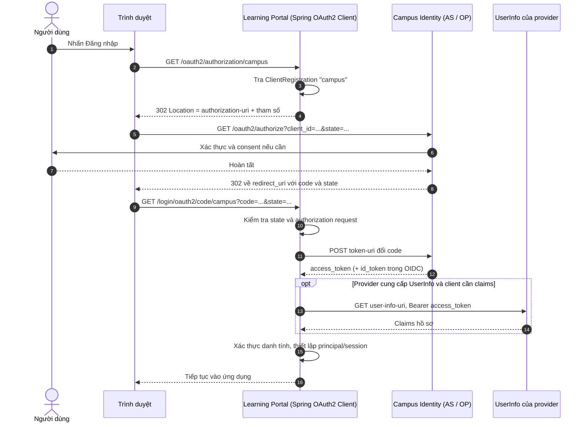

# 6.5. Khai báo authorization-uri, token-uri và user-info-uri thủ công

## Mục tiêu bài học

Sau bài học, bạn có thể:

- Giải thích vai trò riêng của **`authorization-uri`**, **`token-uri`** và **`user-info-uri`** khi Spring Security đóng vai trò OAuth 2.0 / OpenID Connect (OIDC) Client.
- Biết khi nào cần cấu hình các endpoint của provider **thủ công** thay vì dựa vào OIDC Discovery qua `issuer-uri`.
- Viết đúng cấu trúc `spring.security.oauth2.client.provider.<provider-id>.*` và liên kết nó với `registration.<registration-id>.provider`.
- Phân biệt endpoint của **Authorization Server/OpenID Provider** với URL bắt đầu đăng nhập và callback do **ứng dụng Spring** cung cấp.
- Cấu hình một provider OAuth 2.0 tùy biến có UserInfo endpoint, và nhận diện những bổ sung quan trọng khi provider hỗ trợ OIDC.
- Hiểu yêu cầu về danh tính người dùng (`user-name-attribute` hoặc `sub`), JWK Set URI, issuer, scope và xác thực ID Token.
- Chẩn đoán lỗi cấu hình endpoint, `redirect_uri_mismatch`, trao đổi authorization code, gọi UserInfo và những lỗi thường xuất hiện khi hệ thống đặt sau reverse proxy.

## 1. Bối cảnh: tại sao phải khai báo endpoint thủ công?

Giả sử **Learning Portal** là một Spring Boot web application tích hợp với hệ thống danh tính **Campus Identity**. Người dùng bấm “Đăng nhập”, được chuyển tới Campus Identity để xác thực, sau đó quay về Portal. Portal trao đổi authorization code để lấy access token và truy vấn UserInfo để lấy hồ sơ.

Một nhà cung cấp OIDC chuẩn có thể công bố metadata tại một địa chỉ *discovery*. Khi ứng dụng cấu hình `issuer-uri`, Spring Boot/Spring Security có thể lấy metadata để biết authorization endpoint, token endpoint, UserInfo endpoint và địa chỉ khóa công khai tương ứng.

Tuy nhiên, thực tế có những trường hợp:

- Nhà cung cấp OAuth 2.0 **không hỗ trợ OpenID Connect Discovery**.
- Nhà cung cấp có endpoint tùy biến hoặc metadata discovery không đầy đủ.
- Hệ thống cũ chỉ cung cấp tài liệu hướng dẫn gồm ba URL cố định.
- Môi trường nội bộ/nghiệm thu dùng endpoint khác môi trường production.
- Một nhà cung cấp chỉ hỗ trợ OAuth 2.0 với UserInfo/profile API riêng, không phát hành ID Token OIDC.
- Tổ chức cần kiểm soát rõ các URL tích hợp trong cấu hình, thay vì luôn lấy qua metadata động.

Khi ấy, ta có thể khai báo một hoặc nhiều endpoint bằng thuộc tính provider của Spring Boot.

**Lưu ý trọng tâm:** Khai báo thủ công các URL chỉ giúp Spring biết **gửi request đi đâu**. Nó không biến một server OAuth 2.0 thông thường thành OpenID Provider, cũng không tự bảo đảm rằng server tuân thủ OIDC, token có chữ ký hợp lệ hoặc UserInfo trả các claim đúng chuẩn.

## 2. Ba endpoint đảm nhận ba nhiệm vụ khác nhau

Trong Authorization Code Flow, client thường tiếp xúc với ba endpoint của provider ở các bước khác nhau.

| Thuộc tính Spring Boot | Endpoint do ai cung cấp? | Tác dụng | Cách client thường sử dụng |
| --- | --- | --- | --- |
| `authorization-uri` | Authorization Server / OpenID Provider | Tiếp nhận yêu cầu ủy quyền, điều phối xác thực người dùng và consent khi cần | **Trình duyệt** được redirect tới endpoint này |
| `token-uri` | Authorization Server / OpenID Provider | Nhận authorization code hoặc grant phù hợp để cấp token | **Backend client** gọi trực tiếp qua HTTPS |
| `user-info-uri` | OpenID Provider hoặc endpoint profile có bảo vệ của nhà cung cấp | Trả claims / thông tin người dùng mà access token được phép truy cập | **Client** gọi bằng access token khi cần và khi cấu hình phù hợp |

Ví dụ endpoint minh họa của một provider:

```text
Authorization endpoint:
https://sso.campus.example.org/oauth2/authorize

Token endpoint:
https://sso.campus.example.org/oauth2/token

UserInfo endpoint:
https://sso.campus.example.org/oidc/userinfo
```

Những đường dẫn này **không phải quy ước bắt buộc** của OAuth 2.0 hay OIDC. Nhà cung cấp có thể dùng `/authorize`, `/connect/token`, `/me` hoặc đường dẫn khác. Luôn sử dụng tài liệu/metadata được nhà cung cấp xác nhận, không tự đoán URL từ tên domain.

### 2.1. `authorization-uri`: điểm bắt đầu ủy quyền tại provider

Khi người dùng chọn đăng nhập, Spring tạo authorization request và trả HTTP redirect đến `authorization-uri`. Request thường mang các tham số:

- `response_type=code`: sử dụng Authorization Code Flow.
- `client_id`: mã OAuth Client mà provider đã đăng ký.
- `redirect_uri`: callback của Learning Portal.
- `scope`: những quyền/claim được yêu cầu.
- `state`: giá trị liên kết request/callback, bảo vệ chống các kiểu tấn công trộn giao dịch.
- `code_challenge` và `code_challenge_method`: khi áp dụng PKCE.
- `nonce`: trong các tình huống OIDC sử dụng nonce để ràng buộc ID Token với authentication request.

Ví dụ URL sau khi Spring chuyển hướng, viết thành nhiều dòng để dễ đọc:

```text
https://sso.campus.example.org/oauth2/authorize
  ?response_type=code
  &client_id=learning-portal-web
  &redirect_uri=https%3A%2F%2Fportal.example.org%2Flogin%2Foauth2%2Fcode%2Fcampus
  &scope=openid%20profile%20email
  &state=<random-state>
  &code_challenge=<s256-code-challenge>
  &code_challenge_method=S256
```

Đây là dữ liệu minh họa; Spring/thư viện OAuth phải xây URL và mã hóa các giá trị đúng cách. Những chuỗi trong `<...>` không được đưa nguyên văn vào một request thật.

Browser truy cập authorization endpoint để thực hiện quy trình xác thực/ủy quyền tại provider. **Ứng dụng Spring không nên thu thập mật khẩu của Campus Identity để tự làm bước này.**

### 2.2. `token-uri`: nơi trao đổi code và nhận token

Sau khi provider redirect browser về callback của Portal cùng authorization code, Spring gửi HTTP request **trực tiếp** đến `token-uri`.

Ví dụ một confidential client sử dụng `client_secret_basic`:

```http
POST /oauth2/token HTTP/1.1
Host: sso.campus.example.org
Authorization: Basic <encoded-client-credentials>
Content-Type: application/x-www-form-urlencoded

grant_type=authorization_code&code=<one-time-code>&redirect_uri=https%3A%2F%2Fportal.example.org%2Flogin%2Foauth2%2Fcode%2Fcampus
```

Nếu có PKCE, yêu cầu còn chứa `code_verifier` tương ứng. Giá trị authorization code chỉ có hiệu lực ngắn và phải gắn với client/redirect URI theo chính sách của Authorization Server.

Phản hồi có thể như sau:

```json
{
  "access_token": "<access-token>",
  "token_type": "Bearer",
  "expires_in": 300,
  "scope": "openid profile email",
  "id_token": "<id-token>"
}
```

**`id_token` chỉ xuất hiện trong các luồng OIDC phù hợp.** Một provider OAuth 2.0 không hỗ trợ OIDC có thể chỉ trả access token và không phát hành ID Token. Refresh token cũng không phải lúc nào được cấp.

Trong các luồng refresh, cùng `token-uri` thường nhận `grant_type=refresh_token`. Trong Client Credentials Flow, nó nhận `grant_type=client_credentials`. Dù có nhiều grant type, `authorization-uri` vẫn được dùng cho các luồng cần tương tác/ủy quyền qua trình duyệt như Authorization Code, trong khi token endpoint phục vụ trao đổi token theo grant đã đăng ký.

### 2.3. `user-info-uri`: nơi truy vấn hồ sơ bằng access token

OIDC chuẩn hóa **UserInfo Endpoint**: một OAuth 2.0 protected resource trả claims về End-User. Client thường truy vấn:

```http
GET /oidc/userinfo HTTP/1.1
Host: sso.campus.example.org
Authorization: Bearer <access-token>
Accept: application/json
```

Một phản hồi UserInfo dạng JSON minh họa:

```json
{
  "sub": "student-93bd18",
  "name": "Nguyen Minh",
  "preferred_username": "minh.nguyen",
  "email": "minh@example.org",
  "email_verified": true,
  "picture": "https://sso.campus.example.org/avatar/student-93bd18"
}
```

**Access token** được gửi đến UserInfo; **ID Token không được dùng thay access token** trong header Bearer. Nếu provider trả OIDC UserInfo response, claim `sub` phải được so khớp với `sub` của ID Token trước khi sử dụng dữ liệu.

Với provider chỉ hỗ trợ OAuth 2.0, `user-info-uri` có thể trỏ tới endpoint profile riêng, chẳng hạn `/api/me`. Khi đó tên thuộc tính JSON xác định người dùng có thể là `id`, `user_id` hoặc tên khác, và cần cấu hình `user-name-attribute` đúng với response. Một endpoint profile tự thiết kế **không tự trở thành** UserInfo chuẩn OIDC.

## 3. Những URL này khác URL của ứng dụng Spring thế nào?

Khi tích hợp OAuth2 Login, có hai nhóm URL khác nhau:

| URL | Bên sở hữu | Ý nghĩa |
| --- | --- | --- |
| `/oauth2/authorization/{registrationId}` | **Learning Portal (Client)** | Điểm bắt đầu đăng nhập ở Spring; chọn một `ClientRegistration` rồi redirect sang provider |
| `/login/oauth2/code/{registrationId}` | **Learning Portal (Client)** | Callback nhận authorization response sau khi người dùng hoàn tất bước tại provider |
| `authorization-uri` | **Authorization Server/OP** | Endpoint nhận yêu cầu ủy quyền |
| `token-uri` | **Authorization Server/OP** | Endpoint đổi authorization code lấy token |
| `user-info-uri` | **OpenID Provider/profile service** | Endpoint lấy claims hồ sơ đã được phép |

Ví dụ người dùng mở:

```text
https://portal.example.org/oauth2/authorization/campus
```

Spring chọn registration có `registrationId = campus` rồi trả redirect đến:

```text
https://sso.campus.example.org/oauth2/authorize?...
```

Provider sau đó redirect tới callback đã đăng ký:

```text
https://portal.example.org/login/oauth2/code/campus?code=...&state=...
```

Sau callback, backend Portal mới gửi `POST` tới token endpoint và, khi cần, gọi UserInfo.

**Không đặt `authorization-uri` thành `/oauth2/authorization/campus` của chính Portal.** Đây sẽ là một vòng lặp hoặc gọi sai thành phần. Tương tự, không đặt `token-uri` thành callback URL của Portal.

### Sơ đồ luồng



Trong OIDC, Spring phải xác thực ID Token theo quy tắc OIDC; sơ đồ dùng một bước tổng quát để giữ trọng tâm ở ba URI.

## 4. Cấu trúc cấu hình trong Spring Boot

Các endpoint thủ công được khai báo **dưới `provider`**, không phải trực tiếp ở `registration`:

```text
spring.security.oauth2.client
  |
  +-- registration
  |     +-- <registration-id>
  |           +-- provider: <provider-id>
  |           +-- client-id
  |           +-- client-secret
  |           +-- authorization-grant-type
  |           +-- redirect-uri
  |           +-- scope
  |
  +-- provider
        +-- <provider-id>
              +-- authorization-uri
              +-- token-uri
              +-- user-info-uri
              +-- user-info-authentication-method
              +-- user-name-attribute
              +-- jwk-set-uri
```

`provider-id` là khóa cục bộ để các registration tham chiếu cùng cấu hình provider. Nó không nhất thiết trùng `registrationId`, `clientId` hoặc issuer.

Các thuộc tính có ý nghĩa:

| Cấu hình | Ý nghĩa |
| --- | --- |
| `registration.<id>.provider` | Trỏ tới key cấu hình provider |
| `registration.<id>.client-id` | OAuth Client ID đã đăng ký tại Authorization Server |
| `registration.<id>.client-secret` | Credential của confidential client khi được dùng |
| `registration.<id>.authorization-grant-type` | Ví dụ `authorization_code` |
| `registration.<id>.redirect-uri` | Callback URI gửi tới provider và được browser sử dụng |
| `provider.<id>.authorization-uri` | Authorization endpoint tại provider |
| `provider.<id>.token-uri` | Token endpoint tại provider |
| `provider.<id>.user-info-uri` | UserInfo/profile endpoint nếu có |
| `provider.<id>.user-info-authentication-method` | Cách gửi access token khi gọi UserInfo, ví dụ `header` |
| `provider.<id>.user-name-attribute` | Claim trong UserInfo dùng làm định danh principal ở OAuth2 Login thông thường |
| `provider.<id>.jwk-set-uri` | Nguồn khóa công khai, đặc biệt quan trọng khi xác minh chữ ký ID Token OIDC |
| `provider.<id>.issuer-uri` | Định danh issuer dùng cho cấu hình dựa trên discovery; không chỉ là “URL gốc để Spring tự nối đường dẫn” |

Những tên thuộc tính này tuân theo cách bind cấu hình thông dụng của Spring Boot OAuth2 Client. Các endpoint thật phải lấy từ provider được tin cậy.

## 5. Ví dụ A: OAuth 2.0 provider không có OIDC Discovery

Giả sử **Legacy Campus OAuth** chỉ hỗ trợ OAuth 2.0 Authorization Code, cung cấp endpoint profile `/api/profile/me`, phản hồi user ID ở trường `id`. Provider **không phát hành ID Token** và không có scope `openid`.

Cấu hình `application.yml` có thể là:

```yaml
spring:
  security:
    oauth2:
      client:
        registration:
          legacy-campus:
            provider: legacy-campus
            client-id: ${LEGACY_CAMPUS_CLIENT_ID}
            client-secret: ${LEGACY_CAMPUS_CLIENT_SECRET}
            client-authentication-method: client_secret_basic
            authorization-grant-type: authorization_code
            redirect-uri: "{baseUrl}/login/oauth2/code/{registrationId}"
            scope:
              - profile.read
            client-name: "Tài khoản Campus Legacy"

        provider:
          legacy-campus:
            authorization-uri: https://auth.legacy.example.org/oauth/authorize
            token-uri: https://auth.legacy.example.org/oauth/token
            user-info-uri: https://auth.legacy.example.org/api/profile/me
            user-info-authentication-method: header
            user-name-attribute: id
```

Giả định endpoint profile trả JSON:

```json
{
  "id": "account-238",
  "display_name": "Nguyen Minh",
  "mail": "minh@example.org"
}
```

Các điểm cần hiểu:

1. `legacy-campus` dưới `registration` là **registration ID** của Spring.
2. `provider: legacy-campus` liên kết registration với cấu hình ba endpoint.
3. `client-id` và `client-secret` do Authorization Server cấp; secret được truyền qua cấu hình an toàn, không hard-code trong repository.
4. Spring chọn `authorization-uri` để redirect trình duyệt, dùng `token-uri` để trao đổi code và dùng `user-info-uri` để tải hồ sơ.
5. `user-name-attribute: id` nói với Spring rằng thuộc tính **`id`** từ profile response định danh principal.
6. Vì registration không yêu cầu `openid`, đây là **OAuth2 Login thông thường** với `OAuth2User`, không phải OIDC login chỉ vì endpoint hồ sơ có tên “userinfo”.

### 5.1. Tại sao `user-name-attribute` quan trọng?

Đối với provider OAuth 2.0 **không hỗ trợ OIDC**, Spring Security cần biết claim nào đại diện cho user ID trong response khi dùng `DefaultOAuth2UserService`.

Nếu API trả:

```json
{
  "account_id": "A-9001",
  "name": "Nguyen Minh"
}
```

thì cấu hình phải phù hợp:

```yaml
user-name-attribute: account_id
```

Nếu vẫn đặt `id`, Spring có thể không tìm thấy tên thuộc tính bắt buộc và OAuth2 Login thất bại khi xây principal.

Đừng mặc định chọn `email` làm username nếu email có thể thay đổi, trùng, không được xác minh hoặc vắng mặt. Nên chọn định danh bền vững mà provider cam kết; khi lưu tài khoản cục bộ, còn cần xét nguồn/issuer để tránh đụng ID giữa các provider.

### 5.2. `user-info-authentication-method: header`

Với phương thức `header`, Spring gửi access token trong HTTP Authorization header khi gọi UserInfo, theo dạng Bearer nếu phù hợp:

```http
Authorization: Bearer <access-token>
```

Đây là cách phổ biến và phù hợp khi provider hỗ trợ Bearer token. Tùy provider và phiên bản Spring Security, còn có cơ chế biểu diễn khác như form submission; phải đọc hợp đồng endpoint. Không chuyển token sang query string để “làm cho chạy được” nếu endpoint không hỗ trợ hoặc làm lộ credential qua URL/log.

### 5.3. Cấu hình này có tạo ra OIDC không?

**Không.** `authorization-uri` + `token-uri` + `user-info-uri` đủ mô tả các đường giao tiếp của một provider OAuth với profile API, nhưng **OIDC đòi hỏi thêm giao thức xác thực và ID Token đúng chuẩn**.

Nếu một server chỉ cấp access token rồi trả JSON hồ sơ khi gọi `/me`, ứng dụng có thể thực hiện OAuth2 Login và xây `OAuth2User`; không nên gọi token profile đó là ID Token hoặc giả định server là OpenID Provider.

## 6. Ví dụ B: OIDC provider thiếu discovery nhưng công bố endpoint thủ công

Giả sử **Campus OIDC** tuân theo OpenID Connect Core, phát hành ID Token có chữ ký và công bố JWK Set, nhưng máy chủ không công bố tài liệu discovery mà Spring có thể lấy tự động.

Ta cần ít nhất các thông tin liên quan đến Authorization Code + OIDC Login:

- Authorization endpoint.
- Token endpoint.
- UserInfo endpoint, **nếu provider có và client cần dùng**.
- JWK Set URI hoặc một cách xác minh chữ ký ID Token đáng tin cậy theo thuật toán/provider được hỗ trợ.
- Client ID, phương thức xác thực client, grant type, redirect URI và scope có `openid`.
- Giá trị issuer và quy tắc xác thực ID Token mà client phải kiểm tra.
- Khả năng provider hỗ trợ các cơ chế OIDC thực sự cần, như response có `id_token`, validation, UserInfo subject matching.

Một cấu hình minh họa:

```yaml
spring:
  security:
    oauth2:
      client:
        registration:
          campus:
            provider: campus-manual
            client-id: ${CAMPUS_CLIENT_ID}
            client-secret: ${CAMPUS_CLIENT_SECRET}
            client-authentication-method: client_secret_basic
            authorization-grant-type: authorization_code
            redirect-uri: "{baseUrl}/login/oauth2/code/{registrationId}"
            scope:
              - openid
              - profile
              - email
            client-name: "Campus Identity"

        provider:
          campus-manual:
            authorization-uri: https://sso.campus.example.org/oauth2/authorize
            token-uri: https://sso.campus.example.org/oauth2/token
            user-info-uri: https://sso.campus.example.org/oidc/userinfo
            user-info-authentication-method: header
            user-name-attribute: sub
            jwk-set-uri: https://sso.campus.example.org/.well-known/jwks.json
```

Đây là **khung cấu hình tích hợp** cho trường hợp đặc biệt, chưa phải cam kết mọi OP thiếu discovery sẽ hoạt động an toàn chỉ với những thuộc tính này. Với OIDC, RP phải xác minh chữ ký, issuer (`iss`), audience (`aud`), thời hạn và các ràng buộc giao dịch (`nonce` khi sử dụng), cùng các quy tắc liên quan. Nếu không sử dụng được discovery/`issuer-uri`, cần kiểm tra chính xác cơ chế xác minh issuer của phiên bản Spring Security đang dùng và bổ sung validator phù hợp khi chưa được áp dụng. Không bỏ qua yêu cầu issuer validation chỉ vì chữ ký JWT hợp lệ.

Trong môi trường sản xuất, **ưu tiên discovery nếu provider hỗ trợ đúng chuẩn**. Với provider không có discovery, cần tài liệu đáng tin cậy về issuer, metadata khóa, thuật toán ký, scope, claims và chính sách; đồng thời thực hiện kiểm tra tích hợp tương ứng trước khi đưa vào sử dụng.

### 6.1. `jwk-set-uri` có tác dụng gì?

ID Token trong OIDC thường là JWT được ký. `jwk-set-uri` là nơi client có thể lấy các khóa công khai của provider để xác minh chữ ký, chẳng hạn:

```text
https://sso.campus.example.org/.well-known/jwks.json
```

JWK Set thường chứa một hoặc nhiều khóa với `kid`, `kty`, `use`, `alg` hoặc các thuộc tính khóa tương ứng. Client chọn khóa thích hợp và xác thực chữ ký theo thuật toán được cho phép.

**Không lấy JWK Set từ URL tùy ý do JWT không đáng tin tự chỉ định.** JWK Set URI phải thuộc cấu hình provider đã xác thực; tránh lẫn khóa của provider A và token của provider B.

Chữ ký đúng cũng **chưa đủ**: token còn phải dành cho đúng client (`aud`), được cấp bởi issuer tin cậy (`iss`), chưa hết hạn, và đáp ứng các quy tắc OIDC.

### 6.2. Vì sao không tự thêm `issuer-uri` như một thuộc tính trang trí?

Nếu cấu hình:

```yaml
provider:
  campus:
    issuer-uri: https://sso.campus.example.org
```

Spring Boot/Spring Security thông thường sẽ dùng **issuer-based metadata discovery** để cấu hình provider, tùy version và điều kiện khởi tạo. Điều này có thể dẫn tới truy cập endpoint metadata lúc khởi động và phát sinh lỗi nếu issuer không hỗ trợ discovery.

Vì vậy, **`issuer-uri` không phải chỉ là một string lưu hộ `iss`** trong mọi kiểu cấu hình. Khi chủ đích là khai báo endpoint thủ công do provider không có discovery, hãy phân biệt:

- Giá trị issuer chuẩn mà ID Token cần được kiểm tra.
- Thuộc tính `issuer-uri` dùng khởi tạo provider thông qua discovery.
- Cơ chế validator OIDC của Spring Security và cách truyền expected issuer khi không có discovery.

Không tự tắt validation hoặc ép Spring bỏ qua lỗi issuer. Nếu provider công bố discovery hợp lệ, cấu hình qua issuer thường gọn và ít sai hơn.

### 6.3. `sub` là chìa khóa nối ID Token với UserInfo

Với OIDC, UserInfo response phải có `sub`. Nếu Client đã xác thực ID Token với:

```json
{
  "iss": "https://sso.campus.example.org",
  "sub": "student-93bd18",
  "aud": "learning-portal-web"
}
```

thì UserInfo phải trả:

```json
{
  "sub": "student-93bd18",
  "name": "Nguyen Minh"
}
```

Nếu `sub` khác nhau, client phải từ chối sử dụng UserInfo response. Không được “sửa” bằng cách ghi đè danh tính đăng nhập bằng giá trị khác trong UserInfo.

## 7. Dùng `issuer-uri` hay khai báo thủ công: lựa chọn phù hợp

Có hai cách cấu hình provider phổ biến:

### 7.1. Dựa vào discovery

Nếu OP chuẩn hóa OIDC Discovery và issuer tin cậy, có thể dùng:

```yaml
spring:
  security:
    oauth2:
      client:
        registration:
          campus:
            provider: campus
            client-id: ${CAMPUS_CLIENT_ID}
            client-secret: ${CAMPUS_CLIENT_SECRET}
            authorization-grant-type: authorization_code
            redirect-uri: "{baseUrl}/login/oauth2/code/{registrationId}"
            scope:
              - openid
              - profile
              - email
        provider:
          campus:
            issuer-uri: https://sso.campus.example.org
```

Ứng dụng có thể lấy những metadata thích hợp từ issuer thay vì tự viết ba URL. Điều kiện là provider hỗ trợ discovery hợp lệ và môi trường có thể truy cập metadata/khóa theo yêu cầu.

### 7.2. Khai báo thủ công

Với provider chỉ có endpoint cấu hình sẵn:

```yaml
provider:
  campus-manual:
    authorization-uri: https://sso.campus.example.org/oauth2/authorize
    token-uri: https://sso.campus.example.org/oauth2/token
    user-info-uri: https://sso.campus.example.org/oidc/userinfo
    user-name-attribute: sub
    jwk-set-uri: https://sso.campus.example.org/keys
```

Với OIDC, phải bổ sung hoặc kiểm chứng đầy đủ validation và metadata cần thiết như đã giải thích. Với OAuth2 không có ID Token, `jwk-set-uri` thường không cần cho OAuth2 Login thuần.

### 7.3. So sánh

| Tiêu chí | `issuer-uri` + discovery | Khai báo endpoint thủ công |
| --- | --- | --- |
| Số URL phải ghi trong ứng dụng | Thường chỉ cần issuer | Ghi rõ các endpoint cần dùng |
| Phụ thuộc provider metadata | Có | Có thể không phụ thuộc discovery |
| Thay đổi đường dẫn endpoint ở provider | Metadata có thể phản ánh thay đổi | Phải cập nhật cấu hình thủ công |
| Khả năng cấu hình nhầm provider | Giảm khi metadata chuẩn và được xác minh | Cần kiểm soát kỹ việc trộn endpoint |
| Áp dụng với OAuth2 provider không có discovery | Không phải lúc nào khả dụng | Phù hợp |
| ID Token/OIDC validation | Thư viện có metadata/issuer cần thiết | Cần đặc biệt xác minh issuer, keys, thuật toán, audience và các ràng buộc OIDC |
| Debug | Kiểm tra discovery/metadata và cấu hình | Đọc trực tiếp từng URI được khai báo |

Không phải cứ “thủ công” là không an toàn. Rủi ro phát sinh nếu gán sai endpoint, bỏ qua validation hoặc cho phép redirect/URI tùy ý; cần cấu hình và kiểm tra một cách nhất quán.

## 8. Gắn cấu hình provider với `ClientRegistration`

Điểm nối giữa `registration` và `provider` là:

```yaml
spring:
  security:
    oauth2:
      client:
        registration:
          campus:
            provider: campus-manual
            client-id: learning-portal-web

        provider:
          campus-manual:
            authorization-uri: https://sso.campus.example.org/oauth2/authorize
            token-uri: https://sso.campus.example.org/oauth2/token
```

Ở ví dụ:

- `campus` là **registration ID**.
- `campus-manual` là **provider ID/alias** trong cấu hình Spring Boot.
- `learning-portal-web` là **OAuth client ID** phía Campus Identity.

Khi Spring nhận:

```text
GET /oauth2/authorization/campus
```

nó tìm registration có ID `campus`, rồi sử dụng các endpoint từ provider `campus-manual` khi xây request. Đường dẫn bắt đầu login dựa trên registration ID, **không dựa vào provider alias**.

### 8.1. Một provider, nhiều registration

Nếu hai client cùng dùng một nhà cung cấp nhưng client ID, secret hoặc scope khác nhau:

```yaml
spring:
  security:
    oauth2:
      client:
        registration:
          campus-student:
            provider: campus-manual
            client-id: ${STUDENT_CLIENT_ID}
            client-secret: ${STUDENT_CLIENT_SECRET}
            client-authentication-method: client_secret_basic
            authorization-grant-type: authorization_code
            redirect-uri: "{baseUrl}/login/oauth2/code/{registrationId}"
            scope: [openid, profile]

          campus-staff:
            provider: campus-manual
            client-id: ${STAFF_CLIENT_ID}
            client-secret: ${STAFF_CLIENT_SECRET}
            client-authentication-method: client_secret_basic
            authorization-grant-type: authorization_code
            redirect-uri: "{baseUrl}/login/oauth2/code/{registrationId}"
            scope: [openid, profile, email]

        provider:
          campus-manual:
            authorization-uri: https://sso.campus.example.org/oauth2/authorize
            token-uri: https://sso.campus.example.org/oauth2/token
            user-info-uri: https://sso.campus.example.org/oidc/userinfo
            user-name-attribute: sub
            jwk-set-uri: https://sso.campus.example.org/keys
```

Hai registration cùng kế thừa endpoint provider nhưng có **callback URL riêng**:

```text
https://portal.example.org/login/oauth2/code/campus-student
https://portal.example.org/login/oauth2/code/campus-staff
```

Provider phải chấp nhận đúng callback đã đăng ký với **từng** client ID. Không tự gán quyền STAFF vì người dùng đã chọn `/oauth2/authorization/campus-staff`; sau OIDC login vẫn cần kiểm tra quyền nghiệp vụ.

### 8.2. Trường hợp không khai báo `provider`

Trong một số cấu hình có provider nổi tiếng, Spring Boot hỗ trợ những giá trị mặc định; tuy nhiên, với provider tùy biến, việc thiếu `provider` hoặc đặt alias không khớp có thể khiến Spring không lấy được authorization/token/userInfo endpoint tương ứng.

Để giảm nhầm lẫn, nên khai báo `registration.<registrationId>.provider` rõ ràng khi muốn dùng provider cấu hình thủ công dưới key riêng.

## 9. Cấu hình Spring Security sử dụng các endpoint này

Đối với Servlet application có Spring Security OAuth2 Client dependency, cấu hình cơ bản để bật OAuth2 Login:

```java
@Configuration
class WebSecurityConfig {

    @Bean
    SecurityFilterChain securityFilterChain(HttpSecurity http) throws Exception {
        http
            .authorizeHttpRequests(auth -> auth
                .requestMatchers("/", "/login", "/error").permitAll()
                .anyRequest().authenticated()
            )
            .oauth2Login(Customizer.withDefaults());

        return http.build();
    }
}
```

Khi ứng dụng có registration `campus`, người dùng có thể bắt đầu đăng nhập tại:

```text
/oauth2/authorization/campus
```

Spring sẽ sử dụng `authorization-uri`, `token-uri` và cơ chế UserInfo/OIDC phù hợp từ cấu hình đã đăng ký.

Ví dụ về các thành phần liên quan:

| Thành phần Spring Security | Trách nhiệm |
| --- | --- |
| `ClientRegistrationRepository` | Cung cấp các `ClientRegistration` được cấu hình |
| `OAuth2AuthorizationRequestRedirectFilter` | Xử lý yêu cầu bắt đầu login, tạo authorization request, redirect tới authorization endpoint |
| `OAuth2LoginAuthenticationFilter` | Xử lý callback authorization response từ provider |
| `OAuth2AuthorizationCodeAuthenticationProvider` | Thực hiện bước trao đổi authorization code/token cho OAuth2 Login |
| `DefaultOAuth2UserService` | Lấy thông tin user từ UserInfo/profile endpoint trong OAuth2 Login không sử dụng OIDC |
| `OidcAuthorizationCodeAuthenticationProvider` | Thực hiện xử lý OIDC Authorization Code và ID Token |
| `OidcUserService` | Tải, hợp nhất thông tin OIDC, có thể gọi UserInfo theo điều kiện và cấu hình |

Bảng chỉ nhằm làm rõ chức năng; Spring Security còn có các service, validator và filter khác trong flow hoàn chỉnh. Không cần tự viết lại Authorization Code Flow chỉ vì đã cấu hình URL thủ công.

### 9.1. Quan sát `ClientRegistration` đang được dùng

Ví dụ trong backend, đọc metadata (không trả secret/token):

```java
@Service
class ProviderConfigurationInspector {

    private final ClientRegistrationRepository repository;

    ProviderConfigurationInspector(ClientRegistrationRepository repository) {
        this.repository = repository;
    }

    Map<String, String> inspectCampus() {
        ClientRegistration registration =
            repository.findByRegistrationId("campus");

        if (registration == null) {
            throw new IllegalStateException("Client registration not found");
        }

        ClientRegistration.ProviderDetails provider =
            registration.getProviderDetails();

        return Map.of(
            "registrationId", registration.getRegistrationId(),
            "authorizationUri", provider.getAuthorizationUri(),
            "tokenUri", provider.getTokenUri(),
            "userInfoUri", provider.getUserInfoEndpoint().getUri()
        );
    }
}
```

Đoạn mã giả định UserInfo URI hiện diện; nếu endpoint là tùy chọn, cần kiểm tra `null` trước khi tạo `Map.of`. Các ví dụ Java trong bài giả định import/dependency phù hợp. Quan sát URI nội bộ ở log quản trị hoặc debug có kiểm soát, không tự tạo endpoint public trả toàn bộ cấu hình và credential.

`ClientRegistration.ProviderDetails.UserInfoEndpoint` chứa metadata UserInfo, gồm URI và thuộc tính user-name-attribute. Cấu hình Boot là cách khai báo, còn các lớp Spring Security là đối tượng đọc trong quá trình chạy.

### 9.2. Trường hợp chỉ dùng OAuth2 Client để gọi API

Nếu ứng dụng Spring không đăng nhập người dùng mà chỉ sử dụng `OAuth2AuthorizedClientManager` với `client_credentials`, thường **không cần `authorization-uri` hoặc `user-info-uri`** để thực hiện grant đó. Nó cần token endpoint, client authentication và các thuộc tính phù hợp.

Trái lại, trong **Authorization Code Login**, client cần authorization endpoint và token endpoint; UserInfo/profile endpoint cần thiết tùy cơ chế lấy danh tính. Tránh copy cùng một khối YAML không cần thiết cho mọi grant type.

## 10. Programmatic configuration khi YAML không đủ

Một ứng dụng đôi khi phải lấy endpoint từ cấu hình an toàn hoặc chọn provider theo tenant/môi trường. Spring Security cho phép tạo `ClientRegistration` bằng builder.

Ví dụ **OAuth 2.0 provider không hỗ trợ OIDC**:

```java
@Configuration
class ManualOAuthClientConfiguration {

    @Bean
    ClientRegistrationRepository clientRegistrationRepository() {
        ClientRegistration campus = ClientRegistration
            .withRegistrationId("legacy-campus")
            .clientId("learning-portal-web")
            .clientSecret(System.getenv("LEGACY_CAMPUS_CLIENT_SECRET"))
            .clientAuthenticationMethod(
                ClientAuthenticationMethod.CLIENT_SECRET_BASIC
            )
            .authorizationGrantType(
                AuthorizationGrantType.AUTHORIZATION_CODE
            )
            .redirectUri(
                "{baseUrl}/login/oauth2/code/{registrationId}"
            )
            .scope("profile.read")
            .authorizationUri(
                "https://auth.legacy.example.org/oauth/authorize"
            )
            .tokenUri(
                "https://auth.legacy.example.org/oauth/token"
            )
            .userInfoUri(
                "https://auth.legacy.example.org/api/profile/me"
            )
            .userInfoAuthenticationMethod(
                AuthenticationMethod.HEADER
            )
            .userNameAttributeName("id")
            .clientName("Campus Legacy")
            .build();

        return new InMemoryClientRegistrationRepository(campus);
    }
}
```

Cần import từ Spring Security, xử lý bí mật qua secret management thích hợp và không hard-code credential. `System.getenv(...)` chỉ nhằm minh họa cách lấy secret ngoài mã nguồn; ứng dụng thực nên cấu hình và kiểm tra đầu vào rõ ràng.

Khi tự khai báo bean `ClientRegistrationRepository`, cần hiểu nó có thể thay thế repository do Boot auto-configuration tạo ra. Tránh vô tình cấu hình hai nguồn `ClientRegistration` xung đột. Nếu bài toán chỉ là ba URI tĩnh, YAML thường đơn giản hơn.

### 10.1. Vì sao không nên xây endpoint từ chuỗi tùy ý người dùng nhập?

Ví dụ không an toàn về thiết kế:

```text
providerHost = query parameter từ browser
authorizationUri = "https://" + providerHost + "/authorize"
tokenUri = "https://" + providerHost + "/token"
```

Điều này có thể tạo lỗ hổng SSRF hoặc trộn trust boundary: client có thể gửi code, client credentials hoặc token đến host do bên ngoài điều khiển. Hãy lấy cấu hình provider từ nguồn tin cậy, giới hạn host/issuer và không cho request đầu vào tùy ý thay đổi endpoint của grant đang dùng.

## 11. UserInfo và danh tính: OAuth2User so với OidcUser

Hai trường hợp nên phân biệt rõ:

### 11.1. OAuth2 Login thông thường

Khi provider không hỗ trợ OIDC, ứng dụng có thể dùng UserInfo/profile API đã cấu hình để tạo `OAuth2User`.

```java
@RestController
class LegacyProfileController {

    @GetMapping("/legacy-me")
    Map<String, Object> me(
            @AuthenticationPrincipal OAuth2User principal) {

        return Map.of(
            "name", principal.getName(),
            "hasAttributes", !principal.getAttributes().isEmpty()
        );
    }
}
```

`principal.getName()` dựa trên `user-name-attribute` mà Spring đã sử dụng để xác định tên người dùng từ response. Không được coi nó là định danh OIDC `sub` nếu provider chỉ trả OAuth2 custom profile.

### 11.2. OIDC Login

Khi scope có `openid` và OP đáp ứng OIDC, Spring có thể thiết lập `OidcUser` dựa trên ID Token đã xác thực và có thể bổ sung UserInfo.

```java
@RestController
class OidcProfileController {

    @GetMapping("/oidc-me")
    Map<String, Object> me(
            @AuthenticationPrincipal OidcUser principal) {

        Map<String, Object> response = new LinkedHashMap<>();
        response.put("subject", principal.getSubject());
        response.put("issuer", principal.getIssuer().toString());
        response.put("hasUserInfo", principal.getUserInfo() != null);
        response.put("name", principal.getFullName());
        return response;
    }
}
```

Đây là ví dụ cho ứng dụng đã login OIDC. Nếu `getFullName()` là `null`, map có thể xử lý null như `LinkedHashMap` minh họa; UI cần có fallback.

Cần nhớ:

- **ID Token xác nhận thông tin về sự kiện xác thực** cho OIDC Client.
- **UserInfo cung cấp hồ sơ được phép chia sẻ**, được gọi bằng access token khi điều kiện thích hợp.
- `OidcUser.getUserInfo()` có thể không có dữ liệu; không phải mọi OIDC Login đều bắt buộc gọi UserInfo.
- `OidcUser.getClaims()` có thể là tập claim tổng hợp; muốn biết claim đến từ ID Token hay UserInfo, đọc riêng `getIdToken().getClaims()` và `getUserInfo().getClaims()` khi có.
- Khi dùng UserInfo, OIDC yêu cầu so sánh `sub` trong response với `sub` của ID Token.

### 11.3. `user-info-uri` có bắt buộc trong mọi OIDC Client không?

Không. Trong một số trường hợp, OP cung cấp đủ thông tin cần thiết qua ID Token, hoặc client không cần thêm claims hồ sơ. Khi đó UserInfo có thể không được sử dụng. Hơn nữa, Spring có điều kiện cụ thể quyết định gọi UserInfo dựa trên registration, endpoint và scope/khả năng cấu hình.

**Không suy diễn rằng cứ khai báo `user-info-uri` là Spring gọi endpoint đó trong mọi lần login.** Nếu cần bắt buộc gọi một API hồ sơ tùy biến, có thể phải tùy biến `OAuth2UserService` hoặc `OidcUserService` và xử lý phản hồi an toàn theo hợp đồng provider.

## 12. Xử lý endpoint với các phương thức xác thực client khác nhau

`token-uri` chỉ cho biết **địa chỉ** token endpoint. Để lấy token thành công, client còn phải dùng phương thức xác thực được nhà cung cấp đăng ký.

Một số phương thức có thể gặp:

- `client_secret_basic`: confidential client gửi client ID/secret trong Authorization header theo quy tắc HTTP Basic của OAuth.
- `client_secret_post`: confidential client gửi client ID/secret trong form body, nếu provider hỗ trợ và chính sách cho phép.
- `private_key_jwt`: client xác thực bằng assertion ký bởi khóa riêng của mình khi triển khai hỗ trợ.
- Public client: không thể bảo mật client secret phân phối đến browser/mobile; phải dùng mô hình phù hợp, thường Authorization Code + PKCE.

Ví dụ đổi cách xác thực (chỉ khi provider yêu cầu):

```yaml
spring:
  security:
    oauth2:
      client:
        registration:
          campus:
            client-authentication-method: client_secret_post
```

Không sửa `token-uri` để giải quyết lỗi `invalid_client` nếu thực tế là provider không chấp nhận cách xác thực client. Ngược lại, `client-id` hợp lệ nhưng `token-uri` sai vẫn làm giao dịch thất bại.

### 12.1. PKCE không thay thế việc khai báo token endpoint đúng

Với Authorization Code + PKCE, client gửi `code_challenge` trong authorization request, rồi `code_verifier` trong token request. Hai request đi đến **hai endpoint khác nhau**:

```text
authorization-uri  -> code_challenge
token-uri          -> code_verifier
```

PKCE giúp ràng buộc authorization code với client khởi tạo yêu cầu. Nó không biến token endpoint thành public API tùy ý, cũng không thay thế xác thực client đối với confidential clients khi được yêu cầu.

## 13. Kiểm soát redirect URI ở phía client

Ví dụ:

```yaml
redirect-uri: "{baseUrl}/login/oauth2/code/{registrationId}"
```

Nếu ứng dụng chạy tại:

```text
https://portal.example.org
```

với registration `campus`, callback thực tế thường là:

```text
https://portal.example.org/login/oauth2/code/campus
```

Phải đăng ký **đúng redirect URI** này ở phía Authorization Server.

### 13.1. Reverse proxy và host công khai

Giả sử:

```text
Browser: https://portal.example.org
           |
           v
Ingress / Proxy
           |
           v
Spring Boot: http://portal-service:8080
```

Nếu Spring dựng `baseUrl` từ host/scheme nội bộ, authorization request có thể mang:

```text
redirect_uri=http://portal-service:8080/login/oauth2/code/campus
```

Provider chỉ chấp nhận HTTPS URL công khai nên báo `redirect_uri_mismatch`.

Tùy cấu trúc deployment, có thể cần cấu hình xử lý forwarded headers đáng tin cậy của Spring Boot, ví dụ:

```yaml
server:
  forward-headers-strategy: framework
```

Đây là phương án cần đánh giá theo reverse proxy/ingress thật. Chỉ tin forwarded headers do proxy tin cậy ghi đè; không cho người dùng Internet tự quyết định external host bằng header do họ gửi.

### 13.2. `redirect-uri` không phải `authorization-uri`

Đừng viết:

```yaml
authorization-uri: https://portal.example.org/login/oauth2/code/campus
```

Callback URL thuộc về **Client**, còn authorization endpoint thuộc về **Authorization Server**. Sự nhầm lẫn này có thể khiến browser bị redirect sai, tạo vòng lặp hoặc tạo lỗi không thể hoàn tất đăng nhập.

## 14. Quản lý cấu hình theo môi trường

Nên tách các URL môi trường thành giá trị được kiểm soát:

```yaml
spring:
  security:
    oauth2:
      client:
        registration:
          campus:
            provider: campus-manual
            client-id: ${CAMPUS_CLIENT_ID}
            client-secret: ${CAMPUS_CLIENT_SECRET}
            authorization-grant-type: authorization_code
            redirect-uri: "{baseUrl}/login/oauth2/code/{registrationId}"
            scope: [openid, profile]

        provider:
          campus-manual:
            authorization-uri: ${CAMPUS_AUTHORIZATION_URI}
            token-uri: ${CAMPUS_TOKEN_URI}
            user-info-uri: ${CAMPUS_USER_INFO_URI}
            user-name-attribute: sub
            jwk-set-uri: ${CAMPUS_JWK_SET_URI}
```

Ví dụ các biến môi trường (toàn bộ tên miền minh họa):

```text
CAMPUS_AUTHORIZATION_URI=https://sso.staging.example.org/oauth2/authorize
CAMPUS_TOKEN_URI=https://sso.staging.example.org/oauth2/token
CAMPUS_USER_INFO_URI=https://sso.staging.example.org/oidc/userinfo
CAMPUS_JWK_SET_URI=https://sso.staging.example.org/keys
```

Một số nguyên tắc:

1. Không trộn authorization endpoint của staging với token endpoint của production.
2. Không dùng client secret production tại staging nếu không có chủ đích và chính sách rõ ràng.
3. Đăng ký callback phù hợp host/scheme của từng môi trường.
4. Dùng HTTPS cho endpoint thực; chỉ chấp nhận ngoại lệ local development có kiểm soát.
5. Với OIDC, đảm bảo ID Token và UserInfo thuộc **cùng issuer** mà client tin cậy.
6. Thay đổi URI có thể ảnh hưởng phiên authorization đang diễn ra hoặc token validation; cần vận hành chuyển đổi phù hợp.

Đặc biệt nguy hiểm là cấu hình:

```text
authorization-uri = https://idp-a.example/authorize
token-uri         = https://idp-b.example/token
user-info-uri     = https://idp-a.example/userinfo
```

Trừ trường hợp provider có kiến trúc nhiều host được chính thức tài liệu hóa và tin cậy, đây thường là dấu hiệu nhầm cấu hình. Không gửi authorization code hoặc client credential của provider A sang endpoint do provider B quản lý.

## 15. Những lỗi tích hợp thường gặp

| Biểu hiện | Nguyên nhân khả dĩ | Cần kiểm tra |
| --- | --- | --- |
| Bấm login nhưng 404 ở `/oauth2/authorization/campus` | Thiếu registration `campus`, chưa bật `oauth2Login()` hoặc đã đổi authorization request base URI | `registration.<id>`, `SecurityFilterChain`, link login |
| Browser redirect đến URL không tồn tại | Sai `authorization-uri`, thiếu path hoặc dùng URI của Client thay endpoint AS | URL chính thức do provider cung cấp |
| OP báo `invalid_request` | Thiếu hoặc sai tham số OAuth, URI không được hỗ trợ | Client registration, redirect URI, scopes, PKCE |
| OP báo `redirect_uri_mismatch` | Callback không nằm trong danh sách của client ID hoặc sai host/scheme | `redirect-uri`, `baseUrl`, proxy, callback đăng ký ở OP |
| Browser đã quay về Portal nhưng token exchange thất bại | `token-uri` sai, client authentication sai, code/verifier/redirect URI không hợp lệ | Log mã lỗi an toàn, config token endpoint và client auth |
| Token endpoint trả `invalid_client` | Client ID/secret/phương thức xác thực không phù hợp | `client-id`, secret, `client-authentication-method`, cấu hình client phía OP |
| HTTP 404/405 khi gọi token endpoint | Sai đường dẫn hoặc phương thức HTTP | Token endpoint chính xác; token request thường dùng POST |
| HTTP 401 tại UserInfo | Access token hết hạn, sai audience/scope hoặc bị từ chối | Access token và endpoint UserInfo đúng issuer |
| HTTP 404 tại UserInfo | Sai `user-info-uri`, provider không có UserInfo hoặc cần path riêng | Metadata/tài liệu provider |
| Spring báo không tìm thấy user name attribute | `user-name-attribute` không trùng field JSON trong OAuth2 profile response | Kiểm tra cấu trúc response và tên claim ổn định |
| OIDC Login lỗi JWT/key validation | Thiếu/sai JWK Set URI, chữ ký hoặc thuật toán không khớp | Issuer/JWKS, trust, algorithm, thời gian, audience |
| OIDC có ID Token hợp lệ nhưng UserInfo bị từ chối | UserInfo không cấp quyền, token không phù hợp hoặc `sub` không khớp | Scope, UserInfo, `sub` và token |
| Startup lỗi khi đặt `issuer-uri` | Spring thử metadata discovery nhưng OP không công bố metadata tương thích | Khả năng discovery, cấu hình thủ công và issuer validation |
| Dev hoạt động, production lỗi redirect | Cấu hình proxy, scheme, host hoặc context path khác | External base URL và forwarded-header strategy |

### 15.1. Phân biệt lỗi ở từng chặng

Một cách đọc luồng theo HTTP:

```text
(A) GET /oauth2/authorization/campus
      |
      +-- lỗi ở A: registration, login filter, link

(B) 302 -> authorization-uri của provider
      |
      +-- lỗi ở B: URL authorize, client_id, scope, redirect_uri

(C) GET /login/oauth2/code/campus?code=...&state=...
      |
      +-- lỗi ở C: callback, state, cookie/session, proxy

(D) POST token-uri
      |
      +-- lỗi ở D: token endpoint, client authentication, code, PKCE

(E) GET user-info-uri + Bearer access_token
      |
      +-- lỗi ở E: endpoint, access token, scope, response, subject

(F) Authentication/Session tại Spring
      |
      +-- lỗi ở F: ID Token, user-name-attribute, user mapping
```

Bước E có thể bị bỏ qua khi UserInfo không cần thiết/không được cấu hình; trong OIDC, ID Token validation có thể xảy ra trước UserInfo.

Đọc lỗi đúng chặng sẽ hiệu quả hơn việc thay ngẫu nhiên cả ba URI.

### 15.2. Khi login trả 302 lặp lại

Nếu browser bị chuyển hướng giữa Portal và provider mà không tạo được session, có thể do cookie session không được giữ, `state` bị mất, callback không khớp, bảo mật reverse proxy hoặc một điều kiện login khác. Kiểm tra flow thực tế và cookie/session trước khi kết luận token endpoint sai.

Thay `authorization-uri` sang một URL khác chỉ vì thấy redirect nhiều lần có thể làm tình hình tệ hơn nếu nguyên nhân ở phía Client.

## 16. Đọc log mà không lộ token

Khi chẩn đoán, có thể ghi nhận:

- `registrationId` được chọn.
- Provider alias và hostname/path endpoint đã cấu hình (không bao gồm secrets).
- HTTP status và mã lỗi OAuth (`invalid_client`, `invalid_grant`, `invalid_scope`...) khi có.
- Correlation ID của request nội bộ.
- Giai đoạn xảy ra lỗi: authorization redirect, callback, token exchange hay UserInfo.

Không ghi:

- `client-secret`.
- Authorization header hoặc access/refresh token.
- Authorization code, `code_verifier`, session ID hoặc cookie.
- Toàn bộ ID Token, UserInfo response chứa thông tin cá nhân.
- Các thông tin mật trong query string callback nếu không cần cho điều tra được kiểm soát.

Nếu client cố tình log toàn bộ HTTP body của token endpoint, credential có thể bị lộ vào hệ thống thu thập log ngoài phạm vi bảo vệ. Đặc biệt cần kiểm soát logging của HTTP client khi bật debug.

## 17. Bài thực hành: chuyển từ discovery sang manual endpoints

Giả sử tài liệu tích hợp cung cấp:

```text
Provider: Example University SSO
Authorization URL: https://identity.university.example/auth/authorize
Token URL:         https://identity.university.example/auth/token
Profile URL:       https://identity.university.example/api/me
Profile user ID:   uid
Client ID:         course-web
Callback:          https://courses.university.example/login/oauth2/code/university
Grant:             authorization_code
```

Nhà cung cấp chỉ công bố OAuth2 Login với profile API, không xác nhận hỗ trợ OIDC.

### 17.1. Cấu hình đề xuất

```yaml
spring:
  security:
    oauth2:
      client:
        registration:
          university:
            provider: university-custom
            client-id: course-web
            client-secret: ${UNIVERSITY_CLIENT_SECRET}
            client-authentication-method: client_secret_basic
            authorization-grant-type: authorization_code
            redirect-uri: "{baseUrl}/login/oauth2/code/{registrationId}"
            client-name: "University SSO"
            scope: [profile.read]
        provider:
          university-custom:
            authorization-uri: https://identity.university.example/auth/authorize
            token-uri: https://identity.university.example/auth/token
            user-info-uri: https://identity.university.example/api/me
            user-info-authentication-method: header
            user-name-attribute: uid
```

Với ví dụ này, đường dẫn bắt đầu login là:

```text
https://courses.university.example/oauth2/authorization/university
```

Spring sẽ dùng `authorization-uri` của `university-custom` để chuyển trình duyệt sang provider. Callback là `/login/oauth2/code/university`, token exchange tới `/auth/token`, còn profile được đọc từ `/api/me`.

### 17.2. Những điều phải hỏi provider trước khi dùng thật

- Client có được đăng ký chính xác **callback** đã cấu hình không?
- Token endpoint yêu cầu `client_secret_basic`, `client_secret_post`, PKCE hay phương thức khác?
- Endpoint `/api/me` có chấp nhận Bearer access token trong header không?
- JSON có trường `uid` ổn định và duy nhất trong phạm vi provider không?
- Scope `profile.read` có đúng và đã được cấp cho client chưa?
- Provider có thực sự hỗ trợ OIDC không? Nếu có, đâu là issuer, JWK Set URI, chính sách ký ID Token và UserInfo endpoint chuẩn?
- Có giới hạn mạng, TLS trust chain hoặc proxy nội bộ ảnh hưởng backend Spring không?

Những câu hỏi này xác định tính tương thích thực tế; chỉ điền URL đúng cú pháp không đủ để bảo đảm đăng nhập hoạt động.

## 18. Câu hỏi tự kiểm tra

**1. Trong YAML, `authorization-uri` nằm dưới `registration` hay `provider`?**

> Thuộc tính endpoint của nhà cung cấp được đặt dưới `spring.security.oauth2.client.provider.<provider-id>.authorization-uri`. Registration liên kết đến provider bằng `registration.<registration-id>.provider`.

**2. Người dùng mở `/oauth2/authorization/campus`. Đây có phải `authorization-uri` của OP không?**

> Không. Đó là URL của ứng dụng Spring để chọn registration và bắt đầu login. Sau đó Spring mới redirect browser tới `authorization-uri` thật của OP.

**3. Vì sao token endpoint thường được gọi từ backend?**

> Client trao đổi authorization code lấy token qua kênh trực tiếp, gửi client authentication khi cần và PKCE verifier nếu áp dụng. Token endpoint không phải callback của trình duyệt.

**4. Chỉ cần ba URI là đủ để xác thực OIDC an toàn chưa?**

> Chưa. OIDC còn đòi hỏi ID Token hợp lệ, kiểm tra issuer, audience, signature, expiry, nonce khi sử dụng, metadata khóa và quy tắc liên kết UserInfo. `jwk-set-uri` cùng cơ chế issuer validation cần được xác định rõ nếu không dùng discovery.

**5. `user-info-uri` dùng token nào để truy vấn?**

> Access token có quyền truy cập UserInfo. Không dùng ID Token hoặc refresh token trong Bearer header.

**6. Provider OAuth2 có profile JSON với `account_id`, còn `user-name-attribute: id`. Điều gì có thể xảy ra?**

> Spring không tìm được claim được cấu hình làm tên principal. Cần đổi `user-name-attribute` sang trường ổn định thực tế, ví dụ `account_id`, và kiểm tra hợp đồng profile API.

**7. Có thể khai báo ba endpoint ở ba host khác nhau không?**

> Chỉ khi đó là kiến trúc được provider tài liệu hóa và tin cậy. Không tự trộn URL của các issuer khác nhau; sẽ làm sai ranh giới tin cậy và có thể lộ authorization code/credential.

**8. Bật `issuer-uri` có luôn là “khai báo thủ công” không?**

> Không. Trong cấu hình phổ biến, Spring Boot sử dụng issuer để khám phá metadata. Nếu OP không hỗ trợ discovery, cần thiết kế cấu hình manual và validation riêng phù hợp thay vì coi issuer URI chỉ là chuỗi trang trí.

**9. Đổi tên provider alias từ `campus-manual` sang `campus-v2` có đổi URL `/oauth2/authorization/campus` không?**

> Không, nếu `registrationId` vẫn là `campus` và registration đã trỏ đúng alias mới. URL bắt đầu login dựa trên registration ID; provider alias chỉ xác định cấu hình endpoint được tham chiếu.

**10. Một request OAuth thất bại `redirect_uri_mismatch`. Có nên sửa `user-info-uri` không?**

> Không. Lỗi này thuộc authorization request/callback; cần kiểm tra `redirect-uri`, external `baseUrl`, reverse proxy và danh sách redirect URI mà provider chấp nhận.

---

## Ghi nhớ

Khi không thể dùng discovery, Spring Boot cho phép khai báo thủ công **`authorization-uri`** (trình duyệt đến provider để xin ủy quyền), **`token-uri`** (client trực tiếp đổi code/grant lấy token) và **`user-info-uri`** (client dùng access token để lấy claims hồ sơ) dưới `spring.security.oauth2.client.provider.<provider-id>`. Registration của Spring liên kết với provider thông qua thuộc tính `provider`. Các URL này hoàn toàn khác với `/oauth2/authorization/{registrationId}` và `/login/oauth2/code/{registrationId}` thuộc ứng dụng Client. Với OAuth2 Login thông thường cần mapping claim người dùng qua `user-name-attribute`; với OIDC phải bảo đảm ID Token validation, issuer/JWKS và đối chiếu `sub` theo chuẩn. Cấu hình URL chính xác là điều kiện cần cho một luồng đăng nhập đúng và an toàn, cùng với client registration, redirect URI, scope và bảo vệ credential phù hợp.
