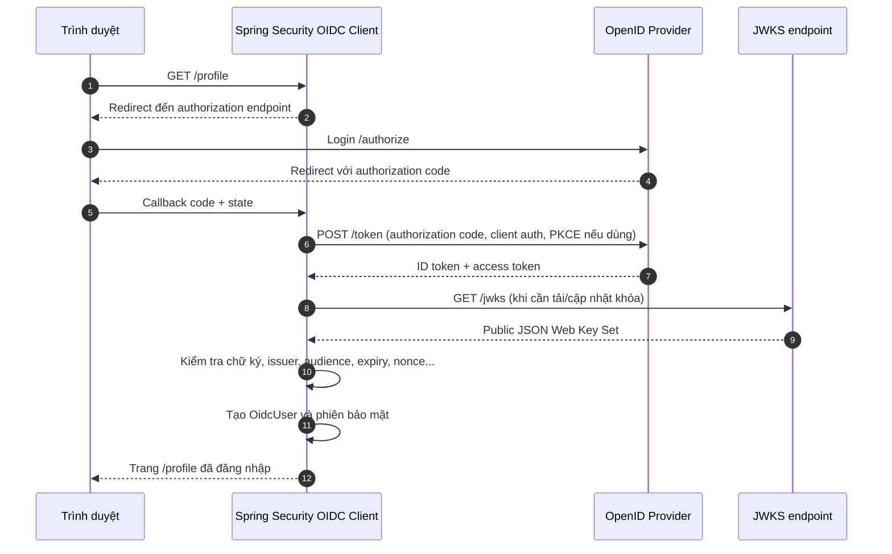
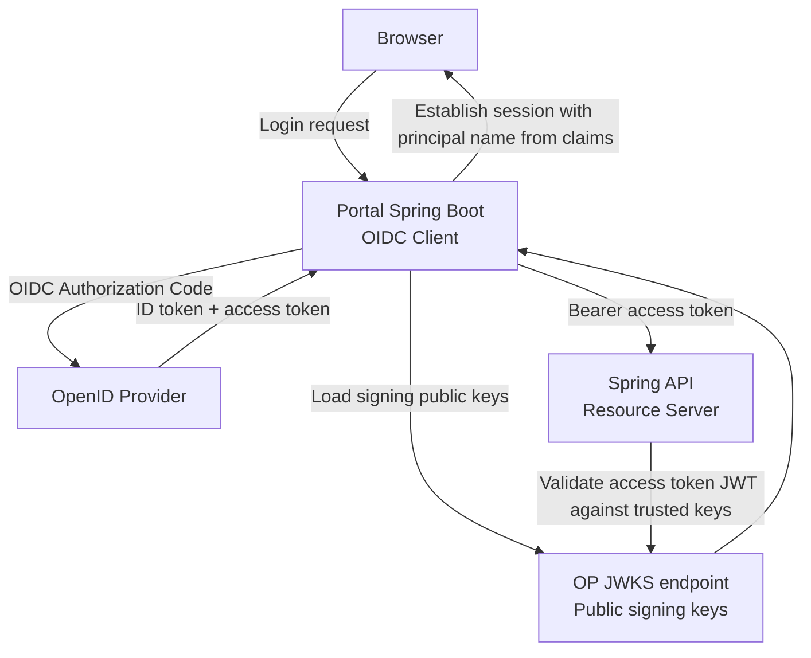

# 6.6. Khai báo jwk-set-uri và user-name-attribute

Trong **Spring Security OAuth 2.0/OIDC Client**, phần `provider` của `ClientRegistration` mô tả các endpoint và quy ước mà ứng dụng cần biết để làm việc với Authorization Server hoặc OpenID Provider (OP). Hai thuộc tính dễ bị nhầm lẫn là **`jwk-set-uri`** và **`user-name-attribute`**.

Chúng phục vụ **hai mục đích độc lập**:

- **`jwk-set-uri`** chỉ đến endpoint cung cấp **JSON Web Key Set (JWKS)**, nơi client lấy khóa công khai để kiểm tra chữ ký của những token có chữ ký do OP phát hành, đặc biệt là **OIDC ID Token** trong quá trình đăng nhập.
- **`user-name-attribute`** chỉ định **tên claim/thuộc tính** dùng làm tên định danh của principal trong Spring Security, chẳng hạn `sub` của OIDC hoặc `id` của một OAuth 2.0 provider có UserInfo API riêng.

Một thuộc tính thuộc **lớp kiểm chứng mật mã**, thuộc tính còn lại thuộc **lớp ánh xạ danh tính**. Đổi `user-name-attribute` không sửa chữ ký token; đổi `jwk-set-uri` không thay đổi nội dung `sub`, email hoặc username của người dùng.

## 1. Vị trí của hai thuộc tính trong ClientRegistration

`ClientRegistration` là đối tượng Spring Security đại diện cho một đăng ký OAuth 2.0/OIDC client. Nó có các nhóm thông tin chính:

| Nhóm | Ví dụ thuộc tính | Mục đích |
|---|---|---|
| **Đăng ký client** | `registrationId`, `clientId`, `clientSecret` | Xác định và xác thực ứng dụng với provider |
| **Luồng OAuth** | `authorizationGrantType`, `redirectUri`, `scopes` | Quy định cách client nhận authorization code/token |
| **Provider endpoints** | `authorizationUri`, `tokenUri`, `userInfoUri` | Biết nơi thực hiện các bước giao thức |
| **Provider key information** | `jwkSetUri` | Tìm khóa công khai phục vụ xác minh token đã ký |
| **Provider principal mapping** | `userNameAttributeName` | Xác định thuộc tính được dùng làm `OAuth2User.getName()`/tên principal |
| **Provider OIDC metadata** | `issuerUri`, các metadata đã khám phá | Kiểm tra nguồn phát hành và cấu hình giao thức |

Trong `application.yml` của Spring Boot, hai thuộc tính cần khai báo ở **nhánh `provider`**:

```yaml
spring:
  security:
    oauth2:
      client:
        registration:
          company:
            provider: company
            client-id: ${OIDC_CLIENT_ID}
            client-secret: ${OIDC_CLIENT_SECRET}
            authorization-grant-type: authorization_code
            client-authentication-method: client_secret_basic
            redirect-uri: "{baseUrl}/login/oauth2/code/{registrationId}"
            scope:
              - openid
              - profile
              - email
        provider:
          company:
            issuer-uri: https://login.example.org
            jwk-set-uri: https://login.example.org/oauth2/jwks
            user-name-attribute: sub
```

Ở ví dụ này:

- `registration.company` là đăng ký OAuth client có tên cục bộ `company` trong ứng dụng.
- `provider: company` khiến registration sử dụng cấu hình tại `provider.company`.
- `issuer-uri` xác định OP được tin cậy, phục vụ OIDC discovery/validation khi được hỗ trợ.
- `jwk-set-uri` chỉ ra địa chỉ **phục vụ bộ khóa công khai của OP**.
- `user-name-attribute: sub` chọn claim `sub` làm tên principal.

Các URL và biến môi trường là minh họa. Endpoint thực tế phải khớp metadata từ OP. **Không nên đặt một JWK Set URI tùy ý chỉ vì máy chủ đó có thể trả JSON.** Đây là một thành phần của ranh giới tin cậy trong đăng nhập OIDC.

> Trong phần lớn tích hợp OIDC chuẩn, chỉ cần khai báo `issuer-uri` và để Spring Security khám phá `jwks_uri`, authorization endpoint, token endpoint, UserInfo endpoint từ metadata của OP. Khai báo tường minh `jwk-set-uri` hữu ích khi có lý do cấu hình cụ thể, nhưng phải nhất quán với OP đáng tin cậy.

## 2. Hiểu chính xác jwk-set-uri

### 2.1. JWK là gì?

**JSON Web Key (JWK)** là cách biểu diễn khóa mật mã dưới dạng JSON. Một **JSON Web Key Set (JWKS)** là tập hợp các JWK, thường phục vụ nhiều khóa để hỗ trợ ký bằng các thuật toán khác nhau hoặc xoay vòng khóa.

Ví dụ OP ký ID token bằng khóa riêng RSA. Ứng dụng Spring cần **khóa công khai RSA** tương ứng để xác minh chữ ký. Khóa công khai này có thể được OP công bố qua JWKS endpoint.

Ví dụ một JWKS (giá trị modulus chỉ mang tính minh họa, không phải khóa có thể dùng thực tế):

```json
{
  "keys": [
    {
      "kty": "RSA",
      "use": "sig",
      "kid": "rsa-key-2026-11",
      "alg": "RS256",
      "n": "<base64url-encoded-public-modulus>",
      "e": "AQAB"
    }
  ]
}
```

Ý nghĩa các trường:

| Trường | Ý nghĩa |
|---|---|
| `keys` | Danh sách JWK do endpoint công bố |
| `kty` | Loại khóa, ví dụ `RSA` hoặc `EC` |
| `kid` | Key ID, giúp chọn khóa phù hợp khi OP có nhiều khóa |
| `use` | Mục đích sử dụng, ví dụ `sig` cho chữ ký |
| `alg` | Gợi ý thuật toán phù hợp, ví dụ `RS256` |
| `n`, `e` | Các thành phần khóa công khai RSA |
| `crv`, `x`, `y` | Các thành phần khóa công khai elliptic curve trong JWK loại EC |

Một JWKS phục vụ xác minh chữ ký không được công bố thành phần **khóa riêng**, như `d` của RSA. Người quản trị OP giữ khóa riêng và công bố phần công khai để Relying Party có thể xác minh ID token.

### 2.2. jwk-set-uri dùng trong bước nào của OIDC Login?

Trong OIDC Authorization Code Flow:

1. Người dùng được chuyển từ Spring ứng dụng (Relying Party) đến OP để xác thực.
2. OP chuyển authorization code về redirect URI đã đăng ký.
3. Backend Spring đổi code lấy token tại token endpoint.
4. OP trả **ID token** (thường là JWT có chữ ký) và access token.
5. Spring Security cần xác minh chữ ký ID token bằng khóa công khai được OP công bố.
6. Spring đọc **`jwk-set-uri`** từ provider metadata/configuration, lấy hoặc sử dụng bộ khóa đã lưu trong cache và chọn khóa phù hợp.
7. Sau xác minh chữ ký, RP còn phải kiểm tra các claim cần thiết như `iss`, `aud`, `exp`, `iat`, nonce theo yêu cầu và các điều kiện OIDC khác.
8. Chỉ khi đăng nhập hợp lệ, ứng dụng mới thiết lập principal/phiên theo chính sách.



Sơ đồ tách `JWKS endpoint` khỏi `OP` để làm rõ chức năng; trên thực tế JWKS thường được OP phục vụ dưới cùng miền hoặc một endpoint được công bố trong metadata.

**Lưu ý:** Việc tải JWKS không nhất thiết xảy ra mỗi lần đăng nhập. Thư viện xử lý JWT thường có cơ chế cache và lấy khóa mới khi cần, tùy phiên bản/cấu hình. Không thiết kế luồng dựa trên giả định rằng một request đến JWKS sẽ được gửi mỗi lần nhận ID token.

### 2.3. Khác biệt giữa ký và mã hóa

JWT có chữ ký (JWS) cho phép RP kiểm tra token có bị thay đổi hay không và được phát hành bởi bên giữ khóa ký đáng tin cậy. Payload JWT ký có thể được giải mã Base64URL bởi bất kỳ ai nhận token; **chữ ký không có chức năng giữ kín nội dung**.

- **Khóa riêng của OP**: dùng để ký, không gửi cho RP.
- **Khóa công khai trong JWKS**: dùng để xác minh chữ ký.
- **Client secret của RP**: dùng xác thực OAuth client tại token endpoint (khi là confidential client).
- **Access token/ID token**: chứng chỉ được phát hành trong giao thức, có vòng đời và người nhận riêng.

Bốn thành phần này không thể tráo đổi. `jwk-set-uri` cũng **không phải** chỗ chứa client secret, mật khẩu người dùng hoặc endpoint tải refresh token.

Một số triển khai OIDC hỗ trợ ID token mã hóa (JWE), nhưng yêu cầu giải mã/khóa mã hóa là cấu hình khác với việc đơn giản khai báo JWKS để kiểm tra chữ ký JWS.

## 3. Lấy jwk-set-uri bằng OIDC Discovery

### 3.1. issuer-uri và jwks_uri có quan hệ gì?

OP hỗ trợ **OpenID Connect Discovery** công bố metadata, thường có URL dạng:

```text
GET https://login.example.org/.well-known/openid-configuration
```

Metadata minh họa:

```json
{
  "issuer": "https://login.example.org",
  "authorization_endpoint": "https://login.example.org/oauth2/authorize",
  "token_endpoint": "https://login.example.org/oauth2/token",
  "userinfo_endpoint": "https://login.example.org/oidc/userinfo",
  "jwks_uri": "https://login.example.org/oauth2/jwks",
  "response_types_supported": ["code"],
  "id_token_signing_alg_values_supported": ["RS256"]
}
```

Giá trị `jwks_uri` trong tài liệu metadata tương ứng với giá trị cấu hình Spring **`jwk-set-uri`**. Hai tên khác nhau vì:

- `jwks_uri` là tên trường theo giao thức discovery.
- `jwk-set-uri` là tên property trong hệ thống cấu hình Spring Boot.
- `ClientRegistration.ProviderDetails.getJwkSetUri()` là API Java để đọc giá trị đã được áp dụng.

Nếu provider hỗ trợ discovery đầy đủ, có thể cấu hình gọn:

```yaml
spring:
  security:
    oauth2:
      client:
        registration:
          company:
            provider: company
            client-id: ${OIDC_CLIENT_ID}
            client-secret: ${OIDC_CLIENT_SECRET}
            client-authentication-method: client_secret_basic
            authorization-grant-type: authorization_code
            redirect-uri: "{baseUrl}/login/oauth2/code/{registrationId}"
            scope: openid,profile,email
        provider:
          company:
            issuer-uri: https://login.example.org
```

Spring Security/Spring Boot sử dụng khả năng discovery phù hợp để điền các endpoint và metadata của OP, trong đó có JWKS URI. Nhờ vậy, cấu hình ít phụ thuộc vào đường dẫn nội bộ của nhà cung cấp.

**Không tự suy đoán** rằng JWKS endpoint luôn là `/.well-known/jwks.json`, `/keys` hoặc `/oauth2/jwks`. Tên đường dẫn phụ thuộc OP; lấy từ discovery hoặc tài liệu/chính sách tích hợp đáng tin cậy.

### 3.2. Khi nào khai báo jwk-set-uri tường minh?

Có các tình huống:

- OP không cung cấp metadata discovery đầy đủ nhưng công bố JWKS URL chính thức.
- Ứng dụng tạo `ClientRegistration` thủ công bằng Java.
- Cần cấu hình endpoint theo hợp đồng tích hợp cụ thể của OP trong hạ tầng doanh nghiệp.
- Provider metadata không có giá trị cần thiết hoặc môi trường dùng cấu hình endpoint riêng đã được kiểm soát.

Ví dụ khai báo các endpoint rõ ràng:

```yaml
spring:
  security:
    oauth2:
      client:
        registration:
          partner:
            provider: partner
            client-id: ${PARTNER_CLIENT_ID}
            client-secret: ${PARTNER_CLIENT_SECRET}
            client-authentication-method: client_secret_basic
            authorization-grant-type: authorization_code
            redirect-uri: "{baseUrl}/login/oauth2/code/{registrationId}"
            scope:
              - openid
              - profile
        provider:
          partner:
            authorization-uri: https://id.partner.example/authorize
            token-uri: https://id.partner.example/token
            user-info-uri: https://id.partner.example/userinfo
            jwk-set-uri: https://id.partner.example/.well-known/jwks.json
            user-name-attribute: sub
```

Nếu cấu hình provider endpoint thủ công, cần bảo đảm toàn bộ endpoint, issuer token thực tế, chữ ký, client registration và thuật toán tương thích với OP. Thiếu `issuer-uri` trong cấu hình thủ công có thể làm giảm hoặc thay đổi cách tích hợp kiểm tra issuer theo framework và version; phải thiết kế việc xác minh issuer rõ ràng. **Không dùng JWKS tùy ý như một sự thay thế cho kiểm tra issuer và audience của ID token.**

### 3.3. Không dùng jwk-set-uri để “bỏ qua” kiểm tra issuer

Việc chữ ký token có thể xác minh bằng một khóa công khai chưa chứng minh token là **ID token dành cho chính ứng dụng**. Một RP cần kiểm tra các điều kiện OIDC, nổi bật là:

| Điều kiện | Vì sao cần thiết? |
|---|---|
| Chữ ký hợp lệ và thuật toán được phép | Chứng minh token không bị sửa và được ký bằng khóa đáng tin |
| `iss` đúng issuer đã cấu hình | Không nhận nhầm token từ nhà cung cấp khác |
| `aud` chứa client ID của RP | Không nhận ID token cấp cho một ứng dụng khác |
| `exp` chưa hết hạn; `iat` hợp lý | Tránh dùng token ngoài thời gian hợp lệ |
| `nonce` khớp khi đã gửi nonce | Ràng buộc ID token với yêu cầu xác thực ban đầu |
| Các điều kiện OIDC khác (`azp`, `auth_time`...) | Phụ thuộc payload/flow và yêu cầu bảo mật |

Không bật chế độ “chấp nhận mọi thuật toán” chỉ vì `alg` được ghi trong JWT header; header đó đến từ nội dung chưa được tin cậy trước khi xác minh. Cần dùng thư viện OIDC được duy trì tốt, cấu hình issuer và thuật toán phù hợp.

### 3.4. Xoay vòng khóa ở OpenID Provider

OP có thể thay khóa ký theo thời gian. JWKS endpoint cho phép công bố **nhiều khóa cùng lúc**, phân biệt bằng `kid`.

Một lần xoay vòng có thể gồm:

1. OP thêm public key mới vào JWKS trong lúc public key cũ vẫn còn.
2. OP bắt đầu ký ID token mới bằng private key tương ứng với public key mới.
3. Các RP khi cần xác minh token mang `kid` mới sẽ tải lại JWKS hoặc cập nhật cache theo cơ chế thư viện.
4. Sau khi token cũ không còn cần được xác minh, OP có thể rút public key cũ theo chính sách.

**Không hard-code một `kid` hoặc copy một public key duy nhất vào code nếu OP có cơ chế rotation**. Cấu hình `jwk-set-uri` đến endpoint ổn định giúp Spring lấy đúng khóa trong vòng đời vận hành.

Ngược lại, nếu một OP rút public key quá sớm hoặc JWKS endpoint không còn truy cập được, RP có thể gặp lỗi xác minh những ID token mà lẽ ra vẫn còn hiệu lực. Cần phối hợp thời gian rotation với cache, TTL token và khả năng làm mới bộ khóa của các RP.

## 4. user-name-attribute là gì?

### 4.1. Một claim dùng làm tên principal trong Spring

Trong Spring Security, sau khi OAuth2/OIDC Login hoàn tất, ứng dụng có một **principal** đại diện cho người dùng được xác thực. Các interface thông dụng:

- `OAuth2User`: principal của OAuth 2.0 Login, có `getAttributes()`, `getAuthorities()` và `getName()`.
- `OidcUser`: principal OIDC, mở rộng cách truy cập ID token, UserInfo và các standard claims.
- `Authentication.getName()`: tên principal được Spring Security trả về cho các phần khác của ứng dụng.

Thuộc tính **`user-name-attribute`** chỉ ra **tên claim/thuộc tính** được Spring dùng để tạo giá trị `getName()` cho principal trong cơ chế tương ứng. Ví dụ:

```yaml
spring:
  security:
    oauth2:
      client:
        provider:
          company:
            user-name-attribute: sub
```

Nếu thông tin người dùng chứa:

```json
{
  "sub": "user-6db7f2",
  "preferred_username": "minh.nguyen",
  "name": "Nguyen Minh",
  "email": "minh@example.org",
  "email_verified": true
}
```

thì chọn `user-name-attribute: sub` có ý định dùng **`user-6db7f2`** làm tên principal. Đây không nhất thiết là tên mà bạn hiển thị trên UI.

Khi Spring gọi `getName()`, framework lấy tên theo cách lớp principal được dựng. Với một `OidcUser` thông thường, tên mặc định thường là `sub`; khi có cấu hình user-name-attribute phù hợp, tên principal có thể lấy từ claim được chỉ định.

### 4.2. user-name-attribute không đổi tài khoản tại OP

Đổi từ:

```yaml
user-name-attribute: sub
```

thành:

```yaml
user-name-attribute: preferred_username
```

không ra lệnh cho OP cấp một user ID mới, không sửa `sub` trong ID token, không đổi email và không thay thông tin đăng nhập mà OP sử dụng. Nó chỉ thay đổi **thuộc tính mà ứng dụng Spring chọn làm tên principal** nếu claim ấy được hỗ trợ và tồn tại.

Tác động có thể xuất hiện ở:

- `Authentication.getName()`.
- `OAuth2User.getName()` và `OidcUser.getName()`.
- Log/audit hoặc các service đang dùng `getName()` làm định danh.
- Session và dữ liệu ứng dụng nếu hệ thống lưu username dựa trực tiếp vào `getName()`.

Vì vậy, thay property này giữa hai lần triển khai có thể gây thay đổi dữ liệu khóa ứng dụng nếu ứng dụng đã trói user identity vào `getName()`. Nên thiết kế một lớp ánh xạ **identity key** riêng, nhất là với OIDC.

### 4.3. sub, preferred_username, email và id khác nhau ra sao?

| Thuộc tính | Nguồn thường gặp | Đặc tính | Dùng làm khóa tài khoản lâu dài? |
|---|---|---|---|
| `sub` | OIDC ID token và UserInfo | Subject identifier thuộc issuer; là định danh cốt lõi của OIDC | **Nên dùng cùng `iss`** |
| `preferred_username` | OIDC profile claim | Tên người dùng được ưu tiên, có thể thay đổi hoặc không duy nhất | Không nên mặc định |
| `email` | OIDC email claim | Có thể thay đổi, tái sử dụng, có hoặc không được xác minh | Không nên mặc định |
| `name` | OIDC profile claim | Tên hiển thị; không bảo đảm duy nhất | Không |
| `id` | API profile của một OAuth provider không dùng OIDC | Tên thuộc tính do provider định nghĩa | Phụ thuộc tài liệu và phạm vi định danh của provider |

**Với OIDC, khóa định danh người dùng nên dựa trên cặp `(issuer, subject)`**, tức `(iss, sub)`. Không giả định một email luôn đại diện cho cùng một tài khoản trong nhiều issuer.

Đặc biệt, OIDC có **pairwise subject identifiers**: cùng một người dùng tại OP có thể nhận các `sub` khác nhau cho những RP thuộc các sector khác nhau. Vì thế `sub` không nhất thiết dùng làm mã người dùng chung giữa mọi ứng dụng, nhưng vẫn là định danh phù hợp trong phạm vi RP/issuer theo giao thức.

### 4.4. Principal name và tên hiển thị là hai việc khác nhau

Giả sử RP cần hiển thị “Nguyen Minh” trên trang chủ. Không cần đổi `user-name-attribute` từ `sub` sang `name`. Ứng dụng có thể giữ `sub` làm identity key và dùng claim `name` cho giao diện.

Ví dụ endpoint Spring MVC/REST hiển thị những trường có mục đích khác nhau:

```java
import org.springframework.security.core.annotation.AuthenticationPrincipal;
import org.springframework.security.oauth2.core.oidc.user.OidcUser;
import org.springframework.web.bind.annotation.GetMapping;
import org.springframework.web.bind.annotation.RestController;

@RestController
public class AccountController {

    public record AccountView(
        String issuer,
        String subject,
        String principalName,
        String displayName,
        String email
    ) {}

    @GetMapping("/me")
    public AccountView me(@AuthenticationPrincipal OidcUser user) {
        return new AccountView(
            user.getIdToken().getIssuer().toString(),
            user.getSubject(),
            user.getName(),
            user.getFullName(),
            user.getEmail()
        );
    }
}
```

Ví dụ này giả sử endpoint được bảo vệ bằng OIDC login. Giá trị `getFullName()` và `getEmail()` có thể `null` khi OP không cấp claim tương ứng; UI nên xử lý trường hợp thiếu. Không trả toàn bộ ID token hoặc access token cho frontend chỉ để hiển thị tên người dùng.

## 5. Cấu hình user-name-attribute cho OAuth2 Login không dùng OIDC

### 5.1. Vì sao OAuth2User cần một thuộc tính ID?

OAuth 2.0 bản thân không định nghĩa một ID token hay bộ claim nhận diện người dùng chuẩn. Nhiều provider vẫn có endpoint API trả thông tin người dùng, ví dụ:

```http
GET /api/v1/me HTTP/1.1
Host: oauth.example.org
Authorization: Bearer <access-token>
```

Phản hồi:

```json
{
  "id": "employee-12345",
  "login": "minh.nguyen",
  "display_name": "Nguyen Minh",
  "email": "minh@example.org"
}
```

Một OAuth2 Login client dùng `DefaultOAuth2UserService` có thể tải dữ liệu này qua UserInfo endpoint. Spring cần biết thuộc tính nào biểu diễn tên principal. Nếu provider định nghĩa ID là `id`, hãy cấu hình:

```yaml
spring:
  security:
    oauth2:
      client:
        registration:
          legacy-oauth:
            provider: legacy-oauth
            client-id: ${LEGACY_CLIENT_ID}
            client-secret: ${LEGACY_CLIENT_SECRET}
            client-authentication-method: client_secret_basic
            authorization-grant-type: authorization_code
            redirect-uri: "{baseUrl}/login/oauth2/code/{registrationId}"
            scope:
              - user.read
        provider:
          legacy-oauth:
            authorization-uri: https://oauth.example.org/authorize
            token-uri: https://oauth.example.org/token
            user-info-uri: https://oauth.example.org/api/v1/me
            user-name-attribute: id
```

Ở đây:

- Client **không yêu cầu scope `openid`** và không giả định OP cấp ID token.
- `user-info-uri` trả dữ liệu người dùng theo API của provider.
- `user-name-attribute: id` giúp principal `OAuth2User` dùng `employee-12345` làm tên.
- `jwk-set-uri` **không bắt buộc cho luồng này** chỉ vì ứng dụng gọi UserInfo; không có OIDC ID token cần kiểm tra chữ ký trong trường hợp trên.

Nếu cấu hình `user-name-attribute: sub` nhưng API chỉ trả `id`, việc tạo/tra cứu principal có thể thất bại do thiếu thuộc tính định danh theo cơ chế của Spring; cấu hình phải dựa trên JSON **thực tế** của provider.

### 5.2. OAuth2User so với OidcUser

| Tiêu chí | OAuth2 Login không có OIDC | OIDC Login |
|---|---|---|
| Scope khởi đầu | Scope riêng, ví dụ `user.read` | Có `openid` |
| Chứng cứ xác thực chuẩn hóa | Không có ID token OIDC | Có ID token OIDC |
| Principal thường gặp | `OAuth2User` | `OidcUser` |
| Nguồn thuộc tính | API/UserInfo riêng của provider | ID token và có thể UserInfo |
| Thuộc tính ID | Có thể `id`, `login` hoặc thuộc tính theo provider | `sub` là claim định danh cốt lõi |
| Cần JWKS để xác minh OIDC ID token | Không, vì không có ID token OIDC | Có khi token ký bằng thuật toán bất đối xứng được OP công bố |
| Xác nhận UserInfo subject trùng ID token | Không áp dụng trực tiếp theo chuẩn OIDC | Phải khớp `sub` khi có UserInfo |

Mỗi provider có thể có mặc định Spring Security riêng, chẳng hạn các provider thông dụng đã biết tên thuộc tính ID. Khi khai báo **provider tùy chỉnh**, cần xác định chính xác thuộc tính từ tài liệu hoặc phản hồi API.

## 6. OIDC UserInfo và mối liên hệ với user-name-attribute

### 6.1. ID token vẫn có vị trí ưu tiên trong xác thực

OIDC khác OAuth2 Login không chuẩn hóa ở điểm OP cấp **ID token** có `sub`, `iss` và các claim về phiên xác thực. UserInfo endpoint có thể cung cấp thêm email, tên, ảnh đại diện hoặc profile.

Ví dụ OIDC ID token đã được xác minh có payload:

```json
{
  "iss": "https://login.example.org",
  "sub": "user-6db7f2",
  "aud": "portal-web",
  "exp": 1924999999,
  "iat": 1924996399
}
```

UserInfo response:

```json
{
  "sub": "user-6db7f2",
  "preferred_username": "minh.nguyen",
  "name": "Nguyen Minh",
  "email": "minh@example.org"
}
```

Theo OIDC, **`sub` từ UserInfo phải khớp `sub` trong ID token đã xác minh**. Đây là một phép kiểm tra quan trọng để tránh RP kết hợp nhầm thông tin người dùng khác vào phiên đăng nhập.

Khai báo `user-name-attribute: preferred_username` **không cho phép bỏ qua kiểm tra `sub`**. Nó cũng không làm thay đổi `sub` thực tế trong ID token hoặc biến email thành bằng chứng về người đăng nhập.

### 6.2. UserInfo không phải lúc nào cũng được gọi

Spring Security có thể lấy thêm UserInfo tùy cấu hình/điều kiện của `OidcUserService` và khả năng của OP. Một số claim có thể chỉ xuất hiện trong ID token, một số khác ở UserInfo, và có thể thiếu do người dùng không cấp scope hoặc OP giới hạn dữ liệu.

Khi chọn `user-name-attribute` khác `sub`, chẳng hạn `preferred_username`, cần bảo đảm claim này thực sự có trong tập dữ liệu mà `OidcUser` nhận được tại thời điểm tạo principal. Nếu claim không tồn tại, kết quả có thể gây lỗi hoặc tên principal không như mong đợi tùy cách tạo user của phiên bản/tùy biến Spring Security.

Do đó:

- **`sub` là lựa chọn an toàn về ý nghĩa định danh cho OIDC**.
- Tên hiển thị, email hoặc nickname nên được truy cập như thuộc tính riêng của `OidcUser`.
- Kiểm soát quyền truy cập nghiệp vụ nên dựa trên tài khoản và role/permission nội bộ, thay vì dựa vào `getName()` là một claim hiển thị.

## 7. Ví dụ Spring Boot hoàn chỉnh với OIDC Client

Giả sử một ứng dụng Spring MVC chạy ở `https://portal.example.org` và dùng OP `https://login.example.org`. OP cấp client ID/secret cho backend, hỗ trợ Authorization Code + PKCE, công bố discovery và JWKS.

### 7.1. Dependencies

Gradle Groovy:

```groovy
dependencies {
    implementation 'org.springframework.boot:spring-boot-starter-security'
    implementation 'org.springframework.boot:spring-boot-starter-oauth2-client'
    implementation 'org.springframework.boot:spring-boot-starter-web'
}
```

Ví dụ dùng Spring Security cho **Servlet-based web application**. API dùng bearer token cần chức năng **Resource Server** riêng, được bàn ở phần sau.

### 7.2. Cấu hình tự động qua issuer-uri

```yaml
spring:
  security:
    oauth2:
      client:
        registration:
          company:
            provider: company
            client-id: ${OIDC_CLIENT_ID}
            client-secret: ${OIDC_CLIENT_SECRET}
            client-authentication-method: client_secret_basic
            authorization-grant-type: authorization_code
            redirect-uri: "{baseUrl}/login/oauth2/code/{registrationId}"
            scope:
              - openid
              - profile
              - email
        provider:
          company:
            issuer-uri: https://login.example.org
            user-name-attribute: sub
```

Ở đây không khai báo `jwk-set-uri` trực tiếp vì dự kiến Spring lấy `jwks_uri` từ OIDC discovery metadata.

Nếu provider yêu cầu URL JWKS đặc thù, có thể bổ sung:

```yaml
spring:
  security:
    oauth2:
      client:
        provider:
          company:
            issuer-uri: https://login.example.org
            jwk-set-uri: https://login.example.org/oauth2/jwks
            user-name-attribute: sub
```

Phần `provider.company` thứ hai chỉ minh họa các thuộc tính thêm vào provider đã khai báo, **không phải khối YAML riêng để copy cùng toàn bộ ví dụ đầu**. Trong file thật phải gộp các thuộc tính cùng một cấu trúc `spring.security.oauth2.client.provider.company`, tránh lặp khóa YAML.

### 7.3. Cấu hình SecurityFilterChain

```java
import org.springframework.context.annotation.Bean;
import org.springframework.context.annotation.Configuration;
import org.springframework.security.config.Customizer;
import org.springframework.security.config.annotation.web.builders.HttpSecurity;
import org.springframework.security.web.SecurityFilterChain;

@Configuration
public class SecurityConfig {

    @Bean
    SecurityFilterChain securityFilterChain(HttpSecurity http) throws Exception {
        http
            .authorizeHttpRequests(auth -> auth
                .requestMatchers("/", "/error").permitAll()
                .anyRequest().authenticated())
            .oauth2Login(Customizer.withDefaults());

        return http.build();
    }
}
```

Khi có yêu cầu đến endpoint cần đăng nhập:

- Spring tìm `ClientRegistration` có `registrationId=company`.
- Browser được chuyển đến authorization endpoint tương ứng.
- Callback mặc định thường có đường dẫn `/login/oauth2/code/company`.
- Backend đổi authorization code lấy token.
- ID token được Spring xác minh bằng thông tin provider và các điều kiện OIDC.
- Principal được tạo với tên lấy theo `user-name-attribute`, trong ví dụ là `sub`.

Lưu ý an toàn: nếu confidential client cần PKCE, hãy xác minh cách phiên bản Spring Security hiện dùng xử lý PKCE và chủ động cấu hình Authorization Request Customizer phù hợp. **`jwk-set-uri` và `user-name-attribute` không có tác dụng thay cho PKCE, `state` hay redirect URI validation.**

### 7.4. Lấy tên principal và subject trong controller

```java
import java.util.Map;

import org.springframework.security.core.annotation.AuthenticationPrincipal;
import org.springframework.security.oauth2.core.oidc.user.OidcUser;
import org.springframework.web.bind.annotation.GetMapping;
import org.springframework.web.bind.annotation.RestController;

@RestController
public class ProfileController {

    @GetMapping("/profile")
    public Map<String, String> profile(@AuthenticationPrincipal OidcUser user) {
        String issuer = user.getIdToken().getIssuer().toString();
        String subject = user.getSubject();
        String principalName = user.getName();

        return Map.of(
            "issuer", issuer,
            "subject", subject,
            "principalName", principalName
        );
    }
}
```

`Map.of` không nhận `null`; trong ví dụ các trường `issuer`/`subject` là những giá trị bắt buộc của ID token hợp lệ, và `principalName` tồn tại khi principal được dựng thành công. Nếu mở rộng để trả `email` hoặc `fullName`, cần xử lý giá trị thiếu.

Không nên dùng endpoint trả toàn bộ `OidcUser.getAttributes()` ra môi trường công khai chỉ để debug. Claims có thể chứa PII; chỉ trả đúng trường phục vụ giao diện.

## 8. Khai báo bằng Java thay vì application.yml

Spring Security cho phép tạo `ClientRegistration` bằng API Java. Khi OP có discovery, ví dụ:

```java
import org.springframework.context.annotation.Bean;
import org.springframework.context.annotation.Configuration;
import org.springframework.security.oauth2.client.registration.ClientRegistration;
import org.springframework.security.oauth2.client.registration.ClientRegistrationRepository;
import org.springframework.security.oauth2.client.registration.ClientRegistrations;
import org.springframework.security.oauth2.client.registration.InMemoryClientRegistrationRepository;
import org.springframework.security.oauth2.core.AuthorizationGrantType;
import org.springframework.security.oauth2.core.ClientAuthenticationMethod;

@Configuration
public class OidcClientRegistrationConfig {

    @Bean
    ClientRegistrationRepository clientRegistrationRepository() {
        String issuer = System.getenv("OIDC_ISSUER_URI");
        String clientId = System.getenv("OIDC_CLIENT_ID");
        String clientSecret = System.getenv("OIDC_CLIENT_SECRET");

        ClientRegistration company = ClientRegistrations
            .fromIssuerLocation(issuer)
            .registrationId("company")
            .clientId(clientId)
            .clientSecret(clientSecret)
            .clientAuthenticationMethod(ClientAuthenticationMethod.CLIENT_SECRET_BASIC)
            .authorizationGrantType(AuthorizationGrantType.AUTHORIZATION_CODE)
            .redirectUri("{baseUrl}/login/oauth2/code/{registrationId}")
            .scope("openid", "profile", "email")
            .jwkSetUri("https://login.example.org/oauth2/jwks")
            .userNameAttributeName("sub")
            .build();

        return new InMemoryClientRegistrationRepository(company);
    }
}
```

Ý nghĩa các API:

- `ClientRegistrations.fromIssuerLocation(issuer)` lấy metadata từ OP theo cơ chế framework hỗ trợ.
- `jwkSetUri(...)` thiết lập rõ URL JWKS, có thể thay giá trị discovery khi cần.
- `userNameAttributeName("sub")` khai báo tên claim của principal.
- `InMemoryClientRegistrationRepository` lưu registration trong bộ nhớ ứng dụng và tra theo `registrationId`.

Không cần khai báo thủ công `jwkSetUri(...)` khi metadata OP đã cung cấp đúng endpoint và bạn muốn sử dụng discovery. Mỗi ứng dụng phải có client ID/secret đã được đăng ký ở OP; xây `ClientRegistration` trong Java **không tạo mới registration tại OP**.

### 8.1. Xem cấu hình đã được Spring nhận

Có thể đọc thông tin provider sau khi `ClientRegistrationRepository` được tạo:

```java
import org.springframework.security.oauth2.client.registration.ClientRegistration;
import org.springframework.security.oauth2.client.registration.ClientRegistrationRepository;

public class RegistrationInspector {

    private final ClientRegistrationRepository repository;

    public RegistrationInspector(ClientRegistrationRepository repository) {
        this.repository = repository;
    }

    public void inspect() {
        ClientRegistration registration =
            repository.findByRegistrationId("company");

        if (registration == null) {
            throw new IllegalStateException("Missing OAuth2 registration: company");
        }

        String jwksUri =
            registration.getProviderDetails().getJwkSetUri();

        String userNameAttribute =
            registration.getProviderDetails()
                .getUserInfoEndpoint()
                .getUserNameAttributeName();

        // Dùng metadata không bí mật để quan sát cấu hình.
        System.out.println("JWKS configured: " + (jwksUri != null));
        System.out.println("Principal attribute: " + userNameAttribute);
    }
}
```

Đây là đoạn minh họa cách đọc thuộc tính. Trong sản phẩm nên dùng logger có kiểm soát thay vì `System.out` và tránh log secret, authorization code, ID token hoặc access/refresh token. Có thể dùng các giá trị này để xác nhận việc binding property vào `ClientRegistration` đúng như kỳ vọng, **không phải để thay thế phép xác minh giao thức**.

## 9. Phân biệt OAuth2 Client jwk-set-uri và Resource Server jwk-set-uri

Spring Security hỗ trợ nhiều vai trò. Hai thuộc tính cấu hình có tên gần giống nhưng đặt ở **hai nhánh khác nhau**:

### 9.1. OIDC Client: xác minh ID token của người đăng nhập

```yaml
spring:
  security:
    oauth2:
      client:
        provider:
          company:
            jwk-set-uri: https://login.example.org/oauth2/jwks
```

Mục đích chính trong OIDC Login: RP dùng khóa công khai để xác minh **ID token** phát cho `client_id` của ứng dụng.

### 9.2. OAuth2 Resource Server: xác minh bearer access token

```yaml
spring:
  security:
    oauth2:
      resourceserver:
        jwt:
          issuer-uri: https://login.example.org
          jwk-set-uri: https://login.example.org/oauth2/jwks
```

Mục đích: Resource Server dùng khóa công khai để xác minh chữ ký của **JWT access token** khi API nhận yêu cầu `Authorization: Bearer ...`.

Hai cấu hình có thể cùng trỏ tới một URL JWKS nếu Authorization Server dùng cùng bộ khóa ký, nhưng mỗi vai trò phải thực thi **kiểm tra token đúng mục đích**:

| Tiêu chí | OIDC RP / OAuth2 Client | OAuth2 Resource Server |
|---|---|---|
| Token chủ yếu cần kiểm tra | ID token | Access token dành cho API |
| Audience được kiểm tra | Client ID của RP | Audience của API |
| Mục đích | Xác thực người dùng cho RP | Xác thực bearer access token để cấp quyền API |
| Property | `client.provider.<id>.jwk-set-uri` | `resourceserver.jwt.jwk-set-uri` |
| User principal | `OidcUser` hoặc `OAuth2User` | Thường `JwtAuthenticationToken`/principal của API |
| `user-name-attribute` | Có thể điều chỉnh tên principal của OAuth2/OIDC Login | Không được dùng để đặt tên principal JWT Resource Server |

**Chỉ khai báo `resourceserver.jwt.jwk-set-uri` không cấu hình OIDC Login**, và chỉ khai báo `client.provider.company.jwk-set-uri` không tự động khiến API xác minh bearer access token. Ứng dụng vừa là RP vừa là Resource Server phải cấu hình rõ từng vai trò.

Nếu Resource Server chỉ cấu hình `jwk-set-uri` mà không cấu hình issuer validation, không được mặc định tin rằng `iss` đã được kiểm tra đúng. API còn phải thiết lập audience validation và quy tắc scope/authorization theo nghiệp vụ. JWT có chữ ký hợp lệ vẫn có thể được cấp cho **đối tượng nhận khác**.

## 10. Những lỗi cấu hình jwk-set-uri thường gặp

### 10.1. Trỏ nhầm endpoint

Một cấu hình sai điển hình:

```yaml
jwk-set-uri: https://login.example.org/oauth2/token
```

Token endpoint nhận request đổi grant lấy token, **không** phục vụ JWKS JSON. Tương tự, authorization endpoint và UserInfo endpoint không phải JWKS endpoint.

Một phản hồi JWKS hợp lệ thông thường có JSON chứa trường `keys` là một mảng. Không sử dụng một URL chỉ trả HTML của trang đăng nhập hoặc JSON metadata toàn bộ provider thay cho bộ khóa.

### 10.2. Server không truy cập được JWKS URL

Client backend phải truy cập được endpoint JWKS qua mạng. Trình duyệt người dùng có thể đăng nhập được vào OP, nhưng server Spring chạy trong VPC/container lại không có egress/DNS/truststore phù hợp để gọi JWKS endpoint.

Biểu hiện có thể là lỗi tải keys hoặc xác minh ID token tại callback dù authorization code đã được đổi thành công.

Nên xét:

- DNS và network route từ **máy chạy Spring** đến JWKS endpoint.
- HTTPS/TLS và truststore của JVM/HTTP client.
- Proxy/egress policy, firewall, private DNS.
- Thời gian chờ, cache, khả năng chịu lỗi của endpoint và key rotation.

Không tắt xác minh TLS hoặc dùng một endpoint HTTP không đáng tin chỉ để “chạy được”. Endpoint khóa công khai phải nằm trong cấu hình tin cậy của ứng dụng.

### 10.3. Token ký bằng khóa/thuật toán không được chấp nhận

Một ID token mang `kid=key-new` nhưng JWKS mà RP đọc chỉ chứa `kid=key-old` có thể bị từ chối. Tương tự, token ký bằng thuật toán không được cấu hình cho OP/RP sẽ không hợp lệ dù endpoint chứa một số public key.

Không giải quyết bằng cách bỏ qua kiểm tra chữ ký. Cần thống nhất signing algorithm, JWKS và lịch xoay vòng khóa giữa OP và RP. Không ép mọi token có chữ ký thành hợp lệ chỉ dựa vào `kid` tự khai báo.

### 10.4. Override JWKS không khớp issuer

Giả sử issuer thật là `https://login.corp.example` nhưng cấu hình `jwk-set-uri` trỏ sang JWKS của một môi trường staging. Token production có thể không xác minh được hoặc tạo nhầm ranh giới tin cậy.

Thực hành phù hợp là sử dụng `issuer-uri`/discovery của chính môi trường và chỉ override JWKS khi có hợp đồng tích hợp rõ. Không chọn JWKS URI động theo một tham số từ browser hoặc nội dung token chưa xác minh; đây là điểm có thể gây **server-side request forgery (SSRF)** hoặc mở rộng nguồn khóa đáng tin ngoài dự kiến.

### 10.5. Nhầm public key và secret

Đường dẫn JWKS cung cấp khóa **công khai**. Nó không phải đường dẫn nơi Spring lấy `client-secret` để xác thực tại token endpoint. Nếu token request trả `invalid_client` vì sai secret, sửa `jwk-set-uri` không giải quyết được nguyên nhân.

Ngược lại, khi trao đổi code thành công nhưng ID token signature verification thất bại, thay secret đúng của client cũng không giải quyết được sự không tương thích về khóa ký/issuer/algorithm.

## 11. Những lỗi user-name-attribute thường gặp

### 11.1. Chọn claim không tồn tại

Ví dụ response của provider chỉ chứa:

```json
{
  "id": "12345",
  "login": "minh"
}
```

nhưng cấu hình:

```yaml
user-name-attribute: sub
```

Nếu provider là OAuth2 Login không dùng OIDC và không có `sub`, cơ chế tạo principal theo UserInfo sẽ không tìm được thuộc tính tên mà cấu hình chỉ định. Cần chọn `id` nếu API bảo đảm đó là ID phù hợp:

```yaml
user-name-attribute: id
```

Ngược lại, với OIDC chuẩn, `sub` là claim bắt buộc của ID token; lựa chọn `id` do quen API riêng của một provider OAuth 2.0 khác có thể không phù hợp.

### 11.2. Dùng email làm identity key

`email` có thể thay đổi, chưa được xác minh hoặc bị tái sử dụng. Với ứng dụng đa nhà cung cấp, cùng một email có thể xuất hiện ở nhiều issuer khác nhau.

Để ánh xạ tài khoản cục bộ một cách ổn định, nên lưu:

```text
user_identity:
  issuer:  https://login.example.org
  subject: user-6db7f2
  local_user_id: 1287
```

Trong đó `(issuer, subject)` đại diện định danh xác thực từ OP, còn `local_user_id` là khóa nội bộ của ứng dụng. Nếu muốn hiển thị email hoặc username, lấy từ claim riêng; không đồng nhất chúng với khóa định danh.

Không cho phép một user account tự động hợp nhất với tài khoản khác chỉ vì hai lần đăng nhập có cùng email, trừ khi có **quy trình liên kết tài khoản** được thiết kế và kiểm chứng phù hợp.

### 11.3. Nhầm user-name-attribute với quyền truy cập

`user-name-attribute: preferred_username` không có nghĩa người dùng có role `ROLE_USER`, cũng không chứng minh người dùng thuộc phòng ban nào.

**Authentication** cung cấp một principal đã được xác thực; **authorization** xác định tài nguyên nào principal được phép truy cập. Để cấp role/authority trong Spring cần chính sách độc lập: ánh xạ claim đáng tin, tải quyền từ cơ sở dữ liệu, hoặc tích hợp authority mapper/user service tùy kiến trúc.

Không tự cấp quyền quản trị vì có một claim tự do mang tên `admin` hoặc vì `getName()` bằng một giá trị đẹp mắt.

### 11.4. Thay user-name-attribute giữa các phiên bản ứng dụng

Nếu ứng dụng đã lưu `Authentication.getName()` vào bảng audit hoặc liên kết tài khoản, đổi từ `sub` sang `email` có thể khiến những request sau ánh xạ đến một user khác hoặc không tìm được dữ liệu trước đó.

Nên cân nhắc:

- Giữ `(issuer, sub)` làm khóa liên kết nội bộ.
- Dùng `preferred_username`, `name` hoặc `email` làm thuộc tính hiển thị.
- Tách logic lưu user identity ra khỏi chi tiết mặc định của `getName()`.
- Khi thay cấu hình trên hệ thống đang chạy, kiểm tra tác động tới những chỗ phụ thuộc principal name.

Việc thay `user-name-attribute` không phải một cách “đổi tên người dùng” an toàn nếu ứng dụng đã coi nó là primary key.

## 12. Đọc triệu chứng để khoanh vùng đúng cấu hình

| Triệu chứng | Khu vực cần xem | Hướng xử lý |
|---|---|---|
| Đăng nhập OIDC nhận code nhưng lỗi xác minh chữ ký ID token | `jwk-set-uri`, thuật toán, `kid`, JWKS cache, issuer | Kiểm tra metadata OP, khóa ký và khả năng backend tải JWKS |
| Lỗi kết nối hoặc TLS khi gọi JWKS endpoint | DNS, egress, firewall, truststore | Bảo đảm backend có kết nối HTTPS đáng tin đến endpoint |
| Lỗi `invalid_client` tại token endpoint | `client-id`, secret, client authentication method | Kiểm tra client registration và credential; JWKS không liên quan trực tiếp |
| Lỗi `invalid_grant` khi đổi code | Code, redirect URI, PKCE verifier, thời hạn | Kiểm tra authorization transaction và cấu hình flow |
| `OAuth2User.getName()` rỗng/sai hoặc login thất bại do thiếu ID | `user-name-attribute` và JSON UserInfo | Chọn đúng claim thực sự được provider trả |
| `OidcUser.getName()` khác username hiển thị | Claim `sub`/`preferred_username`/`name` | Dùng khóa identity tách biệt với tên hiển thị |
| Đăng nhập được nhưng không vào trang quản trị | Role/authority và authorization ứng dụng | Xem chính sách quyền, không sửa `jwk-set-uri` hay `user-name-attribute` để bỏ kiểm tra |
| API JWT trả 401 dù OIDC Login web thành công | Resource Server issuer/audience/JWKS và access token | Kiểm tra cấu hình Resource Server riêng, không gửi ID token làm bearer |
| Bật `issuer-uri` rồi vẫn cố hard-code JWKS cũ | Metadata mới, rotation hoặc override sai | Dùng JWKS từ discovery hoặc cấu hình override nhất quán |
| Local/staging/prod nhận token khác nhau | Client ID, issuer, JWKS URL, redirect URI khác môi trường | Tách cấu hình theo môi trường/registration |

Khi quan sát log, chỉ nên ghi metadata cấu hình cần thiết như registration ID, issuer và tên thuộc tính principal. Không log client secret, authorization code, token đầy đủ, query callback chứa dữ liệu nhạy cảm hoặc HTTP Authorization headers.

## 13. Ví dụ xuyên suốt: cùng một OP, hai ứng dụng khác vai trò

Giả sử doanh nghiệp có:

- `https://portal.example.org`: Spring Boot OIDC Client để nhân viên đăng nhập.
- `https://api.example.org`: Spring Boot Resource Server trả dữ liệu.
- `https://login.example.org`: OpenID Provider phát ID token và access token.

Luồng tổng thể:



Tại **Portal**, cấu hình `client.provider.company.jwk-set-uri` (hoặc discovery) giúp xác minh ID token. `user-name-attribute: sub` xác định tên principal tại Portal.

Tại **API**, cấu hình `resourceserver.jwt.jwk-set-uri` kết hợp issuer/audience validation giúp xác minh bearer access token, không cần đọc `user-name-attribute` của Portal.

Nếu nhân viên đổi email từ `old@example.org` sang `new@example.org` nhưng OP vẫn xác nhận `sub=user-6db7f2`, Portal vẫn có thể nhận diện cùng user nội bộ thông qua `(iss, sub)`. Email mới chỉ ảnh hưởng dữ liệu hồ sơ được hiển thị.

Nếu OP xoay vòng signing key và công bố public key mới trên JWKS endpoint, các service cần tiếp cận được JWKS cập nhật. Nhưng một lỗi đăng nhập do claim `preferred_username` không xuất hiện là vấn đề **mapping principal**, độc lập với việc token đã được ký đúng.

## 14. Nguyên tắc lựa chọn cấu hình

Khi tích hợp một provider mới với Spring Security OAuth2/OIDC Client, hãy quyết định theo thứ tự:

1. **Provider có hỗ trợ OIDC không?** Nếu có, yêu cầu `openid` và sử dụng OIDC Login với ID token; nếu chỉ hỗ trợ OAuth2/UserInfo riêng, xử lý như OAuth2 Login.
2. **OP có discovery metadata hợp lệ không?** Nếu có, ưu tiên `issuer-uri` để Spring lấy `jwks_uri` và các endpoint; nếu không, cấu hình endpoint thủ công theo hợp đồng tích hợp.
3. **JWKS endpoint nào được OP công bố?** Chỉ khai báo `jwk-set-uri` từ nguồn tin cậy, có HTTPS và được backend truy cập.
4. **Claim nào được dùng làm principal name?** OIDC nên dùng `sub`; OAuth2-only dùng thuộc tính định danh do API provider quy định, ví dụ `id`.
5. **Tên hiển thị và ID nội bộ sẽ được ánh xạ thế nào?** Ưu tiên khóa `(iss, sub)` cho OIDC, tách khỏi `email` hoặc `preferred_username`.
6. **Ứng dụng còn đóng vai Resource Server không?** Nếu có, cấu hình `resourceserver.jwt.*` độc lập và xác minh access token đúng issuer, audience và quyền.
7. **Hệ thống vận hành JWKS/rotation thế nào?** Bảo đảm kết nối, TLS, bộ nhớ cache và chính sách cập nhật khóa tương thích với OP.
8. **Quy tắc xác thực và phân quyền còn thiếu gì?** JWKS chỉ hỗ trợ chứng minh chữ ký; issuer, audience, nonce, hạn token và quyền truy cập vẫn cần được xác minh.

**Ghi nhớ:** `jwk-set-uri` phục vụ **khóa công khai để xác minh chữ ký token**, còn `user-name-attribute` phục vụ **chọn tên principal trong Spring Security**. Tên principal không phải chứng cứ mật mã, và chữ ký hợp lệ không quyết định người dùng có quyền xem tài nguyên nào.

## 15. Tài liệu tham khảo

- [OpenID Connect Core 1.0](https://openid.net/specs/openid-connect-core-1_0.html): ID token, `sub`, UserInfo và quy tắc xác thực OIDC.
- [OpenID Connect Discovery 1.0](https://openid.net/specs/openid-connect-discovery-1_0.html): metadata `issuer`, `jwks_uri`, authorization/token/UserInfo endpoints.
- [RFC 7517 — JSON Web Key (JWK)](https://www.rfc-editor.org/rfc/rfc7517): cấu trúc JWK và JSON Web Key Set.
- [RFC 7515 — JSON Web Signature (JWS)](https://www.rfc-editor.org/rfc/rfc7515): cách ký và xác minh nội dung bằng JWS.
- [RFC 7519 — JSON Web Token (JWT)](https://www.rfc-editor.org/rfc/rfc7519): JWT và các registered claim.
- [RFC 9700 — Best Current Practice for OAuth 2.0 Security](https://www.rfc-editor.org/rfc/rfc9700): khuyến nghị bảo mật OAuth 2.0 hiện đại.
- [Spring Security — OAuth 2.0 Client](https://docs.spring.io/spring-security/reference/servlet/oauth2/client/index.html): `ClientRegistration`, `ClientRegistrationRepository` và provider configuration.
- [Spring Security — OAuth 2.0 Login](https://docs.spring.io/spring-security/reference/servlet/oauth2/login/index.html): OAuth2/OIDC Login, principal và UserInfo.
- [Spring Security — OAuth 2.0 Resource Server](https://docs.spring.io/spring-security/reference/servlet/oauth2/resource-server/index.html): cấu hình JWT verifier cho bearer access token.
