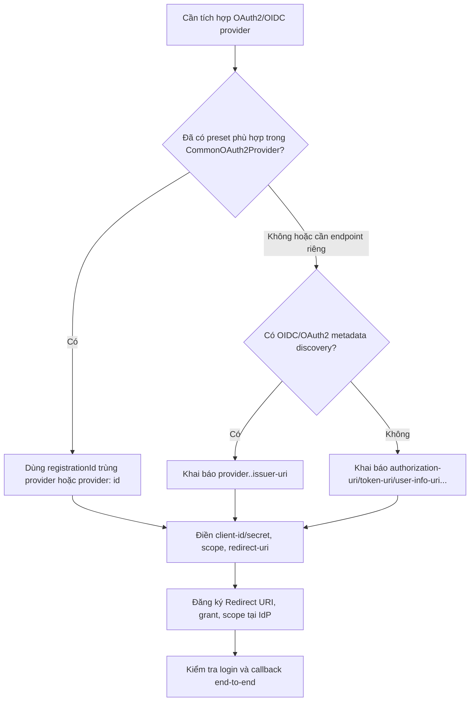

# 6.7. `CommonOAuth2Provider` và các cấu hình provider phổ biến

Trong một ứng dụng **Spring Security OAuth 2.0/OIDC Client**, `ClientRegistration` mô tả Client được đăng ký với một nhà cung cấp OAuth 2.0 hoặc OpenID Connect (OIDC). Ngoài `client-id`, `client-secret` và scope, Spring Security cần biết các địa chỉ **Authorization Endpoint**, **Token Endpoint**, **UserInfo Endpoint**, cùng những chi tiết như tên thuộc tính định danh người dùng và cách xác minh ID Token.

Nếu mọi nhà cung cấp đều phải cấu hình thủ công toàn bộ endpoint, mã nguồn và YAML sẽ dài, dễ sai khi sao chép URL và khó bảo trì. Để giảm công việc này, Spring Security có enum **`CommonOAuth2Provider`** chứa cấu hình mặc định hợp lý cho một số nhà cung cấp phổ biến. Với các hệ thống tùy biến theo tenant hoặc doanh nghiệp, Spring còn hỗ trợ **OIDC discovery** dựa trên `issuer-uri` và **cấu hình provider thủ công**.

Bài học giải thích ba con đường cấu hình, cách áp dụng với Google, GitHub, Facebook, X, Okta, Microsoft Entra ID, Keycloak và các IdP OIDC khác, cũng như những giới hạn phải biết khi tích hợp thực tế.

## 1. Tách hai khái niệm: Client Registration và Provider

Trong Spring Security, thông tin OAuth2 Client được lưu trong `ClientRegistration`. Ta có thể chia thành hai nhóm lớn.

| Nhóm | Ví dụ thuộc tính | Câu hỏi cần trả lời |
|---|---|---|
| **Registration** | `registrationId`, `clientId`, `clientSecret`, `authorizationGrantType`, `clientAuthenticationMethod`, `scopes`, `redirectUri` | Ứng dụng **này** được đăng ký với IdP bằng thông tin gì, cần yêu cầu những quyền nào? |
| **Provider details** | `authorizationUri`, `tokenUri`, `userInfoEndpoint.uri`, `userInfoEndpoint.userNameAttributeName`, `jwkSetUri`, `issuerUri` | **Máy chủ nhà cung cấp** có các endpoint và quy tắc định danh nào? |

Ví dụ ứng dụng quản lý kho có thể đăng ký hai OAuth Client khác nhau cùng dùng Google nhưng có `client-id`, `scope` và callback riêng. Cả hai vẫn có thể sử dụng cùng bộ **provider defaults** của Google. Ngược lại, cùng một ứng dụng có thể đăng ký Client với cả Google và Microsoft Entra ID, mỗi provider có metadata riêng.

Trong Spring Boot, cấu hình điển hình có dạng:

```yaml
spring:
  security:
    oauth2:
      client:
        registration:
          my-login:
            provider: google
            client-id: ${GOOGLE_CLIENT_ID}
            client-secret: ${GOOGLE_CLIENT_SECRET}
        provider:
          # Chỉ cần khai báo ở đây nếu muốn tùy biến hoặc provider chưa biết.
```

`registration.my-login.provider: google` có nghĩa “registration tên `my-login` sử dụng **cấu hình provider Google**”. Nó **không đổi** tên registration thành `google`. URL khởi động đăng nhập từ Spring vẫn là:

```text
/oauth2/authorization/my-login
```

và redirect mặc định thường kết thúc bằng:

```text
/login/oauth2/code/my-login
```

Khi không khai báo `provider`, Spring Boot có thể dùng `registrationId` để tìm cấu hình provider cùng tên, bao gồm các common provider được hỗ trợ.

## 2. `CommonOAuth2Provider` là gì?

`CommonOAuth2Provider` nằm trong package:

```java
org.springframework.security.config.oauth2.client.CommonOAuth2Provider
```

Đây là **enum của Spring Security**, cung cấp phương thức:

```java
ClientRegistration.Builder getBuilder(String registrationId)
```

Mỗi phần tử enum tạo sẵn một `ClientRegistration.Builder` có những giá trị mặc định đặc trưng cho nhà cung cấp. Ví dụ endpoint OAuth2 và cách đọc thông tin người dùng ít thay đổi sẽ được khởi tạo sẵn, trong khi **`client-id` và `client-secret` vẫn phải cung cấp theo Client được cấp ở nhà cung cấp**.

### 2.1. Những provider nào được hỗ trợ?

Ở **Spring Security 7.x**, các hằng enum được tài liệu API công bố là:

| Hằng `CommonOAuth2Provider` | Provider ID trong Spring Boot | Bản chất tích hợp phổ biến | Ghi chú |
|---|---|---|---|
| `GOOGLE` | `google` | OIDC/OAuth 2.0 Login | Có thể yêu cầu scope `openid` và xử lý ID Token |
| `GITHUB` | `github` | OAuth 2.0 Login | OAuth App thông thường; không mặc định coi là OIDC có ID Token |
| `FACEBOOK` | `facebook` | OAuth 2.0 Login | Cấu hình quyền và Graph API phụ thuộc chính sách Meta |
| `X` | `x` | OAuth 2.0 Login | Có trong enum của nhánh Spring Security mới; cần kiểm tra cách đăng ký app và quyền của X |
| `OKTA` | `okta` | Thường dùng OIDC | Endpoint phụ thuộc tổ chức và authorization server, nên hay phải cấu hình issuer |

**Lưu ý theo phiên bản:** tài liệu Spring Security **6.5.x** liệt kê `GOOGLE`, `GITHUB`, `FACEBOOK`, `OKTA`; tài liệu **7.x** có thêm `X`. Vì vậy, không sử dụng `CommonOAuth2Provider.X` trong ví dụ biên dịch bằng Security 6.5 nếu thư viện thực tế chưa có hằng này. Cách an toàn là kiểm tra API docs của **đúng phiên bản dependency**.

Nguồn xác nhận: [CommonOAuth2Provider API](https://docs.spring.io/spring-security/reference/api/java/org/springframework/security/config/oauth2/client/CommonOAuth2Provider.html), [Spring Security 6.5 OAuth2 Login Core](https://docs.spring.io/spring-security/reference/6.5/servlet/oauth2/login/core.html).

### 2.2. Những giá trị được điền sẵn là gì?

Tùy phần tử enum và phiên bản, builder có thể cung cấp:

- `authorizationUri`: endpoint trình duyệt được chuyển tới để người dùng xác thực/ủy quyền.
- `tokenUri`: endpoint Spring gọi trực tiếp để đổi authorization code lấy token.
- `userInfoUri`: endpoint đọc thông tin tài khoản sau khi nhận access token.
- `userNameAttributeName`: tên claim/thuộc tính dùng xác định principal trong phản hồi người dùng.
- `jwkSetUri` hoặc `issuerUri` và các thuộc tính OIDC liên quan khi provider hỗ trợ.
- Một số mặc định về scope, redirect URI template, grant hoặc cơ chế xác thực Client.

**Đừng giả định cùng một tập mặc định cho tất cả provider.** OAuth2 không bắt buộc có ID Token, UserInfo theo OIDC hoặc JWKS endpoint. Spring thiết lập các giá trị phù hợp với provider cụ thể; muốn biết chính xác hãy kiểm tra `ClientRegistration` được tạo trong phiên bản đang chạy.

### 2.3. `CommonOAuth2Provider` không phải thư mục mọi IdP

Enum này giúp cấu hình nhanh **một nhóm provider quen thuộc**, không thể đại diện cho mọi nhà cung cấp OAuth2/OIDC trên thế giới. Các IdP doanh nghiệp, hệ thống tự vận hành hoặc tích hợp theo tenant thường cần:

- `issuer-uri` để Spring khám phá OIDC/OAuth2 metadata.
- Cấu hình `authorization-uri`, `token-uri`, `user-info-uri`, `jwk-set-uri` thủ công nếu không có discovery.
- Các thuộc tính tùy chỉnh khác cho scope, Client authentication, redirect URI, user-name attribute.

Vì vậy việc không thấy Microsoft Entra ID hoặc Keycloak trong enum **không có nghĩa Spring Security không hỗ trợ chúng**.

## 3. Cấu hình nhanh Google với các mặc định có sẵn

Google là ví dụ phổ biến nhất để thấy lợi ích của `CommonOAuth2Provider`.

### 3.1. Trường hợp `registrationId` trùng tên provider

```yaml
spring:
  security:
    oauth2:
      client:
        registration:
          google:
            client-id: ${GOOGLE_CLIENT_ID}
            client-secret: ${GOOGLE_CLIENT_SECRET}
```

Khi registration tên `google`, Spring Boot có thể suy ra dùng preset `CommonOAuth2Provider.GOOGLE`. Bạn không cần tự khai báo URL Authorization Endpoint, Token Endpoint và UserInfo Endpoint nếu các mặc định phù hợp.

Khi dùng Spring MVC `oauth2Login`, đường dẫn khởi động đăng nhập:

```text
http://localhost:8080/oauth2/authorization/google
```

Callback mặc định:

```text
http://localhost:8080/login/oauth2/code/google
```

**Phải đăng ký callback thực tế tại Google Cloud Console** trong OAuth Client tương ứng. Spring biết endpoint của Google không có nghĩa Google tự cho phép mọi Redirect URI.

### 3.2. Trường hợp muốn một registration ID khác

Giả sử ứng dụng muốn đặt tên registration là `google-staff`:

```yaml
spring:
  security:
    oauth2:
      client:
        registration:
          google-staff:
            provider: google
            client-id: ${GOOGLE_STAFF_CLIENT_ID}
            client-secret: ${GOOGLE_STAFF_CLIENT_SECRET}
            authorization-grant-type: authorization_code
            scope:
              - openid
              - profile
              - email
            redirect-uri: "{baseUrl}/login/oauth2/code/{registrationId}"
```

`provider: google` giúp Boot chọn mặc định Google dù khóa registration là `google-staff`. Bây giờ:

```text
Bắt đầu: /oauth2/authorization/google-staff
Callback: /login/oauth2/code/google-staff
```

Đây là điểm quan trọng trong ứng dụng có nhiều đăng nhập: **`registrationId` xác định ClientRegistration của ứng dụng, còn `provider` xác định tập cấu hình endpoint**.

### 3.3. Những bước cần thực hiện bên Google

Một cấu hình YAML chỉ hoạt động khi bạn đã có OAuth Client được Google cấp cho ứng dụng:

1. Chọn hoặc tạo project tại Google Cloud Console.
2. Cấu hình màn hình đồng ý OAuth nếu cần, gồm phạm vi, đối tượng người dùng, chính sách kiểm thử.
3. Tạo OAuth Client phù hợp với ứng dụng web có backend.
4. Khai báo **Authorized redirect URIs** cho môi trường local/staging/production mà bạn dùng.
5. Lấy Client ID và Client secret, cấp qua biến môi trường hoặc secret manager.
6. Chọn scope tối thiểu phục vụ mục đích; với đăng nhập OIDC có thể dùng `openid profile email`.

Các bước và chính sách có thể thay đổi theo Google; tài liệu chính thức: [Google OpenID Connect](https://developers.google.com/identity/openid-connect/openid-connect).

**Cảnh báo quan trọng:** ngay cả khi ID Token có claim `email`, ứng dụng không nên dùng email làm khóa định danh bền vững. Trong OIDC, cặp `(iss, sub)` là định danh thích hợp để liên kết tài khoản.

## 4. Cấu hình GitHub: OAuth2 Login khác OIDC Login

Với đăng nhập GitHub thông thường qua **OAuth Apps**, ứng dụng sử dụng OAuth 2.0 để truy cập thông tin tài khoản. Đây không tự động là một OIDC login flow theo OpenID Connect.

### 4.1. Sử dụng preset GitHub

```yaml
spring:
  security:
    oauth2:
      client:
        registration:
          github:
            client-id: ${GITHUB_CLIENT_ID}
            client-secret: ${GITHUB_CLIENT_SECRET}
            scope:
              - read:user
              - user:email
```

`scope` trong ví dụ là các scope OAuth App liên quan đến dữ liệu người dùng; chúng phải phù hợp với quyền của app GitHub thực tế. Tên scope và hành vi API có thể thay đổi theo cơ chế đăng ký app; GitHub App và OAuth App không nhất thiết dùng cùng mô hình quyền.

Callback phổ biến:

```text
https://portal.example.test/login/oauth2/code/github
```

Cần cấu hình tại GitHub OAuth App đã đăng ký.

### 4.2. Khác biệt khi xử lý principal

Với GitHub OAuth2 login thông thường, Spring có thể tạo `OAuth2User` thay vì `OidcUser` vì **không có OIDC ID Token chuẩn** trong flow này.

Ví dụ OAuth2 user attributes do GitHub trả về có thể là:

```json
{
  "id": 123456,
  "login": "sample-user",
  "name": "Nguyen A",
  "avatar_url": "https://avatars.example.test/u/123456",
  "email": null
}
```

Đây chỉ là ví dụ cấu trúc, không phải dữ liệu người dùng thật.

Một số điểm cần nhớ:

- GitHub dùng thuộc tính tài khoản `id` để xác định người dùng trong phản hồi tài nguyên chuẩn; không mặc định có claim OIDC `sub`.
- Email chính trên hồ sơ có thể bị ẩn và `email` là `null`, dù người dùng đã đăng nhập thành công.
- Scope `user:email` liên quan việc truy cập API email; muốn lấy email từ endpoint khác có thể cần **lời gọi bổ sung** và logic lựa chọn email phù hợp.
- Không giả định `user:email` làm trường `email` trong UserInfo response mặc định luôn khác null.
- Nếu ứng dụng hỗ trợ đồng thời GitHub OAuth2 và OIDC, cần thiết kế ánh xạ danh tính cho **từng loại principal**.

Không thêm `openid` một cách máy móc vào GitHub OAuth App rồi kỳ vọng nhận ID Token. Cách xử lý theo GitHub OAuth2 của Spring Security và đăng nhập OIDC là hai tình huống khác nhau.

Nguồn: [GitHub OAuth Apps](https://docs.github.com/en/apps/oauth-apps), [GitHub REST Users API](https://docs.github.com/en/rest/users/users).

## 5. Facebook và X: có preset nhưng phụ thuộc chính sách nền tảng

### 5.1. Facebook OAuth2 Login

Ví dụ dùng cấu hình mặc định Facebook:

```yaml
spring:
  security:
    oauth2:
      client:
        registration:
          facebook:
            client-id: ${FACEBOOK_APP_ID}
            client-secret: ${FACEBOOK_APP_SECRET}
```

Các scope bổ sung, quyền truy cập profile/email, phiên bản Graph API, thẩm định ứng dụng và chính sách cấp dữ liệu có thể phụ thuộc Meta. Nếu dùng tài liệu hoặc SDK khác với phiên bản của Spring Security, cần đối chiếu endpoint và quyền thực tế.

Facebook Login thông thường không mặc định là OIDC với ID Token theo cùng mô hình Google. Hãy xác minh **phản hồi thực tế và giao thức nhà cung cấp công bố**, thay vì ép mọi `OAuth2User` thành `OidcUser`.

### 5.2. X OAuth2 Login

Nhánh Spring Security **7.x** bổ sung preset `CommonOAuth2Provider.X`, ID cấu hình `x`. Một cấu hình Spring Boot trên nhánh có hỗ trợ có dạng:

```yaml
spring:
  security:
    oauth2:
      client:
        registration:
          x:
            client-id: ${X_CLIENT_ID}
            client-secret: ${X_CLIENT_SECRET}
```

Khi tích hợp thật, xác nhận X Developer App cho phép OAuth2 Authorization Code Flow, các quyền và redirect URI đã đăng ký, phương thức Client authentication cũng như scope cần thiết. Có thể cần điều chỉnh thêm theo ứng dụng/loại Client. Nếu dự án vẫn dùng **Spring Security 6.5**, hãy kiểm tra tài liệu đúng phiên bản: enum lúc đó **chưa có `X`**.

**Không đồng nhất** khái niệm “có preset” với “không cần cấu hình ở nền tảng bên ngoài”. Preset giảm số endpoint phải khai báo, nhưng không tạo ứng dụng OAuth, không cấp Client ID/secret, không bật API hay quyền truy cập thay bạn.

## 6. Okta: có preset nhưng endpoint phụ thuộc tenant

Okta là ví dụ quan trọng vì nhà cung cấp có **tên miền tổ chức** và có thể có nhiều **Authorization Server** trên cùng tenant. Vì vậy, mặc dù có `CommonOAuth2Provider.OKTA`, một cấu hình thực tế thường cần **`issuer-uri` hoặc các endpoint cụ thể**.

### 6.1. Ưu tiên OIDC discovery nếu có thể

Giả sử issuer được IdP công bố:

```text
https://dev-example.okta.com/oauth2/default
```

Có thể cấu hình:

```yaml
spring:
  security:
    oauth2:
      client:
        registration:
          okta:
            provider: okta-tenant
            client-id: ${OKTA_CLIENT_ID}
            client-secret: ${OKTA_CLIENT_SECRET}
            authorization-grant-type: authorization_code
            scope:
              - openid
              - profile
              - email
            redirect-uri: "{baseUrl}/login/oauth2/code/{registrationId}"
        provider:
          okta-tenant:
            issuer-uri: https://dev-example.okta.com/oauth2/default
```

`okta-tenant` là **provider ID do ứng dụng tự đặt**. `issuer-uri` phải khớp **chính xác issuer** của Authorization Server mà ứng dụng đã đăng ký; `default` chỉ là ví dụ tên Authorization Server, không phải giá trị áp dụng cho mọi tổ chức Okta.

### 6.2. Khi phải khai báo endpoint thủ công

Nếu triển khai không dùng được discovery hoặc cần cấu hình cụ thể, có thể khai báo provider:

```yaml
spring:
  security:
    oauth2:
      client:
        registration:
          okta-manual:
            provider: okta-custom
            client-id: ${OKTA_CLIENT_ID}
            client-secret: ${OKTA_CLIENT_SECRET}
            authorization-grant-type: authorization_code
            scope: [openid, profile, email]
            redirect-uri: "{baseUrl}/login/oauth2/code/{registrationId}"
        provider:
          okta-custom:
            authorization-uri: https://dev-example.okta.com/oauth2/default/v1/authorize
            token-uri: https://dev-example.okta.com/oauth2/default/v1/token
            user-info-uri: https://dev-example.okta.com/oauth2/default/v1/userinfo
            jwk-set-uri: https://dev-example.okta.com/oauth2/default/v1/keys
            user-name-attribute: sub
```

Các URL dùng cấu trúc minh họa cho Okta Custom Authorization Server; không sao chép nguyên văn vào sản phẩm mà chưa kiểm tra metadata của tenant. Với OIDC, nên ưu tiên `issuer-uri` khi hỗ trợ để Spring nhận metadata và cơ chế kiểm tra issuer đầy đủ. Nếu tự cấu hình endpoint, cần bảo đảm tương ứng với một Authorization Server duy nhất và chính sách xác thực phù hợp.

### 6.3. Trường hợp nhiều tenant

```text
Tenant A issuer: https://tenant-a.example.okta.com/oauth2/default
Tenant B issuer: https://tenant-b.example.okta.com/oauth2/default
```

Mỗi issuer có thể dùng bộ endpoint/keys riêng, chính sách token và Client ID khác nhau. Không gộp chúng thành một provider “okta” cố định nếu ứng dụng thực sự hỗ trợ multi-tenant. Thiết kế cần tách registration và kiểm soát issuer đáng tin cậy. Không nhận URL issuer tùy ý từ người dùng rồi yêu cầu server tự kết nối tới đó.

Nguồn: [Okta OpenID Connect & OAuth 2.0](https://developer.okta.com/docs/concepts/oauth-openid/).

## 7. Provider không có trong `CommonOAuth2Provider`: dùng `issuer-uri`

OIDC có cơ chế **discovery metadata**. Khi OpenID Provider công bố issuer và các endpoint chuẩn, Spring Security có thể xây dựng cấu hình provider mà không cần hard-code từng URI.

### 7.1. Một tài liệu OIDC discovery điển hình

Ví dụ metadata (rút gọn):

```json
{
  "issuer": "https://login.example.test/realms/employees",
  "authorization_endpoint": "https://login.example.test/realms/employees/protocol/openid-connect/auth",
  "token_endpoint": "https://login.example.test/realms/employees/protocol/openid-connect/token",
  "userinfo_endpoint": "https://login.example.test/realms/employees/protocol/openid-connect/userinfo",
  "jwks_uri": "https://login.example.test/realms/employees/protocol/openid-connect/certs",
  "response_types_supported": ["code"],
  "subject_types_supported": ["public"]
}
```

Trong metadata thật còn có nhiều trường khác, ví dụ thuật toán ký ID Token, các scope, grant và phương thức xác thực Client được hỗ trợ.

Khi dùng `issuer-uri`, Spring Security có thể dựa trên discovery để biết:

- Authorization Endpoint: browser đến đâu khi đăng nhập.
- Token Endpoint: server gửi authorization code đến đâu để đổi token.
- UserInfo Endpoint: nơi lấy claim hồ sơ nếu provider hỗ trợ và Client được phép.
- JWKS URI: lấy khóa công khai để xác minh chữ ký token khi phù hợp.
- Issuer: giá trị phải khớp với claim `iss` trong ID Token để tránh tin nhầm provider.

Đây là lý do `issuer-uri` rất hữu ích cho Keycloak, Microsoft Entra ID, Auth0, Amazon Cognito và các IdP tự vận hành hỗ trợ OIDC.

### 7.2. Keycloak

Một cấu hình mẫu cho realm `employees`:

```yaml
spring:
  security:
    oauth2:
      client:
        registration:
          keycloak:
            provider: keycloak-provider
            client-id: ${KEYCLOAK_CLIENT_ID}
            client-secret: ${KEYCLOAK_CLIENT_SECRET}
            authorization-grant-type: authorization_code
            scope: [openid, profile, email]
            redirect-uri: "{baseUrl}/login/oauth2/code/{registrationId}"
        provider:
          keycloak-provider:
            issuer-uri: https://sso.example.test/realms/employees
```

Keycloak thường công bố tài liệu metadata tại:

```text
https://sso.example.test/realms/employees/.well-known/openid-configuration
```

Giá trị chính xác phụ thuộc URL và cách triển khai Keycloak. Trong admin console, hãy tạo Client đúng loại, grant, phương thức xác thực và **Valid Redirect URIs** phù hợp. `ClientRegistration` ở Spring không thay thế những bước này.

### 7.3. Microsoft Entra ID

Một cấu hình OIDC dành cho tenant cụ thể có thể sử dụng issuer với tenant ID:

```yaml
spring:
  security:
    oauth2:
      client:
        registration:
          microsoft:
            provider: entra
            client-id: ${ENTRA_CLIENT_ID}
            client-secret: ${ENTRA_CLIENT_SECRET}
            authorization-grant-type: authorization_code
            scope: [openid, profile, email]
            redirect-uri: "{baseUrl}/login/oauth2/code/{registrationId}"
        provider:
          entra:
            issuer-uri: https://login.microsoftonline.com/YOUR_TENANT_ID/v2.0
```

Thay `YOUR_TENANT_ID` bằng tenant ID thật và kiểm tra issuer từ metadata của tenant. Cấu hình với endpoint `common` hoặc `organizations` cho ứng dụng multi-tenant có các quy tắc issuer riêng; không giả định nó tương đương một issuer tenant cố định. Những tích hợp gọi Microsoft Graph còn có scope, consent và audience khác với scope OIDC cơ bản.

Nguồn: [Microsoft identity platform — OpenID Connect](https://learn.microsoft.com/en-us/entra/identity-platform/v2-protocols-oidc).

### 7.4. Auth0

Auth0 cung cấp issuer theo tenant/domain. Ví dụ:

```yaml
spring:
  security:
    oauth2:
      client:
        registration:
          auth0:
            provider: auth0-tenant
            client-id: ${AUTH0_CLIENT_ID}
            client-secret: ${AUTH0_CLIENT_SECRET}
            scope: [openid, profile, email]
            authorization-grant-type: authorization_code
        provider:
          auth0-tenant:
            issuer-uri: https://your-tenant.us.auth0.com/
```

**Dấu gạch chéo cuối** có thể là một phần của issuer; phải dùng chính xác giá trị mà tenant công bố. Trong trang cấu hình Auth0 Application, khai báo Allowed Callback URLs tương ứng với `{baseUrl}/login/oauth2/code/{registrationId}`.

### 7.5. Amazon Cognito

Đối với Amazon Cognito User Pool hỗ trợ OIDC, issuer thường có cấu trúc theo region và user pool:

```yaml
spring:
  security:
    oauth2:
      client:
        registration:
          cognito:
            provider: cognito-pool
            client-id: ${COGNITO_CLIENT_ID}
            client-secret: ${COGNITO_CLIENT_SECRET}
            authorization-grant-type: authorization_code
            scope: [openid, email, profile]
        provider:
          cognito-pool:
            issuer-uri: https://cognito-idp.ap-southeast-1.amazonaws.com/ap-southeast-1_EXAMPLE
```

Issuer được dùng cho xác minh token OIDC; domain đăng nhập hosted UI của Cognito có thể khác. Không tự dựng đường dẫn Authorization Endpoint bằng cách nối chuỗi vào issuer nếu chưa kiểm tra metadata và cấu hình user pool. Khi cần cấu hình thủ công, dùng những endpoint mà AWS công bố cho đúng pool/domain.

## 8. Khi không có OIDC discovery: khai báo provider properties thủ công

Không phải Authorization Server nào cũng hỗ trợ OIDC, và không phải OAuth2 provider nào cũng công bố metadata có thể được Spring khám phá. Khi đó, Spring Boot cho phép định nghĩa từng endpoint:

```yaml
spring:
  security:
    oauth2:
      client:
        registration:
          partner-login:
            provider: partner-auth
            client-id: ${PARTNER_CLIENT_ID}
            client-secret: ${PARTNER_CLIENT_SECRET}
            client-authentication-method: client_secret_basic
            authorization-grant-type: authorization_code
            scope: [profile.read]
            redirect-uri: "{baseUrl}/login/oauth2/code/{registrationId}"
        provider:
          partner-auth:
            authorization-uri: https://auth.partner.example.test/oauth2/authorize
            token-uri: https://auth.partner.example.test/oauth2/token
            user-info-uri: https://api.partner.example.test/v1/me
            user-info-authentication-method: header
            user-name-attribute: id
```

Tất cả URL đều minh họa. Cần biết chính xác tài liệu OAuth2 của `partner-auth` trước khi thay bằng URL thật.

### 8.1. Giải nghĩa các provider properties

| Spring Boot property | Ý nghĩa | Khi nào cần? |
|---|---|---|
| `provider.<id>.issuer-uri` | Issuer dùng để khám phá metadata và xác thực issuer | OIDC/metadata provider hỗ trợ discovery |
| `provider.<id>.authorization-uri` | URL Authorization Endpoint | Luồng có redirect; cấu hình thủ công hoặc ghi đè mặc định |
| `provider.<id>.token-uri` | URL Token Endpoint | Code exchange, refresh token hoặc grant khác |
| `provider.<id>.user-info-uri` | URL nhận thông tin người dùng | OAuth2/OIDC provider có endpoint đọc user profile |
| `provider.<id>.user-info-authentication-method` | Cách gửi access token khi gọi UserInfo, thường là header | Khi provider yêu cầu cách truy cập cụ thể |
| `provider.<id>.user-name-attribute` | Thuộc tính trong user info để nhận diện OAuth2User | Provider OAuth2 không dùng OIDC `sub` hoặc có field đặc thù |
| `provider.<id>.jwk-set-uri` | URL lấy JSON Web Keys | Khi cần xác minh token ký, thường với OIDC, nếu không dùng discovery |

**Không phải mọi dòng đều bắt buộc trong mọi giao thức.** Ví dụ một OAuth2 provider không phát hành ID Token sẽ không cần cấu hình JWKS để “tự biến” nó thành OIDC. Ngược lại, nếu Client nhận ID Token từ một OIDC provider, phải xác minh các thuộc tính giao thức cần thiết, không chỉ đọc JSON payload mà tin ngay.

### 8.2. `user-name-attribute` dùng khi nào?

Với một OAuth2 provider, dữ liệu user info có thể là:

```json
{
  "id": "account-245",
  "display_name": "Minh Tran",
  "email_address": "minh@example.test"
}
```

Nếu trường định danh là `id`, cấu hình:

```yaml
provider:
  partner-auth:
    user-name-attribute: id
```

cho phép Spring biết thuộc tính nào được dùng làm tên principal theo cơ chế `OAuth2User` thông thường.

Điều này **không có nghĩa `id` là claim OIDC `sub`**. Nếu có OIDC thật, các yêu cầu về ID Token, issuer, subject, audience và nonce vẫn phải được tuân thủ. Trong nhiều trường hợp OIDC, dùng discovery sẽ tạo cấu hình đáng tin cậy hơn.

## 9. Ba cách cấu hình provider: nên chọn cách nào?



| Tình huống | Cách đề xuất | Lý do |
|---|---|---|
| Google login tiêu chuẩn | `registration.google.client-id/client-secret` | Preset có thể điền endpoint mặc định |
| GitHub OAuth App | `provider: github` hoặc `registration.github` | Preset cho OAuth2 Login; cần xử lý OAuth2User, email |
| Facebook Login | Preset nếu phù hợp, bổ sung quyền/cấu hình của Meta | Giảm endpoint thủ công nhưng chịu chính sách Graph API |
| X OAuth2 Login với Security 7.x | `provider: x` hoặc `registration.x` | Có preset ở nhánh mới; cần kiểm tra Client/app permissions |
| Okta theo tenant/custom server | `provider.<id>.issuer-uri` | Endpoint, issuer và JWKS thuộc server cụ thể |
| Keycloak realm | `issuer-uri` theo realm | Hỗ trợ metadata OIDC theo realm |
| Microsoft Entra ID tenant | `issuer-uri` theo tenant | Cần xác minh issuer/audience theo tenant |
| Auth0 tenant | `issuer-uri` | Issuer theo domain tenant |
| Đối tác OAuth2 không có discovery | Cấu hình thủ công `authorization-uri`, `token-uri`, `user-info-uri` | Phải chỉ định từng endpoint theo tài liệu provider |

Preset không phải ưu tiên tuyệt đối: nếu thông tin provider thực tế khác hoặc cơ chế tenant đặc thù, **discovery hoặc cấu hình thủ công chính xác** có thể là lựa chọn tốt hơn.

## 10. Demo nhiều provider trong một Spring Boot application

Giả sử một website hỗ trợ đăng nhập bằng Google cho khách, GitHub cho lập trình viên và Keycloak cho nhân viên.

```yaml
spring:
  security:
    oauth2:
      client:
        registration:
          google-customer:
            provider: google
            client-id: ${GOOGLE_CLIENT_ID}
            client-secret: ${GOOGLE_CLIENT_SECRET}
            scope: [openid, profile, email]
            authorization-grant-type: authorization_code
            redirect-uri: "{baseUrl}/login/oauth2/code/{registrationId}"

          github-developer:
            provider: github
            client-id: ${GITHUB_CLIENT_ID}
            client-secret: ${GITHUB_CLIENT_SECRET}
            scope: [read:user, user:email]
            authorization-grant-type: authorization_code
            redirect-uri: "{baseUrl}/login/oauth2/code/{registrationId}"

          staff:
            provider: keycloak-staff
            client-id: ${KEYCLOAK_STAFF_CLIENT_ID}
            client-secret: ${KEYCLOAK_STAFF_CLIENT_SECRET}
            scope: [openid, profile, email]
            authorization-grant-type: authorization_code
            redirect-uri: "{baseUrl}/login/oauth2/code/{registrationId}"

        provider:
          keycloak-staff:
            issuer-uri: https://sso.example.test/realms/staff
```

Trong ví dụ:

| Registration ID | Cấu hình provider | Link bắt đầu đăng nhập | Callback |
|---|---|---|---|
| `google-customer` | Preset `google` | `/oauth2/authorization/google-customer` | `/login/oauth2/code/google-customer` |
| `github-developer` | Preset `github` | `/oauth2/authorization/github-developer` | `/login/oauth2/code/github-developer` |
| `staff` | Discovery `keycloak-staff` | `/oauth2/authorization/staff` | `/login/oauth2/code/staff` |

Ứng dụng Spring Security MVC có thể bật:

```java
import org.springframework.context.annotation.Bean;
import org.springframework.context.annotation.Configuration;
import org.springframework.security.config.Customizer;
import org.springframework.security.config.annotation.web.builders.HttpSecurity;
import org.springframework.security.web.SecurityFilterChain;

@Configuration
public class SecurityConfig {

    @Bean
    SecurityFilterChain securityFilterChain(HttpSecurity http) throws Exception {
        http
            .authorizeHttpRequests(authorize -> authorize
                .requestMatchers("/", "/error").permitAll()
                .anyRequest().authenticated()
            )
            .oauth2Login(Customizer.withDefaults());

        return http.build();
    }
}
```

Nếu nhiều registration đủ điều kiện, Spring Security có thể hiển thị các lựa chọn trên login page mặc định. Ứng dụng có thể thay bằng UI tùy chỉnh và liên kết trực tiếp tới `/oauth2/authorization/{registrationId}`. Đường dẫn callback mặc định được Spring filter xử lý; không phải một controller do người lập trình tự viết.

### 10.1. Đọc principal từ các provider khác loại

Cùng là đăng nhập OAuth2, nhưng principal có thể khác:

- Google hoặc Keycloak theo OIDC: thường là `OidcUser` với ID Token và tùy provider có UserInfo.
- GitHub OAuth App: thường là `DefaultOAuth2User` hoặc một triển khai `OAuth2User` khác, không có ID Token OIDC.

Một controller có thể đọc thông tin chung qua `OAuth2User`:

```java
import java.util.LinkedHashMap;
import java.util.Map;
import org.springframework.security.core.annotation.AuthenticationPrincipal;
import org.springframework.security.oauth2.core.user.OAuth2User;
import org.springframework.web.bind.annotation.GetMapping;
import org.springframework.web.bind.annotation.RestController;

@RestController
public class MeController {

    @GetMapping("/me")
    public Map<String, Object> me(@AuthenticationPrincipal OAuth2User principal) {
        Map<String, Object> result = new LinkedHashMap<>();
        result.put("principalName", principal.getName());

        Object displayName = principal.getAttribute("name");
        if (displayName != null) {
            result.put("displayName", displayName);
        }
        return result;
    }
}
```

Đoạn code dựa vào `OAuth2User` chỉ hiển thị thông tin minh họa và giả định endpoint đã được bảo vệ để người dùng có principal. Nếu muốn xác định loại login:

```java
import org.springframework.security.oauth2.core.oidc.user.OidcUser;
import org.springframework.security.oauth2.core.user.OAuth2User;

// principal là OAuth2User đã được Spring xác thực.
if (principal instanceof OidcUser oidcUser) {
    String issuer = oidcUser.getIdToken().getIssuer().toString();
    String subject = oidcUser.getSubject();
    // Định danh OIDC phù hợp: (issuer, subject)
} else {
    String providerSpecificName = principal.getName();
    // Xác định provider và khóa tài khoản bằng registrationId.
}
```

Với nhiều nhà cung cấp, tránh dùng `principal.getName()` trần làm khóa toàn cục nếu không gắn nguồn/provider. Giá trị `123456` của GitHub có thể trùng `123456` từ một provider khác. Đối với OIDC, dùng `(iss, sub)`; đối với OAuth2 không OIDC, dùng **provider/registration + ID** theo hợp đồng của từng provider.

## 11. Cấu hình `CommonOAuth2Provider` trực tiếp trong Java

Không nhất thiết phải dùng YAML. Spring Security cũng cho phép tạo `ClientRegistration` bằng builder trả về từ enum:

```java
import org.springframework.security.config.oauth2.client.CommonOAuth2Provider;
import org.springframework.security.oauth2.client.registration.ClientRegistration;
import org.springframework.security.oauth2.client.registration.ClientRegistrationRepository;
import org.springframework.security.oauth2.client.registration.InMemoryClientRegistrationRepository;

import org.springframework.context.annotation.Bean;
import org.springframework.context.annotation.Configuration;

@Configuration
public class OAuthClientRegistrationsConfig {

    @Bean
    ClientRegistrationRepository clientRegistrationRepository() {
        ClientRegistration google = CommonOAuth2Provider.GOOGLE
            .getBuilder("google-staff")
            .clientId(System.getenv("GOOGLE_CLIENT_ID"))
            .clientSecret(System.getenv("GOOGLE_CLIENT_SECRET"))
            .scope("openid", "profile", "email")
            .redirectUri("{baseUrl}/login/oauth2/code/{registrationId}")
            .build();

        ClientRegistration github = CommonOAuth2Provider.GITHUB
            .getBuilder("github-developer")
            .clientId(System.getenv("GITHUB_CLIENT_ID"))
            .clientSecret(System.getenv("GITHUB_CLIENT_SECRET"))
            .scope("read:user", "user:email")
            .redirectUri("{baseUrl}/login/oauth2/code/{registrationId}")
            .build();

        return new InMemoryClientRegistrationRepository(google, github);
    }
}
```

Ý nghĩa:

- `CommonOAuth2Provider.GOOGLE.getBuilder("google-staff")` lấy preset Google và gán registration ID cho ứng dụng.
- `clientId`, `clientSecret` do hệ thống quản lý cung cấp; đây là thông tin riêng của Client.
- `scope` có thể ghi đè theo nhu cầu đăng nhập.
- `redirectUri` được chủ động đặt cùng template Spring xử lý.
- `InMemoryClientRegistrationRepository` cung cấp nơi tra cứu các ClientRegistration theo ID.

Trong ứng dụng thực tế, nếu đã dùng Spring Boot properties để auto-configure repository, **không cần tạo bean thủ công** này. Chọn một cơ chế cấu hình rõ ràng để tránh hiểu nhầm repository nào đang được Spring sử dụng.

### 11.1. Xem provider details đã được tạo

Ví dụ với một `ClientRegistration` bất kỳ:

```java
import org.springframework.security.oauth2.client.registration.ClientRegistration;
import org.springframework.security.oauth2.client.registration.ClientRegistrationRepository;

public class ProviderInspector {
    private final ClientRegistrationRepository registrations;

    public ProviderInspector(ClientRegistrationRepository registrations) {
        this.registrations = registrations;
    }

    public void inspect() {
        ClientRegistration registration =
            registrations.findByRegistrationId("google-staff");

        if (registration == null) {
            throw new IllegalStateException("Unknown registration");
        }

        var details = registration.getProviderDetails();

        System.out.println("registrationId: " + registration.getRegistrationId());
        System.out.println("grant: " +
            registration.getAuthorizationGrantType().getValue());
        System.out.println("authorization URI: " + details.getAuthorizationUri());
        System.out.println("token URI: " + details.getTokenUri());
        System.out.println("userinfo URI: " +
            details.getUserInfoEndpoint().getUri());
    }
}
```

Đoạn code minh họa khả năng đọc metadata của một registration; không cần in toàn bộ cấu hình trong production. **Không log client secret, authorization code, access token, refresh token hoặc ID Token.**

### 11.2. Dùng discovery bằng Java

Ngoài preset, có thể khởi tạo builder từ issuer:

```java
import org.springframework.security.oauth2.client.registration.ClientRegistration;
import org.springframework.security.oauth2.client.registration.ClientRegistrations;

ClientRegistration registration = ClientRegistrations
    .fromIssuerLocation("https://sso.example.test/realms/staff")
    .registrationId("staff")
    .clientId(System.getenv("KEYCLOAK_STAFF_CLIENT_ID"))
    .clientSecret(System.getenv("KEYCLOAK_STAFF_CLIENT_SECRET"))
    .scope("openid", "profile", "email")
    .redirectUri("{baseUrl}/login/oauth2/code/{registrationId}")
    .build();
```

`ClientRegistrations.fromIssuerLocation(...)` có thể thực hiện truy xuất metadata provider. Vì vậy issuer phải là địa chỉ **đáng tin, hợp lệ và truy cập được** ở môi trường chạy, không nhận tùy ý từ dữ liệu người dùng. Với deployment dùng mạng nội bộ, DNS/proxy/TLS phải cho phép Client kết nối đến metadata và token/JWKS endpoints tương ứng.

## 12. Redirect URI và provider defaults: liên hệ quan trọng

Một preset chỉ giảm việc khai báo endpoint phía provider; nó không đảm bảo **redirect URI đã được đăng ký** ở console của nhà cung cấp.

Với một registration `google-staff`:

```text
URL bắt đầu login ở ứng dụng:
https://portal.example.test/oauth2/authorization/google-staff

Authorization Endpoint:
do provider Google công bố/cấu hình

Redirect URI mà Spring gửi:
https://portal.example.test/login/oauth2/code/google-staff

Token Endpoint:
do provider Google công bố/cấu hình
```

`registrationId` là `google-staff`, nhưng provider là `google`. Vì vậy đường dẫn cuối của callback vẫn phải dùng `google-staff`.

Nếu muốn callback riêng:

```yaml
spring:
  security:
    oauth2:
      client:
        registration:
          google-staff:
            redirect-uri: "{baseUrl}/auth/callback/{registrationId}"
```

thì với **Servlet `oauth2Login`**, cần đồng bộ filter:

```java
http.oauth2Login(oauth2 -> oauth2
    .redirectionEndpoint(endpoint ->
        endpoint.baseUri("/auth/callback/*")
    )
);
```

và thêm callback thực tế `https://portal.example.test/auth/callback/google-staff` tại provider. Thay YAML mà không thay filter hoặc không cập nhật callback ở IdP có thể dẫn đến lỗi redirect.

### 12.1. Reverse proxy và `{baseUrl}`

Khi ứng dụng chạy sau reverse proxy, URL công khai có thể là `https://portal.example.test` nhưng Spring nhận kết nối nội bộ ở `http://app:8080`. Nếu template mở rộng thành địa chỉ nội bộ, provider sẽ từ chối callback hoặc đưa browser về URL không truy cập được.

Tùy cách triển khai Spring Boot, có thể cần cấu hình forwarded headers, ví dụ:

```yaml
server:
  forward-headers-strategy: framework
```

Chỉ tin các header `Forwarded` hoặc `X-Forwarded-*` từ proxy đã được cấu hình kiểm soát. Không cho client bên ngoài tự quyết định host/scheme callback. Đối chiếu `redirect_uri` trong authorization request thực tế với URI được đăng ký tại nhà cung cấp.

## 13. Các vấn đề bảo mật không được “giao phó” cho preset

### 13.1. Scope tối thiểu

Chỉ xin các scope cần cho tính năng. Ví dụ:

- Google OIDC chỉ cần đăng nhập: cân nhắc `openid profile email`.
- GitHub OAuth App cần đọc hồ sơ: dùng scope cụ thể, kiểm tra chính sách API.
- Okta/Keycloak nội bộ: chỉ xin claim/role cần thiết, không tự yêu cầu mọi scope doanh nghiệp.

Không mặc định xin `address`, `phone`, `offline_access` hoặc toàn bộ quyền API chỉ vì provider có thể cấp chúng. Một scope được yêu cầu không có nghĩa chắc chắn được cấp hoặc claim sẽ luôn có mặt.

### 13.2. Client secret và token

- Không commit secret thật trong `application.yml` hoặc source code.
- Không đưa Client secret vào JavaScript frontend hoặc query string.
- Không gửi token lên các URL redirect tùy ý.
- Dùng HTTPS đối với Authorization/Token/UserInfo endpoints thực tế.
- Không ghi log authorization code, client secret, access token, refresh token, ID Token và session cookie.
- Bảo vệ session, `state`, `nonce` và PKCE theo flow được sử dụng.

### 13.3. Tránh tin nhầm issuer hoặc tài khoản

Với OIDC, Spring Security phải xác minh ID Token theo issuer, audience, signature, thời gian hiệu lực và các kiểm tra phù hợp với flow. Với multi-tenant, không coi token của một issuer khác là tương đương. Tên email, preferred username hay display name **không phải** định danh bảo mật ổn định giữa các provider.

Với OAuth2 Login không OIDC, thông tin tài khoản lấy từ API của provider phải được xử lý dựa trên endpoint và chính sách token của đúng provider. Không thể gán quyền quản trị chỉ vì phản hồi user info có trường `email` thuộc một domain nào đó.

### 13.4. Không tự xây URI provider từ dữ liệu chưa kiểm tra

Cho phép người dùng nhập issuer URL tùy ý rồi yêu cầu ứng dụng tải metadata có thể mở đường tới SSRF hoặc tin nhầm máy chủ. Nếu ứng dụng hỗ trợ nhiều IdP, hãy duy trì **allowlist issuer/tenant đáng tin**, validate URL, DNS/TLS và chính sách onboarding.

## 14. Chẩn đoán lỗi cấu hình provider

| Triệu chứng | Nguyên nhân thường gặp | Cách kiểm tra |
|---|---|---|
| `Unknown client registration id` hoặc không có link đăng nhập | Registration ID sai/không được nạp | Kiểm tra `registration.<id>` và link `/oauth2/authorization/<id>` |
| Đăng ký `google-staff` nhưng không dùng endpoint mặc định Google | Thiếu `provider: google` | Kiểm tra mapping registration → provider |
| `Unable to resolve Configuration with the provided Issuer` | Issuer sai, metadata không truy cập được, TLS/DNS/proxy lỗi | Đọc chính xác issuer và `.well-known/openid-configuration` trên môi trường chạy |
| `invalid_client` tại Token Endpoint | Client ID/secret hoặc client authentication method sai | Đối chiếu thông tin Client tại IdP; không log secret |
| `redirect_uri_mismatch` | Callback thực tế khác URI IdP cho phép | Giải mã `redirect_uri` trong authorization request |
| OAuth2 callback về ứng dụng nhưng 404 | Callback path không khớp filter | Kiểm tra `redirect-uri` và `redirectionEndpoint().baseUri` |
| `invalid_scope` | Scope không được provider hỗ trợ/cấp | Kiểm tra scope yêu cầu và cài đặt consent/permissions |
| Có `OAuth2User` nhưng cast sang `OidcUser` lỗi | Provider đang dùng OAuth2 Login không có ID Token chuẩn | Phân biệt OAuth2 provider và OIDC provider |
| Đăng nhập GitHub nhưng `email=null` | Email bị ẩn/không có trong phản hồi user info mặc định | Kiểm tra quyền API email và luồng lấy email riêng nếu cần |
| Okta/Keycloak trả `Invalid issuer` | Metadata issuer và token `iss` không khớp, chọn nhầm tenant/realm | Dùng issuer của đúng Authorization Server |
| OIDC báo lỗi chữ ký/JWKS | Sai issuer, JWK URI, key rotation hoặc không truy cập được JWKS | Kiểm tra metadata và khóa công bố của provider |
| Lỗi `No enum constant ... X` trên Security 6.x | Hằng `X` chưa có trong enum của nhánh đó | Chọn provider config thủ công hoặc dùng nhánh hỗ trợ |
| Đang dùng Google và GitHub nhưng tài khoản bị gộp nhầm | Dùng email/ID trần làm khóa chung | Gắn source/provider và định danh tương ứng |

### 14.1. Một quy trình khoanh vùng hợp lý

1. Xác nhận đúng `registrationId` và `provider` đang được Spring chọn.
2. Xem Spring đã tạo những `authorizationUri`, `tokenUri`, `userInfoUri` và `issuerUri` nào.
3. Kiểm tra authorization request thực tế: `client_id`, `scope`, `redirect_uri`, `response_type`.
4. Nếu là OIDC, đọc metadata issuer và kiểm tra kết nối tới JWKS/token endpoints.
5. Sau callback, xác định lỗi là ở `state`/session, token exchange, xác minh ID Token hay ánh xạ user info.
6. Kiểm tra loại principal và dữ liệu claim thực tế trước khi sử dụng trong nghiệp vụ.

Trong môi trường phát triển, có thể bật log Spring Security ở mức phù hợp để chẩn đoán, nhưng phải tránh ghi vào log hoặc chia sẻ giá trị secret/token/code nhạy cảm.

## 15. Bài thực hành

### Bài tập 1: Chọn preset đúng

Bạn có:

```yaml
registration:
  sign-in-google:
    client-id: ${CLIENT_ID}
    client-secret: ${CLIENT_SECRET}
```

Ứng dụng muốn dùng provider defaults của Google. Điều gì còn thiếu?

**Đáp án:** thêm `provider: google` vào `sign-in-google`, hoặc đổi `registrationId` thành `google` nếu không có yêu cầu giữ tên cũ. Nếu giữ `sign-in-google` thì callback cũng có hậu tố `/sign-in-google`.

### Bài tập 2: Google và GitHub có cùng kiểu principal không?

Một ứng dụng đăng nhập thành công cả Google và GitHub. Có nên luôn cast principal thành `OidcUser`?

**Đáp án:** không. Google OIDC login thường tạo `OidcUser`, trong khi GitHub OAuth App thông thường tạo `OAuth2User` không có ID Token. Dùng API chung `OAuth2User` khi phù hợp và xử lý riêng những tính năng yêu cầu ID Token/issuer/subject.

### Bài tập 3: IdP công ty không nằm trong enum

IdP công ty công bố issuer:

```text
https://login.corp.example.test/realms/office
```

Cấu hình nào hợp lý?

**Đáp án:** tạo provider có `issuer-uri: https://login.corp.example.test/realms/office` và registration trỏ tới provider đó. Bổ sung Client ID, secret/method, scope và callback. Chỉ dùng khai báo thủ công từng endpoint khi discovery không phù hợp hoặc không được hỗ trợ.

### Bài tập 4: Okta cùng công ty nhưng hai authorization server

Nhóm A đăng nhập qua `/oauth2/default`, nhóm B qua một authorization server riêng có issuer khác. Có thể dùng một `issuer-uri` cho cả hai không?

**Đáp án:** không thể mặc định coi chúng giống nhau. Phải xác định issuer mà mỗi token mang, Client registration được phép dùng server nào, scope và keys của từng server. Tách provider/registration theo cấu hình thật, giữ cơ chế xác minh issuer nhất quán.

### Bài tập 5: Nhiều registration dùng một provider

Ứng dụng có hai OAuth Client Google:

```text
registrationId = google-admin
registrationId = google-customer
```

Có cần hai bản sao của Authorization Endpoint Google?

**Đáp án:** không, cả hai có thể dùng `provider: google`. Nhưng mỗi registration vẫn có Client ID/secret, scope, callback và chính sách tương ứng với Client mà Google đã cấp. Callback có thể khác nhau theo `{registrationId}`.

## 16. Bảng ghi nhớ nhanh

| Nhu cầu | Chọn cách cấu hình |
|---|---|
| Google login đơn giản | `registration.google.client-id/client-secret` |
| Registration ID tùy chỉnh nhưng dùng Google | `registration.<id>.provider: google` |
| GitHub/Facebook OAuth2 Login | Preset tương ứng, hiểu đây không nhất thiết là OIDC |
| X OAuth2 Login | Preset `x` khi Spring Security bản đang dùng có hỗ trợ |
| Okta custom authorization server | `provider.<id>.issuer-uri` theo issuer thực tế |
| Keycloak/Microsoft Entra ID/Auth0/Cognito | OIDC discovery bằng `issuer-uri` của đúng tenant/realm/pool |
| OAuth2 provider không có discovery | Khai báo `authorization-uri`, `token-uri`, `user-info-uri` và thuộc tính phù hợp |
| Hai Client dùng chung provider | Hai registration, cùng `provider` nếu endpoint đúng |
| Phản hồi user info có khóa định danh khác | Đặt `user-name-attribute` theo tài liệu provider |
| Tùy chỉnh callback | Đồng bộ `redirect-uri`, Spring Security filter path và redirect URI ở IdP |
| Đăng nhập OIDC | Yêu cầu `openid`, ID Token được xác minh, principal `OidcUser` |
| Đăng nhập OAuth2 không OIDC | Không giả định có ID Token; xử lý `OAuth2User` |

## 17. Tài liệu tham khảo chính thức

1. [Spring Security Reference — OAuth2 Login Core](https://docs.spring.io/spring-security/reference/servlet/oauth2/login/core.html): `ClientRegistration`, `CommonOAuth2Provider`, cấu hình custom provider và quy tắc mapping của Spring Boot.
2. [Spring Security API — CommonOAuth2Provider](https://docs.spring.io/spring-security/reference/api/java/org/springframework/security/config/oauth2/client/CommonOAuth2Provider.html): các enum có sẵn và phương thức `getBuilder`.
3. [Spring Security 6.5 — OAuth2 Login Core](https://docs.spring.io/spring-security/reference/6.5/servlet/oauth2/login/core.html): đối chiếu danh sách preset theo nhánh 6.5.
4. [Spring Boot Reference — OAuth2 Client](https://docs.spring.io/spring-boot/reference/security/oauth2.html): `registration.<id>.provider`, common providers và cấu hình provider properties.
5. [Spring Security Reference — OAuth2 Client Core](https://docs.spring.io/spring-security/reference/servlet/oauth2/client/core.html): thành phần `ClientRegistration` và `ClientRegistrationRepository`.
6. [OpenID Connect Discovery 1.0](https://openid.net/specs/openid-connect-discovery-1_0.html): cách OpenID Provider công bố issuer, endpoints, JWKS.
7. [OpenID Connect Core 1.0](https://openid.net/specs/openid-connect-core-1_0.html): ID Token, OIDC scope và UserInfo.
8. [Google Identity — OpenID Connect](https://developers.google.com/identity/openid-connect/openid-connect): luồng đăng nhập và cấu hình Client Google.
9. [GitHub Docs — OAuth Apps](https://docs.github.com/en/apps/oauth-apps): OAuth App, scopes và đăng ký callback.
10. [Microsoft identity platform — OpenID Connect](https://learn.microsoft.com/en-us/entra/identity-platform/v2-protocols-oidc): issuer và metadata dành cho Microsoft Entra ID.

`CommonOAuth2Provider` hữu ích vì **giảm cấu hình lặp lại cho những nhà cung cấp quen thuộc**, còn `issuer-uri` và custom provider properties giúp Spring Security làm việc với phần lớn OpenID Provider và Authorization Server khác. Khi tích hợp, hãy luôn phân biệt **provider defaults**, **thông tin Client được cấp**, **giao thức OAuth2/OIDC thực tế** và **callback được đăng ký**. Những thứ đó phải khớp nhau thì một lần đăng nhập mới diễn ra đúng và an toàn.
