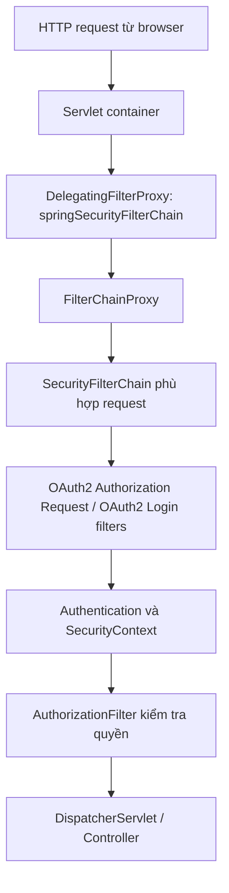
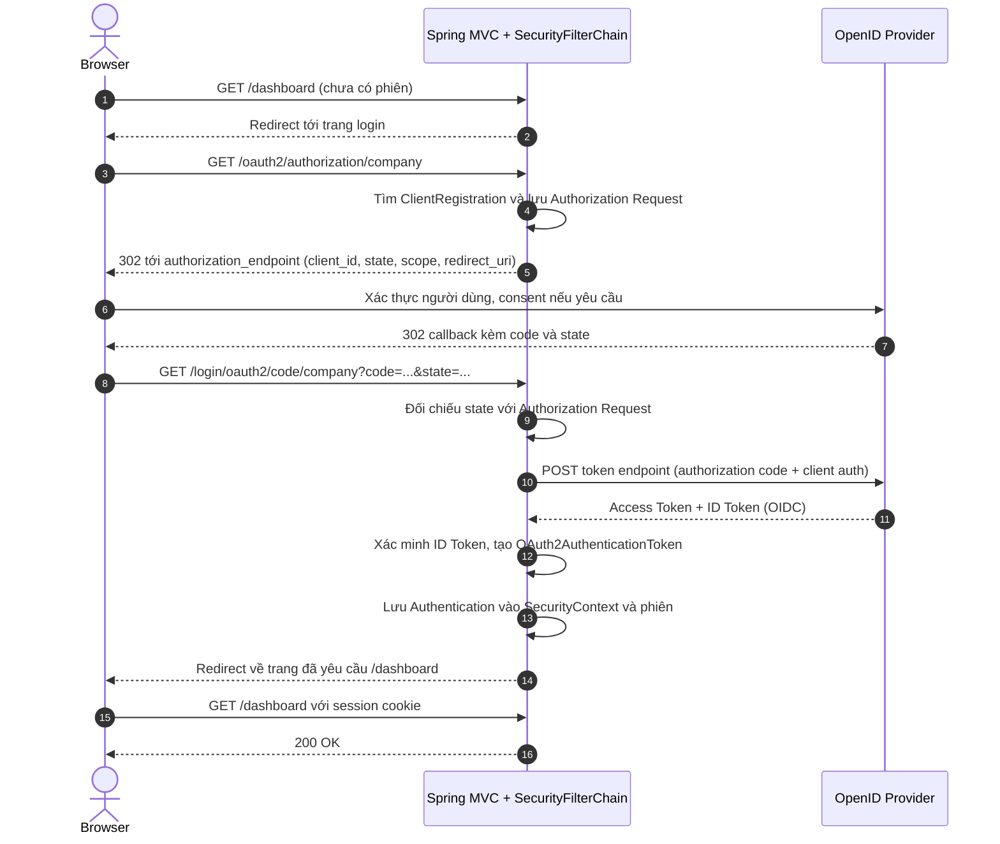

# 7.1. SecurityFilterChain và cấu hình oauth2Login

## 1. Bài toán: bảo vệ website Servlet bằng đăng nhập OAuth 2.0 / OIDC

Giả sử bạn xây dựng **Employee Portal** bằng Spring Boot MVC. Người dùng truy cập `/dashboard`, nhưng hệ thống không tự xây màn hình nhập mật khẩu. Thay vào đó, ứng dụng chuyển họ đến một OpenID Provider (OP) như Keycloak, Microsoft Entra ID hoặc một nhà cung cấp OIDC khác. Sau khi đăng nhập, người dùng quay về ứng dụng với **authorization code**; Spring Security đổi code lấy token, xác minh danh tính rồi tạo phiên đăng nhập ở phía server.

Với ứng dụng **Servlet**, điểm bắt đầu cấu hình bảo mật HTTP là một hoặc nhiều bean **`SecurityFilterChain`**, thường được tạo bằng DSL **`HttpSecurity`**. Để bật cơ chế đăng nhập dựa trên OAuth 2.0 Authorization Code và OIDC, sử dụng:

```java
http.oauth2Login(Customizer.withDefaults());
```

Đây là một lời gọi ngắn, nhưng nó kích hoạt nhiều filter và thành phần phối hợp nhau: khởi tạo authorization request, xử lý callback, trao đổi authorization code, tải thông tin người dùng khi cần, xác thực ID Token khi là OIDC và lưu kết quả xác thực vào `SecurityContext`.

> **Phân biệt vai trò:** `oauth2Login` đăng nhập **người dùng vào ứng dụng web**. `oauth2Client` hỗ trợ OAuth2 Client khi cần lấy/sử dụng access token gọi API. `oauth2ResourceServer` bảo vệ API nhận Bearer token. Ba chức năng có thể cùng xuất hiện trong hệ thống nhưng xử lý các nhu cầu khác nhau.

## 2. Các thành phần chính của Servlet Security

Một request đi qua chuỗi Servlet filter của Spring Security trước khi đến controller:



Sơ đồ chỉ thể hiện những bước liên quan trực tiếp đến bài học; thứ tự và danh sách filter thực tế phụ thuộc cấu hình và phiên bản Spring Security. Request có thể kết thúc sớm tại một filter khi bị chuyển hướng, từ chối truy cập hoặc gặp lỗi xác thực.

| Thành phần | Vai trò |
| --- | --- |
| `SecurityFilterChain` | Xác định nhóm filter bảo mật được áp dụng cho các request phù hợp |
| `HttpSecurity` | DSL cấu hình authentication, authorization, OAuth2 login, CSRF, logout, session và các chính sách HTTP |
| `FilterChainProxy` | Chọn một `SecurityFilterChain` phù hợp với request theo thứ tự chain |
| `OAuth2AuthorizationRequestRedirectFilter` | Khởi tạo OAuth 2.0 Authorization Request và chuyển hướng trình duyệt đến nhà cung cấp |
| `OAuth2LoginAuthenticationFilter` | Xử lý callback chứa authorization code và hoàn tất quá trình xác thực OAuth2 login |
| `ClientRegistrationRepository` | Tra cứu cấu hình OAuth/OIDC client theo `registrationId` |
| `OAuth2AuthorizedClientService` / `OAuth2AuthorizedClientRepository` | Lưu/truy xuất thông tin authorized client và token, tùy ngữ cảnh |
| `SecurityContext` | Chứa `Authentication` đã xác thực cho request/ngữ cảnh đăng nhập |
| `Authentication` | Đại diện principal và các authorities dùng khi kiểm tra quyền |

**Servlet và WebFlux không sử dụng cùng kiểu cấu hình.** Trong Servlet sử dụng `SecurityFilterChain`, `HttpSecurity` và `ClientRegistrationRepository`. Trong WebFlux sử dụng `SecurityWebFilterChain`, `ServerHttpSecurity` và `ReactiveClientRegistrationRepository`. Không trộn code của hai stack chỉ vì chúng đều hỗ trợ OAuth2.

### `SecurityFilterChain` khác `FilterChainProxy` như thế nào?

Bạn thường **không tự tạo** `FilterChainProxy`. Spring Security tập hợp các chain và chọn chain đầu tiên có điều kiện matching phù hợp cho request. Bạn định nghĩa một hoặc nhiều `SecurityFilterChain` bằng cách gọi `http.build()` trong bean.

Với website đơn giản, **một chain** là đủ. Với dự án vừa có website sử dụng session/cookie vừa có API chỉ nhận Bearer token, có thể dùng **hai chain** với `securityMatcher` và `@Order` để áp dụng chính sách khác nhau. Phần 10 sẽ minh họa trường hợp đó.

## 3. Chuẩn bị dự án Spring Boot Servlet

Ví dụ tiếp theo dùng **Spring Boot 3.x / Spring Security 6.x**, **Spring MVC (Servlet)** và một nhà cung cấp OIDC có issuer minh họa:

```text
Issuer:          https://id.example.com/realms/company
Client ID:       employee-portal-web
Registration ID: company
Redirect URI:    http://localhost:8080/login/oauth2/code/company
Scopes:          openid, profile, email
Grant:           authorization_code
```

Để thử nghiệm, ứng dụng phải được đăng ký trước tại OIDC Provider. Provider cần cho phép Authorization Code flow, redirect URI chính xác, scopes tương ứng và cấp thông tin xác thực client theo cơ chế đã chọn.

### 3.1. Thêm dependency

Với Maven:

```xml
<dependencies>
    <dependency>
        <groupId>org.springframework.boot</groupId>
        <artifactId>spring-boot-starter-web</artifactId>
    </dependency>
    <dependency>
        <groupId>org.springframework.boot</groupId>
        <artifactId>spring-boot-starter-security</artifactId>
    </dependency>
    <dependency>
        <groupId>org.springframework.boot</groupId>
        <artifactId>spring-boot-starter-oauth2-client</artifactId>
    </dependency>
</dependencies>
```

Tương đương với Gradle Kotlin DSL:

```kotlin
dependencies {
    implementation("org.springframework.boot:spring-boot-starter-web")
    implementation("org.springframework.boot:spring-boot-starter-security")
    implementation("org.springframework.boot:spring-boot-starter-oauth2-client")
}
```

Ở đây **`spring-boot-starter-oauth2-client`** là dependency cần cho `oauth2Login`. Không cần `spring-boot-starter-oauth2-resource-server` chỉ để website đăng nhập thông qua OIDC. Dependency Resource Server chỉ cần khi ứng dụng còn bảo vệ endpoint tiếp nhận Bearer token theo cấu hình Resource Server.

### 3.2. Khai báo ClientRegistration tại `application.yml`

```yaml
server:
  port: 8080

spring:
  security:
    oauth2:
      client:
        registration:
          company:
            provider: company-idp
            client-id: ${OIDC_CLIENT_ID}
            client-secret: ${OIDC_CLIENT_SECRET}
            client-authentication-method: client_secret_basic
            authorization-grant-type: authorization_code
            redirect-uri: "{baseUrl}/login/oauth2/code/{registrationId}"
            scope:
              - openid
              - profile
              - email
        provider:
          company-idp:
            issuer-uri: https://id.example.com/realms/company
```

Các giá trị:

| Khóa | Ý nghĩa |
| --- | --- |
| `registration.company` | Định danh cục bộ dùng để bắt đầu đăng nhập và chọn client; ở đây là `company` |
| `provider: company-idp` | Tham chiếu đến phần khai báo OP |
| `client-id` | Client ID do OP cấp khi đăng ký ứng dụng |
| `client-secret` | Bí mật xác thực confidential client, nạp an toàn từ môi trường |
| `authorization-grant-type` | `authorization_code`, flow đăng nhập dựa trên trình duyệt |
| `client-authentication-method` | Phương thức client xác thực tại token endpoint; phải được OP hỗ trợ |
| `redirect-uri` | Callback Spring nhận authorization code, phải được OP cho phép |
| `scope` | Có `openid` để yêu cầu đăng nhập theo OIDC; thêm scope hồ sơ khi cần |
| `issuer-uri` | Issuer OIDC tin cậy, dùng để Discovery và xác thực ID Token |

**`registrationId` không phải `clientId`.** Trong ví dụ, đường dẫn Spring là `/oauth2/authorization/company` và `/login/oauth2/code/company`, dù Client ID trên OP là `employee-portal-web`.

Với OP hỗ trợ OIDC Discovery, khai báo `issuer-uri` cho phép Spring Boot/Spring Security lấy metadata như authorization endpoint, token endpoint, JWKS URI và UserInfo endpoint. Nếu OP không công bố metadata hợp lệ, cấu hình phải cung cấp các URI tương ứng theo cơ chế mà provider hỗ trợ.

### 3.3. Giữ client secret bên ngoài source

Ví dụ biến môi trường ở một phiên terminal PowerShell:

```powershell
$env:OIDC_CLIENT_ID = "employee-portal-web"
$env:OIDC_CLIENT_SECRET = "<secret-tu-secret-manager>"
```

Ví dụ cố ý không dùng secret thật. Trong production, có thể dùng secret manager và tích hợp hạ tầng triển khai. Tránh commit credentials vào repository, đưa chúng vào frontend, chép vào ticket hoặc in raw token/secret ra log.

## 4. `SecurityFilterChain` tối thiểu để bật `oauth2Login`

Đây là cấu hình trung tâm của bài học:

```java
package com.example.portal.security;

import org.springframework.context.annotation.Bean;
import org.springframework.context.annotation.Configuration;
import org.springframework.security.config.Customizer;
import org.springframework.security.config.annotation.web.builders.HttpSecurity;
import org.springframework.security.web.SecurityFilterChain;

@Configuration
public class SecurityConfig {

    @Bean
    SecurityFilterChain securityFilterChain(HttpSecurity http) throws Exception {
        http
            .authorizeHttpRequests(authorize -> authorize
                .requestMatchers("/", "/css/**", "/js/**", "/images/**", "/error")
                    .permitAll()
                .anyRequest().authenticated()
            )
            .oauth2Login(Customizer.withDefaults());

        return http.build();
    }
}
```

### 4.1. Đọc từng đoạn cấu hình

**`@Configuration` và `@Bean`:** khai báo `SecurityFilterChain` cho Spring ApplicationContext. Từ Spring Security hiện đại, cách này thay thế việc kế thừa `WebSecurityConfigurerAdapter` đã bị loại bỏ.

**`authorizeHttpRequests`:** xác định quyền truy cập. Các tài nguyên công khai có thể được truy cập mà không đăng nhập; mọi request còn lại phải được xác thực.

**`requestMatchers(...).permitAll()`:** cho phép website phục vụ trang chủ, CSS, JavaScript, ảnh và trang lỗi. Đặt rule cụ thể trước `anyRequest()`.

**`anyRequest().authenticated()`:** yêu cầu người dùng đã được xác thực, nhưng chưa kiểm tra role hay quyền nghiệp vụ cụ thể.

**`oauth2Login(Customizer.withDefaults())`:** bật OAuth2 Login với các endpoint/filter mặc định. Với registration có scope `openid`, Spring Security xử lý đăng nhập OIDC và tạo principal kiểu `OidcUser`; với provider OAuth 2.0 không có OIDC, principal thường là `OAuth2User` tùy provider/cấu hình.

**`http.build()`:** kết thúc DSL và trả về chain để Spring Security sử dụng.

Ở ví dụ này không có `http.csrf(csrf -> csrf.disable())`. **Giữ CSRF protection mặc định cho website đăng nhập dựa trên session/cookie**, đặc biệt với các thao tác POST/PUT/PATCH/DELETE. OAuth2 login mặc định cũng dựa vào state và session để liên kết authorization request với callback.

### 4.2. Vì sao vẫn cần cả authentication và authorization?

**Authentication** xác định *ai đang truy cập*; với `oauth2Login`, người dùng được xác thực bởi provider và Spring Security xác minh kết quả. **Authorization** quyết định *người đó được truy cập endpoint nào* theo các matcher và authority.

Ví dụ bảo vệ thêm trang quản trị:

```java
http.authorizeHttpRequests(authorize -> authorize
        .requestMatchers("/", "/css/**", "/error").permitAll()
        .requestMatchers("/admin/**").hasRole("ADMIN")
        .anyRequest().authenticated()
    )
    .oauth2Login(Customizer.withDefaults());
```

Rule `hasRole("ADMIN")` yêu cầu authority `ROLE_ADMIN`. OIDC provider có thể trả role trong claim riêng, nhưng **role không tự động được ánh xạ theo mọi nhà cung cấp**. Nếu chưa có `ROLE_ADMIN` trong `Authentication`, người dùng đã đăng nhập vẫn có thể bị **403 Forbidden**. Cần cấu hình mapping role/authority đáng tin cậy theo token/nguồn role thực của hệ thống; đừng tự mặc định mọi người dùng OIDC đều là admin.

## 5. Luồng request khi `oauth2Login` hoạt động

Với `SecurityFilterChain` ở mục 4, trình duyệt truy cập một URL yêu cầu xác thực:



Sơ đồ minh họa trường hợp **OIDC Authorization Code flow**. Nếu client cấu hình PKCE, authorization request còn có `code_challenge` và token request có `code_verifier`. Tùy yêu cầu provider và phiên bản Spring Security, cần cấu hình PKCE phù hợp.

### 5.1. Các endpoint mặc định cần nhớ

| Đường dẫn | Ai gọi? | Chức năng |
| --- | --- | --- |
| `/oauth2/authorization/{registrationId}` | Browser → ứng dụng Spring | Khởi tạo authorization request và redirect đến nhà cung cấp |
| `/login/oauth2/code/{registrationId}` | Browser → ứng dụng Spring sau redirect từ OP | Nhận authorization code và state để Spring hoàn tất login |
| `/login` | Browser → ứng dụng Spring | Trang đăng nhập; có thể là trang do Spring Security sinh mặc định |
| `/logout` | Browser → ứng dụng Spring | Endpoint logout phía ứng dụng theo cấu hình Spring Security |

Khi chỉ có OAuth2/OIDC Client registration và bật `oauth2Login`, trang login mặc định có thể hiển thị liên kết đến nhà cung cấp, với điều kiện repository có thể được duyệt để liệt kê client registrations. `InMemoryClientRegistrationRepository` thường đáp ứng điều kiện đó. Nếu dùng repository tùy biến không hỗ trợ liệt kê, có thể cần tự tạo trang login.

**Không nhầm hai URI**:

```text
Bắt đầu OAuth2 login:
http://localhost:8080/oauth2/authorization/company

Callback đăng ký tại OP:
http://localhost:8080/login/oauth2/code/company
```

Trang `/login` là điểm hiển thị/chọn cách đăng nhập. Authorization endpoint `/oauth2/authorization/company` là nơi **Spring bắt đầu gửi request tới provider**, còn callback `/login/oauth2/code/company` là nơi **Spring nhận response từ provider**.

### 5.2. Các tham số trong authorization request

Một redirect đến OP thường chứa:

```text
https://id.example.com/realms/company/protocol/openid-connect/auth
  ?response_type=code
  &client_id=employee-portal-web
  &scope=openid%20profile%20email
  &state=<random-state>
  &redirect_uri=http%3A%2F%2Flocalhost%3A8080%2Flogin%2Foauth2%2Fcode%2Fcompany
```

URL trên được xuống dòng cho dễ đọc, **không phải một URL thực để sao chép nguyên xi**. Tùy cấu hình sẽ có thêm `nonce`, `code_challenge`, `code_challenge_method` và các tham số của provider.

`state` liên kết callback với yêu cầu login được tạo trước đó, giúp phòng chống tấn công giả mạo/nhầm luồng. Với OIDC, `nonce` (khi được dùng) giúp ràng buộc ID Token vào một lần xác thực. Chúng không phải tham số tùy ý nên tắt đi chỉ để sửa lỗi.

### 5.3. Filter nào xử lý bước nào?

| Giai đoạn | Thành phần liên quan | Hành vi |
| --- | --- | --- |
| Bắt đầu đăng nhập | `OAuth2AuthorizationRequestRedirectFilter` | Chọn registration, dựng request, lưu state và trả redirect tới OP |
| Đến callback | `OAuth2LoginAuthenticationFilter` | Lấy code/state, tạo authentication request và chuyển cho authentication manager |
| Đổi code lấy token | `OAuth2LoginAuthenticationProvider` và các client/token response thành phần | Trao đổi authorization code tại token endpoint |
| Xử lý OIDC | `OidcAuthorizationCodeAuthenticationProvider` và bộ xử lý OIDC | Xác minh ID Token và tải UserInfo khi phù hợp |
| Hoàn tất | Authentication success handler + SecurityContext/session | Thiết lập trạng thái đăng nhập và redirect sau login |
| Truy cập trang tiếp theo | Authorization filter | Kiểm tra `authenticated()` và các rule cụ thể |

Tên và sự hiện diện chính xác của filter/provider có thể khác theo phiên bản và các tùy chọn được bật; bảng tập trung vào trách nhiệm cốt lõi. Ở cấu hình mặc định, Spring Security thực hiện đa số quá trình này, vì thế không cần tự viết servlet filter gửi token request hoặc tự bắt callback bằng controller.

## 6. Truy cập danh tính đã xác thực trong Controller

Khi sử dụng OIDC login, Spring Security cung cấp principal kiểu **`OidcUser`** cho controller.

```java
package com.example.portal.web;

import java.util.Map;

import org.springframework.security.core.annotation.AuthenticationPrincipal;
import org.springframework.security.oauth2.core.oidc.user.OidcUser;
import org.springframework.web.bind.annotation.GetMapping;
import org.springframework.web.bind.annotation.RestController;

@RestController
public class ProfileController {

    @GetMapping("/me")
    public Map<String, String> me(@AuthenticationPrincipal OidcUser user) {
        return Map.of(
                "subject", user.getSubject(),
                "issuer", user.getIssuer().toString(),
                "displayName", user.getFullName() != null
                        ? user.getFullName() : user.getSubject()
        );
    }
}
```

Ở đây `OidcUser` đã được tạo sau khi quá trình đăng nhập OIDC thành công. `sub` là định danh người dùng **trong phạm vi issuer**, còn các claim như name/email có thể không được OP cung cấp. Không dựa vào email để làm khóa định danh bất biến nếu quy trình nghiệp vụ không cho phép thay đổi email.

Ví dụ trên giả định `/me` chỉ được truy cập sau **OIDC login**. Nếu cùng ứng dụng hỗ trợ nhiều kiểu authentication (form login, HTTP Basic, JWT hoặc OAuth2 login không có OIDC), principal có thể không phải `OidcUser`. Khi đó controller cần xử lý các loại `Authentication` thích hợp, không ép kiểu một cách mù quáng.

Để xem thông tin quyền đã xác thực ở mức Spring Security:

```java
import java.util.List;

import org.springframework.security.core.Authentication;
import org.springframework.web.bind.annotation.GetMapping;
import org.springframework.web.bind.annotation.RestController;

@RestController
public class AuthorizationController {

    @GetMapping("/my-authorities")
    public List<String> myAuthorities(Authentication authentication) {
        return authentication.getAuthorities().stream()
                .map(authority -> authority.getAuthority())
                .toList();
    }
}
```

Các endpoint minh họa nên được bảo vệ bởi `authenticated()` và chỉ cung cấp dữ liệu mà sản phẩm cho phép. Không trả **raw ID Token/access token/refresh token** cho frontend chỉ để hiển thị thông tin user.

## 7. Tùy chỉnh trang đăng nhập

Mặc định Spring Security có thể tạo trang `/login` chứa liên kết tới các registration. Trong sản phẩm thực tế, bạn thường muốn trang đăng nhập có giao diện của dự án.

### 7.1. Chỉ định trang login riêng

Ví dụ cấu hình bằng một **trang HTML tĩnh** tại `src/main/resources/static/login.html`:

```java
@Bean
SecurityFilterChain securityFilterChain(HttpSecurity http) throws Exception {
    http
        .authorizeHttpRequests(authorize -> authorize
            .requestMatchers(
                "/", "/login.html", "/css/**", "/js/**", "/images/**", "/error"
            ).permitAll()
            .anyRequest().authenticated()
        )
        .oauth2Login(oauth2 -> oauth2
            .loginPage("/login.html")
        );

    return http.build();
}
```

Nội dung trang `login.html`:

```html
<!doctype html>
<html lang="vi">
<head>
  <meta charset="utf-8">
  <title>Đăng nhập Employee Portal</title>
</head>
<body>
  <h1>Employee Portal</h1>
  <a href="/oauth2/authorization/company">Đăng nhập bằng Company SSO</a>
</body>
</html>
```

Lưu ý:

- `loginPage("/login.html")` chỉ định **đường dẫn đến trang login trong ứng dụng**, không phải URL authorization endpoint tại OP.
- Trang login phải được phép truy cập khi người dùng chưa xác thực; nếu không, trình duyệt có thể bị vòng lặp redirect.
- Liên kết `/oauth2/authorization/company` dùng đúng **registration ID** được khai báo ở YAML.
- Khi đặt trang login tùy chỉnh, **Spring Security không còn tự sinh HTML login giúp bạn**; ứng dụng chịu trách nhiệm trả nội dung của URL đó.

Không gắn client secret vào `login.html` hoặc JavaScript; authorization code được đổi lấy token tại backend.

### 7.2. Nếu có nhiều nhà cung cấp

Trang login có thể có nhiều liên kết:

```html
<a href="/oauth2/authorization/company">Đăng nhập bằng tài khoản công ty</a>
<a href="/oauth2/authorization/partner">Đăng nhập bằng tài khoản đối tác</a>
```

Điều kiện là `ClientRegistrationRepository` có registration `company` và `partner` tương ứng. Mỗi client cần callback URI được khai báo hợp lệ tại nhà cung cấp của nó.

## 8. Tùy chỉnh URL bắt đầu đăng nhập và callback

Thông thường nên giữ các URL mặc định. Nhưng một số hệ thống cần thay đổi chúng để phù hợp router/cấu trúc ứng dụng.

### 8.1. Thay authorization request base URI

Ví dụ:

```java
http.oauth2Login(oauth2 -> oauth2
        .authorizationEndpoint(authorization -> authorization
            .baseUri("/sso/authorize"))
);
```

Khi đó URL bắt đầu đăng nhập dùng registration ID sẽ là:

```text
/sso/authorize/company
```

Nếu sử dụng custom login page, phải sửa link cho đúng. `authorizationEndpoint().baseUri(...)` là đường dẫn **trong ứng dụng Spring**, không thay đổi `authorizationUri` tại OP.

### 8.2. Thay callback base URI

Ví dụ một hệ thống muốn callback dưới `/sso/callback/*`:

```java
http.oauth2Login(oauth2 -> oauth2
        .redirectionEndpoint(redirection -> redirection
            .baseUri("/sso/callback/*"))
);
```

Đồng thời, client registration phải đặt:

```yaml
spring:
  security:
    oauth2:
      client:
        registration:
          company:
            redirect-uri: "{baseUrl}/sso/callback/{registrationId}"
```

Và OP phải cho phép callback, ví dụ:

```text
http://localhost:8080/sso/callback/company
```

**Đổi filter callback mà không đổi `redirect-uri`, hoặc chỉ đổi URI tại OP mà không đổi Spring, đều có thể làm flow thất bại.** Các giá trị phải đồng bộ ở ba nơi: callback filter matcher, redirect URI gửi trong authorization request và danh sách URI cho phép tại OP.

### 8.3. Không tạo controller cùng URL callback

Trong cấu hình `oauth2Login` bình thường, `OAuth2LoginAuthenticationFilter` xử lý callback. Việc tự tạo `@GetMapping("/login/oauth2/code/company")` để nhận authorization code thường không cần thiết và dễ gây xung đột luồng, đặc biệt nếu controller cố tự trao đổi token hoặc bỏ qua state validation.

## 9. Điều hướng sau đăng nhập, lỗi đăng nhập và logout

### 9.1. Thành công: trở lại URL ban đầu hay trang mặc định?

Với login tiêu chuẩn, Spring Security thường ghi nhớ request đã dẫn người dùng vào login, sau đó điều hướng họ trở lại URL ban đầu. Ví dụ người dùng mở `/dashboard` thì sau khi đăng nhập thành công sẽ trở lại `/dashboard`.

Nếu muốn cung cấp một trang đích mặc định:

```java
http.oauth2Login(oauth2 -> oauth2
        .defaultSuccessUrl("/dashboard", false)
);
```

Đối số `false` giữ cơ chế ưu tiên request đã lưu; `/dashboard` được dùng làm đích mặc định khi không có request phù hợp để quay lại. Nếu dùng `true`, Spring Security luôn chuyển đến `/dashboard` trong success handler mặc định tương ứng.

Việc thay bằng `successHandler(...)` tự viết cần được thiết kế cẩn thận để không làm mất request cache hoặc tạo open redirect bằng tham số URL không đáng tin cậy.

### 9.2. Thất bại: hiển thị lỗi an toàn

Với trang login tùy chỉnh, có thể đưa người dùng về một trang đăng nhập kèm trạng thái lỗi:

```java
http.oauth2Login(oauth2 -> oauth2
        .loginPage("/login.html")
        .failureUrl("/login.html?error")
);
```

Trên UI, hiển thị thông báo ngắn như “Đăng nhập chưa thành công, hãy thử lại.” Nguyên nhân chi tiết nên được ghi trong log vận hành với thông tin nhạy cảm đã được che.

Không đưa client secret, authorization code, access token, ID Token hay stack trace ra trang lỗi của người dùng.

### 9.3. Logout khỏi ứng dụng và khỏi OIDC Provider

Với session-based login, `logout` của Spring Security thường xóa authentication/session tại **ứng dụng**, nhưng điều đó **không nhất thiết đăng xuất khỏi OP**. Nếu OP vẫn có phiên SSO, người dùng có thể được đăng nhập lại mà không nhập mật khẩu.

Ví dụ cấu hình logout nội bộ:

```java
http.logout(logout -> logout
        .logoutSuccessUrl("/")
        .invalidateHttpSession(true)
        .deleteCookies("JSESSIONID")
);
```

Một request logout theo cấu hình mặc định của Spring Security thường là POST `/logout` kèm CSRF token phù hợp. Trên giao diện server-side, nên sử dụng form POST thay vì tự tạo GET link khi CSRF protection đang bật.

Nếu sản phẩm cần đăng xuất cả phiên tại OP, Spring Security có hỗ trợ **OIDC RP-Initiated Logout** thông qua `OidcClientInitiatedLogoutSuccessHandler` khi OP công bố và hỗ trợ end-session endpoint. Đó là phần cấu hình **thêm**, phụ thuộc provider; không coi xóa session nội bộ là đồng nghĩa thu hồi mọi token hay kết thúc toàn bộ phiên SSO.

## 10. Nhiều `SecurityFilterChain`: website đăng nhập và API nhận Bearer token

Một ứng dụng có thể vừa cung cấp **website cho người dùng đăng nhập bằng OIDC**, vừa cung cấp **REST API cho service khác**. Hai loại request có thể cần chính sách khác nhau:

- Website: đăng nhập tương tác bằng `oauth2Login`, sử dụng session cookie, giữ CSRF protection.
- REST API: nhận `Authorization: Bearer <access-token>`, không dựa vào session trình duyệt, thường dùng `oauth2ResourceServer` để xác thực JWT hoặc opaque token.

Với yêu cầu đó, có thể tạo **hai filter chain** và chỉ rõ thứ tự. Ví dụ sau **chỉ dành cho hệ thống có thêm REST API Resource Server**, cần thêm dependency `spring-boot-starter-oauth2-resource-server` và cấu hình issuer/audience phù hợp với token API:

```java
package com.example.portal.security;

import org.springframework.context.annotation.Bean;
import org.springframework.context.annotation.Configuration;
import org.springframework.core.annotation.Order;
import org.springframework.security.config.Customizer;
import org.springframework.security.config.annotation.web.builders.HttpSecurity;
import org.springframework.security.config.http.SessionCreationPolicy;
import org.springframework.security.web.SecurityFilterChain;

@Configuration
public class MultiChainSecurityConfig {

    @Bean
    @Order(1)
    SecurityFilterChain apiFilterChain(HttpSecurity http) throws Exception {
        http
            .securityMatcher("/api/**")
            .authorizeHttpRequests(authorize -> authorize
                .anyRequest().authenticated()
            )
            .sessionManagement(session -> session
                .sessionCreationPolicy(SessionCreationPolicy.STATELESS)
            )
            .csrf(csrf -> csrf.disable())
            .oauth2ResourceServer(resourceServer -> resourceServer
                .jwt(Customizer.withDefaults())
            );

        return http.build();
    }

    @Bean
    @Order(2)
    SecurityFilterChain webFilterChain(HttpSecurity http) throws Exception {
        http
            .authorizeHttpRequests(authorize -> authorize
                .requestMatchers(
                    "/", "/login.html", "/css/**", "/js/**", "/error"
                ).permitAll()
                .anyRequest().authenticated()
            )
            .oauth2Login(oauth2 -> oauth2
                .loginPage("/login.html")
            );

        return http.build();
    }
}
```

Trong cấu hình này:

1. `@Order(1)`: chain cho `/api/**` được xét trước. Nó xác thực **Bearer token**, đặt phiên thành stateless và không thực hiện `oauth2Login`.
2. `@Order(2)`: chain còn lại xử lý website, trang login và callback.
3. `securityMatcher("/api/**")` chọn **toàn bộ chain** cho request phù hợp. Nó khác với `requestMatchers(...)` bên trong `authorizeHttpRequests`, vốn chỉ quyết định quyền sau khi đã chọn chain.
4. Chain website trong ví dụ không có `securityMatcher`, vì thế là chain bao phủ các request còn lại.
5. CSRF bị tắt **chỉ trong chain API đã giới hạn cho yêu cầu Bearer token stateless**, giả sử API đó không dựa vào cookie như một cơ chế xác thực có thể bị trình duyệt tự gửi. Nếu API có cookie/session authentication, phải đánh giá lại CSRF thay vì tắt theo tên “API”.

Nếu muốn bảo vệ API theo scope, có thể dùng quy tắc ví dụ:

```java
.authorizeHttpRequests(authorize -> authorize
    .requestMatchers("/api/admin/**").hasAuthority("SCOPE_admin.read")
    .anyRequest().authenticated()
)
```

Cần nhớ **audience** của access token. Resource Server không nên chỉ dựa vào chữ ký/issuer mà bỏ qua token dành cho tài nguyên nào; cấu hình JWT validator theo hợp đồng API thực tế.

### 10.1. Vì sao thứ tự filter chain quan trọng?

Giả sử chain web có matcher quá rộng và được kiểm tra trước chain API. Request `GET /api/orders` có thể đi vào chain web, dẫn đến redirect đến trang login thay vì trả `401` cho Bearer token không hợp lệ. Ngược lại, nếu chain API vô tình bao gồm callback `/login/oauth2/code/company`, filter OAuth2 Login có thể không bao giờ nhận được authorization code.

`FilterChainProxy` chọn **chain đầu tiên khớp request**. Nó không ghép tất cả chain phù hợp thành một chain tổng hợp. Khi viết nhiều chain, luôn kiểm tra matcher và `@Order` để đường dẫn login/callback nằm trong chain có `oauth2Login`.

### 10.2. Chỉ có một SecurityFilterChain có ổn không?

Có. Nếu dự án chỉ là web app với OIDC login và các controller dùng phiên, ví dụ tối thiểu ở mục 4 là đủ. Không cần tách chain chỉ vì ứng dụng có `/api/**` trả JSON. Tách chain khi **cơ chế xác thực, session hoặc policy HTTP thực sự khác nhau**.

## 11. Phiên đăng nhập, `SecurityContext` và trạng thái OAuth2

Sau khi hoàn tất login, thông tin xác thực phải được duy trì qua các HTTP request. Với ứng dụng Servlet MVC, Spring Security thường dùng **HTTP session** để lưu trạng thái đăng nhập và request liên quan. Session ID thường nằm trong cookie `JSESSIONID`.

### 11.1. Những loại trạng thái cần phân biệt

| Trạng thái | Dữ liệu/ý nghĩa | Thành phần liên quan |
| --- | --- | --- |
| **Authorization request tạm thời** | `state`, registration, redirect, nonce/PKCE khi có | `AuthorizationRequestRepository` |
| **Authentication** | Principal và authorities đã xác thực | `SecurityContext` / `SecurityContextRepository` |
| **Authorized client** | `ClientRegistration` + access token, có thể có refresh token | `OAuth2AuthorizedClient` và kho authorized client |
| **HTTP session** | Duy trì ngữ cảnh giữa các request của browser | Servlet container và cơ chế session |
| **Client registration** | Cấu hình cố định của OAuth/OIDC client | `ClientRegistrationRepository` |

Các trạng thái phục vụ **những thời điểm khác nhau** của flow. Ví dụ `ClientRegistrationRepository` không lưu token; `SecurityContext` không thay thế việc quản lý access token khi cần gọi API.

### 11.2. Tại sao callback có thể thất bại nếu mất session?

Khi bắt đầu login, Spring Security lưu thông tin authorization request cần thiết để đối chiếu với callback. Nếu trình duyệt quay về mà session/cookie không còn hoặc request bị điều hướng sang server không chia sẻ session, Spring có thể không tìm thấy authorization request tương ứng.

Các nguyên nhân thường gặp:

- Cookie bị chặn hoặc mất do domain, `SameSite`, `Secure` hay cấu hình HTTPS không phù hợp.
- Redirect qua domain/port khác khiến browser không gửi cookie của ứng dụng.
- Load balancer chuyển callback sang instance không chia sẻ session mà hệ thống đang dựa vào.
- Session hết hạn trước khi người dùng hoàn tất MFA/consent.
- Proxy tạo sai URL callback nên người dùng quay về địa chỉ khác với địa chỉ bắt đầu login.

Nếu ứng dụng chạy nhiều node, có thể cần **sticky session** hoặc cơ chế session chia sẻ (ví dụ Spring Session với store phù hợp), tùy khả năng chịu lỗi và kiến trúc. Không xử lý lỗi này bằng cách bỏ qua kiểm tra `state` hoặc tạo request xác thực tùy ý ở callback.

### 11.3. SecurityContext và session cookie không phải access token

Sau login, browser thường gửi cookie session đến Employee Portal ở các request sau. Cookie cho phép Spring phục hồi `SecurityContext`, kiểm tra `authenticated()` và authorities.

Browser **không cần gửi access token trong mọi request HTML** đến website chỉ để duy trì login session. Nếu backend cần gọi API thay mặt người dùng, lúc đó phần OAuth2 Client/Authorized Client mới sử dụng access token phù hợp. Không lưu raw access token trong cookie JavaScript để thay thế cơ chế session khi không có yêu cầu kiến trúc rõ ràng.

### 11.4. Session fixation, CSRF và điều hướng

Spring Security cung cấp các cơ chế bảo vệ mặc định liên quan session fixation và CSRF. Việc cấu hình `oauth2Login` không phải lý do để tắt các bảo vệ đó.

- **Session fixation:** khi trạng thái xác thực thay đổi, cơ chế session authentication nên tạo/thay đổi session identifier theo chính sách an toàn của Spring và container.
- **CSRF:** với các request thay đổi dữ liệu của ứng dụng web dựa vào session cookie, giữ CSRF protection và tích hợp token vào form/AJAX request.
- **State:** bảo vệ authorization callback khỏi bị gắn vào flow khác.
- **Cookie:** dùng `Secure` khi chạy HTTPS; cấu hình `HttpOnly`, `SameSite`, domain/path theo nhu cầu đăng nhập và topology proxy.
- **HTTPS:** các endpoint đăng nhập production phải có kết nối an toàn, bao gồm callback.

## 12. Cách `oauth2Login` nhận biết OIDC hay OAuth 2.0 thông thường

Spring Security OAuth2 Login có thể làm việc với nhà cung cấp OAuth 2.0 hỗ trợ lấy thông tin user và với OP hỗ trợ OIDC. Tùy theo registration/scopes và phản hồi token, chúng có các mô hình xác thực khác nhau.

| Nội dung | OAuth 2.0 login thông thường | OIDC login |
| --- | --- | --- |
| Scope cơ bản | Scope do provider yêu cầu để truy cập thông tin người dùng | Có `openid` |
| Token phục vụ đăng nhập | Thường dùng access token gọi UserInfo/user endpoint của provider | Có **ID Token** theo đặc tả OIDC |
| Principal | Thường là `OAuth2User` | Thường là `OidcUser` |
| Thuộc tính định danh | Phụ thuộc API user của provider | `iss` + `sub` định danh user trong ngữ cảnh issuer |
| Kiểm tra đặc thù | Định dạng user attributes và cơ chế provider | ID Token signature, issuer, audience, thời hạn, nonce theo quy tắc OIDC |
| Provider metadata | Có thể cần cấu hình endpoint thủ công | OIDC Discovery thường cung cấp endpoint và JWKS |

**Không biến một OAuth2 provider không có OIDC thành OP chỉ bằng cách thêm scope `openid`**. Nhà cung cấp phải thực sự hỗ trợ OIDC, phát hành ID Token và cung cấp thông tin/claim cần thiết.

### 12.1. ID Token phải được xác minh

Đối với OIDC, Spring Security xử lý việc xác minh ID Token dựa trên cấu hình tin cậy: chữ ký hoặc cơ chế xác thực được OIDC hỗ trợ, issuer, audience, thời hạn và các yêu cầu bổ sung của flow.

- `iss` phải khớp nhà cung cấp đáng tin cậy.
- `aud` phải chứa client ID phù hợp.
- `exp` và các claim thời gian phải hợp lệ.
- `nonce` cần khớp yêu cầu ban đầu khi được sử dụng.
- `kid` trong JWT header giúp chọn khóa công khai từ JWKS của issuer; bản thân `kid` không làm token đáng tin cậy.
- Tùy điều kiện OIDC, các claim như `azp`, `auth_time` hay `at_hash` có thể cần kiểm tra.

Không tự decode payload Base64URL rồi tin dữ liệu đó là danh tính đã xác thực. Việc đọc được JWT **không chứng minh chữ ký hợp lệ**.

### 12.2. Token dùng đúng nơi

Với OIDC login:

- **ID Token** cung cấp thông tin xác thực người dùng cho **OIDC Client**.
- **Access token** dùng để gọi API/Resource Server theo audience và scope được cấp.
- **Refresh token**, nếu được cấp, giúp client xin access token mới theo chính sách nhà cung cấp.

Một REST API không nên tiếp nhận ID Token như thể đó là access token chỉ vì chúng đều có chữ ký JWT. Hai loại token có mục đích và audience khác nhau.

## 13. Tùy chỉnh UserInfo và authorities sau OAuth2 Login

Trong dự án thực tế, người dùng thường cần role/permission của ứng dụng, không chỉ tên và email từ provider. Spring Security cho phép can thiệp vào giai đoạn tải thông tin người dùng hoặc ánh xạ authorities, nhưng việc phân quyền vẫn phải dựa trên một nguồn tin cậy.

### 13.1. Cấu hình userInfoEndpoint

`oauth2Login` cung cấp các điểm tùy chỉnh:

```java
http.oauth2Login(oauth2 -> oauth2
    .userInfoEndpoint(userInfo -> userInfo
        .oidcUserService(customOidcUserService)
    )
);
```

Ở đây `customOidcUserService` là một bean/đối tượng triển khai `OAuth2UserService<OidcUserRequest, OidcUser>` do ứng dụng tạo. Nó có thể tải thêm thông tin hoặc ánh xạ hồ sơ theo quy định của hệ thống.

Đối với OAuth2 login không dùng OIDC, có hook tương ứng:

```java
http.oauth2Login(oauth2 -> oauth2
    .userInfoEndpoint(userInfo -> userInfo
        .userService(customOAuth2UserService)
    )
);
```

Hai đoạn trên là **các lựa chọn minh họa**, chỉ sử dụng khi đã khai báo bean phù hợp. Với nhu cầu cơ bản, dùng default để tránh tự sao chép chức năng xác thực ID Token và gọi UserInfo của Spring Security.

### 13.2. Ánh xạ role cần có chính sách rõ ràng

Một số provider cấp role/nhóm trong claim tùy biến; một số ứng dụng giữ role trong database nội bộ. Không mặc định chuyển bất kỳ chuỗi role nào do client gửi lên thành `ROLE_ADMIN`.

Các lựa chọn thiết kế:

1. **Role theo nhà cung cấp:** chỉ lấy từ claim đã được xác thực, do issuer tin cậy phát hành, với ý nghĩa và namespace được kiểm soát.
2. **Role nội bộ:** dùng `iss` + `sub` để tra cứu quyền trong database của ứng dụng.
3. **Kết hợp:** lấy danh tính từ OIDC rồi áp chính sách quyền nội bộ; có thể bổ sung group/organization claim đã được xác minh.

Hãy xác định lúc nào quyền được cập nhật, quyền được cache bao lâu và điều gì xảy ra khi tài khoản bị khóa. OIDC login thành công chứng minh xác thực người dùng tại OP theo chính sách; **không tự chứng minh người dùng có quyền truy cập tất cả chức năng nội bộ**.

## 14. Các điểm cấu hình cần tránh khi migrate sang Spring Security 6

Nhiều tutorial cũ vẫn mô tả Spring Security bằng:

```java
// Mô hình cũ, KHÔNG dùng trong dự án Spring Security 6:
class SecurityConfig extends WebSecurityConfigurerAdapter {
    // ...
}
```

`WebSecurityConfigurerAdapter` đã bị loại bỏ. Thay bằng bean `SecurityFilterChain`, DSL lambda của `HttpSecurity` và các bean hỗ trợ khi cần.

Một số cặp đối chiếu:

| Cách cũ/thường thấy | Cách hiện đại trong Spring Security 6 |
| --- | --- |
| Kế thừa `WebSecurityConfigurerAdapter` | `@Bean SecurityFilterChain` |
| `authorizeRequests()`, cấu hình cũ | `authorizeHttpRequests(authorize -> ...)` |
| `antMatchers(...)` | `requestMatchers(...)` |
| `http.oauth2Login()` theo chained API cũ | `http.oauth2Login(Customizer.withDefaults())` hoặc lambda |
| Coi `WebSecurityCustomizer` bỏ qua mọi static resource là lựa chọn duy nhất | Ưu tiên `permitAll()` trong chain khi cần giữ các filter bảo vệ |

Phần lớn cấu hình cơ bản không cần tự thêm `OAuth2LoginAuthenticationFilter`. Hãy để DSL `oauth2Login` xây chuỗi filter mặc định trước; chỉ tùy chỉnh khi có yêu cầu thực tế.

### 14.1. Chọn đúng HTTP stack

Nếu project có cả Spring MVC và WebFlux trên classpath, Spring Boot có thể ưu tiên kiểu web application Servlet theo điều kiện tự động cấu hình. Khi thấy code sample dùng `ServerHttpSecurity` nhưng bean nhận `HttpSecurity` hoặc ngược lại, cần xác định project thực tế chạy **Servlet** hay **Reactive**.

Đối với bài học này:

```text
Spring MVC / Servlet
  -> HttpSecurity
  -> SecurityFilterChain
  -> ClientRegistrationRepository
  -> OAuth2LoginAuthenticationFilter
  -> OidcUser / OAuth2User
```

Đây là tập API cần sử dụng nhất quán.

## 15. Ứng dụng phía sau reverse proxy: callback và HTTPS

Một triển khai production thường có topology:

```text
Browser
   |
   | HTTPS https://portal.example.com
   v
Ingress / Reverse Proxy (TLS termination)
   |
   | HTTP http://employee-portal:8080
   v
Spring Boot Servlet
```

Ứng dụng phải gửi đúng callback **public URL** đã đăng ký tại OP:

```text
https://portal.example.com/login/oauth2/code/company
```

Nếu Spring nhận request nội bộ `http://employee-portal:8080` và cấu hình forwarded headers không đúng, `{baseUrl}` có thể tạo callback sai scheme/hostname/port.

Khi proxy đã được cấu hình làm thành phần đáng tin cậy, có thể dùng tùy chọn phù hợp của Spring Boot, ví dụ:

```yaml
server:
  forward-headers-strategy: framework
```

Proxy cần **ghi đè/lọc header forwarded từ client bên ngoài**. Chỉ tin `Forwarded` hoặc `X-Forwarded-*` do proxy tin cậy kiểm soát; nếu chấp nhận header giả mạo, ứng dụng có thể bị tác động khi dựng URL.

Các lựa chọn khác bao gồm cấu hình redirect URI theo môi trường bằng URL tường minh, nhưng vẫn cần khớp chính xác với OP. Không mở wildcard callback rộng ở production để tránh lỗi `redirect_uri_mismatch`.

### 15.1. Cookie và SameSite khi callback

OIDC callback thường đến từ một lần điều hướng từ OP về ứng dụng. Với flow redirect GET thông dụng, chính sách cookie `SameSite=Lax` thường có thể hoạt động; chính sách cụ thể cần phù hợp trình duyệt, endpoint và hệ thống. Nếu dùng các response mode khác hoặc login trong iframe/cross-site context, yêu cầu cookie có thể khác đáng kể.

Khi gặp lỗi mất `state` sau callback, cần kiểm tra **cookie thực tế trình duyệt có gửi về hay không**, thay vì vội tắt state validation.

## 16. Hướng dẫn chạy thử cấu hình tối thiểu

Để đọc đúng hành vi của `SecurityFilterChain`, dùng môi trường thử nghiệm đã đăng ký OIDC client.

### 16.1. Các bước cơ bản

1. Tạo Spring Boot ứng dụng Servlet có ba starter ở mục 3.1.
2. Khai báo client registration `company` và issuer chính xác tại OP.
3. Đăng ký callback `http://localhost:8080/login/oauth2/code/company` ở OP.
4. Đặt `OIDC_CLIENT_ID` và `OIDC_CLIENT_SECRET` qua môi trường/secret manager.
5. Thêm bean `SecurityFilterChain` như mục 4, không cần tự viết controller callback.
6. Thêm một trang `/dashboard` hoặc thử `/me` để quan sát authenticated principal.
7. Chạy ứng dụng, mở trình duyệt riêng tư và truy cập `http://localhost:8080/me`.
8. Quan sát trang đăng nhập, chọn `company` rồi xác thực trên OP.
9. Sau callback, kiểm tra `/me` nhận `sub` và issuer phù hợp với người dùng thử nghiệm.

**Đây là hướng dẫn thực hành, không phải kết quả đã chạy với một OP thực**. Cần có client registration và tài khoản test hợp lệ tại nhà cung cấp.

### 16.2. Cách quan sát HTTP redirect

Với trình duyệt Developer Tools → Network (bật Preserve log nếu cần), luồng thường cho thấy:

| Bước | Địa chỉ | Trạng thái/hành vi |
| --- | --- | --- |
| Mở trang cần đăng nhập | `GET /me` | Spring nhận thấy chưa authenticated, chuyển hướng đến login |
| Bắt đầu login | `GET /oauth2/authorization/company` | Spring gửi redirect đến OP |
| Đăng nhập tại OP | `GET authorization_endpoint` và các request của OP | Người dùng xác thực và consent theo chính sách |
| Trở lại callback | `GET /login/oauth2/code/company?code=...&state=...` | Spring xử lý code/state |
| Sau xác thực | `GET /me` | Browser gửi session cookie và nhận dữ liệu đã xác thực |

Phản hồi browser **không nhất thiết hiển thị token endpoint request**, vì Spring Boot backend gửi request này trực tiếp đến OP. Không cho rằng thiếu token endpoint trong Browser Network là dấu hiệu token exchange không diễn ra.

### 16.3. Kiểm tra quyền sau login

Nếu `/me` trả danh tính nhưng `/admin` trả `403`, login có thể đã thành công. Lỗi khi ấy là **authorization**: `Authentication` không có quyền mà endpoint đòi hỏi. Kiểm tra mapping authorities và chính sách nghiệp vụ, không sửa secret hoặc callback nếu chúng đã hoạt động.

### 16.4. Quan sát log an toàn

Trong môi trường thử nghiệm, có thể bật log của Spring Security ở mức phù hợp để xem quá trình filter/authentication, song không lưu/chia sẻ raw request chứa authorization code, secret hay token. Nên ghi correlation ID, registration ID, request path, HTTP status và loại exception. Đối với production, giới hạn mức log và masking thông tin nhạy cảm.

## 17. Các lỗi phổ biến với `SecurityFilterChain` và `oauth2Login`

| Dấu hiệu | Nguyên nhân cần nghĩ đến | Hướng xử lý |
| --- | --- | --- |
| Không thấy redirect đến OIDC Provider | Chưa bật `oauth2Login`, chưa có registration, request không vào đúng chain hoặc login page tùy chỉnh sai | Kiểm tra bean `SecurityFilterChain`, registration và matcher |
| `/oauth2/authorization/company` trả 404 | Sai `registrationId`/authorization base URI hoặc thiếu OAuth2 Login cấu hình phù hợp | Đối chiếu `registration.company` và cấu hình `authorizationEndpoint` |
| `/login` vòng lặp redirect | Custom login page bị bảo vệ bởi `authenticated()` | Thêm `permitAll()` cho URL/tài nguyên login |
| Provider trả `redirect_uri_mismatch` | URI Spring gửi khác callback đã đăng ký, proxy dựng sai host/scheme | Đối chiếu URI tuyệt đối, proxy và `redirect-uri` |
| Provider trả `invalid_client` | Sai client ID/secret hoặc client auth method | Kiểm tra app registration và cách gửi credentials |
| Token endpoint trả `invalid_grant` | Authorization code hết hạn/đã dùng, redirect/PKCE không khớp | Kiểm tra thời gian, redirect, token exchange và PKCE |
| Callback báo mất authorization request / `invalid_state` | Browser mất session cookie, state không khớp, nhiều instance không chia sẻ session | Kiểm tra cookie, session store, callback và LB |
| OIDC login lỗi `invalid_token` / issuer | ID Token sai issuer/audience/nonce/thời gian | Kiểm tra issuer, client ID và OIDC token validation |
| Không lấy được khóa JWKS | Issuer/JWKS URI sai, lỗi TLS/DNS/rotation | Kiểm tra OIDC Discovery, network và JWKS cache |
| Người dùng đã đăng nhập nhưng bị **403** | Role/authority chưa được ánh xạ, rule yêu cầu quyền cao hơn | Kiểm tra `Authentication.getAuthorities()` và mapping |
| Browser bị **403** khi POST form | Thiếu CSRF token | Thêm CSRF token vào form/AJAX, không tắt toàn bộ CSRF tùy tiện |
| API trả **302 tới /login** thay vì **401** | Request API đang đi vào chain của website | Kiểm tra `@Order` và `securityMatcher("/api/**")` |
| Logout xong đăng nhập lại ngay không hỏi mật khẩu | OP vẫn giữ phiên SSO | Cấu hình OIDC logout qua OP nếu sản phẩm yêu cầu |
| App chạy local nhưng production bị redirect sai | Forwarded headers/domain/HTTPS proxy chưa thống nhất | Điều chỉnh reverse proxy và external callback |
| Khi thêm SecurityFilterChain, cấu hình mặc định thay đổi | Bean security tự tạo đã thay thế/ghi đè một số auto-configuration | Đảm bảo chain khai báo đủ chính sách mong muốn |

Khi xử lý lỗi, hãy xác định nó xảy ra ở **bước chọn filter chain**, **chuyển hướng đến OP**, **callback/state**, **đổi code lấy token**, **xác thực ID Token**, hay **kiểm tra quyền truy cập sau login**. Các giai đoạn do thành phần khác nhau thực hiện, nên việc sửa sai chỗ có thể tạo thêm lỗ hổng hoặc vòng lặp redirect.

### 17.1. Sơ đồ truy tìm lỗi

```text
(1) GET trang cần đăng nhập có vào đúng SecurityFilterChain?
      |
      +-- Không -> securityMatcher / @Order / bean cấu hình
      |
      v
(2) Spring có chuyển hướng tới đúng OP không?
      |
      +-- Không -> oauth2Login / registrationId / loginPage
      |
      v
(3) OP có chấp nhận client, redirect, scopes và người dùng không?
      |
      +-- Không -> đăng ký ứng dụng / consent / policy tại OP
      |
      v
(4) Callback có code + state và session tương ứng không?
      |
      +-- Không -> proxy / cookie / state / session / redirect URI
      |
      v
(5) Spring có đổi code lấy token và xác minh ID Token không?
      |
      +-- Không -> secret / token endpoint / PKCE / issuer / JWKS
      |
      v
(6) Người dùng được xác thực rồi có đủ quyền không?
      |
      +-- Không -> authority mapping / role / quy tắc authorize
      |
      v
(7) Truy cập controller thành công
```

## 18. Thói quen cấu hình bảo mật tốt

- **Cấp quyền theo đường dẫn rõ ràng:** permit tài nguyên công khai, yêu cầu authentication cho nội dung riêng tư, thêm role/permission cho thao tác nhạy cảm.
- **Giữ CSRF protection cho website cookie/session:** chỉ tùy chỉnh theo kiến trúc xác thực thực tế.
- **Dùng Authorization Code flow và cơ chế PKCE phù hợp:** tránh những flow cũ không cần thiết, đặc biệt khi provider yêu cầu S256.
- **Giữ state và nonce validation:** dùng cơ chế có sẵn của Spring Security/OIDC, không bỏ qua để xử lý lỗi tạm thời.
- **Không tự bắt callback bằng controller:** dùng `oauth2Login` để tận dụng filter và authentication provider chuẩn.
- **Đăng ký callback chính xác:** không dùng wildcard rộng; đồng bộ giữa Spring, reverse proxy và OP.
- **Quản lý secret bằng cơ chế vận hành an toàn:** tách môi trường, rotation và phân quyền truy cập secret.
- **Tách web session với token API:** OIDC login chứng minh người dùng; Resource Server phải kiểm tra access token và quyền riêng của API.
- **Bảo vệ cookie/session:** HTTPS, thuộc tính cookie phù hợp và session store nhất quán khi chạy nhiều instance.
- **Ghi log có kiểm soát:** không để lộ authorization code, client secret, ID Token hoặc access token.
- **Duy trì chính sách OAuth/OIDC theo provider:** thay đổi issuer, allowed scopes, keys, client authentication hay redirect URI đều có thể ảnh hưởng login.

## 19. Tóm tắt theo use case Employee Portal

Giả sử user mở `/dashboard` tại Employee Portal. `SecurityFilterChain` yêu cầu `authenticated()` và cơ chế `oauth2Login` chuyển họ tới đăng nhập bằng OIDC Provider. Sau khi OP xác thực user, Spring Security nhận authorization code ở `/login/oauth2/code/company`, xác thực `state`, đổi code lấy token và xác minh ID Token OIDC. Kết quả được lưu thành `Authentication` trong `SecurityContext` để các request có session cookie có thể tiếp tục truy cập controller.

Các phần cấu hình cần phối hợp là:

1. **`ClientRegistration`:** issuer, client ID/secret, grant, scope và redirect URI.
2. **`SecurityFilterChain`:** luật authorize và cấu hình `oauth2Login`.
3. **Các endpoint OAuth2 Login:** URL khởi tạo đăng nhập và URL callback.
4. **`Authentication` / `SecurityContext`:** danh tính và authorities sau khi login.
5. **Session, CSRF, cookie và proxy:** giữ tính liên tục và an toàn của flow.
6. **Phân quyền nghiệp vụ:** áp rule theo vai trò/quyền đã được xác minh của ứng dụng.

Khi nắm rõ những phần này, bạn có thể triển khai OIDC Login theo chuẩn Servlet của Spring Security mà không cần viết thủ công filter xử lý authorization code, đồng thời biết nơi cấu hình khi muốn đổi trang login, callback, điều hướng thành công, logout hoặc tách bảo mật website và API.

### Tài liệu tham khảo

- [Spring Security — OAuth2 Login, Servlet](https://docs.spring.io/spring-security/reference/servlet/oauth2/login/index.html)
- [Spring Security — OAuth2 Login Advanced Configuration](https://docs.spring.io/spring-security/reference/servlet/oauth2/login/advanced.html)
- [Spring Security — Java Configuration](https://docs.spring.io/spring-security/reference/servlet/configuration/java.html)
- [Spring Security — Authorize HTTP Requests](https://docs.spring.io/spring-security/reference/servlet/authorization/authorize-http-requests.html)
- [Spring Security — CSRF Protection](https://docs.spring.io/spring-security/reference/servlet/exploits/csrf.html)
- [OpenID Connect Core 1.0](https://openid.net/specs/openid-connect-core-1_0.html)
