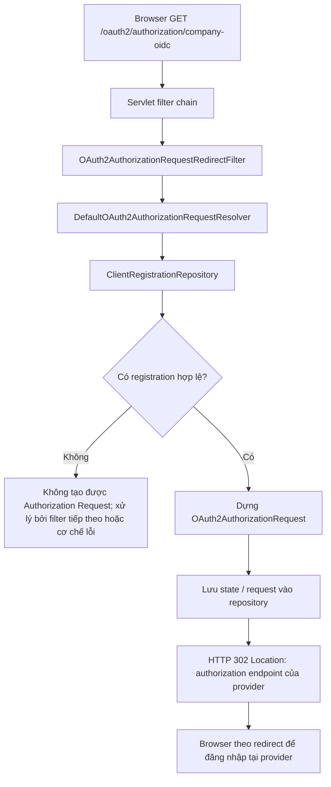

# 7.2. Endpoint khởi động đăng nhập `/oauth2/authorization/{registrationId}`

Trong ứng dụng **Spring Security OAuth 2.0 / OpenID Connect (OIDC) Client chạy trên Servlet**, URL `/oauth2/authorization/{registrationId}` là điểm bắt đầu luồng đăng nhập qua một Authorization Server (AS) hoặc OpenID Provider (OP). Khi trình duyệt truy cập URL này, Spring Security tìm cấu hình `ClientRegistration` có ID tương ứng, tạo một **OAuth 2.0 Authorization Request**, lưu trạng thái cần dùng khi nhận callback rồi trả về HTTP redirect để trình duyệt đến trang xác thực của provider.

Điểm quan trọng nhất: **`/oauth2/authorization/{registrationId}` là endpoint của ứng dụng Spring, không phải endpoint đăng nhập của provider và cũng không phải callback nhận authorization code.** Nó là một địa chỉ khởi tạo chuyển hướng.

Bài này tập trung vào cơ chế của endpoint trong Spring MVC/Servlet: điều kiện để endpoint hoạt động, thành phần xử lý, HTTP request/response, mối liên hệ với `ClientRegistration` và `oauth2Login()`, cách đổi URL khởi tạo và những lỗi thường gặp khi triển khai.

## 1. Vai trò và ý nghĩa của URL

Đường dẫn mặc định có dạng:

```text
GET https://app.example.org/oauth2/authorization/{registrationId}
```

Ví dụ khi ứng dụng khai báo `registrationId` là `company-oidc`:

```text
GET https://app.example.org/oauth2/authorization/company-oidc
```

Ba phần dễ nhầm lẫn:

| Đường dẫn / endpoint | Chủ sở hữu | Vai trò |
|---|---|---|
| `/oauth2/authorization/company-oidc` | Ứng dụng Spring Security | **Khởi động** đăng nhập: chọn registration, dựng Authorization Request, redirect trình duyệt sang provider. |
| `https://idp.example.org/.../auth` | Authorization Server / OpenID Provider | Nhận Authorization Request, xác thực người dùng, có thể yêu cầu consent. |
| `/login/oauth2/code/company-oidc` | Ứng dụng Spring Security | **Callback** mặc định: nhận `code` và `state`, hoàn tất xác thực. |
| `/login` | Ứng dụng Spring Security | Trang đăng nhập (mặc định hoặc tùy biến) có thể hiển thị liên kết để bắt đầu luồng. |

`registrationId` là **khóa nội bộ trong `ClientRegistrationRepository`**, không nhất thiết bằng `client-id` mà nhà cung cấp cấp cho ứng dụng. Nó giúp một ứng dụng hỗ trợ nhiều cách đăng nhập, ví dụ:

```text
/oauth2/authorization/company-oidc
/oauth2/authorization/partner-oidc
/oauth2/authorization/social-login
```

Các đường dẫn trên có thể chọn những client, scope, provider, redirect URI hoặc chính sách khác nhau. Tên ID cần khớp chính xác với khóa cấu hình của Spring Boot hoặc bean repository do ứng dụng khai báo.

## 2. Những thành phần Spring Security xử lý endpoint

Ở Servlet stack, `OAuth2AuthorizationRequestRedirectFilter` là filter tiếp nhận yêu cầu khởi động đăng nhập. Filter này dùng một `OAuth2AuthorizationRequestResolver` để xác định request có thuộc luồng OAuth2 cần khởi tạo hay không và xây dựng `OAuth2AuthorizationRequest`.

Mặc định, Spring Security thường sử dụng:

- `OAuth2AuthorizationRequestRedirectFilter`: nhận yêu cầu khởi tạo và gửi redirect tới provider.
- `DefaultOAuth2AuthorizationRequestResolver`: nhận diện URL có base URI `/oauth2/authorization`, tìm registration và tạo yêu cầu ủy quyền.
- `ClientRegistrationRepository`: cung cấp `ClientRegistration` theo `registrationId`.
- `OAuth2AuthorizationRequestRepository<OAuth2AuthorizationRequest>`: lưu yêu cầu gốc trước redirect để đối chiếu khi provider trả kết quả.
- `HttpSessionOAuth2AuthorizationRequestRepository`: repository mặc định thường dùng session trong luồng Servlet OAuth2 Login.
- `OAuth2LoginAuthenticationFilter`: xử lý **callback** đăng nhập theo base URI mặc định `/login/oauth2/code/*`, khác với filter khởi động.

Các thành phần này hoạt động trong `SecurityFilterChain` mà `HttpSecurity.oauth2Login()` xây dựng. Chúng không phải MVC `@GetMapping` thông thường do bạn phải tự viết.



### 2.1. Vì sao là filter thay vì controller?

Spring Security phải xử lý khởi tạo OAuth2 **trong chuỗi bảo mật**, nơi có quyền truy cập `HttpServletRequest`, `HttpServletResponse`, session và cấu hình client. Filter có thể chủ động kết thúc request bằng redirect trước khi request đi đến `DispatcherServlet` và MVC controller.

Nếu ứng dụng tự viết controller để redirect thủ công đến provider, nó sẽ phải tự bảo đảm tạo `state`, tương quan callback, lưu Authorization Request, thêm các tham số giao thức phù hợp, và phối hợp với cơ chế token exchange của Spring Security. Với các ứng dụng thông thường, nên để filter mặc định thực hiện việc này.

### 2.2. Tại sao cần repository lưu Authorization Request?

Khi trình duyệt rời ứng dụng để sang provider, request HTTP khởi tạo đã kết thúc. Provider sau đó redirect trình duyệt quay về ứng dụng bằng một HTTP request **mới**. Spring cần thông tin gốc để xác nhận phản hồi tương ứng với yêu cầu mà ứng dụng đã khởi tạo.

`HttpSessionOAuth2AuthorizationRequestRepository` sử dụng HTTP session để lưu thông tin như `state` và các tham số liên quan. Điều này khác với repository dùng để lưu `OAuth2AuthorizedClient` sau khi token đã được cấp.

## 3. Toàn bộ luồng từ URL khởi tạo đến đăng nhập thành công

```mermaid
sequenceDiagram
    autonumber
    participant U as Trình duyệt
    participant S as Spring MVC OAuth2 Client
    participant P as OpenID Provider
    U->>S: GET /oauth2/authorization/company-oidc
    Note over S: Resolve ClientRegistration, tạo state<br/>và lưu Authorization Request
    S-->>U: 302 Location: provider/authorize?client_id=...&state=...
    U->>P: GET authorization endpoint
    P-->>U: Form đăng nhập / đồng ý cấp quyền
    U->>P: Xác thực và consent (nếu được yêu cầu)
    P-->>U: 302 Location: /login/oauth2/code/company-oidc?code=...&state=...
    U->>S: GET /login/oauth2/code/company-oidc?code=...&state=...
    Note over S: So khớp state; đổi code lấy token;<br/>kiểm tra thông tin OIDC
    S->>P: POST token endpoint
    P-->>S: Access token, ID token (với OIDC), ...
    S-->>U: Session đăng nhập và redirect đến trang đích
```

Thứ tự xử lý:

1. Người dùng bấm “Đăng nhập với Company” hoặc trình duyệt được điều hướng tới `/oauth2/authorization/company-oidc`.
2. `OAuth2AuthorizationRequestRedirectFilter` nhận request. Resolver trích `company-oidc` từ URL, truy xuất `ClientRegistration` và dựng Authorization Request phù hợp với grant type.
3. Spring sinh giá trị `state` khó đoán để liên kết yêu cầu và phản hồi, xử lý các tham số cần thiết cho OIDC/PKCE tùy registration và cấu hình, sau đó lưu request gốc.
4. Ứng dụng trả `302 Found` với header `Location` là authorization endpoint của provider cùng các query parameter.
5. Trình duyệt tự đi theo redirect; provider thực hiện xác thực/consent. Ứng dụng không nhận mật khẩu mà người dùng nhập tại provider.
6. Provider gửi browser trở về **callback URI** đã đăng ký, thường `/login/oauth2/code/company-oidc` với `code` và `state`.
7. `OAuth2LoginAuthenticationFilter` xử lý callback, kiểm tra tương quan với Authorization Request đã lưu và trao đổi code lấy token; với OIDC, Spring tiếp tục xử lý xác minh ID Token và xây dựng principal.
8. Khi thành công, Spring lưu hoặc cung cấp `Authentication` thông qua security context theo cấu hình. Browser có thể tiếp tục truy cập tài nguyên được bảo vệ.

Chỉ tới bước **7–8** ứng dụng mới hoàn tất đăng nhập. Việc nhận HTTP 302 thành công từ endpoint khởi tạo không chứng minh rằng provider đã xác thực người dùng hay cấp access token.

## 4. Authorization Request chứa những gì?

URL redirect đi tới provider thường mang thông tin tương tự:

```http
HTTP/1.1 302 Found
Location: https://idp.example.org/realms/company/protocol/openid-connect/auth?response_type=code&client_id=my-client&scope=openid%20profile&state=RANDOM_VALUE&redirect_uri=https%3A%2F%2Fapp.example.org%2Flogin%2Foauth2%2Fcode%2Fcompany-oidc
Set-Cookie: JSESSIONID=...; Path=/; HttpOnly; Secure
```

Đây chỉ là **ví dụ minh họa** về cấu trúc HTTP: header cookie và các thuộc tính phụ thuộc container, session và chính sách cookie thực tế; URL authorization có thể chứa thêm tham số.

| Tham số | Ý nghĩa |
|---|---|
| `response_type=code` | Yêu cầu authorization code, thường dùng cho đăng nhập server-side. |
| `client_id` | Client ID mà provider cấp; khác khóa nội bộ `registrationId`. |
| `redirect_uri` | URI mà provider gửi authorization response về; phải khớp với URI đăng ký ở provider. |
| `scope` | Phạm vi quyền được yêu cầu; với OIDC cần bao gồm `openid`. |
| `state` | Giá trị liên kết response với Authorization Request gốc, góp phần chống tấn công giả mạo luồng đăng nhập. |
| `nonce` | Tham số OIDC dùng để ràng buộc ID Token với phiên yêu cầu; xuất hiện khi luồng và cấu hình OIDC áp dụng. |
| `code_challenge` và `code_challenge_method` | Tham số PKCE nếu được bật hoặc tự động áp dụng theo cấu hình; giúp bảo vệ việc đổi authorization code. |
| `prompt`, `login_hint`, `acr_values`... | Tham số mở rộng theo OIDC/provider, chỉ dùng khi có yêu cầu cụ thể. |

Spring Security tạo và quản lý `state`; không nên thay bằng chuỗi cố định hoặc để frontend tự tính giá trị này. PKCE và `nonce` có mục đích khác nhau: `state` giúp liên kết yêu cầu/phản hồi, PKCE liên kết token request với bên khởi tạo authorization request, còn `nonce` giúp ràng buộc ID Token trong OIDC.

Các token **không** được trả về trong phản hồi đầu tiên của `/oauth2/authorization/{registrationId}`. Trong authorization-code flow, token được lấy sau khi callback xử lý `code`.

## 5. Cấu hình Spring Boot Servlet để bật endpoint

Ví dụ ứng dụng Spring Boot dùng Spring MVC và OAuth2 Login/OIDC. Các dependency Maven chính:

```xml
<!-- Trích phần <dependencies> trong pom.xml -->
<dependency>
    <groupId>org.springframework.boot</groupId>
    <artifactId>spring-boot-starter-web</artifactId>
</dependency>
<dependency>
    <groupId>org.springframework.boot</groupId>
    <artifactId>spring-boot-starter-security</artifactId>
</dependency>
<dependency>
    <groupId>org.springframework.boot</groupId>
    <artifactId>spring-boot-starter-oauth2-client</artifactId>
</dependency>
```

### 5.1. Đăng ký client trong `application.yml`

```yaml
spring:
  security:
    oauth2:
      client:
        registration:
          company-oidc:
            provider: company
            client-id: "${OIDC_CLIENT_ID}"
            client-secret: "${OIDC_CLIENT_SECRET}"
            client-authentication-method: client_secret_basic
            authorization-grant-type: authorization_code
            redirect-uri: "{baseUrl}/login/oauth2/code/{registrationId}"
            scope:
              - openid
              - profile
              - email
        provider:
          company:
            issuer-uri: https://idp.example.org/realms/company
```

Giải thích:

- Khóa `registration.company-oidc` xác định `registrationId` được dùng trong đường dẫn khởi tạo.
- `client-id` và `client-secret` phải là credentials thực tế do provider cấp, được quản lý qua environment/secret store. Không đưa secret vào repository Git.
- `provider.company.issuer-uri` là URI issuer chính xác mà provider công bố. Khi hỗ trợ discovery, Spring có thể lấy authorization/token/JWK endpoints từ metadata.
- `authorization-grant-type: authorization_code` là grant type của luồng đăng nhập tương tác.
- `scope: openid` xác định yêu cầu OIDC; `profile` và `email` là những scope bổ sung phổ biến nếu provider hỗ trợ.
- `redirect-uri` là địa chỉ **callback**, không phải địa chỉ khởi động. `{baseUrl}` và `{registrationId}` được mở rộng khi tạo authorization request.

Các hostname trong ví dụ là địa chỉ minh họa. Với ứng dụng thực, provider phải công nhận client ID, client authentication method, redirect URI và scope đang yêu cầu. Cấu hình issuer discovery có thể yêu cầu truy cập mạng trong lúc tạo `ClientRegistration`.

### 5.2. Bật OAuth2 Login trong `SecurityFilterChain`

```java
import org.springframework.context.annotation.Bean;
import org.springframework.context.annotation.Configuration;
import org.springframework.security.config.Customizer;
import org.springframework.security.config.annotation.web.builders.HttpSecurity;
import org.springframework.security.web.SecurityFilterChain;

@Configuration
class SecurityConfig {

    @Bean
    SecurityFilterChain securityFilterChain(HttpSecurity http) throws Exception {
        http
            .authorizeHttpRequests(authorize -> authorize
                .requestMatchers("/", "/error").permitAll()
                .anyRequest().authenticated()
            )
            .oauth2Login(Customizer.withDefaults());

        return http.build();
    }
}
```

`oauth2Login(Customizer.withDefaults())` đăng ký cơ chế OAuth2 Login, bao gồm filter xử lý authorization request redirect và filter xử lý callback. Ứng dụng không cần khai báo một controller cho `GET /oauth2/authorization/company-oidc`.

**Lưu ý về nhiều `SecurityFilterChain`:** nếu ứng dụng cấu hình nhiều chain với `securityMatcher(...)`, request khởi động phải đi qua chain thực sự có `oauth2Login()`. Một chain khác bắt request trước có thể khiến OAuth2 filter không được áp dụng, dù cấu hình `ClientRegistration` đúng.

## 6. Đưa người dùng tới endpoint từ giao diện đăng nhập

### 6.1. Dùng liên kết HTML

Một trang đăng nhập tự xây dựng có thể dùng liên kết thông thường:

```html
<a href="/oauth2/authorization/company-oidc">
    Đăng nhập với tài khoản công ty
</a>
```

Khi người dùng nhấn liên kết, browser thực hiện điều hướng trang tới endpoint khởi tạo, nhận phản hồi `302` rồi tiếp tục tới provider. Cách này đặc biệt phù hợp với ứng dụng web server-side hoặc Backend for Frontend (BFF). Với SPA dùng backend làm OAuth2 Client, cũng nên khởi động bằng **điều hướng browser** đến backend, thay vì chờ `fetch()` lấy JSON từ URL khởi tạo: luồng gồm redirect và tương tác đăng nhập tại domain của IdP.

Nếu ứng dụng có context path như `/portal`, đường dẫn trong HTML cần tính đến context path. Trong Thymeleaf có thể dùng cú pháp URL expression để tạo link đúng theo ứng dụng:

```html
<a th:href="@{/oauth2/authorization/company-oidc}">
    Đăng nhập với tài khoản công ty
</a>
```

### 6.2. Trang login mặc định và trang login tùy biến

Khi không khai báo login page riêng, Spring Security có thể sinh trang đăng nhập mặc định, trong đó có các liên kết OAuth2 dựa trên registration được phát hiện. Khả năng hiển thị danh sách provider phụ thuộc cấu hình và repository có thể duyệt được các registration, ví dụ `InMemoryClientRegistrationRepository`.

Nếu dùng một trang login tự tạo:

```java
@Bean
SecurityFilterChain securityFilterChain(HttpSecurity http) throws Exception {
    http
        .authorizeHttpRequests(authorize -> authorize
            .requestMatchers("/", "/login", "/error", "/css/**").permitAll()
            .anyRequest().authenticated()
        )
        .oauth2Login(oauth2 -> oauth2
            .loginPage("/login")
        );
    return http.build();
}
```

Trong trường hợp này, ứng dụng cần có handler/view phục vụ `/login`. Trang đó nên đặt liên kết tới `/oauth2/authorization/company-oidc`. Cấu hình `loginPage("/login")` **không thay thế** base URI khởi động OAuth2; nó chỉ đặt trang hiển thị lựa chọn đăng nhập.

### 6.3. Khi người dùng truy cập tài nguyên được bảo vệ

Truy cập `GET /orders` khi chưa đăng nhập có thể khiến Spring Security chuyển người dùng tới trang `/login` trước, sau đó họ chọn provider qua liên kết. Không nên mặc định rằng mọi request chưa xác thực sẽ tự chuyển thẳng tới `/oauth2/authorization/company-oidc`. Nếu muốn bỏ qua trang chọn provider hoặc tự động chọn một provider theo đường dẫn, cần thiết kế authentication entry point hoặc cách điều hướng riêng.

Nếu một request ban đầu được lưu bởi cơ chế `RequestCache`, sau khi login thành công ứng dụng có thể điều hướng người dùng quay lại tài nguyên đã yêu cầu, tùy success handler và cấu hình.

## 7. Tùy chỉnh URL khởi động đăng nhập

Base URI mặc định của `OAuth2AuthorizationRequestRedirectFilter` là:

```text
/oauth2/authorization
```

Spring Security cho phép đổi base URI nếu ứng dụng cần URL phù hợp với hệ thống hiện có, ví dụ `/sso/start/{registrationId}`:

```java
@Bean
SecurityFilterChain securityFilterChain(HttpSecurity http) throws Exception {
    http
        .authorizeHttpRequests(authorize -> authorize
            .requestMatchers("/", "/login", "/error").permitAll()
            .anyRequest().authenticated()
        )
        .oauth2Login(oauth2 -> oauth2
            .authorizationEndpoint(authorization ->
                authorization.baseUri("/sso/start")
            )
        );
    return http.build();
}
```

Sau cấu hình này, liên kết login cần dùng:

```html
<a href="/sso/start/company-oidc">Đăng nhập với Company</a>
```

Điểm cần nhớ:

1. Đổi `authorizationEndpoint().baseUri(...)` sẽ đổi **đường dẫn khởi tạo**, không tự thay đổi callback URI.
2. Nếu frontend vẫn dùng `/oauth2/authorization/company-oidc`, yêu cầu có thể không còn được filter nhận diện.
3. Nếu tự cung cấp `OAuth2AuthorizationRequestResolver`, resolver phải khớp với pattern URL khởi động đã chọn và repository/cấu hình client. Tránh để hai cơ chế định tuyến mâu thuẫn nhau.
4. Trong ứng dụng có nhiều security chains hoặc context path, cần kiểm tra matcher thực tế ở nơi request đi vào.

### 7.1. Đổi callback là tùy chỉnh riêng

Callback mặc định `/login/oauth2/code/{registrationId}` do **redirection endpoint** và `redirect-uri` của `ClientRegistration` chi phối. Nếu muốn đổi sang `/auth/callback/{registrationId}`, cần đồng bộ hai phía:

```yaml
spring:
  security:
    oauth2:
      client:
        registration:
          company-oidc:
            redirect-uri: "{baseUrl}/auth/callback/{registrationId}"
```

```java
http.oauth2Login(oauth2 -> oauth2
    .redirectionEndpoint(redirection ->
        redirection.baseUri("/auth/callback/*")
    )
);
```

Cuối cùng đăng ký **URI đầy đủ sau khi mở rộng template** với provider. Đừng nhầm thay callback với thay URL `/oauth2/authorization/...`.

## 8. Tùy chỉnh Authorization Request khi provider cần tham số riêng

Một số OpenID Provider dùng tham số tùy chọn như `prompt=select_account` để cho phép chọn tài khoản hoặc `login_hint` để gợi ý tên đăng nhập. Spring Security hỗ trợ `DefaultOAuth2AuthorizationRequestResolver` và một customizer của `OAuth2AuthorizationRequest.Builder`.

Ví dụ minh họa cách thêm `prompt=select_account` cho các request do một resolver xử lý:

```java
import org.springframework.context.annotation.Bean;
import org.springframework.security.config.annotation.web.builders.HttpSecurity;
import org.springframework.security.oauth2.client.registration.ClientRegistrationRepository;
import org.springframework.security.oauth2.client.web.DefaultOAuth2AuthorizationRequestResolver;
import org.springframework.security.web.SecurityFilterChain;

@Bean
SecurityFilterChain oauth2Chain(
        HttpSecurity http,
        ClientRegistrationRepository registrations) throws Exception {

    var resolver = new DefaultOAuth2AuthorizationRequestResolver(
            registrations, "/oauth2/authorization");

    resolver.setAuthorizationRequestCustomizer(builder ->
            builder.additionalParameters(params ->
                    params.put("prompt", "select_account")));

    http
        .authorizeHttpRequests(authorize -> authorize
            .anyRequest().authenticated()
        )
        .oauth2Login(oauth2 -> oauth2
            .authorizationEndpoint(authorization ->
                authorization.authorizationRequestResolver(resolver)
            )
        );

    return http.build();
}
```

Đây là ví dụ cấu hình độc lập với các ví dụ `SecurityFilterChain` trước; chỉ khai báo **một cấu hình phù hợp** cho ứng dụng thực. Không phải provider nào cũng hỗ trợ cùng tham số. Một customizer chung có thể làm thay đổi hành vi của nhiều registration; trong hệ thống đa provider nên giới hạn theo chính sách provider cụ thể nếu cần.

Không thay thế `state`, `nonce` hoặc các tham số bảo vệ giao thức bằng giá trị tùy ý. Khi cần custom login logic đáng kể, ưu tiên dùng API extension của Spring Security thay vì tự lắp URL authorization bằng nối chuỗi.

## 9. Điều kiện hoạt động và rủi ro khi triển khai

### 9.1. Phải có ClientRegistration đúng ID

Nếu link dẫn đến `/oauth2/authorization/company-oidc` nhưng chỉ khai báo:

```yaml
spring:
  security:
    oauth2:
      client:
        registration:
          company-login:
            client-id: ...
```

thì resolver không tìm thấy registration `company-oidc`. Request có thể tiếp tục qua các filter hoặc thất bại theo cấu hình security/routing; **không có bảo đảm framework luôn trả cùng một HTTP status**. Sửa lại link hoặc ID cấu hình để chúng khớp nhau.

### 9.2. Phải dùng grant type phù hợp

Endpoint này dùng cho luồng authorization redirect, điển hình là `authorization_code`. Một registration chỉ cấu hình `client_credentials` được thiết kế để lấy token máy tới máy, **không có browser login**. Không nên tạo nút “Đăng nhập” trỏ đến registration dạng client credentials.

### 9.3. Trạng thái session phải tồn tại đến callback

Authorization Request được lưu trước khi chuyển hướng. Nếu cookie session bị mất, browser dùng session khác hoặc ứng dụng chạy nhiều instance mà không chia sẻ dữ liệu session phù hợp, Spring có thể không tìm lại được request gốc để đối chiếu `state`.

Các tình huống cần xem xét:

- Cookie session không được browser gửi lại trên callback.
- Thuộc tính `Secure`/`SameSite`, domain/path cookie không tương thích với luồng redirect thực tế.
- Proxy làm sai scheme/host khi ứng dụng tạo redirect URI.
- Cơ chế lưu session không dùng chung giữa các instance hoặc session hết hạn.
- Người dùng bắt đầu nhiều lần đăng nhập song song; hành vi lưu request và tương quan state cần được thiết kế/kiểm thử với repository đang sử dụng.

Không vô hiệu hóa kiểm tra `state` để vượt qua lỗi session: cần sửa nguyên nhân gây mất Authorization Request.

### 9.4. Ứng dụng chạy sau reverse proxy

`{baseUrl}` thường được suy ra từ URL của request mà Spring nhận biết. Ở môi trường production có proxy, ứng dụng có thể nhìn thấy `http://internal-host:8080` dù trình duyệt truy cập `https://app.example.org`. Khi đó authorization request chứa `redirect_uri` sai và bị provider từ chối.

Spring Boot có cấu hình xử lý forwarded headers, ví dụ:

```yaml
server:
  forward-headers-strategy: framework
```

Việc chọn `framework`, `native` hay giá trị khác tùy container và triển khai. Chỉ chấp nhận các forwarded headers do **proxy tin cậy** thiết lập; proxy cần loại bỏ header không đáng tin từ client ngoài. Luôn kiểm tra `redirect_uri` thực tế thay vì chỉ nhìn template trong YAML.

### 9.5. SecurityChain không nhận request khởi tạo

Trong ứng dụng có nhiều `SecurityFilterChain`, chain có `oauth2Login()` phải match `/oauth2/authorization/**`. Nếu một chain API ưu tiên cao bắt tất cả request trước, request khởi tạo có thể không đến OAuth2 filter.

Khi kiểm tra, xác định:

1. Ứng dụng thực sự là Servlet/Spring MVC, không phải WebFlux.
2. Request đi qua security chain nào, dựa trên thứ tự và `securityMatcher`.
3. Chain đó có bật `oauth2Login()` và cấu hình authorization endpoint tương ứng không.
4. Ứng dụng có context path hay proxy rewrite nào thay đổi đường dẫn bên ngoài không.

## 10. HTTP minh họa: quan sát luồng khởi động

Giả sử ứng dụng và provider được cấu hình hợp lệ. Người dùng truy cập:

```http
GET /oauth2/authorization/company-oidc HTTP/1.1
Host: app.example.org
Cookie: JSESSIONID=existing-session
```

Spring Security tạo Authorization Request và phản hồi điển hình:

```http
HTTP/1.1 302 Found
Location: https://idp.example.org/realms/company/protocol/openid-connect/auth?response_type=code&client_id=my-client&scope=openid%20profile&state=RANDOM_VALUE&redirect_uri=https%3A%2F%2Fapp.example.org%2Flogin%2Foauth2%2Fcode%2Fcompany-oidc
```

Browser đi theo header `Location`. Nếu provider chấp nhận yêu cầu, người dùng tiến hành đăng nhập tại giao diện provider; không có response JSON từ endpoint khởi tạo.

Có thể quan sát **Network** trong DevTools của trình duyệt, lọc request tới `/oauth2/authorization/...`, xem status redirect và host đích. Chỉ dùng môi trường kiểm thử và tránh chia sẻ/log các giá trị `state`, `code`, token hoặc session cookie vì chúng có tính nhạy cảm trong giao thức.

Trong quá trình phát triển, Spring Security có thể cung cấp thông tin debug theo cấu hình logger, nhưng không nên bật mức ghi log chi tiết trên production trong thời gian dài hoặc vô tình lưu dữ liệu xác thực.

## 11. Bảng chẩn đoán các lỗi thường gặp

| Triệu chứng | Nguyên nhân có thể | Cách xác định / xử lý |
|---|---|---|
| Truy cập `/oauth2/authorization/company-oidc` nhưng không redirect đến provider | `registrationId` không tồn tại, base URI đã đổi, chain không có `oauth2Login()` | Kiểm tra ID, cấu hình resolver và security chain thực sự match request. |
| Bị đưa về trang login liên tục | Chain/login page routing chưa đúng, session không được giữ, login thất bại rồi quay lại entry point | Xem chuỗi HTTP redirect, callback, cookie và success/failure handler. |
| Provider trả `invalid_request` | Thiếu hoặc sai `client_id`, `scope`, `redirect_uri`, PKCE/parameter theo chính sách provider | Đối chiếu query thực tế với cấu hình và tài liệu provider. |
| Provider báo `redirect_uri_mismatch` | URI callback khác với địa chỉ đã đăng ký, proxy đổi scheme/host/port | So sánh giá trị `redirect_uri` đã URL-decode với URI đăng ký ở provider. |
| Callback báo thiếu authorization request hoặc sai `state` | Mất session, cookie không gửi về, nhiều request login chồng lấp hoặc repository không nhất quán | Kiểm tra session persistence, callback request và cách lưu Authorization Request. |
| `invalid_client` khi đổi code | Client ID/secret hoặc client authentication method không đúng | Kiểm tra cấu hình confidential/public client và credentials ở provider, không ghi secret ra log. |
| Đăng nhập OIDC thất bại dù đã nhận code | Issuer/ID Token/JWK metadata hoặc các kiểm tra OIDC không khớp | Kiểm tra provider registration, issuer chính xác và cấu hình OIDC; giữ nguyên validation bảo mật. |
| Login thành công nhưng gọi API downstream bị 403 | Access token không có scope/audience, chọn authorized client sai | Phân biệt lỗi outbound API với lỗi endpoint khởi động login. |
| Đổi base URI rồi link cũ không hoạt động | Trang login vẫn trỏ đến `/oauth2/authorization/...` | Đồng bộ link với `authorizationEndpoint().baseUri(...)`. |

### 11.1. Không nhầm lỗi khởi động với lỗi callback

Nếu browser nhận HTTP 302 hợp lệ từ `/oauth2/authorization/company-oidc` nhưng ứng dụng báo lỗi khi quay lại `/login/oauth2/code/company-oidc`, bước khởi động đã xử lý được yêu cầu. Phần cần điều tra có thể là cookie/session, `state`, token exchange, issuer hoặc ID Token. Phân tách các giai đoạn giúp tránh sửa nhầm `registrationId` khi nguyên nhân thật sự nằm ở callback.

### 11.2. Không nhầm endpoint đăng nhập với endpoint lấy access token

`/oauth2/authorization/{registrationId}` khởi động browser authorization flow. Nó không phải URL để backend gọi trực tiếp nhằm lấy access token cho batch job. Đối với `client_credentials`, ứng dụng dùng `OAuth2AuthorizedClientManager` hoặc thành phần quản lý client tương ứng để làm việc với token endpoint của provider mà không chuyển hướng trình duyệt.

## 12. Những nguyên tắc bảo mật cần ghi nhớ

1. **Không tự tạo `state` cố định** hoặc bỏ bước đối chiếu callback. Spring Security đã có cơ chế liên kết Authorization Request và response.
2. **Không dựng authorization URL bằng cách nối chuỗi tùy ý** khi không cần thiết; sử dụng `OAuth2AuthorizationRequestResolver` và các điểm tùy biến được hỗ trợ.
3. **Không cho client chọn `redirect_uri` tùy ý** rồi chuyển tiếp vào authorization request. Callback phải thuộc các URI đã đăng ký/cho phép, tránh redirect bất hợp pháp.
4. **Không nhầm `client-id` với bí mật.** Client ID thường là định danh công khai; client secret phải được giữ ở backend hoặc secret store, không đưa vào trình duyệt.
5. **Không truyền access token hoặc ID Token trong URL khởi động.** Authorization-code flow nhận code ở callback và đổi token ở backend.
6. **Đảm bảo PKCE theo yêu cầu của provider/chính sách hệ thống.** Việc tự động thêm PKCE phụ thuộc loại client và phiên bản/cấu hình Spring Security; không nên mặc định mọi registration đều có PKCE nếu chưa xác minh.
7. **Giữ OIDC validation.** Khi dùng scope `openid`, Spring cần xác minh ID Token theo các ràng buộc của giao thức. Lỗi issuer, audience, chữ ký hoặc nonce phải được sửa tại nguồn.
8. **Bảo vệ session và cấu hình proxy.** Login phụ thuộc tương quan giữa request khởi tạo và callback; session/cookie và URL bên ngoài phải nhất quán.

## 13. Ví dụ tổng hợp: hai provider trong cùng một ứng dụng

Một ứng dụng quản trị cho phép nhân viên đăng nhập qua Corporate IdP và đối tác qua Partner IdP:

```yaml
spring:
  security:
    oauth2:
      client:
        registration:
          corporate:
            provider: corporate-op
            client-id: "${CORPORATE_CLIENT_ID}"
            client-secret: "${CORPORATE_CLIENT_SECRET}"
            authorization-grant-type: authorization_code
            redirect-uri: "{baseUrl}/login/oauth2/code/{registrationId}"
            scope: [openid, profile, email]
          partner:
            provider: partner-op
            client-id: "${PARTNER_CLIENT_ID}"
            client-secret: "${PARTNER_CLIENT_SECRET}"
            authorization-grant-type: authorization_code
            redirect-uri: "{baseUrl}/login/oauth2/code/{registrationId}"
            scope: [openid, profile]
        provider:
          corporate-op:
            issuer-uri: https://idp.example.org/realms/corporate
          partner-op:
            issuer-uri: https://idp.partner.example.org/realms/partners
```

Trang login:

```html
<nav aria-label="Các cách đăng nhập">
    <a href="/oauth2/authorization/corporate">Nhân viên</a>
    <a href="/oauth2/authorization/partner">Đối tác</a>
</nav>
```

Người dùng chọn “Nhân viên” thì Spring Security lấy registration `corporate`, xây dựng authorization request với provider `corporate-op`, rồi redirect sang issuer của doanh nghiệp. Với “Đối tác”, filter và base URI **giữ nguyên**, nhưng resolver chọn `ClientRegistration` khác. Callback của mỗi client có `registrationId` tương ứng:

```text
https://app.example.org/login/oauth2/code/corporate
https://app.example.org/login/oauth2/code/partner
```

Hai callback cần được đăng ký với đúng client tại từng provider. Cơ chế này thể hiện mục đích của `registrationId`: chọn đúng cấu hình OAuth2 khi người dùng bắt đầu đăng nhập.

## 14. Câu hỏi ôn tập

1. Vì sao `/oauth2/authorization/corporate` thuộc ứng dụng Spring, còn authorization endpoint thực nằm ở domain của provider?
2. `OAuth2AuthorizationRequestRedirectFilter`, `DefaultOAuth2AuthorizationRequestResolver` và `ClientRegistrationRepository` phối hợp với nhau như thế nào?
3. Browser nhận HTTP 302 từ endpoint khởi động có nghĩa người dùng đã đăng nhập thành công chưa?
4. `registrationId` khác `client-id` và `providerId` ở điểm nào?
5. Vì sao phải lưu Authorization Request trước khi redirect, và điều gì xảy ra nếu callback không tìm thấy `state` gốc?
6. Nếu đổi base URI thành `/sso/start`, cần sửa gì ở trang login? Callback có tự đổi theo không?
7. Khi ứng dụng có nhiều `SecurityFilterChain`, tại sao endpoint có thể không được nhận diện dù client registration đúng?
8. Nếu provider báo `redirect_uri_mismatch` sau khi đi qua reverse proxy, cần so sánh những thành phần URL nào?
9. Vì sao `client_credentials` không dùng endpoint khởi động đăng nhập qua browser?
10. Muốn thêm tham số `prompt` cho một provider OIDC, nên tùy biến thành phần nào của Spring Security?

## Tài liệu tham khảo

- [Spring Security Reference — OAuth2 Login: Core Configuration](https://docs.spring.io/spring-security/reference/servlet/oauth2/login/core.html)
- [Spring Security Reference — OAuth2 Login: Advanced Configuration](https://docs.spring.io/spring-security/reference/servlet/oauth2/login/advanced.html)
- [Spring Security Reference — OAuth2 Client (Servlet)](https://docs.spring.io/spring-security/reference/servlet/oauth2/client/index.html)
- [Spring Security API — OAuth2AuthorizationRequestRedirectFilter](https://docs.spring.io/spring-security/reference/api/java/org/springframework/security/oauth2/client/web/OAuth2AuthorizationRequestRedirectFilter.html)
- [Spring Security API — DefaultOAuth2AuthorizationRequestResolver](https://docs.spring.io/spring-security/reference/api/java/org/springframework/security/oauth2/client/web/DefaultOAuth2AuthorizationRequestResolver.html)
- [Spring Security API — HttpSessionOAuth2AuthorizationRequestRepository](https://docs.spring.io/spring-security/reference/api/java/org/springframework/security/oauth2/client/web/HttpSessionOAuth2AuthorizationRequestRepository.html)
