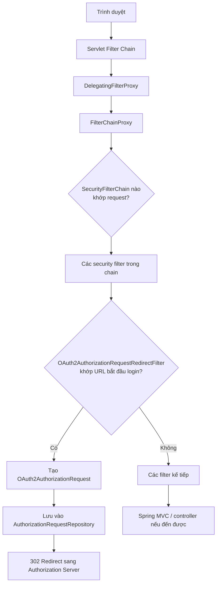
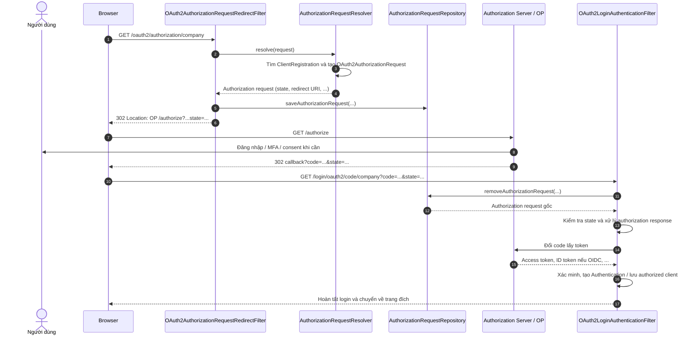
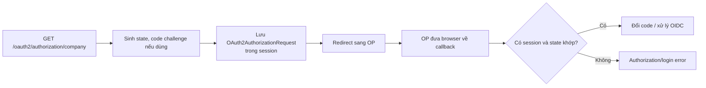

# 7.3. OAuth2AuthorizationRequestRedirectFilter trong chuỗi filter

Khi ứng dụng Spring Boot dùng **Spring Security OAuth 2.0 / OIDC Client** cho đăng nhập Servlet, một yêu cầu HTTP như `GET /oauth2/authorization/company` có thể dẫn đến phản hồi `302 Found` chuyển trình duyệt tới Authorization Server. Thành phần thực hiện bước bắt đầu này là **`OAuth2AuthorizationRequestRedirectFilter`**.

Filter này có nhiệm vụ **tạo và lưu yêu cầu ủy quyền OAuth 2.0, rồi chuyển hướng trình duyệt đến authorization endpoint**. Nó nằm trong chuỗi filter của Spring Security, tham gia **giai đoạn đầu của Authorization Code Flow**. Filter không tự đăng nhập người dùng, không nhận authorization code ở callback, không đổi code lấy token và không xác minh ID token.

Bài học đi từ vị trí filter trong kiến trúc Servlet đến luồng chạy thực tế, các thành phần phụ thuộc, cấu hình mặc định, cách tùy chỉnh và phương pháp chẩn đoán lỗi.

## 1. Đặt filter vào đúng chuỗi xử lý Servlet

Một ứng dụng Spring MVC có thể có nhiều servlet filter: xử lý encoding, tracing, proxy, session và bảo mật. Spring Security đóng góp **`FilterChainProxy`**, được tích hợp vào servlet container qua cơ chế như `DelegatingFilterProxy`. `FilterChainProxy` chọn **một `SecurityFilterChain` phù hợp** với request, sau đó lần lượt chạy các security filter của chain đó.

Khi cấu hình `oauth2Login()`, Spring Security bổ sung các thành phần cần thiết cho đăng nhập OAuth 2.0/OIDC, bao gồm filter **khởi động chuyển hướng** và filter **xử lý callback**.



Ở cấu hình mặc định, URL khởi động thường là:

```text
GET /oauth2/authorization/{registrationId}
```

Ví dụ:

```text
GET /oauth2/authorization/company
```

**`registrationId`** là tên của `ClientRegistration` trong ứng dụng, **không nhất thiết trùng `client_id`** tại Authorization Server.

Đối với request không khớp endpoint khởi động, filter thường gọi tiếp `filterChain.doFilter(...)` để những filter phía sau xử lý. Đối với request khớp và đủ dữ liệu hợp lệ, filter gửi redirect rồi kết thúc nhánh xử lý request hiện tại. Phản hồi không đi tới controller MVC thông thường.

### Vị trí tương đối quan trọng hơn thứ tự số

Trong chain đăng nhập Servlet, hai filter đáng nhận diện là:

1. **`OAuth2AuthorizationRequestRedirectFilter`**: chặn request *bắt đầu* luồng authorization và chuyển hướng đến Authorization Server.
2. **`OAuth2LoginAuthenticationFilter`**: xử lý *callback* chứa authorization response khi browser trở lại ứng dụng.

Các filter khác phụ trách security context, exception handling, authorization, session, logout và những cơ chế xác thực có bật. Tập filter thực tế còn tùy cấu hình; không nên coi một thứ tự liệt kê cố định là API ổn định xuyên suốt phiên bản.

**Mối liên hệ cốt lõi:** filter redirect tạo yêu cầu, **filter login callback sử dụng lại yêu cầu đó** để kiểm tra ngữ cảnh và hoàn tất xác thực.

## 2. Trước khi filter chạy: ClientRegistration

Spring Security cần biết **client nào sẽ xin quyền**. Cấu hình Spring Boot thường có dạng:

```yaml
spring:
  security:
    oauth2:
      client:
        registration:
          company:
            provider: company
            client-id: ${OIDC_CLIENT_ID}
            client-secret: ${OIDC_CLIENT_SECRET}
            authorization-grant-type: authorization_code
            redirect-uri: "{baseUrl}/login/oauth2/code/{registrationId}"
            scope:
              - openid
              - profile
              - email
        provider:
          company:
            issuer-uri: https://id.example.test/realms/company
```

Đây là cấu hình minh họa cho một **web application có backend**; URL issuer phải được thay bằng issuer thực tế có metadata phù hợp. Không đưa client secret thật vào Git.

Ở ví dụ trên:

- **`company`** là `registrationId`, được URL `/oauth2/authorization/company` dùng để tìm client.
- **`client-id`** là định danh được đăng ký tại Authorization Server.
- **`authorization-grant-type` = `authorization_code`** cho biết client sẽ đổi authorization code lấy token.
- **`scope`** gồm `openid`, vì vậy đây là một yêu cầu đăng nhập OIDC.
- **`redirect-uri`** là địa chỉ callback về ứng dụng; khác với URL bắt đầu đăng nhập.
- **`issuer-uri`** cho phép Spring Security/Boot sử dụng OIDC/OAuth metadata discovery phù hợp với nhà cung cấp.

`ClientRegistrationRepository` dùng để nạp registration theo `registrationId`. Ví dụ một triển khai phổ biến là `InMemoryClientRegistrationRepository`.

Filter redirect **không tự suy ra client_id từ URL một cách tùy ý**; nó dùng `registrationId` để truy vấn registration đã cấu hình và từ đó xây yêu cầu authorization có thông tin đúng của client.

## 3. Hai endpoint không được nhầm lẫn

| Vai trò | Endpoint mặc định | Filter liên quan |
| --- | --- | --- |
| **Bắt đầu OAuth2 Login** | `/oauth2/authorization/{registrationId}` | `OAuth2AuthorizationRequestRedirectFilter` |
| **Nhận callback sau khi OP xác thực** | `/login/oauth2/code/{registrationId}` | `OAuth2LoginAuthenticationFilter` |

Một luồng hợp lệ có thể là:

```text
1. Browser -> GET https://app.example.test/oauth2/authorization/company
2. App     -> 302 Location: https://id.example.test/.../authorize?...
3. Browser -> GET https://id.example.test/.../authorize?...
4. OP      -> 302 Location: https://app.example.test/login/oauth2/code/company?code=...&state=...
5. Browser -> GET https://app.example.test/login/oauth2/code/company?code=...&state=...
6. App     -> POST token endpoint (server-side)
7. App     -> Establish authentication/session; redirect to original destination
```

**`/oauth2/authorization/company` không phải callback URI đăng ký ở OP.** Callback thường là `/login/oauth2/code/company`. Nếu đăng ký nhầm URL khởi động là redirect URI, bạn có thể tạo vòng chuyển hướng hoặc khiến OP từ chối yêu cầu.

Phần **trang đích sau đăng nhập thành công** (ví dụ `/account`) là một khái niệm khác nữa: ứng dụng đưa người dùng tới đó sau khi đã hoàn tất xử lý callback.

## 4. Điều gì xảy ra khi request đi vào OAuth2AuthorizationRequestRedirectFilter?

### Bước 1 — Xác định request có phải yêu cầu bắt đầu authorization

Filter nhận `HttpServletRequest` qua `doFilterInternal(...)`. Nó sử dụng **`OAuth2AuthorizationRequestResolver`** để xác định có thể tạo authorization request từ HTTP request hiện tại hay không.

Trong thiết lập mặc định, `DefaultOAuth2AuthorizationRequestResolver` nhận `ClientRegistrationRepository` cùng base URI:

```text
/oauth2/authorization
```

Với request `/oauth2/authorization/company`, resolver lấy registration `company`. Với request không khớp, resolver không tạo authorization request cho filter, và luồng thường tiếp tục qua filter chain.

### Bước 2 — Tạo OAuth2AuthorizationRequest

Một `OAuth2AuthorizationRequest` mô tả ý định xin quyền. Những thành phần quan trọng gồm:

| Thành phần | Ý nghĩa |
| --- | --- |
| **Authorization URI** | Endpoint của Authorization Server, ví dụ `https://id.example.test/.../authorize` |
| **`response_type=code`** | Yêu cầu Authorization Code Flow |
| **`client_id`** | Định danh client với OP/AS |
| **`scope`** | Quyền hoặc thông tin OIDC được yêu cầu |
| **`redirect_uri`** | Callback về client sau khi authorization kết thúc |
| **`state`** | Giá trị ngẫu nhiên để liên kết response với request ban đầu |
| **`code_challenge`, `code_challenge_method`** | Tham số PKCE khi áp dụng |
| **`nonce` và tham số mở rộng** | Tham số liên quan OIDC hoặc yêu cầu đặc thù từ OP khi được sử dụng |

Phần URL gửi tới OP có thể trông như sau:

```http
GET /realms/company/protocol/openid-connect/auth?
    response_type=code&
    client_id=web-company&
    scope=openid%20profile%20email&
    redirect_uri=https%3A%2F%2Fapp.example.test%2Flogin%2Foauth2%2Fcode%2Fcompany&
    state=example-random-state&
    code_challenge=example-s256-challenge&
    code_challenge_method=S256 HTTP/1.1
Host: id.example.test
```

Các giá trị `state` và `code_challenge` ở đây chỉ là placeholder; giá trị thực cần được thư viện sinh đúng chuẩn, không hardcode.

Không phải mọi triển khai đều hiển thị cùng tham số mở rộng. Chẳng hạn, PKCE có được áp dụng tự động hay cần cấu hình thêm phụ thuộc kiểu client và phiên bản/cấu hình Spring Security. Khi dùng OIDC, nonce và xử lý xác minh ID token thuộc ngữ cảnh OIDC, không nên tự tạo tham số theo một chuỗi cố định.

### Bước 3 — Lưu OAuth2AuthorizationRequest trước khi rời ứng dụng

Filter sử dụng **`AuthorizationRequestRepository<OAuth2AuthorizationRequest>`** để giữ yêu cầu gốc qua hai lần HTTP request khác nhau: lần đầu đi từ ứng dụng sang OP và lần sau quay về callback.

Mặc định trong cấu hình Servlet phổ biến, repository là **`HttpSessionOAuth2AuthorizationRequestRepository`**: thông tin authorization request được lưu trong **HTTP session**.

Vì sao phải lưu? Khi callback trở lại, Spring Security cần xác định:

- Callback có tương ứng một request mà chính ứng dụng đã khởi động không?
- `state` có trùng giá trị ban đầu không?
- Client registration và redirect URI liên quan là gì?
- Có những thuộc tính nội bộ cần thiết nào để hoàn tất Authorization Code / PKCE / OIDC?

Nếu request gốc biến mất, callback có thể thất bại dù OP đã xác thực người dùng thành công.

### Bước 4 — Gửi HTTP redirect tới Authorization Server

Sau khi đã tạo và lưu yêu cầu, filter dùng **`RedirectStrategy`** để trả một chuyển hướng HTTP tới authorization endpoint với query parameters được mã hóa.

```http
HTTP/1.1 302 Found
Location: https://id.example.test/realms/company/protocol/openid-connect/auth?response_type=code&client_id=web-company&...
Set-Cookie: JSESSIONID=<session-id>; Path=/; HttpOnly
```

`Set-Cookie` là một ví dụ có thể xuất hiện khi server tạo/cập nhật session; chính sách cookie và thời điểm cấp session ID tùy cấu hình. Không nên cho rằng mọi redirect đều chắc chắn phát sinh cookie mới.

Khi browser nhận 302, nó đến Authorization Server. Ở thời điểm này **ứng dụng Spring Boot chưa được cấp access token cho lần authorization đó**, và **`OAuth2AuthorizationRequestRedirectFilter` đã hoàn tất việc cần làm**.

### Bước 5 — Callback do filter khác xử lý

Authorization Server thực hiện đăng nhập, MFA hoặc consent theo chính sách. Sau khi xong, browser quay về callback:

```text
GET /login/oauth2/code/company?code=...&state=...
```

**`OAuth2LoginAuthenticationFilter`** chịu trách nhiệm tiếp nhận response. Nó lấy lại authorization request đã lưu từ `AuthorizationRequestRepository` và tiếp tục xác thực authorization response. Các thành phần OAuth2/OIDC authentication provider thực hiện đổi code lấy token và kiểm tra OIDC phù hợp.

Sau login thành công, Spring Security thiết lập `Authentication` trong `SecurityContext` và lưu `OAuth2AuthorizedClient` theo cơ chế tương ứng. Đó là những bước **sau** phạm vi của filter redirect.

## 5. Sơ đồ trình tự hoàn chỉnh qua hai filter



Sơ đồ trình bày **luồng trách nhiệm logic**: token exchange và kiểm tra OIDC được các authentication provider/service phía sau `OAuth2LoginAuthenticationFilter` phối hợp thực hiện, không phải HTTP filter trực tiếp tự viết toàn bộ giao thức.

## 6. Phân biệt những repository thường bị nhầm

Tên repository xuất hiện nhiều trong OAuth2/OIDC nhưng mục đích khác nhau:

| Thành phần | Lưu cái gì? | Giai đoạn |
| --- | --- | --- |
| **`ClientRegistrationRepository`** | Cấu hình client: ID, secret, endpoint, scope, redirect URI | Khi dựng authorization request và lấy cấu hình client |
| **`AuthorizationRequestRepository<OAuth2AuthorizationRequest>`** | Authorization request đang chờ, gồm `state` và metadata liên quan | Trước redirect → callback |
| **`OAuth2AuthorizedClientRepository`** / **`OAuth2AuthorizedClientService`** | Token đã được cấp cho registration + principal | Sau khi authorization thành công, khi gọi API |
| **`SecurityContextRepository`** | SecurityContext chứa Authentication của người dùng | Duy trì đăng nhập giữa các request |
| **`RequestCache`** | Request gốc người dùng muốn truy cập, ví dụ `/reports` | Đưa người dùng về tài nguyên sau xác thực |

Ví dụ người dùng mở `/reports` khi chưa đăng nhập:

1. Spring Security có thể lưu request `/reports` vào `RequestCache`.
2. Khi bắt đầu OAuth2 Login, `OAuth2AuthorizationRequestRedirectFilter` lưu authorization request (có `state`) vào `AuthorizationRequestRepository`.
3. Khi callback thành công, ứng dụng lưu authentication và authorized client.
4. Success handler có thể đưa người dùng trở về `/reports`.

**Không dùng OAuth2AuthorizedClientRepository để thay thế AuthorizationRequestRepository.** Một đối tượng chứa token *sau* khi cấp quyền; đối tượng còn lại lưu trạng thái *trước* khi nhận code.

## 7. Bắt đầu đăng nhập bằng đường dẫn mặc định

Với Spring Boot web application, dependency phổ biến gồm:

```xml
<dependency>
    <groupId>org.springframework.boot</groupId>
    <artifactId>spring-boot-starter-security</artifactId>
</dependency>
<dependency>
    <groupId>org.springframework.boot</groupId>
    <artifactId>spring-boot-starter-oauth2-client</artifactId>
</dependency>
```

Cấu hình Spring Security theo kiểu `SecurityFilterChain`:

```java
import org.springframework.context.annotation.Bean;
import org.springframework.context.annotation.Configuration;
import org.springframework.security.config.Customizer;
import org.springframework.security.config.annotation.web.builders.HttpSecurity;
import org.springframework.security.web.SecurityFilterChain;

@Configuration
class SecurityConfig {

    @Bean
    SecurityFilterChain securityFilterChain(HttpSecurity http) throws Exception {
        return http
            .authorizeHttpRequests(authorize -> authorize
                .requestMatchers("/", "/public/**", "/error").permitAll()
                .anyRequest().authenticated())
            .oauth2Login(Customizer.withDefaults())
            .build();
    }
}
```

Thêm một liên kết ở trang đăng nhập hoặc trang chủ:

```html
<a href="/oauth2/authorization/company">
    Đăng nhập bằng tài khoản công ty
</a>
```

Nếu cấu hình OIDC đúng, browser truy cập liên kết sẽ nhận redirect sang OP. Trong trường hợp không tự tạo trang đăng nhập, Spring Security có thể sinh trang login mặc định với các liên kết tới client registration được nhận biết.

**Tại sao không cần controller `@GetMapping("/oauth2/authorization/company")`?** Bởi filter chặn request trong security chain **trước khi tới Spring MVC**. Viết controller trùng endpoint thường không cần thiết và dễ che khuất nguyên nhân của lỗi.

**Lưu ý:** filter có thể không được gọi nếu request không đi qua SecurityFilterChain có `oauth2Login()`, hoặc một filter trước đó đã kết thúc request.

## 8. Cách người dùng đi đến filter: tự bấm login và bị chặn ở trang bảo vệ

Có hai tình huống dễ nhầm:

### Tình huống A — Người dùng chủ động bấm “Đăng nhập”

```text
GET /oauth2/authorization/company
    -> OAuth2AuthorizationRequestRedirectFilter
    -> 302 Authorization Server
```

Đây là đường dẫn trực tiếp vào filter redirect, độc lập với việc người dùng trước đó đã truy cập tài nguyên nào.

### Tình huống B — Người dùng truy cập URL cần xác thực

```text
GET /private
    -> authorization kiểm tra yêu cầu
    -> AuthenticationEntryPoint khởi động hành vi đăng nhập
    -> trình duyệt tới trang login hoặc registration URL
    -> GET /oauth2/authorization/company
    -> OAuth2AuthorizationRequestRedirectFilter
    -> 302 Authorization Server
```

Với cấu hình mặc định và nhiều client registration, người dùng thường thấy trang lựa chọn provider. Nếu ứng dụng cấu hình entry point hoặc success/login behavior khác, có thể chuyển thẳng sang một registration cụ thể.

**`OAuth2AuthorizationRequestRedirectFilter` không phải filter quyết định người dùng được vào `/private` hay không.** Chức năng phân quyền thuộc các filter authorization và exception handling. Filter redirect chỉ xử lý request bắt đầu authorization, theo URI/resolver đã cấu hình.

## 9. Đổi base URI của filter redirect

Spring Security cho phép thay URL **bắt đầu** OAuth2 Login, ví dụ từ:

```text
/oauth2/authorization/company
```

sang:

```text
/sso/start/company
```

Cấu hình:

```java
import org.springframework.context.annotation.Bean;
import org.springframework.context.annotation.Configuration;
import org.springframework.security.config.annotation.web.builders.HttpSecurity;
import org.springframework.security.web.SecurityFilterChain;

@Configuration
class SecurityConfig {

    @Bean
    SecurityFilterChain securityFilterChain(HttpSecurity http) throws Exception {
        return http
            .authorizeHttpRequests(auth -> auth
                .requestMatchers("/", "/login", "/error").permitAll()
                .anyRequest().authenticated())
            .oauth2Login(oauth2 -> oauth2
                .loginPage("/login")
                .authorizationEndpoint(authorization ->
                    authorization.baseUri("/sso/start")))
            .build();
    }
}
```

Lúc này trang `/login` do ứng dụng tự cung cấp cần liên kết tới:

```html
<a href="/sso/start/company">Đăng nhập SSO</a>
```

Nếu bạn khai báo `loginPage("/login")`, phải có controller/view hoặc route thực sự phục vụ `/login`. Khi tự dùng trang login, Spring Security không tự sinh nội dung trang riêng cho ứng dụng.

**Đổi base URI khởi động không đổi callback URI.** Với cấu hình trên, callback vẫn là:

```text
/login/oauth2/code/company
```

Muốn thay callback path, bạn phải cấu hình riêng cả:

- `spring.security.oauth2.client.registration.company.redirect-uri`, ví dụ `{baseUrl}/sso/callback/{registrationId}`;
- `oauth2Login(oauth2 -> oauth2.redirectionEndpoint(redirection -> redirection.baseUri("/sso/callback/*")))`;
- Allowlist Redirect URI cho client tại Authorization Server.

Hai tên hơi giống nhau nhưng là hai endpoint độc lập:

```text
authorizationEndpoint().baseUri(...)   -> URL trong ứng dụng để BẮT ĐẦU login
redirectionEndpoint().baseUri(...)     -> URL trong ứng dụng để NHẬN callback
```

## 10. Tùy chỉnh OAuth2AuthorizationRequestResolver

`OAuth2AuthorizationRequestResolver` là extension point để thay đổi cách tạo `OAuth2AuthorizationRequest`. Lựa chọn mặc định là **`DefaultOAuth2AuthorizationRequestResolver`**; nó tra cứu `ClientRegistration` và dựng request với các giá trị OAuth2/OIDC phù hợp.

Cần tùy chỉnh khi Authorization Server đòi hỏi những tham số hợp lệ như:

- `prompt=login` để yêu cầu người dùng xác thực lại theo chính sách OP.
- `login_hint` khi đã biết danh tính cần gợi ý.
- `acr_values` cho mức xác thực cần yêu cầu nếu OP hỗ trợ.
- `code_challenge` với PKCE khi cần bật hoặc kiểm soát cụ thể.
- Những `additionalParameters` khác được OP tài liệu hóa.

Ví dụ cấu hình một resolver thêm `prompt=login` cho registration `company`:

```java
import java.util.LinkedHashMap;
import java.util.Map;

import org.springframework.context.annotation.Bean;
import org.springframework.context.annotation.Configuration;
import org.springframework.security.config.annotation.web.builders.HttpSecurity;
import org.springframework.security.oauth2.client.registration.ClientRegistrationRepository;
import org.springframework.security.oauth2.client.web.DefaultOAuth2AuthorizationRequestResolver;
import org.springframework.security.oauth2.client.web.OAuth2AuthorizationRequestRedirectFilter;
import org.springframework.security.web.SecurityFilterChain;

@Configuration
class OAuth2RequestConfig {

    @Bean
    SecurityFilterChain securityFilterChain(
            HttpSecurity http,
            ClientRegistrationRepository registrations) throws Exception {

        var resolver = new DefaultOAuth2AuthorizationRequestResolver(
            registrations,
            OAuth2AuthorizationRequestRedirectFilter.DEFAULT_AUTHORIZATION_REQUEST_BASE_URI);

        resolver.setAuthorizationRequestCustomizer(builder ->
            builder.additionalParameters(params -> params.put("prompt", "login")));

        return http
            .authorizeHttpRequests(auth -> auth
                .requestMatchers("/", "/error").permitAll()
                .anyRequest().authenticated())
            .oauth2Login(oauth2 -> oauth2
                .authorizationEndpoint(endpoint ->
                    endpoint.authorizationRequestResolver(resolver)))
            .build();
    }
}
```

Ở ví dụ, `prompt=login` luôn được thêm vào các authorization request mà resolver xử lý; nếu ứng dụng có nhiều registration, cần thiết kế điều kiện theo registration cụ thể thay vì áp dụng chung. Hãy xác minh tham số được OP hỗ trợ và thực sự cần cho nghiệp vụ.

Cách cấu hình này **tùy biến request được tạo bởi filter**, không tự thay thế toàn bộ filter. Nó giúp giữ nguyên cách Spring Security lưu request, kiểm tra state và xử lý callback, đồng thời cho phép điều chỉnh yêu cầu gửi tới OP.

### Khi cần PKCE

Spring Security cung cấp hỗ trợ PKCE, bao gồm customizer như:

```java
import org.springframework.security.oauth2.client.web.OAuth2AuthorizationRequestCustomizers;

// Nếu cần cấu hình customizer PKCE trên DefaultOAuth2AuthorizationRequestResolver:
resolver.setAuthorizationRequestCustomizer(
    OAuth2AuthorizationRequestCustomizers.withPkce());
```

Đây là minh họa riêng về customizer; nếu còn cần `prompt`, hãy tổ hợp tùy biến theo cơ chế phù hợp thay vì gọi `setAuthorizationRequestCustomizer` hai lần rồi tưởng cả hai cấu hình đều còn.

**Bảo mật:** không chèn `client_secret`, access token, refresh token hoặc dữ liệu nhạy cảm vào authorize URL. Query string có thể xuất hiện trong browser history, proxy log hoặc công cụ giám sát. `state` và `code_verifier` phải được sinh/xử lý an toàn bởi thư viện, không hardcode một giá trị toàn cục.

## 11. AuthorizationRequestRepository: vai trò của HTTP session

Giữa lúc browser đi sang OP rồi quay lại, Spring Boot xử lý **hai HTTP request riêng**. `HttpSessionOAuth2AuthorizationRequestRepository` lưu authorization request qua session để callback có thể tìm lại bằng `state`.



**Hệ quả vận hành:**

- Browser phải giữ cookie phiên theo cơ chế session đã cấu hình khi chuyển qua lại với OP.
- Nếu ứng dụng có nhiều instance và lưu session cục bộ, callback vào instance khác có thể không thấy authorization request ban đầu.
- Nếu request đi qua các host khác nhau, cookie có thể không được gửi lại theo domain/path/chính sách bảo mật.
- Nếu cấu hình callback dựa vào redirect URI công khai sai scheme/host, browser có thể sang origin khác và làm mất tương quan session.
- Với session hết hạn hoặc ứng dụng restart trong khi người dùng còn ở OP, dữ liệu yêu cầu có thể biến mất.

Có thể sử dụng một `AuthorizationRequestRepository` tùy biến khi cần, nhưng đây là thay đổi liên quan đến **state, CSRF, PKCE và dữ liệu nhạy cảm**. Việc chuyển sang cookie hoặc kho lưu trữ khác phải bảo vệ tính toàn vẹn, bảo mật và thời hạn của dữ liệu, cũng như phù hợp với flow callback. Không nên tự vô hiệu hóa bước liên kết request/response để tránh lỗi session.

## 12. Tùy chỉnh repository trong DSL

Một ứng dụng có thể cấu hình repository cụ thể cho authorization request:

```java
import org.springframework.context.annotation.Bean;
import org.springframework.context.annotation.Configuration;
import org.springframework.security.config.annotation.web.builders.HttpSecurity;
import org.springframework.security.oauth2.client.web.AuthorizationRequestRepository;
import org.springframework.security.oauth2.client.web.HttpSessionOAuth2AuthorizationRequestRepository;
import org.springframework.security.oauth2.core.endpoint.OAuth2AuthorizationRequest;
import org.springframework.security.web.SecurityFilterChain;

@Configuration
class AuthorizationRequestStorageConfig {

    @Bean
    AuthorizationRequestRepository<OAuth2AuthorizationRequest> authorizationRequestRepository() {
        return new HttpSessionOAuth2AuthorizationRequestRepository();
    }

    @Bean
    SecurityFilterChain chain(
            HttpSecurity http,
            AuthorizationRequestRepository<OAuth2AuthorizationRequest> requests) throws Exception {
        return http
            .authorizeHttpRequests(auth -> auth
                .requestMatchers("/", "/error").permitAll()
                .anyRequest().authenticated())
            .oauth2Login(oauth2 -> oauth2
                .authorizationEndpoint(endpoint ->
                    endpoint.authorizationRequestRepository(requests)))
            .build();
    }
}
```

Đoạn code nhấn mạnh dependency giữa filter redirect và repository; trong đa số ứng dụng Servlet đơn giản, bạn có thể dùng mặc định và không cần tạo bean riêng. Khi tùy biến, hãy chắc chắn **cơ chế lưu và tải authorization request ở callback tương thích**, không để hai giai đoạn dùng hai nơi lưu khác nhau.

## 13. Khi có nhiều SecurityFilterChain

Một dự án có API stateless, website Servlet login và endpoint actuator có thể khai báo nhiều `SecurityFilterChain`. `FilterChainProxy` chọn chain khớp đầu tiên theo thứ tự. Điều này ảnh hưởng trực tiếp đến việc filter redirect có cơ hội chạy hay không.

Ví dụ ý tưởng:

```text
SecurityFilterChain A: /api/**
    -> Bearer token / API security
SecurityFilterChain B: /**
    -> oauth2Login()
    -> OAuth2AuthorizationRequestRedirectFilter
```

Nếu route `/oauth2/authorization/company` chỉ đi vào chain A hoặc không đi vào chain có `oauth2Login()`, filter redirect sẽ không xử lý dù registration tồn tại.

Tương tự, cấu hình `securityMatcher("/app/**")` giới hạn hẳn phạm vi chain; đưa endpoint khởi động `/oauth2/authorization/**` ra ngoài phạm vi ấy mà không có chain khác chứa filter login sẽ làm flow không khởi động được.

**Phân biệt:**

- **`securityMatcher(...)`** quyết định **chain này có xử lý request hay không**.
- **`authorizeHttpRequests(...requestMatchers(...).permitAll())`** quyết định một request đã qua chain có được cho phép ở bước authorization không.
- Một filter nằm **trước** bước authorization có thể nhận request và gửi redirect ngay cả khi endpoint đó được khai báo `permitAll()`.

Bởi vậy, khi khởi động OAuth2 Login bị 404 hoặc không redirect, hãy kiểm tra chain matching và filter list trước khi thử tự viết controller ở URL của filter.

## 14. Những lỗi điển hình liên quan trực tiếp filter redirect

| Hiện tượng | Điều cần xác minh | Cách xử lý |
| --- | --- | --- |
| `GET /oauth2/authorization/company` trả 404 | Có chain chứa filter? `oauth2Login()` được bật? Có đổi base URI không? | Đưa endpoint vào đúng SecurityFilterChain, dùng đúng base URI |
| Truy cập URL bắt đầu login nhưng không được chuyển sang OP | Resolver có nhận request và tìm registration `company` không? Filter trước có chặn request không? | Kiểm tra path, filter list, `ClientRegistrationRepository` |
| Lỗi `Invalid Client Registration` hoặc không tìm thấy registration | `registrationId` trên URL khác key cấu hình | Dùng key chính xác; phân biệt registration ID với client ID |
| 302 tới OP nhưng OP báo `invalid_redirect_uri` | Tham số `redirect_uri` gửi đi không có trong allowlist, hoặc sinh host/scheme sai | Đối chiếu URL thực, cấu hình proxy/forwarded headers và OP |
| 302 tới `http://app-internal:8080` | Spring suy ra origin nội bộ sau reverse proxy | Chỉ tin header từ proxy đáng tin; cấu hình forwarded headers hoặc redirect URI tường minh |
| OP đăng nhập xong nhưng callback lỗi state/correlation | Session, cookie, state hoặc authorization request bị mất | Kiểm tra session affinity/replication, cookie, TTL, callback origin |
| Callback `/login/oauth2/code/company` trả 404/không login | Callback thuộc filter khác; path hoặc SecurityFilterChain không khớp | Kiểm tra `OAuth2LoginAuthenticationFilter` và `redirectionEndpoint().baseUri` |
| Authorization request thiếu `prompt` hay PKCE theo yêu cầu | Resolver/customizer chưa được áp dụng hoặc bị ghi đè | Kiểm tra resolver được gắn vào DSL và tham số authorize thực tế |
| Login thành công nhưng không vào trang ban đầu | RequestCache/success handler/config session | Phân biệt saved request với authorization request repository |
| Ứng dụng trả vòng lặp tới login liên tục | Không lưu Authentication/session; cookie bị chặn | Kiểm tra success flow và security context persistence |

### Trường hợp 1 — Bị nhầm giữa authorize URL và callback

Sai ý tưởng:

```yaml
spring:
  security:
    oauth2:
      client:
        registration:
          company:
            redirect-uri: "{baseUrl}/oauth2/authorization/company"
```

URL đó là điểm **bắt đầu** authorization. Nếu OP đưa browser về đây với `code`, filter redirect có thể cố khởi động authorization mới thay vì tiếp nhận callback đúng cách.

Cấu hình thông thường:

```yaml
redirect-uri: "{baseUrl}/login/oauth2/code/{registrationId}"
```

Và đăng ký callback tương ứng ở OP.

### Trường hợp 2 — Staging chuyển hướng với hostname nội bộ

Ứng dụng public `https://staging.app.example.test` nhưng authorization request lại có:

```text
redirect_uri=http://spring-app:8080/login/oauth2/code/company
```

Đây thường là vấn đề cách app dựng `{baseUrl}` qua reverse proxy. Đảm bảo proxy truyền scheme/host/port công khai qua forwarded headers và Spring sử dụng chúng đúng cách. Hoặc cung cấp redirect URI tuyệt đối theo môi trường. Đồng thời chỉ tin header từ proxy được kiểm soát.

### Trường hợp 3 — 302 thành công, callback vẫn báo lỗi

Điều này cho biết filter redirect **đã chạy tới giai đoạn chuyển hướng**, nhưng phần xử lý callback có thể không tìm được request gốc. Kiểm tra `JSESSIONID`, cookie `SameSite`/`Secure`, host, session replication và state. Không bỏ kiểm tra `state` để làm cho callback “được phép” đi qua.

## 15. Quan sát hoạt động trong ứng dụng

### 15.1. Quan sát Network trong trình duyệt

Các bước có ích:

1. Mở trang ứng dụng bằng URL công khai thực tế.
2. Truy cập `/oauth2/authorization/company`.
3. Trong Developer Tools → Network, xem response HTTP của request này.
4. Xác nhận có mã redirect (thường là 302) và `Location` trỏ tới authorization endpoint đã kỳ vọng.
5. Giải mã `client_id`, `response_type`, `scope` và `redirect_uri` để đối chiếu với registration và OP.
6. Sau đăng nhập thử nghiệm, kiểm tra callback tới `/login/oauth2/code/company` và ứng dụng tạo phiên đúng.

Các tham số như `state`, `nonce` và `code_challenge` có thể cần xem có tồn tại hay không; **không chia sẻ nguyên giá trị** trong log hoặc ticket. Tuyệt đối không chia sẻ authorization code, ID token, access token hay refresh token.

### 15.2. Dùng log filter chain khi debug

Có thể bật log bảo mật ở mức DEBUG trong môi trường được kiểm soát:

```yaml
logging:
  level:
    org.springframework.security.web.FilterChainProxy: DEBUG
    org.springframework.security.oauth2.client: DEBUG
```

Mục đích là quan sát **request đã đi qua chain nào**, đã bắt đầu login hay chưa và lỗi ở giai đoạn nào. Tránh bật TRACE rộng hoặc lưu nguyên HTTP headers, authorize URL, token response trong production. Sau khi xác định lỗi, nên tắt log chi tiết.

### 15.3. Kiểm tra bằng curl ở mức tối thiểu

Với một app chạy local:

```bash
curl -i http://localhost:8080/oauth2/authorization/company
```

Bạn thường có thể nhìn thấy `HTTP/1.1 302` và `Location` trỏ sang OP. Đây chỉ là cách quan sát **bước khởi động**. `curl` không thay thế một trình duyệt có cookie/session và tương tác đăng nhập khi kiểm thử toàn bộ OIDC Login.

## 16. Ranh giới bảo mật của filter redirect

Filter redirect là một điểm quan trọng của giao thức, nhưng không nên đặt toàn bộ trách nhiệm bảo mật vào một filter.

**1. Giữ `state` và authorization request correlation.** Đây là cơ chế quan trọng để liên kết callback với request khởi đầu và chống login CSRF/mix-up trong ngữ cảnh phù hợp. Không cấu hình resolver tùy biến làm mất hoặc dùng lại một `state` cố định.

**2. Không chấp nhận Redirect URI tùy ý từ người dùng.** Redirect URI gửi sang OP phải được xây từ client registration/cấu hình đã tin cậy và khớp allowlist đã đăng ký. Không tự lấy `returnUrl` do người dùng cung cấp làm OAuth callback.

**3. Sử dụng Authorization Code + PKCE khi phù hợp.** PKCE giúp bảo vệ code interception; đặc biệt quan trọng với public clients. Backend có client secret vẫn cần cấu hình login, token và OIDC đúng chuẩn.

**4. Đừng cho mã độc truy cập token/secret.** Client secret không thuộc authorize URL; access token và ID token không phải dữ liệu được filter redirect trả ra ở front channel trong Authorization Code Flow chuẩn.

**5. Xử lý session/cookie an toàn.** Với Servlet login, authorization request thường được lưu trong HTTP session; dùng HTTPS, cookie `HttpOnly`/`Secure` và `SameSite` phù hợp, cùng cơ chế session nhất quán trên nhiều instance.

**6. Tin cậy origin chính xác.** Nếu app sau reverse proxy, các header `Forwarded` / `X-Forwarded-*` cần được kiểm soát tại proxy; không để client tùy ý quyết định host hay scheme trong `redirect_uri`.

**7. Phân biệt authorization request với authorization policy.** Request `/oauth2/authorization/company` kích hoạt luồng login; việc user sau đó được truy cập API nào vẫn phụ thuộc authentication, token scope, audience và authorization tại ứng dụng/Resource Server.

## 17. Bài tập tình huống

### Bài 1 — Tìm đúng filter

Browser gọi:

```text
GET /oauth2/authorization/company
```

Sau đó ứng dụng trả:

```text
HTTP/1.1 302 Found
Location: https://id.example.test/.../authorize?client_id=...&state=...
```

**Hỏi:** Bộ phận nào tạo chuyển hướng này, và đã có access token ở thời điểm đó chưa?

> `OAuth2AuthorizationRequestRedirectFilter` tạo và lưu `OAuth2AuthorizationRequest` rồi redirect browser tới authorization endpoint. Chưa có access token được cấp cho lần yêu cầu này chỉ từ bước chuyển hướng.

### Bài 2 — Phân biệt hai kho lưu trữ

Trước khi redirect sang OP, ứng dụng lưu dữ liệu nào? Sau callback thành công, ứng dụng lưu dữ liệu nào?

> Trước redirect, `AuthorizationRequestRepository` giữ `OAuth2AuthorizationRequest` nhằm đối chiếu state và ngữ cảnh với callback. Sau khi được cấp token, `OAuth2AuthorizedClientRepository` hoặc service giữ `OAuth2AuthorizedClient`; `SecurityContextRepository` có thể giữ Authentication của người dùng. Đây là những trạng thái khác nhau.

### Bài 3 — Tự đổi URL bắt đầu

Bạn chuyển authorization base URI thành `/sso/start` nhưng vẫn đặt link login thành `/oauth2/authorization/company`.

**Hỏi:** Vì sao link cũ không hoạt động?

> Filter redirect đã được cấu hình để nhận đường dẫn mới. Phải đổi link thành `/sso/start/company`. Việc đổi URL bắt đầu không tự thay đổi URL callback.

### Bài 4 — Mất authorization request khi callback

Người dùng đã đăng nhập tại OP, browser quay về đúng callback và mang `code`, nhưng ứng dụng không tìm được trạng thái đã lưu.

**Hỏi:** Vì sao đây chưa chắc là lỗi Authorization Server?

> Vì trạng thái gốc thường lưu trong HTTP session của ứng dụng. Cookie thiếu, domain khác, timeout, restart hoặc nhiều instance không chia sẻ session có thể khiến callback không tải được `OAuth2AuthorizationRequest`. Cần kiểm tra session, state và routing.

### Bài 5 — Không thấy filter khi debug

Bạn bật `oauth2Login()` trong một chain chỉ có `securityMatcher("/web/**")`, rồi truy cập `/oauth2/authorization/company`.

**Hỏi:** Tại sao request không kích hoạt filter?

> Vì request không thuộc phạm vi `/web/**` nên không đi vào chain chứa filter. Cần thiết kế lại chain matcher hoặc đường dẫn bắt đầu login để request thuộc chain có OAuth2 Login.

### Bài 6 — Cần thêm `prompt=login`

**Hỏi:** Nên viết một servlet filter mới để nối chuỗi vào `Location` hay tùy chỉnh resolver?

> Dùng `OAuth2AuthorizationRequestResolver`, thường thông qua `DefaultOAuth2AuthorizationRequestResolver` với request customizer. Cách này sửa request ở đúng nơi nó được tạo, vẫn giữ logic chuẩn lưu request và xử lý callback.

## 18. Tóm tắt luồng cần nhớ

```text
ClientRegistrationRepository
    |
    v
GET /oauth2/authorization/{registrationId}
    |
    v
OAuth2AuthorizationRequestRedirectFilter
    |
    +--> OAuth2AuthorizationRequestResolver
    |        |
    |        +--> OAuth2AuthorizationRequest
    |              (client_id, scope, redirect_uri, state, PKCE...)
    |
    +--> AuthorizationRequestRepository.save(...)
    |
    +--> 302 Redirect đến Authorization Server
    |
    v
Trình duyệt đăng nhập tại Authorization Server / OpenID Provider
    |
    v
GET /login/oauth2/code/{registrationId}?code=...&state=...
    |
    v
OAuth2LoginAuthenticationFilter
    |
    +--> AuthorizationRequestRepository: tìm và loại bỏ request gốc
    +--> Kiểm tra authorization response / state
    +--> Đổi code lấy token và xác thực OIDC
    +--> Lưu Authentication, OAuth2AuthorizedClient
    |
    v
Người dùng trở về ứng dụng đã đăng nhập
```

Có thể ghi nhớ một câu: **`OAuth2AuthorizationRequestRedirectFilter` phụ trách “đi sang OP”, còn `OAuth2LoginAuthenticationFilter` phụ trách “quay về từ OP”**. Hai filter phối hợp thông qua authorization request được lưu để bảo đảm callback thuộc đúng giao dịch xác thực đã bắt đầu.

### Tài liệu tham khảo chính thức

- [Spring Security API — OAuth2AuthorizationRequestRedirectFilter](https://docs.spring.io/spring-security/reference/api/java/org/springframework/security/oauth2/client/web/OAuth2AuthorizationRequestRedirectFilter.html)
- [Spring Security API — AuthorizationRequestRepository](https://docs.spring.io/spring-security/reference/api/java/org/springframework/security/oauth2/client/web/AuthorizationRequestRepository.html)
- [Spring Security — Advanced OAuth 2.0 Login Configuration](https://docs.spring.io/spring-security/reference/servlet/oauth2/login/advanced.html)
