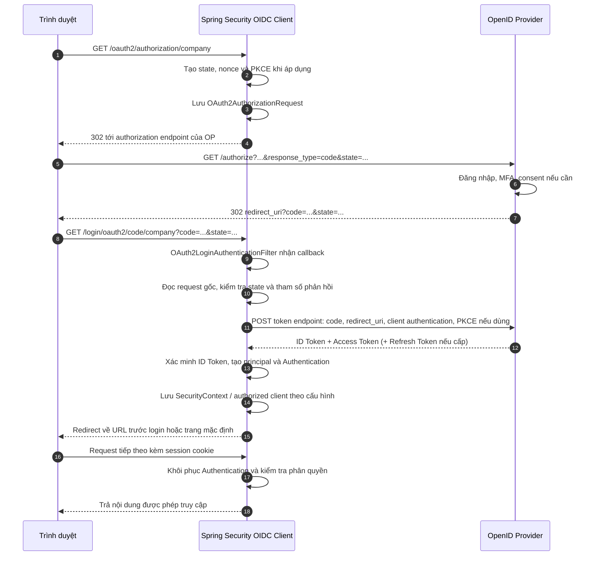

# 7.4. Endpoint nhận callback `/login/oauth2/code/{registrationId}`

Trong ứng dụng Spring Boot sử dụng **Spring Security OAuth 2.0 / OpenID Connect (OIDC) Client** trên Servlet stack, một trong những URL quan trọng nhất của luồng đăng nhập là:

```text
/login/oauth2/code/{registrationId}
```

Đây là **điểm tiếp nhận phản hồi ủy quyền (redirection/callback endpoint)**. Sau khi người dùng được chuyển đến Authorization Server hoặc OpenID Provider (OP) để đăng nhập, trình duyệt quay về endpoint này cùng với một **authorization code** và giá trị **state**. Spring Security sử dụng kết quả ấy để hoàn tất Authorization Code Flow, xác thực người dùng và thiết lập phiên đăng nhập cho ứng dụng.

Endpoint callback **không phải** URL người dùng bắt đầu đăng nhập, không phải token endpoint của OP và không phải controller nghiệp vụ cần tự tạo. Với cấu hình `oauth2Login()` theo mặc định, request được **`OAuth2LoginAuthenticationFilter`** tiếp nhận bên trong Servlet Security Filter Chain.

Bài học trình bày cấu trúc URL, từng bước xử lý callback, sự liên hệ giữa `registrationId` và authorization request ban đầu, cách cấu hình lại callback, ví dụ Spring Boot và các lỗi thường gặp khi vận hành.

## 1. Định vị callback trong luồng OAuth2/OIDC Login

Giả sử ứng dụng web có tên miền `https://orders.example.org` và đăng nhập qua OP của doanh nghiệp. Client registration trong Spring Security được đặt tên là `company`.

| URL | Hệ thống sở hữu | Vai trò |
|---|---|---|
| `https://orders.example.org/orders` | Ứng dụng | Trang nghiệp vụ yêu cầu đăng nhập. |
| `https://orders.example.org/oauth2/authorization/company` | Spring Security tại ứng dụng | Điểm **bắt đầu** OAuth2 Authorization Code Flow. |
| `https://login.example.org/.../authorize` | OpenID Provider | Authorization endpoint mà trình duyệt được chuyển đến để xác thực. |
| `https://orders.example.org/login/oauth2/code/company` | Spring Security tại ứng dụng | Điểm **nhận callback** sau khi OP trả code hoặc lỗi. |
| `https://login.example.org/.../token` | OpenID Provider | Token endpoint mà backend gọi trực tiếp để đổi authorization code lấy token. |

Khi đọc cấu hình hoặc log, cần phân biệt ba loại endpoint:

- **Authorization request entry point** (`/oauth2/authorization/company`): client tạo yêu cầu và bắt đầu redirect.
- **Redirection endpoint / callback** (`/login/oauth2/code/company`): client tiếp nhận phản hồi mà OP trả về qua trình duyệt.
- **Token endpoint** tại OP: backend của client trao đổi authorization code thành token, không phải URL để người dùng mở trực tiếp.

Trong OIDC Authorization Code Flow, **ID Token và Access Token được nhận tại token endpoint**, chứ không xuất hiện trong callback URL dưới dạng token. Callback chủ yếu nhận `code` và `state` hoặc các tham số báo lỗi của authorization response.

## 2. Ý nghĩa của `{registrationId}`

`{registrationId}` là placeholder trong URI template của Spring Security. Nó tương ứng với **khóa client registration trong cấu hình ứng dụng**.

Ví dụ:

```yaml
spring:
  security:
    oauth2:
      client:
        registration:
          company:
            provider: company-oidc
            client-id: orders-web
            client-secret: ${OIDC_CLIENT_SECRET}
            authorization-grant-type: authorization_code
            redirect-uri: "{baseUrl}/login/oauth2/code/{registrationId}"
            scope:
              - openid
              - profile
              - email
        provider:
          company-oidc:
            issuer-uri: https://login.example.org/realms/company
```

Trong ví dụ này:

| Giá trị | Ý nghĩa |
|---|---|
| `company` | Registration ID mà Spring Security dùng để tra cứu `ClientRegistration`. |
| `orders-web` | `client_id` mà OP cấp cho ứng dụng. |
| `company-oidc` | Tên alias của cấu hình provider trong Spring Boot. |
| `https://login.example.org/realms/company` | Issuer OIDC mà client tin cậy. |
| `/login/oauth2/code/company` | Đường callback sau khi thay `{registrationId}`. |

**Registration ID không nhất thiết trùng với client ID hay tên provider.** Một ứng dụng có thể có registration `employee`, `partner` hoặc `github`, mỗi registration có thông tin client và provider riêng.

Cách thay thế placeholder `{registrationId}` ảnh hưởng đến URL được gửi trong tham số `redirect_uri` của authorization request. Tuy nhiên, tính hợp lệ của callback **không chỉ dựa vào đoạn tên xuất hiện trong path**: Spring Security còn sử dụng authorization request đã được lưu trước khi chuyển hướng, đặc biệt giá trị `state` và các liên kết tới registration/provider.

### 2.1. URL có placeholder và URL thực tế

Trong cấu hình:

```yaml
redirect-uri: "{baseUrl}/login/oauth2/code/{registrationId}"
```

Giả sử public base URL của ứng dụng là `https://orders.example.org`, URL được dùng là:

```text
https://orders.example.org/login/oauth2/code/company
```

URI này phải được OP cho phép tại cấu hình đăng ký client. Nếu OP chỉ cho phép `https://orders.example.org/login/oauth2/code/company` nhưng Spring sinh `http://localhost:8080/login/oauth2/code/company`, OP có thể từ chối do `redirect_uri_mismatch` hoặc tên lỗi tương đương.

`{baseUrl}` được tính từ ngữ cảnh request và cấu hình hạ tầng. Khi có reverse proxy, ingress hoặc load balancer, cần bảo đảm Spring nhận đúng scheme/host/path công khai qua cấu hình proxy được tin cậy.

## 3. Sơ đồ toàn bộ callback trong Authorization Code Flow

Để thấy chính xác callback xuất hiện ở đâu, xét một luồng OIDC với một lần đăng nhập chưa có phiên ứng dụng:



Các giá trị `code` và `state` được chuyển qua trình duyệt vì đó là authorization response. Nhưng **token exchange** diễn ra trực tiếp giữa backend và OP. Người dùng không cần thấy hoặc nhập authorization code trong một form riêng.

Một lưu ý khi debug: trình duyệt có thể đã có cookie phiên của ứng dụng ngay từ lúc bắt đầu flow. Session đó có thể chứa authorization request chưa hoàn thành; nó **không đồng nghĩa** người dùng đã đăng nhập thành công.

## 4. Request callback trông như thế nào?

Sau khi xác thực người dùng và chấp nhận yêu cầu, OP chuyển hướng browser tới callback đã đăng ký:

```http
HTTP/1.1 302 Found
Location: https://orders.example.org/login/oauth2/code/company?code=c_6s9...&state=s_2k4...
```

Trình duyệt làm theo redirect và gửi request:

```http
GET /login/oauth2/code/company?code=c_6s9...&state=s_2k4... HTTP/1.1
Host: orders.example.org
Cookie: JSESSIONID=<session-id-if-present>
```

Ý nghĩa các phần:

| Thành phần | Nguồn | Công dụng |
|---|---|---|
| `/login/oauth2/code/company` | URI callback của client đã đăng ký | Đường mà bộ lọc OAuth2 Login cần nhận. |
| `code` | OP cấp sau khi authorization thành công | Code ngắn hạn để backend đổi lấy token. |
| `state` | Client sinh trước đó; OP trả lại nguyên giá trị | Dùng để ràng buộc callback với authorization request đã lưu. |
| Cookie phiên ứng dụng | Browser gửi theo chính sách cookie | Cho client tìm lại trạng thái authorization request khi lưu theo HTTP session. |

Đối với **Authorization Code Flow**, callback thành công thường có `code` và `state`. Mỗi authorization code chỉ dùng theo quy tắc của OP, thường là một lần với thời hạn rất ngắn.

Khi OP từ chối cấp quyền hoặc có lỗi, callback có thể là:

```http
GET /login/oauth2/code/company?error=access_denied&state=s_2k4... HTTP/1.1
Host: orders.example.org
```

Một số OP còn gửi `error_description` hoặc `error_uri`. Ứng dụng nên xem những giá trị này là **dữ liệu nhận từ bên ngoài**, không hiển thị trực tiếp thành HTML không escape và không ghi lộ thông tin nhạy cảm.

Tùy profile/protocol và cấu hình provider, authorization response có thể sử dụng thêm tham số khác, chẳng hạn `iss` trong cơ chế xác định issuer. Điều đó không làm thay đổi nguyên tắc cốt lõi: callback cần được gắn với **authorization request và issuer mà client đã lựa chọn trước đó**; không tin tưởng một provider tùy ý chỉ vì một tham số trong URL chỉ ra nó.

## 5. Thành phần nào của Spring Security nhận URL callback?

Trong ứng dụng **Servlet**, filter chính cho OAuth2 login callback là:

```text
org.springframework.security.oauth2.client.web.OAuth2LoginAuthenticationFilter
```

Filter này nằm trong **Spring Security Filter Chain** và được cấu hình bởi `oauth2Login()`. Mẫu URL xử lý mặc định tương ứng:

```text
/login/oauth2/code/*
```

Với `registrationId=company`, callback là `/login/oauth2/code/company`. Trong tài liệu và cấu hình redirect URI, thường viết dạng template `/login/oauth2/code/{registrationId}`. Trong cơ chế match request của filter, biểu thức mặc định là mẫu path có wildcard để khớp callback.

Các thành phần liên quan:

| Thành phần | Công việc |
|---|---|
| `OAuth2AuthorizationRequestRedirectFilter` | Khi browser truy cập `/oauth2/authorization/company`, tạo authorization request rồi chuyển hướng sang OP. |
| `OAuth2AuthorizationRequestResolver` | Xây dựng authorization request dựa trên registration và request hiện tại; có thể tùy biến. |
| `AuthorizationRequestRepository<OAuth2AuthorizationRequest>` | Lưu authorization request để callback có thể khôi phục và đối chiếu. |
| `HttpSessionOAuth2AuthorizationRequestRepository` | Implementation thường dùng mặc định trên Servlet để lưu authorization request trong session. |
| **`OAuth2LoginAuthenticationFilter`** | Nhận callback, tạo yêu cầu xác thực nội bộ và kích hoạt token exchange/OIDC authentication. |
| `OAuth2LoginAuthenticationProvider` | Xử lý OAuth2 login theo protocol tương ứng, bao gồm trường hợp không dùng OIDC. |
| `OidcAuthorizationCodeAuthenticationProvider` | Hỗ trợ bước xác thực OIDC Authorization Code, kiểm tra ID Token và xây dựng kết quả OIDC. |
| `OAuth2AuthorizedClientRepository` / `OAuth2AuthorizedClientService` | Lưu thông tin authorized client và token cần thiết theo cấu hình. |
| `SecurityContextRepository` | Lưu/khôi phục `SecurityContext` giữa các HTTP request, thường dùng session đối với web app. |
| Authentication success/failure handler | Quyết định điều hướng sau khi login thành công hoặc thất bại. |

Các lớp nội bộ và thứ tự gọi có thể khác theo phiên bản Spring Security và các extension point được cấu hình, nhưng trách nhiệm của **callback filter** và **authorization request đã lưu** vẫn là trục chính của flow.

### 5.1. Tại sao không tạo controller `@GetMapping` cho callback?

Với `oauth2Login()`, Spring Security chủ động chặn callback ở tầng **filter** trước khi request đến `DispatcherServlet` và controller.

Một controller như sau không phải cách triển khai login mặc định:

```java
// Không cần tự tạo endpoint này khi dùng oauth2Login() mặc định
@GetMapping("/login/oauth2/code/{registrationId}")
public String callback(@PathVariable String registrationId,
                       @RequestParam String code) {
    // Tự đổi code và tự tin payload token: dễ thiếu các bước xác minh
    return "redirect:/";
}
```

Nếu filter được cấu hình đúng, request sẽ được xử lý trước khi controller trên có cơ hội chạy. Nếu filter không khớp đường dẫn, controller cũng **không tự động có những bảo vệ** như kiểm tra `state`, xác thực client tại token endpoint, đối chiếu issuer/ID Token và lưu phiên.

Cách đúng khi dùng Spring Security là để filter phụ trách callback và tùy biến qua các API hỗ trợ, ví dụ `oauth2Login().redirectionEndpoint(...)`, `successHandler(...)`, `failureHandler(...)` hoặc authorization request resolver/repository phù hợp.

## 6. Spring Security xử lý callback theo những bước nào?

### 6.1. Bước đầu: nhận diện một authorization response

Khi callback khớp URL mà `OAuth2LoginAuthenticationFilter` xử lý, filter đọc các tham số response như `code`, `state` hoặc `error`.

Bên trong Spring Security, các đối tượng như `OAuth2AuthorizationResponse`, `OAuth2AuthorizationExchange` và `OAuth2LoginAuthenticationToken` được dùng để biểu diễn dữ liệu giao thức và kết quả cần xác thực. Đội phát triển ứng dụng thường không phải tự khởi tạo các đối tượng này cho login flow mặc định.

Nếu callback nhận `error` từ OP, login không được coi là thành công. Cơ chế xác thực sẽ tạo luồng lỗi tương ứng và chuyển việc xử lý cho failure handler.

### 6.2. Khôi phục authorization request đã lưu

Trước khi chuyển browser tới OP, client đã tạo `OAuth2AuthorizationRequest` với các giá trị như:

- `client_id`, `redirect_uri`, scope và authorization endpoint.
- `state` ngẫu nhiên dùng để liên kết yêu cầu với response.
- `nonce` nếu flow OIDC sử dụng nonce.
- Dữ liệu PKCE, đặc biệt `code_verifier` khi yêu cầu sử dụng PKCE.
- Thông tin về registration/provider đã được lựa chọn.

Trong Servlet login mặc định, `HttpSessionOAuth2AuthorizationRequestRepository` dùng HTTP session để lưu yêu cầu này. Khi callback trở về, Spring Security cần tìm lại chính authorization request đó; tùy quá trình xử lý, request có thể được **lấy ra và loại khỏi kho lưu** để tránh tái sử dụng.

Nếu cookie session bị mất giữa hai lần redirect, authorization request có thể không còn truy cập được. Khi ấy login thất bại dù người dùng vừa xác thực thành công tại OP.

### 6.3. Kiểm tra `state` và đối chiếu authorization response

`state` được sinh khi bắt đầu authorization request, gửi sang OP và được OP trả lại trong callback. Client đối chiếu giá trị được trả về với request đang lưu.

Mục tiêu là chống callback không thuộc yêu cầu mà browser/client đã khởi tạo, giúp giảm rủi ro **login CSRF, thay thế authorization response hoặc nhầm phiên**.

Một callback có code trông đúng định dạng nhưng `state` sai, thiếu hoặc không tìm thấy request tương ứng **không được coi là hợp lệ**. Không khắc phục sự cố bằng cách bỏ kiểm tra `state` hoặc tự nhận code trong controller.

**`state` khác `nonce` và PKCE:**

| Cơ chế | Được kiểm tra ở đâu? | Bảo vệ gì? |
|---|---|---|
| `state` | Khi xử lý callback và liên kết với request ban đầu. | Tính tương ứng giữa authorization request/response. |
| `nonce` | Khi client xác minh ID Token OIDC, nếu đã yêu cầu nonce. | Ràng buộc ID Token với lần yêu cầu OIDC. |
| PKCE | OP kiểm tra `code_verifier` khi backend đổi authorization code. | Ngăn bên đánh cắp code đổi token mà không nắm verifier. |

Ba cơ chế bổ sung cho nhau; không cơ chế nào thay thế hoàn toàn hai cơ chế còn lại.

### 6.4. Dùng registration/provider tương ứng để gọi token endpoint

Khi authorization response hợp lệ, backend gửi authorization code tới token endpoint của provider đã chọn trong request ban đầu.

Ví dụ về cấu trúc token request (đường dẫn và cơ chế client authentication tùy OP):

```http
POST /protocol/openid-connect/token HTTP/1.1
Host: login.example.org
Content-Type: application/x-www-form-urlencoded
Authorization: Basic <encoded-client-credentials>

grant_type=authorization_code&
code=<authorization-code-from-callback>&
redirect_uri=https%3A%2F%2Forders.example.org%2Flogin%2Foauth2%2Fcode%2Fcompany&
code_verifier=<original-verifier-if-using-PKCE>
```

Các dữ liệu quan trọng:

- **`code`:** code mà callback vừa nhận, chỉ được sử dụng trong điều kiện OP cho phép.
- **`redirect_uri`:** phải phù hợp redirect URI gắn với authorization request/code.
- **Client authentication:** `client_secret_basic`, `client_secret_post` hoặc phương thức mà registration/provider cho phép. Public client không thể bảo vệ một secret nhúng ở frontend.
- **`code_verifier`:** nếu authorization request sử dụng PKCE, backend gửi đúng verifier đã tạo trước khi redirect.

OP kiểm tra code còn hiệu lực, chưa sử dụng, đúng client, redirect URI và PKCE khi có. Nếu thất bại, OP có thể trả `invalid_grant`, `invalid_client` hoặc lỗi OAuth2 khác. Lúc đó **chưa có login thành công**, dù callback đã đến đúng đường dẫn.

### 6.5. Xử lý phản hồi token và OIDC principal

Với authorization request có scope `openid` và OP hỗ trợ OIDC, token response thường chứa:

```json
{
  "access_token": "<opaque-or-jwt-access-token>",
  "token_type": "Bearer",
  "expires_in": 300,
  "id_token": "<signed-oidc-id-token>",
  "scope": "openid profile email"
}
```

`refresh_token` có thể được cấp hoặc không, tùy chính sách OP, loại client và grant. Không được giả định luôn có refresh token.

Spring Security xác minh ID Token theo thông tin client/provider đáng tin cậy, bao gồm các ràng buộc như:

| Claim/kiểm tra | Ý nghĩa |
|---|---|
| Chữ ký và khóa | ID Token phải xác thực được theo khóa/thuật toán được chấp nhận của OP. |
| `iss` | Issuer phải khớp OP đã cấu hình. |
| `aud` | Token phải được cấp cho `client_id` phù hợp; `azp` được xét khi OIDC yêu cầu. |
| `exp`, `iat` | Điều kiện thời gian của token phải hợp lệ. |
| `nonce` | Khớp nonce của authorization request khi client đã gửi nonce. |

Khi mọi điều kiện cần thiết được đáp ứng, Spring Security xây dựng principal, thường là `OidcUser` với OIDC login, và một `Authentication` đã xác thực. Nếu có gọi UserInfo endpoint, kết quả phải cùng `sub` với ID Token theo yêu cầu OIDC.

Lưu ý rằng **Access Token không dùng thay ID Token để xác định danh tính OIDC**. Access Token có thể được client giữ để gọi API khác; API đó có trách nhiệm kiểm tra token và quyền truy cập của mình.

### 6.6. Lưu authorized client, tạo phiên và chuyển hướng sau login

Sau khi xác thực thành công, Spring Security có thể lưu `OAuth2AuthorizedClient` — thông tin liên quan client registration và token được cấp — thông qua repository/service phù hợp. Đây là một trách nhiệm khác với việc lưu người dùng đăng nhập trong `SecurityContext`.

Flow đăng nhập thành công còn dẫn tới:

1. `Authentication` được đặt vào `SecurityContext`.
2. Security context được lưu bởi `SecurityContextRepository` đã cấu hình, trong ứng dụng web truyền thống thường liên quan HTTP session.
3. Cơ chế session management có thể đổi session ID để chống session fixation.
4. Authentication success handler chọn URL sau đăng nhập, thường là trang người dùng đã yêu cầu trước đó thông qua request cache, hoặc trang mặc định.
5. Trình duyệt gửi session cookie trong các request kế tiếp; ứng dụng khôi phục `Authentication` rồi đánh giá quyền truy cập.

Do đó, **nhận callback khác với thiết lập phiên**. Callback chỉ là bước đầu của quá trình xác minh phía backend. Session được coi là đã đăng nhập khi Spring Security đã xử lý xác thực thành công và lưu trạng thái tương ứng.

## 7. Ví dụ cấu hình đầy đủ với Spring Boot

### 7.1. Dependency cần thiết

Ví dụ dùng Gradle trong dự án Spring Boot Servlet:

```gradle
dependencies {
    implementation("org.springframework.boot:spring-boot-starter-web")
    implementation("org.springframework.boot:spring-boot-starter-security")
    implementation("org.springframework.boot:spring-boot-starter-oauth2-client")
}
```

Starter OAuth2 Client cung cấp phần tích hợp cần thiết cho OAuth2/OIDC Client. Không cần thêm `spring-boot-starter-oauth2-resource-server` nếu ứng dụng hiện chỉ thực hiện đăng nhập web và không nhận bearer token tại các API của chính mình.

### 7.2. Khai báo client registration và callback

```yaml
spring:
  security:
    oauth2:
      client:
        registration:
          company:
            provider: company-oidc
            client-id: ${OIDC_CLIENT_ID}
            client-secret: ${OIDC_CLIENT_SECRET}
            authorization-grant-type: authorization_code
            client-authentication-method: client_secret_basic
            redirect-uri: "{baseUrl}/login/oauth2/code/{registrationId}"
            scope:
              - openid
              - profile
              - email
        provider:
          company-oidc:
            issuer-uri: https://login.example.org/realms/company
```

Giả sử public URL của ứng dụng là `https://orders.example.org`, cần đăng ký callback sau với OP:

```text
https://orders.example.org/login/oauth2/code/company
```

Các biến `OIDC_CLIENT_ID` và `OIDC_CLIENT_SECRET` được nạp từ cấu hình môi trường/secret manager; không đưa giá trị bí mật vào source code. Issuer phải là giá trị thực được OP công bố, có thể khác tùy provider.

### 7.3. Bật `oauth2Login()` trong Servlet Security Filter Chain

```java
import org.springframework.context.annotation.Bean;
import org.springframework.context.annotation.Configuration;
import org.springframework.security.config.Customizer;
import org.springframework.security.config.annotation.web.builders.HttpSecurity;
import org.springframework.security.web.SecurityFilterChain;

@Configuration
public class SecurityConfiguration {

    @Bean
    SecurityFilterChain webFilterChain(HttpSecurity http) throws Exception {
        http
            .authorizeHttpRequests(auth -> auth
                .requestMatchers("/", "/public/**", "/assets/**").permitAll()
                .anyRequest().authenticated()
            )
            .oauth2Login(Customizer.withDefaults());

        return http.build();
    }
}
```

Với cấu hình mặc định, Spring Security đăng ký bộ lọc xử lý callback. Bạn có thể đặt liên kết login trong trang giao diện như sau:

```html
<a href="/oauth2/authorization/company">
  Đăng nhập bằng tài khoản công ty
</a>
```

Khi người dùng bấm nút này, flow bắt đầu từ `/oauth2/authorization/company`. Sau khi đăng nhập tại OP, browser được chuyển về `/login/oauth2/code/company` và filter xử lý callback.

Không cần tạo `@Controller` hoặc `@RestController` trùng callback path.

### 7.4. Controller đọc danh tính sau login

Sau khi callback thành công và phiên được tạo, endpoint nghiệp vụ có thể đọc principal:

```java
import java.util.Map;

import org.springframework.security.core.annotation.AuthenticationPrincipal;
import org.springframework.security.oauth2.core.oidc.user.OidcUser;
import org.springframework.web.bind.annotation.GetMapping;
import org.springframework.web.bind.annotation.RestController;

@RestController
public class CurrentUserController {

    @GetMapping("/me")
    public Map<String, String> currentUser(
            @AuthenticationPrincipal OidcUser user) {
        return Map.of(
            "issuer", user.getIdToken().getIssuer().toString(),
            "subject", user.getSubject()
        );
    }
}
```

`/me` là endpoint nghiệp vụ **sau login**, không phải callback của OP. Ở request này Spring Security đã khôi phục `SecurityContext` từ phiên ứng dụng. Cặp `(issuer, subject)` thường phù hợp để tìm hồ sơ nội bộ; không nên dùng email như định danh bất biến duy nhất.

## 8. Tùy biến URL callback đúng cách

Không bắt buộc phải giữ `/login/oauth2/code/{registrationId}` nếu ứng dụng có lý do chính đáng để dùng đường khác, ví dụ:

```text
/auth/callback/company
```

Tuy nhiên, cần thay đổi **đồng bộ**:

1. URI template của client registration, để Spring gửi đúng `redirect_uri` sang OP.
2. Request matcher của **`OAuth2LoginAuthenticationFilter`** qua cấu hình `redirectionEndpoint().baseUri(...)`.
3. Danh sách redirect URI được phép tại OP.
4. Proxy, gateway và Security Filter Chain để request callback đến đúng ứng dụng/filter.

### 8.1. Cấu hình ví dụ

Trong `application.yml`:

```yaml
spring:
  security:
    oauth2:
      client:
        registration:
          company:
            provider: company-oidc
            client-id: ${OIDC_CLIENT_ID}
            client-secret: ${OIDC_CLIENT_SECRET}
            authorization-grant-type: authorization_code
            redirect-uri: "{baseUrl}/auth/callback/{registrationId}"
            scope: [openid, profile, email]
        provider:
          company-oidc:
            issuer-uri: https://login.example.org/realms/company
```

Trong cấu hình Spring Security:

```java
import org.springframework.context.annotation.Bean;
import org.springframework.context.annotation.Configuration;
import org.springframework.security.config.annotation.web.builders.HttpSecurity;
import org.springframework.security.web.SecurityFilterChain;

@Configuration
public class SecurityConfiguration {

    @Bean
    SecurityFilterChain webFilterChain(HttpSecurity http) throws Exception {
        http
            .authorizeHttpRequests(auth -> auth
                .requestMatchers("/", "/public/**").permitAll()
                .anyRequest().authenticated()
            )
            .oauth2Login(oauth2 -> oauth2
                .redirectionEndpoint(redirection ->
                    redirection.baseUri("/auth/callback/*")
                )
            );

        return http.build();
    }
}
```

Cuối cùng, với registration `company`, đăng ký URL sau tại OP:

```text
https://orders.example.org/auth/callback/company
```

Lưu ý sự khác biệt về ký pháp:

- `"{baseUrl}/auth/callback/{registrationId}"` là **URI template** dùng để dựng giá trị `redirect_uri`.
- `"/auth/callback/*"` là **mẫu path** để bộ lọc OAuth2 Login nhận callback.

Nếu chỉ đổi `redirect-uri` nhưng không đổi `redirectionEndpoint().baseUri(...)`, OP có thể chuyển về đường mới trong khi filter vẫn chỉ lắng nghe đường cũ. Nếu chỉ đổi filter nhưng OP vẫn đăng ký callback cũ, authorization request có thể bị OP từ chối ngay từ đầu.

### 8.2. Có thể dùng một URL cố định không có registration ID không?

Có thể tùy biến các cấu hình nhận callback và cách lưu/tra cứu authorization request, nhưng khi có nhiều registration, cần đặc biệt thận trọng để callback được liên kết chính xác với authorization request và provider ban đầu. Cách mặc định `/login/oauth2/code/{registrationId}` giúp định danh registration dễ hiểu trong URL và thuận tiện cho cấu hình.

Dù URL cố định hay có registration ID, **path không phải bằng chứng xác thực**; `state` và authorization request đã lưu mới là phần quan trọng để ràng buộc response. Không tự suy đoán registration từ một tham số do browser cung cấp rồi gửi authorization code tới bất kỳ token endpoint nào.

### 8.3. Dùng nhiều Security Filter Chain

Một ứng dụng có thể có chain riêng cho API (`/api/**`) và chain cho web login. Trong trường hợp này, callback phải được xử lý bởi chain đã cấu hình `oauth2Login()`.

Nếu request `/login/oauth2/code/company` bị một chain có `securityMatcher` quá hẹp bỏ qua, hoặc bị chain khác bắt trước, OAuth2 login filter có thể không được chạy. Các triệu chứng là 404, 401, redirect vô hạn hoặc request rơi vào controller thay vì đăng nhập.

Vì Spring Security chọn Security Filter Chain theo matcher và thứ tự, khi tùy biến path callback phải kiểm tra phạm vi matcher của chain chứa `oauth2Login()`. Không khắc phục bằng cách tự động cho phép tất cả callback từ mọi nguồn; yêu cầu phải được filter OAuth2 xử lý và kiểm tra trạng thái.

## 9. Callback ở phía sau reverse proxy, gateway và nhiều instance

Đường callback là URL mà **trình duyệt ngoài Internet/intranet** phải mở được. Ứng dụng thực tế thường chạy sau gateway:

```text
Browser:
https://orders.example.org/login/oauth2/code/company

Reverse proxy:
https://orders.example.org -> http://orders-app:8080

Spring Boot:
http://orders-app:8080/login/oauth2/code/company
```

Những điểm cấu hình cần thống nhất:

- **Scheme, host, port và path công khai:** Spring cần sinh đúng `{baseUrl}`, bao gồm context path hoặc path prefix nếu được dùng.
- **Forwarded headers:** chỉ chấp nhận `Forwarded`/`X-Forwarded-*` từ proxy đáng tin cậy; không tin header giả mạo từ người dùng bên ngoài.
- **Cookie:** session cookie phải có domain, path, `Secure`, `HttpOnly` và `SameSite` phù hợp với luồng redirect thực tế.
- **Session storage:** nếu nhiều instance xử lý request bắt đầu login và callback, phiên chứa authorization request phải truy cập được tại instance nhận callback, thông qua kho phiên chung hoặc cơ chế định tuyến được thiết kế.
- **TLS:** public callback phải dùng HTTPS trong môi trường thật, ngoại trừ những ngoại lệ phát triển đặc biệt được provider cho phép.

Ví dụ lỗi thường gặp: request đầu tiên đi đến instance A, authorization request được lưu trong session trên bộ nhớ của A; callback lại đến instance B và B không có session đó. Khi ấy `state` không được tìm thấy hoặc không khớp. Điều này không có nghĩa OP đã phát sai code; lỗi nằm ở lưu trữ/định tuyến phiên của client.

Một biến thể khác là browser không gửi cookie vì `SameSite` hoặc cookie path không phù hợp. OIDC redirect GET thông thường thường hoạt động với `SameSite=Lax`, nhưng response mode hoặc chính sách cookie đặc biệt cần được đánh giá theo trình duyệt và hạ tầng thực tế.

## 10. Callback, CSRF và các ranh giới bảo mật

### 10.1. `state` là cơ chế chống giả mạo authorization response

Authorization callback thường dùng GET, nên CSRF middleware cho form nghiệp vụ không nhất thiết yêu cầu token CSRF trong chính callback. Thay vào đó, OIDC/OAuth2 flow dùng `state` và các bước ràng buộc tương ứng để bảo vệ callback.

Không nhầm điều này với việc **vô hiệu toàn bộ CSRF protection** cho web app. Với endpoint nghiệp vụ sử dụng cookie session, CSRF vẫn phải được xem xét riêng. `state` chỉ bảo vệ authorization request/response, không thay thế CSRF token cho thao tác thanh toán, cập nhật hồ sơ hoặc xóa dữ liệu.

### 10.2. Authorization code là giá trị nhạy cảm dù ngắn hạn

Authorization code nằm trên URL callback theo dạng query parameter trong flow thông thường. Vì vậy cần:

- Dùng HTTPS khi browser đến ứng dụng và khi backend gọi OP.
- Tránh ghi nguyên URL callback (chứa `code` và `state`) vào application log, access log chia sẻ công khai, analytics hoặc trace không được bảo vệ.
- Hạn chế để code rò qua `Referer` hoặc redirect tùy ý; cấu hình referrer policy và luồng điều hướng phù hợp.
- Không hiển thị code/ID Token/Access Token trong thông báo lỗi.
- Bảo vệ token, `client_secret` và PKCE `code_verifier` ở backend.

Một code bị chặn có thể không đổi được nhờ ràng buộc client authentication và PKCE nếu flow triển khai phù hợp, nhưng đó không phải lý do để coi code không nhạy cảm.

### 10.3. Callback không cấp quyền nghiệp vụ

Ngay cả khi xác thực OIDC thành công, ứng dụng vẫn cần kiểm tra `authenticated()`, role, scope và quyền cụ thể ở đúng tầng. Người dùng có thể đăng nhập thành công nhưng bị 403 khi truy cập `/admin` hoặc một đơn hàng không thuộc quyền.

Nếu ứng dụng gọi API riêng bằng Access Token, Resource Server phải tự kiểm tra token dành cho mình. OIDC Client login thành công không làm API khác được phép bỏ qua xác minh bearer token.

### 10.4. Không tin query parameter để quyết định issuer

Một ứng dụng hỗ trợ nhiều provider cần liên kết callback với registration/issuer đã chọn khi bắt đầu flow. Không tự lấy tham số `issuer`, `token_uri` hay tên registration do browser đưa vào rồi coi đó là provider đáng tin cậy. Bảo vệ chống **mix-up attack** và phản hồi nhầm provider đòi hỏi dùng registration đã lưu, kiểm tra issuer/ID Token và những cơ chế bổ sung thích hợp theo profile của provider.

## 11. Xử lý thành công và thất bại sau callback

### 11.1. Thành công: chuyển về trang đã yêu cầu trước khi login

Trong ứng dụng web thông thường, Spring Security có thể lưu request ban đầu bằng `RequestCache`. Ví dụ người dùng mở `/orders/123`, bị chuyển sang login, hoàn tất callback rồi được đưa trở lại `/orders/123`.

Nếu muốn quy định một trang đích mặc định, có thể cấu hình `defaultSuccessUrl`:

```java
import org.springframework.context.annotation.Bean;
import org.springframework.context.annotation.Configuration;
import org.springframework.security.config.annotation.web.builders.HttpSecurity;
import org.springframework.security.web.SecurityFilterChain;

@Configuration
public class LoginSuccessConfiguration {

    @Bean
    SecurityFilterChain securityFilterChain(HttpSecurity http) throws Exception {
        http
            .authorizeHttpRequests(auth -> auth
                .requestMatchers("/", "/public/**").permitAll()
                .anyRequest().authenticated()
            )
            .oauth2Login(oauth2 -> oauth2
                .defaultSuccessUrl("/dashboard", false)
            );

        return http.build();
    }
}
```

Với tham số `false`, request đã lưu có thể được ưu tiên; URL `/dashboard` là đích mặc định nếu không có request phù hợp để khôi phục. Khi thay bằng `true`, đích mặc định được ưu tiên sau login theo cấu hình handler tương ứng.

**Success URL không phải callback URI.** Callback xử lý code/state trước; success handler chỉ điều hướng **sau khi authentication thành công**. Không cấu hình success URL làm `redirect_uri` tại OP.

### 11.2. Thất bại: chuyển về trang lỗi login

Khi callback có `error` hoặc token exchange/token validation thất bại, Spring Security sử dụng failure handler được cấu hình. Có thể chỉ định trang lỗi:

```java
.oauth2Login(oauth2 -> oauth2
    .failureUrl("/login?oauth2Error")
)
```

Đoạn trên đặt bên trong cấu hình `HttpSecurity` hiện có. Nếu dùng trang login tùy biến, cần bảo đảm URL lỗi truy cập được mà không yêu cầu authentication, nếu không có thể tạo vòng lặp redirect.

Không đưa raw authorization code, token, exception nhạy cảm hoặc secret vào URL chuyển hướng. Nội dung như `error_description` do provider gửi phải được làm sạch trước khi hiển thị.

### 11.3. Đăng nhập thất bại không tạo phiên authenticated

Một browser có cookie/session phục vụ flow **không có nghĩa** đã được xác thực. Khi callback thất bại, ứng dụng không được phát sinh `Authentication` thành công chỉ vì đã nhận được code hoặc vì OP đã hiển thị màn hình «đăng nhập thành công».

Spring Security chỉ coi login hoàn tất sau khi kết quả protocol hợp lệ và authentication provider xác thực thành công.

## 12. Những lỗi điển hình của endpoint callback

| Triệu chứng | Nơi cần xem | Diễn giải |
|---|---|---|
| OP báo `redirect_uri_mismatch` trước khi quay về ứng dụng. | `registration.<id>.redirect-uri`, public base URL và danh sách redirect URI tại OP. | URI mà client gửi không nằm trong danh sách cho phép. |
| Callback trả **404**. | `oauth2Login()`, đường matcher của callback, context path, filter chain và proxy rewrite. | Request có thể chưa tới đúng `OAuth2LoginAuthenticationFilter`. |
| Callback trả **401** hoặc bị chặn ở chain khác. | Thứ tự và `securityMatcher` của các `SecurityFilterChain`. | Callback đang được xử lý bởi chain không cấu hình OAuth2 Login. |
| Lỗi `authorization_request_not_found` hoặc `state` không hợp lệ. | AuthorizationRequestRepository, cookie session, shared session, thay đổi domain/path. | Không khôi phục đúng authorization request đã lưu trước redirect. |
| Lỗi `invalid_grant` tại token endpoint. | Code hết hạn/đã dùng, redirect URI, PKCE verifier và cấu hình client. | OP từ chối trao đổi code, không phải lỗi controller `/orders`. |
| Lỗi `invalid_client`. | `client-id`, secret, client authentication method tại token endpoint. | OP không chấp nhận client authentication. |
| Lỗi xác minh ID Token. | Issuer, audience, signing keys, thời gian, nonce và metadata OP. | Token không thỏa điều kiện để xác thực OIDC. |
| Sau callback thành công bị redirect đến login liên tục. | Cookie phiên, `SecurityContextRepository`, session storage và URL redirect. | Trạng thái xác thực không được lưu hoặc không được khôi phục ở request sau. |
| Đăng nhập được nhưng truy cập trang trả **403**. | Authorities, role mapping và chính sách phân quyền nghiệp vụ. | Callback đã hoàn thành; người dùng không có quyền đối với tài nguyên. |
| Callback path tùy biến không hoạt động. | Cả `redirect-uri` lẫn `redirectionEndpoint().baseUri(...)` và cấu hình OP. | Một hoặc nhiều nơi vẫn dùng path cũ. |
| Hoạt động trên một instance nhưng lỗi ngẫu nhiên khi scale. | HTTP session/authorization request storage và load balancing. | Request bắt đầu và callback có thể đến hai instance không chia sẻ state. |

### 12.1. Thường gặp: provider chuyển về callback đúng nhưng code vẫn bị từ chối

Một số người thấy browser đã gọi:

```text
/login/oauth2/code/company?code=...&state=...
```

rồi cho rằng OIDC flow phải thành công. Trên thực tế, backend vẫn cần:

1. Tìm được authorization request đã lưu và xác minh `state`.
2. Đổi authorization code tại token endpoint.
3. Được OP chấp nhận client authentication và PKCE nếu có.
4. Xác minh ID Token và xử lý các điều kiện OIDC.
5. Lưu authentication/session.

Lỗi ở bất kỳ bước nào cũng làm đăng nhập thất bại, dù callback URL đã được gọi thành công về mặt HTTP.

### 12.2. Thường gặp: đổi tên registration nhưng quên callback

Nếu đổi tên `registration.company` thành `registration.staff` mà vẫn dùng template:

```yaml
redirect-uri: "{baseUrl}/login/oauth2/code/{registrationId}"
```

thì callback thực tế đổi từ `/login/oauth2/code/company` sang `/login/oauth2/code/staff`. OP phải cho phép callback mới tương ứng client registration đó. Các liên kết đăng nhập và tham chiếu registration ID trong code cũng cần thay nhất quán.

### 12.3. Thường gặp: controller xử lý callback nhưng filter không chạy

Khi tự thêm controller `@GetMapping("/login/oauth2/code/company")` để in tham số `code`, developer có thể vô tình hiểu nhầm rằng controller cần chịu trách nhiệm cho OIDC login. Nếu filter đang match callback, controller không có vai trò; nếu controller nhận được request thì cần tìm nguyên nhân filter không match hoặc chain sai.

Mục tiêu là **khôi phục cơ chế Spring Security xử lý callback**, không sao chép logic token exchange vào controller nghiệp vụ.

### 12.4. Thường gặp: cookie bị mất ở lần chuyển hướng về

Nếu `state` được lưu trong `HttpSessionOAuth2AuthorizationRequestRepository`, trình duyệt phải gửi lại đúng session cookie về callback. Session có thể mất vì:

- Cookie domain/path không trùng callback URL.
- Chính sách `Secure`/`SameSite` và phương thức callback không phù hợp.
- Reverse proxy sửa host, path hoặc scheme sai.
- Session timeout trong lúc người dùng xác thực/MFA.
- Các instance không truy cập được cùng HTTP session.
- Người dùng mở luồng đăng nhập đồng thời và trạng thái lưu trữ không hỗ trợ tình huống đó phù hợp.

Giải pháp cần xử lý lưu trữ và cookie đúng cách, không tắt `state`.

## 13. Quan sát flow trong môi trường phát triển

Khi cần chẩn đoán callback, nên quan sát **trình tự các sự kiện** cùng các giá trị không nhạy cảm:

1. Trình duyệt bắt đầu ở `/oauth2/authorization/company` và ứng dụng tạo authorization request.
2. Redirect sang authorization endpoint đúng provider; URI công khai phù hợp.
3. OP xác thực người dùng và redirect tới `/login/oauth2/code/company`.
4. OAuth2 Login filter của đúng Security Filter Chain nhận callback; tìm lại authorization request từ repository.
5. Backend gọi token endpoint; quan sát mã trạng thái và mã lỗi nếu thất bại, **không log code/credential/token**.
6. Spring Security xác minh kết quả OIDC, tạo principal và `Authentication`.
7. Security context và session được lưu; success handler redirect về URL tiếp theo.
8. Browser gửi session cookie ở request kế tiếp; Spring Security khôi phục authentication và áp dụng phân quyền.

Đối với cấu hình:

- Kiểm tra registration ID mà link `/oauth2/authorization/...` đang sử dụng.
- Kiểm tra `redirect-uri` sau khi thay placeholder, bao gồm scheme/host/port/path.
- Kiểm tra OP có cho phép chính callback URI đó hay không.
- Kiểm tra callback matcher và Security Filter Chain nhận đúng request.
- Kiểm tra session repository/cookie còn hiệu lực qua lần redirect.

Có thể tăng mức log của Spring Security trong môi trường phát triển theo nhu cầu, nhưng log tại tầng HTTP có nguy cơ chứa nguyên URL callback và token. Không để access log hay trace công khai giữ raw authorization code, `state`, token hoặc session cookie.

## 14. Các điểm cần ghi nhớ khi thiết kế callback

Endpoint `/login/oauth2/code/{registrationId}` đóng vai trò **cầu nối giữa authorization response của OP và quá trình xác thực người dùng bên trong Spring Security**.

- **OP trả trình duyệt về callback với code/state**, không phải trực tiếp cấp quyền nghiệp vụ cho ứng dụng.
- **`OAuth2LoginAuthenticationFilter`** là thành phần Servlet nhận callback mặc định khi dùng `oauth2Login()`.
- **Authorization request đã lưu và `state`** là ràng buộc quan trọng để chấp nhận callback; không tin code chỉ vì URL đúng.
- **Backend đổi code lấy token** qua token endpoint bằng các điều kiện của client registration và PKCE nếu dùng.
- **ID Token được xác minh** trước khi tạo OIDC principal và `Authentication`; Access Token phục vụ gọi tài nguyên được cấp quyền.
- **Security context/phiên ứng dụng** được thiết lập sau khi xác thực thành công; success URL là bước điều hướng sau callback.
- **Đổi callback path phải đồng bộ** giữa `redirect-uri`, matcher của OAuth2 Login filter và cấu hình cho phép tại OP.

### Tài liệu tham khảo

- [Spring Security Reference — OAuth 2.0 Login (Servlet)](https://docs.spring.io/spring-security/reference/servlet/oauth2/login/index.html)
- [Spring Security Reference — OAuth 2.0 Client](https://docs.spring.io/spring-security/reference/servlet/oauth2/client/index.html)
- [Spring Security API — OAuth2LoginAuthenticationFilter](https://docs.spring.io/spring-security/site/docs/current/api/org/springframework/security/oauth2/client/web/OAuth2LoginAuthenticationFilter.html)
- [OpenID Connect Core 1.0 — Authorization Code Flow](https://openid.net/specs/openid-connect-core-1_0.html#CodeFlowAuth)
- [OAuth 2.0, RFC 6749 — Authorization Code Grant](https://www.rfc-editor.org/rfc/rfc6749#section-4.1)
- [PKCE, RFC 7636](https://www.rfc-editor.org/rfc/rfc7636)

Khi hiểu đúng callback endpoint, developer có thể để Spring Security xử lý phần giao thức, tập trung vào cấu hình client/provider và quy tắc phân quyền của ứng dụng. Những lỗi ở callback cũng trở nên dễ phân biệt hơn: **URL chưa tới filter**, **authorization request/state không khớp**, **token exchange bị từ chối**, **OIDC token không hợp lệ**, hoặc **session không được lưu và khôi phục sau login**.

