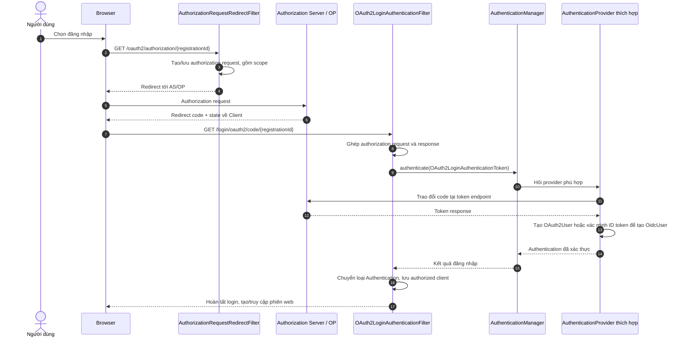

# 7.6. Lựa chọn OAuth2LoginAuthenticationProvider hoặc OidcAuthorizationCodeAuthenticationProvider

> **Module:** Spring Security OAuth 2.0 OIDC Client  
> **Chương:** 7. Đăng nhập Servlet  
> **Trọng tâm:** Spring Security quyết định dùng nhánh xử lý đăng nhập OAuth 2.0 hay OpenID Connect (OIDC) như thế nào, mỗi AuthenticationProvider thực hiện việc gì và vì sao scope `openid` là tín hiệu quan trọng.

Trong ứng dụng Spring MVC/Servlet, một người dùng có thể đăng nhập qua nhà cung cấp OAuth 2.0 chỉ có API hồ sơ, hoặc qua OpenID Provider hỗ trợ OIDC. Cả hai thường bắt đầu bằng redirect tới Authorization Server rồi quay về ứng dụng bằng **Authorization Code**, nhưng cách xác lập danh tính người dùng không giống nhau.

Spring Security có hai thành phần đáng chú ý:

- `OAuth2LoginAuthenticationProvider`: xử lý đăng nhập OAuth 2.0 thông thường, nhận access token rồi dùng `OAuth2UserService` lấy thông tin người dùng theo hợp đồng provider.
- `OidcAuthorizationCodeAuthenticationProvider`: xử lý **OIDC Authorization Code login**, yêu cầu và kiểm tra ID token, sau đó dùng `OidcUserService` tạo principal có ngữ nghĩa OIDC.

Người lập trình thường **không phải tự chọn một trong hai provider bằng câu lệnh if/else**. Khi cấu hình `oauth2Login()`, Spring Security chuẩn bị các authentication providers cần thiết. Tại callback, provider có xử lý yêu cầu hay không phụ thuộc vào ngữ cảnh authorization request, đặc biệt là **scope `openid`**. Đây là trọng tâm bài học.

## 1. Mục tiêu học tập

Sau bài này, bạn có thể:

1. Đặt hai AuthenticationProvider đúng vị trí trong luồng đăng nhập Servlet của Spring Security.
2. Phân biệt `OAuth2LoginAuthenticationToken`, `OAuth2AuthenticationToken`, `OAuth2User` và `OidcUser`.
3. Giải thích cơ chế `AuthenticationManager`/`ProviderManager` hỏi từng provider, ý nghĩa của `supports()` và `authenticate()` trả về `null`.
4. Xác định vì sao **scope `openid` trong authorization request** định hướng OIDC provider, còn yêu cầu OAuth 2.0 không có scope đó đi qua provider thông thường.
5. Mô tả cách mỗi nhánh lấy token, tải dữ liệu người dùng, kiểm tra thông tin xác thực và tạo principal.
6. Viết cấu hình một ứng dụng có cả OIDC registration và OAuth 2.0 registration theo provider.
7. Quan sát nhánh đang chạy qua principal và registration ID mà không ghi log raw token hoặc cookie.
8. Khoanh vùng lỗi như thiếu `id_token`, issuer sai, thiếu UserInfo endpoint, sai scope hoặc nhầm ứng dụng web với Resource Server.

## 2. Phạm vi: OAuth2 Login ở Servlet

Các lớp trong tiêu đề thuộc **Spring Security OAuth 2.0 Client** cho Servlet applications. Chúng phục vụ người dùng đăng nhập vào **ứng dụng web**. Không nhầm với:

| Thành phần | Trách nhiệm |
|---|---|
| `OAuth2LoginAuthenticationProvider` | Xử lý Authorization Code để đăng nhập người dùng bằng luồng OAuth 2.0 Login, thường thông qua UserInfo API của provider |
| `OidcAuthorizationCodeAuthenticationProvider` | Xử lý OIDC Authorization Code login và xác minh ID token |
| `OAuth2AuthorizationCodeAuthenticationProvider` | Thành phần cấp thấp thực hiện xác thực/trao đổi authorization code trong nhánh OAuth2 thông thường; không đồng nghĩa với OIDC provider ở tiêu đề |
| `OAuth2LoginAuthenticationFilter` | Nhận callback của đăng nhập Servlet rồi gọi `AuthenticationManager` |
| `OAuth2AuthorizationRequestRedirectFilter` | Khởi tạo authorization request và chuyển hướng trình duyệt đến Authorization Server |
| `OAuth2AuthorizedClientManager` | Hỗ trợ quản lý Client đã được cấp quyền khi cần gọi tài nguyên bảo vệ; không tự biến một request thành web login |
| `BearerTokenAuthenticationFilter` và provider Resource Server | Xử lý bearer token của request đi **vào API**; không phải callback đăng nhập OIDC của browser |

Cả OAuth2 và OIDC đều dùng các thành phần trong mô hình Client, nhưng **OIDC thêm lớp xác thực danh tính và ID token** trên OAuth 2.0. Do đó, Spring Security cần hai cách hoàn thiện principal khác nhau.

Phần mã minh họa sử dụng kiểu cấu hình quen thuộc của **Spring Boot 3.x / Spring Security 6.x với Spring MVC**. API và một số cơ chế mặc định có thể phát triển ở nhánh Spring Security khác; nên đối chiếu reference documentation và Javadoc tương ứng với phiên bản dự án.

## 3. Từ trình duyệt đến AuthenticationProvider

Khi người dùng truy cập trang bảo vệ và chọn đăng nhập bằng registration, luồng thường gồm ba pha.

### 3.1. Pha A — Tạo yêu cầu ủy quyền

1. Browser yêu cầu `/oauth2/authorization/{registrationId}`, ví dụ `/oauth2/authorization/corp`.
2. `OAuth2AuthorizationRequestRedirectFilter` dùng cấu hình `ClientRegistration` để tạo authorization request.
3. Authorization request chứa những thông số như `client_id`, `redirect_uri`, `scope`, `state` và thông số bảo vệ bổ sung khi áp dụng, ví dụ PKCE hoặc OIDC nonce.
4. Trình duyệt được chuyển đến Authorization Server/OpenID Provider.
5. Spring Security lưu ngữ cảnh authorization request để đối chiếu khi callback, theo cấu hình repository đang dùng.

Điểm đáng nhớ: **scope được yêu cầu** đã được xác định ở pha này, trước khi Client nhận token.

### 3.2. Pha B — Nhận callback

Sau khi người dùng được xác thực/cấp phép tại nhà cung cấp, trình duyệt được chuyển về callback mặc định:

```text
/login/oauth2/code/{registrationId}?code=...&state=...
```

`OAuth2LoginAuthenticationFilter` nhận callback phù hợp, lấy authorization request gốc, kết hợp nó với authorization response và ClientRegistration để tạo dữ liệu đăng nhập dạng `OAuth2LoginAuthenticationToken` chưa được xác thực.

Filter gọi `AuthenticationManager.authenticate(...)`. Ở đây, những AuthenticationProvider được cấu hình cho OAuth2 Login bắt đầu làm việc.

### 3.3. Pha C — Xác thực và hoàn thiện phiên

Provider phù hợp trao đổi authorization code tại token endpoint, xử lý kết quả, tạo `OAuth2User` hoặc `OidcUser`, rồi trả về kết quả đã được xác thực. Filter có thể chuyển kết quả nội bộ thành `OAuth2AuthenticationToken` phục vụ trạng thái đăng nhập và lưu `OAuth2AuthorizedClient` theo cấu hình.

Vì vậy **loại token truyền trong callback không phải JWT access token hay ID token**: callback mang authorization code; việc trao đổi và kiểm tra token xảy ra tiếp theo bên trong xử lý Client.

### 3.4. Sơ đồ tổng quan



Sơ đồ gom một số bước nội bộ để dễ học. Cơ chế kiểm tra `state`, trao đổi code, lưu security context và xử lý lỗi vẫn phụ thuộc phiên bản và cấu hình cụ thể; không nên tự viết lại các bước này nếu đã dùng thư viện Spring Security.

## 4. Cơ chế lựa chọn: hai provider, cùng một loại yêu cầu

Một điểm dễ gây nhầm là tên lớp khiến người đọc tưởng OIDC có một loại `Authentication` đầu vào hoàn toàn khác. Trong cơ chế Servlet OAuth2 Login, **cả hai providers đều có thể nhận `OAuth2LoginAuthenticationToken`**.

`AuthenticationProvider` có hai phương thức quan trọng:

- `supports(Class<?> authentication)` cho biết provider **có khả năng** xử lý loại Authentication này.
- `authenticate(Authentication authentication)` quyết định có thực sự xử lý nội dung yêu cầu đó hay không. Nó có thể trả về một Authentication đã xác thực, trả về `null` để provider khác thử, hoặc ném `AuthenticationException` khi xác thực thất bại.

`ProviderManager` lần lượt hỏi các providers được cấu hình phù hợp. Việc `supports()` trả `true` không bảo đảm provider sẽ nhận xử lý mọi request cùng loại.

### 4.1. Quy tắc phân nhánh theo openid scope

Logic cốt lõi, diễn giải giản lược từ hai lớp provider:

```java
// Mã minh họa ý tưởng, không phải API ứng dụng nên sao chép.
boolean isOidcRequest = authorizationRequest.getScopes().contains("openid");

if (isOidcRequest) {
    // OAuth2LoginAuthenticationProvider từ chối xử lý nhánh này (return null);
    // OidcAuthorizationCodeAuthenticationProvider xử lý OIDC login.
} else {
    // OidcAuthorizationCodeAuthenticationProvider return null;
    // OAuth2LoginAuthenticationProvider xử lý OAuth2 login.
}
```

Đây là một **mô hình để hiểu**, không phải cấu hình if/else mà bạn cần thêm vào `SecurityFilterChain`.

| Scope trên authorization request đã lưu | Provider nhận xử lý | Principal thường tạo thành |
|---|---|---|
| Có `openid` | `OidcAuthorizationCodeAuthenticationProvider` | `OidcUser` |
| Không có `openid` | `OAuth2LoginAuthenticationProvider` | `OAuth2User` |
| Có `openid` nhưng token response thiếu ID token | OIDC provider cố xử lý và báo lỗi | Không có principal đăng nhập hợp lệ |
| Có `openid` nhưng thiếu thành phần JOSE/JWT cần thiết | Cơ chế OIDC có thể không được cấu hình đúng | Không được âm thầm đổi thành đăng nhập OAuth2 thường |

Trong những phiên bản Spring Security triển khai theo logic này, provider OAuth2 thường nhìn **scope của authorization request gốc**, thấy `openid` và trả `null` để nhường cho OIDC provider. OIDC provider làm điều ngược lại: nếu không có `openid`, trả `null` để nhường cho OAuth2 provider.

**Hệ quả:** lựa chọn không dựa đơn giản trên tên provider (ví dụ `google` hay `corp`), giao diện login, tên `registrationId` hoặc việc access token là JWT. Tín hiệu phân nhánh quan trọng là **OIDC authentication request được khởi tạo với `openid`**.

### 4.2. Khi provider trả null, có phải login thất bại?

Chưa. `null` có thể chỉ có nghĩa **“provider này không nhận xử lý yêu cầu; thử provider khác”**. Chẳng hạn, một OIDC request có `openid` thường khiến `OAuth2LoginAuthenticationProvider` trả `null` một cách có chủ ý.

Ngược lại, khi OIDC provider nhận xử lý mà token response thiếu ID token, chữ ký không hợp lệ hoặc nonce không khớp, nó ném lỗi xác thực. Đó là **thất bại thật**, không phải tín hiệu hạ cấp an toàn sang OAuth2 login thông thường. Một ứng dụng tuyệt đối không nên tự viết “thử OIDC thất bại thì bỏ kiểm tra ID token và đăng nhập bằng access token”.

### 4.3. Có thể chọn provider dựa vào access token trả về không?

Không nên. Một access token của OAuth 2.0 có thể là JWT, nhưng **JWT access token không tự biến OAuth2 Login thành OIDC Login**. OIDC yêu cầu một ID token đúng chức năng, được cấp trong luồng xác thực OIDC và được xác minh theo quy tắc OIDC.

Việc lập luận “token trả về có dấu chấm nên chọn OIDC provider” vừa sai ngữ nghĩa vừa có thể dẫn đến nhầm đối tượng nhận token.

## 5. OAuth2LoginAuthenticationProvider: nhánh đăng nhập OAuth 2.0

### 5.1. Trách nhiệm

`OAuth2LoginAuthenticationProvider` là một implementation của `AuthenticationProvider`, dùng trong OAuth 2.0 Login với Authorization Code Grant. Trong nhánh thông thường nó:

1. Xác định yêu cầu không có scope `openid`; nếu có, trả `null` cho nhánh OIDC.
2. Dùng cơ chế trao đổi authorization code với token endpoint; thành phần liên quan gồm `OAuth2AuthorizationCodeAuthenticationProvider` và `OAuth2AccessTokenResponseClient`.
3. Nhận access token từ token response.
4. Tạo `OAuth2UserRequest` chứa ClientRegistration, access token và các tham số liên quan.
5. Gọi `OAuth2UserService<OAuth2UserRequest, OAuth2User>` để lấy thuộc tính người dùng từ UserInfo/profile endpoint hoặc cơ chế mà provider hỗ trợ.
6. Tạo `OAuth2LoginAuthenticationToken` đã xác thực với `OAuth2User` và authorities phù hợp.

Ở cấu hình phổ biến, user service là `DefaultOAuth2UserService`. Nó sử dụng access token để gọi UserInfo endpoint và đọc thuộc tính người dùng theo hợp đồng của provider.

### 5.2. Danh tính trong nhánh OAuth2 thông thường đến từ đâu?

OAuth 2.0 tự nó tập trung vào **ủy quyền truy cập tài nguyên**. Để biến thành trải nghiệm “đăng nhập”, ứng dụng và nhà cung cấp cần một thỏa thuận về thông tin hồ sơ của người dùng. Nhà cung cấp có thể công bố API trả `id`, `login`, `name` hoặc trường khác.

Ví dụ phản hồi minh họa từ profile endpoint:

```json
{
  "id": 24017,
  "login": "demo-user",
  "display_name": "Demo User"
}
```

Cấu hình `user-name-attribute` có thể hướng dẫn Spring Security dùng trường `id` để xác định tên principal. Nhưng **đây là quy ước của provider**, không phải ID token OIDC có issuer/audience được kiểm chứng theo cùng cơ chế.

Khi một bài học chỉ có provider OAuth 2.0, hãy giải thích rõ rằng luồng đăng nhập dựa vào provider profile contract; không đồng nhất tính năng `oauth2Login()` với việc tất cả providers đều hỗ trợ OIDC.

### 5.3. Những dữ liệu thường có sau khi xử lý

| Đối tượng | Trong nhánh OAuth2 thông thường |
|---|---|
| `OAuth2LoginAuthenticationToken` | Kết quả xác thực nội bộ của login flow |
| `OAuth2User` | Principal chứa attributes, authorities và name theo cấu hình user service |
| `OAuth2AuthenticationToken` | Authentication thường thấy trong controller/security context sau khi login |
| `OAuth2AuthorizedClient` | Gắn registration và token được cấp, dùng cho nhu cầu gọi API |

Một `OAuth2User` có `getAttributes()`, `getAuthorities()` và `getName()`. Không được mặc định rằng `getAttributes().get("email")` tồn tại hoặc đã được xác minh; điều này tùy provider.

### 5.4. Điều kiện để nhánh OAuth2 thường chạy được

Một Client registration cần thông tin hợp lệ để đổi code lấy token. Thông thường OAuth2 Login còn cần endpoint/chiến lược lấy UserInfo và cách nhận diện người dùng. Ví dụ provider không OIDC tự khai báo:

```yaml
spring:
  security:
    oauth2:
      client:
        registration:
          legacy-profile:
            provider: legacy-provider
            client-id: legacy-web
            client-secret: ${LEGACY_CLIENT_SECRET}
            authorization-grant-type: authorization_code
            redirect-uri: "{baseUrl}/login/oauth2/code/{registrationId}"
            scope: [profile.read]

        provider:
          legacy-provider:
            authorization-uri: https://auth.example.test/oauth/authorize
            token-uri: https://auth.example.test/oauth/token
            user-info-uri: https://api.example.test/profile
            user-name-attribute: id
```

Các domain và thuộc tính trên chỉ là ví dụ. Để chạy thật, provider phải thực sự hỗ trợ các endpoint, scope, kiểu xác thực Client và định dạng UserInfo tương ứng.

Nếu userInfo URI không hợp lệ hoặc service không xác định được thuộc tính nhận diện người dùng, login OAuth2 thường có thể thất bại sau khi đổi code lấy access token. Đừng kết luận sai rằng “token endpoint trả 200 thì toàn bộ đăng nhập chắc chắn thành công”.

## 6. OidcAuthorizationCodeAuthenticationProvider: nhánh đăng nhập OIDC

### 6.1. Trách nhiệm

`OidcAuthorizationCodeAuthenticationProvider` cũng xử lý Authorization Code. Nó nhận xử lý khi authorization request có scope `openid`, rồi thực hiện các thao tác riêng của OIDC:

1. Kiểm tra authorization response và sự liên kết giữa request/response, bao gồm `state`.
2. Trao đổi authorization code với token endpoint qua `OAuth2AccessTokenResponseClient`.
3. Yêu cầu token response có **`id_token`** cho luồng OIDC Code.
4. Dùng bộ xử lý JWT/ID token theo `ClientRegistration` để giải mã và **xác minh ID token**.
5. Kiểm tra các ràng buộc OIDC liên quan, bao gồm nonce khi request có nonce được sử dụng.
6. Gọi `OAuth2UserService<OidcUserRequest, OidcUser>`, thường là `OidcUserService`, để tạo principal OIDC, có thể kết hợp claim từ UserInfo khi phù hợp.
7. Trả về `OAuth2LoginAuthenticationToken` đã xác thực với `OidcUser` và thông tin token theo cấu hình.

Chính bước **ID token validation** là một khác biệt không thể bỏ qua. Nó không đơn thuần gọi API hồ sơ rồi tin vào thuộc tính `email` hoặc `username`.

### 6.2. ID token có những gì?

Ví dụ **payload minh họa**, không phải JWT ký thật:

```json
{
  "iss": "https://login.example.test/realms/company",
  "sub": "person-734",
  "aud": "corp-web",
  "iat": 1893450000,
  "exp": 1893453600,
  "nonce": "example-only-nonce"
}
```

Các claim quan trọng:

| Claim | Ý nghĩa đối với Client |
|---|---|
| `iss` | Issuer đã phát hành ID token; cần phù hợp issuer dự kiến |
| `sub` | Subject được OP định danh; nên kết hợp `iss` và `sub` làm khóa nhận diện nội bộ |
| `aud` | Audience phải bao gồm client ID nhận ID token; tránh token cấp cho Client khác |
| `exp`, `iat` | Giới hạn hiệu lực và thời điểm phát hành; kiểm tra theo chính sách |
| `nonce` | Khi đã dùng trong authorization request, phải được xác minh phù hợp để chống replay/correlation attacks |
| `azp`, `auth_time` | Được xét khi các quy tắc/điều kiện OIDC tương ứng áp dụng |

**Không tự chọn `sub` từ access token để thay ID token.** Access token dành cho Resource Server và có thể có audience khác. Ngược lại, ID token dành cho Client/Relying Party để kiểm chứng danh tính, không phải bearer token dùng gọi API.

### 6.3. JwtDecoderFactory và thư viện JOSE

OIDC provider có thành phần kiểm tra `OidcIdToken` bằng `JwtDecoderFactory<ClientRegistration>`, với implementation mặc định trong Spring Security như `OidcIdTokenDecoderFactory`. Nó sử dụng thông tin provider/Client để xác minh token theo yêu cầu OIDC, bao gồm chữ ký và các claims thích hợp.

Trong cấu hình `oauth2Login()` của các nhánh Spring Security liên quan, việc đăng ký OIDC authentication provider phụ thuộc sự hiện diện của khả năng giải mã JWT/JOSE, chẳng hạn lớp `JwtDecoder`. Nếu thiếu dependency cần thiết, một request có `openid` có thể gặp lỗi kiểu **`oidc_provider_not_configured`** thay vì tự chuyển sang OAuth2 thường.

Với ứng dụng Spring Boot, sử dụng đúng starter/dependency OAuth2 Client thường giúp có các thành phần liên quan; nếu quản lý dependencies thủ công hoặc loại bỏ dependency bắc cầu, hãy kiểm tra `spring-security-oauth2-jose` và các thư viện cần thiết của phiên bản hiện tại.

### 6.4. OidcUserService và UserInfo

`OidcUserService` có thể tải thêm claim từ UserInfo endpoint khi nhà cung cấp/cấu hình cho phép. Đây là một **tài nguyên bảo vệ được gọi bằng access token** trong luồng OIDC.

Điểm quan trọng:

- ID token hợp lệ là cốt lõi của xác thực OIDC ở Code flow.
- UserInfo có thể cung cấp thêm `name`, `email`, `picture` hoặc custom claims.
- Không nên mặc định rằng mọi lần đăng nhập OIDC luôn phải gọi UserInfo; điều này phụ thuộc cấu hình provider và user service.
- Khi có UserInfo, `sub` trong dữ liệu UserInfo phải tương ứng với `sub` của ID token đã được xác minh.
- Các claim hồ sơ không tự trở thành role nội bộ `ROLE_ADMIN`; ứng dụng cần quy tắc ánh xạ quyền riêng.

### 6.5. Vì sao OIDC login không được hạ cấp khi ID token sai?

Giả sử authorization request có `scope=openid profile` nhưng OP trả access token **không có `id_token`**. Không thể nói “thôi lấy UserInfo API như OAuth2 thường” rồi xem đó là OIDC login thành công.

OIDC Code flow yêu cầu ID token trong token response. Nếu ID token thiếu, hỏng, sai issuer/audience, không hợp lệ về chữ ký hoặc nonce không đúng, nhánh OIDC phải thất bại. **Fallback từ xác thực OIDC thất bại sang xác thực kém chặt chẽ hơn có thể tạo lỗ hổng xác thực**.

## 7. So sánh hai AuthenticationProvider

| Khía cạnh | OAuth2LoginAuthenticationProvider | OidcAuthorizationCodeAuthenticationProvider |
|---|---|---|
| Giao thức đăng nhập | OAuth 2.0 Login theo hợp đồng user info của provider | OIDC Authentication trên OAuth 2.0 |
| Tín hiệu chọn nhánh | Authorization request **không** chứa `openid` | Authorization request **có** `openid` |
| Input nội bộ | `OAuth2LoginAuthenticationToken` | `OAuth2LoginAuthenticationToken` |
| Đổi authorization code | Có | Có |
| Token response | Access token cần thiết; token khác tùy provider | Có access token và **ID token bắt buộc** trong OIDC Code flow |
| Nguồn principal | `OAuth2UserService` và user attributes từ provider | ID token đã kiểm tra, thêm UserInfo qua `OidcUserService` khi dùng |
| Principal | `OAuth2User` | `OidcUser` |
| Bộ service phổ biến | `DefaultOAuth2UserService` | `OidcUserService` |
| Kiểm tra ID token OIDC | Không phải trách nhiệm của nhánh này | Có, qua JWT/ID token validation |
| Mục tiêu thực tế | Đăng nhập qua provider OAuth2 không có OIDC, theo contract của provider | Đăng nhập liên thông với khẳng định danh tính OIDC |
| Khi không nhận yêu cầu | Trả `null` nếu request có `openid` | Trả `null` nếu request không có `openid` |
| Khi đã nhận nhưng dữ liệu sai | Ném lỗi xác thực phù hợp | Ném lỗi xác thực phù hợp, ví dụ thiếu/không hợp lệ ID token |

Điểm chung: cả hai triển khai `AuthenticationProvider`, tham gia cơ chế login trên Servlet, và có thể hoàn tất đăng nhập cho người dùng theo chính sách đã cấu hình. Cả hai **không** thay thế kiểm tra phân quyền của ứng dụng, không làm access token trở thành session cookie và không thay bộ xác thực bearer token của Resource Server.

## 8. Mã nguồn minh họa lựa chọn provider

Phần dưới là mã giả để mô hình hóa hành vi phân nhánh. Nó **không phải** đoạn mã cần copy vào Spring Boot và cố tình bỏ qua exception/chi tiết token để nhấn mạnh vấn đề lựa chọn.

```java
// Pseudocode chỉ để đọc hiểu nội bộ Spring Security.
Authentication incoming = new OAuth2LoginAuthenticationToken(
    clientRegistration,
    authorizationExchange
);

// ProviderManager thử các AuthenticationProvider đã đăng ký:
for (AuthenticationProvider provider : providers) {
    if (!provider.supports(incoming.getClass())) {
        continue;
    }

    Authentication result = provider.authenticate(incoming);

    if (result != null) {
        return result; // provider hoàn tất xác thực
    }

    // null nghĩa là provider nhường cho provider tiếp theo
}

// Nếu không provider nào xử lý: xác thực thất bại.
```

Ví dụ request có `scope=openid profile`:

```text
OAuth2LoginAuthenticationFilter
  -> AuthenticationManager / ProviderManager
      -> OAuth2LoginAuthenticationProvider
           authorizationRequest.scopes chứa "openid"
           => return null
      -> OidcAuthorizationCodeAuthenticationProvider
           authorizationRequest.scopes chứa "openid"
           => exchange code, validate id_token, load OidcUser
           => return authenticated OAuth2LoginAuthenticationToken
  -> OAuth2AuthenticationToken trong web security context
```

Ví dụ request có `scope=read:user` và provider dùng API hồ sơ OAuth 2.0:

```text
OAuth2LoginAuthenticationFilter
  -> AuthenticationManager / ProviderManager
      -> OAuth2LoginAuthenticationProvider
           authorizationRequest.scopes KHÔNG chứa "openid"
           => exchange code, load OAuth2User
           => return authenticated OAuth2LoginAuthenticationToken
      -> OidcAuthorizationCodeAuthenticationProvider
           không cần xử lý yêu cầu này
  -> OAuth2AuthenticationToken trong web security context
```

**Lưu ý về thứ tự:** provider manager có thể có thứ tự đăng ký cụ thể, và logic chi tiết phụ thuộc phiên bản. Điều ổn định cần hiểu là **mỗi provider có cơ chế nhận xử lý riêng; request OIDC và OAuth2 thường được tách bằng `openid`**. Không suy luận từ pseudocode rằng provider nào cũng phải được gọi đúng thứ tự như hai đoạn minh họa.

## 9. Cấu hình Spring Boot để thấy cả hai nhánh trong một ứng dụng

Một ứng dụng có thể cấu hình hai registrations:

- `corp`: OP hỗ trợ OpenID Connect.
- `code-host`: nhà cung cấp hỗ trợ OAuth 2.0 Login với API hồ sơ nhưng không dùng OIDC trong ví dụ.

### 9.1. Dependencies

Với Maven và Spring Boot 3.x:

```xml
<dependencies>
    <dependency>
        <groupId>org.springframework.boot</groupId>
        <artifactId>spring-boot-starter-web</artifactId>
    </dependency>
    <dependency>
        <groupId>org.springframework.boot</groupId>
        <artifactId>spring-boot-starter-security</artifactId>
    </dependency>
    <dependency>
        <groupId>org.springframework.boot</groupId>
        <artifactId>spring-boot-starter-oauth2-client</artifactId>
    </dependency>
</dependencies>
```

Ứng dụng Servlet/MVC dùng `HttpSecurity`. Đừng sao chép nguyên cấu hình cho WebFlux (reactive), nơi có các loại filter chain và authentication provider tương ứng khác.

### 9.2. application.yml

Ví dụ OIDC Provider nội bộ chạy ở localhost để học. Trong ứng dụng thật phải dùng issuer do OP công bố và HTTPS, đồng thời đăng ký các redirect URIs. Nhà cung cấp OAuth2 thứ hai minh họa qua provider GitHub với Client ID/secret riêng:

```yaml
server:
  port: 8080

spring:
  security:
    oauth2:
      client:
        registration:
          corp:
            provider: corp-idp
            client-id: corp-web
            client-secret: ${CORP_OIDC_CLIENT_SECRET}
            authorization-grant-type: authorization_code
            redirect-uri: "{baseUrl}/login/oauth2/code/{registrationId}"
            scope:
              - openid
              - profile
              - email

          code-host:
            provider: github
            client-id: ${CODE_HOST_CLIENT_ID}
            client-secret: ${CODE_HOST_CLIENT_SECRET}
            authorization-grant-type: authorization_code
            redirect-uri: "{baseUrl}/login/oauth2/code/{registrationId}"
            scope:
              - read:user

        provider:
          corp-idp:
            issuer-uri: http://localhost:9000/realms/training
```

Giải thích cách phân nhánh:

| Registration | Provider | Scope yêu cầu | Nhánh dự kiến |
|---|---|---|---|
| `corp` | `corp-idp` từ issuer URI | `openid profile email` | OIDC provider |
| `code-host` | `github` với cấu hình provider phổ biến | `read:user` | OAuth2 Login provider |

Trong ví dụ này, `code-host` là **registration ID nội bộ**, `github` là provider ID, còn `client-id` là mã Client mà dịch vụ phát hành. Khi đăng nhập với registration `code-host`, Spring Security không tự chuyển sang OIDC chỉ vì ứng dụng cũng có registration `corp`.

**Cần chuẩn bị:** cấu hình Client thực sự ở từng provider; với `corp` đăng ký callback `http://localhost:8080/login/oauth2/code/corp`, với `code-host` callback `http://localhost:8080/login/oauth2/code/code-host`. Giá trị `CORP_OIDC_CLIENT_SECRET`, `CODE_HOST_CLIENT_ID` và `CODE_HOST_CLIENT_SECRET` phải được cấp qua environment/secret store, không đưa bí mật vào Git.

### 9.3. SecurityFilterChain

Một chain tường minh cho cả hai registrations:

```java
import org.springframework.context.annotation.Bean;
import org.springframework.context.annotation.Configuration;
import org.springframework.security.config.Customizer;
import org.springframework.security.config.annotation.web.builders.HttpSecurity;
import org.springframework.security.web.SecurityFilterChain;

@Configuration
public class SecurityConfig {

    @Bean
    SecurityFilterChain webSecurityFilterChain(HttpSecurity http) throws Exception {
        return http
            .authorizeHttpRequests(auth -> auth
                .requestMatchers("/", "/error").permitAll()
                .anyRequest().authenticated()
            )
            .oauth2Login(Customizer.withDefaults())
            .build();
    }
}
```

Trang chủ tùy chỉnh có thể cung cấp hai link:

```html
<a href="/oauth2/authorization/corp">Đăng nhập bằng tài khoản tổ chức</a>
<a href="/oauth2/authorization/code-host">Đăng nhập bằng tài khoản Code Host</a>
```

**Không cần khai báo thủ công** `new OAuth2LoginAuthenticationProvider(...)` hoặc `new OidcAuthorizationCodeAuthenticationProvider(...)` trong ứng dụng phổ biến. `oauth2Login()` đảm nhận kết nối các thành phần mặc định; customization nên đi qua DSL/repository/service phù hợp.

### 9.4. Điểm khác nhau giữa login URL và provider class

Cả hai đường dẫn login có chung cấu trúc:

```text
/oauth2/authorization/corp
/oauth2/authorization/code-host
```

Cả hai callback có chung cấu trúc:

```text
/login/oauth2/code/corp
/login/oauth2/code/code-host
```

URL xác định **registration**, không gọi tên class AuthenticationProvider. Spring Security dùng ClientRegistration tương ứng để dựng authorization request; các scopes trên request định hướng provider nào thực hiện callback authentication.

## 10. Quan sát principal để nhận biết nhánh đã dùng

Một endpoint demo có thể hiển thị loại principal, registration ID và thông tin danh tính ít nhạy cảm, tránh trả token:

```java
import java.util.LinkedHashMap;
import java.util.Map;
import org.springframework.security.core.annotation.AuthenticationPrincipal;
import org.springframework.security.oauth2.client.authentication.OAuth2AuthenticationToken;
import org.springframework.security.oauth2.core.oidc.user.OidcUser;
import org.springframework.security.oauth2.core.user.OAuth2User;
import org.springframework.web.bind.annotation.GetMapping;
import org.springframework.web.bind.annotation.RestController;

@RestController
class LoginInfoController {

    @GetMapping("/login-info")
    Map<String, Object> loginInfo(OAuth2AuthenticationToken authentication) {
        OAuth2User user = authentication.getPrincipal();

        Map<String, Object> result = new LinkedHashMap<>();
        result.put("registrationId",
            authentication.getAuthorizedClientRegistrationId());
        result.put("principalType", user.getClass().getSimpleName());
        result.put("name", user.getName());
        result.put("isOidc", user instanceof OidcUser);

        if (user instanceof OidcUser oidc) {
            result.put("subject", oidc.getSubject());
            result.put("issuer", oidc.getIdToken().getIssuer().toString());
        }
        return result;
    }
}
```

Ví dụ này giả định endpoint chỉ được gọi sau khi người dùng đăng nhập thông qua `oauth2Login()`; nếu ứng dụng cho phép nhiều kiểu Authentication cùng truy cập, cần xử lý kiểu principal tường minh thay vì luôn giả định có `OAuth2AuthenticationToken`.

Kết quả minh họa cho `corp`:

```json
{
  "registrationId": "corp",
  "principalType": "DefaultOidcUser",
  "name": "person-734",
  "isOidc": true,
  "subject": "person-734",
  "issuer": "http://localhost:9000/realms/training"
}
```

Kết quả minh họa cho `code-host`:

```json
{
  "registrationId": "code-host",
  "principalType": "DefaultOAuth2User",
  "name": "demo-code-host-user",
  "isOidc": false
}
```

Tên implementation cụ thể và `name` phụ thuộc user service, nhà cung cấp và ánh xạ principal. Mục đích ví dụ là quan sát **`OidcUser` hay `OAuth2User`**, không phải yêu cầu mọi provider trả JSON giống hệt.

Không đặt các trường sau vào endpoint demo: raw `access_token`, `refresh_token`, `id_token`, client secret, authorization code, session cookie hoặc raw authentication details.

### 10.1. Không nhầm Authentication cuối cùng với provider đã xử lý

Điểm dễ gây nhầm:

- **Trước khi ProviderManager xử lý**, filter tạo `OAuth2LoginAuthenticationToken` để yêu cầu xác thực.
- **Trong provider**, thành phần này được xác thực cùng `OAuth2User` hoặc `OidcUser`.
- **Trong ứng dụng sau login**, bạn thường thấy `OAuth2AuthenticationToken`, nhưng principal bên trong có thể là `DefaultOAuth2User` hoặc `DefaultOidcUser`.

Vì vậy nếu chỉ in `authentication.getClass().getSimpleName()` từ controller, cả hai nhánh có thể cùng hiển thị `OAuth2AuthenticationToken`. Để phân biệt, xem **kiểu principal**, `registrationId` và cơ chế đã cấu hình.

### 10.2. OidcUser cũng là OAuth2User

Trong hệ kiểu Spring Security, `OidcUser` mở rộng giao diện người dùng OAuth2 phù hợp để bổ sung ID token và UserInfo. Do đó:

- Một controller nhận `OAuth2User` có thể làm việc với principal OIDC.
- Kiểm tra `user instanceof OAuth2User` **không đủ** để phân biệt hai nhánh.
- Khi cần API riêng của OIDC (ví dụ `getIdToken()`), kiểm tra `user instanceof OidcUser` hoặc dùng `@AuthenticationPrincipal OidcUser` ở endpoint chỉ cho OIDC login.

Nếu ứng dụng hỗ trợ cả hai registration, tránh viết controller dùng OIDC-only type cho mọi request mà không xử lý nhánh OAuth2 thường.

## 11. Tùy chỉnh user service đúng nhánh

Nhà phát triển thường cần chuẩn hóa thuộc tính hoặc ánh xạ role từ nhà cung cấp. Spring Security cho phép tùy chỉnh ở `oauth2Login().userInfoEndpoint()`:

```java
@Bean
SecurityFilterChain securityFilterChain(
        HttpSecurity http,
        OAuth2UserService<OAuth2UserRequest, OAuth2User> oauth2UserService,
        OAuth2UserService<OidcUserRequest, OidcUser> oidcUserService)
        throws Exception {

    return http
        .authorizeHttpRequests(auth -> auth.anyRequest().authenticated())
        .oauth2Login(oauth2 -> oauth2
            .userInfoEndpoint(info -> info
                .userService(oauth2UserService)
                .oidcUserService(oidcUserService)
            )
        )
        .build();
}
```

Đoạn trên giả định ứng dụng đã có hai bean user services được định nghĩa ở nơi phù hợp. Đây là ví dụ về **điểm cắm** cho từng service, không phải một cấu hình hoàn chỉnh khi chưa có bean. Các imports cần dùng bao gồm:

```java
import org.springframework.security.oauth2.client.userinfo.OAuth2UserRequest;
import org.springframework.security.oauth2.client.userinfo.OAuth2UserService;
import org.springframework.security.oauth2.client.oidc.userinfo.OidcUserRequest;
import org.springframework.security.oauth2.core.oidc.user.OidcUser;
import org.springframework.security.oauth2.core.user.OAuth2User;
```

Nếu muốn bắt đầu với defaults, bạn không cần thêm hai bean trên:

```java
.oauth2Login(Customizer.withDefaults())
```

Việc cung cấp hai user services riêng có ý nghĩa khi mỗi provider có cách lấy/mapping hồ sơ khác nhau.

### 11.1. Cấu hình userService không phải điều kiện chọn AuthenticationProvider

Một nhầm lẫn phổ biến là nghĩ rằng:

```java
.userInfoEndpoint(info -> info.oidcUserService(customOidcUserService))
```

sẽ ép mọi registration dùng OIDC provider. Không phải vậy. `oidcUserService` chỉ tùy chỉnh **cách tạo OidcUser khi nhánh OIDC đã được chọn và xử lý**.

Nếu authorization request không có `openid`, nhánh OAuth2 thường vẫn xử lý theo các điều kiện của nó; tùy chỉnh OIDC user service không tự tạo ID token cho OAuth2 login.

### 11.2. Phân quyền sau khi tải user

Một login OIDC hợp lệ xác thực danh tính; một profile API hợp lệ cung cấp thông tin người dùng trong hợp đồng OAuth2 Login. Quyền như `ROLE_ADMIN` còn phụ thuộc chính sách ứng dụng.

Bạn có thể dùng `GrantedAuthoritiesMapper` hoặc custom user service để ánh xạ claims/attributes từ nguồn đã được tin cậy. Không tự lấy một trường tên `roles` từ mọi provider rồi cấp quyền quản trị nếu chưa xác minh định dạng, nguồn và quy tắc ánh xạ.

### 11.3. Không tự đổi loại principal một cách tùy tiện

Nếu đang ở OIDC branch, custom OIDC user service nên giữ đầy đủ ngữ nghĩa `OidcUser`, bao gồm ID token đã được xác minh. Chỉ tạo `DefaultOAuth2User` từ vài claim rồi bỏ ID token có thể làm mất thông tin và phá vỡ những chức năng dựa trên OIDC.

Ngược lại, không thể biến một OAuth2User từ provider không hỗ trợ OIDC thành OidcUser đáng tin chỉ bằng cách tạo object giả có `issuer` và `sub` do ứng dụng tự gán.

## 12. Vai trò của SecurityFilterChain và dependencies

Hai AuthenticationProvider không xuất hiện ngẫu nhiên chỉ vì ứng dụng khai báo một `registration`.

Đối với ứng dụng Servlet tự cấu hình HTTP Security, điểm bật login là:

```java
.oauth2Login(Customizer.withDefaults())
```

Trong cấu hình này, Spring Security đăng ký các cơ chế hỗ trợ authorization redirect, callback filter và authentication providers phù hợp. Provider OIDC còn phụ thuộc khả năng JOSE/JWT tương ứng trên classpath.

**Trường hợp thay đổi từ auto-configuration sang custom chain:** nếu ứng dụng trước đây chỉ dựa vào Spring Boot defaults, sau đó thêm bean `SecurityFilterChain` nhưng không gọi `oauth2Login()`, bạn có thể mất hành vi đăng nhập mong muốn. Điều đó là vấn đề bật cơ chế trong HTTP chain, **không phải bằng chứng provider OIDC chọn sai**.

### 12.1. Đừng tự đăng ký provider chỉ để giải quyết scope

Các lựa chọn nên ưu tiên theo thứ tự phù hợp:

1. Nếu muốn OIDC login: provider phải hỗ trợ OIDC; registration dùng scope `openid` và issuer/metadata đúng.
2. Nếu muốn OAuth2 login thông thường: provider hỗ trợ OAuth2 Authorization Code cùng UserInfo/profile contract; registration không dùng `openid`.
3. Nếu muốn tùy chỉnh thuộc tính/authorities: cấu hình `userService` hoặc `oidcUserService` tương ứng.
4. Nếu muốn sửa cách trao đổi code: dùng điểm tùy chỉnh token endpoint của `oauth2Login()` và `OAuth2AccessTokenResponseClient` phù hợp.
5. Nếu cần biến đổi nghiệp vụ sau login: dùng các cơ chế như success handler, user service, principal mapping hoặc authorization rules, thay vì thay thế provider cốt lõi.

Tạo `new OAuth2LoginAuthenticationProvider` thủ công trong cấu hình ứng dụng khi không có yêu cầu đặc biệt có thể làm mất việc wiring các thành phần khác, gây khó bảo trì theo phiên bản.

### 12.2. Không nhầm với Resource Server

Một API nhận:

```http
GET /api/orders
Authorization: Bearer <access-token>
```

sẽ đi theo đường xử lý của Resource Server nếu bạn cấu hình `oauth2ResourceServer()`, không đi qua `OAuth2LoginAuthenticationProvider` hoặc `OidcAuthorizationCodeAuthenticationProvider` để kiểm tra bearer token đó.

Cùng một ứng dụng có thể vừa là Client vừa là Resource Server, nhưng cần thiết kế SecurityFilterChain và entry point đúng với loại request. Đăng nhập thành công trong browser không cho phép bỏ kiểm tra quyền ở API.

## 13. Một số tình huống có thể gây hiểu nhầm về lựa chọn provider

### 13.1. Đăng nhập vào một OP nhưng thiếu openid

Bạn dùng một OP có OIDC discovery, nhưng registration có:

```yaml
scope: [profile, email]
```

Không có `openid`, request không phải OIDC authentication request theo chuẩn. Spring Security có thể chọn OAuth2 Login branch, nhưng nhánh đó còn cần UserInfo endpoint, user-name-attribute và contract phù hợp. Một số OP có thể từ chối request, không phát ID token hoặc trả thông tin không đủ để hoàn thiện OAuth2User.

**Không nên kết luận:** “Bỏ `openid` thì Spring Security vẫn đăng nhập OIDC bằng access token.”

### 13.2. Có openid, nhưng OP không trả ID token

Registration có:

```yaml
scope: [openid, profile]
```

Authorization request là OIDC request. Nếu token response không có `id_token`, `OidcAuthorizationCodeAuthenticationProvider` phải từ chối login theo ngữ nghĩa OIDC. Việc token endpoint vẫn phát access token không thay thế được ID token.

### 13.3. Có openid, ID token bị đổi issuer hoặc audience

OIDC provider phải kiểm tra issuer, audience, chữ ký, hạn token và các điều kiện OIDC liên quan. Token có payload dễ đọc vẫn chưa chứng minh hợp lệ.

Ví dụ một ID token có `aud=other-client` không dành cho Client `corp-web`. Nếu ứng dụng tự bỏ kiểm tra audience để cho đăng nhập, đó là lỗi tin cậy nghiêm trọng.

### 13.4. Có OIDC login nhưng không có SCOPE_admin

Một `OidcUser` hợp lệ không tự có `ROLE_ADMIN` hoặc authority nghiệp vụ. Provider được chọn đúng chỉ giúp xác lập principal; phân quyền phụ thuộc rule trong `authorizeHttpRequests()` và mapping authorities.

### 13.5. Access token là JWT nhưng dùng OAuth2 Login thường

Một Authorization Server có thể cấp JWT access token cho API ngay cả khi Client sử dụng OAuth2 Login không có `openid`. Điều này không làm OIDC provider tham gia. Mục đích và định dạng của access token phải được tách khỏi giao thức chứng thực danh tính.

### 13.6. Một ứng dụng có nhiều registrations

Ví dụ một ứng dụng cấu hình `corp` có `openid` và `code-host` không có `openid`. Cả hai dùng cùng `oauth2Login()`, nhưng từng request chọn logic phù hợp theo registration/scopes.

Không cần tạo hai SecurityFilterChain chỉ để phân biệt OAuth2 và OIDC. Hai chain có thể hữu ích khi chính sách URL, session hoặc entry point khác nhau, nhưng **không phải điều kiện bắt buộc để chọn hai providers**.

### 13.7. Ứng dụng WebFlux chứ không phải Servlet

WebFlux dùng stack Security reactive, ví dụ `SecurityWebFilterChain` và các thành phần reactive tương ứng. Các tên provider ở tiêu đề là bối cảnh Servlet. Nếu đang dùng `spring-boot-starter-webflux`, đừng cố gắn nguyên `OAuth2LoginAuthenticationFilter` hay các provider của Servlet vào pipeline reactive.

## 14. Thực hành A — Quan sát hai loại principal

**Mục tiêu:** xác nhận cùng một ứng dụng có thể đăng nhập bằng hai registrations nhưng tạo hai loại principal khác nhau.

**Chuẩn bị:** hoàn thành cấu hình `corp` và `code-host` ở mục 9, đăng ký callback URI tương ứng, tạo người dùng thử nghiệm, bật HTTP chain `oauth2Login()` và endpoint `/login-info`. Dùng môi trường phát triển không chứa tài khoản hoặc dữ liệu nhạy cảm.

**Các bước:**

1. Mở cửa sổ browser riêng tư, truy cập `/oauth2/authorization/corp`.
2. Đăng nhập ở OP thử nghiệm, rồi mở `/login-info`.
3. Ghi lại `registrationId`, `principalType`, `isOidc`, issuer và subject được trả về; không thu thập raw token.
4. Đăng xuất tại ứng dụng, hoặc sử dụng phiên browser riêng tư mới. Nếu OP vẫn có phiên SSO, điều đó không làm thay đổi giao thức, chỉ ảnh hưởng việc màn hình login có hiện lại hay không.
5. Truy cập `/oauth2/authorization/code-host`, đăng nhập, rồi mở `/login-info`.
6. So sánh các trường với lần đăng nhập `corp`.

**Kết quả mong đợi:**

- `corp` dùng scope `openid` và tạo principal tương thích `OidcUser` khi login thành công.
- `code-host` dùng OAuth2 Login thông thường và tạo principal `OAuth2User` theo profile contract của provider.
- Cả hai lần đăng nhập có thể dẫn đến `OAuth2AuthenticationToken` trong security context của ứng dụng web.
- Không có chuyển đổi protocol do tên login button hoặc provider ID; phân nhánh dựa vào authorization request.

**Câu hỏi thảo luận:** Nếu chỉ thấy `OAuth2AuthenticationToken` trong controller, làm sao biết user thực tế là OIDC? Vì sao phải xét `principal instanceof OidcUser`?

## 15. Thực hành B — Thay đổi scope có chủ đích

**Mục tiêu:** quan sát `openid` quyết định nhánh xử lý như thế nào.

Thực hiện trên bản cấu hình thử nghiệm, không trên Client production.

**Các bước:**

1. Ghi nhận cấu hình `corp` chạy tốt với `scope: [openid, profile]`.
2. Ghi lại request scopes ở tầng cấu hình hoặc debug đã che thông tin nhạy cảm.
3. Tạm thời bỏ `openid` khỏi registration `corp`, chỉ để `scope: [profile]`.
4. Khởi động lại ứng dụng nếu cần để áp dụng cấu hình.
5. Tạo phiên đăng nhập mới và quan sát xem Authorization Server có cho phép yêu cầu, token response có ID token không và ứng dụng có thể xây dựng principal theo OAuth2 profile contract không.
6. Hoàn nguyên `openid`, chạy lại luồng hợp lệ.

**Kết quả cần hiểu:** request không có `openid` không còn là OIDC login. Hệ thống có thể thành công theo OAuth2 Login nếu provider và user service đáp ứng, hoặc thất bại nếu contract không phù hợp. **Đừng coi việc OAuth2 nhánh thường không thành công là bằng chứng rằng logic chọn provider bị hỏng.**

## 16. Thực hành C — Xác nhận lỗi ID token không bị hạ cấp

**Mục tiêu:** phân biệt trường hợp provider `return null` có chủ đích với trường hợp OIDC provider **ném lỗi xác thực**.

**Môi trường:** OP kiểm soát được trong lab hoặc mock OIDC provider có khả năng tạo token response sai để học. Không can thiệp phản hồi của hệ thống production hay thu thập credentials thật.

**Các biến thể:**

| Biến thể | Điều kiện | Điều nên quan sát |
|---|---|---|
| OIDC response thiếu `id_token` | Authorization request có `openid` nhưng token response không có ID token | OIDC login bị từ chối; không có principal OIDC hợp lệ |
| ID token sai issuer | OP/mock trả ID token có issuer không khớp | JWT/OIDC validation thất bại |
| ID token sai audience | ID token có `aud` không chứa client ID phù hợp | Xác minh OIDC bị từ chối |
| Token nonce không tương ứng | Request có nonce và ID token không thỏa ràng buộc | OIDC login bị từ chối |
| JWT/JOSE dependency thiếu | Cấu hình OIDC nhưng môi trường thiếu thành phần decode cần thiết | Cơ chế OIDC không sẵn sàng; kiểm tra dependencies |
| OAuth2 UserInfo endpoint trả lỗi | Request không có `openid` và user service cần gọi UserInfo | OAuth2 Login thất bại ở bước lấy principal |

Kết quả HTTP hoặc thông báo lỗi cụ thể phụ thuộc phiên bản Spring Security, provider và success/failure handlers. Hãy quan sát **điểm thất bại trong pipeline**: trao đổi token, ID token validation, UserInfo hay principal mapping.

Câu hỏi: tại sao không được “bắt mọi Exception rồi thử OAuth2UserService” để duy trì login khi ID token sai? Bởi vì khi yêu cầu OIDC, Client phải giữ nguyên tiêu chuẩn tin cậy OIDC đã được kỳ vọng.

## 17. Thực hành D — Chẩn đoán kết quả login và quyền API

**Mục tiêu:** tránh nhầm AuthenticationProvider của login với việc xác minh access token ở Resource Server.

**Chuẩn bị:** web Client đăng nhập OIDC và Resource Server riêng bảo vệ `GET /api/reports` bằng access token có scope `reports.read`.

**Các bước:**

1. Đăng nhập ở `corp`, xác nhận `/login-info` trả `isOidc: true`.
2. Từ Client gọi Resource Server bằng **access token** được cấp cho API, không gửi ID token làm bearer token.
3. Thử một access token hợp lệ nhưng thiếu scope nếu có thể cấu hình trong lab.
4. Quan sát khi API trả 401 hoặc 403.
5. Kiểm tra phiên ở web Client vẫn xác thực bình thường khi API từ chối request.

**Kết quả mong đợi:** dù OIDC provider đã xác thực thành công ở web, Resource Server vẫn độc lập xác thực và phân quyền bearer token. Việc API trả 403 do thiếu scope không có nghĩa Spring Security đã chọn sai OAuth2/OIDC AuthenticationProvider khi login.

## 18. Bảng chẩn đoán lỗi khi triển khai

| Triệu chứng | Lớp chịu trách nhiệm thường liên quan | Hướng kiểm tra |
|---|---|---|
| Cấu hình OIDC nhưng principal lại chỉ là OAuth2User | Authorization request / registration scopes | Request gốc có `openid` không? User service có custom không? |
| Thêm `openid` vào scope thì login thất bại | OIDC validation / provider capability | OP có thật sự hỗ trợ OIDC? Token response có ID token? Issuer và keys đúng không? |
| Login thường OAuth2 lấy được access token nhưng vẫn lỗi | UserInfo / OAuth2UserService | `user-info-uri`, `user-name-attribute`, profile contract và quyền gọi API |
| Token endpoint trả 200 nhưng OIDC login lỗi | ID token validation | `id_token` có mặt? Chữ ký, issuer, audience, thời hạn, nonce? |
| Nhận `oidc_provider_not_configured` | Dependencies / OAuth2 Login configurer | JOSE/JWT decoder có trên classpath không? Có cấu hình OIDC đúng không? |
| Không có redirect khi vào trang bảo vệ | SecurityFilterChain / login entry point | Đã bật `oauth2Login()`? Chain áp dụng cho URL này? |
| Callback không được xử lý | Redirect URI / filter matcher | Path callback đúng `/login/oauth2/code/{registrationId}`? Custom endpoint và OP đã đồng bộ? |
| Đăng nhập xong nhưng `/admin` trả 403 | Authorization rules / authorities mapping | Có authority `ROLE_ADMIN` thật không? Không lấy login success làm bằng chứng quyền |
| API trả 401/403 sau login | Resource Server / access token | Có bearer token phù hợp API, đúng scope/audience và token validation không? |
| Thấy class `OAuth2AuthenticationToken` cho cả hai registrations | Filter chuyển Authentication cuối cùng | Kiểm tra principal type và registration ID để phân biệt |

### 18.1. Quan sát logging một cách an toàn

Trong môi trường phát triển, có thể bật log Security ở mức đủ dùng:

```yaml
logging:
  level:
    org.springframework.security: DEBUG
```

Nhưng ngay cả trong lab, log hoặc ảnh chụp Network **không nên chứa** raw ID token, access token, refresh token, authorization code, client secret, cookie phiên hoặc thông số `state` thật. Khi cần làm tài liệu, ghi lại endpoint, loại request, registration ID, kết quả login và mã lỗi đã được rút gọn.

Các debug events và tên logger có thể thay đổi giữa phiên bản; không xây dựng logic ứng dụng dựa trên một chuỗi log nội bộ cụ thể.

### 18.2. Quan sát class provider bằng cách nào?

Đối với bài học, thường không cần đưa hai providers ra thành beans thủ công. Bạn có thể:

- Quan sát request scopes ở registration/authorization request.
- Quan sát principal type sau login.
- Xem documentation hoặc implementation của `OAuth2LoginAuthenticationProvider` và `OidcAuthorizationCodeAuthenticationProvider` trong phiên bản đang chạy.
- Tăng mức log trong lab để kiểm tra đường xử lý nếu cần, tránh ghi thông tin bí mật.

Tách **lựa chọn provider** khỏi **xử lý lỗi bên trong provider**: nếu request đã là OIDC và ID token sai, thay đổi Java mapper quyền không thể sửa một issuer validation error.

## 19. Các hiểu lầm cần tránh

| Khẳng định dễ nhầm | Cách hiểu đúng |
|---|---|
| “Có `issuer-uri` thì luôn chọn OIDC provider.” | `issuer-uri` cung cấp metadata/issuer; quyết định request là OIDC dựa trên `openid` scope và cấu hình giao thức phù hợp. |
| “Cả hai providers đều `supports(OAuth2LoginAuthenticationToken)` thì sẽ đua nhau xử lý token.” | `supports()` xác định loại input; `authenticate()` có thể trả `null` để nhường provider khác. |
| “OIDC login lỗi thì tự fallback sang OAuth2 user.” | Không được hạ cấp xác thực OIDC khi ID token sai hoặc thiếu. |
| “OAuth2LoginAuthenticationProvider không cần biết người dùng là ai.” | Để hoàn tất OAuth2 Login, nó vẫn cần `OAuth2UserService` lấy thông tin principal theo contract provider. |
| “OIDC luôn phải gọi UserInfo endpoint.” | Cốt lõi là ID token hợp lệ; UserInfo có thể được gọi để bổ sung claim theo service/provider. |
| “Một access token JWT chính là ID token.” | Hai token có mục đích và đối tượng nhận khác nhau. |
| “Principal là OAuth2AuthenticationToken thì chắc chắn không phải OIDC.” | `OAuth2AuthenticationToken` có thể chứa `OidcUser`. |
| “Muốn dùng cả OAuth2 và OIDC phải viết hai SecurityFilterChain.” | Có thể dùng chung `oauth2Login()` với nhiều registrations; chain tách theo chính sách URL nếu cần. |
| “Đăng nhập OIDC xong thì tự có `ROLE_ADMIN`.” | Quyền nghiệp vụ cần chính sách và mapping riêng. |
| “OAuth2LoginAuthenticationProvider là provider của API Resource Server.” | Đây là provider cho **Servlet login callback**; Resource Server dùng pipeline bearer token khác. |

## 20. Hướng lựa chọn cho dự án thực tế

Trong một hệ thống mới cần đăng nhập người dùng qua tổ chức, nên ưu tiên OP hỗ trợ **OIDC**, khai báo registration có `openid`, cấu hình đúng issuer/client ID/secret/redirect URI và dùng `oauth2Login()`. Spring Security tự kết nối nhánh OIDC với bước xác minh ID token; bạn tập trung vào mapping người dùng, chính sách phiên và phân quyền nghiệp vụ.

Nếu nhà cung cấp chỉ hỗ trợ OAuth 2.0 với API hồ sơ riêng, có thể sử dụng **OAuth2 Login thông thường** theo contract của provider và ánh xạ `OAuth2User` phù hợp. Cần nhận thức rõ đó là trải nghiệm đăng nhập dựa trên hợp đồng của provider, không phải xác thực danh tính OIDC chuẩn hóa.

Nếu cùng một ứng dụng hỗ trợ nhiều providers, bạn có thể giữ các registrations độc lập, mỗi registration có scopes/provider config riêng. **Không chọn nhánh bằng cách đọc raw access token hoặc tự sửa OAuth2LoginAuthenticationFilter.** Spring Security có cơ chế xử lý theo authorization request đã được khởi tạo.

## 21. Tài liệu tham khảo

- [Spring Security Reference — OAuth2 Login](https://docs.spring.io/spring-security/reference/servlet/oauth2/login/index.html): cơ chế đăng nhập OAuth2/OIDC trên Servlet stack.
- [Spring Security Reference — OAuth2 Login Advanced Configuration](https://docs.spring.io/spring-security/reference/servlet/oauth2/login/advanced.html): token endpoint, UserInfo endpoint, `userService` và `oidcUserService`.
- [Spring Security API — OAuth2LoginAuthenticationProvider](https://docs.spring.io/spring-security/reference/api/java/org/springframework/security/oauth2/client/authentication/OAuth2LoginAuthenticationProvider.html): trách nhiệm, input/output và hợp đồng của provider.
- [Spring Security API — OidcAuthorizationCodeAuthenticationProvider](https://docs.spring.io/spring-security/reference/api/java/org/springframework/security/oauth2/client/oidc/authentication/OidcAuthorizationCodeAuthenticationProvider.html): OIDC Authorization Code login và ID token validation.
- [Spring Security source — OAuth2LoginAuthenticationProvider](https://github.com/spring-projects/spring-security/blob/main/oauth2/oauth2-client/src/main/java/org/springframework/security/oauth2/client/authentication/OAuth2LoginAuthenticationProvider.java): nhánh kiểm tra `openid` để nhường OIDC provider.
- [Spring Security source — OidcAuthorizationCodeAuthenticationProvider](https://github.com/spring-projects/spring-security/blob/main/oauth2/oauth2-client/src/main/java/org/springframework/security/oauth2/client/oidc/authentication/OidcAuthorizationCodeAuthenticationProvider.java): kiểm tra `openid`, ID token và nonce.
- [Spring Security source — OAuth2LoginConfigurer](https://github.com/spring-projects/spring-security/blob/main/config/src/main/java/org/springframework/security/config/annotation/web/configurers/oauth2/client/OAuth2LoginConfigurer.java): cách DSL đăng ký các authentication providers khi bật OAuth2 login.
- [OpenID Connect Core 1.0](https://openid.net/specs/openid-connect-core-1_0.html): ID token, nonce, issuer, audience và xác minh OIDC.
- [RFC 6749 — The OAuth 2.0 Authorization Framework](https://www.rfc-editor.org/rfc/rfc6749): Authorization Code grant và các vai trò OAuth 2.0.

**Ghi nhớ:** cả hai classes nhận luồng Servlet OAuth2 Login, nhưng **request có `openid` được OIDC provider xử lý và phải có ID token hợp lệ**, còn **request không có `openid` dùng OAuth2 Login provider với UserInfo/profile contract thích hợp**. Khi một provider chủ động `return null`, đó là cách nhường yêu cầu cho provider kia; khi provider đã nhận xử lý nhưng xác thực thất bại, phải báo lỗi thay vì âm thầm hạ cấp mức tin cậy.
