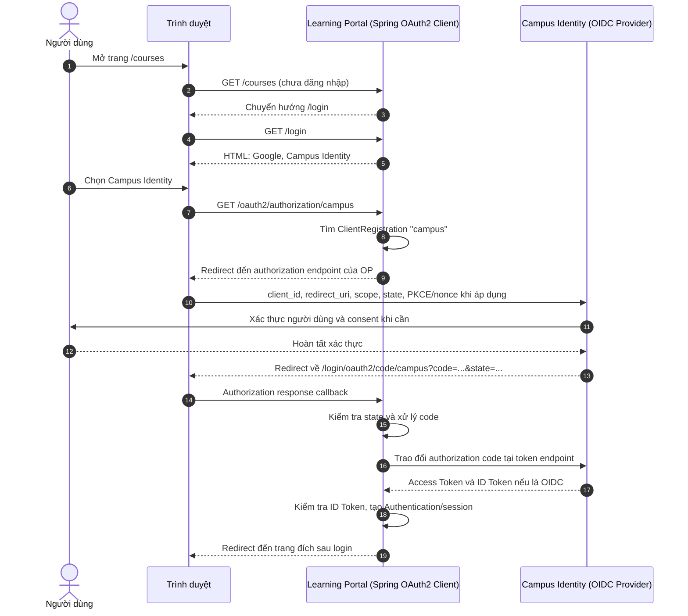

# 7.8. Trang đăng nhập mặc định và danh sách nhà cung cấp

## Mục tiêu bài học

Sau bài học, bạn có thể:

- Giải thích khi nào Spring Security trong ứng dụng **Servlet** tạo trang đăng nhập mặc định và vì sao trang đó xuất hiện khi bật `oauth2Login()`.
- Nhận diện danh sách các lựa chọn đăng nhập OAuth 2.0/OpenID Connect (OIDC) trên trang mặc định, nguồn dữ liệu của danh sách và ý nghĩa nhãn hiển thị.
- Phân biệt URL **trang đăng nhập**, URL **bắt đầu authorization**, URL **callback** và authorization endpoint của Identity Provider.
- Cấu hình nhiều `ClientRegistration`, kiểm soát `clientName`, `registrationId` và hiểu điều kiện để Spring hiển thị các liên kết.
- Tùy biến trang đăng nhập mà vẫn dùng các filter OAuth2 Login của Spring Security, bao gồm cách dựng danh sách lựa chọn từ repository.
- Chẩn đoán trang đăng nhập không xuất hiện, thiếu nhà cung cấp, link sai, redirect loop hoặc lỗi callback.

## 1. Bối cảnh: người dùng gặp trang đăng nhập khi nào?

Giả sử **Learning Portal** là ứng dụng web Spring Boot sử dụng Spring Security. Trang `/courses` chỉ dành cho người đã đăng nhập. Người dùng chưa có phiên đăng nhập hợp lệ mở:

```http
GET /courses HTTP/1.1
Host: portal.example.org
```

Với cấu hình đăng nhập OAuth 2.0/OIDC cho ứng dụng Servlet, Spring Security có thể chuyển hướng người dùng đến trang `/login`. Nếu ứng dụng **chưa tự định nghĩa trang đăng nhập**, Spring có thể tạo một trang HTML mặc định. Trang này cung cấp các liên kết như:

```text
                  Sign in

       [Login with Campus Identity]
       [Login with Google]
```

Đây là giao diện minh họa. Cách hiển thị thực tế, nhãn và thành phần trang có thể thay đổi theo phiên bản/config Spring Security. Danh sách được xây từ **các OAuth2 Client Registration của chính ứng dụng**, không phải danh sách mọi nhà cung cấp đang tồn tại trên Internet.

Người dùng bấm “Campus Identity” thì trình duyệt đi đến một endpoint **bên trong Learning Portal**, ví dụ:

```text
/oauth2/authorization/campus
```

Sau đó Spring mới tạo yêu cầu OAuth2/OIDC và redirect trình duyệt sang **OpenID Provider** để đăng nhập. Trang mặc định đóng vai trò **chọn cách đăng nhập**, không tự xác thực mật khẩu của Campus Identity.

### 1.1. Phân biệt bốn địa chỉ quan trọng

| Địa chỉ | Thuộc bên nào? | Công dụng |
| --- | --- | --- |
| `/login` | Spring web application | Trang chọn cách đăng nhập, có thể được Spring tạo mặc định |
| `/oauth2/authorization/{registrationId}` | Spring OAuth2 Client | Bắt đầu authorization request theo registration cụ thể |
| `/login/oauth2/code/{registrationId}` | Spring OAuth2 Client | Nhận authorization response/callback từ provider |
| `https://id.example.org/oauth2/authorize` | Authorization Server/OpenID Provider | Nơi xử lý đăng nhập, consent và phát hành authorization code |

Hai địa chỉ đầu tiên có thể nằm trên **cùng domain của ứng dụng** nhưng không cùng chức năng. `/login` hiển thị lựa chọn; `/oauth2/authorization/campus` bắt đầu giao dịch OAuth2 thực sự.

### 1.2. Mối quan hệ giữa OAuth2 Login và OIDC Login

`oauth2Login()` là chức năng **đăng nhập người dùng** của Spring Security dựa trên OAuth 2.0 Authorization Code Flow. Khi registration yêu cầu scope `openid` và provider đáp ứng OpenID Connect, Spring Security thực hiện thêm xử lý OIDC: kiểm tra ID Token, nhận diện `OidcUser` và tùy trường hợp lấy hồ sơ từ UserInfo.

Vì thế một trang đăng nhập mặc định có thể đồng thời hiển thị:

- Liên kết đến **OIDC Provider**, ví dụ một hệ thống đăng nhập tập trung.
- Liên kết đến **OAuth2 Provider** có thông tin người dùng theo cơ chế nhà cung cấp, nếu Spring Security có cấu hình phù hợp.

Người dùng chỉ thấy các lựa chọn đăng nhập; họ không cần biết provider dùng OAuth2 UserInfo kiểu riêng hay OIDC chuẩn. Tuy nhiên, backend vẫn phải xử lý đúng các luồng và dữ liệu danh tính tương ứng.

## 2. Spring Security tạo trang đăng nhập mặc định bằng thành phần nào?

Trong servlet security filter chain, **`DefaultLoginPageGeneratingFilter`** có thể cung cấp trang HTML đăng nhập được sinh tự động khi Spring Security được cấu hình với cơ chế đăng nhập phù hợp mà không chỉ định trang login tùy chỉnh.

Khi dùng OAuth2 Login:

```java
@Configuration
class SecurityConfiguration {

    @Bean
    SecurityFilterChain securityFilterChain(HttpSecurity http) throws Exception {
        http
            .authorizeHttpRequests(auth -> auth
                .requestMatchers("/", "/assets/**").permitAll()
                .anyRequest().authenticated()
            )
            .oauth2Login(Customizer.withDefaults());

        return http.build();
    }
}
```

Đoạn mã giả định dự án dùng Spring Boot, Spring Security và OAuth2 Client dependencies tương thích; các import Java đã được lược bỏ để tập trung vào cấu hình.

Chức năng của các dòng chính:

1. `requestMatchers("/", "/assets/**").permitAll()` cho phép người dùng xem trang chủ/tài nguyên tĩnh công khai.
2. `anyRequest().authenticated()` yêu cầu người dùng đăng nhập đối với các URL còn lại.
3. `oauth2Login(Customizer.withDefaults())` bật cơ chế OAuth2 Login với các endpoint và xử lý mặc định.
4. Nếu không có cấu hình trang login riêng, Spring Security có thể sinh trang đăng nhập mặc định để trình bày các OAuth clients có thể chọn.

**Không phải mỗi ứng dụng có OAuth2 Client đều tự tạo trang `/login`.** `oauth2Login()` đóng vai trò bật login tương tác; nếu ứng dụng chỉ cấu hình `oauth2Client()` để gọi API outbound hoặc `oauth2ResourceServer()` để nhận Bearer token, đó là các trách nhiệm khác và không có nghĩa tự xuất hiện danh sách đăng nhập.

### 2.1. Trang mặc định không phải một file `login.html` trong dự án

Với cấu hình mặc định, HTML được tạo bởi Spring Security trong xử lý request; bạn có thể nhìn thấy `/login` dù dự án không có:

```text
src/main/resources/templates/login.html
src/main/resources/static/login.html
```

Điều này rất thuận tiện cho demo hoặc kiểm tra tích hợp OAuth2 Login vì chưa cần viết controller và template. Tuy nhiên, vì trang sinh tự động, việc thêm một file HTML tên `login.html` không tự thay thế trang mặc định. Muốn dùng UI tùy chỉnh, cần cấu hình `loginPage(...)` và xây handler/view phù hợp.

### 2.2. Trang mặc định có thể có nhiều loại lựa chọn

Nếu cùng một `SecurityFilterChain` cấu hình cả đăng nhập username/password và OAuth2 Login, trang được sinh có thể chứa phần form login và các liên kết OAuth2. Những thành phần xuất hiện phụ thuộc cấu hình xác thực đã bật và phiên bản Spring Security.

Ví dụ:

```java
http
    .authorizeHttpRequests(auth -> auth
        .anyRequest().authenticated()
    )
    .formLogin(Customizer.withDefaults())
    .oauth2Login(Customizer.withDefaults());
```

Ngược lại, ứng dụng chỉ dùng OIDC SSO có thể chỉ có lựa chọn OAuth2/OIDC. Không nên suy diễn có form mật khẩu là Spring Security trực tiếp xử lý mật khẩu của provider: form login và OAuth2 Login là hai cơ chế khác nhau.

## 3. Danh sách nhà cung cấp lấy từ đâu?

Danh sách trên trang mặc định được xây từ **`ClientRegistrationRepository`**, nơi Spring Security lưu các cấu hình `ClientRegistration`.

Một `ClientRegistration` đại diện cho một OAuth2 client đã đăng ký với Authorization Server, chứa:

| Thuộc tính | Ví dụ | Vai trò trên trang và luồng |
| --- | --- | --- |
| `registrationId` | `campus` | Khóa nội bộ dùng xây link `/oauth2/authorization/campus` |
| `clientName` | `Campus Identity` | Nhãn dễ đọc trong link của trang đăng nhập |
| `clientId` | `learning-portal-web` | Giá trị gửi cho Authorization Server trong tham số `client_id` |
| `clientSecret` | Đọc từ secret store | Credential của confidential client; không đưa vào HTML |
| `authorizationGrantType` | `authorization_code` | Phân biệt registration dùng đăng nhập tương tác với loại grant khác |
| `redirectUri` | `{baseUrl}/login/oauth2/code/{registrationId}` | URI nhận callback sau khi Authorization Server xử lý |
| `scopes` | `openid`, `profile`, `email` | Các phạm vi được yêu cầu |
| Provider details | `issuer-uri`, authorization endpoint, token endpoint | Xác định máy chủ mà client sẽ giao tiếp |

**Mỗi link biểu diễn một `ClientRegistration`, không nhất thiết một thương hiệu/nhà cung cấp duy nhất.**

Một nhà cung cấp OIDC có thể được dùng bởi hai registration với hai Client ID/điều kiện riêng, ví dụ `campus-student` và `campus-staff`. Khi repository cung cấp cả hai và cấu hình cho phép login, trang có thể hiển thị hai lựa chọn, dù chúng đều dẫn đến cùng issuer.

### 3.1. Vai trò của `Iterable<ClientRegistration>`

Để `DefaultLoginPageGeneratingFilter` tự liệt kê các OAuth clients đã cấu hình, `ClientRegistrationRepository` phải cho phép duyệt các registration, thường là implement **`Iterable<ClientRegistration>`**.

Triển khai `InMemoryClientRegistrationRepository` của Spring Security đáp ứng đặc điểm này và thường được sử dụng trong các cấu hình Spring Boot đơn giản.

```java
ClientRegistrationRepository repository = ...;

ClientRegistration campus =
    repository.findByRegistrationId("campus");
```

Lời gọi `findByRegistrationId` cho phép **tra cứu một registration**, nhưng nếu implementation chỉ hỗ trợ tra cứu và **không** implement `Iterable`, Spring không có cách chuẩn để thu thập danh sách từ repository cho trang mặc định.

Kết quả có thể là: OAuth2 Login vẫn có registration để xử lý đường dẫn trực tiếp, nhưng **danh sách liên kết không xuất hiện đúng trên trang tự sinh**.

Ví dụ repository tự tạo:

```java
final class DatabaseClientRegistrationRepository
        implements ClientRegistrationRepository {

    @Override
    public ClientRegistration findByRegistrationId(String id) {
        return loadRegistrationFromDatabase(id);
    }
}
```

Implementation này minh họa việc tìm theo khóa, nhưng **không có khả năng iterate**. Nếu muốn dùng trang login tự sinh để hiện toàn bộ registration, cần cung cấp một repository có khả năng liệt kê tương ứng. Cũng có thể viết trang login riêng và lấy danh sách từ dịch vụ cấu hình của ứng dụng.

Lưu ý: không phải bất kỳ registration nào cũng phù hợp làm nút đăng nhập; nên chỉ hiển thị những client dành cho **Authorization Code login**.

### 3.2. `clientName` quyết định nhãn, `registrationId` quyết định URL

Giả sử cấu hình:

```yaml
registration:
  campus:
    client-id: learning-portal-web
    client-name: "Tài khoản Campus"
```

Khi được chọn để hiển thị:

```text
Text của link:  Tài khoản Campus
Href của link:  /oauth2/authorization/campus
OAuth client_id: learning-portal-web
```

Nếu đổi:

```yaml
client-name: "Đăng nhập bằng SSO trường"
```

thì tên link có thể thay đổi, nhưng địa chỉ `/oauth2/authorization/campus` và `client_id=learning-portal-web` không đổi.

Nếu thay **`registrationId`** từ `campus` thành `university`, đường dẫn bắt đầu đăng nhập đổi sang `/oauth2/authorization/university` và callback URI dùng template tương ứng cũng có thể thay đổi. Cần cập nhật những link, URI đã đăng ký với OP và mã nơi khác tra cứu registration.

### 3.3. Provider alias không phải registration ID

Trong YAML:

```yaml
registration:
  campus-student:
    provider: campus-oidc
    client-id: student-client

provider:
  campus-oidc:
    issuer-uri: https://id.campus.example.org
```

- `campus-student`: registration ID, dùng trong link đăng nhập.
- `campus-oidc`: tên khóa cấu hình provider dùng chung thông tin OP.
- `student-client`: client ID đã đăng ký ở OP.

URL `/oauth2/authorization/campus-oidc` **không tự tồn tại** chỉ vì provider alias có tên đó. URL mặc định cần một registration ID thật.

## 4. Ví dụ chạy với hai lựa chọn đăng nhập

Giả sử Learning Portal muốn hiển thị “Google” và “Campus Identity”. Một cấu hình minh họa:

```yaml
spring:
  security:
    oauth2:
      client:
        registration:
          google:
            client-id: ${GOOGLE_CLIENT_ID}
            client-secret: ${GOOGLE_CLIENT_SECRET}
            scope:
              - openid
              - profile
              - email
            client-name: "Google"

          campus:
            provider: campus
            client-id: ${CAMPUS_CLIENT_ID}
            client-secret: ${CAMPUS_CLIENT_SECRET}
            client-authentication-method: client_secret_basic
            authorization-grant-type: authorization_code
            redirect-uri: "{baseUrl}/login/oauth2/code/{registrationId}"
            scope:
              - openid
              - profile
              - email
            client-name: "Campus Identity"

        provider:
          campus:
            issuer-uri: https://id.campus.example.org
```

Cấu hình này dùng:

- **Google** là provider đã được Spring Boot hỗ trợ cấu hình thông dụng theo registration ID `google`; ứng dụng vẫn phải đăng ký OAuth client thực tế với Google và nhận credentials đúng.
- **Campus Identity** là OP giả định được mô tả qua `issuer-uri`; OP cần hỗ trợ OIDC Discovery và các endpoint yêu cầu.
- **Biến môi trường** cho client ID/secret; không đặt secret thật trong tài liệu hoặc source code.
- Các scope `openid`, `profile`, `email` để yêu cầu OIDC login và thông tin hồ sơ theo chính sách provider.

Có thể bổ sung dependency Maven trong một dự án Spring Boot điển hình:

```xml
<dependency>
    <groupId>org.springframework.boot</groupId>
    <artifactId>spring-boot-starter-security</artifactId>
</dependency>
<dependency>
    <groupId>org.springframework.boot</groupId>
    <artifactId>spring-boot-starter-oauth2-client</artifactId>
</dependency>
```

Các dependency/phiên bản được quản lý theo BOM và Spring Boot version của dự án. Đối với provider thực, cần tạo client registration bên phía nhà cung cấp và khai báo **redirect URI hợp lệ**; không thể đăng nhập chỉ bằng cách chép YAML.

### 4.1. Liên kết dự kiến trên trang mặc định

Nếu Spring đang dùng cấu hình login mặc định và repository có thể iterate, người dùng sẽ thấy các lựa chọn tương ứng như:

```html
<a href="/oauth2/authorization/google">Google</a>
<a href="/oauth2/authorization/campus">Campus Identity</a>
```

Đoạn trên chỉ mô phỏng cấu trúc link; HTML/CSS thực tế do Spring tạo không nhất thiết giống hệt.

Trên môi trường production ở `https://portal.example.org`, các callback thường là:

```text
https://portal.example.org/login/oauth2/code/google
https://portal.example.org/login/oauth2/code/campus
```

Cần đăng ký callback tương ứng với từng client ở Google và Campus Identity. Thay đổi context path, reverse proxy hay URI template có thể làm URL thực tế khác ví dụ.

### 4.2. Trình tự khi người dùng chọn Campus Identity



Trang `/login` chỉ giúp **chọn registration**. Authentication thực sự diễn ra qua các filter OAuth2 Login, Authorization Server và xử lý token phía Spring.

### 4.3. Sau khi login xong sẽ đến đâu?

Trong cấu hình thông dụng, Spring Security lưu thông tin request cần xác thực ban đầu và có thể đưa người dùng trở về trang đã yêu cầu, ví dụ `/courses`. Khi không có request đã lưu hoặc ứng dụng cấu hình success handler riêng, đường dẫn thành công có thể khác.

Có thể cấu hình:

```java
http.oauth2Login(oauth2 -> oauth2
    .defaultSuccessUrl("/dashboard", true)
);
```

Tùy chọn `true` yêu cầu luôn chuyển đến `/dashboard` khi login thành công, thay vì ưu tiên saved request. Đây là hành vi cấp ứng dụng, không phải của OAuth2 Provider hay danh sách nhà cung cấp.

## 5. Các filter tham gia vào trang login và luồng OAuth2

Một cách hiểu hữu ích về kiến trúc Servlet:

| Thành phần | Vai trò |
| --- | --- |
| `DefaultLoginPageGeneratingFilter` | Sinh nội dung trang login mặc định nếu được bật và phù hợp cấu hình |
| `OAuth2AuthorizationRequestRedirectFilter` | Nhận request bắt đầu OAuth2, xây authorization request, chuyển hướng đến Authorization Server |
| `DefaultOAuth2AuthorizationRequestResolver` | Giải quyết registration từ URL bắt đầu và tạo authorization request mặc định |
| `OAuth2AuthorizationRequestRepository` | Lưu và lấy authorization request trong khi đi qua trình duyệt; mặc định thường dựa trên HTTP session |
| `OAuth2LoginAuthenticationFilter` | Nhận callback authorization response và thực hiện login token exchange |
| `ClientRegistrationRepository` | Tìm/lặp các cấu hình OAuth2 Client |
| `OAuth2UserService` hoặc `OidcUserService` | Lấy thông tin principal theo luồng tương ứng |
| `SecurityContextRepository` | Lưu ngữ cảnh xác thực theo cấu hình sau login |

Các thành phần có trách nhiệm khác nhau. Việc tự tạo một trang HTML với danh sách link không thay thế được authorization request resolver, validation `state`, PKCE, OIDC ID Token validation, lưu session hay xử lý thành công/thất bại.

### 5.1. Đường dẫn đi qua hai filter khác nhau

Khi bấm:

```text
/oauth2/authorization/campus
```

bộ xử lý authorization request sẽ bắt đầu redirect sang provider. Khi quay về:

```text
/login/oauth2/code/campus?code=...&state=...
```

bộ xử lý OAuth2 Login sẽ nhận callback.

Nếu tùy biến một trong hai đường dẫn, phải đồng bộ cấu hình của filter tương ứng với link trên trang đăng nhập và redirect URI đã đăng ký tại provider.

## 6. Trang mặc định có những giới hạn gì?

Trang mặc định rất hữu ích cho phát triển và các hệ thống đơn giản, nhưng không phải một UI quản trị identity đầy đủ:

- Thiết kế và nhãn phụ thuộc cơ chế sinh trang của Spring; việc tùy chỉnh branding, giải thích quyền, đa ngôn ngữ hoặc quy trình trợ giúp đăng nhập khá hạn chế.
- Danh sách nhìn thấy là những registration mà client cung cấp cho Spring và có thể liệt kê; không được tự động đồng bộ từ danh sách provider bên ngoài.
- Không có cơ chế mặc định để “chọn provider tốt nhất” theo email/domain/tenant nếu ứng dụng không xây thêm.
- Một registration tên `admin` hay `staff` không phải là chính sách phân quyền. Người dùng có thể truy cập link trực tiếp; cần kiểm tra role ở ứng dụng.
- Khi dùng repository không iterable hoặc có security chain đặc thù, danh sách mặc định có thể không như mong đợi.
- Client Registration có thể không phù hợp để hiển thị công khai; nếu cần phân loại registration hiển thị cho người dùng, trang custom thường hợp lý hơn.

Không cần thay trang mặc định ngay khi bắt đầu; nó giúp kiểm tra nhanh đường đi của OAuth2 Login. Khi yêu cầu UX và chính sách trở nên cụ thể, nên xây trang đăng nhập riêng với link được kiểm soát.

## 7. Tùy biến trang đăng nhập nhưng giữ cơ chế OAuth2 Login

Một yêu cầu phổ biến: Learning Portal muốn có logo, tiêu đề tiếng Việt, mô tả và hai nút đăng nhập theo thiết kế sản phẩm.

### 7.1. Cấu hình trang `/signin` do ứng dụng cung cấp

```java
@Configuration
class WebSecurityConfig {

    @Bean
    SecurityFilterChain securityFilterChain(HttpSecurity http) throws Exception {
        http
            .authorizeHttpRequests(auth -> auth
                .requestMatchers("/", "/signin", "/css/**", "/images/**").permitAll()
                .anyRequest().authenticated()
            )
            .oauth2Login(oauth2 -> oauth2
                .loginPage("/signin")
            );

        return http.build();
    }
}
```

Khi gọi `.loginPage("/signin")`:

1. Spring sử dụng đường dẫn `/signin` làm trang login của ứng dụng.
2. **Ứng dụng phải tự cung cấp controller/view** cho GET `/signin`, hoặc cơ chế tương đương.
3. Trang này cần có các link đến authorization-start URL đúng với từng registration.
4. Các filter OAuth2 Login cho việc redirect sang provider và xử lý callback vẫn hoạt động nếu cấu hình giữ nguyên.
5. Nên cho phép truy cập `/signin` và các tài nguyên tĩnh cần thiết khi chưa xác thực để tránh redirect loop.

Ví dụ controller Spring MVC:

```java
@Controller
class SignInController {

    @GetMapping("/signin")
    String signIn() {
        return "signin";
    }
}
```

Với Thymeleaf, tệp template có thể ở `src/main/resources/templates/signin.html` và chứa các link:

```html
<!doctype html>
<html lang="vi" xmlns:th="http://www.thymeleaf.org">
<head>
  <meta charset="UTF-8">
  <title>Đăng nhập Learning Portal</title>
</head>
<body>
  <h1>Đăng nhập Learning Portal</h1>
  <p>Chọn tài khoản dùng để đăng nhập.</p>

  <a th:href="@{/oauth2/authorization/google}">
    Tiếp tục với Google
  </a>
  <a th:href="@{/oauth2/authorization/campus}">
    Tiếp tục với Campus Identity
  </a>
</body>
</html>
```

Biểu thức `@{...}` của Thymeleaf giúp sinh URL theo ngữ cảnh triển khai; ví dụ giả định ứng dụng đã tích hợp Thymeleaf view resolver. Nếu thay authorization base URI, các link trên phải được đổi tương ứng.

**Điểm cần nhớ:** `.loginPage("/signin")` không có nghĩa provider cũng phải dùng URL `/signin`. Đây là trang UI của **Learning Portal**.

### 7.2. Khi trang tùy chỉnh không dùng form password

Nếu ứng dụng chỉ có OAuth2/OIDC login, trang `/signin` có thể chỉ gồm các link `<a href>`. Đây là cách hợp lệ để bắt đầu OAuth2 Authorization Code Flow; không cần tạo form chứa mật khẩu của Identity Provider, và cũng không yêu cầu người dùng nhập client secret.

Link bắt đầu OAuth2 thường là GET; không gửi email/mật khẩu của người dùng tới backend Learning Portal để đổi lấy token. Xác thực người dùng được thực hiện tại OP.

### 7.3. Có thể chỉ hiển thị một lựa chọn không?

Có. Nếu ứng dụng chỉ dùng một OIDC Provider, trang `/signin` có thể có một nút “Đăng nhập bằng tài khoản tổ chức”. Thậm chí ứng dụng có thể cấu hình một authentication entry point hoặc điều hướng của riêng mình để tự chuyển ngay đến `/oauth2/authorization/campus` thay vì yêu cầu chọn.

Tuy nhiên, một cơ chế tự động chuyển hướng phải tránh vòng lặp khi provider báo lỗi hoặc người dùng quay về với trạng thái không hợp lệ. Cần có đường xử lý lỗi dễ hiểu và một cách phục hồi khi session/token không được chấp nhận.

## 8. Sinh danh sách nhà cung cấp một cách động

Nếu số lượng registrations thay đổi theo môi trường, trang custom có thể lấy tên và ID từ `ClientRegistrationRepository` thay vì hard-code mọi link.

### 8.1. Model hiển thị chỉ gồm dữ liệu an toàn

Giả sử repository implement `Iterable<ClientRegistration>`; một controller có thể chọn các registration dành cho OAuth2 Login:

```java
@Controller
class ProviderSelectionController {

    private final ClientRegistrationRepository registrations;

    ProviderSelectionController(ClientRegistrationRepository registrations) {
        this.registrations = registrations;
    }

    @GetMapping("/signin")
    String signIn(Model model) {
        List<LoginOption> options = new ArrayList<>();

        if (registrations instanceof Iterable<?> iterable) {
            for (Object candidate : iterable) {
                ClientRegistration registration = (ClientRegistration) candidate;

                if (AuthorizationGrantType.AUTHORIZATION_CODE.equals(
                        registration.getAuthorizationGrantType())) {
                    options.add(new LoginOption(
                        registration.getRegistrationId(),
                        registration.getClientName()
                    ));
                }
            }
        }

        model.addAttribute("loginOptions", options);
        return "signin";
    }

    record LoginOption(String registrationId, String clientName) {}
}
```

Mã Java trên minh họa ý tưởng trong một dự án Java hiện đại; cần thêm các import và kiểm soát danh sách registration nào được phép hiển thị. Điều kiện `AuthorizationGrantType.AUTHORIZATION_CODE` ngăn đưa những client chỉ dành cho `client_credentials` thành nút login người dùng.

Template Thymeleaf:

```html
<h1>Chọn phương thức đăng nhập</h1>

<ul>
  <li th:each="option : ${loginOptions}">
    <a th:href="@{/oauth2/authorization/{registrationId}
                  (registrationId=${option.registrationId})}"
       th:text="${option.clientName}">
      Login provider
    </a>
  </li>
</ul>
```

Tùy template engine, có thể viết biểu thức link gọn trên một dòng. Điều quan trọng là:

- **URL dùng `registrationId`.**
- **Nhãn dùng `clientName`.**
- Không đưa `clientSecret`, access token, token endpoint secret hay toàn bộ `ClientRegistration` sang browser.
- Không tự động hiển thị registration không dành cho người dùng cuối nếu ứng dụng có chính sách chọn lọc riêng.

### 8.2. Khi repository không implement `Iterable`

Với repository chỉ biết `findByRegistrationId(id)`, ứng dụng có thể:

- Sử dụng một danh sách các login option hợp lệ được quản lý riêng trong cấu hình UI.
- Bổ sung dịch vụ chuyên dụng trả các registration được phép hiển thị.
- Triển khai khả năng enumerate tại repository nếu phù hợp mô hình lưu trữ và bảo mật.
- Với một vài lựa chọn cố định, hard-code các URL link rõ ràng trong template và quản lý cùng cấu hình.

Không cần ép mọi kho lưu client credentials thành API liệt kê công khai. Chỉ cung cấp metadata cần cho trang chọn đăng nhập.

### 8.3. Danh sách nhà cung cấp không phải danh sách người dùng được phép

Danh sách login option trả lời câu hỏi “Ứng dụng hỗ trợ cách đăng nhập nào?” chứ không trả lời “Người dùng này có quyền gì?”. Ví dụ:

```text
/oauth2/authorization/campus-staff
```

chỉ chọn registration dành cho một luồng hoặc chính sách đã cấu hình. Nếu người dùng chưa có role giảng viên, họ vẫn không được cấp quyền truy cập `/staff/reports` chỉ vì đã chọn nút Staff. Sau callback, ứng dụng phải kiểm tra danh tính và authorization bằng nguồn đáng tin cậy.

## 9. Tùy biến authorization base URI ảnh hưởng đến các nút thế nào?

Spring Security OAuth2 Login thường bắt đầu tại:

```text
/oauth2/authorization/{registrationId}
```

Nếu muốn dùng `/sso/start/{registrationId}`:

```java
http.oauth2Login(oauth2 -> oauth2
    .loginPage("/signin")
    .authorizationEndpoint(authorization -> authorization
        .baseUri("/sso/start")
    )
);
```

Khi đó, các link bắt đầu login phải được đổi:

```text
/sso/start/google
/sso/start/campus
```

Không cần đổi `clientId` hoặc tên provider chỉ vì URL nội bộ thay đổi. Đây là URL của Spring Client; Authorization Server vẫn có authorization endpoint của riêng nó.

Ngoài ra, nếu dùng URI template mặc định cho callback:

```text
/login/oauth2/code/{registrationId}
```

thì đổi **authorization start base URI** không tự đổi **callback URI**. Hai cấu hình là độc lập.

### 9.1. Tùy biến callback cũng cần đồng bộ provider

Nếu ứng dụng thay callback thành `/auth/callback/{registrationId}`, phải cấu hình cả:

```java
http.oauth2Login(oauth2 -> oauth2
    .redirectionEndpoint(redirection -> redirection
        .baseUri("/auth/callback/*")
    )
);
```

và:

```yaml
redirect-uri: "{baseUrl}/auth/callback/{registrationId}"
```

Sau đó đăng ký redirect URI **đã mở rộng** tại provider, ví dụ:

```text
https://portal.example.org/auth/callback/campus
```

Mẫu `*` của filter dùng để khớp request ở Spring; nó không có nghĩa provider nhận wildcard trong redirect URI đã đăng ký.

Với các URI callback, cần khớp host, scheme, port, context path và đường dẫn theo chính sách của provider. Thông báo `redirect_uri_mismatch` thường là vấn đề cấu hình URI hoặc reverse proxy, chứ không liên quan nhãn `clientName`.

## 10. Cách thay đổi trang đăng nhập tương tác với xử lý lỗi và phiên

### 10.1. Trang login có thể xuất hiện từ request được bảo vệ

Một hành trình điển hình:

```text
1. GET /courses
2. Spring phát hiện chưa có Authentication hợp lệ
3. Redirect đến /login hoặc /signin
4. Người dùng chọn provider
5. OAuth2/OIDC login hoàn tất
6. Spring tạo Authentication và session phù hợp
7. Chuyển người dùng tới /courses hoặc success URL đã cấu hình
```

Việc chuyển sang trang login thường do entry point/cơ chế xử lý yêu cầu cần xác thực thực hiện. Nếu API muốn trả `401` thay vì redirect HTML, cần cấu hình security chain hoặc authentication entry point phù hợp; trang login dành cho luồng web tương tác.

### 10.2. Login thất bại thì gì xảy ra?

Nếu provider từ chối yêu cầu, người dùng hủy consent, `state` không hợp lệ hoặc token exchange thất bại, Spring sẽ xử lý lỗi theo cấu hình `oauth2Login()`.

Có thể cấu hình đường dẫn xử lý lỗi riêng:

```java
http.oauth2Login(oauth2 -> oauth2
    .loginPage("/signin")
    .failureUrl("/signin?error")
);
```

Ứng dụng phải cung cấp trang `/signin` hoạt động cả khi có `?error` và hiển thị thông điệp an toàn, tránh tiết lộ token, secret hoặc raw exception. Nếu trang lỗi tự động chuyển ngay sang provider, có thể tạo redirect loop khi lỗi kéo dài.

### 10.3. Logout và chọn nhà cung cấp có khác nhau không?

Trang login chỉ bắt đầu một lần đăng nhập mới. Khi người dùng logout khỏi Learning Portal, session local có thể bị kết thúc; điều này không đồng nghĩa session SSO ở OP đã bị xóa. Lần tiếp theo nhấn login, OP có thể nhận ra người dùng vẫn còn phiên đăng nhập và chuyển về rất nhanh.

Với OIDC nếu có yêu cầu logout tập trung, có thể cần tích hợp **RP-Initiated Logout** và các cơ chế do OP hỗ trợ. Nó là bài toán khác với việc hiện danh sách nhà cung cấp trên trang `/login`.

## 11. Những trường hợp danh sách nhà cung cấp không xuất hiện như mong đợi

### 11.1. Đã cấu hình OAuth2 Client nhưng trang login không có link

Một số khả năng:

- Ứng dụng chỉ dùng `.oauth2Client()` mà chưa bật `.oauth2Login()`.
- Đang dùng trang login tùy chỉnh qua `.loginPage(...)` nhưng template chưa có link.
- `ClientRegistrationRepository` có khả năng lookup nhưng không thể iterate, nên filter sinh trang không liệt kê được các client.
- Registration không được tạo thành công do thiếu client ID, issuer hoặc thuộc tính cần thiết.
- `SecurityFilterChain` được chọn cho request `/login` không chứa cấu hình OAuth2 Login mong đợi.
- Một filter/controller hoặc forward khác đang xử lý `/login` thay trang mặc định.

### 11.2. Đường dẫn bắt đầu đăng nhập trả lỗi hoặc 404

Ví dụ:

```text
GET /oauth2/authorization/campus
```

Những điều cần kiểm tra:

1. Có thực sự tồn tại `registration.campus` không, hay chỉ có `provider.campus`?
2. Đã bật `oauth2Login()` trên chain xử lý URL đó chưa?
3. Có đổi authorization base URI thành `/sso/start` hay đường dẫn khác không?
4. Ứng dụng có context path như `/learning` không?
5. Có reverse proxy cắt hoặc thêm prefix dẫn đến URL không khớp không?

Nếu registration ID thực tế là `campus-student`, link `/oauth2/authorization/campus` sẽ không tự chọn registration tương ứng.

### 11.3. Provider báo `redirect_uri_mismatch`

Nguyên nhân có thể:

```text
Spring gửi:
http://portal-service:8080/login/oauth2/code/campus

Provider đăng ký:
https://portal.example.org/login/oauth2/code/campus
```

Trong môi trường reverse proxy, Spring cần suy ra đúng external base URL. Spring Boot có thể dùng cấu hình forwarded header phù hợp, ví dụ:

```yaml
server:
  forward-headers-strategy: framework
```

Chỉ sử dụng forwarded headers do reverse proxy đáng tin cậy thiết lập/kiểm soát; không tin Host hay X-Forwarded-* không được xác minh từ Internet. Ngoài scheme/host, cần so đúng port, path và callback URI của từng registration.

### 11.4. Người dùng đăng nhập thành công nhưng không được truy cập tài nguyên

OAuth2/OIDC login chứng minh phiên đăng nhập theo cấu hình, không tự cấp quyền admin hay quyền xem mọi khóa học. Việc đăng nhập bằng nút “Campus Staff” không đủ để khẳng định người dùng là nhân viên; Resource Server và ứng dụng vẫn phải kiểm tra role, scope và ownership của tài nguyên.

### 11.5. Trang `/signin` cứ chuyển hướng về chính nó

Nguyên nhân thường gặp: `/signin` không được `permitAll()`, handler view không tồn tại, security chain sai hoặc entry point liên tục redirect về URL đã bị chặn. Với trang custom, hãy kiểm tra ngay khả năng **mở `/signin` khi chưa đăng nhập** trước khi điều tra provider.

## 12. Bảng chẩn đoán nhanh

| Hiện tượng | Khả năng chính | Hướng kiểm tra |
| --- | --- | --- |
| Thấy trang Spring mặc định dù đã tạo `signin.html` | Chưa cấu hình `.loginPage("/signin")` hoặc đường dẫn login thực tế khác | Kiểm tra OAuth2 Login config và controller |
| Không thấy nhà cung cấp trên trang mặc định | Repository không iterable, chưa có registration hoặc `oauth2Login()` chưa bật | Kiểm tra `ClientRegistrationRepository`, chain và startup config |
| Nhãn link là tên kỹ thuật | `clientName` chưa đặt hoặc template lấy `registrationId` | Cấu hình `client-name` hoặc sửa UI |
| Nhãn ở OP không đổi dù sửa `client-name` | Tên client hiển thị tại OP được quản lý độc lập | Chỉnh tên ứng dụng trong phần đăng ký provider |
| Link login dẫn đến 404 | Registration ID sai, base URI khác hoặc context path không đúng | So link và cấu hình |
| Provider trả `invalid_client` | `client_id`, secret hoặc phương thức xác thực client không đúng | So với registration tại provider |
| Provider trả `redirect_uri_mismatch` | Callback không đúng URI đã đăng ký | So exact redirect URI và proxy headers |
| Callback trả 404 | Redirection endpoint pattern không khớp URI thực tế | So `.redirectionEndpoint().baseUri(...)` và `redirect-uri` |
| `/signin` redirect loop | Trang custom bị yêu cầu xác thực hoặc handler không có | Mở quyền `/signin` và static assets |
| Đăng nhập xong tới trang khác dự kiến | Có saved request hoặc success handler khác | Xem defaultSuccessUrl và successHandler |
| Có nút Staff nhưng user thường vào được login | Nút chỉ chọn registration, không kiểm tra role | Bổ sung authorization ở ứng dụng |
| Người dùng logout nhưng đăng nhập lại ngay không hỏi mật khẩu | Phiên SSO tại OP vẫn còn | Xem chính sách logout/reauth của OP |

## 13. Một số nguyên tắc bảo mật cần giữ khi thiết kế trang login

- **Không thu thập mật khẩu của OP trên trang Portal:** OAuth2/OIDC dùng redirect đến OP để xác thực người dùng. Trang chọn provider chỉ cần link bắt đầu flow.
- **Không đưa client secret và token vào HTML:** `clientName` và `registrationId` có thể công khai; `clientSecret`, access token, refresh token và state bí mật cần được quản lý đúng cách.
- **Dùng `state`/PKCE/nonce theo luồng:** Spring Security cần có đủ trạng thái giao dịch và cơ chế xác thực để chống CSRF/login CSRF, đánh tráo response và một số nguy cơ đánh cắp code.
- **Đăng ký redirect URI chính xác:** Không dựng callback từ host không tin cậy hay cho phép redirect tới URL tùy ý.
- **Phân biệt provider và quyền:** Một link đăng nhập tên “Admin” không phải cơ chế xác định role.
- **Hạn chế registration hiển thị:** Chỉ trình bày các client login cần thiết; không dùng danh sách client cho workload backend như một menu công khai.
- **Giữ thông báo lỗi không chứa thông tin nhạy cảm:** Không log hoặc hiển thị raw token, client secret, authorization code hay toàn bộ claims cá nhân.
- **Không thiết lập rule `permitAll()` quá rộng:** Trang login và assets cần công khai, nhưng endpoint nghiệp vụ cần được bảo vệ đúng mục tiêu.
- **Chống giả mạo ở trang có form:** Nếu một UI custom có thêm form local login hoặc thao tác đổi trạng thái, hãy giữ cơ chế CSRF protection phù hợp; các liên kết OAuth2 GET không thay thế quy tắc bảo vệ request khác.
- **Duy trì trải nghiệm phục hồi:** Khi provider không sẵn sàng, trang lỗi cần giúp người dùng thử lại hợp lý hoặc chọn phương thức khác mà không lặp redirect vô hạn.

## 14. Bài tập thực hành

### Bài tập 1: Dự đoán danh sách link

Cho cấu hình rút gọn:

```yaml
spring:
  security:
    oauth2:
      client:
        registration:
          school:
            provider: campus
            client-id: portal-web
            client-name: "SSO Nhà trường"
            authorization-grant-type: authorization_code
            scope: [openid, profile]
        provider:
          campus:
            issuer-uri: https://id.school.example
```

Giả định registration có đủ thông số cần thiết để khởi tạo và repository iterable. Khi dùng trang login mặc định, dự đoán:

**Nhãn link:** `SSO Nhà trường`.

**Đích link:** `/oauth2/authorization/school`.

**OAuth `client_id` gửi lên OP:** `portal-web`.

**Provider alias:** `campus`.

Điểm quan trọng là bốn giá trị có vai trò khác nhau. Nếu sửa provider alias nhưng không sửa registration ID, link của trang vẫn dựa trên `school`.

### Bài tập 2: Thêm nhà cung cấp thứ hai

Ứng dụng muốn thêm “Google” bên cạnh “SSO Nhà trường”.

Các bước ở mức cấu hình:

1. Đăng ký OAuth client ở Google, lấy Client ID/secret và khai báo redirect URI.
2. Thêm một `ClientRegistration` có ID `google` và tên hiển thị phù hợp.
3. Giữ `oauth2Login()` được bật, repository hỗ trợ iterate hoặc tự đưa link vào trang custom.
4. Kiểm tra hai đường dẫn `/oauth2/authorization/school` và `/oauth2/authorization/google`.
5. Đảm bảo callback cho cả hai registration được OP tương ứng chấp nhận.

Không cần biến cả hai provider thành một registration chung nếu chúng có issuer/client ID/điều kiện khác nhau.

### Bài tập 3: Chuyển từ trang mặc định sang trang tùy chỉnh

Learning Portal muốn sử dụng `/signin` với logo và hai nút.

**Cách làm:** Cấu hình `.oauth2Login(o -> o.loginPage("/signin"))`, cung cấp view/controller cho GET `/signin`, cho phép truy cập khi chưa xác thực, và đặt hai link bắt đầu authorization theo registration IDs. Không tự viết code trao đổi authorization code nếu Spring đã xử lý flow chuẩn.

### Bài tập 4: Danh sách biến mất khi thay repository

Trước đây ứng dụng dùng `InMemoryClientRegistrationRepository`, trang login tự sinh hiển thị hai lựa chọn. Sau khi thay bằng `ClientRegistrationRepository` tùy biến chỉ có `findByRegistrationId`, các link biến mất.

**Giải thích:** trang mặc định cần có khả năng liệt kê registrations. Một implementation chỉ hỗ trợ tra cứu có thể vẫn dùng cho login trực tiếp nhưng không cho Spring xây danh sách. Hãy bổ sung khả năng iterate phù hợp hoặc dùng trang custom lấy danh sách từ một nguồn đã kiểm soát.

### Bài tập 5: Một người bấm nút “Giảng viên”

Trang login có link:

```text
/oauth2/authorization/campus-staff
```

Có thể coi user là giảng viên chỉ vì bấm link không?

**Không.** Đây là cách chọn một registration. Sau khi login, hệ thống cần xác thực danh tính và áp dụng quyền nghiệp vụ từ dữ liệu đáng tin cậy.

## 15. Câu hỏi ôn tập

**1. Vì sao `/login` xuất hiện dù dự án không có file HTML cùng tên?**

> Khi cấu hình đăng nhập phù hợp mà chưa tùy biến login page, `DefaultLoginPageGeneratingFilter` của Spring Security có thể sinh HTML cho URL đăng nhập.

**2. Danh sách nhà cung cấp trên trang mặc định được lấy ở đâu?**

> Từ các `ClientRegistration` mà ứng dụng cung cấp qua `ClientRegistrationRepository`, với yêu cầu repository phải có khả năng liệt kê khi Spring sinh link tự động.

**3. Nếu `clientName = "Đăng nhập SSO"` và `registrationId = "campus"`, nhãn và URL là gì?**

> Nhãn thường là `Đăng nhập SSO`, còn liên kết bắt đầu login là `/oauth2/authorization/campus` trong cấu hình mặc định.

**4. `clientName` có phải tên mà Authorization Server hiển thị trên consent screen không?**

> Không nhất thiết. Tên tại OP thường được quản lý trong registration của chính OP; `clientName` của Spring là metadata hiển thị phía ứng dụng.

**5. Tùy biến `.loginPage("/signin")` có tự tạo template `/signin` không?**

> Không. Ứng dụng phải cung cấp handler/view cho URL này và bảo đảm trang có link đúng đến các authorization-start URL.

**6. Thay authorization start base URI có làm đổi callback URI không?**

> Không tự động. Authorization start URI và redirection callback URI là hai cấu hình khác nhau.

**7. Spring trang login mặc định không hiện provider nhưng `/oauth2/authorization/campus` vẫn hoạt động, có thể do đâu?**

> Có thể repository không iterable: Spring vẫn tra cứu được registration theo ID nhưng không thể liệt kê nó để sinh danh sách.

**8. Vì sao trang đăng nhập không được dùng để cấp role theo tên nút?**

> Vì nút chỉ chọn client registration. Quyền truy cập phải được quyết định sau khi danh tính đã xác thực, dựa trên nguồn phân quyền và chính sách nghiệp vụ.

---

## Ghi nhớ

Trong ứng dụng **Spring Security Servlet** có `oauth2Login()`, trang **`/login`** mặc định có thể được sinh bởi `DefaultLoginPageGeneratingFilter`. Danh sách lựa chọn đăng nhập phản ánh những **`ClientRegistration`** mà repository có thể liệt kê; **`clientName`** là nhãn hiển thị, còn **`registrationId`** tạo đường dẫn mặc định **`/oauth2/authorization/{registrationId}`**. Bấm link sẽ khởi tạo Authorization Code/OIDC flow; provider trả kết quả về callback **`/login/oauth2/code/{registrationId}`**. Khi muốn branding, đa ngôn ngữ hoặc kiểm soát các lựa chọn hiển thị, dùng **custom login page** nhưng vẫn để Spring Security xử lý redirect, token exchange, kiểm tra OIDC và tạo phiên đăng nhập.
