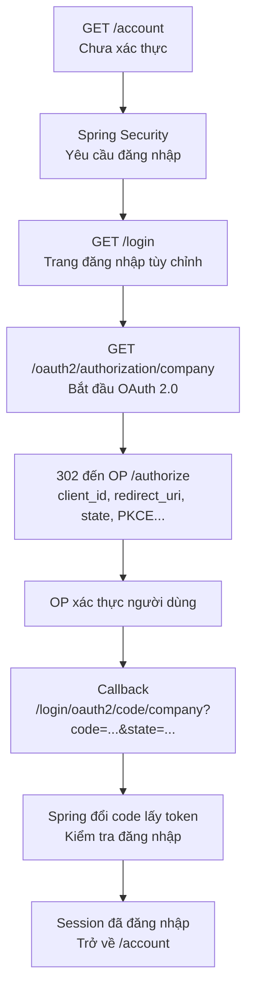

# 7.9. Trang đăng nhập tùy chỉnh và đường dẫn bắt đầu xác thực

Trong ứng dụng **Spring Security OAuth 2.0/OIDC Client chạy trên Servlet stack**, người dùng thường truy cập một trang được bảo vệ, sau đó được chuyển đến trang đăng nhập và chọn nhà cung cấp định danh (Identity Provider). Spring Security có thể tạo trang đăng nhập mặc định với các liên kết OAuth 2.0, nhưng nhiều hệ thống cần trang riêng để hiển thị thương hiệu, hướng dẫn đăng nhập hoặc nhiều lựa chọn như “Đăng nhập bằng tài khoản công ty”.

Hai việc dễ bị nhầm lẫn là:

1. **Trang đăng nhập tùy chỉnh**: trang HTML mà người dùng nhìn thấy trong ứng dụng, ví dụ `GET /login`; ứng dụng tự thiết kế và phục vụ trang đó.
2. **Đường dẫn bắt đầu xác thực OAuth 2.0/OIDC**: endpoint do Spring Security xử lý để **khởi tạo authorization request** và chuyển trình duyệt đến Authorization Server/OpenID Provider (OP), mặc định là `GET /oauth2/authorization/{registrationId}`.

Đổi trang đăng nhập không tự động đổi endpoint bắt đầu xác thực. Đổi endpoint bắt đầu xác thực cũng không tự động đổi đường dẫn callback. Hiểu rõ ba vị trí **login page → authorization initiation → redirect callback** là nền tảng để cấu hình đúng.

## 1. Bối cảnh: OAuth 2.0 Login trên Servlet stack

Ứng dụng Spring MVC hoặc Spring Boot Servlet thường đóng vai **OAuth 2.0 Client**; khi có scope `openid` và OP hỗ trợ OIDC, ứng dụng đồng thời là **OpenID Connect Relying Party**.

Các vai trò trong luồng:

| Thành phần | Trách nhiệm | Ví dụ |
|---|---|---|
| Trình duyệt | Hiển thị trang và đi theo HTTP redirect | Chrome, Firefox |
| Spring Security OAuth 2.0 Client | Bảo vệ trang, tạo authorization request, xử lý callback, tạo phiên | Ứng dụng `portal.example.org` |
| Authorization Server / OpenID Provider | Xác thực người dùng, cấp authorization code/token | `login.example.org` |
| `ClientRegistrationRepository` | Lưu cấu hình các OAuth client registration | `company`, `partner` |
| HTTP session của ứng dụng | Gắn yêu cầu đăng nhập đang chờ với callback và duy trì đăng nhập | Session cookie của RP |

Ví dụ người dùng chưa đăng nhập truy cập `GET /account`. Nếu endpoint yêu cầu xác thực, Spring Security sẽ khởi động quy trình đăng nhập. Khi ứng dụng có trang tùy chỉnh `/login`, người dùng có thể chọn nút để bắt đầu đăng nhập qua provider.



Mặc định, Spring Security có thể cung cấp trang login sinh tự động. Khi chỉ định `loginPage("/login")`, ứng dụng **chịu trách nhiệm tạo route, template và nội dung trang riêng**.

## 2. Phân biệt chính xác ba đường dẫn

| Đường dẫn minh họa | Phương thức thường dùng | Ai xử lý? | Mục đích |
|---|---|---|---|
| `/login` | `GET` | Controller/view của ứng dụng | Hiển thị giao diện lựa chọn đăng nhập |
| `/oauth2/authorization/company` | `GET` | `OAuth2AuthorizationRequestRedirectFilter` | Tạo authorization request rồi redirect đến OP |
| `/login/oauth2/code/company` | `GET` với `code`/`state` | `OAuth2LoginAuthenticationFilter` | Nhận kết quả authorization và hoàn tất đăng nhập |

Trong đó `company` là **`registrationId`**, tức khóa cục bộ do Spring đặt trong `ClientRegistrationRepository`. Nó **không nhất thiết bằng** OAuth `client_id` do OP cấp.

Ví dụ:

```yaml
spring:
  security:
    oauth2:
      client:
        registration:
          company:
            client-id: portal-web-production
```

- URL bắt đầu đăng nhập mặc định: `/oauth2/authorization/company`.
- Query parameter tại OP: `client_id=portal-web-production`.
- URL callback mặc định: `/login/oauth2/code/company`.

Sự khác biệt này rất quan trọng khi đọc log. Thay `company` thành `company-oidc` trong Spring thường sẽ đổi các URL chứa `{registrationId}`, trong khi `client_id` tại provider có thể giữ nguyên.

### 2.1. Đường dẫn bắt đầu xác thực không phải trang OP

Liên kết:

```text
https://portal.example.org/oauth2/authorization/company
```

trỏ về **ứng dụng Spring**, không trỏ trực tiếp đến login page của OP. Spring Security tìm `ClientRegistration` tên `company`, tạo một authorization request có `client_id`, `redirect_uri`, `scope`, `state` và thông tin giao thức khác, rồi gửi HTTP `302` đến authorization endpoint của OP.

Thay vì hard-code đường dẫn `https://login.example.org/authorize?...` trong HTML, liên kết đến URL của Spring giúp Spring Security quản lý an toàn các giá trị theo từng yêu cầu.

### 2.2. Đường dẫn callback không phải đường dẫn bắt đầu đăng nhập

Callback mặc định:

```text
https://portal.example.org/login/oauth2/code/company
```

được OP sử dụng để trả về `code` và `state` sau khi người dùng xác thực. Nó **không phải** URL để người dùng nhấn bắt đầu đăng nhập, và không nên đưa vào nút “Đăng nhập”.

Nếu truy cập callback trực tiếp mà không có yêu cầu authorization đang chờ hợp lệ, ứng dụng không thể hoàn tất một phiên đăng nhập đúng giao thức.

## 3. Spring Security tạo trang đăng nhập mặc định thế nào?

Khi bật OAuth2 Login:

```java
http.oauth2Login(Customizer.withDefaults());
```

và chưa thiết lập trang login riêng, Spring Security có thể dùng `DefaultLoginPageGeneratingFilter` để sinh trang đăng nhập. Với cấu hình thông thường và `ClientRegistrationRepository` có thể liệt kê registration, trang đó có các liên kết OAuth client.

Ví dụ repository có `company` và `partner`, trang mặc định có thể hiển thị các lựa chọn OAuth tương ứng. Đây là giải pháp hữu ích cho môi trường học tập, thử nghiệm hoặc ứng dụng đơn giản.

Tuy nhiên, trang mặc định thường không đáp ứng yêu cầu về giao diện, đa ngôn ngữ, nội dung hướng dẫn, branding, accessibility hoặc chính sách hiển thị provider. Khi dùng:

```java
.oauth2Login(oauth2 -> oauth2.loginPage("/login"))
```

Spring không tự xây trang HTML tùy chỉnh cho `/login`. Bạn phải cung cấp controller hoặc view tương ứng, đồng thời cho phép người dùng chưa xác thực truy cập trang đó.

**Dễ nhầm:** `loginPage("/login")` chỉ xác định nơi người dùng nhìn thấy giao diện đăng nhập; không thay đổi `/oauth2/authorization/{registrationId}` và cũng không thay đổi `/login/oauth2/code/{registrationId}`.

## 4. Ví dụ đầy đủ: trang đăng nhập tùy chỉnh với Spring MVC và Thymeleaf

Giả sử ứng dụng Spring Boot có một OpenID Provider nội bộ. Yêu cầu:

- Trang chính `/` và trang `/login` là công khai.
- Trang `/account` yêu cầu đăng nhập.
- Người dùng nhấn nút “Đăng nhập với tài khoản công ty”.
- Spring khởi tạo đăng nhập OIDC qua registration `company`.
- Sau khi xác thực thành công, Spring tạo phiên và đưa người dùng đến tài nguyên cần truy cập.

### 4.1. Dependencies

Ví dụ với Gradle (Groovy DSL):

```groovy
dependencies {
    implementation 'org.springframework.boot:spring-boot-starter-web'
    implementation 'org.springframework.boot:spring-boot-starter-security'
    implementation 'org.springframework.boot:spring-boot-starter-oauth2-client'
    implementation 'org.springframework.boot:spring-boot-starter-thymeleaf'
}
```

Đây là ứng dụng **Servlet/MVC**; ví dụ dùng `SecurityFilterChain` hiện đại, không dựa vào `WebSecurityConfigurerAdapter` của các phiên bản cũ.

### 4.2. Client registration trong `application.yml`

```yaml
spring:
  security:
    oauth2:
      client:
        registration:
          company:
            provider: company
            client-id: ${COMPANY_OIDC_CLIENT_ID}
            client-secret: ${COMPANY_OIDC_CLIENT_SECRET}
            client-authentication-method: client_secret_basic
            authorization-grant-type: authorization_code
            redirect-uri: "{baseUrl}/login/oauth2/code/{registrationId}"
            scope:
              - openid
              - profile
              - email
        provider:
          company:
            issuer-uri: ${COMPANY_OIDC_ISSUER_URI}
```

Giải thích:

- `registration.company`: tạo registration với ID `company`; đây là tên xuất hiện trong link bắt đầu đăng nhập.
- `client-id`: định danh client mà OP đã cấp, có thể khác `company`.
- `client-secret`: credential của confidential backend client; không đưa vào template hoặc JavaScript.
- `client-authentication-method`: phương thức backend xác thực với token endpoint.
- `redirect-uri`: URI mà OP trả callback về, có `{registrationId}`.
- `scope: openid`: yêu cầu OIDC, để nhận ID token và thực hiện đăng nhập định danh.
- `issuer-uri`: issuer tin cậy của OP, hỗ trợ discovery các endpoint/JWKS nếu provider tương thích.

Đăng ký tại OP cần có **redirect URI chính xác**, ví dụ `https://portal.example.org/login/oauth2/code/company`. Các giá trị `{baseUrl}` được mở rộng từ public base URL mà Spring nhận diện; trong kiến trúc có reverse proxy cần cấu hình forwarded headers tin cậy.

### 4.3. SecurityFilterChain

```java
import org.springframework.context.annotation.Bean;
import org.springframework.context.annotation.Configuration;
import org.springframework.security.config.Customizer;
import org.springframework.security.config.annotation.web.builders.HttpSecurity;
import org.springframework.security.web.SecurityFilterChain;

@Configuration
public class SecurityConfig {

    @Bean
    SecurityFilterChain securityFilterChain(HttpSecurity http) throws Exception {
        http
            .authorizeHttpRequests(auth -> auth
                .requestMatchers(
                    "/", "/login", "/error",
                    "/css/**", "/js/**", "/images/**"
                ).permitAll()
                .anyRequest().authenticated())
            .oauth2Login(oauth2 -> oauth2
                .loginPage("/login"));

        return http.build();
    }
}
```

Tác động:

1. Người dùng chưa đăng nhập có thể truy cập `/login` và tài nguyên tĩnh của giao diện.
2. Các đường dẫn khác, ví dụ `/account`, yêu cầu xác thực.
3. Khi cần đăng nhập, Spring sử dụng `/login` làm trang login.
4. Vì chưa custom authorization endpoint base URI, liên kết bắt đầu OAuth2 vẫn là `/oauth2/authorization/company`.
5. Callback OIDC vẫn được filter của Spring xử lý tại `/login/oauth2/code/company` theo cấu hình mặc định.

Có thể bỏ import `Customizer` khi không dùng tới trong lớp cấu hình này; nó thường hữu ích ở những ví dụ bật `oauth2Login(Customizer.withDefaults())`. Ứng dụng không cần tạo controller riêng để xử lý callback; Spring Security chịu trách nhiệm cho callback path nếu filter chain được cấu hình phù hợp.

### 4.4. Controller phục vụ trang đăng nhập

```java
import org.springframework.stereotype.Controller;
import org.springframework.web.bind.annotation.GetMapping;

@Controller
public class LoginPageController {

    @GetMapping("/login")
    public String login() {
        return "login";
    }

    @GetMapping("/")
    public String home() {
        return "home";
    }
}
```

`return "login"` nghĩa là Thymeleaf sẽ render `src/main/resources/templates/login.html`. Nếu dùng static HTML, MVC view khác hoặc SPA frontend, cách phục vụ trang có thể thay đổi nhưng endpoint hiển thị vẫn phải tồn tại và truy cập được khi chưa đăng nhập.

Đừng tạo:

```java
@GetMapping("/login")
public String login() {
    return "redirect:/login";
}
```

vì nó tự tạo vòng lặp chuyển hướng. Cũng không để `/login` nằm sau quy tắc yêu cầu xác thực mà thiếu ngoại lệ thích hợp, vì request unauthenticated có thể bị chuyển vòng về chính nó.

### 4.5. Template `login.html`

```html
<!DOCTYPE html>
<html lang="vi" xmlns:th="http://www.thymeleaf.org">
<head>
    <meta charset="UTF-8">
    <meta name="viewport" content="width=device-width, initial-scale=1">
    <title>Đăng nhập</title>
    <link rel="stylesheet" th:href="@{/css/login.css}">
</head>
<body>
<main>
    <h1>Đăng nhập vào cổng thông tin</h1>
    <p>Sử dụng tài khoản công ty để tiếp tục.</p>

    <a th:href="@{/oauth2/authorization/company}">
        Đăng nhập với tài khoản công ty
    </a>
</main>
</body>
</html>
```

Nút/đường dẫn trong ví dụ:

- Thực hiện **GET** đến filter bắt đầu xác thực của Spring.
- Không chứa client secret, access token hoặc authorization code.
- Không tự tạo `state` hay `nonce` trong template.
- Không trực tiếp gọi token endpoint.
- Dùng cú pháp `@{...}` của Thymeleaf để ứng dụng xử lý context path phù hợp.

Nếu ứng dụng được phục vụ dưới context path `/portal`, link do Thymeleaf xây dựng có thể tính đúng context path. Hard-code chuỗi `href="/oauth2/authorization/company"` đôi khi không phù hợp nếu deployed dưới một path prefix khác.

**CSRF:** Một link GET đến endpoint khởi tạo OAuth2 authorization là thao tác điều hướng thường gặp. Không cần tự gắn CSRF token vào link này để thay thế `state`. Ngược lại, các form POST thay đổi trạng thái trong ứng dụng (ví dụ logout bằng session cookie) vẫn cần CSRF protection thích hợp.

### 4.6. Trang bảo vệ và kiểm tra principal

Ví dụ một controller trả dữ liệu tài khoản sau OIDC Login:

```java
import org.springframework.security.core.annotation.AuthenticationPrincipal;
import org.springframework.security.oauth2.core.oidc.user.OidcUser;
import org.springframework.web.bind.annotation.GetMapping;
import org.springframework.web.bind.annotation.RestController;

@RestController
public class AccountController {

    public record AccountInfo(
        String issuer,
        String subject,
        String displayName
    ) {}

    @GetMapping("/account")
    public AccountInfo account(@AuthenticationPrincipal OidcUser user) {
        return new AccountInfo(
            user.getIdToken().getIssuer().toString(),
            user.getSubject(),
            user.getFullName()
        );
    }
}
```

Với registration có `openid` và đăng nhập OIDC thành công, principal thường là `OidcUser`. Claim `name` có thể không được OP cấp, vì vậy `getFullName()` có thể `null`.

`sub` kết hợp `iss` là cơ sở thích hợp để ánh xạ tài khoản nội bộ. Tên hiển thị/email không nên tự động trở thành khóa định danh hoặc quyền nghiệp vụ.

## 5. Luồng HTTP khi người dùng nhấn nút đăng nhập

Giả sử RP là `https://portal.example.org`, OP là `https://login.example.org`.

```text
[1] GET https://portal.example.org/account
    -> 302 Location: /login

[2] GET https://portal.example.org/login
    -> 200 OK, HTML chứa link /oauth2/authorization/company

[3] GET https://portal.example.org/oauth2/authorization/company
    -> Spring tạo authorization request
    -> 302 Location: https://login.example.org/authorize?
          response_type=code
          &client_id=<registered-client-id>
          &redirect_uri=https%3A%2F%2Fportal.example.org%2Flogin%2Foauth2%2Fcode%2Fcompany
          &scope=openid%20profile%20email
          &state=<random-state>
          &code_challenge=<pkce-challenge-if-enabled>
          &code_challenge_method=S256

[4] Browser theo redirect; OP xử lý xác thực/đồng ý

[5] OP -> 302 Location:
    https://portal.example.org/login/oauth2/code/company?
          code=<authorization-code>&state=<original-state>

[6] Spring nhận callback và kiểm tra authorization response;
    backend đổi code lấy token tại OP token endpoint

[7] Spring Security xác minh OIDC ID token, tạo Authentication/phiên

[8] Browser được redirect về tài nguyên ban đầu hoặc trang thành công
```

Các parameter hiển thị ở bước [3] là minh họa; một authorization request thực tế có thể có `nonce` của OIDC, `code_challenge` của PKCE và parameter bổ sung tùy cấu hình/provider. Phải giữ đúng semantics của thư viện và OP.

Spring Security thường lưu authorization request liên quan `state` để đối chiếu khi callback quay về. Nếu ứng dụng dùng HTTP session, việc mất session giữa [3] và [5] có thể khiến Spring không tìm lại được yêu cầu ban đầu.

## 6. Cách thay đổi đường dẫn bắt đầu xác thực

Mặc định, `OAuth2AuthorizationRequestRedirectFilter` xử lý:

```text
/oauth2/authorization/{registrationId}
```

Nhưng tổ chức có thể muốn URL dễ hiểu như:

```text
/sso/start/company
```

Spring Security Servlet OAuth2 Login cho phép cấu hình **authorization endpoint base URI**:

```java
import org.springframework.context.annotation.Bean;
import org.springframework.context.annotation.Configuration;
import org.springframework.security.config.annotation.web.builders.HttpSecurity;
import org.springframework.security.web.SecurityFilterChain;

@Configuration
public class SecurityConfig {

    @Bean
    SecurityFilterChain securityFilterChain(HttpSecurity http) throws Exception {
        http
            .authorizeHttpRequests(auth -> auth
                .requestMatchers("/", "/login", "/error", "/css/**").permitAll()
                .anyRequest().authenticated())
            .oauth2Login(oauth2 -> oauth2
                .loginPage("/login")
                .authorizationEndpoint(authorization -> authorization
                    .baseUri("/sso/start")));

        return http.build();
    }
}
```

Sau thay đổi:

| Thành phần | Trước | Sau |
|---|---|---|
| Trang login | `/login` | `/login` |
| Đường dẫn bắt đầu đăng nhập | `/oauth2/authorization/company` | **`/sso/start/company`** |
| Callback mặc định | `/login/oauth2/code/company` | `/login/oauth2/code/company` |

Template cần đổi link tương ứng:

```html
<a th:href="@{/sso/start/company}">
    Đăng nhập với tài khoản công ty
</a>
```

Điều quan trọng là **`baseUri("/sso/start")` chỉ đổi nơi Spring tiếp nhận yêu cầu bắt đầu xác thực**. Nó không đổi authorization endpoint ở OP, không tự cập nhật trang login, không sửa callback, không đổi `client_id` hay `registrationId`.

Nếu vẫn giữ link `/oauth2/authorization/company` trong HTML sau khi đã đổi base URI, Spring không còn bắt link ấy bằng filter tương ứng theo cấu hình mới. Tùy route và security rules, người dùng có thể thấy `404`, bị yêu cầu đăng nhập lại hoặc xảy ra redirect loop.

### 6.1. Liên kết được tạo từ đâu?

Spring Security dùng `ClientRegistrationRepository` để tìm registration khớp `registrationId` trong URL. Không thể tự gắn một ID bất kỳ rồi mong framework tìm được provider.

Ví dụ repository có:

```yaml
registration:
  company:
    client-id: portal-oidc-prod
  partner:
    client-id: partner-login-prod
```

và base URI là `/sso/start`, hai link có dạng:

```text
/sso/start/company
/sso/start/partner
```

Không dùng `/sso/start/portal-oidc-prod` trừ khi đó đúng là registration ID. Phần cuối path là tên cục bộ của registration, không phải giá trị `client_id` do provider cấp.

### 6.2. Base URI không phải URI tuyệt đối đến OP

Cấu hình:

```java
.authorizationEndpoint(authorization ->
    authorization.baseUri("/sso/start"))
```

không có nghĩa đặt authorization endpoint của provider thành `/sso/start`. Authorization endpoint thật của OP được khai báo qua `provider.authorization-uri` hoặc được khám phá từ `issuer-uri`.

Hai lớp cấu hình:

| Thuộc tính | Nơi áp dụng |
|---|---|
| `authorizationEndpoint().baseUri(...)` | Path **tại ứng dụng Spring** để bắt đầu đăng nhập |
| `provider.<id>.authorization-uri` | URL **tại Authorization Server** nhận OAuth authorization request |

Không gán URL `https://login.example.org/authorize` vào `baseUri` với ý định chuyển OP; Spring filter yêu cầu matcher path cục bộ.

## 7. Thay đổi callback là thao tác khác với thay đổi initiation URL

Callback mặc định của Spring Security Servlet OAuth2 Login có pattern:

```text
/login/oauth2/code/*
```

Và cấu hình redirect URI theo từng client thường là:

```yaml
redirect-uri: "{baseUrl}/login/oauth2/code/{registrationId}"
```

Nếu kiến trúc cần callback riêng `/signin/oauth2/code/{registrationId}`, phải phối hợp **cả hai nơi**.

### 7.1. Cấu hình filter xử lý callback

```java
http.oauth2Login(oauth2 -> oauth2
    .loginPage("/login")
    .authorizationEndpoint(authorization -> authorization
        .baseUri("/sso/start"))
    .redirectionEndpoint(redirection -> redirection
        .baseUri("/signin/oauth2/code/*")));
```

### 7.2. Cấu hình URI mà client gửi đến OP

```yaml
spring:
  security:
    oauth2:
      client:
        registration:
          company:
            redirect-uri: "{baseUrl}/signin/oauth2/code/{registrationId}"
```

Đồng thời, OP phải đăng ký callback tuyệt đối tương ứng, chẳng hạn:

```text
https://portal.example.org/signin/oauth2/code/company
```

Nếu chỉ đổi `redirectionEndpoint().baseUri(...)` nhưng giữ `redirect-uri` cũ, OP có thể trả code về một URL mà Spring filter không còn xử lý. Nếu chỉ đổi `redirect-uri` mà không đổi filter matcher, callback có thể trả `404` hoặc không hoàn tất đăng nhập.

**Không cần đổi callback chỉ để tạo trang login đẹp hơn.** Với phần lớn ứng dụng, nên giữ callback mặc định và chỉ tùy chỉnh trang giao diện/URL bắt đầu xác thực khi có yêu cầu cụ thể.

## 8. Nhiều nhà cung cấp trên cùng trang đăng nhập

Một trang login có thể cung cấp nhiều lựa chọn OAuth/OIDC:

```yaml
spring:
  security:
    oauth2:
      client:
        registration:
          company:
            provider: company
            client-id: ${COMPANY_CLIENT_ID}
            client-secret: ${COMPANY_CLIENT_SECRET}
            authorization-grant-type: authorization_code
            redirect-uri: "{baseUrl}/login/oauth2/code/{registrationId}"
            scope: openid,profile
          partner:
            provider: partner
            client-id: ${PARTNER_CLIENT_ID}
            client-secret: ${PARTNER_CLIENT_SECRET}
            authorization-grant-type: authorization_code
            redirect-uri: "{baseUrl}/login/oauth2/code/{registrationId}"
            scope: openid,profile
        provider:
          company:
            issuer-uri: ${COMPANY_ISSUER_URI}
          partner:
            issuer-uri: ${PARTNER_ISSUER_URI}
```

Template:

```html
<section aria-labelledby="login-options">
    <h1 id="login-options">Chọn phương thức đăng nhập</h1>

    <a th:href="@{/oauth2/authorization/company}">
        Đăng nhập bằng tài khoản công ty
    </a>

    <a th:href="@{/oauth2/authorization/partner}">
        Đăng nhập bằng tài khoản đối tác
    </a>
</section>
```

Mỗi liên kết được định tuyến đến `ClientRegistration` tương ứng, với issuer, client ID, credential, scope và redirect URI riêng.

### 8.1. Không xây URL cho registration không tồn tại

Ví dụ trang đăng nhập nhận query parameter `provider` từ người dùng. Không nên ghép trực tiếp:

```java
return "redirect:/oauth2/authorization/" + providerFromRequest;
```

mà không kiểm tra `providerFromRequest`. Cần whitelist những registration ID được phép hiển thị và sử dụng theo chính sách ứng dụng/tenant.

Một lựa chọn minh họa:

```java
import java.util.Map;

import org.springframework.stereotype.Controller;
import org.springframework.web.bind.annotation.GetMapping;
import org.springframework.web.bind.annotation.RequestParam;

@Controller
public class LoginChoiceController {

    private static final Map<String, String> ALLOWED = Map.of(
        "employee", "company",
        "vendor", "partner"
    );

    @GetMapping("/choose-login")
    public String choose(@RequestParam String method) {
        String registrationId = ALLOWED.get(method);
        if (registrationId == null) {
            return "redirect:/login";
        }
        return "redirect:/oauth2/authorization/" + registrationId;
    }
}
```

Các giá trị trong map được quản lý trong code, không được truyền tùy ý từ browser. Trong hệ thống nhiều tenant, việc tenant được phép dùng OP nào phải được xác định từ cấu hình đáng tin cậy.

### 8.2. Hiển thị provider linh hoạt

Với trang login tùy chỉnh, application có thể:

- Đưa danh sách lựa chọn login qua `Model` từ cấu hình đã tin cậy.
- Hiển thị logo, tên thân thiện hoặc hướng dẫn tương ứng với từng provider.
- Ẩn những lựa chọn không áp dụng cho tenant/đối tượng sử dụng.
- Dùng translation messages cho tên provider.

Tuy nhiên, các liên kết cần trỏ đến **registration ID đã có thật**. Nếu muốn tự sinh danh sách từ `ClientRegistrationRepository`, cần biết repository có khả năng duyệt `Iterable<ClientRegistration>` hay không; một repository tùy biến có thể chỉ hỗ trợ lookup theo ID. Không nên cho rằng mọi implementation đều liệt kê được.

## 9. Trang login và đường dẫn authorization có liên hệ với security filter chain

### 9.1. Cấp quyền truy cập công khai cho trang login

Nếu `/login` yêu cầu authentication, người dùng chưa đăng nhập có thể bị gửi trở lại `/login`, tạo redirect loop:

```text
GET /account
  -> unauthenticated
  -> redirect /login
GET /login
  -> still requires authentication
  -> redirect /login
  -> ...
```

Đảm bảo route login và các tệp CSS/JS/images cần thiết cho giao diện được truy cập công khai. Chỉ cho phép `permitAll()` với các path thật sự công khai; phần còn lại vẫn được bảo vệ bằng `authenticated()` hoặc quy tắc authorization cụ thể.

### 9.2. Thứ tự nhiều SecurityFilterChain

Ứng dụng phức tạp có thể có filter chain cho REST API và một filter chain cho giao diện web. Ví dụ:

- `/api/**`: Resource Server, bearer token, stateless.
- `/**`: Servlet web login, session và `oauth2Login()`.

Nếu chain cho API vô tình match `/login` hoặc `/oauth2/authorization/**` trước chain web, các filter đăng nhập có thể không chạy. Cần cấu hình `securityMatcher` và thứ tự chain rõ ràng để login path, authorization initiation và callback đều được xử lý bởi đúng chain.

Ví dụ một chain riêng cho API:

```java
import org.springframework.core.annotation.Order;
import org.springframework.context.annotation.Bean;
import org.springframework.context.annotation.Configuration;
import org.springframework.security.config.annotation.web.builders.HttpSecurity;
import org.springframework.security.config.http.SessionCreationPolicy;
import org.springframework.security.web.SecurityFilterChain;

@Configuration
public class ApiChainConfig {

    @Bean
    @Order(1)
    SecurityFilterChain apiChain(HttpSecurity http) throws Exception {
        http
            .securityMatcher("/api/**")
            .sessionManagement(session -> session
                .sessionCreationPolicy(SessionCreationPolicy.STATELESS))
            .authorizeHttpRequests(auth -> auth
                .anyRequest().authenticated());

        // Có thể bổ sung oauth2ResourceServer().jwt() theo cấu hình API.
        return http.build();
    }
}
```

Ví dụ chỉ diễn tả **phạm vi matcher**; một API thực tế cần xác thực bearer token và chính sách CSRF phù hợp khi không dùng cookie. Phần OAuth2 Login web phải nằm trong chain khác có matcher phù hợp, không bị API chain bắt nhầm.

### 9.3. Login page khác login processing URL

Khi ứng dụng vừa có login form username/password truyền thống vừa có OAuth2 Login, cần phân biệt:

- Trang hiển thị `GET /login`.
- Endpoint xử lý form login `POST /login` hoặc path do `formLogin().loginProcessingUrl(...)` đặt.
- Endpoint bắt đầu OAuth `GET /oauth2/authorization/{registrationId}`.
- OAuth callback `GET /login/oauth2/code/{registrationId}`.

Có thể dùng chung trang giao diện cho nhiều lựa chọn, nhưng form login và OAuth2 Login là **hai quy trình xác thực** khác nhau. Không cấu hình cùng path/method theo cách khiến bộ filter xử lý nhầm request.

Ví dụ trang có cả form và OAuth link:

```html
<form th:action="@{/login}" method="post">
    <label for="username">Tên đăng nhập</label>
    <input id="username" name="username" type="text" autocomplete="username">

    <label for="password">Mật khẩu</label>
    <input id="password" name="password" type="password"
           autocomplete="current-password">

    <input type="hidden" th:name="${_csrf.parameterName}"
           th:value="${_csrf.token}">
    <button type="submit">Đăng nhập nội bộ</button>
</form>

<a th:href="@{/oauth2/authorization/company}">
    Đăng nhập SSO
</a>
```

Mẫu form POST chỉ hoạt động nếu ứng dụng đã cấu hình `formLogin()` và provider xác thực username/password tương ứng. Chỉ có `oauth2Login()` sẽ không khiến Spring tự xác minh username/password gửi qua form.

## 10. Lưu trạng thái authorization và quay lại trang ban đầu

### 10.1. Vai trò của state

Khi browser vào `/oauth2/authorization/company`, Spring Security tạo authorization request có `state` ngẫu nhiên và lưu thông tin cần thiết để đối chiếu với callback. Khi OP trả:

```text
/login/oauth2/code/company?code=...&state=...
```

Spring tra yêu cầu tương ứng, kiểm tra `state` và dùng thông tin của yêu cầu gốc để đổi code.

Nếu mất cookie session hoặc authorization request trước khi callback, có thể xuất hiện lỗi tương tự “authorization_request_not_found” hoặc `invalid_state_parameter`, tùy phiên bản và điểm lỗi.

Các nguyên nhân phổ biến:

- Session không được duy trì giữa request khởi tạo và callback.
- Cookie bị cấu hình `Secure`/`SameSite` không tương thích với cách OP trả callback, scheme hoặc hostname.
- Load balancer chuyển callback đến node không truy cập session store chứa authorization request.
- Người dùng khởi tạo nhiều login flow, back/forward giữa các tab và ghi đè trạng thái trong thiết kế tùy biến.
- Ứng dụng tự sửa authorization request hoặc `state` nhưng không duy trì repository tương ứng.

Không dùng một `state` tĩnh cho mọi yêu cầu. Không tự chấp nhận callback thiếu hoặc sai `state` chỉ để tránh lỗi.

### 10.2. Saved request sau khi đăng nhập

Khi người dùng chưa xác thực truy cập `/account`, Spring Security có thể lưu lại request mong muốn và đưa họ tới `/login`. Sau OIDC Login thành công, cơ chế success handler và request cache có thể đưa người dùng trở lại trang ban đầu.

Nếu ứng dụng tùy biến `defaultSuccessUrl` hoặc `successHandler`, cần phân biệt:

- **Ưu tiên request ban đầu** khi có saved request.
- **Luôn chuyển đến một trang cố định**.
- **Chuyển theo chính sách nghiệp vụ** sau xác thực.

Đừng đọc một query parameter như `next=https://somewhere.example` rồi redirect trực tiếp mà không kiểm tra; đây là nguồn **open redirect**. Nên dùng đường dẫn nội bộ đã kiểm soát hoặc allowlist đích được phép.

Ví dụ một lựa chọn success URL cố định:

```java
.oauth2Login(oauth2 -> oauth2
    .loginPage("/login")
    .defaultSuccessUrl("/dashboard", true))
```

Đối số `true` có nghĩa luôn ưu tiên `/dashboard` sau login thành công, kể cả trước đó người dùng đã vào một trang khác. Nếu muốn quay lại saved request khi có, cần lựa chọn cấu hình success URL/handler phù hợp.

### 10.3. Session và khả năng mở rộng nhiều instance

Trong môi trường production nhiều instance:

```text
Browser
  |
  v
Load Balancer
  |                 |
Spring App A     Spring App B
  |                 |
  +---- Shared Session Store ----+
```

Nếu authorization request được lưu trong session trên App A nhưng callback tới App B mà không có shared store/sticky session tương thích, việc đối chiếu `state` có thể thất bại.

Cần thiết kế session storage và lifecycle (ví dụ Spring Session), cookie domain/path, HTTPS và reverse proxy headers phù hợp. Chuyển sang lưu thông tin authorization trong cookie cần cân nhắc tính toàn vẹn/bảo mật và không tự thay đổi repository nếu chưa hiểu rủi ro.

## 11. Thêm thông số authorization mà vẫn giữ quy trình chuẩn

Có lúc OP yêu cầu hoặc cho phép các parameter bổ sung:

- `login_hint`: gợi ý tài khoản để OP điền trước.
- `prompt`: gợi ý cách OP tương tác, như `login` hoặc `select_account` theo OIDC.
- `max_age`: yêu cầu xác thực người dùng trong khoảng thời gian nhất định.
- `acr_values`: yêu cầu ngữ cảnh xác thực theo thỏa thuận với OP.
- `code_challenge`/`code_challenge_method`: PKCE, thường do OAuth client tạo.
- `nonce`: ràng buộc OIDC ID token với authorization request.

Không nên ghép các giá trị ngẫu nhiên này vào một URL tĩnh ở template. Nếu cần tùy biến, Spring Security hỗ trợ **`OAuth2AuthorizationRequestResolver`** hoặc customizer để can thiệp trước khi filter redirect sang OP.

Ví dụ chủ động yêu cầu PKCE trong authorization request với Spring Security Servlet:

```java
import org.springframework.context.annotation.Bean;
import org.springframework.context.annotation.Configuration;
import org.springframework.security.config.annotation.web.builders.HttpSecurity;
import org.springframework.security.oauth2.client.registration.ClientRegistrationRepository;
import org.springframework.security.oauth2.client.web.DefaultOAuth2AuthorizationRequestResolver;
import org.springframework.security.oauth2.client.web.OAuth2AuthorizationRequestCustomizers;
import org.springframework.security.web.SecurityFilterChain;

@Configuration
public class LoginSecurityConfig {

    @Bean
    SecurityFilterChain securityFilterChain(
            HttpSecurity http,
            ClientRegistrationRepository registrations) throws Exception {

        var resolver = new DefaultOAuth2AuthorizationRequestResolver(
            registrations, "/sso/start");

        resolver.setAuthorizationRequestCustomizer(
            OAuth2AuthorizationRequestCustomizers.withPkce());

        http
            .authorizeHttpRequests(auth -> auth
                .requestMatchers("/", "/login", "/error", "/css/**").permitAll()
                .anyRequest().authenticated())
            .oauth2Login(oauth2 -> oauth2
                .loginPage("/login")
                .authorizationEndpoint(authorization -> authorization
                    .authorizationRequestResolver(resolver)));

        return http.build();
    }
}
```

Lúc này base URI được đặt ngay trong `DefaultOAuth2AuthorizationRequestResolver`; link trong template phải là `/sso/start/company`. Không cần đồng thời cấu hình một resolver khác cho cùng initiation path.

PKCE phù hợp với Authorization Code Flow và cần AS hỗ trợ kiểm tra `code_verifier` ở token endpoint. Với public client, PKCE là yếu tố quan trọng; với confidential client, nó vẫn giúp ràng buộc authorization code và yêu cầu ban đầu.

Nếu thêm `login_hint` hoặc `prompt`, phải giới hạn giá trị đến từ request người dùng, không tin tham số tùy ý từ browser để sửa `redirect_uri`, `client_id` hoặc lựa chọn issuer không được phép. Giữ nguyên các kiểm tra `state`, `nonce`, PKCE và client authentication của framework.

## 12. Khi nào nên redirect thẳng đến nhà cung cấp thay vì hiển thị trang lựa chọn?

Không phải ứng dụng nào cũng cần một trang login có nút chọn. Nếu một tổ chức chỉ có một OP, có thể muốn người dùng vào vùng bảo vệ và được chuyển thẳng đến SSO.

Có hai phương án về trải nghiệm:

| Mô hình | Trải nghiệm | Khi phù hợp |
|---|---|---|
| **Trang lựa chọn** `/login` | Người dùng xem giới thiệu, chọn OP | Nhiều nhà cung cấp, hướng dẫn riêng, chính sách đăng nhập |
| **Điều hướng thẳng vào OAuth** | Người dùng được đưa đến `/oauth2/authorization/company` | Một OP duy nhất và không cần UI lựa chọn |

Một controller có thể chuyển hướng từ `/login` đến endpoint khởi tạo:

```java
import org.springframework.stereotype.Controller;
import org.springframework.web.bind.annotation.GetMapping;

@Controller
public class DirectSsoController {

    @GetMapping("/login")
    public String login() {
        return "redirect:/oauth2/authorization/company";
    }
}
```

Đây là ví dụ tùy chọn cho mô hình **một provider**. Với cấu hình custom base URI `/sso/start`, redirect phải đổi thành `redirect:/sso/start/company`.

Nếu OP còn giữ SSO session, trình duyệt có thể hoàn tất đăng nhập gần như không có tương tác. Nhưng nếu OP từ chối yêu cầu, trả lỗi hoặc có điều kiện người dùng chưa đáp ứng, ứng dụng cần xử lý failure và trang trợ giúp thích hợp.

Không thiết kế failure handler luôn redirect `/login` nếu `/login` lại lập tức redirect đến OP và OP liên tục trả cùng lỗi; điều đó tạo loop khó thoát cho người dùng.

## 13. Xử lý lỗi đăng nhập và trang thông báo thân thiện

Với trang login riêng, nên có cách hiển thị thông điệp khi đăng nhập thất bại, đồng thời không rò rỉ token hay secret.

Một ví dụ cấu hình:

```java
.oauth2Login(oauth2 -> oauth2
    .loginPage("/login")
    .failureUrl("/login?error"))
```

Controller có thể render cùng view `login`, và template hiển thị thông báo tổng quát khi query parameter `error` tồn tại:

```html
<p th:if="${param.error}" role="alert">
    Không thể hoàn tất đăng nhập. Vui lòng thử lại hoặc liên hệ hỗ trợ.
</p>
```

Không hiển thị trực tiếp nội dung exception kỹ thuật, authorization code, token response hoặc chi tiết nhạy cảm của OP cho người dùng cuối. Log phía server cần giữ request correlation an toàn để hỗ trợ điều tra.

Các lỗi phổ biến cần phân biệt:

| Biểu hiện | Nguyên nhân có thể | Vùng cấu hình liên quan |
|---|---|---|
| `GET /login` trả 404 | Chưa có controller/template hoặc view sai | MVC controller, templates |
| `/login` redirect về chính nó | Login page bị bảo vệ hoặc controller tự redirect vòng | `authorizeHttpRequests`, `loginPage` |
| Link đăng nhập trả 404 | Link không khớp initiation base URI | `authorizationEndpoint().baseUri`, template |
| Không tìm được `ClientRegistration` | Phần cuối URL khác `registrationId` | `registration.<id>`, link |
| OP trả `invalid_redirect_uri` | Callback URI Spring gửi không được OP đăng ký | `redirect-uri`, proxy/base URL, cấu hình OP |
| Callback trả 404 | Redirect endpoint matcher không khớp URI thực tế | `redirectionEndpoint().baseUri` và `redirect-uri` |
| Callback báo state/authorization request lỗi | Mất session, cookie hoặc request repository | `state`, session store, SameSite, load balancer |
| Token endpoint trả `invalid_client` | Client ID/secret/method không phù hợp | Client registration, OP |
| ID token không hợp lệ | Issuer, audience, chữ ký, nonce, thời hạn | OIDC provider, JWKS, xác minh token |
| Login thành công nhưng lại về trang sai | SavedRequest, success handler | `defaultSuccessUrl`, request cache |
| Truy cập static CSS bị yêu cầu login | Path static chưa permit hoặc filter matcher lệch | `requestMatchers`, resource paths |
| Lỗi chỉ xuất hiện sau reverse proxy | Public URL/scheme/host hoặc forwarded header không đúng | `{baseUrl}`, proxy headers, TLS |
| Đăng nhập lỗi chỉ ở nhiều node | Authorization request/session không đồng bộ | Shared session store/sticky sessions |

**Phân biệt nơi xảy ra lỗi** là cách xác định đúng tầng: trang login do MVC phục vụ; initiation path do redirect filter xử lý; redirect URI thuộc callback filter và registration; token exchange/JWT validation là bước tiếp theo.

## 14. Bảo mật trang login và đường dẫn bắt đầu xác thực

### 14.1. Giữ bí mật ở phía server

Với confidential Spring Boot client:

- Không chèn `client-secret` vào HTML hoặc JavaScript của `login.html`.
- Không ghi secret vào link OAuth initiation.
- Không đưa authorization code, access token, ID token hoặc refresh token vào query parameter tùy ý của trang login.
- Dùng secret manager/environment injection có kiểm soát cho backend; không commit secret production.

Trang login thường chỉ cần **đường dẫn cục bộ** như `/oauth2/authorization/company`.

### 14.2. Kiểm soát redirect và tham số động

Một trang đăng nhập có thể cần lưu nơi người dùng muốn đến sau login. Không cho phép user nhập URL bất kỳ rồi chuyển hướng trực tiếp mà thiếu kiểm tra, ví dụ:

```text
/login?returnTo=https://attacker.example/phishing
```

Nếu ứng dụng tự hỗ trợ return URL, chỉ nhận relative path hoặc URL thuộc allowlist chặt chẽ, tránh chuyển tiếp tới bên không tin cậy.

Không truyền trực tiếp giá trị từ query string vào `redirect_uri` hoặc issuer của authorization request. Đây là những thành phần thuộc cấu hình tin cậy của OAuth flow.

### 14.3. Tránh làm mất các giá trị bảo vệ giao thức

Spring Security có cơ chế quản lý `state` và OIDC nonce; Authorization Code + PKCE dùng `code_verifier` mỗi flow. Việc custom resolver cần bảo toàn các ràng buộc này.

Không tạo link OAuth thủ công bằng cách copy một URL `/authorize` có `state=123` hoặc `code_challenge` cố định. Đó là các giá trị phải được sinh và liên kết với **từng yêu cầu**.

### 14.4. HTTPS, cookie và reverse proxy

Trong production, cả RP và OP nên được truy cập qua HTTPS. Session cookie của RP cần các flag phù hợp như `Secure`, `HttpOnly` và `SameSite` theo luồng browser thực tế.

Khi OP redirect callback về RP, browser phải gửi các cookie cần thiết để Spring tìm lại authorization request. Nếu dùng `response_mode=form_post` hoặc một luồng callback POST đặc biệt, chính sách `SameSite`/CSRF/filter phải được đánh giá khác với callback GET thông thường.

Nếu Spring nằm sau proxy, đừng tin header `X-Forwarded-Host` hoặc `Forwarded` do client tùy ý gửi; chỉ áp dụng từ proxy tin cậy. Sai public base URL có thể khiến OP từ chối callback hoặc gây lỗi redirect.

### 14.5. Không xem trang login như nơi xác thực người dùng

Trang login tùy chỉnh chỉ hiển thị lựa chọn và chuyển browser đến flow. Việc xác thực End-User thực sự do OP thực hiện, sau đó Spring Security xác minh kết quả dựa trên giao thức.

Một trang HTML đẹp không chứng minh người dùng đã đăng nhập; không đặt logic bảo vệ tài nguyên ở controller render `/login`. Các endpoint nghiệp vụ vẫn phải được bảo vệ bằng authorization rules, role/authority và kiểm tra dữ liệu tương ứng.

## 15. Phân biệt OIDC Login với Resource Server và ứng dụng SPA

Cấu hình `oauth2Login()` là giải pháp cho một **OAuth client trên Servlet stack**. Nó không đồng nghĩa với việc mọi loại ứng dụng đều phải có `/oauth2/authorization/{registrationId}`.

| Mô hình | Thành phần xử lý OAuth flow | Cách bắt đầu xác thực thường gặp |
|---|---|---|
| Spring MVC + Thymeleaf | Spring backend là RP/client | Browser truy cập `/oauth2/authorization/{registrationId}` |
| Spring MVC + custom login page | Spring backend là RP/client | Browser từ `/login` đến initiation path của Spring |
| SPA thuần (React/Vue) | JavaScript client bằng thư viện OIDC | SDK frontend bắt đầu Authorization Code + PKCE |
| SPA + Spring BFF | BFF Spring là OAuth client | Frontend điều hướng tới BFF initiation endpoint |
| Spring REST Resource Server | Không nhất thiết là OAuth client | API nhận bearer access token, không tự cung cấp OIDC login page |
| Backend-to-backend `client_credentials` | Service confidential client | Token request server-to-server; không có trang đăng nhập người dùng |

Đặc biệt, **REST API dùng `oauth2ResourceServer().jwt()`** không tự tạo browser login UX. Nó xác minh bearer access token do client gửi; nếu cần người dùng đăng nhập, phải có một client thực hiện flow ở lớp frontend hoặc BFF phù hợp.

Ngược lại, nếu một ứng dụng Spring vừa phục vụ MVC login vừa có API, cần thiết kế rõ filter chain, session, CSRF và auth method để API bearer không bị nhầm với phiên web.

## 16. Ví dụ cấu hình nhiều phần tùy chỉnh cùng lúc

Một cấu hình đầy đủ hơn với:

- Trang đăng nhập tại `/sign-in`.
- URL bắt đầu OAuth tại `/auth/start/{registrationId}`.
- Callback tại `/auth/callback/{registrationId}`.
- Đăng nhập xong trở về trang ban đầu (theo cấu hình mặc định của success handler nếu có saved request).

SecurityFilterChain:

```java
import org.springframework.context.annotation.Bean;
import org.springframework.context.annotation.Configuration;
import org.springframework.security.config.annotation.web.builders.HttpSecurity;
import org.springframework.security.web.SecurityFilterChain;

@Configuration
public class CustomOAuthPathsSecurityConfig {

    @Bean
    SecurityFilterChain webSecurity(HttpSecurity http) throws Exception {
        http
            .authorizeHttpRequests(auth -> auth
                .requestMatchers("/sign-in", "/", "/error", "/assets/**")
                .permitAll()
                .anyRequest().authenticated())
            .oauth2Login(oauth2 -> oauth2
                .loginPage("/sign-in")
                .authorizationEndpoint(authorization -> authorization
                    .baseUri("/auth/start"))
                .redirectionEndpoint(redirection -> redirection
                    .baseUri("/auth/callback/*")));

        return http.build();
    }
}
```

Provider registration:

```yaml
spring:
  security:
    oauth2:
      client:
        registration:
          company:
            provider: company
            client-id: ${COMPANY_CLIENT_ID}
            client-secret: ${COMPANY_CLIENT_SECRET}
            client-authentication-method: client_secret_basic
            authorization-grant-type: authorization_code
            redirect-uri: "{baseUrl}/auth/callback/{registrationId}"
            scope:
              - openid
              - profile
        provider:
          company:
            issuer-uri: ${COMPANY_ISSUER_URI}
```

MVC controller:

```java
import org.springframework.stereotype.Controller;
import org.springframework.web.bind.annotation.GetMapping;

@Controller
public class SignInController {

    @GetMapping("/sign-in")
    String signIn() {
        return "sign-in";
    }
}
```

Template `sign-in.html`:

```html
<a th:href="@{/auth/start/company}">Đăng nhập SSO</a>
```

Và tại OP cần đăng ký redirect URI:

```text
https://portal.example.org/auth/callback/company
```

**Ba thay đổi phải đồng bộ**: đường dẫn trang giao diện, base URI bắt đầu xác thực và callback path/configuration. Nếu không có yêu cầu đặc biệt từ sản phẩm, giữ đường dẫn mặc định cho initiation/callback thường giúp đơn giản hóa tích hợp.

## 17. Tư duy triển khai thực tế

Khi cần tạo hoặc sửa trang login OAuth2/OIDC của một ứng dụng Spring Servlet, lần lượt xác định:

1. **Ứng dụng nào đóng vai OAuth client?** Spring MVC/BFF hay một SPA trực tiếp? Với Spring Servlet RP, mới áp dụng `oauth2Login()` và các filter tương ứng.
2. **Muốn người dùng thấy màn hình nào?** Nếu cần giao diện riêng, cấu hình `loginPage(...)` và cung cấp controller/template truy cập công khai.
3. **Registration ID nào đã được khai báo?** Nút đăng nhập phải trỏ đến path có `registrationId` thật, chẳng hạn `company`.
4. **Có muốn đổi URL bắt đầu OAuth không?** Mặc định `/oauth2/authorization/{registrationId}`; nếu đổi, đặt `authorizationEndpoint().baseUri(...)` và cập nhật link.
5. **Có cần đổi callback không?** Nếu cần, cấu hình đồng thời `redirectionEndpoint().baseUri(...)`, `redirect-uri` và danh sách redirect URI tại OP.
6. **Có nhiều provider hay multi-tenant không?** Chỉ hiển thị/chấp nhận những registration có trong cấu hình tin cậy, tránh tạo endpoint/redirect động thiếu kiểm soát.
7. **Có dự kiến quay lại URL trước login không?** Chọn saved request/success handler theo trải nghiệm và bảo vệ tránh open redirect.
8. **Hệ thống có giữ được authorization state không?** Xem cookie, session, proxy, load balancer và thời gian sống session khi triển khai nhiều instance.
9. **Có đủ bảo vệ giao thức không?** Giữ `state`, PKCE, OIDC nonce/ID token verification, issuer/audience/redirect validation.
10. **Trang login có bị nhầm với xử lý callback hoặc API login không?** Đảm bảo từng request do đúng MVC/controller hoặc Security filter xử lý.

**Ghi nhớ:** `loginPage("/login")` tạo **điểm hiển thị UI**; `/oauth2/authorization/{registrationId}` là **điểm bắt đầu authorization flow**; `/login/oauth2/code/{registrationId}` là **điểm nhận callback**. Tùy chỉnh một phần không làm hai phần còn lại đổi theo. Trong Spring Security, việc giữ đúng ranh giới giữa ba đường dẫn này giúp trang login tùy chỉnh vận hành ổn định và vẫn tận dụng được các kiểm tra OAuth 2.0/OIDC của framework.

## 18. Tài liệu tham khảo

- [Spring Security — OAuth 2.0 Login](https://docs.spring.io/spring-security/reference/servlet/oauth2/login/index.html): cấu hình `oauth2Login()` trong Servlet.
- [Spring Security — OAuth 2.0 Login Advanced Configuration](https://docs.spring.io/spring-security/reference/servlet/oauth2/login/advanced.html): custom login page, authorization endpoint, redirection endpoint và các extension point.
- [Spring Security — OAuth 2.0 Client](https://docs.spring.io/spring-security/reference/servlet/oauth2/client/index.html): `ClientRegistration`, provider metadata, authorized clients.
- [Spring Security — Form Login](https://docs.spring.io/spring-security/reference/servlet/authentication/passwords/form.html): phân biệt trang form và đường dẫn xử lý đăng nhập.
- [Spring Security — Servlet Architecture](https://docs.spring.io/spring-security/reference/servlet/architecture.html): filter chain và cách chọn SecurityFilterChain.
- [RFC 6749 — The OAuth 2.0 Authorization Framework](https://www.rfc-editor.org/rfc/rfc6749): Authorization Code Grant, authorization/token endpoint và redirect URI.
- [RFC 7636 — Proof Key for Code Exchange](https://www.rfc-editor.org/rfc/rfc7636): PKCE trong Authorization Code Flow.
- [RFC 9700 — Best Current Practice for OAuth 2.0 Security](https://www.rfc-editor.org/rfc/rfc9700): khuyến nghị an toàn OAuth hiện đại.
- [OpenID Connect Core 1.0](https://openid.net/specs/openid-connect-core-1_0.html): OIDC Authorization Code Flow, ID token, nonce và các điều kiện đăng nhập.
