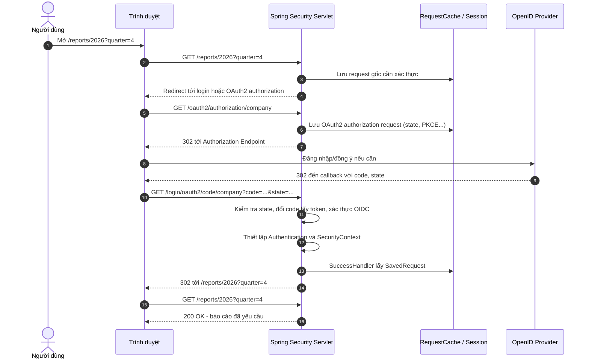

# 7.10. AuthenticationSuccessHandler, saved request và điều hướng sau đăng nhập

Trong ứng dụng **Spring Security OAuth 2.0/OIDC Client** chạy trên **Servlet stack**, người dùng thường mở một trang cần xác thực trước khi đăng nhập. Ví dụ, họ nhấp vào liên kết báo cáo `/reports/2026?quarter=4`, được chuyển sang OpenID Provider (Google, Keycloak, Microsoft Entra ID...), hoàn tất đăng nhập rồi mong muốn **quay lại đúng báo cáo ban đầu**. Ở tình huống khác, người dùng chủ động nhấn nút “Đăng nhập” từ trang chủ và sau khi xác thực chỉ cần về `/dashboard`.

Hai nhu cầu này được Spring Security đáp ứng bằng **`AuthenticationSuccessHandler`** và cơ chế **saved request**. Muốn tùy biến điều hướng đúng, cần biết khi nào request được lưu, mặc định ai quyết định URL đích, cách ưu tiên saved request so với trang mặc định và những điểm cần bảo vệ trước open redirect.

Bài viết sử dụng **Spring Security OAuth2 Login trên Spring MVC/Servlet**. Các ví dụ Java theo API hiện đại của Spring Security 6/7, cấu hình bằng `SecurityFilterChain`; khi dùng Spring WebFlux, các interface và filter tương ứng khác.

## 1. Ba thành phần cốt lõi

| Thành phần | Vai trò | Ví dụ |
|---|---|---|
| `AuthenticationSuccessHandler` | Được gọi sau khi Spring Security xác thực thành công; quyết định phản hồi HTTP tiếp theo, thường là chuyển hướng | Điều hướng tới saved request hoặc `/dashboard` |
| `RequestCache` | Lưu request người dùng đã cố truy cập trước khi bị yêu cầu xác thực, và cho phép lấy lại | `HttpSessionRequestCache` |
| `SavedRequest` | Bản mô tả request ban đầu đã được lưu để phục hồi điều hướng | URL `/reports/2026?quarter=4`, thông tin request cần thiết |

Lớp quan trọng nhất trong cấu hình mặc định:

**`SavedRequestAwareAuthenticationSuccessHandler`** là triển khai của `AuthenticationSuccessHandler` có thể **ưu tiên request đã lưu**. Nếu không có saved request, handler dùng URL đích mặc định. Nó kế thừa `SimpleUrlAuthenticationSuccessHandler` nên còn có các tùy chọn như `defaultTargetUrl`, `alwaysUseDefaultTargetUrl` và `targetUrlParameter`.

Cần phân biệt:

- **Đăng nhập thành công**: Spring Security đã xác thực OIDC ID Token/định danh và tạo `Authentication` hợp lệ.
- **Success handler**: phần xử lý HTTP **sau khi** xác thực thành công; không có nhiệm vụ tự đổi authorization code hoặc xác minh token.
- **Saved request**: request muốn truy cập ứng dụng **trước khi đăng nhập**, không phải callback từ IdP.
- **Redirect URI của OAuth2 Login**: endpoint cố định tương đối như `/login/oauth2/code/company` để Spring tiếp nhận `code` và `state`.
- **Success target URL**: nơi trình duyệt đi tới **sau khi** callback đã được xử lý thành công, ví dụ `/reports/2026`.

## 2. Toàn bộ dòng thời gian: từ deep link tới trang đích

Giả sử người dùng chưa đăng nhập và truy cập:

```text
GET https://portal.example.test/reports/2026?quarter=4
```

Trang `/reports/**` được bảo vệ. Spring Security yêu cầu đăng nhập OIDC qua ClientRegistration tên `company`:



**Điểm quan trọng:** thành công ở OIDC callback chưa có nghĩa trình duyệt sẽ luôn đi tới `/dashboard`. Mặc định, nếu tồn tại **saved request hợp lệ**, Spring thường ưu tiên đưa người dùng về chính tài nguyên đã bị chặn trước đó.

Nếu người dùng không truy cập tài nguyên được bảo vệ trước khi bắt đầu login (ví dụ họ nhấn nút đăng nhập ở trang công khai), sẽ **không nhất thiết có saved request**. Khi đó Spring dùng trang đích mặc định, thường là `/` nếu chưa cấu hình khác.

### 2.1. Những lớp tham gia vào luồng

Các thành phần quan trọng trên Servlet stack:

1. **`ExceptionTranslationFilter`** phát hiện trường hợp cần bắt đầu xác thực, sử dụng `RequestCache` để lưu request trước khi gọi `AuthenticationEntryPoint`.
2. **`HttpSessionRequestCache`** thường lưu thông tin dưới dạng `DefaultSavedRequest` trong HTTP session.
3. **`OAuth2AuthorizationRequestRedirectFilter`** bắt đầu OAuth2 login và đưa trình duyệt tới Authorization Endpoint.
4. **`OAuth2LoginAuthenticationFilter`** xử lý callback từ provider, đổi code và tạo kết quả xác thực.
5. **`AuthenticationSuccessHandler`** được gọi khi xác thực thành công để điều hướng sau đăng nhập.
6. **`RequestCacheAwareFilter`** có thể khôi phục/wrap request phù hợp với bản đã lưu khi trình duyệt quay lại URL đích, tùy cấu hình request cache.

Không phải mọi request đi qua hệ thống đều được lưu. Request cache chỉ tham gia ở các tình huống được cấu hình, chủ yếu khi truy cập tài nguyên yêu cầu xác thực và cần khởi động login flow.

## 3. Saved request khác OAuth2 authorization request

Đây là hai trạng thái dễ bị nhầm lẫn trong quá trình debug OIDC.

| Đặc điểm | **Saved request** | **OAuth2 authorization request** |
|---|---|---|
| Mục tiêu | Nhớ **trang người dùng muốn đến trước login** | Nhớ **authorization request** mà Spring gửi tới IdP để đối chiếu callback |
| Ví dụ dữ liệu | URL `/reports/2026?quarter=4`, method, headers/parameters phù hợp | `client_id`, `redirect_uri`, `state`, scope, PKCE và các thông tin liên quan |
| Giao diện Spring Security | `RequestCache` / `SavedRequest` | `AuthorizationRequestRepository<OAuth2AuthorizationRequest>` |
| Triển khai thường gặp | `HttpSessionRequestCache` | `HttpSessionOAuth2AuthorizationRequestRepository` |
| Được dùng lúc nào? | Sau xác thực thành công để quay về tài nguyên | Khi nhận callback để kiểm tra `state` và hoàn tất OAuth2 flow |
| Nếu bị mất | Người dùng có thể được đưa tới URL mặc định | Callback có thể lỗi vì không tìm thấy authorization request hoặc `state` không khớp |

Ví dụ:

```text
Saved request:
GET /reports/2026?quarter=4

OAuth2 authorization request:
response_type=code
client_id=portal-client
redirect_uri=https://portal.example.test/login/oauth2/code/company
state=RANDOM_STATE
scope=openid profile email

OAuth2 callback:
GET /login/oauth2/code/company?code=...&state=...

Success target:
GET /reports/2026?quarter=4
```

Việc Spring dùng session để lưu cả hai loại dữ liệu **không có nghĩa chúng là một object**. Tự xóa các thuộc tính session hoặc thay request cache có thể làm mất một trong hai chức năng. Khi chẩn đoán login thành công nhưng không quay về trang cũ, hãy kiểm tra **saved request**; khi callback báo lỗi `state`, hãy kiểm tra **authorization request repository** và session.

## 4. Hành vi mặc định của OAuth2 Login

Với ứng dụng Servlet, Spring Security thường được bật như sau:

```java
import org.springframework.context.annotation.Bean;
import org.springframework.context.annotation.Configuration;
import org.springframework.security.config.Customizer;
import org.springframework.security.config.annotation.web.builders.HttpSecurity;
import org.springframework.security.web.SecurityFilterChain;

@Configuration
public class SecurityConfig {

    @Bean
    SecurityFilterChain securityFilterChain(HttpSecurity http) throws Exception {
        http
            .authorizeHttpRequests(authorize -> authorize
                .requestMatchers("/", "/error").permitAll()
                .requestMatchers("/reports/**", "/account/**").authenticated()
                .anyRequest().authenticated()
            )
            .oauth2Login(Customizer.withDefaults());

        return http.build();
    }
}
```

Trong cấu hình cơ bản, `oauth2Login` sử dụng success handling thích hợp với cơ chế saved request của Spring Security. `SavedRequestAwareAuthenticationSuccessHandler` là handler mặc định phổ biến cho flow đăng nhập kiểu này.

Giả sử controller có endpoint:

```java
import org.springframework.web.bind.annotation.GetMapping;
import org.springframework.web.bind.annotation.RequestParam;
import org.springframework.web.bind.annotation.RestController;

@RestController
public class ReportController {

    @GetMapping("/reports/2026")
    public String report(@RequestParam String quarter) {
        return "Quarter " + quarter + " report";
    }
}
```

Nếu người dùng chưa xác thực, request tới `/reports/2026?quarter=4` có thể được lưu và đưa qua login. Sau khi đăng nhập thành công, Spring có thể redirect về đúng request đó để controller trả dữ liệu trong phiên đã xác thực.

Không cần tự viết `AuthenticationSuccessHandler` để đạt hành vi “vào trang nào, đăng nhập xong quay lại trang đó” **nếu request cache mặc định đã đáp ứng đúng thiết kế**.

### 4.1. Khi người dùng bắt đầu login trực tiếp

Giả sử trang công khai chứa liên kết:

```html
<a href="/oauth2/authorization/company">Đăng nhập với tài khoản công ty</a>
```

Người dùng nhấn liên kết này mà chưa truy cập tài nguyên bảo vệ. Trong trường hợp đó, thường không có saved request nào để quay về. Handler chuyển sang **default target URL** theo cấu hình.

Lưu ý `/oauth2/authorization/company` là URL khởi động đăng nhập của **ứng dụng Spring**, không phải saved destination và cũng không phải Redirect URI callback `/login/oauth2/code/company`.

## 5. `SavedRequestAwareAuthenticationSuccessHandler` hoạt động ra sao?

Có thể diễn đạt hành vi của handler mặc định thành thuật toán:

```text
Authentication thành công
        |
        v
Có cấu hình buộc dùng default target?
        | Có
        v
Xóa saved request có liên quan, điều hướng default target
        |
        +---- Không ----> Có targetUrlParameter hợp lệ được cấu hình?
                               | Có
                               v
                         Xử lý target đó theo cấu hình
                               |
                               +-- Không --> Có SavedRequest?
                                                | Có
                                                v
                                         Redirect về URL đã lưu
                                                |
                                                +-- Không --> Default target URL
```

Các điểm then chốt:

- `defaultTargetUrl` là đích dự phòng khi không có target ưu tiên khác; mặc định thường là `/`.
- `alwaysUseDefaultTargetUrl=true` có nghĩa **bỏ ưu tiên saved request**, chuyển tới default URL và dọn saved request liên quan.
- `targetUrlParameter` cho phép một tham số request chỉ định đích trong một số cấu hình handler; phải kiểm soát chặt nếu bật tính năng này.
- Khi handler redirect tới saved request, bản lưu có thể vẫn được giữ đến request tiếp theo để `RequestCacheAwareFilter` nhận diện và khôi phục thông tin cần thiết; không nên tự xóa session một cách tùy tiện giữa hai bước.
- Handler điều hướng dựa trên request cache; nó **không tự quyết định quyền truy cập** ở URL đích. Request mới vẫn đi qua security filter chain và authorization rules.

Cấu hình custom handler sẽ thay đổi đường đi này nếu mã của bạn không gọi handler có khả năng đọc saved request.

## 6. `defaultSuccessUrl`: cách tùy biến đơn giản nhất

Với nhiều dự án, không cần tạo một class handler riêng. Spring Security DSL cho phép đặt URL mặc định:

```java
http.oauth2Login(oauth2 -> oauth2
    .defaultSuccessUrl("/dashboard")
);
```

Cách này đặt **trang đích dự phòng**. Nếu trước khi đăng nhập có saved request, hành vi ưu tiên saved request vẫn được giữ theo cấu hình mặc định.

### 6.1. Hai cách gọi và sự khác biệt

```java
// A: saved request được ưu tiên; /dashboard là fallback.
http.oauth2Login(oauth2 -> oauth2
    .defaultSuccessUrl("/dashboard", false)
);

// B: sau mỗi lần OAuth2 Login thành công đều ưu tiên /dashboard.
http.oauth2Login(oauth2 -> oauth2
    .defaultSuccessUrl("/dashboard", true)
);
```

Dạng một tham số tương đương mục đích “default URL khi không có đích ưu tiên”:

```java
http.oauth2Login(oauth2 -> oauth2
    .defaultSuccessUrl("/dashboard")
);
```

Bảng so sánh:

| Tình huống | `defaultSuccessUrl("/dashboard", false)` | `defaultSuccessUrl("/dashboard", true)` |
|---|---|---|
| Người dùng mở `/reports/2026` trước login | Quay về `/reports/2026` nếu có saved request | Tới `/dashboard` |
| Người dùng nhấn login ở trang công khai | Tới `/dashboard` nếu không có saved request | Tới `/dashboard` |
| Saved request cũ trong session | Có thể được ưu tiên khi phù hợp | Bị bỏ qua/dọn khi handler sử dụng default target |
| Mục đích sử dụng | Deep link, bookmark, email link, trải nghiệm quay lại đúng trang | Sản phẩm yêu cầu một landing page cố định sau mọi login |

**Chọn `true` có chủ đích.** Nếu ứng dụng có nhiều liên kết sâu (deep link) như báo cáo, đơn hàng hoặc tài liệu, chuyển mọi lần đăng nhập về dashboard có thể làm người dùng mất ngữ cảnh.

### 6.2. Ví dụ SecurityFilterChain hoàn chỉnh

```java
import org.springframework.context.annotation.Bean;
import org.springframework.context.annotation.Configuration;
import org.springframework.security.config.annotation.web.builders.HttpSecurity;
import org.springframework.security.web.SecurityFilterChain;

@Configuration
public class SecurityConfig {

    @Bean
    SecurityFilterChain securityFilterChain(HttpSecurity http) throws Exception {
        http
            .authorizeHttpRequests(authorize -> authorize
                .requestMatchers("/", "/error", "/public/**").permitAll()
                .anyRequest().authenticated()
            )
            .oauth2Login(oauth2 -> oauth2
                .defaultSuccessUrl("/dashboard", false)
            );

        return http.build();
    }
}
```

Ở đây `/dashboard` và các đường dẫn sau login cần tồn tại trong ứng dụng; `.defaultSuccessUrl` không tự tạo controller hoặc trang HTML tương ứng.

### 6.3. Vì sao không nên viết một success handler chỉ để redirect cố định?

Nếu mục tiêu duy nhất là “mọi login thành công về `/dashboard`”, dùng:

```java
.oauth2Login(oauth2 -> oauth2
    .defaultSuccessUrl("/dashboard", true)
)
```

đã đủ. Việc tạo handler riêng chỉ để gọi `response.sendRedirect("/dashboard")` dễ khiến người viết quên kiểm soát context path, saved request, logic cleanup và phương thức redirect chuẩn của Spring.

## 7. Khi nào cần tự tạo `AuthenticationSuccessHandler`?

Một custom handler phù hợp khi cần những thao tác **bổ sung tại thời điểm đăng nhập thành công**, chẳng hạn:

- Ghi nhận một sự kiện đăng nhập đã thành công mà không log secret hoặc token.
- Chọn landing page theo vai trò nội bộ đã ánh xạ.
- Đồng bộ một thông tin hồ sơ tối thiểu hoặc thực hiện nghiệp vụ có kiểm soát.
- Áp dụng luật điều hướng khác giữa các ClientRegistration/tenant.
- Giải quyết trường hợp giao diện riêng cần luồng redirect nhất quán.

Điều quan trọng là custom handler **phải tự quyết định redirect**, và nếu muốn giữ hành vi saved request thì cần sử dụng `RequestCache` hoặc ủy quyền cho `SavedRequestAwareAuthenticationSuccessHandler`.

### 7.1. Cách an toàn: delegate cho handler mặc định

Ví dụ tạo handler có thêm log sự kiện (không in token hoặc thông tin nhạy cảm), sau đó **giao việc điều hướng** cho `SavedRequestAwareAuthenticationSuccessHandler`.

```java
import jakarta.servlet.ServletException;
import jakarta.servlet.http.HttpServletRequest;
import jakarta.servlet.http.HttpServletResponse;

import java.io.IOException;

import org.slf4j.Logger;
import org.slf4j.LoggerFactory;
import org.springframework.security.core.Authentication;
import org.springframework.security.web.authentication.AuthenticationSuccessHandler;
import org.springframework.security.web.authentication.SavedRequestAwareAuthenticationSuccessHandler;
import org.springframework.security.web.savedrequest.RequestCache;

public final class AuditingLoginSuccessHandler
        implements AuthenticationSuccessHandler {

    private static final Logger log =
        LoggerFactory.getLogger(AuditingLoginSuccessHandler.class);

    private final SavedRequestAwareAuthenticationSuccessHandler delegate;

    public AuditingLoginSuccessHandler(RequestCache requestCache) {
        this.delegate = new SavedRequestAwareAuthenticationSuccessHandler();
        this.delegate.setRequestCache(requestCache);
        this.delegate.setDefaultTargetUrl("/dashboard");
        this.delegate.setAlwaysUseDefaultTargetUrl(false);
    }

    @Override
    public void onAuthenticationSuccess(
            HttpServletRequest request,
            HttpServletResponse response,
            Authentication authentication)
            throws IOException, ServletException {

        // Chỉ minh họa một sự kiện; không log principal claims hay token.
        log.info("OAuth2/OIDC login completed successfully");

        // Giữ ưu tiên saved request và cleanup mặc định.
        delegate.onAuthenticationSuccess(request, response, authentication);
    }
}
```

Đăng ký cùng một `RequestCache` cho filter chain và handler:

```java
import org.springframework.context.annotation.Bean;
import org.springframework.context.annotation.Configuration;
import org.springframework.security.config.annotation.web.builders.HttpSecurity;
import org.springframework.security.web.SecurityFilterChain;
import org.springframework.security.web.savedrequest.HttpSessionRequestCache;
import org.springframework.security.web.savedrequest.RequestCache;

@Configuration
public class SecurityConfig {

    @Bean
    RequestCache requestCache() {
        return new HttpSessionRequestCache();
    }

    @Bean
    AuditingLoginSuccessHandler loginSuccessHandler(RequestCache requestCache) {
        return new AuditingLoginSuccessHandler(requestCache);
    }

    @Bean
    SecurityFilterChain securityFilterChain(
            HttpSecurity http,
            RequestCache requestCache,
            AuditingLoginSuccessHandler loginSuccessHandler)
            throws Exception {

        http
            .authorizeHttpRequests(authorize -> authorize
                .requestMatchers("/", "/error").permitAll()
                .anyRequest().authenticated()
            )
            .requestCache(cache -> cache.requestCache(requestCache))
            .oauth2Login(oauth2 -> oauth2.successHandler(loginSuccessHandler));

        return http.build();
    }
}
```

Ưu điểm của delegate:

- Không phải tự xây thuật toán lấy saved request.
- Vẫn sử dụng redirect và xử lý cleanup của Spring Security.
- Có thể đặt default target nếu không có saved request.
- Có thể bổ sung telemetry hoặc nghiệp vụ ngắn trước khi redirect.

Nếu thao tác audit hoặc đồng bộ dữ liệu có thể tốn thời gian/thất bại, cần thiết kế cơ chế retry, transaction, error policy và quan sát phù hợp. Không nên làm callback OIDC bị treo vì một dịch vụ phân tích không quan trọng.

### 7.2. `successHandler(...)` và `defaultSuccessUrl(...)`

Hai API đều ảnh hưởng đến cách trả phản hồi **sau login**:

```java
.oauth2Login(oauth2 -> oauth2
    .defaultSuccessUrl("/dashboard")
)
```

và:

```java
.oauth2Login(oauth2 -> oauth2
    .successHandler(customSuccessHandler)
)
```

Nếu dùng một handler riêng, **handler đó chịu trách nhiệm chọn URL và hoàn tất phản hồi**. Đừng cho rằng `defaultSuccessUrl` sẽ tự kết hợp theo thứ tự mong muốn với bất kỳ custom handler nào. Trong một filter chain, nên chọn **một chiến lược success handling rõ ràng**, thiết lập default target ngay trong handler nếu cần.

## 8. Điều hướng theo vai trò nhưng vẫn ưu tiên saved request

Yêu cầu thường gặp:

- Nếu người dùng trước login mở một trang được bảo vệ, **quay lại trang đó**.
- Nếu họ chủ động đăng nhập từ trang công khai, người có `ROLE_ADMIN` tới `/admin`, còn người thường tới `/home`.

Một cách hiện thực là kết hợp `RequestCache`, `SavedRequestAwareAuthenticationSuccessHandler` và hai `SimpleUrlAuthenticationSuccessHandler` cố định, không chia sẻ URL target biến đổi giữa các request.

### 8.1. Custom handler

```java
import jakarta.servlet.ServletException;
import jakarta.servlet.http.HttpServletRequest;
import jakarta.servlet.http.HttpServletResponse;

import java.io.IOException;

import org.springframework.security.core.Authentication;
import org.springframework.security.web.authentication.AuthenticationSuccessHandler;
import org.springframework.security.web.authentication.SavedRequestAwareAuthenticationSuccessHandler;
import org.springframework.security.web.authentication.SimpleUrlAuthenticationSuccessHandler;
import org.springframework.security.web.savedrequest.RequestCache;

public final class RoleAwareLoginSuccessHandler
        implements AuthenticationSuccessHandler {

    private final RequestCache requestCache;

    private final SavedRequestAwareAuthenticationSuccessHandler savedHandler;

    private final SimpleUrlAuthenticationSuccessHandler adminHandler =
        new SimpleUrlAuthenticationSuccessHandler("/admin");

    private final SimpleUrlAuthenticationSuccessHandler userHandler =
        new SimpleUrlAuthenticationSuccessHandler("/home");

    public RoleAwareLoginSuccessHandler(RequestCache requestCache) {
        this.requestCache = requestCache;
        this.savedHandler = new SavedRequestAwareAuthenticationSuccessHandler();
        this.savedHandler.setRequestCache(requestCache);
    }

    @Override
    public void onAuthenticationSuccess(
            HttpServletRequest request,
            HttpServletResponse response,
            Authentication authentication)
            throws IOException, ServletException {

        if (requestCache.getRequest(request, response) != null) {
            // Người dùng đã mở một URL bảo vệ trước khi login.
            savedHandler.onAuthenticationSuccess(request, response, authentication);
            return;
        }

        boolean admin = authentication.getAuthorities().stream()
            .anyMatch(a -> "ROLE_ADMIN".equals(a.getAuthority()));

        if (admin) {
            adminHandler.onAuthenticationSuccess(request, response, authentication);
        } else {
            userHandler.onAuthenticationSuccess(request, response, authentication);
        }
    }
}
```

Các handler được tạo với URL **cố định và do ứng dụng kiểm soát**. Không gọi `setDefaultTargetUrl(...)` trên một singleton handler ngay trong từng request để đổi giữa admin và user: điều đó có thể gây **race condition** khi nhiều người đăng nhập đồng thời.

### 8.2. Wiring vào `HttpSecurity`

```java
@Bean
RoleAwareLoginSuccessHandler roleAwareLoginSuccessHandler(RequestCache cache) {
    return new RoleAwareLoginSuccessHandler(cache);
}

@Bean
SecurityFilterChain securityFilterChain(
        HttpSecurity http,
        RequestCache cache,
        RoleAwareLoginSuccessHandler successHandler) throws Exception {

    http
        .authorizeHttpRequests(authorize -> authorize
            .requestMatchers("/", "/error").permitAll()
            .requestMatchers("/admin/**").hasRole("ADMIN")
            .anyRequest().authenticated()
        )
        .requestCache(requestCache -> requestCache.requestCache(cache))
        .oauth2Login(oauth2 -> oauth2.successHandler(successHandler));

    return http.build();
}
```

Đoạn này giả định đã khai báo bean `RequestCache` dùng `HttpSessionRequestCache` như ví dụ trước, và class `RoleAwareLoginSuccessHandler` đã có trong project.

**Lưu ý về role:** `ROLE_ADMIN` trong ví dụ phải được **ánh xạ đáng tin cậy** từ hệ thống quyền nội bộ hoặc dữ liệu danh tính được xác minh. OIDC scope `profile`, `email` hoặc sự xuất hiện của claim `email` **không tự tạo** authority `ROLE_ADMIN`.

### 8.3. Tại sao không áp dụng role redirect trước saved request?

Nếu ưu tiên role landing trước, người dùng nhấp liên kết `/orders/123` rồi đăng nhập sẽ bị đẩy về `/home` hoặc `/admin` và không tới đơn hàng như mong muốn. Với ứng dụng coi deep link là hành vi chính, thứ tự phù hợp là:

```text
Có saved request hợp lệ?
  Có  -> quay lại tài nguyên trước login
  Không -> áp dụng landing page theo vai trò
```

Nếu sản phẩm có yêu cầu “luôn vào dashboard sau login”, có thể đảo ưu tiên một cách chủ đích. Cần thông báo rõ trong thiết kế vì hành vi sẽ khác với saved request mặc định.

## 9. Dùng tên ClientRegistration để chọn trang đích

Ứng dụng có thể hỗ trợ hai IdP: khách hàng đăng nhập qua `customer`, nhân viên qua `staff`. OAuth2 Login thành công thường tạo `OAuth2AuthenticationToken` cho biết registration ID.

```java
import org.springframework.security.authentication.AbstractAuthenticationToken;
import org.springframework.security.core.Authentication;
import org.springframework.security.oauth2.client.authentication.OAuth2AuthenticationToken;

public final class RegistrationTargets {

    public static String fallbackTarget(Authentication authentication) {
        if (authentication instanceof OAuth2AuthenticationToken oauth2) {
            return switch (oauth2.getAuthorizedClientRegistrationId()) {
                case "staff" -> "/staff/home";
                case "customer" -> "/customer/home";
                default -> "/home";
            };
        }

        return "/home";
    }
}
```

Ở đây các đường dẫn là **allowlist tĩnh** của ứng dụng. Đăng ký `staff` không tự chứng minh rằng người dùng là nhân viên có quyền vào toàn bộ trang nội bộ; vẫn phải xác thực membership/role khi xét quyền truy cập.

Để kết hợp với saved request, có thể dùng mô hình handler ở mục 8: nếu có saved request thì delegate; nếu không thì chọn một handler URL cố định theo registration ID. Tránh tạo redirect URL bằng chuỗi người dùng gửi từ query string.

## 10. `RequestCache` và `HttpSessionRequestCache`

### 10.1. Lưu request dưới dạng nào?

`RequestCache` là abstraction để lưu, truy hồi và loại bỏ request đã bị chặn trước khi xác thực.

Những phương thức thường gặp:

```java
void saveRequest(
    HttpServletRequest request,
    HttpServletResponse response
);

SavedRequest getRequest(
    HttpServletRequest request,
    HttpServletResponse response
);

HttpServletRequest getMatchingRequest(
    HttpServletRequest request,
    HttpServletResponse response
);

void removeRequest(
    HttpServletRequest request,
    HttpServletResponse response
);
```

`HttpSessionRequestCache` thường lưu `SavedRequest` trong HTTP session, với triển khai `DefaultSavedRequest`. Phản hồi redirect không tự khôi phục lại nội dung POST body đã gửi lần trước; request cache chủ yếu giúp trình duyệt điều hướng lại URL đích.

### 10.2. Đăng ký RequestCache rõ ràng

```java
import org.springframework.context.annotation.Bean;
import org.springframework.security.web.savedrequest.HttpSessionRequestCache;
import org.springframework.security.web.savedrequest.RequestCache;

@Bean
RequestCache requestCache() {
    return new HttpSessionRequestCache();
}
```

Gắn vào security chain:

```java
http.requestCache(cache -> cache.requestCache(requestCache));
```

Nếu custom success handler cũng truy cập request cache, **dùng cùng một bean/cấu hình** trong chain và handler. Điều này giữ hành vi tra cứu, xóa và khôi phục request nhất quán.

Trong những phiên bản Spring Security hiện đại, request cache có thể tối ưu cách nhận biết request khớp bằng tham số như `continue`. Khi tùy chỉnh `HttpSessionRequestCache` hoặc tự xây `RequestCache`, cần đọc tài liệu API của đúng phiên bản để bảo đảm `getMatchingRequest` và `getRequest` có hành vi mong muốn.

### 10.3. Khi nào dùng `NullRequestCache`?

Một ứng dụng có thể có REST API thuần JSON, không muốn cache request và redirect browser tới login. Với nhánh API dùng bearer token hoặc trả 401, có thể dùng:

```java
import org.springframework.security.web.savedrequest.NullRequestCache;

http.requestCache(cache -> cache.requestCache(new NullRequestCache()));
```

`NullRequestCache` không lưu request. Khi OAuth2 Login dùng request cache này, không có saved request để handler khôi phục và sẽ dùng fallback hoặc logic tùy chỉnh.

**Đừng vô tình áp `NullRequestCache` lên toàn bộ web filter chain** nếu yêu cầu sản phẩm là “đang xem trang X, đăng nhập xong quay lại trang X”. Trường hợp web và API hỗn hợp nên cân nhắc các `SecurityFilterChain` tách biệt theo matcher, mỗi chain có behavior authentication và request cache phù hợp.

### 10.4. Có nên cache mọi phương thức HTTP?

Saved request chủ yếu có ý nghĩa với **GET điều hướng trang**. Giả sử người dùng chưa đăng nhập gửi:

```http
POST /orders HTTP/1.1
Content-Type: application/json

{"productId": 123, "quantity": 1}
```

Sau login, trình duyệt nhận redirect không đảm bảo sẽ gửi lại POST body cũ; còn nguy cơ thực thi lại một thao tác thay đổi dữ liệu. Các API tạo/cập nhật tài nguyên nên trả lỗi xác thực phù hợp (ví dụ 401), để Client/SPA điều khiển lại yêu cầu sau khi xác thực hoặc yêu cầu người dùng xác nhận. Không dựa vào saved request để replay an toàn thao tác POST/PUT/DELETE.

Nếu yêu cầu nghiệp vụ cần quay lại sau login, có thể lưu **ý định** của người dùng theo cơ chế riêng có kiểm soát và khôi phục màn hình, nhưng thao tác thay đổi dữ liệu phải được thực hiện lại theo thiết kế rõ ràng với CSRF/idempotency phù hợp.

## 11. Saved request và Session: điều gì xảy ra khi phiên bị mất?

Ở OAuth2 Authorization Code Flow, trình duyệt rời ứng dụng để đi tới IdP. Khi quay về callback, Spring cần tìm lại dữ liệu liên quan đến login flow. Nếu HTTP session bị mất, có thể xảy ra hai mức lỗi khác nhau:

1. **Authorization request bị mất:** Spring không đối chiếu được `state` hoặc không khôi phục được dữ liệu PKCE; đăng nhập có thể thất bại ngay tại callback.
2. **Saved request bị mất nhưng authorization request vẫn còn:** đăng nhập có thể thành công, nhưng không biết trang gốc để quay lại; success handler dùng fallback.

Các nguyên nhân thường gặp:

- Cookie session không được browser gửi lại sau redirect.
- Host callback khác host đã lưu cookie hoặc thuộc tính `SameSite`/`Secure`/`Domain`/`Path` không phù hợp.
- Reverse proxy làm thay đổi scheme hoặc host công khai và tạo callback sai.
- Ứng dụng chạy nhiều instance mà không có cơ chế quản lý session nhất quán.
- Session bị timeout trong khi người dùng ở trang đăng nhập IdP.
- Ứng dụng/custom code xóa session hoặc thuộc tính saved request không đúng thời điểm.
- Cấu hình session stateless trên filter chain đang dùng OAuth2 Login dựa vào HTTP session.

**Session fixation protection** của Spring Security có thể đổi session ID sau khi xác thực thành công; trong cấu hình chuẩn, đây là một biện pháp bảo vệ bình thường. Không nên giải quyết vấn đề redirect bằng cách vô hiệu hóa session fixation protection.

### 11.1. Reverse proxy và URL công khai

Ví dụ browser truy cập `https://portal.example.test`, nhưng Spring nhận kết nối qua `http://internal-service:8080`. Nếu forwarded headers không được xử lý đúng, `{baseUrl}` dùng trong OAuth2 Redirect URI có thể tạo URL nội bộ.

Trong môi trường có proxy đáng tin, Spring Boot có thể cần:

```yaml
server:
  forward-headers-strategy: framework
```

Cấu hình cụ thể phụ thuộc hạ tầng. Chỉ tin các header `Forwarded` hoặc `X-Forwarded-*` do proxy kiểm soát. Việc sửa URL callback sai liên quan đến **OAuth2 Redirect URI**; còn URL trang đích sau login liên quan đến **saved request** hoặc success handler. Hai loại redirect phải được xác minh riêng.

### 11.2. Cookie `SameSite` và callback

Authorization Code Flow mặc định thường quay về callback bằng GET qua browser redirect; với cookie session cấu hình phù hợp, `SameSite=Lax` thường đáp ứng tốt luồng này. Nếu provider sử dụng `response_mode=form_post` hoặc luồng khác gửi callback cross-site bằng POST, chính sách cookie có thể cần xử lý riêng. Không nới cookie một cách tùy tiện; phải đánh giá HTTPS, `Secure`, CSRF, browser policy và yêu cầu thực tế.

## 12. Tránh open redirect khi điều hướng sau login

Một số ứng dụng tự thêm tham số:

```text
/login?returnTo=https://evil.example.test
```

rồi sau login làm:

```java
response.sendRedirect(request.getParameter("returnTo"));
```

Đây là một **mẫu có nguy cơ open redirect**: kẻ tấn công có thể dùng URL thuộc domain hợp pháp của ứng dụng làm điểm trung chuyển người dùng tới trang giả mạo.

### 12.1. Không tin `targetUrlParameter` một cách mặc định

`SimpleUrlAuthenticationSuccessHandler` hỗ trợ tùy chọn `targetUrlParameter`. Khi bật tùy chọn này, input từ request có thể tác động trực tiếp đến URL redirect, nên cần cơ chế validate chặt chẽ. Không bật chỉ để tiện dùng `?next=...` rồi để người dùng tự chỉ định URL bất kỳ.

Với ứng dụng web thông thường, ưu tiên:

- Dùng `SavedRequestAwareAuthenticationSuccessHandler` cho URL mà chính Spring đã lưu trong flow xác thực.
- Dùng các đường dẫn nội bộ cố định như `/dashboard`, `/admin`, `/home`.
- Nếu cần `returnTo` tùy chỉnh, chỉ chấp nhận đường dẫn nội bộ thuộc allowlist theo route nghiệp vụ.
- Không redirect tới schema `javascript:`, `data:`, URI dạng `//evil.example.test`, đường dẫn đi vòng không kiểm tra hoặc host ngoài được chỉ định trực tiếp.
- Không dựa vào HTTP `Referer` chưa kiểm tra để chọn URL redirect.

### 12.2. Ví dụ kiểm tra redirect target theo allowlist

Một cơ chế đơn giản là **ánh xạ lựa chọn của người dùng sang route cố định**:

```java
public final class SafeLandingPage {

    private SafeLandingPage() {}

    public static String fromChoice(String choice) {
        if ("reports".equals(choice)) {
            return "/reports";
        }
        if ("account".equals(choice)) {
            return "/account";
        }
        return "/dashboard";
    }
}
```

Cách này an toàn hơn việc trực tiếp đưa một URL tùy ý vào `sendRedirect`. Nhưng việc **lưu và khôi phục lựa chọn qua OAuth2 flow** vẫn phải được thiết kế có kiểm soát; không ghép tham số tùy ý vào callback hoặc bỏ qua `state`.

### 12.3. Saved request cũng cần hạ tầng host đáng tin

Saved request được tạo từ HTTP request tới ứng dụng. Nếu ứng dụng chạy sau reverse proxy và tin `Host`/`Forwarded` từ nguồn không được kiểm soát, có thể xuất hiện URL tuyệt đối ngoài ý muốn trong redirect. Vì vậy ngoài việc dùng RequestCache đúng cách, phải cấu hình canonical host, reverse proxy và forwarded headers đáng tin.

## 13. Điều hướng thành công trong ứng dụng SPA và API

Không phải mọi client đều mong đợi browser redirect sau đăng nhập.

### 13.1. Server-rendered MVC web

Người dùng mở trang HTML, Spring xử lý login session, rồi trả HTTP 302 tới tài nguyên. Đây là ngữ cảnh phù hợp nhất với `SavedRequestAwareAuthenticationSuccessHandler`.

```text
GET /invoices/42
  -> 302 /login
  -> OIDC login
  -> 302 /invoices/42
  -> 200 HTML
```

### 13.2. SPA có backend session

Nếu React/Vue/Angular mở đăng nhập bằng **top-level browser navigation**, OIDC callback vẫn do backend Spring nhận. Sau khi tạo session, handler thường redirect tới một route hợp lệ của SPA:

```text
https://frontend.example.test/app
```

Việc SPA và backend khác origin đòi hỏi thiết kế cookie, CORS, CSRF, SameSite và callback rõ ràng. Không chuyển access token hoặc ID Token qua query string của URL SPA chỉ để “đăng nhập xong”.

Một phương án đơn giản nếu cùng origin là dùng đường dẫn nội bộ `/app`. Nếu frontend nằm trên origin khác, chỉ dùng URL từ **cấu hình server tin cậy và allowlist**, không nhận host từ request parameter chưa kiểm tra.

### 13.3. REST API trả JSON

Một endpoint API được gọi bởi JavaScript hoặc mobile app thường không muốn nhận HTTP 302 tới trang login khi thiếu xác thực. Với API, chiến lược hợp lý có thể là trả 401/403 và để Client điều khiển login flow. Request cache mặc định của web không nhất thiết phù hợp.

Nếu Spring ứng dụng vừa phục vụ web session vừa phục vụ API, cân nhắc phân tách `SecurityFilterChain` theo `securityMatcher` và quy định rõ authentication entry point, RequestCache và success behavior cho mỗi loại tài nguyên.

## 14. Sai lầm thường gặp khi custom success handler

### Sai lầm 1: ghi đè handler rồi làm mất saved request

```java
.oauth2Login(oauth2 -> oauth2
    .successHandler((request, response, authentication) ->
        response.sendRedirect("/dashboard")
    )
)
```

Đoạn code luôn redirect về dashboard. Nếu yêu cầu là bảo toàn deep link, nó đã làm mất chức năng mặc định. Cần dùng `defaultSuccessUrl("/dashboard", false)` hoặc delegate cho `SavedRequestAwareAuthenticationSuccessHandler`.

Ngoài ra, `sendRedirect("/dashboard")` có cách hiểu URL tùy theo servlet/container/context path; handler và `RedirectStrategy` của Spring thường phù hợp hơn khi xử lý các trường hợp web application có context path.

### Sai lầm 2: đổi target URL trên singleton handler theo từng người

```java
// Tránh biến đổi thuộc tính cấu hình chia sẻ của singleton theo request.
sharedHandler.setDefaultTargetUrl(isAdmin ? "/admin" : "/home");
sharedHandler.onAuthenticationSuccess(request, response, authentication);
```

Nhiều request đăng nhập có thể chạy đồng thời. Người A và B có thể ghi đè giá trị của nhau trước lúc redirect. Dùng các handler cố định, chọn đích tại từng request bằng local variable và redirect strategy, hoặc xây logic lựa chọn không đột biến shared state.

### Sai lầm 3: dùng `Referer` làm success target không kiểm tra

```java
String previous = request.getHeader("Referer");
response.sendRedirect(previous);
```

`Referer` có thể vắng mặt, bị thay đổi, chứa URL ngoài hoặc là trang không nên chuyển người dùng đến. Đây không phải nguồn đáng tin cho authentication redirect.

### Sai lầm 4: tưởng callback là saved destination

```text
/login/oauth2/code/company
```

là callback OAuth2, không phải trang gốc của người dùng. Nếu success handler điều hướng trở lại callback cùng `code`/`state`, bạn có thể gây lỗi code đã dùng, redirect loop hoặc bề mặt lộ dữ liệu. Success target thông thường phải là tài nguyên ứng dụng.

### Sai lầm 5: đánh đồng quyền OIDC và role nội bộ

`OidcUser` có thể chứa claim `email`, `name`, `groups` hoặc các dữ liệu tùy provider. Không lấy một claim tùy ý để quyết định redirect tới trang quản trị nếu chưa xác minh và ánh xạ qua mô hình phân quyền đáng tin. Redirect tới `/admin` cũng **không thay thế** rule `hasRole("ADMIN")` bảo vệ trang admin.

### Sai lầm 6: dùng request cache để lặp lại POST

Saved request giúp khôi phục điều hướng URL; nó không phải queue tác vụ HTTP và không thay thế cơ chế chống gửi lại đơn hàng hoặc thanh toán. Những hành động ghi dữ liệu nên yêu cầu xác nhận lại hoặc thiết kế idempotency.

### Sai lầm 7: vừa trả JSON vừa redirect trong cùng response

Một success handler chỉ có thể hoàn tất một phản hồi HTTP cho callback. Sau khi gọi `sendRedirect`, không nên tiếp tục ghi JSON vào response hoặc gọi một handler khác. Cần quyết định response type rõ ràng dựa trên kiến trúc frontend.

## 15. Những lỗi thực tế và cách khoanh vùng

| Hiện tượng | Nguyên nhân thường gặp | Hướng kiểm tra |
|---|---|---|
| Sau login luôn về `/` | Không có saved request và chưa đặt default target | Kiểm tra `defaultSuccessUrl`, người dùng bắt đầu login từ đâu |
| Sau login luôn về dashboard, không về deep link | `alwaysUseDefaultTargetUrl=true` hoặc custom handler redirect cố định | Kiểm tra `defaultSuccessUrl(..., true)` và `successHandler(...)` |
| Trang đích ban đầu không được nhớ | Request không đi qua authentication entry point có cache, `NullRequestCache`, session mất | Kiểm tra filter chain, `RequestCache`, cookie và session |
| Callback OIDC thất bại vì mất `state` | OAuth2 authorization request repository/session bị mất | Kiểm tra callback, cookie, proxy, session affinity/shared session |
| Login thành công nhưng redirect sang host nội bộ | Proxy headers hoặc URL callback/base URL không đúng | Kiểm tra `{baseUrl}`, forwarded headers và host công khai |
| 302 lặp vô hạn giữa login và trang đích | Phiên xác thực không được lưu, cookie bị chặn, route/matcher sai | Kiểm tra SecurityContext, session, cookie và authorization rules |
| User đăng nhập nhưng nhận 403 ở trang được trả về | Người dùng xác thực rồi nhưng **không có quyền** vào tài nguyên | Kiểm tra role/authority và authorization riêng của trang đích |
| Redirect tới `/login/oauth2/code/company` rồi lỗi | Success handler chọn nhầm OAuth2 callback làm success target | Đổi đích về một route nghiệp vụ của ứng dụng |
| Query string của deep link không còn | URL được lưu/thay thế sai hoặc custom redirect bỏ query | Quan sát saved request và Location header trả ra |
| Login bằng hai tab dẫn về trang không mong đợi | Các flow cùng session cạnh tranh saved request hoặc state | Kiểm tra thời điểm khởi tạo, session và cách xử lý đa tab |
| Đăng nhập xong API nhận HTML login page | Dùng web login entry point cho JSON API | Tách cấu hình API hoặc trả 401 thích hợp |
| Redirect theo role không chính xác | Authorities chưa được ánh xạ từ hệ quyền đáng tin | Kiểm tra `Authentication.getAuthorities()`, mapping, claim |
| `returnTo` redirect sang tên miền lạ | Đã tin tham số target chưa validate | Chỉ dùng allowlist route và URL đáng tin |

### 15.1. Cách kiểm tra luồng bằng Developer Tools

Trong môi trường phát triển:

1. Mở tab Network của trình duyệt và bật giữ lịch sử request nếu cần.
2. Mở một URL yêu cầu đăng nhập, ví dụ `/reports/2026?quarter=4`.
3. Quan sát redirect sang trang đăng nhập hoặc `/oauth2/authorization/company`.
4. Hoàn tất đăng nhập ở IdP; xác nhận callback `/login/oauth2/code/company`.
5. Xem `Location` header ngay sau callback: trỏ về saved URL hay default URL?
6. Nếu redirect đúng nhưng trang cuối vẫn lỗi, kiểm tra **authorization rule và session** của request mới.

Không chia sẻ log/network export chứa authorization code, session cookie, access token, refresh token hoặc ID Token. Việc chẩn đoán thường chỉ cần status, path và thông tin đã che giá trị nhạy cảm.

### 15.2. Log để chẩn đoán, nhưng không làm rò dữ liệu

Có thể tạm tăng log khi phát triển:

```yaml
logging:
  level:
    org.springframework.security: DEBUG
```

Giảm mức log khi không còn cần thiết; lọc header/cookie/token nhạy cảm. Khi có custom handler, log quyết định redirect ở mức khái quát như “saved target” hay “default target”, không cần log toàn bộ URL nếu URL chứa query có dữ liệu cá nhân.

## 16. Kịch bản thực hành từ đầu đến cuối

Giả sử ứng dụng có:

- Trang công khai `/`.
- Báo cáo bảo vệ tại `/reports/2026?quarter=4`.
- Trang mặc định `/dashboard`.
- Đăng nhập OIDC qua registration `company`.

Cấu hình:

```java
@Bean
SecurityFilterChain securityFilterChain(HttpSecurity http) throws Exception {
    http
        .authorizeHttpRequests(authorize -> authorize
            .requestMatchers("/", "/error").permitAll()
            .anyRequest().authenticated()
        )
        .oauth2Login(oauth2 -> oauth2
            .defaultSuccessUrl("/dashboard", false)
        );

    return http.build();
}
```

Xét các tình huống:

| Tình huống | Saved request? | Kết quả mong đợi |
|---|---|---|
| Người dùng chưa login mở `/reports/2026?quarter=4` | Có, nếu request đi qua request cache đúng cấu hình | Sau login về `/reports/2026?quarter=4` |
| Người dùng ở `/` bấm link đăng nhập trực tiếp | Thường không | Sau login về `/dashboard` |
| Người dùng đã đăng nhập mở `/reports/2026?quarter=4` | Không cần tạo login flow mới | Xem báo cáo ngay, theo quyền |
| Đổi thành `defaultSuccessUrl("/dashboard", true)` | Saved request có thể tồn tại nhưng bị bỏ qua | Mọi login thành công đều về `/dashboard` |
| Thay request cache bằng `NullRequestCache` | Không lưu | Dùng `/dashboard` thay vì khôi phục deep link |
| Role handler của mục 8, không có saved request | Không | Tới `/admin` hoặc `/home` theo authority hợp lệ |

### 16.1. Câu hỏi tự luyện

**Câu 1.** Người dùng vào `/orders/123`, bị đưa tới OIDC login, sau callback luôn về `/dashboard`. Trong code có `defaultSuccessUrl("/dashboard", true)`. Cần thay gì để ưu tiên đơn hàng?

**Gợi ý đáp án:** đổi sang `defaultSuccessUrl("/dashboard", false)` hoặc dạng một tham số, giữ request cache phù hợp. Nếu vẫn không quay về đơn hàng, kiểm tra xem request ban đầu có được lưu và session còn hay không.

**Câu 2.** Đăng nhập thành công nhưng callback báo không tìm thấy authorization request ban đầu. Có nên thay `SavedRequestAwareAuthenticationSuccessHandler`?

**Gợi ý đáp án:** không phải điểm sửa đầu tiên. Lỗi đó xảy ra **trước success handler**, khi Spring không khôi phục được OAuth2 authorization request/state. Kiểm tra session, authorization request repository, callback và cookies.

**Câu 3.** Ứng dụng cần role-based landing, nhưng vẫn muốn giữ deep link. Có nên gọi `setDefaultTargetUrl` trong success handler singleton ở mỗi request?

**Gợi ý đáp án:** không. Có nguy cơ race condition. Dùng strategy stateless với route cố định; ưu tiên delegate xử lý saved request, sau đó chọn landing theo role khi không có saved request.

**Câu 4.** Người dùng nhấn “Thanh toán” gửi POST rồi được yêu cầu đăng nhập. Sau login, có nên tự replay POST từ saved request?

**Gợi ý đáp án:** không. Không coi saved request là nơi lưu request body hay giao dịch an toàn. Sau xác thực, đưa người dùng về màn hình xác nhận hoặc thiết kế một transaction workflow có tính idempotent.

## 17. Những API cần nhớ

| API/Interface | Package hoặc nơi dùng | Vai trò |
|---|---|---|
| `AuthenticationSuccessHandler` | `org.springframework.security.web.authentication` | Điểm mở rộng để xử lý response sau login thành công |
| `SavedRequestAwareAuthenticationSuccessHandler` | `org.springframework.security.web.authentication` | Ưu tiên saved request rồi default target |
| `SimpleUrlAuthenticationSuccessHandler` | `org.springframework.security.web.authentication` | Handler chuyển hướng tới URL đơn giản |
| `RequestCache` | `org.springframework.security.web.savedrequest` | Lưu/đọc/xóa request đang chờ login |
| `HttpSessionRequestCache` | `org.springframework.security.web.savedrequest` | Request cache lưu trong HTTP session |
| `NullRequestCache` | `org.springframework.security.web.savedrequest` | Không lưu request |
| `SavedRequest` / `DefaultSavedRequest` | `org.springframework.security.web.savedrequest` | Dữ liệu request gốc |
| `ExceptionTranslationFilter` | `org.springframework.security.web.access` | Khởi động authentication và cache request khi cần |
| `RequestCacheAwareFilter` | `org.springframework.security.web.savedrequest` | Hỗ trợ khôi phục request đã lưu |
| `OAuth2LoginAuthenticationFilter` | `org.springframework.security.oauth2.client.web` | Xử lý callback OAuth2 Login |
| `OAuth2AuthorizationRequestRedirectFilter` | `org.springframework.security.oauth2.client.web` | Tạo/redirect authorization request tới provider |
| `HttpSessionOAuth2AuthorizationRequestRepository` | `org.springframework.security.oauth2.client.web` | Lưu authorization request có `state` trong session |

Tài liệu về `SavedRequestAwareAuthenticationSuccessHandler`, `RequestCache` và `SimpleUrlAuthenticationSuccessHandler` giúp tra các tùy chọn như `setDefaultTargetUrl`, `setAlwaysUseDefaultTargetUrl`, `setTargetUrlParameter` và `setRequestCache`.

## 18. Tài liệu tham khảo

- [Spring Security Reference — Servlet Authentication Architecture](https://docs.spring.io/spring-security/reference/servlet/authentication/architecture.html): quá trình xác thực và `SecurityContext`.
- [Spring Security Reference — Servlet OAuth2 Login](https://docs.spring.io/spring-security/reference/servlet/oauth2/login/core.html): ClientRegistration, callback và bộ lọc OAuth2 Login.
- [Spring Security Reference — ExceptionTranslationFilter](https://docs.spring.io/spring-security/reference/servlet/architecture.html): quan hệ giữa xác thực, authorization và xử lý request bị chặn.
- [Spring Security API — SavedRequestAwareAuthenticationSuccessHandler](https://docs.spring.io/spring-security/reference/api/java/org/springframework/security/web/authentication/SavedRequestAwareAuthenticationSuccessHandler.html): hành vi saved request và default target.
- [Spring Security API — SimpleUrlAuthenticationSuccessHandler](https://docs.spring.io/spring-security/reference/api/java/org/springframework/security/web/authentication/SimpleUrlAuthenticationSuccessHandler.html): redirect strategy, default target và tham số đích.
- [Spring Security API — HttpSessionRequestCache](https://docs.spring.io/spring-security/reference/api/java/org/springframework/security/web/savedrequest/HttpSessionRequestCache.html): lưu và lấy lại saved request.
- [Spring Security API — RequestCache](https://docs.spring.io/spring-security/reference/api/java/org/springframework/security/web/savedrequest/RequestCache.html): abstraction request cache.
- [Spring Security API — AuthenticationSuccessHandler](https://docs.spring.io/spring-security/reference/api/java/org/springframework/security/web/authentication/AuthenticationSuccessHandler.html): hợp đồng callback sau xác thực.

Khi thiết kế điều hướng sau OIDC Login, hãy xác định **trang người dùng muốn truy cập trước khi đăng nhập**, **callback xác thực của provider**, và **trang cần hiển thị sau khi đã xác thực** là những khái niệm khác nhau. Với phần lớn ứng dụng MVC, `defaultSuccessUrl("/dashboard", false)` cùng request cache mặc định đã đủ để giữ deep link và có fallback. Khi cần logic phức tạp, một custom `AuthenticationSuccessHandler` nên dùng lại cơ chế `SavedRequestAwareAuthenticationSuccessHandler`, kiểm soát chặt target URL và giữ rõ ranh giới giữa **điều hướng** với **phân quyền**.
