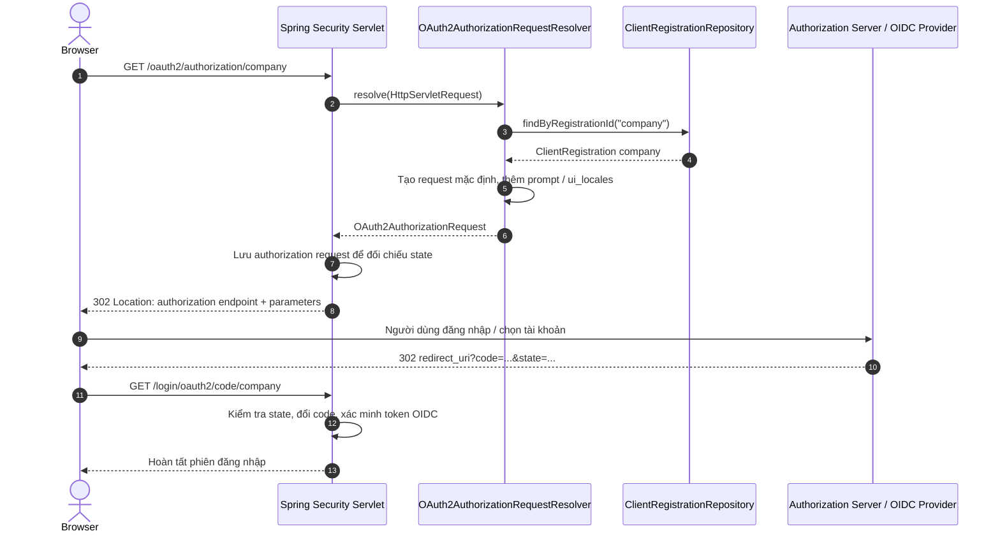

# 8.3. Tùy chỉnh authorization request theo registration

## 1. Bài toán: cùng ứng dụng, nhiều nhà cung cấp có yêu cầu đăng nhập khác nhau

Một ứng dụng **Spring Security OAuth 2.0/OIDC Client** có thể kết nối nhiều nhà cung cấp định danh (*Identity Provider*, viết tắt IdP) thông qua các `ClientRegistration` riêng. Chẳng hạn:

- `company`: nhân viên đăng nhập qua OIDC Provider của công ty. Giao diện nên ưu tiên tiếng Việt và cho phép chọn tài khoản.
- `partner`: đối tác đăng nhập qua OIDC Provider khác. Ứng dụng muốn yêu cầu xác thực lại khi phiên xác thực quá cũ, và đề nghị mức bảo đảm xác thực phù hợp.
- `google`: một tích hợp sử dụng các tham số đặc thù được Google hỗ trợ cho trường hợp nghiệp vụ cụ thể.

Trong mọi trường hợp, Spring Security biết **client ID, redirect URI, authorization endpoint, scopes** từ `ClientRegistration`. Nhưng một số thông số của **từng lần bắt đầu đăng nhập** lại có thể khác nhau tùy registration: `prompt`, `login_hint`, `max_age`, `ui_locales`, `acr_values` hoặc tham số riêng của nhà cung cấp.

Vì vậy, ta cần biết cách **tùy chỉnh OAuth2 Authorization Request theo `registrationId`** mà vẫn giữ nguyên các bảo vệ do Spring Security tạo sẵn: `state`, `nonce`, PKCE và callback.

> **Mục tiêu:** Sau bài học, bạn có thể xác định registration từ request, thêm tham số phù hợp với từng provider bằng `OAuth2AuthorizationRequestResolver`, cấu hình vào `oauth2Login` và hiểu vì sao không nên tự dựng toàn bộ authorization URL hoặc ghi đè các thông số bảo mật một cách tùy tiện.

## 2. Authorization Request nằm ở đâu trong luồng OAuth 2.0/OIDC?

Với **Authorization Code flow**, authorization request là yêu cầu đưa trình duyệt người dùng đến **Authorization Endpoint của nhà cung cấp**. Request này thường được biểu diễn bằng URL có query parameters, ví dụ:

```http
GET /authorize?response_type=code
    &client_id=employee-portal
    &redirect_uri=https%3A%2F%2Fportal.example.com%2Flogin%2Foauth2%2Fcode%2Fcompany
    &scope=openid%20profile
    &state=<random-state>
    &prompt=select_account
    &ui_locales=vi
HTTP/1.1
Host: id.company.example
```

Ví dụ đã xuống dòng để dễ đọc; một request HTTP thực tế gửi URL trên một dòng đã mã hóa đúng.

### 2.1. Các vai trò liên quan

| Thành phần | Vai trò |
| --- | --- |
| **`ClientRegistration`** | Cấu hình tương đối ổn định của một OAuth/OIDC client: `registrationId`, `clientId`, grant, scopes, endpoints, redirect URI |
| **`ClientRegistrationRepository`** | Lưu và tìm `ClientRegistration` bằng registration ID trong Servlet |
| **`OAuth2AuthorizationRequest`** | Đại diện cho **một yêu cầu bắt đầu cấp quyền**: authorization URI, client ID, redirect URI, scopes, state, additional parameters và attributes |
| **`OAuth2AuthorizationRequestResolver`** | Từ HTTP request, chọn registration và tạo `OAuth2AuthorizationRequest` |
| **`DefaultOAuth2AuthorizationRequestResolver`** | Implementation mặc định xử lý `/oauth2/authorization/{registrationId}` |
| **`OAuth2AuthorizationRequestRedirectFilter`** | Dùng resolver để khởi tạo request rồi trả redirect đến Authorization Server |
| **`AuthorizationRequestRepository`** | Lưu authorization request giữa bước bắt đầu và callback để đối chiếu state/ngữ cảnh |
| **`OAuth2LoginAuthenticationFilter`** | Xử lý authorization response chứa `code`, `state` tại callback |
| **`OAuth2AuthorizedClient`** | Trạng thái được cấp quyền sau khi có token; khác authorization request ban đầu |

### 2.2. Sơ đồ luồng xử lý



Tùy chỉnh **authorization request** chỉ tác động giai đoạn *bắt đầu đăng nhập*. Nó **không đồng nghĩa** tùy chỉnh token request, client authentication, ID Token validation hoặc redirect xử lý callback.

## 3. Phân biệt hai nhóm thông số trong Authorization Request

### 3.1. Thông số nền tảng của OAuth 2.0

| Tham số | Ý nghĩa | Ai nên quản lý? |
| --- | --- | --- |
| `response_type=code` | Chọn Authorization Code flow | Spring Security dựa trên registration/flow |
| `client_id` | Định danh ứng dụng tại Authorization Server | `ClientRegistration` |
| `redirect_uri` | Callback nhận authorization code | Registration + xử lý URI template |
| `scope` | Phạm vi quyền ứng dụng yêu cầu | Registration, hoặc logic được kiểm soát chặt |
| `state` | Gắn callback với authorization request, giảm nguy cơ CSRF/nhầm phiên | **Spring Security tạo và kiểm tra** |
| `code_challenge` | Mã thử thách PKCE được gửi trong authorization request | Bộ xử lý PKCE |
| `code_challenge_method` | Thường là `S256` | Bộ xử lý PKCE |

Những tham số này ảnh hưởng trực tiếp đến tính hợp lệ của flow. Nếu tự sửa `state`, `redirect_uri`, `client_id` hoặc `code_challenge` mà không đồng bộ trạng thái liên quan, login có thể thất bại hoặc mất cơ chế bảo vệ cần thiết.

### 3.2. Tham số bổ sung của OIDC và nhà cung cấp

| Tham số | Ví dụ | Tác dụng |
| --- | --- | --- |
| `prompt` | `login`, `consent`, `select_account`, `none` | Hướng dẫn cách OP tương tác với người dùng |
| `login_hint` | `employee@example.com` | Gợi ý tài khoản, tên đăng nhập hoặc email cho OP |
| `max_age` | `300` | Yêu cầu giới hạn tuổi của phiên xác thực, tính bằng giây |
| `ui_locales` | `vi`, `en` | Đề nghị ngôn ngữ giao diện xác thực |
| `acr_values` | Giá trị ACR được OP công bố/hỗ trợ | Đề nghị mức/ngữ cảnh bảo đảm xác thực |
| `domain_hint` | Giá trị theo tài liệu nhà cung cấp | Gợi ý tenant/domain hoặc tuyến định danh, không phải tham số OIDC lõi |
| `kc_idp_hint` | Alias IdP trên Keycloak nếu được cấu hình | Hướng đăng nhập đến IdP liên kết theo quy ước Keycloak |
| `access_type` | `offline` theo quy ước Google OAuth | Yêu cầu loại truy cập theo chính sách của Google; không phải tham số OIDC chung |

Các tham số ngoài OAuth 2.0 lõi có thể được OP **hỗ trợ, bỏ qua hoặc từ chối**. Đừng coi `domain_hint`, `kc_idp_hint` hoặc `access_type` là những tính năng bắt buộc của OIDC.

**Lưu ý về `prompt`:** những giá trị OIDC phổ biến là `none`, `login`, `consent`, `select_account`. `prompt=none` yêu cầu không hiện giao diện tương tác; nếu OP không thể xác thực âm thầm, thường trả lỗi như `login_required` hoặc `interaction_required`. Không ghép `none` với các giá trị prompt đòi tương tác. `prompt=login` yêu cầu OP xác thực lại theo chính sách; nó không tự thay thế yêu cầu kiểm tra tuổi xác thực bằng `max_age` hay việc xác minh claim `auth_time`.

### 3.3. Authorization request parameters khác internal attributes

`OAuth2AuthorizationRequest` có hai tập dữ liệu quan trọng:

- **`additionalParameters`:** những tham số bổ sung sẽ xuất hiện trong authorization request URI khi builder tạo URL, ví dụ `prompt`, `ui_locales`, `max_age`, hoặc `code_challenge` theo cơ chế PKCE.
- **`attributes`:** dữ liệu nội bộ Spring Security sử dụng trong xử lý flow; không tự động được gửi đến Authorization Server chỉ vì đã thêm vào map attributes. Ví dụ registration ID và `code_verifier` của PKCE có thể nằm trong attributes.

Ví dụ:

```java
OAuth2AuthorizationRequest modified = OAuth2AuthorizationRequest
        .from(original)
        .additionalParameters(params ->
                params.put("prompt", "select_account"))
        .build();
```

Đây là cách thêm tham số `prompt`. Nếu thay `additionalParameters` bằng `attributes`, OP sẽ **không nhận được** query parameter đó theo cách mong muốn.

**Không đưa `code_verifier` vào `additionalParameters` để gửi ngay ở authorization endpoint.** Với PKCE, client gửi **`code_challenge`** lúc bắt đầu flow, còn **`code_verifier`** chỉ được gửi trong token request, khi đổi authorization code.

## 4. Tạo hai ClientRegistration để minh họa việc tùy chỉnh theo registration

Ví dụ dùng **Spring Boot 3.x / Spring Security 6.x, Spring MVC/Servlet**. Các URI và chính sách đăng nhập chỉ là dữ liệu minh họa.

### 4.1. Dependencies

Maven:

```xml
<dependencies>
    <dependency>
        <groupId>org.springframework.boot</groupId>
        <artifactId>spring-boot-starter-web</artifactId>
    </dependency>
    <dependency>
        <groupId>org.springframework.boot</groupId>
        <artifactId>spring-boot-starter-security</artifactId>
    </dependency>
    <dependency>
        <groupId>org.springframework.boot</groupId>
        <artifactId>spring-boot-starter-oauth2-client</artifactId>
    </dependency>
</dependencies>
```

`spring-boot-starter-oauth2-client` cung cấp OAuth2 Login và các class được dùng trong bài. Ví dụ này dùng API **Servlet**: `HttpSecurity`, `SecurityFilterChain`, `ClientRegistrationRepository` và `OAuth2AuthorizationRequestResolver`, không dùng các interface reactive của WebFlux.

### 4.2. Cấu hình `application.yml`

```yaml
server:
  port: 8080

spring:
  security:
    oauth2:
      client:
        registration:
          company:
            provider: company-idp
            client-id: ${COMPANY_CLIENT_ID}
            client-secret: ${COMPANY_CLIENT_SECRET}
            client-authentication-method: client_secret_basic
            authorization-grant-type: authorization_code
            redirect-uri: "{baseUrl}/login/oauth2/code/{registrationId}"
            scope:
              - openid
              - profile
              - email

          partner:
            provider: partner-idp
            client-id: ${PARTNER_CLIENT_ID}
            client-secret: ${PARTNER_CLIENT_SECRET}
            client-authentication-method: client_secret_basic
            authorization-grant-type: authorization_code
            redirect-uri: "{baseUrl}/login/oauth2/code/{registrationId}"
            scope:
              - openid
              - profile

        provider:
          company-idp:
            issuer-uri: https://id.company.example/realms/employees
          partner-idp:
            issuer-uri: https://login.partner.example/realms/partners
```

Ở OP tương ứng, cần đăng ký:

| Registration ID | URL bắt đầu login tại Spring | Redirect URI cho phép tại OP |
| --- | --- | --- |
| `company` | `http://localhost:8080/oauth2/authorization/company` | `http://localhost:8080/login/oauth2/code/company` |
| `partner` | `http://localhost:8080/oauth2/authorization/partner` | `http://localhost:8080/login/oauth2/code/partner` |

Các issuer được dùng để minh họa, không phải endpoint có thể truy cập. Khi triển khai thật, mỗi provider cần hỗ trợ OIDC Discovery, Authorization Code, client authentication và scopes đã khai báo.

**`registrationId` là khóa dùng trong ứng dụng Spring.** Nó không nhất thiết trùng client ID trên OP; mã tùy chỉnh sẽ chọn chính sách bằng `registrationId`.

## 5. Cách đơn giản: cùng một tham số cho mọi registration

Nếu tất cả đăng nhập đều cần `prompt=consent`, có thể tạo một `DefaultOAuth2AuthorizationRequestResolver` và sử dụng built-in customizer.

```java
import org.springframework.context.annotation.Bean;
import org.springframework.context.annotation.Configuration;
import org.springframework.security.oauth2.client.registration.ClientRegistrationRepository;
import org.springframework.security.oauth2.client.web.DefaultOAuth2AuthorizationRequestResolver;
import org.springframework.security.oauth2.client.web.OAuth2AuthorizationRequestResolver;

@Configuration
public class AuthorizationRequestConfig {

    @Bean
    OAuth2AuthorizationRequestResolver authorizationRequestResolver(
            ClientRegistrationRepository registrations) {

        var resolver = new DefaultOAuth2AuthorizationRequestResolver(
                registrations,
                "/oauth2/authorization"
        );

        resolver.setAuthorizationRequestCustomizer(builder ->
                builder.additionalParameters(parameters ->
                        parameters.put("prompt", "consent")));

        return resolver;
    }
}
```

Phương thức `setAuthorizationRequestCustomizer` nhận một `Consumer<OAuth2AuthorizationRequest.Builder>` để chỉnh builder trước khi request được dựng xong. Lời gọi `additionalParameters(...)` giữ được các tham số đã được builder tạo từ flow mặc định.

Tuy nhiên, customizer đơn giản ở trên **áp dụng cùng chính sách cho mọi registration** mà resolver xử lý. Nếu `company` cần `select_account` còn `partner` cần `login`, ta nên chọn chính sách dựa vào registration ID thay vì dùng một giá trị chung.

### 5.1. Khi nào chỉ cần cấu hình URL ở provider?

Một số nhà cung cấp chấp nhận tham số cố định trong `authorization-uri`. Với tích hợp đơn giản chỉ có một tham số không thay đổi theo request, bạn có thể cấu hình endpoint đã được cho phép kèm query parameter được provider hỗ trợ.

Cách này ít mã Java nhưng có giới hạn:

- Không thuận tiện khi cùng registration cần tham số **động** theo phiên/người dùng.
- Cần cẩn thận với URI encoding, tham số trùng lặp và cơ chế OIDC Discovery/override endpoint.
- Không thích hợp khi tham số được xác định theo nhánh logic riêng cho mỗi registration.
- Không đưa thông tin bí mật hoặc dữ liệu nhạy cảm vào authorization URI.

Trong những trường hợp có chính sách điều kiện, `OAuth2AuthorizationRequestResolver` giúp diễn đạt logic rõ ràng hơn và kiểm soát được từng request.

## 6. Cách chính: custom resolver áp dụng chính sách theo `registrationId`

### 6.1. Ý tưởng triển khai

Ta **bọc** `DefaultOAuth2AuthorizationRequestResolver` thay vì tự dựng request từ đầu:

1. Resolver mặc định chọn `ClientRegistration` theo đường dẫn `/oauth2/authorization/{registrationId}`.
2. Resolver mặc định sinh các tham số OAuth bắt buộc, state và các dữ liệu OIDC/PKCE tương ứng.
3. Resolver của ứng dụng nhận request đã được tạo, đọc `registrationId` từ **internal attribute** mà Spring đặt trong authorization request.
4. Ứng dụng thêm các tham số cần thiết cho registration đó.
5. Kết quả được trả về cho filter redirect của Spring Security.

Ví dụ chính sách:

| Registration | Chính sách mẫu |
| --- | --- |
| `company` | `prompt=select_account`, `ui_locales=vi` hoặc `en` theo danh sách cho phép |
| `partner` | `prompt=login`, `max_age=300`, `acr_values` theo mức được OP công nhận |
| Registration khác | Không thay đổi request mặc định |

**`acr_values` trong ví dụ phải được đổi thành ACR thực sự được provider hỗ trợ.** Nó chỉ biểu diễn yêu cầu; nếu nghiệp vụ buộc phải đạt mức bảo đảm xác thực cụ thể, ứng dụng còn phải xác minh claim/đáp ứng từ OP sau khi nhận ID Token.

### 6.2. Định nghĩa `RegistrationAwareAuthorizationRequestResolver`

```java
package com.example.portal.security;

import jakarta.servlet.http.HttpServletRequest;

import org.springframework.security.oauth2.client.registration.ClientRegistrationRepository;
import org.springframework.security.oauth2.client.web.DefaultOAuth2AuthorizationRequestResolver;
import org.springframework.security.oauth2.client.web.OAuth2AuthorizationRequestResolver;
import org.springframework.security.oauth2.core.endpoint.OAuth2AuthorizationRequest;
import org.springframework.security.oauth2.core.endpoint.OAuth2ParameterNames;

public final class RegistrationAwareAuthorizationRequestResolver
        implements OAuth2AuthorizationRequestResolver {

    private final OAuth2AuthorizationRequestResolver delegate;

    public RegistrationAwareAuthorizationRequestResolver(
            ClientRegistrationRepository clientRegistrations) {

        this.delegate = new DefaultOAuth2AuthorizationRequestResolver(
                clientRegistrations,
                "/oauth2/authorization");
    }

    @Override
    public OAuth2AuthorizationRequest resolve(HttpServletRequest request) {
        return customize(request, delegate.resolve(request));
    }

    @Override
    public OAuth2AuthorizationRequest resolve(
            HttpServletRequest request, String registrationId) {

        return customize(request, delegate.resolve(request, registrationId));
    }

    private OAuth2AuthorizationRequest customize(
            HttpServletRequest request,
            OAuth2AuthorizationRequest original) {

        if (original == null) {
            return null;
        }

        String registrationId = original.getAttribute(
                OAuth2ParameterNames.REGISTRATION_ID);

        if ("company".equals(registrationId)) {
            // Chỉ nhận ngôn ngữ trong allowlist, còn lại mặc định tiếng Việt.
            String language = "en".equals(request.getParameter("lang"))
                    ? "en" : "vi";

            return OAuth2AuthorizationRequest.from(original)
                    .additionalParameters(parameters -> {
                        parameters.put("prompt", "select_account");
                        parameters.put("ui_locales", language);
                    })
                    .build();
        }

        if ("partner".equals(registrationId)) {
            return OAuth2AuthorizationRequest.from(original)
                    .additionalParameters(parameters -> {
                        parameters.put("prompt", "login");
                        parameters.put("max_age", "300");
                        // Chỉ sử dụng ACR có ý nghĩa theo hợp đồng với OP.
                        parameters.put(
                                "acr_values",
                                "urn:partner:example:loa:2");
                    })
                    .build();
        }

        return original;
    }
}
```

Các điểm cần đọc kỹ:

**(1) Delegate xử lý phần chuẩn.** `DefaultOAuth2AuthorizationRequestResolver` biết cách dùng `ClientRegistrationRepository`, đường dẫn đăng nhập, URI template, scopes, state, PKCE và nonce theo thiết lập Spring Security. Ta không phải sao chép những cơ chế đó.

**(2) Triển khai cả hai overload `resolve`.** Interface có `resolve(HttpServletRequest)` và `resolve(HttpServletRequest, String)`. Dùng cùng một hàm `customize` để logic hoạt động nhất quán ở các điểm gọi khác nhau.

**(3) Dùng `OAuth2ParameterNames.REGISTRATION_ID` từ attributes.** Resolver mặc định lưu registration ID trong `OAuth2AuthorizationRequest`. Việc lấy lại attribute này tránh phải tự tách path hoặc tin vào query parameter `registrationId` do browser tự đặt.

**(4) `from(original)` bảo tồn trạng thái.** Bằng cách sao chép request đã được default resolver tạo, những thông số/attributes đã có như `state`, `nonce` và dữ liệu PKCE không bị đánh mất khi ta chỉ thêm `prompt`/`ui_locales`/`max_age`.

**(5) Chỉ sửa `additionalParameters`.** Đó là nơi phù hợp cho tham số bổ sung trong authorization URL. Không dùng `attributes` để truyền `prompt` cho OP.

**(6) Giá trị động phải được kiểm soát.** Trong ví dụ, `lang` chỉ chọn `en` hoặc `vi`. Không dùng input tùy ý từ browser để thay `authorizationUri`, `redirectUri`, `state`, `acr_values` hoặc issuer.

**(7) Registration khác giữ nguyên.** Cách này hạn chế thay đổi hành vi của các client không có yêu cầu đặc biệt.

### 6.3. Đăng ký resolver với `SecurityFilterChain`

Tạo một bean resolver và đưa vào phần `authorizationEndpoint` của `oauth2Login`:

```java
package com.example.portal.security;

import org.springframework.context.annotation.Bean;
import org.springframework.context.annotation.Configuration;
import org.springframework.security.config.Customizer;
import org.springframework.security.config.annotation.web.builders.HttpSecurity;
import org.springframework.security.oauth2.client.registration.ClientRegistrationRepository;
import org.springframework.security.oauth2.client.web.OAuth2AuthorizationRequestResolver;
import org.springframework.security.web.SecurityFilterChain;

@Configuration
public class WebSecurityConfig {

    @Bean
    OAuth2AuthorizationRequestResolver authorizationRequestResolver(
            ClientRegistrationRepository registrations) {

        return new RegistrationAwareAuthorizationRequestResolver(
                registrations);
    }

    @Bean
    SecurityFilterChain securityFilterChain(
            HttpSecurity http,
            OAuth2AuthorizationRequestResolver authorizationRequestResolver)
            throws Exception {

        http
            .authorizeHttpRequests(authorize -> authorize
                .requestMatchers("/", "/login", "/css/**", "/error")
                    .permitAll()
                .anyRequest().authenticated()
            )
            .oauth2Login(oauth2 -> oauth2
                .authorizationEndpoint(authorization -> authorization
                    .authorizationRequestResolver(
                            authorizationRequestResolver)
                )
            );

        return http.build();
    }
}
```

Với hai registration đã khai báo trong `application.yml`, Spring Security có thể bắt đầu login qua:

```text
GET http://localhost:8080/oauth2/authorization/company?lang=vi
GET http://localhost:8080/oauth2/authorization/company?lang=en
GET http://localhost:8080/oauth2/authorization/partner
```

Những request này được Spring xử lý và dẫn tới redirect khác nhau. Không cần tạo `@GetMapping` cho đường dẫn `/oauth2/authorization/...` vì filter OAuth2 đã xử lý điểm bắt đầu login.

**Không cần tắt CSRF protection** để làm việc với `oauth2Login`. Trong luồng Servlet dùng session, Spring Security dựa vào request state để ràng buộc callback; giữ các cơ chế mặc định và xử lý đúng cookie/session.

## 7. Luồng thực tế sau khi tùy chỉnh

### 7.1. Company login

Browser gọi:

```http
GET /oauth2/authorization/company?lang=vi HTTP/1.1
Host: localhost:8080
```

Custom resolver đọc registration `company` và tạo một authorization request tới OP tương ứng. URL được tạo có dạng rút gọn:

```text
https://id.company.example/realms/employees/protocol/openid-connect/auth
    ?response_type=code
    &client_id=<company-client-id>
    &redirect_uri=http%3A%2F%2Flocalhost%3A8080%2Flogin%2Foauth2%2Fcode%2Fcompany
    &scope=openid%20profile%20email
    &state=<random-state>
    &prompt=select_account
    &ui_locales=vi
```

Nếu OP có chức năng chọn tài khoản và giao diện tiếng Việt, nó có thể áp dụng các gợi ý này. `prompt` và `ui_locales` không được phép dùng để bypass xác thực bắt buộc.

### 7.2. Partner login

Browser gọi:

```http
GET /oauth2/authorization/partner HTTP/1.1
Host: localhost:8080
```

Authorization request dành cho partner có thể mang:

```text
https://login.partner.example/realms/partners/protocol/openid-connect/auth
    ?response_type=code
    &client_id=<partner-client-id>
    &redirect_uri=http%3A%2F%2Flocalhost%3A8080%2Flogin%2Foauth2%2Fcode%2Fpartner
    &scope=openid%20profile
    &state=<random-state>
    &prompt=login
    &max_age=300
    &acr_values=urn%3Apartner%3Aexample%3Aloa%3A2
```

Ở đây `prompt=login` biểu diễn yêu cầu xác thực lại, `max_age=300` đề nghị thời gian tối đa kể từ lần xác thực gần nhất là 300 giây, và `acr_values` đề nghị mức xác thực cụ thể theo hợp đồng với OP. OP quyết định hành vi chính xác theo đặc tả và khả năng hỗ trợ; ứng dụng phải kiểm tra những claim và điều kiện cần thiết sau khi login thành công.

### 7.3. Callback vẫn dùng đường dẫn bình thường

Sau khi người dùng hoàn tất bước tại OP, trình duyệt được chuyển đến callback đã đăng ký:

```text
http://localhost:8080/login/oauth2/code/company?code=...&state=...
http://localhost:8080/login/oauth2/code/partner?code=...&state=...
```

Spring Security xử lý callback với `OAuth2LoginAuthenticationFilter`, xác thực `state`, dùng đúng `ClientRegistration` để đổi code lấy token và tiếp tục xác minh ID Token theo OIDC. **Việc thêm `prompt` hoặc `max_age` không tạo một callback endpoint mới.**

## 8. Một số biến thể tùy chỉnh thường gặp

### 8.1. Hiển thị chọn tài khoản cho một provider

```java
return OAuth2AuthorizationRequest.from(original)
        .additionalParameters(params ->
                params.put("prompt", "select_account"))
        .build();
```

Thích hợp khi OP hỗ trợ lựa chọn tài khoản, ví dụ người dùng có nhiều danh tính. Không áp dụng mặc định cho mọi OP nếu một số OP không hỗ trợ giá trị này.

### 8.2. Yêu cầu xác thực lại khi truy cập nghiệp vụ nhạy cảm

```java
return OAuth2AuthorizationRequest.from(original)
        .additionalParameters(params -> {
            params.put("max_age", "0");
            params.put("prompt", "login");
        })
        .build();
```

`max_age=0` yêu cầu xác thực mới theo chính sách OIDC. Tuy nhiên, để **bảo vệ thao tác nhạy cảm**, ứng dụng vẫn cần kiểm tra thời điểm/mức xác thực thực tế từ token/phiên và quy trình nghiệp vụ; chỉ gửi tham số mà không xác minh kết quả là chưa đủ.

Không để trình duyệt tự chọn `max_age` quá lớn hoặc tự bỏ `prompt=login` trên một tuyến đăng nhập bắt buộc xác thực lại.

### 8.3. Dùng `login_hint` để hỗ trợ trải nghiệm

`login_hint` có thể giúp OP điền sẵn tài khoản hoặc chọn phương thức đăng nhập. Nhưng địa chỉ email/username là **dữ liệu cá nhân**, có thể xuất hiện trong URL, history, log proxy hoặc hệ thống phân tích. Chỉ sử dụng khi cần, phù hợp chính sách riêng tư và lấy từ nguồn đáng tin cậy.

Một cách dùng có kiểm soát khi ứng dụng đã có gợi ý tài khoản nội bộ:

```java
String knownAccount = trustedAccountLookup(); // Hàm của ứng dụng.
if (knownAccount != null && !knownAccount.isBlank()) {
    builder.additionalParameters(params ->
            params.put("login_hint", knownAccount));
}
```

Đây là **đoạn minh họa trong logic resolver**, giả định `trustedAccountLookup()` do ứng dụng cung cấp với dữ liệu đã được kiểm soát. Không có lý do dùng `request.getParameter("login_hint")` không được kiểm tra rồi gắn trực tiếp vào URL đến nhà cung cấp.

### 8.4. Chọn ngôn ngữ giao diện

Nếu người dùng có thể chọn `vi` hoặc `en` ở login page, chỉ đưa giá trị vào `ui_locales` khi nằm trong allowlist:

```java
String requested = request.getParameter("lang");
String locale = "en".equals(requested) ? "en" : "vi";

return OAuth2AuthorizationRequest.from(original)
        .additionalParameters(params ->
                params.put("ui_locales", locale))
        .build();
```

`ui_locales` là một **gợi ý**; OP có thể chọn ngôn ngữ khác theo cấu hình và tài khoản người dùng.

### 8.5. Tham số riêng của một nhà cung cấp

Với nhà cung cấp có quy định riêng, thêm tham số trong nhánh registration tương ứng. Ví dụ một môi trường Keycloak được quản trị có thể hỗ trợ:

```java
if ("company".equals(registrationId)) {
    return OAuth2AuthorizationRequest.from(original)
            .additionalParameters(params ->
                    params.put("kc_idp_hint", "corporate-saml"))
            .build();
}
```

Giá trị `corporate-saml` phải là alias IdP đã cấu hình và được phép tại Keycloak. Đây không phải chuẩn OIDC chung; không áp dụng cho provider khác.

Tương tự, một tích hợp Google có thể hỗ trợ tham số `access_type=offline` nếu nghiệp vụ cần quyền truy cập kéo dài và được nhà cung cấp chấp thuận. Việc gửi tham số không đảm bảo refresh token luôn được cấp: chính sách, consent, grant và trạng thái cấp quyền trước đó của provider vẫn quyết định.

## 9. Tham số theo registration khác scope, tenant và endpoint

Một số yêu cầu thường bị gom sai vào logic tùy chỉnh authorization request:

| Nhu cầu | Nơi nên cấu hình trước tiên |
| --- | --- |
| Mỗi provider có client ID và client secret riêng | `ClientRegistration` |
| Mỗi provider có issuer, authorization/token/JWKS endpoint riêng | `ClientRegistration.ProviderDetails` và OIDC Discovery |
| Mỗi provider có scope mặc định riêng | `ClientRegistration.scope` |
| Mỗi provider có redirect URI riêng | `ClientRegistration.redirectUri` và danh sách callback ở OP |
| Thêm `prompt`, `ui_locales`, `max_age` theo từng request | `OAuth2AuthorizationRequestResolver` |
| Tùy chỉnh cách đổi code lấy token | OAuth2 token endpoint/token response client |
| Tùy chỉnh cách lấy UserInfo hoặc ánh xạ authorities | `oauth2Login().userInfoEndpoint(...)` / user service |
| Tùy chỉnh token lưu/khôi phục giữa các request | `OAuth2AuthorizedClientRepository` / service |
| Thay đổi security chain cho đường dẫn đăng nhập | `SecurityFilterChain` và matcher |
| Lựa chọn người dùng nội bộ theo tenant | Logic tenant/authorization riêng, chỉ ánh xạ sang allowlist issuer/registration tin cậy |

Đừng dùng parameter `prompt` để thay client ID, hay dùng `login_hint` để quyết định issuer từ giá trị không đáng tin cậy. Nếu hệ thống đa tenant, cần có **ánh xạ tenant → registration đã được cấu hình và phê duyệt**, không dựng `authorizationUri` trực tiếp từ input.

## 10. Những dữ liệu tuyệt đối không nên vô tình thay đổi

Khi dùng `OAuth2AuthorizationRequest.from(original)`, ta giữ cấu trúc request và chỉ thêm thông số cần thiết. Một số dữ liệu có vai trò bảo mật đặc biệt:

### `state`

`state` là giá trị khó đoán liên kết authorization response với yêu cầu ban đầu, thường được lưu trong `AuthorizationRequestRepository`. Tự thay `state` bằng giá trị cố định hoặc chuỗi từ query parameter có thể làm mất khả năng chống CSRF/nhầm callback.

### `nonce`

Trong OIDC, `nonce` được dùng để gắn ID Token vào một yêu cầu xác thực khi flow áp dụng nonce. Spring Security có thể quản lý nonce trong authorization request/attributes và đối chiếu với ID Token sau đó. Không xóa, thay hay gửi nonce từ nguồn không tin cậy.

### PKCE: `code_challenge`, `code_verifier`

PKCE sử dụng một `code_verifier` được giữ ở client và `code_challenge` được gửi đến authorization endpoint. Khi đổi authorization code tại token endpoint, client gửi code verifier. Nếu custom resolver phá hỏng hai giá trị này hoặc thay riêng challenge, token exchange có thể thất bại và mất bảo vệ PKCE.

### `redirect_uri` và `client_id`

Chúng phải khớp với `ClientRegistration`, callback đã đăng ký và token exchange. Đổi `redirect_uri` sang domain khác theo tham số URL chưa xác minh có thể tạo lỗ hổng chuyển hướng/đánh cắp authorization code.

### `authorizationRequestUri`

`OAuth2AuthorizationRequest` chứa URL hoàn chỉnh để redirect. Nếu tự dựng URL thay vì dùng builder mặc định, bạn phải tự xử lý encoding, query parameters, state và thông số OIDC/PKCE. Trong đa số use case, **thêm tham số bằng `additionalParameters`** ít rủi ro hơn việc ghi đè toàn bộ `authorizationRequestUri`.

## 11. AuthorizationRequestRepository, session và callback

Trong Servlet OAuth2 Login, Spring Security thường lưu authorization request trong session thông qua `HttpSessionOAuth2AuthorizationRequestRepository`. Khi callback tới, Spring lấy request đã lưu để kiểm tra state và xác định ngữ cảnh cấp quyền.

Việc tùy chỉnh resolver không có nghĩa bạn cần viết lại repository:

```text
/oauth2/authorization/company
   |
   | tạo OAuth2AuthorizationRequest
   v
Lưu request với state ngẫu nhiên trong HTTP session
   |
   | Redirect đến Company OIDC Provider
   v
/login/oauth2/code/company?code=...&state=...
   |
   | lấy request đã lưu, so khớp state và xử lý authorization response
   v
Hoàn tất xác thực và lưu SecurityContext
```

Nếu ứng dụng chạy nhiều instance sau load balancer và callback được chuyển sang instance khác mà session không được chia sẻ, Spring có thể mất authorization request ban đầu. Cần giải quyết bằng chính sách session/cookie/proxy phù hợp, **không bỏ kiểm tra state**.

**Không đưa dữ liệu tùy biến có chứa secret vào `attributes` rồi giả định nó không bao giờ được lưu.** Attributes phục vụ xử lý nội bộ nhưng có thể được đưa vào cơ chế lưu trạng thái authorization request. Chỉ lưu dữ liệu tối thiểu và không nhạy cảm cần cho flow.

## 12. Nếu dùng `oauth2Client` thay vì `oauth2Login`

Ví dụ chính sử dụng:

```java
http.oauth2Login(oauth2 -> oauth2
        .authorizationEndpoint(authorization -> authorization
                .authorizationRequestResolver(customResolver))
);
```

Đây là cấu hình **đăng nhập tương tác**. Một ứng dụng cũng có thể sử dụng `oauth2Client` để thực hiện Authorization Code Grant nhằm lấy access token gọi API, không nhất thiết để tạo login session.

Với Spring Security Servlet, phần custom resolver tương ứng nằm dưới:

```java
http.oauth2Client(oauth2 -> oauth2
        .authorizationCodeGrant(codeGrant -> codeGrant
                .authorizationRequestResolver(customResolver))
);
```

Cả hai ví dụ giả định `customResolver` là `OAuth2AuthorizationRequestResolver` đã được khởi tạo với repository phù hợp. Nếu ứng dụng bật **cả `oauth2Login` và `oauth2Client`**, cần hiểu filter và endpoint nào khởi tạo authorization request trong từng luồng; cấu hình thống nhất resolver khi chúng phải áp dụng cùng chính sách.

`client_credentials` không đi qua browser authorization request và không sử dụng `prompt` hay `login_hint`. Đừng cố dùng `OAuth2AuthorizationRequestResolver` để sửa request ở token endpoint của Client Credentials.

## 13. Lưu ý với WebFlux

Bài này minh họa **Spring MVC/Servlet**. Nếu cùng bài toán triển khai trên Spring WebFlux, có API phản ứng tương đương nhưng **khác kiểu**:

| Servlet | WebFlux |
| --- | --- |
| `ClientRegistrationRepository` | `ReactiveClientRegistrationRepository` |
| `OAuth2AuthorizationRequestResolver` | `ServerOAuth2AuthorizationRequestResolver` |
| `DefaultOAuth2AuthorizationRequestResolver` | `DefaultServerOAuth2AuthorizationRequestResolver` |
| `HttpServletRequest` | `ServerWebExchange` |
| `SecurityFilterChain` / `HttpSecurity` | `SecurityWebFilterChain` / `ServerHttpSecurity` |

Không lấy một `DefaultOAuth2AuthorizationRequestResolver` của Servlet đưa vào `ServerHttpSecurity`. Reactive resolver hoạt động bằng `Mono<OAuth2AuthorizationRequest>`, nên việc thêm logic phải giữ cách xử lý reactive phù hợp.

## 14. Quan sát kết quả và phân biệt lỗi

### 14.1. Cách quan sát redirect

Sau khi có OP và client registration hợp lệ trong môi trường thử nghiệm:

1. Mở `http://localhost:8080/oauth2/authorization/company?lang=vi` trên trình duyệt.
2. Trong Developer Tools → Network, quan sát HTTP **302 Location** từ ứng dụng Spring.
3. Xác định URL chuyển hướng tới đúng authorization endpoint của Company Provider, có `client_id`, `scope`, `redirect_uri`, `state`, `prompt=select_account` và `ui_locales=vi`.
4. Mở `/oauth2/authorization/partner` và quan sát redirect tới Partner Provider với `prompt=login`, `max_age=300` và `acr_values` được URL-encode.
5. Hoàn tất đăng nhập, quan sát callback nhận `code` và `state`, sau đó được Spring xử lý thành phiên đăng nhập.
6. Thử registration không tồn tại và kiểm tra ứng dụng không tự chuyển hướng đến provider tùy ý.

Không cần ghi raw authorization code, ID Token, access token hoặc client secret vào log. `state` và `nonce` cũng là dữ liệu tạm thời nhạy cảm theo phiên, không dùng giá trị cố định hoặc chia sẻ công khai.

### 14.2. Kịch bản theo registration

| Request bắt đầu | Kết quả mong đợi tại authorization URL |
| --- | --- |
| `/oauth2/authorization/company?lang=vi` | `prompt=select_account`, `ui_locales=vi` |
| `/oauth2/authorization/company?lang=en` | `prompt=select_account`, `ui_locales=en` |
| `/oauth2/authorization/company?lang=fr` | Giá trị không trong allowlist nên mặc định `ui_locales=vi` |
| `/oauth2/authorization/partner` | `prompt=login`, `max_age=300`, `acr_values=...` |
| `/oauth2/authorization/unknown` | Không có registration hợp lệ; Spring không khởi tạo đăng nhập cho provider tùy ý |

Các kết quả trên là **hành vi dự kiến của code minh họa**, không phải kết quả đã chạy với OP thật.

### 14.3. Lỗi thường gặp

| Triệu chứng | Nguyên nhân thường gặp | Hướng xử lý |
| --- | --- | --- |
| Không thấy tham số `prompt` trong URL | Chưa gắn resolver vào đúng `oauth2Login().authorizationEndpoint()` hoặc request không vào custom resolver | Kiểm tra `SecurityFilterChain` và configuration |
| Cùng `prompt` xuất hiện cho cả hai provider | Dùng một customizer chung mà không xét `registrationId` | Áp dụng nhánh riêng theo registration |
| Đã thêm `prompt` vào `attributes` nhưng OP không nhận | `attributes` là internal state, không tự gửi trên query | Dùng `additionalParameters` |
| Resolver trả `null` | URL không match base URI hoặc registration ID không được tìm thấy | Kiểm tra `/oauth2/authorization/{registrationId}` và repository |
| `redirect_uri_mismatch` | Callback không trùng đăng ký tại OP; reverse proxy làm sai URL | Đối chiếu redirect URI và forwarded headers |
| `invalid_client` | Client ID/secret hoặc client auth method sai | Kiểm tra `ClientRegistration`/OP |
| `invalid_scope` | Scope không được OP cho phép | Đối chiếu scopes được cấp |
| `invalid_request` / unsupported parameter | OP không hỗ trợ giá trị `prompt`, `acr_values` hoặc parameter vendor | Kiểm tra metadata/tài liệu nhà cung cấp |
| `login_required` / `interaction_required` | Dùng `prompt=none` nhưng OP cần người dùng tương tác | Thiết kế fallback cho interactive login |
| Token exchange trả `invalid_grant` | Code đã hết hạn/dùng lại, redirect URI hoặc PKCE không đồng bộ | Giữ dữ liệu từ default resolver, kiểm tra token exchange |
| `state` không hợp lệ | Custom code thay state, session bị mất hoặc callback khác phiên | Không tự sửa state, kiểm tra session/cookie |
| `nonce` không khớp | Nonce bị thay/xóa hoặc ID Token không đúng request | Giữ OIDC nonce mặc định và validation |
| Provider bỏ qua `ui_locales` | Provider không hỗ trợ hoặc ưu tiên ngôn ngữ khác | Kiểm tra behavior/khả năng OP |
| `max_age` không đạt yêu cầu bảo mật | Chỉ gửi tham số nhưng không xác minh thời điểm xác thực thực tế | Xác thực `auth_time` và chính sách step-up |
| Provider khác bị lỗi sau khi thêm custom resolver | Tùy chỉnh áp dụng toàn cục hoặc sửa tham số cốt lõi | Giới hạn nhánh theo registration, giữ default cho client khác |

### 14.4. Đường truy tìm lỗi

```text
GET /oauth2/authorization/{registrationId}
        |
        +-- Không vào filter OAuth2? -> kiểm tra SecurityFilterChain / base URI
        |
        v
Default resolver tìm ClientRegistration
        |
        +-- Không có registration? -> kiểm tra ID / application.yml
        |
        v
Custom resolver thêm tham số
        |
        +-- Tham số sai/thiếu? -> additionalParameters / nhánh registration
        |
        v
Browser redirect đến Authorization Server
        |
        +-- Provider từ chối? -> grant / scope / prompt / redirect URI
        |
        v
Callback /login/oauth2/code/{registrationId}
        |
        +-- State/PKCE/nonce sai? -> không phá cơ chế mặc định / kiểm tra session
        |
        v
Token exchange + ID Token validation
        |
        +-- Thất bại? -> issuer / signature / audience / clock / token endpoint
        |
        v
SecurityContext được tạo, người dùng hoàn tất đăng nhập
```

## 15. Nguyên tắc bảo mật khi tùy chỉnh theo registration

- **Chọn provider từ allowlist:** registration ID chỉ được ánh xạ tới client đã cấu hình. Không lấy authorization endpoint, issuer hay JWKS URI trực tiếp từ URL người dùng để tránh chuyển hướng sai và SSRF.
- **Chỉ bổ sung thông số cần thiết:** dùng `OAuth2AuthorizationRequest.from(original).additionalParameters(...)` khi có thể; giữ nguyên state, nonce, PKCE, client ID và callback.
- **Không đặt giá trị bí mật trên redirect:** authorization URL hiện trong trình duyệt và có thể bị lưu ở history, log hoặc referrer. Đặc biệt cân nhắc dữ liệu cá nhân khi dùng `login_hint`.
- **Không nhầm một hint với policy bắt buộc:** `login_hint`, `ui_locales` và nhiều tham số vendor chỉ là gợi ý; `acr_values`, `max_age` cần được đánh giá cùng claims/kết quả xác thực nếu ảnh hưởng quyền nghiệp vụ.
- **Tách chính sách từng registration:** một provider có thể chấp nhận `prompt=select_account`, provider khác không. Giữ các mặc định cho registration không cần sửa.
- **Không dựng lại hoàn toàn authentication flow:** custom resolver chỉ điều chỉnh authorization request. Để Spring Security tiếp tục quản lý authorization response, token exchange, SecurityContext và OIDC validation.
- **Giữ HTTPS và callback chính xác ở production:** OP chỉ redirect đến URI được đăng ký; cấu hình reverse proxy và forwarded headers theo ranh giới tin cậy.
- **Giữ secret trong backend:** cấu hình client secret, ký client assertion hoặc TLS credentials không thuộc authorization query gửi tới trình duyệt.
- **Giám sát theo registration:** log registration ID, provider đã biết, loại lỗi và correlation ID; không log toàn bộ redirect URL có thông tin nhạy cảm hoặc token.
- **Quản lý phiên liên tục:** khi Spring lưu authorization request bằng HTTP session, callback phải truy cập được đúng trạng thái qua cookie/session store.

## 16. Tổng kết use case Company và Partner

Cùng một Spring Security Servlet application có thể dùng **`ClientRegistrationRepository`** chứa nhiều OAuth/OIDC client, nhưng mỗi provider có yêu cầu tương tác khác nhau. Khi browser gọi `/oauth2/authorization/{registrationId}`, **`DefaultOAuth2AuthorizationRequestResolver`** tạo request chuẩn; một **custom `OAuth2AuthorizationRequestResolver`** có thể đọc `registrationId` rồi thêm tham số tương ứng:

- `company`: `prompt=select_account` và `ui_locales` theo allowlist.
- `partner`: `prompt=login`, `max_age` và `acr_values` đúng khả năng của nhà cung cấp.
- Registration khác: giữ request mặc định.

Trong `SecurityFilterChain`, cấu hình resolver qua **`oauth2Login().authorizationEndpoint().authorizationRequestResolver(...)`**. Các phần còn lại của flow như state, PKCE, nonce, callback và token exchange vẫn do Spring Security xử lý.

Như vậy, **tùy chỉnh theo registration là lựa chọn bổ sung tham số cho từng nhà cung cấp trên nền luồng OAuth/OIDC chuẩn**, chứ không phải tự thay cách xác thực. Cách tiếp cận này giúp ứng dụng phục vụ nhiều provider với trải nghiệm khác nhau trong khi tiếp tục sử dụng các bảo vệ mặc định.

### Tài liệu tham khảo

- [Spring Security — Servlet OAuth 2.0 Client, Authorization Code và tùy chỉnh Authorization Request](https://docs.spring.io/spring-security/reference/servlet/oauth2/client/authorization-grants.html)
- [Spring Security — OAuth2 Login Advanced Configuration (Servlet)](https://docs.spring.io/spring-security/reference/servlet/oauth2/login/advanced.html)
- [Spring Security API — DefaultOAuth2AuthorizationRequestResolver](https://docs.spring.io/spring-security/reference/api/java/org/springframework/security/oauth2/client/web/DefaultOAuth2AuthorizationRequestResolver.html)
- [Spring Security API — OAuth2AuthorizationRequest](https://docs.spring.io/spring-security/reference/api/java/org/springframework/security/oauth2/core/endpoint/OAuth2AuthorizationRequest.html)
- [OpenID Connect Core — Authentication Request](https://openid.net/specs/openid-connect-core-1_0.html#AuthRequest)
- [OAuth 2.0 Authorization Framework — Authorization Request](https://www.rfc-editor.org/rfc/rfc6749#section-4.1.1)
