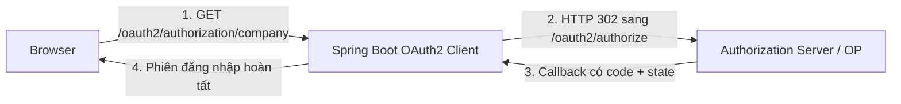
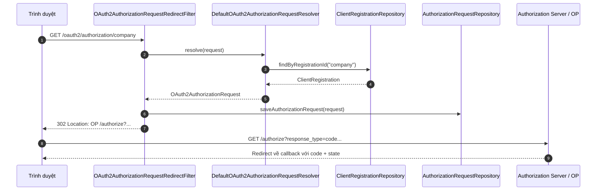

# 8.4. Cấu hình base URI của Authorization Endpoint

Trong **Spring Security OAuth 2.0 / OIDC Client** trên nền **Servlet**, một luồng đăng nhập thường bắt đầu khi trình duyệt truy cập:

```text
GET /oauth2/authorization/company
```

Ứng dụng Spring Boot tìm cấu hình client có `registrationId=company`, tạo một OAuth 2.0 authorization request và phản hồi bằng lệnh chuyển hướng đến Authorization Server/OpenID Provider (OP).

Địa chỉ `/oauth2/authorization` ở phía ứng dụng được gọi là **base URI của authorization request endpoint** trong Spring Security. Bạn có thể đổi nó thành một địa chỉ phù hợp với quy ước routing, ví dụ `/sso/authorize`, để người dùng bắt đầu đăng nhập tại:

```text
GET /sso/authorize/company
```

Bài học này giải thích **base URI đó thực sự là gì, cấu hình ở đâu, ảnh hưởng đến filter và resolver như thế nào, và làm sao tránh nhầm nó với endpoint của OP hoặc callback URI**.

> Phạm vi chính: Spring Boot 3.x / Spring Security 6.x, ứng dụng Servlet sử dụng `oauth2Login()` với Authorization Code Flow và, khi có `openid` scope, OIDC Login. Tên provider, URI và domain trong ví dụ chỉ dùng để minh họa.

## 1. Ba địa chỉ thường bị gọi chung là “authorization endpoint”

Chữ *authorization endpoint* có thể xuất hiện ở hai phía kiến trúc. Cần phân biệt thật rõ trước khi cấu hình.

| Khái niệm | Nằm ở đâu? | Ví dụ | Chức năng |
| --- | --- | --- | --- |
| **Authorization request base URI của Spring Security** | Ứng dụng OAuth2 Client | `/oauth2/authorization` hoặc `/sso/authorize` | Tiếp nhận yêu cầu **bắt đầu** đăng nhập |
| **Authorization endpoint URI của OP/AS** | Authorization Server | `https://id.example.test/oauth2/authorize` | Xác thực người dùng, xin consent khi cần, phát hành authorization response |
| **Redirect URI / callback của ứng dụng** | Ứng dụng OAuth2 Client | `https://app.example.test/login/oauth2/code/company` | Tiếp nhận authorization code và state khi OP đưa browser quay lại |

Với cấu hình mặc định:



**Thay đổi `authorizationEndpoint().baseUri(...)` chỉ thay đổi URL mà client dùng để *khởi động* authorization.** Nó không sửa `authorization-uri` của OP, không tự đổi callback và không làm thay đổi trang đích sau khi login thành công.

Bốn URL liên quan trong một ứng dụng hoàn chỉnh có thể là:

```text
URL bắt đầu:
  https://app.example.test/sso/authorize/company

Authorization endpoint trên OP:
  https://id.example.test/oauth2/authorize

Callback của ứng dụng:
  https://app.example.test/login/oauth2/code/company

Trang người dùng được đưa về sau login:
  https://app.example.test/account
```

Mỗi URL có nhiệm vụ khác nhau và có thể được cấu hình ở một nơi khác nhau.

## 2. Cơ chế mặc định trong Servlet SecurityFilterChain

Khi bật `oauth2Login()`, Spring Security cài đặt các thành phần xử lý Authorization Code Flow. Thành phần trực tiếp nhận request bắt đầu luồng là:

**`OAuth2AuthorizationRequestRedirectFilter`**.

Filter này dùng **`OAuth2AuthorizationRequestResolver`** để xem request hiện tại có phù hợp với đường dẫn khởi động hay không và, nếu có, để tạo `OAuth2AuthorizationRequest`.

Trong cấu hình thông thường:

- Base URI mặc định là `/oauth2/authorization`.
- URL khởi động có mẫu `/oauth2/authorization/{registrationId}`.
- Resolver thông dụng là `DefaultOAuth2AuthorizationRequestResolver`.
- `registrationId` được dùng để tra cứu một `ClientRegistration` trong `ClientRegistrationRepository`.
- Authorization request được lưu qua `AuthorizationRequestRepository`, thường dựa trên HTTP session.
- Filter trả redirect đến **authorization endpoint của OP** và kết thúc nhánh xử lý request đó.
- Callback về sau được **`OAuth2LoginAuthenticationFilter`** xử lý.



**Tại sao cần repository trước redirect?** Khi trình duyệt quay về với `code` và `state`, ứng dụng phải biết response đó thuộc request nào đã được khởi động trước đây. Đổi base URI không thay thế việc kiểm tra `state` hay lưu yêu cầu ban đầu.

### Base URI là đường dẫn trong ứng dụng, không phải client ID

Trong:

```text
/sso/authorize/company
```

- `/sso/authorize` là **base URI** được filter/resolver nhận biết.
- `company` là **registrationId** nội bộ, không phải tên endpoint và cũng không bắt buộc là client ID của OP.
- Client ID thực tế được lấy từ `ClientRegistration` khi resolver xây authorize request.

Nếu có nhiều registration, cùng một base URI dùng được cho nhiều provider:

```text
/sso/authorize/company
/sso/authorize/partner
/sso/authorize/google
```

Mỗi phần cuối của URL phải tương ứng với một `registrationId` có cấu hình hợp lệ.

## 3. Ví dụ tối thiểu trước khi thay đổi base URI

Giả sử ứng dụng có cấu hình OIDC registration như sau:

```yaml
spring:
  security:
    oauth2:
      client:
        registration:
          company:
            provider: company
            client-id: ${OIDC_CLIENT_ID}
            client-secret: ${OIDC_CLIENT_SECRET}
            authorization-grant-type: authorization_code
            redirect-uri: "{baseUrl}/login/oauth2/code/{registrationId}"
            scope:
              - openid
              - profile
              - email

        provider:
          company:
            issuer-uri: https://id.example.test/realms/company
```

Với Servlet application, cấu hình bảo mật đơn giản:

```java
import org.springframework.context.annotation.Bean;
import org.springframework.context.annotation.Configuration;
import org.springframework.security.config.Customizer;
import org.springframework.security.config.annotation.web.builders.HttpSecurity;
import org.springframework.security.web.SecurityFilterChain;

@Configuration
class SecurityConfig {

    @Bean
    SecurityFilterChain securityFilterChain(HttpSecurity http) throws Exception {
        return http
            .authorizeHttpRequests(auth -> auth
                .requestMatchers("/", "/public/**", "/error").permitAll()
                .anyRequest().authenticated())
            .oauth2Login(Customizer.withDefaults())
            .build();
    }
}
```

Nếu trang chủ có liên kết:

```html
<a href="/oauth2/authorization/company">Đăng nhập với Company SSO</a>
```

trình duyệt gửi request đến endpoint mặc định. Filter sẽ tạo authorize request đến OP. Ví dụ tham số được gửi có thể gồm:

```text
response_type=code
client_id=<configured-client-id>
scope=openid profile email
redirect_uri=https://app.example.test/login/oauth2/code/company
state=<random-state>
```

Các giá trị thực phải được sinh và mã hóa theo giao thức; ví dụ chỉ trình bày cấu trúc. PKCE và tham số OIDC bổ sung có thể xuất hiện tùy phiên bản, loại client và cấu hình.

**Lưu ý:** URI callback `/login/oauth2/code/company` là giá trị OP phải cho phép đối với client ID tương ứng. URI `/oauth2/authorization/company` là endpoint *do ứng dụng tự phục vụ*, không phải redirect callback đăng ký với OP.

## 4. Thay đổi base URI với Java DSL

Đây là cách phổ biến và ngắn gọn nhất khi chỉ muốn thay đường dẫn bắt đầu login.

### 4.1. Chọn đường dẫn mới

Giả sử cần đổi từ:

```text
/oauth2/authorization/company
```

sang:

```text
/sso/authorize/company
```

Chọn base URI:

```text
/sso/authorize
```

**Không thêm `/company` vào base URI** nếu muốn Spring Security dùng mẫu `{baseUri}/{registrationId}` như trước.

### 4.2. Cấu hình `authorizationEndpoint().baseUri()`

```java
import org.springframework.context.annotation.Bean;
import org.springframework.context.annotation.Configuration;
import org.springframework.security.config.annotation.web.builders.HttpSecurity;
import org.springframework.security.web.SecurityFilterChain;

@Configuration
class SecurityConfig {

    @Bean
    SecurityFilterChain securityFilterChain(HttpSecurity http) throws Exception {
        return http
            .authorizeHttpRequests(auth -> auth
                .requestMatchers("/", "/login", "/public/**", "/error").permitAll()
                .anyRequest().authenticated())
            .oauth2Login(oauth2 -> oauth2
                .loginPage("/login")
                .authorizationEndpoint(authorization ->
                    authorization.baseUri("/sso/authorize")))
            .build();
    }
}
```

Cấu hình trên thực hiện hai thay đổi độc lập:

1. `.authorizationEndpoint(authorization -> authorization.baseUri("/sso/authorize"))` đặt đường dẫn mới mà filter nhận để **bắt đầu** authorization.
2. `.loginPage("/login")` yêu cầu ứng dụng **tự cung cấp trang đăng nhập** tại `/login`. Thuộc tính này có thể bỏ nếu muốn tiếp tục dùng hành vi login page mặc định khi phù hợp.

Ví dụ trang HTML do ứng dụng phục vụ tại `/login`:

```html
<!doctype html>
<html lang="vi">
<head>
  <meta charset="utf-8">
  <title>Đăng nhập</title>
</head>
<body>
  <a href="/sso/authorize/company">Đăng nhập bằng SSO công ty</a>
</body>
</html>
```

Nếu có `loginPage("/login")`, ứng dụng cần có view, controller hoặc router thực sự xử lý `/login`. Spring Security không tự tạo trang tùy chỉnh này.

Bạn không cần viết `@GetMapping("/sso/authorize/company")`. Filter nhận request trước tầng controller và thực hiện redirect.

### 4.3. Kết quả mong đợi

Trước khi đổi:

```text
GET /oauth2/authorization/company
  -> OAuth2AuthorizationRequestRedirectFilter
  -> 302 đến OP
```

Sau khi đổi:

```text
GET /sso/authorize/company
  -> OAuth2AuthorizationRequestRedirectFilter
  -> 302 đến OP
```

Đường dẫn cũ không còn là endpoint khởi động được resolver mặc định đã cấu hình mới nhận. Nếu còn nút đăng nhập, bookmark hoặc mã chuyển hướng trỏ tới URL cũ, hãy cập nhật theo đường dẫn mới.

**Callback không bị đổi:**

```text
/login/oauth2/code/company?code=...&state=...
```

Ở thời điểm này, không cần thay đổi Redirect URI đã đăng ký tại OP chỉ vì bạn đã đổi URL *khởi động* login.

## 5. Tách bạch cấu hình authorization base URI, callback và OP endpoint

Ba phần sau có thể xuất hiện trong một dự án và rất dễ bị chỉnh nhầm:

### A. Base URI của request bắt đầu ở client

Cấu hình **trong DSL Spring Security**:

```java
.oauth2Login(oauth2 -> oauth2
    .authorizationEndpoint(authorization ->
        authorization.baseUri("/sso/authorize")))
```

Kết quả: `/sso/authorize/company` là URL mà trình duyệt gọi trên **ứng dụng** để bắt đầu quá trình.

### B. Callback Redirect URI của client

Cấu hình trong **client registration**:

```yaml
spring:
  security:
    oauth2:
      client:
        registration:
          company:
            redirect-uri: "{baseUrl}/login/oauth2/code/{registrationId}"
```

Kết quả: OP đưa trình duyệt quay về `/login/oauth2/code/company` kèm `code` và `state`. Mặc định endpoint này được `OAuth2LoginAuthenticationFilter` tiếp nhận.

Nếu thực sự muốn chuyển callback sang `/sso/callback/company`, bạn cần thay **cả registration Redirect URI lẫn redirection endpoint filter**:

```java
.oauth2Login(oauth2 -> oauth2
    .authorizationEndpoint(authorization ->
        authorization.baseUri("/sso/authorize"))
    .redirectionEndpoint(redirection ->
        redirection.baseUri("/sso/callback/*")))
```

```yaml
spring:
  security:
    oauth2:
      client:
        registration:
          company:
            redirect-uri: "{baseUrl}/sso/callback/{registrationId}"
```

Sau đó đăng ký callback mới tại OP. Đây là **thay đổi khác** với yêu cầu đổi authorization request base URI và chỉ nên thực hiện khi hệ thống thực sự muốn đổi callback.

### C. Authorization endpoint của Authorization Server

Nếu dùng metadata discovery theo `issuer-uri`, Spring Security có thể nhận `authorization_endpoint` từ metadata của OP. Với provider không dùng discovery, có thể cần khai báo:

```yaml
spring:
  security:
    oauth2:
      client:
        provider:
          company:
            authorization-uri: https://id.example.test/oauth2/authorize
            token-uri: https://id.example.test/oauth2/token
```

`authorization-uri` là **đích trên OP** mà trình duyệt được chuyển tới. Thay giá trị này không thay URL `/sso/authorize/company` của Spring Boot.

### Bảng nhận diện cấu hình

| Muốn thay đổi | Chỉnh ở đâu? | Ví dụ |
| --- | --- | --- |
| Đường dẫn người dùng **bắt đầu** SSO | `oauth2Login().authorizationEndpoint().baseUri(...)` | `/sso/authorize` |
| Nơi browser **quay về sau** OP | `registration.redirect-uri` + `redirectionEndpoint().baseUri(...)` | `/sso/callback/company` |
| URL của OP nhận authorization request | `provider.authorization-uri` hoặc metadata issuer | `https://id.example.test/oauth2/authorize` |
| Trang để người dùng chọn cách login | `oauth2Login().loginPage(...)` và route/view ứng dụng | `/login` |
| Trang sau login thành công | SavedRequest/success handler theo cấu hình | `/account` |

## 6. Base URI với nhiều ClientRegistration

Một ứng dụng có thể dùng nhiều provider hoặc nhiều loại client:

```yaml
spring:
  security:
    oauth2:
      client:
        registration:
          company:
            provider: company
            client-id: ${COMPANY_CLIENT_ID}
            client-secret: ${COMPANY_CLIENT_SECRET}
            authorization-grant-type: authorization_code
            scope: openid, profile

          partner:
            provider: partner
            client-id: ${PARTNER_CLIENT_ID}
            client-secret: ${PARTNER_CLIENT_SECRET}
            authorization-grant-type: authorization_code
            scope: openid, email

        provider:
          company:
            issuer-uri: https://id.example.test/realms/company
          partner:
            issuer-uri: https://login.partner.example.test/tenant
```

Với `baseUri("/sso/authorize")`, hai đường dẫn là:

```text
/sso/authorize/company
/sso/authorize/partner
```

Mỗi đường dẫn làm resolver tra cứu một registration khác nhau. Sau đó các request có thể được chuyển tới **hai Authorization Server khác nhau**.

Ví dụ trang login:

```html
<nav aria-label="Chọn nhà cung cấp đăng nhập">
  <a href="/sso/authorize/company">Company SSO</a>
  <a href="/sso/authorize/partner">Partner SSO</a>
</nav>
```

Không cần tạo hai filter redirect riêng chỉ vì có hai registration. Cùng một base URI có thể khởi động nhiều authorization flow.

**Nhận diện lỗi:** nếu người dùng truy cập `/sso/authorize/companies` nhưng config chỉ có `company`, resolver không tìm được registration phù hợp và luồng không hoạt động như mong muốn. Tên registration trong URL phải khớp key đã nạp.

## 7. Khi cần custom OAuth2AuthorizationRequestResolver

Đổi đường dẫn bằng `baseUri(...)` đã đủ cho đa số nhu cầu. Tuy nhiên, bạn có thể cần một **`OAuth2AuthorizationRequestResolver` tùy chỉnh** nếu OP yêu cầu tham số bổ sung, hoặc bạn muốn điều kiện đặc thù khi tạo request.

Một ví dụ phổ biến là bổ sung tham số OIDC `prompt=login` để yêu cầu OP hiển thị tương tác đăng nhập lại theo chính sách của nó.

### 7.1. Dùng DefaultOAuth2AuthorizationRequestResolver với base URI tùy chỉnh

```java
import org.springframework.context.annotation.Bean;
import org.springframework.context.annotation.Configuration;
import org.springframework.security.config.annotation.web.builders.HttpSecurity;
import org.springframework.security.oauth2.client.registration.ClientRegistrationRepository;
import org.springframework.security.oauth2.client.web.DefaultOAuth2AuthorizationRequestResolver;
import org.springframework.security.web.SecurityFilterChain;

@Configuration
class CustomAuthorizationRequestConfig {

    @Bean
    SecurityFilterChain securityFilterChain(
            HttpSecurity http,
            ClientRegistrationRepository registrations) throws Exception {

        DefaultOAuth2AuthorizationRequestResolver resolver =
            new DefaultOAuth2AuthorizationRequestResolver(
                registrations,
                "/sso/authorize"
            );

        resolver.setAuthorizationRequestCustomizer(builder ->
            builder.additionalParameters(parameters ->
                parameters.put("prompt", "login"))
        );

        return http
            .authorizeHttpRequests(auth -> auth
                .requestMatchers("/", "/login", "/error").permitAll()
                .anyRequest().authenticated())
            .oauth2Login(oauth2 -> oauth2
                .loginPage("/login")
                .authorizationEndpoint(endpoint ->
                    endpoint.authorizationRequestResolver(resolver)))
            .build();
    }
}
```

Ở trường hợp này, **resolver tự nhận base URI `/sso/authorize`** khi được khởi tạo. DSL `authorizationRequestResolver(resolver)` bảo Spring Security dùng resolver đó để khởi tạo authorization request.

Có thể tạo request cho `GET /sso/authorize/company`, bổ sung `prompt=login` vào tham số authorize, lưu request rồi redirect.

**Điều quan trọng khi tùy chỉnh:** một resolver tự viết có thể tự quyết định việc match request. Khi đã cung cấp custom resolver, không nên giả định việc gọi thêm `authorizationEndpoint().baseUri(...)` sẽ tự động sửa logic match của resolver. Hãy dùng một base URI nhất quán trong resolver, DSL và các liên kết HTML.

### 7.2. Vì sao không nối query string vào link bắt đầu login?

Ví dụ không nên dựa vào cơ chế này:

```html
<a href="/sso/authorize/company?prompt=login">
  Đăng nhập lại
</a>
```

`prompt` trong URL **đến ứng dụng Spring Boot** không tự động trở thành tham số `prompt` của authorization request **gửi đến OP**. Resolver phải hỗ trợ chuyển tham số đó theo một quy tắc đã kiểm soát.

Với nhu cầu cấu hình tham số ổn định, dùng request customizer. Nếu chấp nhận tham số động từ request, hãy áp dụng allowlist giá trị hợp lệ để tránh việc user tùy ý tạo authorization request ngoài chính sách.

### 7.3. Chỉ thay base URI thì chưa cần custom filter

Không nên tạo Servlet filter mới chỉ để chặn `/sso/authorize/company` rồi viết `sendRedirect(...)` sang OP bằng tay. Làm thế dễ bỏ sót `state`, PKCE, đăng ký client, correlation repository và callback logic.

DSL `authorizationEndpoint().baseUri(...)` cho phép đổi đường dẫn **mà vẫn tận dụng cơ chế Spring Security chuẩn**.

## 8. Tương tác với login page và AuthenticationEntryPoint

Không phải mọi user đều gõ trực tiếp URL `/sso/authorize/company`. Có hai đường vào OAuth2 Login.

### 8.1. Người dùng chủ động nhấn nút SSO

```text
Browser
  -> GET /login
  -> Nhấn link /sso/authorize/company
  -> OAuth2AuthorizationRequestRedirectFilter
  -> Redirect sang OP
```

Đây là trường hợp trực tiếp nhất. Trang `/login` hoặc component giao diện phải dùng URL base URI mới.

### 8.2. Người dùng truy cập trang bị bảo vệ

```text
Browser
  -> GET /private
  -> Spring Security nhận thấy cần Authentication
  -> AuthenticationEntryPoint kích hoạt login
  -> Trang login (hoặc cấu hình redirect tới provider)
  -> GET /sso/authorize/company
  -> Redirect sang OP
```

Cơ chế chọn trang login hoặc chuyển thẳng tới registration phụ thuộc số lượng provider và cấu hình `AuthenticationEntryPoint` / `loginPage`. Cấu hình `authorizationEndpoint().baseUri(...)` **không tự xác định** người dùng được đưa tới trang nào khi truy cập một URL bảo vệ.

Nếu bạn dùng custom `LoginUrlAuthenticationEntryPoint` hoặc success handler, cần rà lại những URL được hardcode đến `/oauth2/authorization/...`.

### 8.3. Generated login page so với custom login page

Khi dùng login page do Spring Security sinh trong một số cấu hình, các URL provider được dựng dựa trên khả năng tự nhận biết registration và cấu hình framework. Nếu UI của ứng dụng tự xây, nó chịu trách nhiệm dùng đúng link khởi động mới.

Để dễ kiểm soát khi đổi prefix, bạn có thể dùng **trang login tự quản lý** và ghi rõ từng link. Khi cấu hình `.loginPage("/login")`, hãy tạo route thật cho `/login` để tránh trang trống hoặc 404.

## 9. SecurityFilterChain và URL matching

Trong Servlet, một HTTP request phải đi qua đúng `SecurityFilterChain` chứa `OAuth2AuthorizationRequestRedirectFilter`. Nếu có nhiều chain, URL bạn chọn có thể nằm ngoài phạm vi chain được cài `oauth2Login()`.

### 9.1. Phân biệt securityMatcher và requestMatchers

- **`http.securityMatcher(...)`**: xác định phạm vi request mà **cả SecurityFilterChain** áp dụng.
- **`authorizeHttpRequests(...requestMatchers(...).permitAll())`**: xác định quy tắc authorization cho request **đã nằm trong chain**.
- **`authorizationEndpoint().baseUri(...)`**: quy định đường dẫn mà resolver/filter OAuth2 nhận để **bắt đầu luồng authorization**.

Nếu chain chỉ khớp `/web/**`, request `/sso/authorize/company` có thể không đi qua filter redirect dù cấu hình `baseUri("/sso/authorize")` là đúng.

### 9.2. Ví dụ nhiều chain: API và Web

Giả sử API dùng bearer token còn website dùng login redirect. Một sơ đồ thường gặp:

```text
/api/**             -> API SecurityFilterChain, stateless
/sso/authorize/**   -> Web SecurityFilterChain, oauth2Login()
/login/oauth2/**    -> Web SecurityFilterChain, oauth2Login()
/web/**             -> Web SecurityFilterChain, oauth2Login()
```

Nếu đặt `/sso/authorize/**` vào chain API hoặc chain không chứa OAuth2 Login, browser có thể gặp 401, 403, 404 hoặc không được chuyển sang OP, tùy các filter còn lại.

Một cấu hình minh họa với hai chain:

```java
import org.springframework.context.annotation.Bean;
import org.springframework.context.annotation.Configuration;
import org.springframework.core.annotation.Order;
import org.springframework.security.config.Customizer;
import org.springframework.security.config.annotation.web.builders.HttpSecurity;
import org.springframework.security.web.SecurityFilterChain;

@Configuration
class MultipleChainsConfig {

    @Bean
    @Order(1)
    SecurityFilterChain apiChain(HttpSecurity http) throws Exception {
        return http
            .securityMatcher("/api/**")
            .authorizeHttpRequests(auth -> auth.anyRequest().authenticated())
            .oauth2ResourceServer(resource -> resource.jwt(Customizer.withDefaults()))
            .build();
    }

    @Bean
    @Order(2)
    SecurityFilterChain webChain(HttpSecurity http) throws Exception {
        return http
            .authorizeHttpRequests(auth -> auth
                .requestMatchers("/", "/login", "/error").permitAll()
                .anyRequest().authenticated())
            .oauth2Login(oauth2 -> oauth2
                .loginPage("/login")
                .authorizationEndpoint(authorization ->
                    authorization.baseUri("/sso/authorize")))
            .build();
    }
}
```

Ở đây chain API chỉ áp dụng cho `/api/**`; chain web còn lại nhận `/sso/authorize/company` và callback mặc định. Đây là cấu hình minh họa; ứng dụng thực tế cần thiết kế thêm CSRF, session, authorization và các quy tắc API theo nghiệp vụ.

**Vì sao `permitAll()` không thay thế được chain matching?** `permitAll()` chỉ nói request không bị chặn bởi quy tắc authorization của chain. Nó không đưa filter OAuth2 vào một chain mà request vốn không đi qua.

### 9.3. Cần thêm matcher riêng khi web chain đã bị giới hạn

Nếu bạn cấu hình web chain chỉ chạy tại `/web/**`, hãy mở rộng phạm vi match để gồm **start endpoint và callback endpoint**, cùng các URL login/error cần thiết. Ví dụ ý tưởng:

```text
Web chain scope:
  /web/**
  /login
  /sso/authorize/**
  /login/oauth2/code/**
  /error
```

Đường dẫn cụ thể còn phụ thuộc framework/router và cách cấu hình matcher. Mục tiêu là bảo đảm cả lúc **đi sang OP** và lúc **trở về từ OP** đều chạy qua chain có OAuth2 Login.

## 10. Base URI dưới context path và reverse proxy

Phần `baseUri("/sso/authorize")` thường là đường dẫn **tương đối với context path của ứng dụng Servlet**, không phải đầy đủ URL public có hostname.

### 10.1. Ứng dụng chạy dưới context path

Ví dụ:

```yaml
server:
  servlet:
    context-path: /portal
```

Và:

```java
authorization.baseUri("/sso/authorize")
```

Với ứng dụng mở tại `http://localhost:8080/portal`, browser sẽ sử dụng:

```text
http://localhost:8080/portal/sso/authorize/company
```

Trong HTML được phục vụ dưới context path, cần tạo link tương ứng. Nếu hardcode `href="/sso/authorize/company"`, trình duyệt đi tới root domain và **bỏ qua `/portal`**. Có thể dùng cách sinh URL có context path của framework hoặc template engine.

Ví dụ với Thymeleaf:

```html
<a th:href="@{/sso/authorize/company}">Đăng nhập SSO</a>
```

Template engine xử lý context path trong URL khi render đúng ngữ cảnh. Nếu ứng dụng có path rewrite ở proxy, cần xét thêm public prefix.

### 10.2. Reverse proxy terminate HTTPS

Mô hình thông thường:

```text
Browser
  HTTPS https://app.example.test/portal
        |
        v
Reverse Proxy / Ingress :443
        |
        v
Spring Boot HTTP :8080
```

Browser bấm link `https://app.example.test/portal/sso/authorize/company`. Reverse proxy phải chuyển request tới đường dẫn mà filter thực sự nhận.

Giả sử proxy giữ nguyên prefix `/portal` và ứng dụng có `server.servlet.context-path=/portal`, callback có thể được xử lý đúng. Nếu proxy loại bỏ prefix và ứng dụng chạy ở root, link public vẫn cần chứa prefix nhưng filter backend chỉ nhận `/sso/authorize/company`.

Với các môi trường này:

1. Xác định browser truy cập URL nào.
2. Xác định proxy rewrite path ra sao.
3. Xác định Spring Boot có `context-path` nào.
4. Cấu hình `baseUri` theo request path thực tế mà resolver nhìn thấy.
5. Kiểm tra callback OP cũng được proxy định tuyến về đúng filter.

### 10.3. Forwarded headers và Redirect URI

Thông thường `{baseUrl}` trong `registration.redirect-uri` được tính từ HTTP request. Sau proxy, nếu Spring Boot không biết public scheme/host, callback có thể bị dựng sai:

```text
Sai:
http://spring-app:8080/login/oauth2/code/company

Đúng:
https://app.example.test/login/oauth2/code/company
```

Có thể cấu hình theo hạ tầng:

```yaml
server:
  forward-headers-strategy: framework
```

Và bảo đảm reverse proxy do bạn kiểm soát gửi/ghi đè header như `Forwarded`, `X-Forwarded-Proto`, `X-Forwarded-Host`, `X-Forwarded-Port`, và `X-Forwarded-Prefix` khi phù hợp.

**Bảo mật:** ứng dụng chỉ nên tin forwarded headers được tạo bởi proxy đáng tin; không để request Internet tự gán `X-Forwarded-Host` nhằm điều khiển URL sinh ra.

Forwarded headers liên quan trực tiếp đến **public callback URI** và link có host/scheme. Bản thân `authorizationEndpoint().baseUri("/sso/authorize")` vẫn là một đường dẫn nội bộ, nên không nên cố giải quyết mọi lỗi proxy bằng cách thay giá trị base URI.

## 11. Môi trường local, staging và production

Có thể sử dụng **cùng base URI** `/sso/authorize` và **cùng registrationId** `company` ở cả ba môi trường. Chỉ public origin, client credentials, issuer và Redirect URI công khai thay đổi theo môi trường.

| Môi trường | URL bắt đầu login | Callback thường đăng ký tại OP |
| --- | --- | --- |
| Local | `http://localhost:8080/sso/authorize/company` | `http://localhost:8080/login/oauth2/code/company` |
| Staging | `https://staging.app.example.test/sso/authorize/company` | `https://staging.app.example.test/login/oauth2/code/company` |
| Production | `https://app.example.test/sso/authorize/company` | `https://app.example.test/login/oauth2/code/company` |

Các ví dụ giả định ứng dụng chạy ở root context. Nếu dùng `/portal`, thêm prefix vào URL public tương ứng.

Điểm cần nhớ: **Authorization Server thường đăng ký callback Redirect URI, không phải URL khởi động `/sso/authorize/company`**. Khi chỉ đổi base URI từ `/oauth2/authorization` thành `/sso/authorize`, allowlist callback tại OP không cần đổi.

Để tách môi trường, có thể cấp mỗi môi trường một client ID riêng tại OP:

```text
local   -> client ID app-local   -> localhost callback
staging -> client ID app-stage   -> staging callback
prod    -> client ID app-prod    -> production callback
```

Phân tách client ID/secret làm giảm việc chia sẻ credential và hạn chế ảnh hưởng khi cấu hình staging sai hoặc một secret bị lộ.

## 12. Quy trình kiểm tra hành vi endpoint

Khi thiết lập base URI mới, kiểm tra URL **đi vào ứng dụng** trước, rồi xác nhận kết quả redirect.

### 12.1. Với trình duyệt

1. Mở website đúng public origin.
2. Nhấn nút login trỏ tới `/sso/authorize/company`.
3. Trong Developer Tools → Network, tìm request đến URL vừa nhấn.
4. Xác nhận response từ ứng dụng là redirect đến **authorization endpoint của OP**.
5. Xem query parameters trong `Location`: phải có `response_type=code`, `client_id` đúng client, `redirect_uri` công khai và `state` được tạo.
6. Hoàn tất login trên OP bằng tài khoản thử nghiệm để xác nhận callback trở về và phiên đăng nhập được thiết lập.

Không sao chép giá trị nguyên của `state`, `code`, access token hoặc ID token vào ticket/log. Khi cần báo lỗi, chỉ ghi đường dẫn, loại tham số, hostname và trạng thái HTTP đã che dữ liệu nhạy cảm.

### 12.2. Quan sát bước redirect bằng curl

Với ứng dụng local:

```bash
curl -i http://localhost:8080/sso/authorize/company
```

Trong trường hợp thành công, có thể thấy response tương tự:

```http
HTTP/1.1 302 Found
Location: https://id.example.test/oauth2/authorize?response_type=code&client_id=...&redirect_uri=...&state=...
```

`curl` ở đây chỉ kiểm tra **bước bắt đầu OAuth2 authorization**. Nó không thực hiện đầy đủ browser login, cookie handling, MFA, PKCE hay OIDC token exchange. Nếu dùng `curl -L` để theo redirect, có thể bị đưa sang trang login của OP; đó không phải cách tốt nhất để chứng minh toàn bộ luồng hoạt động.

### 12.3. Quan sát SecurityFilterChain

Khi request không đi qua filter như kỳ vọng, có thể tạm bật DEBUG trong môi trường có kiểm soát:

```yaml
logging:
  level:
    org.springframework.security.web.FilterChainProxy: DEBUG
    org.springframework.security.oauth2.client: DEBUG
```

Mục tiêu là biết request `/sso/authorize/company` đi vào chain nào và việc tạo authorization request có được khởi động hay không. Không bật logging payload/token chi tiết trên production và không ghi nguyên authorization response chứa thông tin nhạy cảm.

## 13. Những lỗi thường gặp khi đổi base URI

| Triệu chứng | Nguyên nhân thường gặp | Cách xử lý |
| --- | --- | --- |
| Link mới trả 404 | Base URI không được áp dụng trong chain đang xử lý, hoặc URL/link khác cấu hình | Kiểm tra `oauth2Login().authorizationEndpoint().baseUri()` và chain matching |
| Link cũ còn hoạt động trong UI nhưng không redirect sang OP | UI vẫn trỏ `/oauth2/authorization/company` sau khi đã đổi sang `/sso/authorize` | Cập nhật link, entry point và các route hardcode |
| Đường dẫn mới trả 401/403 | Request đi vào API chain hoặc chain không có OAuth2 Login, bị authorization xử lý trước | Thiết kế lại `securityMatcher` và filter chains |
| OP trả `invalid_redirect_uri` | Callback URI trong authorize request không khớp allowlist | Kiểm tra `registration.redirect-uri`, proxy, public origin và OP config |
| Redirect sang OP có `client_id` sai | URL chứa registrationId khác dự kiến hoặc biến môi trường chọn nhầm client | So sánh registration key, client ID, profile đang chạy |
| Browser quay về callback nhưng gặp state mismatch | Session/cookie hoặc authorization request gốc bị mất | Kiểm tra session persistence, host, cookie, nhiều replica |
| `/sso/authorize/company` bị 404 dưới `/portal` | Link bỏ qua context path hoặc proxy rewrite sai | Sinh URL kèm context path, xem ingress routing |
| Custom resolver không nhận đường dẫn mới | Resolver được tạo với base URI cũ | Khởi tạo resolver với cùng base URI đã chọn |
| Đổi callback khiến login ngừng hoạt động | Chỉ đổi `redirect-uri`, chưa đổi filter callback hoặc OP allowlist | Cập nhật cả callback filter và OP khi thật sự cần |
| OP từ chối prompt/hint | Tham số mở rộng không được OP hỗ trợ hoặc resolver chưa thêm | Kiểm tra tài liệu OP và customizer thực tế |

### Tình huống A — Đã đổi DSL nhưng nút login vẫn trỏ URL cũ

Code:

```java
.authorizationEndpoint(authorization ->
    authorization.baseUri("/sso/authorize"))
```

Nhưng HTML:

```html
<a href="/oauth2/authorization/company">Đăng nhập</a>
```

Kết quả: request đi tới đường dẫn cũ. Bản thân URI này không còn là mẫu khởi động mà resolver cấu hình mới nhận. **Sửa đúng vị trí:** đổi HTML link thành `/sso/authorize/company`. Không cần thay OP authorization endpoint hoặc callback.

### Tình huống B — Đã đổi base URI nhưng OP báo redirect mismatch

Ứng dụng gửi:

```text
GET https://id.example.test/oauth2/authorize?
    redirect_uri=http%3A%2F%2Fspring-app%3A8080%2Flogin%2Foauth2%2Fcode%2Fcompany
```

Browser thực tế mở `https://app.example.test`. Đây là vấn đề **callback/public origin**, thường do proxy forwarded headers hoặc `redirect-uri` sai, không phải vì base URI `/sso/authorize`. Sửa ở phần đăng ký client và thông tin request công khai.

### Tình huống C — Có nhiều SecurityFilterChain

```text
Chain 1: securityMatcher("/sso/**"), oauth2ResourceServer()
Chain 2: SecurityFilterChain còn lại, oauth2Login()
```

Request `/sso/authorize/company` khớp chain 1 trước, nên không đi qua OAuth2AuthorizationRequestRedirectFilter của chain 2. Cần thiết kế matcher và order để endpoint bắt đầu SSO đi vào chain có OAuth2 Login.

### Tình huống D — Thay cả start URL lẫn callback nhưng chỉ sửa một phía

App cấu hình:

```text
Start URL: /sso/authorize/company
Callback URL: /sso/callback/company
```

Nếu đổi callback trong registration nhưng `OAuth2LoginAuthenticationFilter` vẫn chỉ nhận `/login/oauth2/code/*`, browser có thể quay về đường dẫn mà Spring Security không xử lý. Vì vậy hãy chỉnh `redirectionEndpoint().baseUri("/sso/callback/*")`, registration `redirect-uri` và allowlist OP cùng một lúc nếu muốn thay callback.

## 14. Bảo mật khi tùy chỉnh authorization request endpoint

### 14.1. Chỉ bắt đầu flow cho những registration hợp lệ

Resolver tra cứu `ClientRegistrationRepository` theo registrationId. Không xây một cơ chế nhận tùy ý `client_id`, `authorization_uri` hoặc callback do request cung cấp mà không kiểm soát. Những tham số đó phải xuất phát từ cấu hình client đã tin cậy.

### 14.2. Bảo vệ state và PKCE

Đổi URL bắt đầu SSO không được làm mất các bảo vệ của Authorization Code Flow. `state` cần liên kết request khởi đầu với callback; PKCE gắn authorization code với `code_verifier` tương ứng khi được áp dụng. Không tự tạo state cố định hoặc dùng chung cho mọi phiên.

### 14.3. Giữ redirect URI trong allowlist của OP

Authorization request gửi tới OP phải dùng Redirect URI hợp lệ, được đăng ký cho client ID tương ứng. Không thêm callback động từ query parameter do user kiểm soát. Việc URL start có thể được phép truy cập công khai không đồng nghĩa người dùng được quyết định nơi nhận authorization code.

### 14.4. Không nhúng secret vào authorize URL

Client secret thuộc kênh và phương thức client authentication thích hợp, không phải query parameter của redirect đến OP. Access token, refresh token và ID token không phải thành phần của URL bắt đầu Authorization Code Flow chuẩn.

### 14.5. Session và cookie

Với Servlet login, authorization request thường được lưu trong HTTP session. Cookie session cần cấu hình phù hợp HTTPS, `HttpOnly`, `Secure`, `SameSite` và topology reverse proxy. Với nhiều instance, cần đảm bảo callback đọc được trạng thái request đã lưu. Không tắt kiểm tra `state` để che lỗi cấu hình session.

### 14.6. Hạn chế open redirect và login CSRF

Custom resolver hoặc custom login page phải tránh đưa `redirect_uri` ra ngoài allowlist. Nếu có URL “trở về sau login”, phải validate đúng vai trò của nó và không biến nó thành OAuth callback. Dùng cơ chế request cache/success handler phù hợp để điều hướng sau đăng nhập.

## 15. Bài thực hành cấu hình từ đầu đến cuối

**Bài toán:** ứng dụng Spring MVC dùng OIDC với registration `company`. Tổ chức muốn tất cả các liên kết SSO bắt đầu tại `/sso/authorize/{registrationId}` thay cho endpoint mặc định. Callback của OP vẫn là `/login/oauth2/code/{registrationId}`.

### Bước 1 — Khai báo registration

```yaml
spring:
  security:
    oauth2:
      client:
        registration:
          company:
            provider: company
            client-id: ${OIDC_CLIENT_ID}
            client-secret: ${OIDC_CLIENT_SECRET}
            authorization-grant-type: authorization_code
            redirect-uri: "{baseUrl}/login/oauth2/code/{registrationId}"
            scope: openid, profile, email

        provider:
          company:
            issuer-uri: ${OIDC_ISSUER_URI}
```

### Bước 2 — Đổi start base URI

```java
@Configuration
class SecurityConfig {

    @Bean
    SecurityFilterChain securityFilterChain(HttpSecurity http) throws Exception {
        return http
            .authorizeHttpRequests(auth -> auth
                .requestMatchers("/", "/login", "/error").permitAll()
                .anyRequest().authenticated())
            .oauth2Login(oauth2 -> oauth2
                .loginPage("/login")
                .authorizationEndpoint(endpoint ->
                    endpoint.baseUri("/sso/authorize")))
            .build();
    }
}
```

Đoạn này tập trung vào DSL; các import tương tự ví dụ ở mục 4.2.

### Bước 3 — Cập nhật UI

```html
<a href="/sso/authorize/company">Đăng nhập qua Company SSO</a>
```

Nếu dùng context path, hãy sinh link có prefix phù hợp như Thymeleaf `@{/sso/authorize/company}`.

### Bước 4 — Giữ callback đã đăng ký trên OP

Với production root context:

```text
https://app.example.test/login/oauth2/code/company
```

Đây là URI mà client gửi ở `redirect_uri` và OP phải cho phép. **Không đăng ký `https://app.example.test/sso/authorize/company` làm callback chỉ vì đó là start URL mới.**

### Bước 5 — Quan sát request và redirect

Mở:

```text
https://app.example.test/sso/authorize/company
```

Ứng dụng phải phản hồi bằng redirect đến OP. Xác nhận authorize request có:

```text
response_type=code
client_id=<production-client-id>
redirect_uri=https://app.example.test/login/oauth2/code/company
scope=openid profile email
state=<unique-state>
```

Sau khi hoàn tất tương tác trên OP, browser phải quay về callback và Spring Security xử lý login. Nếu request không được chuyển hướng, xem lại filter chain, base URI và registrationId.

## 16. Câu hỏi tự kiểm tra

**Câu 1.** Bạn cấu hình:

```java
.authorizationEndpoint(endpoint -> endpoint.baseUri("/sso/start"))
```

và có registration `company`. URL nào khởi động login theo quy ước thông thường?

> `/sso/start/company`. Phần `/sso/start` là base URI; `company` là registrationId.

**Câu 2.** Đổi base URI từ `/oauth2/authorization` sang `/sso/start` có cần cập nhật Redirect URI allowlist của OP không?

> Không, nếu callback của ứng dụng vẫn giữ nguyên. OP cần allowlist **callback URI**, ví dụ `/login/oauth2/code/company`. Base URI mới là đường dẫn bắt đầu login ở client.

**Câu 3.** Trong `spring.security.oauth2.client.provider.company.authorization-uri` bạn khai báo `https://id.example.test/oauth2/authorize`. Nó có phải base URI của Spring Security filter không?

> Không. Đó là authorization endpoint trên Authorization Server. URL filter nằm trên ứng dụng Spring Boot và được cấu hình bằng `authorizationEndpoint().baseUri(...)` hoặc resolver thích hợp.

**Câu 4.** Vì sao `GET /sso/start/company` trả 401 dù bạn đã bật `oauth2Login()` ở một SecurityFilterChain?

> Có thể request đang đi vào một chain khác, chẳng hạn chain API stateless, hoặc nằm ngoài matcher của chain có OAuth2 Login. Cần kiểm tra `securityMatcher`, thứ tự các chain và filter thực tế.

**Câu 5.** Ứng dụng có context path `/portal` và base URI `/sso/start`. Browser cần gọi URL nào trên `http://localhost:8080`?

> `http://localhost:8080/portal/sso/start/company`, giả sử không có rewrite khác ở proxy. Base URI là đường dẫn trong context của ứng dụng.

**Câu 6.** Một custom `DefaultOAuth2AuthorizationRequestResolver` vẫn được khởi tạo với `/oauth2/authorization` nhưng HTML đã chuyển sang `/sso/start/company`. Tại sao không có redirect?

> Vì resolver còn nhận đường dẫn cũ. Cần khởi tạo resolver với `/sso/start` hoặc dùng DSL `baseUri(...)` nếu không cần resolver riêng.

**Câu 7.** Lỗi `invalid_state` xuất hiện sau khi browser quay lại từ OP. Thay đổi `authorizationEndpoint().baseUri(...)` có giải quyết trực tiếp không?

> Không. Đây là dấu hiệu callback không thể khớp authorization request gốc; cần kiểm tra cookie/session, state, nhiều instance, origin và repository. Không bỏ bước đối chiếu state.

---

## Ghi nhớ

**Base URI của Authorization Endpoint trong Spring Security là nơi trình duyệt *bắt đầu* OAuth2/OIDC authorization tại ứng dụng client**:

```text
Mặc định:  /oauth2/authorization/{registrationId}
Tùy chỉnh: /sso/authorize/{registrationId}
```

Cấu hình điển hình:

```java
.oauth2Login(oauth2 -> oauth2
    .authorizationEndpoint(endpoint ->
        endpoint.baseUri("/sso/authorize")))
```

Sau khi đổi, cập nhật link đăng nhập và bảo đảm đường dẫn mới thuộc đúng `SecurityFilterChain`. **Authorization endpoint của OP và callback Redirect URI là hai cấu hình khác**; chỉ thay chúng nếu yêu cầu triển khai thực sự liên quan. Giữ nguyên cơ chế `state`, PKCE, repository và xử lý callback của Spring Security để luồng đăng nhập vẫn an toàn.

### Tài liệu đối chiếu

- [Spring Security — OAuth 2.0 Login: Advanced Configuration](https://docs.spring.io/spring-security/reference/servlet/oauth2/login/advanced.html)
- [Spring Security API — OAuth2AuthorizationRequestRedirectFilter](https://docs.spring.io/spring-security/reference/api/java/org/springframework/security/oauth2/client/web/OAuth2AuthorizationRequestRedirectFilter.html)
- [Spring Security API — DefaultOAuth2AuthorizationRequestResolver](https://docs.spring.io/spring-security/reference/api/java/org/springframework/security/oauth2/client/web/DefaultOAuth2AuthorizationRequestResolver.html)
