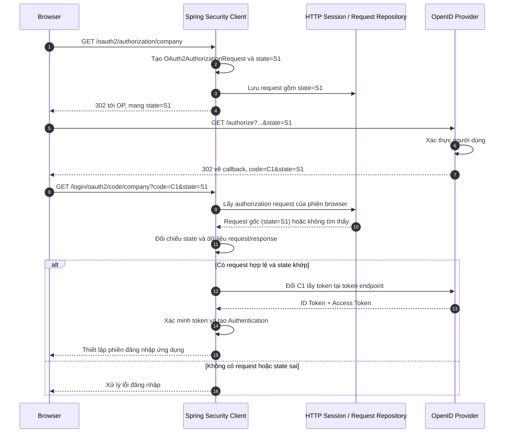

# 8.5. Quản lý `state` và liên kết request với phiên trình duyệt

Khi người dùng đăng nhập vào ứng dụng Spring Boot thông qua **Spring Security OAuth 2.0 / OpenID Connect (OIDC) Client**, trình duyệt rời website của ứng dụng để đến Authorization Server hoặc OpenID Provider (OP), rồi được chuyển hướng quay lại. Hai HTTP request ở phía ứng dụng — request bắt đầu đăng nhập và request nhận callback — cách nhau bởi nhiều bước tương tác ngoài ứng dụng.

Làm thế nào để ứng dụng chắc chắn rằng **callback đang nhận thuộc về đúng lần đăng nhập mà chính trình duyệt này đã khởi tạo**? Đó là vai trò của **`state`** và cơ chế lưu **authorization request** trong khoảng thời gian chờ phản hồi.

Trong cấu hình Spring Security Servlet phổ biến, framework sinh một giá trị `state` khó đoán, tạo `OAuth2AuthorizationRequest`, lưu request trong **HTTP session** của ứng dụng, rồi chuyển browser sang OP. Khi OP trả browser về với `code` và `state`, Spring Security tìm lại authorization request đã lưu từ phiên tương ứng và đối chiếu dữ liệu trước khi tiến hành các bước trao đổi code, kiểm tra token và thiết lập trạng thái đăng nhập.

Nội dung này tập trung vào **vòng đời của `state`, mối liên kết với phiên trình duyệt, trách nhiệm của các bộ lọc Spring Security và cách thiết kế an toàn khi có nhiều tab, reverse proxy hoặc nhiều instance**.

## 1. Vì sao authorization request cần một giá trị `state`?

Giả sử website quản lý đơn hàng dùng OIDC để đăng nhập:

- Ứng dụng: `https://orders.example.org`.
- OP: `https://login.example.org`.
- Spring Security client registration: `company`.
- Callback: `https://orders.example.org/login/oauth2/code/company`.

Người dùng chưa đăng nhập mở trang `/orders` rồi được đưa đến:

```text
GET https://orders.example.org/oauth2/authorization/company
```

Client tạo một authorization request có `state` mới:

```http
HTTP/1.1 302 Found
Location: https://login.example.org/authorize?response_type=code&client_id=orders-web&redirect_uri=https%3A%2F%2Forders.example.org%2Flogin%2Foauth2%2Fcode%2Fcompany&scope=openid&state=s_8hK2...
```

Sau khi OP xác thực và cấp authorization code, browser trở về:

```http
GET /login/oauth2/code/company?code=c_Q7...&state=s_8hK2... HTTP/1.1
Host: orders.example.org
Cookie: JSESSIONID=<opaque-session-id>
```

Ứng dụng không nên chỉ nhìn thấy `code` rồi mặc nhiên tin đó là phản hồi hợp lệ. Nó phải kiểm tra `state` trả về có khớp giá trị mà ứng dụng **đã sinh và lưu cho lần đăng nhập trước đó** không.

### 1.1. Kẻ tấn công muốn lợi dụng điều gì?

Một tình huống điển hình là **login CSRF**: kẻ tấn công khởi tạo một luồng đăng nhập bằng tài khoản của mình rồi cố khiến trình duyệt nạn nhân hoàn tất callback theo luồng đó. Nếu client chấp nhận authorization response không có ràng buộc với request của nạn nhân, nạn nhân có thể bị đăng nhập nhầm vào tài khoản của kẻ tấn công và vô tình thực hiện các thao tác hoặc nhập dữ liệu dưới tài khoản ấy.

`state` giúp chống kiểu nhầm lẫn này khi được triển khai đúng: phản hồi chỉ được chấp nhận nếu liên kết tới **authorization request do client khởi tạo cho phiên trình duyệt tương ứng**.

Các mục tiêu bảo vệ chính gồm:

1. **Liên kết request/response:** biết phản hồi nào thuộc về lần xin authorization nào.
2. **Ràng buộc với ngữ cảnh trình duyệt:** không thể lấy một callback tạo ở phiên A rồi dùng như callback của phiên B.
3. **Giảm khả năng phản hồi giả mạo hoặc chèn ngang:** một `state` không đoán được và được kiểm tra đúng khiến phản hồi không có yêu cầu gốc bị từ chối.
4. **Hạn chế nhầm luồng đăng nhập:** phân biệt các yêu cầu đang chờ khi ứng dụng có nhiều client registration, nhiều tab hoặc các bước điều hướng khác nhau.

`state` **không phải token đăng nhập** và **không tự xác minh danh tính người dùng**. Nó chỉ chứng minh được mối liên kết giữa authorization response và authorization request khi client có cơ chế lưu, bảo vệ và kiểm tra trạng thái đúng cách.

## 2. `state` được tạo và sử dụng ở những thời điểm nào?

Có thể chia vòng đời authorization request làm bốn giai đoạn.

| Giai đoạn | Spring Security Client làm gì? | Trạng thái được sử dụng ra sao? |
|---|---|---|
| **Khởi tạo** | Chọn `ClientRegistration`, sinh `OAuth2AuthorizationRequest` và `state` ngẫu nhiên. | Tạo giá trị duy nhất, khó đoán cho lần authorization. |
| **Lưu trước redirect** | Lưu authorization request vào `AuthorizationRequestRepository`. | Giữ `state` gốc và dữ liệu ràng buộc cần dùng ở callback. |
| **Chuyển tới OP** | Gửi browser sang authorization endpoint với tham số `state`. | OP nhận và trả lại `state` trong authorization response, không cần hiểu nội dung của nó. |
| **Nhận callback** | Lấy lại authorization request, so khớp `state` và kiểm tra authorization response. | Nếu không tìm thấy hoặc không khớp thì không tiếp tục xác thực thành công. |



**Đối chiếu `state` xảy ra trước khi client tin vào kết quả đăng nhập.** Việc callback xuất hiện trên đường dẫn đúng hoặc mang một authorization code có vẻ hợp lệ chưa đủ để tạo `Authentication`.

### 2.1. Giá trị `state` nên có đặc tính gì?

`state` nên là một giá trị **khó đoán, có entropy cao, được sinh bằng nguồn ngẫu nhiên an toàn**, đủ để chống việc dự đoán hoặc giả mạo. Mỗi lần authorization request mới cần có giá trị thích hợp cho lần đó; không dùng một chuỗi cố định cho mọi người dùng hoặc mọi phiên.

Một ví dụ minh họa:

```text
state=6d8V2B...rN7p
```

Dấu ba chấm chỉ để rút gọn trình bày; khi vận hành, giá trị đầy đủ do Spring Security sinh. **Không chọn `state=userId`, `state=company`, `state=true` hay timestamp dễ đoán.**

`state` không có định dạng dữ liệu nghiệp vụ bắt buộc. OP không cần đọc nội dung bên trong. Không nên nhét mật khẩu, Access Token, email nhạy cảm hoặc dữ liệu cá nhân vào `state` vì nó đi qua URL, browser history và có thể bị hạ tầng ghi log nếu không kiểm soát.

### 2.2. `state` được OP xử lý như thế nào?

Theo Authorization Code Flow, client gửi `state` trong authorization request; OP trả lại giá trị đó trong authorization response khi có `state` ban đầu, kể cả những trường hợp trả lỗi theo giao thức có thể chuyển về redirect URI.

OP không biết HTTP session của ứng dụng Spring Boot; OP chỉ nhìn thấy tham số trong authorization request và trả về đúng giá trị. **Client là bên chịu trách nhiệm bảo đảm `state` liên kết được với phiên trình duyệt và authorization request mà nó đã tạo.**

Vì thế, không thể thay bước kiểm tra ở client bằng câu nói «OP đã trả lại `state`, nên callback chắc chắn đúng». Bất kỳ trình duyệt nào cũng có thể gửi một URL callback; cơ chế chống giả mạo nằm ở việc client tra cứu và xác minh request gốc.

## 3. Spring Security lưu authorization request ở đâu?

Trong Servlet stack, các thành phần chính là:

| Thành phần | Trách nhiệm |
|---|---|
| `OAuth2AuthorizationRequestRedirectFilter` | Xử lý điểm bắt đầu `/oauth2/authorization/{registrationId}`, tạo và lưu authorization request, sau đó gửi redirect tới OP. |
| `OAuth2AuthorizationRequestResolver` | Xây dựng `OAuth2AuthorizationRequest` từ `ClientRegistration` và request hiện tại. |
| `OAuth2AuthorizationRequest` | Đối tượng mô tả yêu cầu, gồm authorization URI, client ID, redirect URI, scopes, `state`, attributes và thông tin bổ sung liên quan. |
| `AuthorizationRequestRepository<OAuth2AuthorizationRequest>` | Hợp đồng lưu, tải và loại bỏ authorization request giữa lúc redirect và callback. |
| `HttpSessionOAuth2AuthorizationRequestRepository` | Implementation thông dụng được Spring Security Servlet dùng mặc định để lưu request vào HTTP session. |
| `OAuth2LoginAuthenticationFilter` | Nhận callback, lấy authorization request tương ứng, kiểm tra phản hồi và tiếp tục quy trình login. |
| `SecurityContextRepository` | Lưu/khôi phục trạng thái người dùng đã đăng nhập **sau khi** xác thực thành công. Đây không phải kho authorization request đang chờ. |

Trong cấu hình mặc định phổ biến, `HttpSessionOAuth2AuthorizationRequestRepository` lưu một `OAuth2AuthorizationRequest` vào session thuộc browser hiện tại. Tại callback, repository kiểm tra `state` và chỉ trả về hoặc loại bỏ request tương ứng khi dữ liệu hợp lệ theo implementation của nó.

### 3.1. Hai loại trạng thái trong cùng một HTTP session

Điểm quan trọng là **session có thể tồn tại trước khi người dùng được xác thực**.

Trong giai đoạn chờ OP:

```text
HTTP Session của browser
└── OAuth2AuthorizationRequest
    ├── registration/provider context
    ├── redirect_uri
    ├── scope
    ├── state
    ├── nonce (nếu OIDC dùng)
    └── PKCE verifier (nếu dùng PKCE)
```

Sau callback thành công, ứng dụng còn có trạng thái đăng nhập:

```text
HTTP Session của browser
└── SecurityContext
    └── Authentication (principal + authorities)
```

Đây là **hai mục đích lưu khác nhau**. Authorization request được lưu để kiểm tra tính tương ứng giữa hai đầu flow; `SecurityContext` được lưu để nhận diện người dùng ở những request ứng dụng sau khi login. Tùy cấu hình, nơi lưu authorized client/tokens lại là một thành phần riêng.

Một browser có cookie `JSESSIONID` khi đang chờ OP **chưa chắc đã đăng nhập**: session đó có thể chỉ chứa `state` và dữ liệu authorization request. Sau login, Spring Security còn có thể đổi session ID để chống session fixation.

### 3.2. Ví dụ một phiên chờ callback

Giả sử browser nhận cookie phiên trước khi được chuyển đến OP:

```http
HTTP/1.1 302 Found
Location: https://login.example.org/authorize?client_id=orders-web&response_type=code&state=s_9G...
Set-Cookie: JSESSIONID=a73...; Path=/; Secure; HttpOnly; SameSite=Lax
```

Header trên chỉ minh họa một cấu hình cookie có thể gặp; thuộc tính thực tế phụ thuộc servlet container, reverse proxy, phiên bản Spring Boot và cách ứng dụng cấu hình session.

Browser cất cookie thuộc **miền ứng dụng**. Khi OP chuyển browser về:

```http
GET /login/oauth2/code/company?code=c_4K...&state=s_9G... HTTP/1.1
Host: orders.example.org
Cookie: JSESSIONID=a73...
```

Session ID giúp backend tìm lại authorization request đã lưu. Sau đó client so `state` trong callback với `state` ở request đã tải.

**Liên kết không phải do bản thân tên cookie chứng minh**, mà do cơ chế phiên và repository: browser chỉ có thể tham gia đúng flow khi quay về với session ứng dụng chứa authorization request tương ứng. Cookie SSO của OP là một cookie khác, trên miền OP; nó không được dùng thay cookie phiên ứng dụng.

### 3.3. Authorization request thường được tiêu thụ khi nhận callback

Authorization response cần được xử lý như **kết quả của một yêu cầu đang chờ**, không phải vé dùng nhiều lần. Trong flow chuẩn, repository được dùng để lấy và loại authorization request khi callback được xử lý phù hợp.

Điều này có ích vì:

- Không giữ mãi `state` của các lần đăng nhập đã hoàn tất.
- Giảm khả năng một callback cũ được liên kết lại với request cũ.
- Giúp vòng đời flow rõ ràng khi thành công hoặc lỗi.

Dù request đã bị loại khỏi repository, Authorization Server vẫn phải kiểm soát tính một lần và thời hạn ngắn của authorization code. **Dùng code một lần là kiểm soát của OP; loại authorization request là kiểm soát của client**. Hai cơ chế hỗ trợ nhau.

## 4. Mối liên kết giữa phiên trình duyệt và `state`

Có thể biểu diễn logic xác minh khái niệm:

```text
authorizationRequest = repository.loadForCurrentBrowserSession(callback)

if (authorizationRequest is absent):
    reject login

if (callback.state != authorizationRequest.state):
    reject login

continue OIDC authorization-code processing
```

Đây là **pseudo-code giải thích nguyên tắc**, không phải mã triển khai chính xác của bộ lọc Spring Security. Ở implementation thật, Spring Security còn xử lý OAuth2 error response, client registration, redirect URI, trao đổi code, PKCE và xác minh ID Token.

### 4.1. Vì sao một `state` có thật vẫn có thể bị từ chối?

Giả sử browser A bắt đầu đăng nhập và có:

```text
session A -> pending state = AAA
```

Browser B có session khác:

```text
session B -> pending state = BBB
```

Nếu callback của A bị gửi đến B:

```text
GET /login/oauth2/code/company?code=fromA&state=AAA
Cookie: JSESSIONID=<session-B>
```

Client tra session B sẽ gặp `BBB`, không khớp `AAA`, nên phải từ chối. Mục tiêu không phải xác nhận `AAA` «có từng tồn tại đâu đó» mà là xác nhận **`AAA` thuộc về đúng browser session đang thực hiện callback**.

Tương tự, một `state` đúng trên một máy không giúp callback thành công nếu session không còn được truy xuất trên instance khác. Dữ liệu phải được lưu và khôi phục nhất quán trong suốt vòng đời flow.

### 4.2. `state` không phải mã phiên

Không nên coi `state` tương đương `JSESSIONID`:

| Giá trị | Nguồn tạo | Vai trò |
|---|---|---|
| `state` | OAuth2/OIDC Client khi tạo authorization request. | Liên kết đúng một yêu cầu authorization với phản hồi của nó. |
| `JSESSIONID` hoặc tên cookie phiên tùy biến | Ứng dụng/container quản lý HTTP session. | Giúp browser tìm lại session ứng dụng qua nhiều request. |
| `nonce` | OIDC Client khi tạo yêu cầu OIDC có nonce. | Ràng buộc ID Token với một authorization request cụ thể. |
| `code_verifier` | OAuth2 Client khi dùng PKCE. | Chứng minh quyền đổi authorization code tại token endpoint. |

Không đặt session ID làm `state` hoặc tự suy diễn trạng thái session chỉ từ `state`. Thông thường Spring Security sinh `state` riêng và lưu nó cùng authorization request trong session.

### 4.3. Session fixation khác login CSRF

Session fixation là tình huống kẻ tấn công tìm cách áp đặt một session ID rồi lợi dụng sau khi người dùng đăng nhập. Spring Security có các biện pháp bảo vệ session fixation sau authentication.

`state` chống giả mạo authorization response, còn session fixation protection bảo vệ vòng đời session ID khi người dùng chuyển từ chưa xác thực sang đã xác thực. **Cả hai đều cần**, vì một hệ thống có thể so `state` đúng mà vẫn có rủi ro nếu session/cookie bị chiếm đoạt hoặc quản lý yếu.

## 5. Quá trình xử lý `state` trong Spring Security Servlet

Với registration `company`, đường bắt đầu flow thường là:

```text
/oauth2/authorization/company
```

Đường callback mặc định:

```text
/login/oauth2/code/company
```

Trình tự xử lý:

1. `OAuth2AuthorizationRequestRedirectFilter` nhận request bắt đầu.
2. `OAuth2AuthorizationRequestResolver` tạo authorization request tương ứng với `company`.
3. `AuthorizationRequestRepository` lưu authorization request trong ngữ cảnh phiên browser.
4. Filter trả HTTP `302`, browser tới authorization endpoint của OP, mang `state`.
5. OP xác thực người dùng, phát authorization code, trả browser về callback với `code` và `state`.
6. `OAuth2LoginAuthenticationFilter` tiếp nhận callback, tìm lại authorization request và xác định phản hồi phù hợp.
7. Nếu request/response không liên kết được, login thất bại. Nếu hợp lệ, client mới tiến hành token exchange và xác minh OIDC.
8. Khi hoàn tất thành công, Spring Security tạo `Authentication`, lưu `SecurityContext` và chuyển hướng tới trang của ứng dụng.

Các class có thể có khác biệt nhỏ theo phiên bản/framework extension được cấu hình, nhưng nguyên tắc **lưu yêu cầu trước redirect và kiểm tra nó tại callback** giữ nguyên.

### 5.1. Các API repository cần biết

Interface `AuthorizationRequestRepository<T extends OAuth2AuthorizationRequest>` cung cấp các thao tác về ý tưởng:

```java
T loadAuthorizationRequest(HttpServletRequest request);

void saveAuthorizationRequest(
    T authorizationRequest,
    HttpServletRequest request,
    HttpServletResponse response
);

T removeAuthorizationRequest(
    HttpServletRequest request,
    HttpServletResponse response
);
```

Đây là hình thức rút gọn để hiểu các operation của API. Những phương thức này được Spring Security dùng ở các giai đoạn khác nhau:

- `saveAuthorizationRequest`: ghi request đang chờ trước khi redirect.
- `loadAuthorizationRequest`: tìm request khi cần xử lý hoặc đối chiếu authorization response.
- `removeAuthorizationRequest`: lấy và loại request tương ứng khi flow tiêu thụ phản hồi.

Với `HttpSessionOAuth2AuthorizationRequestRepository`, các thao tác dùng HTTP session của request hiện tại. Không nên tự thay bằng cơ chế chỉ lưu một biến toàn cục cho tất cả người dùng: như vậy mất ràng buộc giữa browser và request, dễ nhầm flow.

### 5.2. Khi nào nên tùy biến repository?

Cấu hình mặc định phù hợp với nhiều ứng dụng Spring MVC có HTTP session. Có thể cân nhắc một repository tùy biến khi:

- Cần hỗ trợ **nhiều authorization request song song** trong cùng browser session.
- Tài nguyên của ứng dụng phân tán nhiều instance và có kiến trúc lưu trạng thái riêng.
- Luồng đăng nhập phải làm việc với cơ chế session hoặc storage đặc biệt của tổ chức.
- Cần một mô hình lưu/tiêu thụ request có thời hạn và tính nguyên tử rõ ràng.

Khi tùy biến, phải duy trì những thuộc tính cốt lõi: `state` sinh an toàn, liên kết request với đúng browser, giữ dữ liệu gốc cần cho code exchange/PKCE/nonce, giới hạn thời gian chờ, tránh request dùng lại và chống việc một trình duyệt đọc/sửa request của trình duyệt khác.

**Cookie chỉ chứa `state` dạng plain text là chưa đủ** nếu không có cơ chế bảo vệ tính toàn vẹn, liên kết phiên và ngăn sửa/giả mạo. Một repository dựa trên cookie hoặc dữ liệu client-side cần thiết kế bảo vệ riêng và được đánh giá về bảo mật; không nên sao chép ví dụ lưu cookie tùy tiện rồi dùng trong production.

## 6. Ví dụ cấu hình chuẩn với `oauth2Login()`

### 6.1. Cấu hình OIDC client

Một ứng dụng Spring Boot Servlet dùng cấu hình điển hình:

```yaml
spring:
  security:
    oauth2:
      client:
        registration:
          company:
            provider: company-idp
            client-id: ${OIDC_CLIENT_ID}
            client-secret: ${OIDC_CLIENT_SECRET}
            authorization-grant-type: authorization_code
            redirect-uri: "{baseUrl}/login/oauth2/code/{registrationId}"
            scope:
              - openid
              - profile
              - email
        provider:
          company-idp:
            issuer-uri: https://login.example.org/realms/company

server:
  servlet:
    session:
      timeout: 30m
```

`client-id` và `client-secret` phải khớp registration tại OP. Cần giữ secret phía server và lấy từ môi trường/secret manager. `issuer-uri` phải là issuer OIDC được ứng dụng tin cậy. Thời gian `30m` là chính sách phiên **ứng dụng** trong ví dụ, không tự đặt thời gian tối đa của mỗi authorization request hay thời hạn authorization code tại OP.

### 6.2. Bật OAuth2 Login

```java
import org.springframework.context.annotation.Bean;
import org.springframework.context.annotation.Configuration;
import org.springframework.security.config.Customizer;
import org.springframework.security.config.annotation.web.builders.HttpSecurity;
import org.springframework.security.web.SecurityFilterChain;

@Configuration
public class SecurityConfiguration {

    @Bean
    SecurityFilterChain securityFilterChain(HttpSecurity http)
            throws Exception {
        http
            .authorizeHttpRequests(requests -> requests
                .requestMatchers("/", "/public/**").permitAll()
                .anyRequest().authenticated()
            )
            .oauth2Login(Customizer.withDefaults());

        return http.build();
    }
}
```

Với cấu hình này, Spring Security cung cấp các bộ lọc và repository mặc định phù hợp để quản lý authorization request trong flow login dựa trên session, bao gồm việc sinh/đối chiếu `state`. Developer không cần tự tạo `state` trong controller và cũng không cần tự triển khai callback.

Trang login có thể chứa:

```html
<a href="/oauth2/authorization/company">
  Đăng nhập bằng tài khoản công ty
</a>
```

Nếu `/orders` là URL cần xác thực, success handler của Spring Security có thể chuyển người dùng quay lại URL đã yêu cầu sau khi login, tùy cấu hình `RequestCache` và success handler.

### 6.3. Cấu hình tường minh repository mặc định

Khi muốn minh họa hoặc thay thế cách quản lý authorization request, Spring Security cho phép cấu hình repository trên authorization endpoint; repository được tích hợp vào luồng xử lý login để callback sử dụng cùng cơ chế lưu và tra cứu.

Ví dụ cấu hình tường minh cùng một instance repository:

```java
import org.springframework.context.annotation.Bean;
import org.springframework.context.annotation.Configuration;
import org.springframework.security.config.annotation.web.builders.HttpSecurity;
import org.springframework.security.oauth2.client.web.AuthorizationRequestRepository;
import org.springframework.security.oauth2.client.web.HttpSessionOAuth2AuthorizationRequestRepository;
import org.springframework.security.oauth2.core.endpoint.OAuth2AuthorizationRequest;
import org.springframework.security.web.SecurityFilterChain;

@Configuration
public class OAuth2RequestConfiguration {

    @Bean
    AuthorizationRequestRepository<OAuth2AuthorizationRequest>
            authorizationRequestRepository() {
        return new HttpSessionOAuth2AuthorizationRequestRepository();
    }

    @Bean
    SecurityFilterChain securityFilterChain(
            HttpSecurity http,
            AuthorizationRequestRepository<OAuth2AuthorizationRequest>
                    authorizationRequestRepository
    ) throws Exception {
        http
            .authorizeHttpRequests(auth -> auth
                .requestMatchers("/", "/public/**").permitAll()
                .anyRequest().authenticated()
            )
            .oauth2Login(oauth2 -> oauth2
                .authorizationEndpoint(authorization -> authorization
                    .authorizationRequestRepository(authorizationRequestRepository)
                )
            );

        return http.build();
    }
}
```

Ví dụ trên trình bày **một cấu hình thay cho Bean `SecurityFilterChain` trước đó**, không đặt cả hai Bean cùng tên trong cùng project. Trong ứng dụng thông thường, cấu hình tường minh này không bắt buộc vì Spring Security đã có mặc định.

Điểm thiết kế cần hiểu: **cả chiều tạo authorization request và chiều nhận callback phải dùng repository tương thích**, nếu không một bên lưu còn bên kia không tìm được. Khi tùy biến repository, cần đảm bảo hai filter nhìn vào cùng kho và quy ước lưu trữ.

### 6.4. Đọc principal sau khi state đã được kiểm tra

Khi callback thành công, Spring Security đã thực hiện những kiểm tra cần thiết trước khi tạo `Authentication`. Một controller nghiệp vụ chỉ đọc principal hiện tại:

```java
import java.util.Map;
import org.springframework.security.core.annotation.AuthenticationPrincipal;
import org.springframework.security.oauth2.core.oidc.user.OidcUser;
import org.springframework.web.bind.annotation.GetMapping;
import org.springframework.web.bind.annotation.RestController;

@RestController
public class ProfileController {

    @GetMapping("/me")
    public Map<String, String> currentUser(@AuthenticationPrincipal OidcUser user) {
        return Map.of(
            "issuer", user.getIdToken().getIssuer().toString(),
            "subject", user.getSubject()
        );
    }
}
```

`/me` không tự kiểm tra `state` lần nữa. Nó dựa vào `SecurityContext` của phiên đã được Spring Security xác thực. Các kiểm tra quyền nghiệp vụ (như được xem tài liệu nào) vẫn phải thực hiện ở controller/service/resource server tương ứng.

## 7. `state`, `nonce`, PKCE và CSRF token: khác nhau ra sao?

Khi đọc tài liệu OAuth 2.0/OIDC, nhiều biện pháp bảo vệ cùng xuất hiện trong authorization request. Chúng có các mục đích khác nhau:

| Cơ chế | Sinh/giữ tại đâu? | Được kiểm tra ở đâu? | Mục tiêu chính |
|---|---|---|---|
| **`state`** | Client sinh, lưu cùng authorization request. | Client khi nhận authorization response. | Liên kết callback với authorization request và ngữ cảnh browser. |
| **`nonce`** | OIDC Client sinh và giữ để đối chiếu. | Client khi xác minh ID Token nếu đã gửi nonce. | Ràng buộc ID Token với yêu cầu OIDC, giảm nguy cơ token replay. |
| **PKCE** | Client sinh `code_verifier`, gửi `code_challenge` ở authorization request. | OP kiểm tra verifier tại token endpoint. | Chống đánh cắp authorization code đem đổi token. |
| **Client authentication** | Confidential client giữ secret/khóa hoặc credential phù hợp. | OP tại token endpoint. | Xác thực danh tính client yêu cầu token. |
| **CSRF token của web application** | Ứng dụng web sinh theo cơ chế CSRF của mình. | Ứng dụng khi nhận request thay đổi trạng thái dùng cookie. | Chống yêu cầu nghiệp vụ giả mạo từ website khác. |

`state` không thể thay cho kiểm tra chữ ký ID Token hoặc audience. `nonce` không thể chứng minh browser đã bắt đầu authorization request đang nhận nếu client không bảo vệ ràng buộc phiên. PKCE giúp bảo vệ code exchange, còn cơ chế nhận và xác thực authorization response vẫn cần được thiết kế theo yêu cầu OAuth2/OIDC và chính sách bảo mật tương ứng.

### 7.1. Vì sao không dùng `state` để chuyển hướng người dùng tùy ý?

Một số hệ thống muốn trở về trang đã truy cập trước login, ví dụ `/orders/123`. Dễ phát sinh ý tưởng gán:

```text
state=https://orders.example.org/orders/123
```

Cách này làm mất tính ngẫu nhiên khó đoán và khiến `state` bị dùng sai mục đích. Thay vào đó, với Spring Security Servlet có thể dùng `RequestCache` và success handler để lưu URL cần quay về trong ngữ cảnh session.

Nếu ứng dụng có nhu cầu giữ thêm dữ liệu, hãy liên kết dữ liệu ấy với `state` đã được sinh an toàn trong **kho phía server** hoặc một cấu trúc được bảo vệ tính toàn vẹn, đồng thời kiểm soát URL đích để tránh **open redirect**. Không dùng giá trị redirect lấy trực tiếp từ callback chưa tin cậy.

### 7.2. Không dùng `state` như Session ID hay Access Token

`state` có thể xuất hiện trong URL và log. Đừng sử dụng nó để chứng minh quyền truy cập API hoặc làm khóa duy nhất cấp quyền truy cập dữ liệu nghiệp vụ. Chỉ có những thành phần xác thực/phân quyền phù hợp mới quyết định quyền.

Trong OIDC, ID Token cung cấp bằng chứng xác thực cho client sau khi được xác minh; Access Token dùng cho Resource Server. Cookie session của ứng dụng lại phục vụ khôi phục `SecurityContext`. Bốn loại dữ liệu này không thay thế cho nhau.

## 8. Nhiều tab và nhiều authorization request trong cùng phiên

Tình huống thực tế:

1. Người dùng mở **tab A**, bấm đăng nhập qua OP, client lưu request với `state=A1`.
2. Trước khi tab A quay lại, người dùng mở **tab B**, bấm đăng nhập lần nữa, client lưu request với `state=B1`.
3. OP chuyển tab A về callback với `state=A1`.

Nếu repository chỉ có **một vị trí lưu authorization request đang chờ trên session** và request thứ hai đã thay thế request thứ nhất, callback của tab A không thể tìm đúng request `A1`. Kết quả thường là lỗi state hoặc authorization request not found.

Đây là trường hợp dễ gặp với mô hình lưu một request đang chờ trong HTTP session của `HttpSessionOAuth2AuthorizationRequestRepository`. Ứng dụng cần nhận thức giới hạn của cơ chế lưu mặc định trong tình huống đăng nhập đồng thời, nhất là khi sản phẩm cho phép nhiều lựa chọn IdP hoặc người dùng thường mở nhiều tab.

### 8.1. Không giải quyết bằng cách chấp nhận mọi `state`

Một phương án sai là: «Nếu state không khớp, cứ thử đổi code; người dùng đã đăng nhập tại OP rồi». Cách đó loại bỏ chính cơ chế chống login CSRF và phản hồi nhầm phiên.

Các hướng thiết kế phù hợp hơn tùy nhu cầu sản phẩm:

- Giữ flow đơn giản, tránh bắt đầu nhiều luồng login đồng thời trong cùng browser.
- Nếu cần hỗ trợ nhiều flow song song, dùng repository được thiết kế lưu **nhiều yêu cầu theo `state`** với ràng buộc đúng phiên browser, thời hạn và chính sách tiêu thụ từng request.
- Khi người dùng thay đổi lựa chọn đăng nhập, có thể chủ động làm rõ luồng trước bị hủy và khởi tạo luồng mới.
- Tại callback, chỉ tiêu thụ request tương ứng, không chấp nhận một state khác vì «có request bất kỳ đang tồn tại».

Mọi repository tự viết phải xử lý race condition, TTL, giới hạn số request chờ, và không để browser này đọc được request của browser khác.

### 8.2. Back button và refresh callback

Sau khi một authorization code được dùng thành công, người dùng bấm Back/Refresh trên URL callback cũ có thể khiến request cũ được gửi lại. Authorization request đã bị tiêu thụ hoặc authorization code đã dùng thường dẫn đến lỗi. Đây là hành vi phù hợp với cách giao thức phòng tránh replay.

Success handler nên chuyển người dùng sang URL ứng dụng không chứa code/state sau login. Không thiết kế callback như trang mà người dùng phải tự refresh để hoàn tất giao thức.

## 9. Cookie session và chính sách trình duyệt

Khi `HttpSessionOAuth2AuthorizationRequestRepository` được dùng, browser phải giữ cookie phiên của **ứng dụng** trong suốt lần chuyển hướng qua OP và quay về callback. Một số vấn đề thực tế:

### 9.1. `SameSite` và kiểu authorization response

Với flow dùng redirect GET từ OP về ứng dụng, cookie được cấu hình `SameSite=Lax` thường có thể được gửi trong top-level navigation theo chính sách trình duyệt hiện đại. Tuy nhiên, không nên khẳng định mọi flow OIDC đều tương thích cùng một cookie policy:

- Nếu OP trả authorization response bằng **`response_mode=form_post`**, callback có thể là POST cross-site và chính sách `SameSite=Lax` có thể khiến browser không gửi cookie như kỳ vọng.
- Nếu app chạy trong iframe hoặc có chuỗi điều hướng phức tạp, hạn chế third-party cookie có thể ảnh hưởng flow.
- `SameSite=None` thường yêu cầu `Secure` trên trình duyệt hiện đại, đồng thời làm phát sinh yêu cầu kiểm soát CSRF/cookie thích hợp.

Vì vậy, cần xác định **response mode thực tế** và kiểm tra việc cookie có quay về đúng callback hay không. Đừng chuyển tất cả cookie sang `SameSite=None` chỉ để thử chữa lỗi nếu chưa hiểu hệ quả.

### 9.2. Domain, path và HTTPS

Giả sử authorization request bắt đầu trên:

```text
https://orders.example.org/oauth2/authorization/company
```

nhưng callback lại về:

```text
https://login-orders.example.org/login/oauth2/code/company
```

Hai hostname có thể khiến cookie `JSESSIONID` của `orders.example.org` không được gửi sang callback. Nếu callback dùng domain/path khác với nơi lưu session, repository không tìm được request gốc. Cấu hình redirect URI phải nhất quán với public URL và phạm vi cookie.

Tương tự, `Secure` cookie chỉ được gửi qua HTTPS. Một callback được dựng sai thành HTTP do reverse proxy có thể làm mất cookie và còn gây vấn đề bảo mật. Phải sửa scheme/host phía proxy và ứng dụng cho đúng.

### 9.3. Trình duyệt và phiên SSO không có cùng cookie

OP có thể duy trì cookie SSO ở `login.example.org`. Ứng dụng duy trì cookie phiên ở `orders.example.org`. Việc người dùng đăng nhập OP thành công chỉ cho thấy **cookie SSO của OP hoạt động**; nó không chứng minh cookie của ứng dụng đã được gửi ở callback.

Khi debug, phải nhìn đúng cookie và đúng domain. Đừng cho rằng «IdP vẫn nhớ user» đồng nghĩa `HttpSessionOAuth2AuthorizationRequestRepository` còn request.

## 10. Reverse proxy, load balancer và nhiều instance

Một kiến trúc phổ biến:

```text
Browser: https://orders.example.org
           |
           v
     Reverse Proxy / LB
        /           \
       v             v
  Spring A        Spring B
     \               /
       Shared Session Store (nếu có)
```

Ở lúc khởi tạo, request có thể đến **Spring A**, nơi lưu `OAuth2AuthorizationRequest` trong session. Sau khi user xác thực tại OP, callback có thể đến **Spring B**.

Nếu A và B chỉ có session trong bộ nhớ cục bộ và load balancer không bảo đảm cùng phiên về đúng node, B không thấy authorization request. Hậu quả thường là lỗi state, dù URL callback, client ID và code vẫn đúng.

### 10.1. Những giải pháp vận hành phù hợp

Các lựa chọn tùy kiến trúc:

- Dùng **shared/distributed HTTP session storage** phù hợp, ví dụ một implementation Spring Session dựa trên kho dùng chung.
- Dùng **session affinity** nếu đáp ứng được yêu cầu và có kế hoạch khi node thay đổi/khởi động lại; không coi affinity là cơ chế thay thế hoàn toàn cho quản lý vòng đời session.
- Dùng `AuthorizationRequestRepository` riêng có hỗ trợ phân tán, ràng buộc browser và xử lý tiêu thụ request an toàn.
- Đảm bảo session/cookie/proxy configuration nhất quán giữa các instance: cùng public host, cookie path, cách serialize/deserialize state và chính sách thời hạn phù hợp.

Shared session còn hữu ích cho việc khôi phục `SecurityContext` sau login. Nhưng **kho lưu authorization request** và **kho lưu session sau xác thực** có thể là hai nhu cầu khác nhau nếu hệ thống tùy biến; phải thiết kế cả hai.

### 10.2. Forwarded headers và `redirect_uri`

Nếu public endpoint là:

```text
https://orders.example.org/login/oauth2/code/company
```

nhưng backend thấy request nội bộ:

```text
http://orders-app:8080/login/oauth2/code/company
```

thì `{baseUrl}` có thể bị tính sai, làm OP từ chối `redirect_uri` hoặc callback quay về host không mang cookie đúng. Cần cấu hình reverse proxy và ứng dụng để nhận biết public URL, chỉ chấp nhận `Forwarded`/`X-Forwarded-*` từ proxy đáng tin cậy.

Không nới lỏng redirect URI thành wildcard rộng hoặc tắt kiểm tra state để bù cho cấu hình hạ tầng sai.

## 11. Ứng dụng stateless có thể quản lý `state` được không?

Có thể thiết kế OAuth2/OIDC client theo kiến trúc không dùng HTTP session truyền thống, nhưng **authorization request vẫn phải được liên kết và đối chiếu với browser đã khởi tạo flow**.

Nếu ứng dụng cấu hình `SessionCreationPolicy.STATELESS` và vẫn dùng `oauth2Login()` với `HttpSessionOAuth2AuthorizationRequestRepository` mặc định mà không có giải pháp khác, flow có thể mất nơi lưu authorization request hoặc không có mô hình phiên đăng nhập phù hợp.

Các hướng triển khai không dùng session truyền thống có thể sử dụng:

- Kho server-side có TTL, lưu request theo `state` và một binding an toàn với browser.
- Cơ chế cookie/giá trị client-side có bảo vệ tính toàn vẹn và bí mật khi cần, chống sửa, replay và nhầm browser.
- Mô hình **Backend for Frontend (BFF)** hoặc session-based phía backend nếu mục tiêu là tránh đưa OAuth tokens trực tiếp ra trình duyệt.
- Luồng SPA/public client riêng dùng Authorization Code + PKCE cùng các biện pháp lưu và bảo vệ thông tin phù hợp loại client.

Không được bỏ yêu cầu bảo vệ chỉ vì ứng dụng muốn «stateless». Khả năng xác minh state và các ràng buộc giữa request/response là yêu cầu giao thức/bảo mật; cách lưu trữ có thể thay đổi, nhưng tính chất bảo vệ phải được giữ.

## 12. Tùy biến authorization request mà vẫn giữ `state` an toàn

Spring Security hỗ trợ tùy biến authorization request qua `OAuth2AuthorizationRequestResolver`. Một số ứng dụng cần thêm tham số như `prompt=login`, `login_hint` hoặc các tham số provider-specific. Điều này **khác** với việc thay thế thuật toán sinh `state` hoặc bỏ repository.

Ví dụ tùy biến bằng resolver có sẵn, thêm `prompt=login` cho registration `company`:

```java
import org.springframework.context.annotation.Bean;
import org.springframework.context.annotation.Configuration;
import org.springframework.security.config.annotation.web.builders.HttpSecurity;
import org.springframework.security.oauth2.client.registration.ClientRegistrationRepository;
import org.springframework.security.oauth2.client.web.DefaultOAuth2AuthorizationRequestResolver;
import org.springframework.security.oauth2.client.web.OAuth2AuthorizationRequestResolver;
import org.springframework.security.web.SecurityFilterChain;

@Configuration
public class AuthorizationRequestConfiguration {

    @Bean
    SecurityFilterChain securityFilterChain(
            HttpSecurity http,
            ClientRegistrationRepository registrations
    ) throws Exception {

        DefaultOAuth2AuthorizationRequestResolver resolver =
            new DefaultOAuth2AuthorizationRequestResolver(
                registrations,
                "/oauth2/authorization"
            );

        resolver.setAuthorizationRequestCustomizer(builder ->
            builder.additionalParameters(parameters ->
                parameters.put("prompt", "login")
            )
        );

        http
            .authorizeHttpRequests(auth -> auth
                .requestMatchers("/", "/public/**").permitAll()
                .anyRequest().authenticated()
            )
            .oauth2Login(oauth2 -> oauth2
                .authorizationEndpoint(authorization ->
                    authorization.authorizationRequestResolver(resolver)
                )
            );

        return http.build();
    }
}
```

Đây là một cấu hình ví dụ độc lập, không đặt cùng `SecurityFilterChain` với các ví dụ trước trong một project. Với các tham số tùy biến, cần đối chiếu tài liệu OP vì không phải OP nào cũng hỗ trợ `prompt` hay các giá trị như nhau.

Ví dụ dùng resolver mặc định để giữ flow cơ bản của Spring Security. Khi thêm tham số, vẫn cần đảm bảo `OAuth2AuthorizationRequest` giữ `state` và những attributes thiết yếu cho nonce/PKCE. Không dùng một `OAuth2AuthorizationRequestResolver` tùy biến tự tạo request thiếu `state` hoặc làm mất thông tin để hoàn tất callback.

## 13. Xử lý lỗi liên quan `state` trong thực tế

| Biểu hiện | Nguyên nhân cần kiểm tra | Ý nghĩa |
|---|---|---|
| Callback báo `authorization_request_not_found`. | Request gốc không còn ở `AuthorizationRequestRepository`; cookie/session mất hoặc request bị thay thế. | Client không tìm được ngữ cảnh hợp lệ để xử lý callback. |
| Callback báo `invalid_state_parameter` hoặc lỗi state tương tự. | `state` không khớp request đã lưu, sai phiên browser hoặc có response giả mạo. | Ràng buộc request/response không được xác minh. |
| Đăng nhập thành công tại OP nhưng thất bại sau redirect. | Cookie ứng dụng, session timeout, nhiều tab, nhiều instance, proxy. | OP xác thực thành công không bảo đảm client khôi phục được authorization request. |
| Chỉ lỗi khi mở hai tab đăng nhập. | Cơ chế lưu một pending request; flow sau thay thế flow trước. | Nhu cầu xử lý nhiều authorization requests đồng thời. |
| Chỉ lỗi khi scale lên nhiều instance. | Session local theo node, load balancing không affinity, thiếu shared storage. | Callback không truy xuất được trạng thái đã lưu ở node khác. |
| Chỉ lỗi trên một trình duyệt hoặc chế độ privacy. | SameSite, third-party cookie restrictions, chặn cookie, browser extensions. | Cookie cần thiết không đến callback. |
| Chỉ lỗi khi đổi hostname/context path. | `redirect-uri`, cookie domain/path, forwarded headers. | Callback không ở cùng ngữ cảnh phiên đã khởi tạo. |
| Thỉnh thoảng lỗi khi người dùng đăng nhập lâu. | Session timeout hoặc TTL của authorization request; thời gian MFA/consent. | Request chờ hết hiệu lực trước callback. |
| Callback cũ bị refresh và lỗi. | Authorization request đã tiêu thụ; code đã dùng. | Hành vi đúng để tránh replay. |
| `state` khớp nhưng token exchange lỗi. | Code, PKCE verifier, client authentication, redirect URI. | State đúng chưa đủ để bảo đảm code/token hợp lệ. |

### 13.1. Vì sao không nên «tắt state để thử»?

Trong môi trường phát triển, lỗi `state` thường gây khó chịu vì có thể xuất hiện sau khi user đã đăng nhập OP thành công. Tuy nhiên, **bỏ kiểm tra state làm mất một ràng buộc bảo vệ callback quan trọng**. Lỗi này nên được điều tra như một vấn đề về cookie, session, repository hoặc tính hợp lệ của authorization response.

Không nên đưa một callback không tìm được authorization request sang nhánh fallback tự đổi code; nhánh ấy thường không có dữ liệu để xác minh đúng flow và có thể tạo lỗ hổng login CSRF.

### 13.2. Một callback có đúng `state` vẫn chưa hoàn tất đăng nhập

Sau bước state còn có:

1. Kiểm tra authorization response và registration/provider phù hợp.
2. Trao đổi authorization code tại token endpoint.
3. Xác minh client authentication và PKCE khi dùng.
4. Xác minh ID Token trong OIDC: chữ ký, issuer, audience, thời gian, nonce và các điều kiện cần thiết.
5. Tạo `Authentication` và lưu `SecurityContext`, kiểm tra phân quyền khi vào tài nguyên.

`state` **bảo vệ quan hệ giữa request và response**, không tự thay thế toàn bộ quy trình xác thực.

## 14. Quan sát flow mà không lộ dữ liệu nhạy cảm

Khi điều tra vấn đề, nên theo dõi từng giai đoạn trong browser developer tools và log ứng dụng theo chính sách bảo mật:

1. Browser có gửi request đến `/oauth2/authorization/company` không?
2. Ứng dụng có trả redirect đến authorization endpoint của đúng OP và khởi tạo session phù hợp không?
3. Cookie session của **ứng dụng** có được browser lưu và tiếp tục gửi khi callback về không?
4. Callback có đi đúng path `/login/oauth2/code/company`, đúng host/scheme và Security Filter Chain không?
5. Session nơi callback chạy có truy xuất được authorization request gốc không?
6. `state` có được client đối chiếu thành công không?
7. Nếu có, token exchange và ID Token validation có thành công không?
8. `SecurityContext` có được lưu và khôi phục trong request tiếp theo không?

Trong hệ thống sản xuất, có thể ghi các sự kiện **không chứa credential** như tên registration, thời điểm bắt đầu callback, loại lỗi và correlation ID an toàn. Nếu cần đối chiếu nhiều sự kiện, dùng một ID nội bộ được sinh riêng cho logging; không coi `state` hoặc session ID thật là một mã công khai để chia sẻ trong dashboard.

Không log toàn bộ URL callback có `code`, `state`, Authorization headers, cookie phiên, `client_secret`, `code_verifier`, ID Token, Access Token hoặc Refresh Token. Các dữ liệu đó có thể bị lộ qua access log, tracing, metrics labels hay ảnh chụp Network panel.

### 14.1. Các nhóm lỗi liên quan thời điểm

Một mô hình chẩn đoán dễ hiểu:

```text
Trước redirect:
  Chưa tạo/lưu được authorization request
        |
        v
Ở OP:
  Người dùng xác thực hoặc từ chối authorization
        |
        v
Khi callback về:
  Không có session / state không khớp
        |
        v
Sau state:
  Code exchange, PKCE, client authentication hoặc ID Token lỗi
        |
        v
Sau login:
  SecurityContext / cookie / session không được khôi phục
```

Phân tách theo giai đoạn giúp tránh nhầm lỗi state với lỗi mật khẩu, PKCE, token, role hoặc đăng xuất SSO.

## 15. Các điểm cần ghi nhớ

Trong Spring Security OAuth 2.0/OIDC Client, `state` là một giá trị khó đoán **do client tạo cho từng authorization request**. Client lưu authorization request cùng `state` và các dữ liệu liên quan, chuyển browser đến OP và chỉ chấp nhận callback khi tìm lại được **request gốc trong ngữ cảnh phiên browser** và xác minh phản hồi tương ứng.

- `OAuth2AuthorizationRequestRedirectFilter` tạo và lưu authorization request trước redirect.
- `AuthorizationRequestRepository` đảm nhận lưu/khôi phục yêu cầu đang chờ; `HttpSessionOAuth2AuthorizationRequestRepository` thường dùng HTTP session trong Servlet.
- `OAuth2LoginAuthenticationFilter` xử lý callback; việc có đúng URL và có code **chưa đủ** để đăng nhập.
- Cookie phiên browser giúp tìm lại request gốc; cookie SSO tại OP là một phiên khác.
- `state`, `nonce` và PKCE bảo vệ những lớp khác nhau của giao thức; `state` không phải Session ID, ID Token hoặc CSRF token cho nghiệp vụ.
- Nhiều tab, session timeout, cookie policy, reverse proxy và nhiều instance có thể làm callback mất liên kết với request khởi tạo.
- Không tắt kiểm tra state để «khắc phục» lỗi; phải giải quyết nguyên nhân ở repository, session và luồng đăng nhập.

### Tài liệu tham khảo

- [Spring Security Reference — OAuth2 Login (Servlet)](https://docs.spring.io/spring-security/reference/servlet/oauth2/login/index.html)
- [Spring Security Reference — OAuth2 Client Core](https://docs.spring.io/spring-security/reference/servlet/oauth2/client/core.html)
- [Spring Security API — HttpSessionOAuth2AuthorizationRequestRepository](https://docs.spring.io/spring-security/site/docs/current/api/org/springframework/security/oauth2/client/web/HttpSessionOAuth2AuthorizationRequestRepository.html)
- [OAuth 2.0 RFC 6749 — Authorization Request và state](https://www.rfc-editor.org/rfc/rfc6749#section-4.1.1)
- [OAuth 2.0 Security Best Current Practice — RFC 9700](https://www.rfc-editor.org/rfc/rfc9700)
- [OpenID Connect Core 1.0 — Authorization Code Flow](https://openid.net/specs/openid-connect-core-1_0.html#CodeFlowAuth)

Cách hiểu đúng là **`state` nối hai HTTP request của một lần authorization**, còn **HTTP session và authorization request repository giúp xác định hai request ấy thực sự thuộc về cùng ngữ cảnh trình duyệt**. Sau khi ràng buộc này được xác minh, Spring Security mới tiếp tục kiểm tra code/token và tạo phiên đăng nhập ứng dụng.
