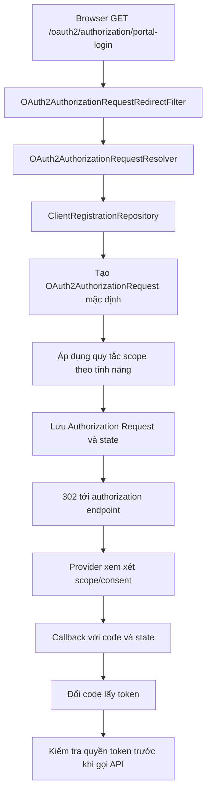
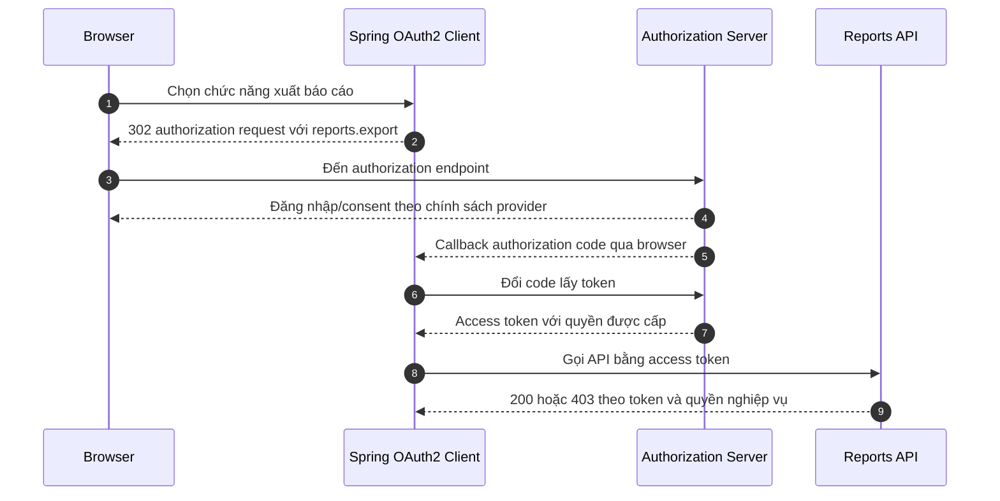
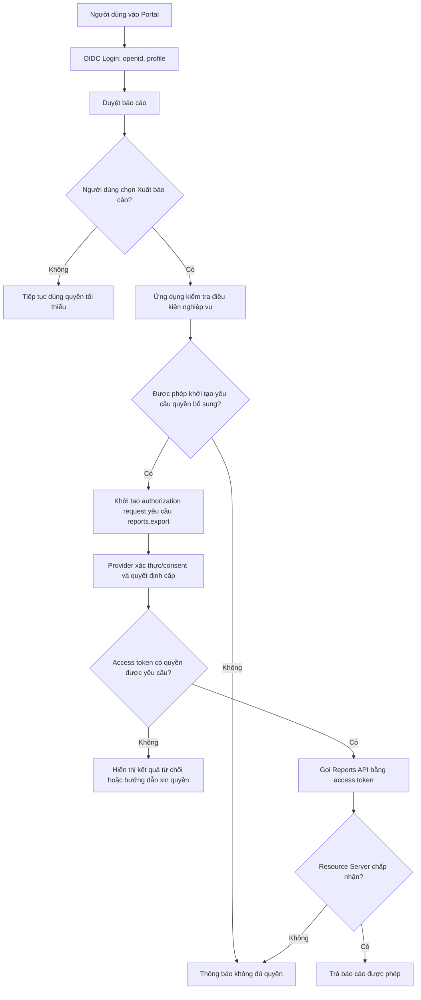

# 8.8. Tùy chỉnh scope theo nhu cầu nghiệp vụ

Trong Spring Security OAuth 2.0 / OpenID Connect (OIDC) Client, **scope** là một phần quan trọng của `OAuth2AuthorizationRequest`: ứng dụng khai báo những quyền hoặc nhóm dữ liệu mà nó muốn Authorization Server xem xét cấp cho client. Khi người dùng đăng nhập, scope thường được gửi trên yêu cầu chuyển hướng đến authorization endpoint. Tập scope hợp lý giúp ứng dụng nhận đúng thông tin cần thiết, giới hạn quyền truy cập của access token và tránh yêu cầu người dùng cấp quyền quá rộng.

Trong một ứng dụng thật, không phải mọi chức năng đều cần cùng quyền. Ví dụ, người dùng chỉ đăng nhập để xem trang cá nhân có thể cần `openid profile`, nhưng khi chủ động xuất báo cáo, ứng dụng mới cần yêu cầu `reports.export`. Bài này trình bày cách **thiết kế, cấu hình và tùy chỉnh scope theo nhu cầu nghiệp vụ** trong Spring Security OAuth2/OIDC Client, đặc biệt ở giai đoạn tạo Authorization Request cho luồng `authorization_code` trên Servlet.

## 1. Hiểu đúng phạm vi của scope

Trong OAuth 2.0, tham số `scope` là danh sách các chuỗi do Authorization Server và Resource Server định nghĩa. Trên authorization endpoint, chúng thường được biểu diễn thành một giá trị được phân cách bằng dấu cách:

```text
scope=openid profile reports.read
```

Khi đặt trong URL, khoảng trắng được URL-encode. Ví dụ:

```http
GET /authorize?response_type=code
    &client_id=portal-client
    &redirect_uri=https%3A%2F%2Fportal.example.org%2Flogin%2Foauth2%2Fcode%2Fportal-login
    &scope=openid%20profile%20reports.read
    &state=RANDOM_VALUE
```

Đoạn HTTP trên chỉ minh họa các tham số chính. Authorization Request thực tế còn có thể có `nonce`, tham số PKCE và những tham số riêng của provider.

| Khái niệm | Ý nghĩa |
|---|---|
| **Requested scopes** | Tập scope client **yêu cầu** trong Authorization Request. |
| **Granted scopes** | Tập scope Authorization Server thực sự **cấp**; có thể ít hơn tập đã yêu cầu. |
| **Client registration scopes** | Tập scope cấu hình mặc định cho một `ClientRegistration`. |
| **OAuth2AuthorizedClient** | Dữ liệu liên quan đến một client đã được cấp quyền: registration, principal, access token và có thể có refresh token. |
| **Access-token scopes** | Các quyền gắn với access token; Resource Server có thể dùng chúng để kiểm tra quyền truy cập. |
| **OIDC scopes** | Scope tiêu chuẩn như `openid`, `profile`, `email`, `address`, `phone`; tác động đến giao thức xác thực và các claims có thể được cung cấp. |

**Scope không đồng nghĩa với vai trò người dùng trong ứng dụng.** Ví dụ, scope `reports.export` có thể cho phép một client gọi API xuất báo cáo, nhưng API vẫn phải xác minh token, chủ thể và các quy tắc nghiệp vụ, chẳng hạn người dùng chỉ được xuất báo cáo của phòng ban mình. Việc client tự yêu cầu thêm scope không đồng nghĩa provider sẽ cấp, cũng không thể vượt qua chính sách phân quyền của Resource Server.

Trong OIDC, `openid` là scope đặc biệt báo hiệu yêu cầu xác thực theo giao thức OpenID Connect. `profile` hoặc `email` có thể yêu cầu claims bổ sung, nhưng không phải mọi provider đều trả về đầy đủ claim chỉ vì ứng dụng đã yêu cầu scope. Không nên coi `email` là một quyền API dùng chung cho mọi provider.

## 2. Từ nhu cầu nghiệp vụ đến tập scope

Thiết kế scope nên xuất phát từ **thao tác được phép thực hiện** và API thật sự được gọi, sau đó mới chuyển thành thông số kỹ thuật. Giả sử một cổng nhân viên có các chức năng:

| Tình huống nghiệp vụ | Scope có thể cần | Thời điểm yêu cầu | Lưu ý |
|---|---|---|---|
| Đăng nhập và hiển thị tên người dùng | `openid profile` | Đăng nhập ban đầu | `openid` cần cho OIDC; `profile` chỉ yêu cầu thông tin hồ sơ nếu cần. |
| Hiển thị email liên hệ | `openid email` | Khi giao diện cần email | Claim có thể vắng mặt; thiết kế xử lý trường hợp provider không trả về. |
| Xem báo cáo | `reports.read` | Khi kích hoạt tính năng xem báo cáo hoặc ngay từ login nếu bắt buộc | Scope tùy chỉnh do API/provider hỗ trợ; không phải scope chuẩn của OIDC. |
| Xuất dữ liệu nhạy cảm | `reports.export` | Khi người dùng thực hiện chức năng xuất | Cân nhắc cấp quyền theo nhu cầu; API vẫn kiểm tra quyền nghiệp vụ. |
| Đồng bộ dữ liệu ngoài phiên đăng nhập | `offline_access` hoặc cơ chế refresh do provider quy định | Chỉ khi có nhu cầu hợp lệ | Provider có thể yêu cầu consent và điều kiện riêng; scope không bảo đảm sẽ nhận refresh token. |
| Công việc máy tới máy | `inventory.read` với `client_credentials` | Khi backend xin access token dịch vụ | Không phải đăng nhập người dùng qua authorization endpoint. |

Tên `reports.read` và `reports.export` chỉ là ví dụ. Trong ứng dụng thật, danh sách và ý nghĩa scope phải được thống nhất với Authorization Server và Resource Server. Không tự tạo chuỗi scope tùy ý nếu provider chưa đăng ký hoặc không công nhận chúng.

### 2.1. Bốn câu hỏi thiết kế

1. **Ai đang thực hiện hành động?** Người dùng đang đăng nhập tương tác, hay một service đang gọi API bằng danh tính của chính client?
2. **API nào nhận access token?** Quyền trên một API không mặc nhiên có giá trị đối với API khác hoặc khác audience.
3. **Cần quyền ngay khi đăng nhập hay chỉ khi kích hoạt một tính năng?** Yêu cầu mọi scope ở lần login đầu có thể gây consent rộng và không phù hợp với nguyên tắc quyền tối thiểu.
4. **Provider có hỗ trợ yêu cầu thêm scope về sau không?** Một số provider hỗ trợ incremental authorization/consent, một số yêu cầu luồng cấp quyền mới hoặc cấu hình client riêng.

Các câu trả lời này quyết định nên dùng **scope cố định theo registration**, **nhiều registration**, hay **tùy chỉnh Authorization Request theo ngữ cảnh**.

## 3. Scope cấu hình mặc định bằng ClientRegistration

Trong Spring Boot, cách đơn giản nhất là khai báo scope trong `spring.security.oauth2.client.registration.<registrationId>.scope`.

```yaml
spring:
  security:
    oauth2:
      client:
        registration:
          portal-login:
            provider: company
            client-id: "${PORTAL_CLIENT_ID}"
            client-secret: "${PORTAL_CLIENT_SECRET}"
            authorization-grant-type: authorization_code
            client-authentication-method: client_secret_basic
            redirect-uri: "{baseUrl}/login/oauth2/code/{registrationId}"
            scope:
              - openid
              - profile
              - reports.read
        provider:
          company:
            issuer-uri: https://idp.example.org/realms/company
```

Với registration `portal-login`, người dùng có thể bắt đầu đăng nhập bằng URL mặc định:

```text
GET /oauth2/authorization/portal-login
```

Khi `oauth2Login()` được bật, Spring Security tìm `ClientRegistration` có ID `portal-login` rồi đưa scope đã cấu hình vào `OAuth2AuthorizationRequest`, sau đó chuyển hướng trình duyệt đến authorization endpoint của provider.

Cấu hình Servlet tối thiểu:

```java
import org.springframework.context.annotation.Bean;
import org.springframework.context.annotation.Configuration;
import org.springframework.security.config.Customizer;
import org.springframework.security.config.annotation.web.builders.HttpSecurity;
import org.springframework.security.web.SecurityFilterChain;

@Configuration
class SecurityConfig {

    @Bean
    SecurityFilterChain securityFilterChain(HttpSecurity http) throws Exception {
        http
            .authorizeHttpRequests(authorize -> authorize
                .requestMatchers("/", "/error").permitAll()
                .anyRequest().authenticated()
            )
            .oauth2Login(Customizer.withDefaults())
            .oauth2Client(Customizer.withDefaults());
        return http.build();
    }
}
```

`oauth2Login()` xây dựng flow đăng nhập với authorization-code redirect, còn `oauth2Client()` hỗ trợ những tình huống ứng dụng cần quản lý authorized client để gọi downstream API. Hai phần có thể được dùng cùng nhau.

Một controller không cần tự tạo authorization URL hoặc nối các chuỗi scope. `OAuth2AuthorizationRequestRedirectFilter` và `DefaultOAuth2AuthorizationRequestResolver` đảm nhiệm khởi tạo request theo registration.

### 3.1. Xem giá trị scope từ ClientRegistration

Sau khi Spring tạo repository từ cấu hình, có thể tra cứu registration:

```java
ClientRegistration registration =
        clientRegistrationRepository.findByRegistrationId("portal-login");

Set<String> scopes = registration.getScopes();
```

`ClientRegistration.getScopes()` cho biết **mặc định của client**, không chắc là scope thực sự đã được cấp trong token sau đăng nhập. Không dùng giá trị này làm bằng chứng rằng người dùng đã cấp quyền `reports.read`.

### 3.2. Khi nào scope cố định là đủ?

Scope cố định phù hợp khi mọi người dùng của một registration thực sự cần cùng quyền, chẳng hạn ứng dụng nội bộ luôn phải gọi API đọc hồ sơ và danh sách công việc sau khi đăng nhập. Cách này dễ triển khai, dễ quan sát và ít nhánh xử lý hơn.

Nếu chỉ một nhóm nhỏ người dùng cần quyền nhạy cảm như `reports.export`, yêu cầu scope đó ở mọi lần đăng nhập có thể không phù hợp. Khi đó cần cân nhắc cách phân tách theo chức năng.

## 4. Dùng nhiều ClientRegistration cho những nhóm quyền rõ ràng

Một lựa chọn dễ quản lý là khai báo các registration khác nhau, mỗi registration có tập scope riêng. Ví dụ:

```yaml
spring:
  security:
    oauth2:
      client:
        registration:
          portal-login:
            provider: company
            client-id: "${PORTAL_CLIENT_ID}"
            client-secret: "${PORTAL_CLIENT_SECRET}"
            authorization-grant-type: authorization_code
            scope: [openid, profile]
          portal-export:
            provider: company
            client-id: "${PORTAL_EXPORT_CLIENT_ID}"
            client-secret: "${PORTAL_EXPORT_CLIENT_SECRET}"
            authorization-grant-type: authorization_code
            scope: [openid, profile, reports.export]
        provider:
          company:
            issuer-uri: https://idp.example.org/realms/company
```

Hai registration cùng dùng một provider nhưng có thể có client ID, secret và quyền được đăng ký riêng. Mặc định:

```text
/oauth2/authorization/portal-login
/oauth2/authorization/portal-export
```

Khi chọn registration, Spring sử dụng tập scope tương ứng và redirect callback chứa `registrationId` của registration đã chọn. Nếu provider yêu cầu đăng ký callback rõ ràng, cần khai báo cả hai URI:

```text
https://portal.example.org/login/oauth2/code/portal-login
https://portal.example.org/login/oauth2/code/portal-export
```

Các điểm cần lưu ý:

- Một `registrationId` là khóa nội bộ trong repository; hai registration có thể trỏ tới cùng provider, nhưng cấu hình thực tế phải được provider chấp nhận.
- Đối với ứng dụng cần cấp quyền khác nhau thực sự, việc dùng **client registration riêng phía provider** có thể thuận lợi cho consent, audit và quyền tối thiểu.
- Cách nhiều registration giúp tách các `OAuth2AuthorizedClient` theo khóa registration, nhưng cần thiết kế trải nghiệm đăng nhập lại và lựa chọn token một cách rõ ràng.
- Chọn `portal-export` không thể thay cho kiểm tra quyền nghiệp vụ ở controller và Resource Server. Nếu người dùng không được phép xuất dữ liệu, API vẫn phải từ chối.

Nếu hai chức năng dùng chung một provider nhưng ứng dụng cần thêm scope theo nhiều ngữ cảnh nhỏ, tạo vô hạn registration có thể khiến cấu hình khó quản lý. Trường hợp đó có thể tùy chỉnh scope khi tạo từng Authorization Request.

## 5. Vị trí tùy chỉnh scope trong Authorization Request

Trong Servlet, quá trình khởi động OAuth2 Login đi qua:



Các đối tượng cần phân biệt:

| Thành phần | Trách nhiệm |
|---|---|
| `ClientRegistrationRepository` | Cung cấp cấu hình client, bao gồm default scopes. |
| `OAuth2AuthorizationRequestResolver` | Chọn registration và tạo Authorization Request từ HTTP request. |
| `DefaultOAuth2AuthorizationRequestResolver` | Resolver mặc định; có thể được bọc hoặc tùy chỉnh để bổ sung hành vi. |
| `OAuth2AuthorizationRequest` | Chứa authorization URI, grant request, scopes, `state`, redirect URI, các tham số và attributes. |
| `OAuth2AuthorizationRequestRepository` | Lưu request đã tạo để đối chiếu khi callback. |
| `OAuth2LoginAuthenticationFilter` | Xử lý callback, xác thực phản hồi và đổi code lấy token theo cơ chế của Spring Security. |
| `OAuth2AuthorizedClientManager` | Quản lý một client đã được ủy quyền và các lần lấy/làm mới token; không phải nơi mặc định thêm scope vào browser Authorization Request. |

Để tùy chỉnh scope ở giai đoạn trình duyệt bắt đầu đăng nhập, hãy can thiệp vào **Authorization Request Resolver** thay vì sửa thủ công header `Authorization` của request outbound.

## 6. Tùy chỉnh scope theo tính năng bằng AuthorizationRequestResolver

Giả sử cổng báo cáo có hai yêu cầu:

- Đăng nhập thông thường: `openid profile`.
- Khi người dùng chọn “Xuất báo cáo” và ứng dụng bắt đầu một luồng ủy quyền dành cho chức năng đó: thêm `reports.export`.

URL khởi động được dùng trong ví dụ:

```text
/oauth2/authorization/portal-login
/oauth2/authorization/portal-login?feature=export
```

Ta có thể bọc `DefaultOAuth2AuthorizationRequestResolver`. Resolver mặc định xây dựng request đầy đủ trước; lớp bọc chỉ điều chỉnh tập scope, giữ lại `state`, redirect URI, `nonce`, PKCE và các thuộc tính khác đã được Spring chuẩn bị.

### 6.1. Lớp resolver dành cho nghiệp vụ

```java
import jakarta.servlet.http.HttpServletRequest;
import java.util.LinkedHashSet;
import java.util.Set;
import org.springframework.security.oauth2.client.registration.ClientRegistrationRepository;
import org.springframework.security.oauth2.client.web.DefaultOAuth2AuthorizationRequestResolver;
import org.springframework.security.oauth2.client.web.OAuth2AuthorizationRequestResolver;
import org.springframework.security.oauth2.core.endpoint.OAuth2AuthorizationRequest;

public final class BusinessScopeAuthorizationRequestResolver
        implements OAuth2AuthorizationRequestResolver {

    private static final String START_URI =
            "/oauth2/authorization/portal-login";
    private static final String EXPORT_SCOPE = "reports.export";

    private final OAuth2AuthorizationRequestResolver delegate;

    public BusinessScopeAuthorizationRequestResolver(
            ClientRegistrationRepository registrations) {
        this.delegate = new DefaultOAuth2AuthorizationRequestResolver(
                registrations, "/oauth2/authorization");
    }

    @Override
    public OAuth2AuthorizationRequest resolve(HttpServletRequest request) {
        return customize(request, delegate.resolve(request));
    }

    @Override
    public OAuth2AuthorizationRequest resolve(
            HttpServletRequest request, String clientRegistrationId) {
        return customize(
                request, delegate.resolve(request, clientRegistrationId));
    }

    private OAuth2AuthorizationRequest customize(
            HttpServletRequest request,
            OAuth2AuthorizationRequest original) {

        if (original == null) {
            return null;
        }

        // Chỉ áp dụng cho điểm khởi tạo của registration mong muốn.
        if (!START_URI.equals(request.getServletPath())) {
            return original;
        }

        // Chỉ có một tính năng được cho phép mở rộng scope.
        if (!"export".equals(request.getParameter("feature"))) {
            return original;
        }

        Set<String> scopes = new LinkedHashSet<>(original.getScopes());
        scopes.add(EXPORT_SCOPE);

        return OAuth2AuthorizationRequest.from(original)
                .scopes(scopes)
                .build();
    }
}
```

Ví dụ này chủ động giới hạn phạm vi ở đường dẫn `portal-login` và chỉ chấp nhận lựa chọn `feature=export`; nó **không** đọc danh sách scope tùy ý từ query string. Việc dùng `request.getServletPath()` phù hợp với cấu hình servlet mapping mặc định của ví dụ. Nếu ứng dụng có servlet mapping tùy biến hoặc reverse proxy rewrite path, cần áp dụng cách so khớp đường dẫn tương ứng với thực tế.

`OAuth2AuthorizationRequest.from(original)` tạo builder từ request mặc định. Việc chỉ thay `scopes` giúp giữ lại các trường mà framework đã dựng, thay vì tạo request mới bằng tay và dễ làm mất tham số bảo vệ.

**Giới hạn bảo mật của ví dụ:** query parameter `feature` do browser gửi là dữ liệu không đáng tin. Demo chỉ cho phép yêu cầu **một scope đã liệt kê sẵn**; nó không chứng minh người dùng có quyền xuất báo cáo. Nếu việc yêu cầu scope đặc quyền cũng phải hạn chế theo người dùng, hệ thống cần kiểm tra điều kiện nghiệp vụ bằng thành phần phía server phù hợp, kiểm soát luồng khởi động và tiếp tục thực thi authorization tại API. Không xem query parameter là bằng chứng phân quyền.

### 6.2. Gắn resolver vào Spring Security Servlet

```java
import org.springframework.context.annotation.Bean;
import org.springframework.context.annotation.Configuration;
import org.springframework.security.config.annotation.web.builders.HttpSecurity;
import org.springframework.security.oauth2.client.registration.ClientRegistrationRepository;
import org.springframework.security.web.SecurityFilterChain;

@Configuration
class SecurityConfig {

    @Bean
    SecurityFilterChain securityFilterChain(
            HttpSecurity http,
            ClientRegistrationRepository registrations) throws Exception {

        var resolver =
                new BusinessScopeAuthorizationRequestResolver(registrations);

        http
            .authorizeHttpRequests(authorize -> authorize
                .requestMatchers("/", "/error").permitAll()
                .anyRequest().authenticated()
            )
            .oauth2Login(oauth2 -> oauth2
                .authorizationEndpoint(endpoint ->
                    endpoint.authorizationRequestResolver(resolver)
                )
            );

        return http.build();
    }
}
```

`authorizationEndpoint().authorizationRequestResolver(...)` thay resolver được dùng cho giai đoạn tạo redirect. Filter xử lý callback vẫn sử dụng flow đăng nhập của Spring Security. Không cần tự cài đặt token exchange hoặc đối chiếu `state`.

Lưu ý: hai code block trong mục 6 là các thành phần của **cùng một ví dụ**, còn những `SecurityFilterChain` ở mục trước là các cấu hình thay thế để minh họa cách tiếp cận khác nhau.

### 6.3. Liên kết trên giao diện

```html
<a href="/oauth2/authorization/portal-login">
    Đăng nhập thông thường
</a>

<a href="/oauth2/authorization/portal-login?feature=export">
    Tiếp tục với quyền xuất báo cáo
</a>
```

Đây là các liên kết điều hướng trình duyệt. Với luồng đăng nhập OIDC có redirect qua provider, không nên xử lý URL khởi động như một endpoint JSON mà frontend gọi bằng `fetch()` và mong nhận dữ liệu ngay.

Khi ứng dụng nằm dưới context path, cần tạo link có tính đến context path (chẳng hạn dùng URL expression của Thymeleaf). Khi đổi base URI trong `DefaultOAuth2AuthorizationRequestResolver` hoặc `authorizationEndpoint().baseUri(...)`, các link phải được cập nhật nhất quán.

### 6.4. Phạm vi cho phép và lựa chọn policy

Không nên triển khai kiểu:

```java
// KHÔNG NÊN: browser tự chọn mọi scope.
String raw = request.getParameter("scope");
Set<String> scopes = Set.of(raw.split(" "));
```

Cách này có thể đưa yêu cầu `admin`, `payments.write` hoặc scope nhạy cảm khác vào Authorization Request dù tính năng thực tế không cần. Có thể provider sẽ từ chối, nhưng một số cấu hình provider vẫn cho phép cấp quyền rộng; hơn nữa log, consent và hành vi ứng dụng sẽ khó kiểm soát.

Thay vào đó, định nghĩa danh sách scope ứng dụng hiểu và ánh xạ cố định từ tính năng:

```java
Map<String, Set<String>> featureScopes = Map.of(
    "view", Set.of("reports.read"),
    "export", Set.of("reports.export")
);
```

Chỉ áp dụng scope sau khi đã xác định registration hợp lệ và kiểm tra chính sách chức năng. Nếu scope chứa dấu cách, ký tự bất thường hoặc không nằm trong hợp đồng với provider, đừng chuyển tiếp trực tiếp từ input của người dùng.

## 7. Tùy biến ổn định bằng customizer

Trong trường hợp **mọi Authorization Request** của một registration đều phải thêm một tập scope đã biết trước, `DefaultOAuth2AuthorizationRequestResolver` cũng cung cấp `setAuthorizationRequestCustomizer(...)`. Ví dụ về ý tưởng:

```java
DefaultOAuth2AuthorizationRequestResolver resolver =
        new DefaultOAuth2AuthorizationRequestResolver(
                registrations, "/oauth2/authorization");

resolver.setAuthorizationRequestCustomizer(builder ->
        builder.scopes(scopes -> scopes.add("reports.read")));
```

Customizer nhận `OAuth2AuthorizationRequest.Builder`, thích hợp cho những điều chỉnh tĩnh về scope hoặc tham số authorization. Tuy nhiên:

- Callback này không trực tiếp nhận `HttpServletRequest`. Nếu cần biết một hành động mà người dùng vừa chọn qua HTTP request, việc bọc resolver như mục 6 thường giúp kiểm soát ngữ cảnh rõ hơn.
- Điều chỉnh theo nhiều provider cần bảo đảm scope tương thích với từng `ClientRegistration`; một customizer dùng chung có thể vô tình áp dụng scope của API A cho provider B.
- Khi thay thế customizer mặc định, cần hiểu tương tác với các tùy biến bảo mật như PKCE của phiên bản Spring Security đang dùng. Cách bọc Authorization Request đã được tạo như mục 6 giúp bảo toàn các tham số mặc định.
- Thêm scope tĩnh bằng YAML `ClientRegistration` thường là phương án đơn giản hơn nếu không có yêu cầu thực sự cần lập trình.

## 8. Authorization Request, consent và token được cấp

Thêm `reports.export` vào Authorization Request chỉ thay đổi **quyền được yêu cầu**. Diễn biến có thể là:



Provider có thể:

1. Cấp đầy đủ requested scopes.
2. Chỉ cấp một phần; ví dụ không cấp `reports.export` dù người dùng đã đăng nhập.
3. Yêu cầu người dùng đồng ý thêm quyền.
4. Từ chối authorization request vì `invalid_scope` hoặc chính sách client.
5. Áp dụng cơ chế incremental authorization/consent riêng.

Không suy luận quyền đã được cấp chỉ vì Authorization Request chứa scope mong muốn. Cần kiểm tra kết quả thực tế và để Resource Server kiểm tra quyền khi nhận bearer access token.

### 8.1. Phân biệt requested và granted scope trong mã

Sau khi có `OAuth2AuthorizedClient`, access token của client có thể cung cấp thông tin về scope được cấp:

```java
OAuth2AccessToken accessToken = authorizedClient.getAccessToken();
Set<String> grantedScopes = accessToken.getScopes();

if (!grantedScopes.contains("reports.export")) {
    // Không thực hiện giả định rằng client đã được cấp quyền xuất báo cáo.
}
```

Đây là một tín hiệu ở phía OAuth2 Client. Provider có thể có cách biểu diễn scope khác nhau, đặc biệt với opaque token hoặc token không cung cấp metadata đầy đủ. Phía Resource Server cần là nơi kiểm tra token và chính sách truy cập cuối cùng. Với token JWT, Resource Server có thể ánh xạ các claim scope theo chính sách của ứng dụng; không có một dạng claim bắt buộc giống nhau ở mọi provider.

### 8.2. Scope và OIDC claims

Scope `openid` kích hoạt luồng OIDC, trong đó client nhận ID Token theo giao thức nếu provider hỗ trợ và yêu cầu hợp lệ. `profile`, `email` có thể ảnh hưởng các claims từ ID Token hoặc UserInfo endpoint tùy nhà cung cấp.

Không nhầm:

- **ID Token**: xác nhận thông tin đăng nhập cho client (issuer, subject, audience và các điều kiện OIDC).
- **Access Token**: dùng để yêu cầu truy cập Resource Server.
- **Scope**: biểu đạt yêu cầu quyền hoặc nhóm claims, được provider xem xét cấp.

Không gửi ID Token thay access token khi gọi Reports API; cũng không coi scope `email` là quyền xuất báo cáo.

## 9. Quyền tăng dần sau đăng nhập: những giới hạn cần hiểu

Kịch bản phổ biến: người dùng đăng nhập bằng `openid profile`, sử dụng ứng dụng một lúc, rồi bấm “Xuất báo cáo”. Khi đó ứng dụng muốn xin thêm `reports.export` mà không luôn yêu cầu scope rộng lúc login đầu tiên.

Đây thường được gọi là **incremental authorization** hoặc xin thêm quyền theo thời điểm. Khả năng thực hiện phụ thuộc Authorization Server và thiết kế OAuth2 Client:

- Nếu provider hỗ trợ yêu cầu thêm scope, ứng dụng có thể bắt đầu một authorization-code flow mới với tập scope bổ sung.
- Provider có thể hiển thị consent hoặc yêu cầu đăng nhập lại; hành vi phụ thuộc chính sách SSO và `prompt`, `max_age` nếu có.
- Nếu dùng chung `registrationId`, authorized client lưu cho cùng principal có thể được cập nhật/thay thế theo kết quả authorization mới. Ứng dụng cần biết token nào đang dùng cho chức năng nào.
- `OAuth2AuthorizedClientManager` **không mặc nhiên** xin thêm scope mỗi khi controller cần một quyền mới. Nó thường sử dụng `ClientRegistration`, authorized client hiện có và các provider grant đã cấu hình để quản lý token.
- Refresh token thông thường **không tự mở rộng quyền** ngoài quyền đã được cấp. Muốn scope mới thường phải thực hiện một yêu cầu ủy quyền phù hợp với provider.
- Việc yêu cầu thêm scope mới không bảo đảm token đã nhận phù hợp với audience của Reports API. Scope, resource/audience và các điều kiện provider cần được kiểm tra cùng nhau.

Với ứng dụng phức tạp, tách registration theo tính năng hoặc tổ chức authorization-code flow riêng có thể làm rõ việc lưu token và consent hơn so với thay đổi scope trên cùng một registration ở mọi request.

### 9.1. Vì sao refresh token không thay thế luồng xin quyền mới?

Ví dụ sau khi đăng nhập, access token chỉ có `reports.read`. Ứng dụng đổi refresh token để lấy access token mới. Theo mô hình OAuth 2.0, yêu cầu refresh không nên mở rộng tập scope vượt quá quyền đã được cấp ban đầu. Nếu ứng dụng cần `reports.export` nhưng chưa được cấp, phải có cơ chế authorization mới được provider cho phép.

Không sửa thủ công `OAuth2AuthorizedClient` hoặc thêm `reports.export` vào đối tượng scope ở bộ nhớ rồi coi token đã có quyền đó. Quyền được quyết định ở phía phát hành/kiểm tra token, không phải bởi chuỗi được viết thêm ở Client.

## 10. Cân nhắc về Servlet session và nhiều lần Authorization Request

Trong Spring Security Servlet, Authorization Request thường được lưu vào `HttpSessionOAuth2AuthorizationRequestRepository` trước khi chuyển hướng. Callback dựa vào `state` để tìm lại request gốc và tiếp tục đổi authorization code.

Khi ứng dụng hỗ trợ nhiều cách khởi tạo authorization theo scope, các trường hợp sau cần được thiết kế cẩn thận:

| Tình huống | Vấn đề tiềm ẩn |
|---|---|
| Người dùng mở hai tab và bắt đầu hai lần OAuth2 Login song song | Repository/session và state cần đủ khả năng tương quan từng request; cách lưu tùy phiên bản/cấu hình. |
| Người dùng chọn “export” rồi đổi ý thành “view” trước callback | Các authorization request có scope khác nhau; không dựa vào UI hiện tại để suy luận scope của callback. |
| Load balancer gửi callback tới instance khác | Mất session hoặc Authorization Request nếu chưa có cơ chế lưu session dùng chung/phù hợp. |
| Callback sử dụng cookie session khác | Spring có thể không đối chiếu được `state` hoặc request đã lưu. |
| Ứng dụng lưu token của nhiều registration | Phải chọn đúng registration/principal khi gọi downstream API, tránh gửi token của tính năng khác. |

Không tắt kiểm tra `state`, không tự dùng chuỗi state cố định và không truyền quyền nghiệp vụ dưới dạng request parameter không được bảo vệ rồi coi đó là authorization đã được xác nhận.

Nếu cần đưa ngữ cảnh nghiệp vụ qua một lần redirect, ứng dụng nên dùng trạng thái phía server hoặc cơ chế có ràng buộc integrity và lifetime phù hợp, sau đó liên kết với Authorization Request/phiên người dùng. Không đặt dữ liệu nhạy cảm vào query parameter hay log URL redirect.

## 11. Phân biệt scope đăng nhập với scope cho service-to-service

Không phải mọi OAuth2 Client đều dùng `OAuth2AuthorizationRequestRedirectFilter`. Với `client_credentials`, ứng dụng xin token trực tiếp tại token endpoint để một service gọi service khác, không có người dùng nhập mật khẩu ở trang provider hoặc callback browser.

Ví dụ registration cho batch export:

```yaml
spring:
  security:
    oauth2:
      client:
        registration:
          reports-batch:
            provider: company
            client-id: "${BATCH_CLIENT_ID}"
            client-secret: "${BATCH_CLIENT_SECRET}"
            authorization-grant-type: client_credentials
            client-authentication-method: client_secret_basic
            scope:
              - reports.read
              - reports.export
        provider:
          company:
            token-uri: https://idp.example.org/realms/company/protocol/openid-connect/token
```

Với registration này:

- Scope là một phần của yêu cầu lấy token cho client credentials, theo cách provider và Spring Security hỗ trợ; không phải tham số trên URL `/oauth2/authorization/reports-batch`.
- Quyền được cấp cho danh tính client/service, không tự đại diện một người dùng cụ thể.
- Nên dùng `OAuth2AuthorizedClientManager` cùng mô hình lưu authorized client phù hợp với background job, chẳng hạn `AuthorizedClientServiceOAuth2AuthorizedClientManager` khi không có `HttpServletRequest`.
- Không đưa scope OIDC `openid` vào service-to-service chỉ vì cấu hình login tương tác cũng dùng chung provider.

Nếu API yêu cầu phân quyền theo người dùng cuối, dùng `client_credentials` thay cho authorization-code flow không tự giải quyết được yêu cầu đó.

## 12. Các lỗi thường gặp khi tùy chỉnh scope

| Triệu chứng | Nguyên nhân khả dĩ | Cách xử lý |
|---|---|---|
| Provider trả `invalid_scope` | Scope không tồn tại, client chưa được phép, cú pháp sai, hoặc grant type không hỗ trợ | Kiểm tra metadata/tài liệu provider và cấu hình scope phía Authorization Server. |
| Scope mới không xuất hiện trong redirect | Resolver chưa được gắn vào security chain, sai registration/path, customizer không chạy | Kiểm tra link khởi tạo, chain thực tế và giá trị tham số `scope` của Authorization Request. |
| Người dùng được yêu cầu consent nhiều hơn mong đợi | Mọi lần login đều xin scope rộng, hoặc provider cần consent cho scope mới | Rà soát mapping giữa chức năng và tập scope; ưu tiên yêu cầu khi thực sự cần. |
| Đăng nhập thành công nhưng API trả `403` | Provider không cấp scope, access token sai audience hoặc người dùng thiếu quyền nghiệp vụ | Đối chiếu granted scope, API đích và chính sách Resource Server. |
| Scope có nhưng ID Token thiếu email | Scope `email` không bảo đảm mọi claim luôn có mặt trong ID Token; provider có thể dùng UserInfo | Đọc contract OIDC của provider, xử lý claim thiếu và kiểm tra UserInfo khi thích hợp. |
| Thêm scope làm hỏng login OIDC | Vô tình loại bỏ `openid` hoặc làm mất tham số `nonce`/PKCE khi tự tạo request | Hợp nhất scope với tập gốc; bắt đầu từ `OAuth2AuthorizationRequest.from(original)`. |
| Quyền mới không có sau refresh token | Refresh không tăng scope đã được cấp trước đó | Khởi tạo authorization flow mới theo khả năng của provider. |
| Một tính năng nhận token của registration khác | Chọn sai registration khi lấy `OAuth2AuthorizedClient` hoặc dùng default client không phù hợp | Chỉ rõ registration/authorized client cho outbound call và kiểm tra API audience. |
| Link khởi động thay đổi nhưng resolver không chạy | Thay base URI một phía hoặc có nhiều security chains | Đồng bộ resolver base URI, link giao diện và `securityMatcher`. |
| Callback thất bại khi nhiều tab | Authorization Request hoặc session/state không được tương quan như mong đợi | Kiểm tra repository, state và cơ chế session; không bỏ validation. |

### 12.1. Gỡ lỗi theo đúng giai đoạn

Nên tách ba câu hỏi:

1. **Authorization Request đã yêu cầu những scope nào?** Quan sát `scope` trên URL redirect từ client tới provider trong môi trường kiểm thử; tránh công bố `state`, code hoặc cookie session.
2. **Provider đã cấp quyền nào?** Xem token response và metadata token thông qua cơ chế an toàn, hoặc cách provider cung cấp introspection/claims phù hợp.
3. **Resource Server thực sự kiểm tra điều gì?** Scope chỉ là một phần; API còn có thể kiểm tra issuer, audience, subject, tổ chức, vai trò và các ràng buộc nghiệp vụ.

Ba tập thông tin này có thể khác nhau. Đừng sửa code custom resolver nếu `scope` trong redirect đã chính xác nhưng provider từ chối quyền.

## 13. Một luồng nghiệp vụ hoàn chỉnh: xuất báo cáo khi cần

Giả sử hệ thống có Portal Web, Corporate IdP và Reports API. Yêu cầu nghiệp vụ là phần lớn nhân viên chỉ cần xem báo cáo; chức năng xuất báo cáo có dữ liệu nhạy cảm và phải được phê duyệt riêng.



Các bước triển khai thực tế:

1. **Đăng nhập cơ bản:** cấu hình `portal-login` với `openid profile`, hạn chế các scope không bắt buộc.
2. **Định nghĩa quyền:** thống nhất với Reports API rằng `reports.export` là scope được provider công nhận, và định nghĩa rõ quyền nghiệp vụ ngoài scope.
3. **Chọn thời điểm:** khi người dùng bấm chức năng xuất, quyết định có nên bắt đầu authorization mới hoặc dùng một registration riêng theo thiết kế của provider.
4. **Tạo Authorization Request:** áp dụng allowlist và giữ `state`, `nonce`, PKCE cùng các thuộc tính gốc.
5. **Xử lý kết quả:** nếu provider không cấp quyền bổ sung, trình bày thông báo phù hợp; không thử bỏ scope validation hoặc dùng token từ luồng khác.
6. **Gọi API:** chọn đúng `OAuth2AuthorizedClient` và gửi access token tới Reports API; tại API, xác minh token và kiểm tra quyền với chính đối tượng báo cáo.
7. **Quan sát vận hành:** theo dõi `registrationId`, feature code và mã lỗi đã được làm sạch, không ghi access token, refresh token, authorization code hoặc secret vào log.

Trong hệ thống này, scope kiểm soát **quyền client xin và được cấp**, còn quyền xuất một báo cáo cụ thể vẫn cần được bảo vệ bởi policy nghiệp vụ của API. Cách phân chia đó tránh tình huống một token có `reports.export` bị xem như quyền xuất mọi dữ liệu của mọi phòng ban.

## 14. Thực hành kiểm tra luồng

Khi có môi trường kiểm thử với Authorization Server, có thể quan sát hai trường hợp:

**Luồng A – Đăng nhập thông thường**

```text
GET /oauth2/authorization/portal-login
=> 302 Location: https://idp.example.org/...&scope=openid%20profile&state=...
```

**Luồng B – Người dùng chọn tính năng export**

```text
GET /oauth2/authorization/portal-login?feature=export
=> 302 Location: https://idp.example.org/...&scope=openid%20profile%20reports.export&state=...
```

Đây là kết quả minh họa mong đợi khi áp dụng các ví dụ cấu hình tương ứng, không phải cam kết provider sẽ cấp toàn bộ scope. Thứ tự chuỗi scope trong URL có thể khác mà không đổi ý nghĩa tập scope.

Khi phân tích các lần chạy, cần chú ý:

- Bước khởi động thuộc `OAuth2AuthorizationRequestRedirectFilter` và trả redirect; đừng chờ token ngay tại endpoint này.
- Provider có quyền từ chối hoặc yêu cầu consent; phản hồi token có thể thể hiện scope được cấp khác với scope được yêu cầu.
- Spring Security cần giữ trạng thái giữa request khởi tạo và callback để kiểm tra `state`.
- Sau login, API downstream phải kiểm tra access token và chính sách quyền tương ứng.
- Các ví dụ `feature=export` minh họa custom request; trong production cần bảo vệ quyền nghiệp vụ và dùng nguồn quyết định tính năng đáng tin cậy.

## 15. Câu hỏi ôn tập

1. Tại sao scope trong `ClientRegistration` chưa chứng minh rằng access token thực sự có quyền tương ứng?
2. `openid`, `profile` và `reports.export` khác nhau về mục đích như thế nào?
3. Khi nào scope cố định trong YAML là đủ, và khi nào nên dùng registration riêng cho một chức năng?
4. Vì sao không nên lấy nguyên `scope` từ query parameter của browser rồi đưa vào Authorization Request?
5. `DefaultOAuth2AuthorizationRequestResolver` và `OAuth2AuthorizationRequestRedirectFilter` phối hợp thế nào để gửi scope đến provider?
6. Vì sao cách tạo request bằng `OAuth2AuthorizationRequest.from(original)` phù hợp hơn việc tự dựng mới toàn bộ request chỉ để thêm scope?
7. Nếu người dùng đã có access token `reports.read`, tại sao refresh token không tự giúp nhận thêm `reports.export`?
8. Provider đã cấp `reports.export` nhưng Reports API vẫn trả 403; cần kiểm tra thêm những yếu tố nào?
9. Trong ứng dụng nhiều provider, thêm scope cho mọi request bằng một customizer chung có rủi ro gì?
10. Có nên dùng endpoint `/oauth2/authorization/{registrationId}` để lấy token cho `client_credentials` không? Vì sao?

## Tài liệu tham khảo

- [Spring Security Reference — OAuth2 Login, Core Configuration (Servlet)](https://docs.spring.io/spring-security/reference/servlet/oauth2/login/core.html)
- [Spring Security Reference — OAuth2 Login, Advanced Configuration (Servlet)](https://docs.spring.io/spring-security/reference/servlet/oauth2/login/advanced.html)
- [Spring Security Reference — OAuth2 Client (Servlet)](https://docs.spring.io/spring-security/reference/servlet/oauth2/client/index.html)
- [Spring Security API — DefaultOAuth2AuthorizationRequestResolver](https://docs.spring.io/spring-security/reference/api/java/org/springframework/security/oauth2/client/web/DefaultOAuth2AuthorizationRequestResolver.html)
- [Spring Security API — OAuth2AuthorizationRequest](https://docs.spring.io/spring-security/reference/api/java/org/springframework/security/oauth2/core/endpoint/OAuth2AuthorizationRequest.html)
- [RFC 6749 — OAuth 2.0 Authorization Framework, Scope](https://datatracker.ietf.org/doc/html/rfc6749#section-3.3)
- [OpenID Connect Core 1.0 — Scope Values](https://openid.net/specs/openid-connect-core-1_0.html#ScopeClaims)
