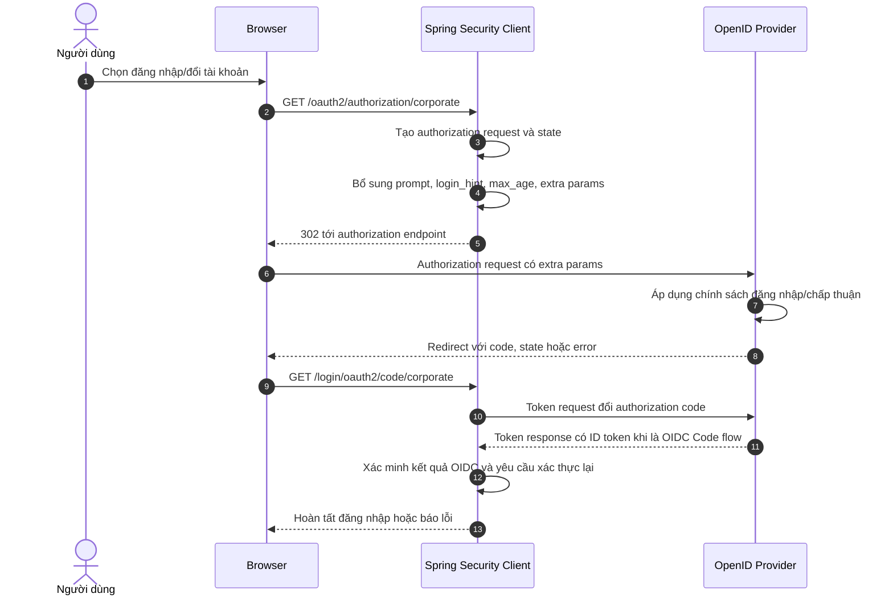

# 8.9. Thêm prompt, login_hint, max_age và tham số riêng của provider

> **Module:** Spring Security OAuth 2.0 OIDC Client  
> **Chương:** 8. Authorization Request  
> **Phạm vi:** Ứng dụng Spring Boot dùng Spring Security OAuth 2.0/OIDC Client trên Servlet stack, khởi tạo Authorization Code flow thông qua trình duyệt và tùy chỉnh tham số gửi đến Authorization Server/OpenID Provider (OP).

Một ứng dụng dùng `oauth2Login()` thường bắt đầu đăng nhập bằng đường dẫn `/oauth2/authorization/{registrationId}`. Spring Security tạo authorization request với `client_id`, `redirect_uri`, `response_type`, `scope`, `state` và các thông số bảo vệ cần thiết. Trong nhiều tình huống sản phẩm, cấu hình mặc định chưa đủ: ứng dụng muốn yêu cầu người dùng chọn tài khoản, xác thực lại trước khi thao tác nhạy cảm, gợi ý tên đăng nhập đã biết hoặc điều hướng đến một nhà cung cấp danh tính cụ thể trong hệ thống SSO.

OAuth 2.0 và OpenID Connect hỗ trợ mở rộng authorization request để đáp ứng các tình huống đó. Bốn nhóm mà bài này tập trung là:

- **`prompt`:** đề nghị OP điều khiển cách tương tác với người dùng.
- **`login_hint`:** gợi ý tài khoản mà người dùng có thể định dùng.
- **`max_age`:** yêu cầu độ mới tối đa của lần xác thực người dùng tại OP.
- **Tham số riêng của provider:** chẳng hạn `hd` ở Google, `kc_idp_hint` ở Keycloak hoặc các tùy chọn được nhà cung cấp công bố.

Phải phân biệt **tham số được gửi đi**, **cách OP có thể diễn giải**, và **điều kiện ứng dụng phải kiểm tra sau khi nhận kết quả**. Chỉ thêm query parameter không đảm bảo nhà cung cấp đáp ứng mọi yêu cầu hay tự tạo ra bằng chứng xác thực đủ mạnh.

## 1. Mục tiêu học tập

Sau bài học, bạn có thể:

1. Chỉ ra vị trí của authorization request trong Authorization Code và OIDC login flow.
2. Diễn giải các giá trị `prompt=login`, `prompt=consent`, `prompt=select_account`, `prompt=none` cùng các giới hạn tương tác.
3. Biết khi nào `login_hint` hữu ích, tại sao đây chỉ là gợi ý và cần bảo vệ dữ liệu cá nhân như thế nào.
4. Dùng `max_age` để yêu cầu xác thực gần đây, phân biệt nó với thời hạn access token, ID token và phiên của ứng dụng.
5. Nhận diện yêu cầu OIDC đối với claim `auth_time` khi gửi `max_age`, đồng thời xác định phần xác minh mà ứng dụng phải bảo đảm.
6. Thêm các tham số bằng `DefaultOAuth2AuthorizationRequestResolver` và `OAuth2AuthorizationRequest.Builder.additionalParameters(...)`.
7. Đặt chính sách tham số theo `registrationId` mà không vô tình gửi tùy chọn của nhà cung cấp A sang nhà cung cấp B.
8. Giữ nguyên `state`, OIDC `nonce`, PKCE và thông tin callback do Spring Security quản lý.
9. Quan sát, xử lý lỗi và thử các trường hợp OP không hỗ trợ tham số, yêu cầu tương tác sai hoặc chính sách xác thực lại chưa được đáp ứng.

## 2. Authorization request nằm ở đâu?

Trong Authorization Code flow, **authorization request** là yêu cầu trình duyệt gửi đến authorization endpoint của nhà cung cấp. Nó xuất hiện **trước** khi Client nhận authorization code và trước khi Client đổi code lấy token.

Ví dụ URL được giải thích theo dạng dễ đọc, không phải URL thực có thể dán vào trình duyệt:

```text
GET https://login.example.test/authorize
    ?response_type=code
    &client_id=portal-web
    &redirect_uri=https%3A%2F%2Fapp.example.test%2Flogin%2Foauth2%2Fcode%2Fcorporate
    &scope=openid%20profile%20email
    &state=<generated-state>
    &prompt=select_account
    &login_hint=user%40example.test
    &max_age=300
```

Những giá trị như `state`, `nonce` hoặc PKCE `code_challenge` có thể được Spring Security sinh ra và liên kết với giao dịch. Ví dụ trên chỉ hiển thị ba tham số cần học; trong một giao dịch OIDC thực tế có thể còn các tham số khác.

Tổng quan luồng:



**Không nhầm ba loại request:** authorization request đi qua trình duyệt tới authorization endpoint; token request đi từ Client tới token endpoint; request tới Resource Server mang access token. Những tham số `prompt` và `max_age` là tham số của **OIDC authentication/authorization request**, không phải header dùng gọi API.

### 2.1. Phân nhóm các tham số

| Loại | Ví dụ | Ai thường quản lý? |
|---|---|---|
| OAuth 2.0 cốt lõi | `response_type`, `client_id`, `redirect_uri`, `scope`, `state` | Spring Security dựa trên ClientRegistration |
| Bảo vệ luồng | PKCE `code_challenge`, `code_challenge_method`; OIDC `nonce` | Spring Security và cấu hình Client |
| OIDC authentication request | `prompt`, `login_hint`, `max_age`, `acr_values`, `ui_locales` | Client thêm theo chính sách, OP diễn giải |
| Tham số đặc thù nhà cung cấp | `hd`, `kc_idp_hint`, `access_type`, ... | Theo hợp đồng và tài liệu của provider |

Trong Spring Security, các giá trị OIDC mở rộng và tham số provider thường được thêm vào **`additionalParameters`** của `OAuth2AuthorizationRequest`. Trường `attributes` của authorization request dùng cho dữ liệu nội bộ của ứng dụng/framework; không nên nhầm nó với query parameters sẽ được gửi tới OP.

## 3. prompt: yêu cầu cách OP tương tác với người dùng

`prompt` là tham số tùy chọn được OIDC chuẩn hóa. Nó gồm một hoặc nhiều giá trị phân tách bằng dấu cách; OP áp dụng tùy ngữ nghĩa của giá trị và trạng thái hiện tại của phiên.

Các giá trị chính trong OIDC Core:

| Giá trị | Mục đích | Tình huống |
|---|---|---|
| `login` | Yêu cầu OP xác thực lại người dùng | Trước thao tác nhạy cảm hoặc muốn bắt đầu một lần login mới |
| `consent` | Yêu cầu hiển thị tương tác xin chấp thuận | Người dùng cần xem/cho phép lại quyền theo chính sách OP |
| `select_account` | Yêu cầu giao diện cho người dùng chọn tài khoản | Trình duyệt có nhiều tài khoản/phiên ở cùng OP |
| `none` | Không hiển thị giao diện xác thực hay chấp thuận | Thử kiểm tra phiên hiện có mà không làm gián đoạn UI |

Ví dụ:

```text
prompt=select_account
prompt=login
prompt=login consent
prompt=none
```

**Quy tắc quan trọng:** `none` **không được dùng cùng các giá trị khác**. Không tạo `prompt=none login` hoặc `prompt=none consent`. Nếu OP cần tương tác để hoàn tất yêu cầu `prompt=none`, nó trả về lỗi OIDC thích hợp chứ không được tự hiển thị giao diện tương tác.

### 3.1. prompt=login

Khi có phiên SSO sẵn ở OP, một lần chuyển hướng tới OP có thể diễn ra rất nhanh và người dùng không nhìn thấy màn hình đăng nhập. `prompt=login` yêu cầu OP **xác thực lại** thay vì chỉ sử dụng phiên hiện hữu.

Tuy nhiên, hành vi chi tiết tùy OP, phương thức xác thực, chính sách SSO và khả năng tuân thủ. Nếu ứng dụng cần chứng minh người dùng đã xác thực gần đây cho tác vụ nhạy cảm, chỉ thấy request chứa `prompt=login` **không đủ**. Cần nhận một kết quả có bằng chứng thời điểm xác thực phù hợp và thực thi chính sách kiểm tra tại Client (xem mục `max_age` và `auth_time`).

Một bước xác thực lại có thể khác với yêu cầu nhập mật khẩu: OP có thể dùng passkey, MFA hoặc phương thức tương đương theo chính sách.

### 3.2. prompt=consent

`prompt=consent` đề nghị OP hiển thị tương tác xin chấp thuận. Nó hữu ích khi người dùng cần xem lại quyền mà ứng dụng yêu cầu, hoặc khi nhà cung cấp yêu cầu consent trước khi cấp một số loại quyền/token.

Không nên suy ra rằng `prompt=consent`:

- luôn trả về refresh token;
- cấp thêm scope mà Client chưa được cấp;
- bỏ qua chính sách giới hạn refresh token của OP;
- thay thế yêu cầu xác thực lại người dùng.

Một số nhà cung cấp cần tham số riêng, cấu hình client hoặc chính sách consent riêng. Hãy đọc tài liệu của OP đang triển khai.

### 3.3. prompt=select_account

`prompt=select_account` yêu cầu OP đưa ra cơ chế chọn tài khoản nếu có. Đây là trường hợp phù hợp khi người dùng có thể đăng nhập nhiều tài khoản cùng OP hoặc muốn đổi từ tài khoản cá nhân sang tài khoản công việc.

Việc chọn tài khoản là **tương tác tại OP**. Client vẫn phải xác minh ID token và ánh xạ danh tính theo `iss`/`sub`; tên tài khoản hiển thị trên giao diện không thay việc kiểm tra token.

Nếu người dùng muốn chuyển tài khoản trong chính ứng dụng, cần cân nhắc cả phiên ứng dụng hiện tại và phiên SSO tại OP. Chỉ thêm `prompt=select_account` không tự xóa session web hoặc liên kết tài khoản cũ.

### 3.4. prompt=none

`prompt=none` yêu cầu OP không hiển thị UI. Nếu không có phiên phù hợp, cần chấp thuận mới hoặc cần người dùng chọn tài khoản, OP có thể trả lỗi như:

- `login_required`;
- `consent_required`;
- `interaction_required`;
- `account_selection_required`.

Các error codes cụ thể và lúc phát sinh phụ thuộc tình huống. Client phải xử lý callback lỗi, đối chiếu `state`, và cho người dùng thực hiện luồng tương tác khi phù hợp.

**Tránh vòng lặp đăng nhập:** nếu OP trả `login_required` cho `prompt=none`, đừng tự chuyển lại `prompt=none` vô hạn. Thiết kế nhánh rõ ràng từ thử yên lặng sang một lần đăng nhập tương tác.

Các trình duyệt và chính sách cookie hiện đại có thể giới hạn kỹ thuật silent authentication trong iframe hoặc third-party cookie context. Không xây dựng trải nghiệm sản phẩm chỉ dựa vào giả định `prompt=none` lúc nào cũng thành công.

## 4. login_hint: gợi ý danh tính, không phải xác thực danh tính

`login_hint` là tham số OIDC tùy chọn, cho phép Client cung cấp gợi ý về người dùng dự kiến đăng nhập. OP có thể sử dụng giá trị này để điền sẵn tên tài khoản, chọn màn hình phù hợp hoặc định tuyến quá trình đăng nhập.

Ví dụ:

```text
login_hint=staff.member@example.test
```

**Ý nghĩa:** “Nếu có ích, hãy dùng gợi ý này trong trải nghiệm đăng nhập.”  
**Không có nghĩa:** “Người dùng này đã được xác thực”, “hãy cấp ID token có `sub` tương ứng” hoặc “bỏ qua xác minh mật khẩu/MFA”.

### 4.1. Những tình huống phù hợp

- Ứng dụng đã biết một tên đăng nhập do người dùng cung cấp ở bước trước, muốn tránh yêu cầu nhập lại.
- Người dùng đã được xác thực ở một hệ thống khác trong luồng chuyển tiếp đáng tin và được đưa sang OP.
- Hệ thống có nhiều tài khoản và muốn gợi ý tài khoản phù hợp mà vẫn để OP quyết định.
- Một trang đăng nhập tổ chức muốn gợi ý tên tài khoản đã được người dùng chọn.

OP có thể bỏ qua, diễn giải khác hoặc dùng một loại identifier thay email. Do đó, tên đăng nhập được chuyển phải theo hợp đồng provider đang dùng.

### 4.2. Cẩn trọng với dữ liệu cá nhân trong URL

`login_hint` thường đi trên authorization URL. Dù dùng HTTPS, URL vẫn có thể xuất hiện trong browser history, telemetry, reverse proxy/access logs, monitoring hoặc thông tin điều hướng. Vì vậy:

1. Chỉ gửi gợi ý thực sự cần thiết.
2. Tránh mã định danh nhạy cảm như số giấy tờ, thông tin y tế hoặc dữ liệu không liên quan.
3. Không đưa access token, ID token, mật khẩu, client secret hoặc mã phiên vào `login_hint`.
4. Không ghi lại raw authorization URL vào log dùng chung.
5. Nếu nhận gợi ý từ HTTP request, kiểm tra nguồn, định dạng, độ dài và không dùng nó như căn cứ cấp quyền.
6. Cho người dùng đổi tài khoản nếu OP hỗ trợ; không ép danh tính chỉ dựa trên gợi ý.

**Quy tắc thiết kế:** ứng dụng chỉ chấp nhận người dùng đã đăng nhập sau khi hoàn thành xử lý OIDC và xác minh ID token phù hợp, bất kể giá trị `login_hint`.

## 5. max_age: giới hạn thời gian kể từ lần xác thực ở OP

`max_age` là tham số chuẩn OIDC, biểu diễn **số giây tối đa có thể chấp nhận kể từ lần xác thực chủ động cuối cùng của người dùng tại OP**.

Ví dụ:

```text
max_age=300    # yêu cầu xác thực không cũ quá 5 phút
max_age=0      # yêu cầu OP chủ động xác thực lại
```

Giá trị phải là số giây không âm theo giao thức. Không đặt `max_age=5m`, `max_age=-1` hoặc một timestamp tuyệt đối. Trong ví dụ URL thực, chỉ gửi chuỗi số như `300`.

### 5.1. Phân biệt max_age với thời hạn token và session

| Thành phần | Diễn giải |
|---|---|
| `max_age` | Điều kiện về **độ mới của lần xác thực tại OP** khi xử lý yêu cầu OIDC |
| ID token `exp` | Thời điểm hết hạn **ID token** |
| Access token `expires_in`/`exp` | Thời gian có hiệu lực của **access token** |
| HTTP session timeout | Bao lâu ứng dụng web duy trì trạng thái phiên theo chính sách |
| `auth_time` | Thời điểm OP cho biết người dùng đã xác thực |

Ví dụ OP cấp ID token còn hiệu lực 60 phút nhưng người dùng xác thực từ 2 giờ trước. Một yêu cầu mới có `max_age=300` không được coi là đạt chính sách chỉ vì token mới có `exp` ở tương lai. Ngược lại, access token API hết hạn không tự có nghĩa cần yêu cầu người dùng xác thực lại tại OP.

### 5.2. Quan hệ giữa max_age và auth_time

Theo OIDC Core, khi Client yêu cầu `max_age`, OP **phải đưa claim `auth_time` vào ID token**. Claim này dùng định dạng NumericDate (số giây Unix epoch).

Ví dụ payload minh họa:

```json
{
  "iss": "https://login.example.test",
  "sub": "user-42",
  "aud": "web-client",
  "iat": 1893453000,
  "exp": 1893456600,
  "auth_time": 1893452760
}
```

Ở ví dụ này, thời gian giữa `iat` và `auth_time` là 240 giây. Nếu Client yêu cầu `max_age=300` và thời gian kiểm tra không vượt quá 300 giây kể từ `auth_time` (sau khi tính clock skew hợp lý), thông tin trên có thể phù hợp với yêu cầu độ mới. Đây chỉ là payload minh họa; Client phải xác minh chữ ký, issuer, audience, thời hạn và các điều kiện OIDC trước khi tin claim.

**Với thao tác nhạy cảm**, Client nên kiểm tra rõ:

- ID token hợp lệ theo OIDC.
- Có `auth_time` khi đã yêu cầu `max_age`.
- `auth_time` là một NumericDate hợp lệ, không bất thường ở tương lai.
- Độ lệch giữa thời điểm hiện tại đáng tin cậy và `auth_time` nằm trong ngưỡng chính sách, cho phép clock skew nhỏ khi cần.
- Quyền và mức bảo đảm cần thiết cho thao tác vẫn được kiểm tra độc lập.

Đừng giả định rằng mọi phiên bản/thư viện/framework tự xác nhận chính sách nghiệp vụ về `auth_time` chỉ vì authorization request đã chứa `max_age`. Kiểm tra rõ khả năng mặc định của phiên bản Spring Security đang dùng; nếu cần, bổ sung validation/policy tại điểm phù hợp sau khi ID token đã được xác minh.

### 5.3. max_age=0 và prompt=login có thay thế nhau không?

Cả hai có thể khiến OP yêu cầu người dùng xác thực lại, nhưng khác ngữ nghĩa và bằng chứng đầu ra:

| Cấu hình | Mục tiêu chính | Dữ liệu nên kiểm tra |
|---|---|---|
| `prompt=login` | Đề nghị OP đưa người dùng qua xác thực lại | Hành vi OP và yêu cầu xác thực thực tế; `auth_time` nếu chính sách cần bằng chứng độ mới |
| `max_age=0` | Yêu cầu OP chủ động xác thực lại theo quy tắc OIDC | OP phải có `auth_time`; Client kiểm tra tính hợp lệ và độ mới |
| `prompt=login&max_age=0` | Kết hợp yêu cầu UI/xác thực lại với điều kiện độ mới | Kiểm tra ID token và `auth_time` để chứng minh phù hợp |

Không nên dùng `prompt=login` một mình như bằng chứng máy đọc được rằng xác thực lại đã xảy ra vào đúng thời điểm cần thiết. Nếu ứng dụng có policy “MFA trong 5 phút gần nhất”, chỉ `max_age` cũng chưa đủ để xác định **phương thức/MFA** đã dùng; cần cơ chế assurance phù hợp, ví dụ `acr_values` hoặc claim `acr`/`amr` theo hợp đồng OP và chính sách tin cậy.

## 6. Tham số OIDC chuẩn khác và tham số riêng provider

Các request tùy chỉnh có thể mang thêm:

| Tham số | Loại | Mục đích | Giới hạn cần nhớ |
|---|---|---|---|
| `ui_locales` | OIDC chuẩn | Gợi ý ngôn ngữ giao diện OP theo mã BCP 47, ví dụ `vi en` | OP có thể bỏ qua hoặc dùng ngôn ngữ khác |
| `acr_values` | OIDC chuẩn | Yêu cầu các Authentication Context Class Reference theo thứ tự ưu tiên | OP hỗ trợ khác nhau; phải kiểm tra kết quả `acr` theo policy |
| `id_token_hint` | OIDC chuẩn | Gợi ý phiên/danh tính đã biết cho một số luồng | Phải đúng quy tắc OIDC; không đưa token tùy ý vào URL |
| `hd` | Google-specific | Gợi ý Google Workspace/hosted domain | **Không phải kiểm tra quyền**; cần xác minh claim/provider policy ở kết quả |
| `kc_idp_hint` | Keycloak-specific | Gợi ý identity provider trong luồng broker của Keycloak | Chỉ có ý nghĩa khi realm/broker được cấu hình và hỗ trợ |
| `access_type=offline` | Google-specific OAuth2 | Xin khả năng truy cập offline theo chính sách Google | Không bảo đảm luôn nhận refresh token; chịu điều kiện consent và provider |
| `domain_hint` | Một số provider cụ thể | Gợi ý domain/tenant, có thể ảnh hưởng account discovery | Tùy provider, không được dùng thay kiểm tra issuer/tenant |

**Không có bảng tham số dùng cho mọi provider**. Một tham số hợp lệ với Keycloak có thể bị Google bỏ qua; một tham số của Google có thể làm provider khác báo `invalid_request`. Dùng tài liệu của phiên bản IdP/realm/tenant thực tế và cấu hình theo từng `registrationId`.

### 6.1. Ví dụ Google hd

Trong một ứng dụng đăng nhập bằng Google Workspace, có thể thêm:

```text
hd=example.com
```

Điều này gợi ý Google ưu tiên tài khoản thuộc hosted domain. **Không được** dựa vào việc đã gửi `hd` để kết luận người dùng thực sự thuộc tổ chức. Nếu chính sách chỉ cho phép domain đó, cần kiểm tra thông tin danh tính mà Google xác nhận theo hướng dẫn của provider, cùng chính sách quản lý thành viên nội bộ. Chỉ kiểm tra email kết thúc bằng `@example.com` cũng có thể chưa đủ cho mô hình tổ chức/tenant đang sử dụng.

### 6.2. Ví dụ Keycloak kc_idp_hint

Một realm Keycloak có thể kết nối nhiều Identity Providers (broker). Tham số:

```text
kc_idp_hint=partner-oidc
```

có thể yêu cầu Keycloak ưu tiên chuyển sang nhà cung cấp danh tính tên `partner-oidc` đã đăng ký ở realm. Tên alias này thuộc cấu hình Keycloak và phải tồn tại thực tế. Nó không thay thế xác minh token, không tự cấp role và không bắt buộc áp dụng cho mọi phiên bản/phương thức đăng nhập.

### 6.3. Phân biệt hint với yêu cầu bắt buộc

Các tham số có từ “hint” là dấu hiệu quan trọng: chúng mô tả mong muốn của Client, không trực tiếp là chính sách ủy quyền của Resource Server. Nếu yêu cầu bảo mật là “người dùng phải thuộc tenant A và đã xác thực bằng MFA”, ứng dụng phải có **kết quả xác thực đáng tin và kiểm tra policy** sau login.

## 7. Spring Security tạo authorization request mặc định thế nào?

Với cấu hình Servlet:

```java
import org.springframework.context.annotation.Bean;
import org.springframework.context.annotation.Configuration;
import org.springframework.security.config.Customizer;
import org.springframework.security.config.annotation.web.builders.HttpSecurity;
import org.springframework.security.web.SecurityFilterChain;

@Configuration
class SecurityConfig {

    @Bean
    SecurityFilterChain securityFilterChain(HttpSecurity http) throws Exception {
        return http
            .authorizeHttpRequests(auth -> auth
                .requestMatchers("/", "/error").permitAll()
                .anyRequest().authenticated()
            )
            .oauth2Login(Customizer.withDefaults())
            .build();
    }
}
```

Cùng một `ClientRegistration` có thể có các thông số:

```yaml
spring:
  security:
    oauth2:
      client:
        registration:
          corporate:
            provider: corporate
            client-id: web-client
            client-secret: ${OIDC_CLIENT_SECRET}
            authorization-grant-type: authorization_code
            redirect-uri: "{baseUrl}/login/oauth2/code/{registrationId}"
            scope: [openid, profile, email]
        provider:
          corporate:
            issuer-uri: https://login.example.test/realms/staff
```

Khi người dùng truy cập `/oauth2/authorization/corporate`, Spring Security sử dụng `OAuth2AuthorizationRequestRedirectFilter` cùng `OAuth2AuthorizationRequestResolver` để tạo request. Implementation mặc định cho Servlet thường là `DefaultOAuth2AuthorizationRequestResolver`.

Cấu hình `scope: [openid, profile, email]` trong `application.yml` là cấu hình **Client registration**. Nó không đồng nghĩa với việc `prompt`/`login_hint`/`max_age` đã được thêm. Các tham số bổ sung thường đi qua customization của authorization request resolver.

### 7.1. Tại sao chỉnh ở authorization request resolver?

Vì resolver kiểm soát dữ liệu **trước khi redirect sang OP**, đây là nơi thích hợp để:

- thêm `prompt`, `login_hint`, `max_age`, `ui_locales`;
- thêm tham số mà provider công bố hỗ trợ;
- đặt chính sách tùy theo registration hoặc ngữ cảnh đăng nhập, nếu cấu hình cần;
- giữ luồng callback và token exchange ở các thành phần chuẩn của Spring Security.

Ngược lại, việc tùy chỉnh `OAuth2UserService`, `OidcUserService` hoặc authentication success handler diễn ra **sau** authorization request và không phù hợp để quyết định query parameters đã gửi ở bước bắt đầu login.

## 8. Ví dụ A — Thêm tham số cố định bằng DefaultOAuth2AuthorizationRequestResolver

Nếu ứng dụng có **một OIDC registration** và muốn áp dụng cùng một nhóm tham số cho mọi authorization request mà resolver xử lý, có thể dùng `setAuthorizationRequestCustomizer(...)`.

### 8.1. Tạo resolver

```java
import org.springframework.context.annotation.Bean;
import org.springframework.context.annotation.Configuration;
import org.springframework.security.oauth2.client.registration.ClientRegistrationRepository;
import org.springframework.security.oauth2.client.web.DefaultOAuth2AuthorizationRequestResolver;
import org.springframework.security.oauth2.client.web.OAuth2AuthorizationRequestResolver;
import org.springframework.security.oauth2.client.web.OAuth2AuthorizationRequestRedirectFilter;

@Configuration
class AuthorizationRequestConfig {

    @Bean
    OAuth2AuthorizationRequestResolver authorizationRequestResolver(
            ClientRegistrationRepository registrations) {

        DefaultOAuth2AuthorizationRequestResolver resolver =
            new DefaultOAuth2AuthorizationRequestResolver(
                registrations,
                OAuth2AuthorizationRequestRedirectFilter
                    .DEFAULT_AUTHORIZATION_REQUEST_BASE_URI
            );

        resolver.setAuthorizationRequestCustomizer(builder ->
            builder.additionalParameters(parameters -> {
                parameters.put("prompt", "select_account");
                parameters.put("max_age", "300");
            })
        );

        return resolver;
    }
}
```

Hàm `setAuthorizationRequestCustomizer(...)` nhận một `Consumer<OAuth2AuthorizationRequest.Builder>`. Trong hàm đó, `additionalParameters(...)` cho phép thay đổi map các tham số bổ sung sẽ được chuyển vào authorization request.

Tại sao dùng `"300"` dưới dạng chuỗi? Query parameters đi trên URL dưới dạng text. Dù một số API có thể chấp nhận đối tượng số và chuyển đổi, dùng chuỗi số rõ ràng thuận tiện khi đọc và đối chiếu request.

### 8.2. Gắn resolver vào oauth2Login()

```java
import org.springframework.context.annotation.Bean;
import org.springframework.context.annotation.Configuration;
import org.springframework.security.config.annotation.web.builders.HttpSecurity;
import org.springframework.security.web.SecurityFilterChain;
import org.springframework.security.oauth2.client.web.OAuth2AuthorizationRequestResolver;

@Configuration
class WebSecurityConfig {

    @Bean
    SecurityFilterChain webSecurityFilterChain(
            HttpSecurity http,
            OAuth2AuthorizationRequestResolver authorizationRequestResolver)
            throws Exception {

        return http
            .authorizeHttpRequests(auth -> auth
                .requestMatchers("/", "/error").permitAll()
                .anyRequest().authenticated()
            )
            .oauth2Login(oauth2 -> oauth2
                .authorizationEndpoint(authorization -> authorization
                    .authorizationRequestResolver(authorizationRequestResolver)
                )
            )
            .build();
    }
}
```

Khi kích hoạt login bằng `/oauth2/authorization/corporate`, request hướng tới OP có thêm `prompt=select_account` và `max_age=300` bên cạnh các trường chuẩn.

**Điều kiện của ví dụ A:** chỉ dùng khi mọi registration được resolver xử lý đều chấp nhận những tham số này. Nếu ứng dụng có một registration OAuth 2.0 không hỗ trợ OIDC hoặc nhiều providers có chính sách khác nhau, nên tùy chỉnh theo registration thay vì áp dụng toàn cục.

### 8.3. Vì sao đây là cách mở rộng an toàn hơn việc tự tạo URL?

`DefaultOAuth2AuthorizationRequestResolver` tiếp tục dựng các thành phần cốt lõi của authorization request theo `ClientRegistration` và các cơ chế mặc định của Spring Security. Customizer **chỉ thêm tham số**; bạn không cần tự phát sinh `state`, tự tính PKCE `code_challenge` hoặc tự thiết lập OIDC `nonce`.

Đừng tự nối URL như:

```java
// Tránh tự xây một authorization URL cố định rồi bỏ qua resolver của Spring Security.
String loginUrl =
    "https://login.example.test/authorize?client_id=web-client" +
    "&redirect_uri=https://app.example.test/callback" +
    "&prompt=login";
```

Cách nối chuỗi tùy tiện dễ quên `state`, `response_type`, `scope`, PKCE, OIDC nonce, mã hóa URL và cơ chế lưu/đối chiếu callback. Hãy để Spring Security xử lý phần giao thức mặc định.

## 9. Ví dụ B — Thêm login_hint từ ngữ cảnh đáng tin cậy

Trong nhiều ứng dụng, `login_hint` không phải hằng số toàn cục. Người dùng có thể đã nhập email ở bước trước, hoặc ứng dụng có một gợi ý đăng nhập hợp lệ trong phiên.

Nguyên tắc triển khai:

1. Thu thập gợi ý tại một bước được kiểm soát, phục vụ riêng việc điều hướng login.
2. Xác định nguồn dữ liệu và cách kiểm tra định dạng theo provider.
3. Lưu tạm trong ngữ cảnh phiên hoặc kho dữ liệu phía server có thời hạn phù hợp.
4. Chỉ thêm `login_hint` khi có giá trị và provider chấp nhận nó.
5. Không coi gợi ý là căn cứ xác thực hoặc cấp quyền sau callback.

Ví dụ đọc từ session do ứng dụng đã chuẩn bị trước:

```java
import jakarta.servlet.http.HttpServletRequest;
import jakarta.servlet.http.HttpSession;

static String serverSideLoginHint(HttpServletRequest request) {
    HttpSession session = request.getSession(false);
    if (session == null) {
        return null;
    }

    Object value = session.getAttribute("trustedLoginHint");
    if (!(value instanceof String hint)) {
        return null;
    }

    hint = hint.trim();
    if (hint.isEmpty() || hint.length() > 254) {
        return null;
    }

    return hint;
}
```

Đoạn này minh họa cách đọc gợi ý ở phía server. Nó **chưa chứng minh đầu vào đáng tin**: nơi gán `trustedLoginHint` phải kiểm tra nguồn, tính hợp lệ và mục đích sử dụng. Tên attribute không làm dữ liệu tự động an toàn.

Sau khi có hint, resolver có thể thêm:

```java
if (hint != null) {
    builder.additionalParameters(parameters ->
        parameters.put("login_hint", hint));
}
```

Với resolver hỗ trợ cả hai chữ ký `resolve(request)` và `resolve(request, registrationId)`, việc truy cập `HttpServletRequest` thuận tiện hơn khi dùng một lớp wrapper như ví dụ C ở mục sau.

**Không nên làm:** lấy trực tiếp `request.getParameter("email")` rồi đẩy vào authorization URL mà không giới hạn định dạng, độ dài, nhà cung cấp đích và mục đích; ghi nguyên authorization URI vào logs; hoặc dùng `login_hint` để bỏ qua bước khớp ID token với tài khoản đã xác minh.

## 10. Ví dụ C — Tùy biến theo registrationId và provider

Đây là cách phù hợp cho ứng dụng có nhiều OAuth 2.0/OIDC Client registrations. Chẳng hạn:

- `corporate`: OIDC nội bộ, muốn `prompt=login` và `max_age=300`.
- `google-work`: Google OIDC, dùng `prompt=select_account` và `hd=example.com`.
- `partner-sso`: OIDC Keycloak broker, dùng `kc_idp_hint=partner-oidc`.
- `legacy-api`: OAuth 2.0 không phải OIDC; không thêm các tham số OIDC nếu provider không hỗ trợ.

### 10.1. Cấu hình registrations

Ví dụ rút gọn `application.yml`; cần thay issuer, client ID và secrets bằng giá trị của môi trường thật:

```yaml
spring:
  security:
    oauth2:
      client:
        registration:
          corporate:
            provider: corporate-op
            client-id: corporate-web
            client-secret: ${CORPORATE_CLIENT_SECRET}
            authorization-grant-type: authorization_code
            redirect-uri: "{baseUrl}/login/oauth2/code/{registrationId}"
            scope: [openid, profile, email]

          google-work:
            provider: google
            client-id: ${GOOGLE_CLIENT_ID}
            client-secret: ${GOOGLE_CLIENT_SECRET}
            authorization-grant-type: authorization_code
            redirect-uri: "{baseUrl}/login/oauth2/code/{registrationId}"
            scope: [openid, profile, email]

          partner-sso:
            provider: partner-op
            client-id: partner-web
            client-secret: ${PARTNER_CLIENT_SECRET}
            authorization-grant-type: authorization_code
            redirect-uri: "{baseUrl}/login/oauth2/code/{registrationId}"
            scope: [openid, profile]

        provider:
          corporate-op:
            issuer-uri: https://id.example.test/realms/staff
          partner-op:
            issuer-uri: https://partner-login.example.test/realms/broker
```

Ở đây `corporate`, `google-work` và `partner-sso` là **registration IDs**. Code chọn cấu hình theo registration ID, không theo tên hiển thị của nút đăng nhập hay suy đoán hostname provider.

### 10.2. Wrapper giữ nguyên yêu cầu do Spring Security tạo

Có thể bọc `DefaultOAuth2AuthorizationRequestResolver` rồi tạo bản sao authorization request từ đối tượng gốc:

```java
import jakarta.servlet.http.HttpServletRequest;
import jakarta.servlet.http.HttpSession;

import org.springframework.security.oauth2.client.registration.ClientRegistrationRepository;
import org.springframework.security.oauth2.client.web.DefaultOAuth2AuthorizationRequestResolver;
import org.springframework.security.oauth2.client.web.OAuth2AuthorizationRequestRedirectFilter;
import org.springframework.security.oauth2.client.web.OAuth2AuthorizationRequestResolver;
import org.springframework.security.oauth2.core.OAuth2ParameterNames;
import org.springframework.security.oauth2.core.endpoint.OAuth2AuthorizationRequest;

public final class PolicyAuthorizationRequestResolver
        implements OAuth2AuthorizationRequestResolver {

    private final DefaultOAuth2AuthorizationRequestResolver delegate;

    public PolicyAuthorizationRequestResolver(
            ClientRegistrationRepository registrations) {

        this.delegate = new DefaultOAuth2AuthorizationRequestResolver(
            registrations,
            OAuth2AuthorizationRequestRedirectFilter
                .DEFAULT_AUTHORIZATION_REQUEST_BASE_URI
        );
    }

    @Override
    public OAuth2AuthorizationRequest resolve(HttpServletRequest request) {
        return customize(delegate.resolve(request), request);
    }

    @Override
    public OAuth2AuthorizationRequest resolve(
            HttpServletRequest request, String registrationId) {

        return customize(delegate.resolve(request, registrationId), request);
    }

    private OAuth2AuthorizationRequest customize(
            OAuth2AuthorizationRequest original,
            HttpServletRequest servletRequest) {

        if (original == null) {
            return null;
        }

        String registrationId =
            original.getAttribute(OAuth2ParameterNames.REGISTRATION_ID);

        if ("corporate".equals(registrationId)) {
            String hint = readTrustedLoginHint(servletRequest);

            return OAuth2AuthorizationRequest.from(original)
                .additionalParameters(parameters -> {
                    parameters.put("prompt", "login");
                    parameters.put("max_age", "300");

                    if (hint != null) {
                        parameters.put("login_hint", hint);
                    }
                })
                .build();
        }

        if ("google-work".equals(registrationId)) {
            return OAuth2AuthorizationRequest.from(original)
                .additionalParameters(parameters -> {
                    parameters.put("prompt", "select_account");
                    parameters.put("hd", "example.com");
                })
                .build();
        }

        if ("partner-sso".equals(registrationId)) {
            return OAuth2AuthorizationRequest.from(original)
                .additionalParameters(parameters ->
                    parameters.put("kc_idp_hint", "partner-oidc"))
                .build();
        }

        // Các registrations khác giữ nguyên behavior mặc định.
        return original;
    }

    private static String readTrustedLoginHint(HttpServletRequest request) {
        HttpSession session = request.getSession(false);
        if (session == null) {
            return null;
        }
        Object value = session.getAttribute("trustedLoginHint");
        if (!(value instanceof String hint)) {
            return null;
        }
        hint = hint.trim();
        return hint.isEmpty() || hint.length() > 254 ? null : hint;
    }
}
```

**Cách sử dụng trong configuration:**

```java
import org.springframework.context.annotation.Bean;
import org.springframework.context.annotation.Configuration;
import org.springframework.security.config.annotation.web.builders.HttpSecurity;
import org.springframework.security.oauth2.client.registration.ClientRegistrationRepository;
import org.springframework.security.oauth2.client.web.OAuth2AuthorizationRequestResolver;
import org.springframework.security.web.SecurityFilterChain;

@Configuration
class OAuth2LoginSecurityConfiguration {

    @Bean
    OAuth2AuthorizationRequestResolver authorizationRequestResolver(
            ClientRegistrationRepository registrations) {
        return new PolicyAuthorizationRequestResolver(registrations);
    }

    @Bean
    SecurityFilterChain webSecurityChain(
            HttpSecurity http,
            OAuth2AuthorizationRequestResolver resolver)
            throws Exception {

        return http
            .authorizeHttpRequests(auth -> auth
                .requestMatchers("/", "/error").permitAll()
                .anyRequest().authenticated()
            )
            .oauth2Login(oauth2 -> oauth2
                .authorizationEndpoint(endpoint ->
                    endpoint.authorizationRequestResolver(resolver))
            )
            .build();
    }
}
```

### 10.3. Vì sao cần override cả hai phương thức resolve?

`OAuth2AuthorizationRequestResolver` có hai dạng:

```java
OAuth2AuthorizationRequest resolve(HttpServletRequest request);
OAuth2AuthorizationRequest resolve(
    HttpServletRequest request, String clientRegistrationId);
```

Tùy cách filter hoặc ứng dụng khởi tạo yêu cầu, một trong hai dạng có thể được gọi. Nếu wrapper chỉ tùy chỉnh một dạng, các luồng khởi tạo khác có thể bỏ qua chính sách mong muốn. Ví dụ C bảo đảm cùng logic `customize(...)` được áp dụng cho cả hai.

### 10.4. Vì sao dùng from(original)?

`OAuth2AuthorizationRequest.from(original)` tạo builder từ authorization request đã được Spring Security dựng. Cách này giúp giữ các dữ liệu do framework phát sinh và liên kết giao dịch:

- `client_id`, `redirect_uri`, `response_type`, `scope`;
- `state` và dữ liệu tương ứng;
- OIDC `nonce` và các attributes phục vụ kiểm tra nonce;
- PKCE `code_challenge`, `code_challenge_method` cùng thông tin verifier liên quan;
- `registrationId` trong attributes;
- các additional parameters đã có trước khi tùy chỉnh.

Nếu bạn tự xây mới một authorization request từ vài trường cơ bản, rất dễ bỏ quên các thuộc tính phục vụ bảo vệ luồng và xử lý callback. Với cấu hình có PKCE/nonce, mất dữ liệu liên kết có thể khiến token exchange/login thất bại hoặc làm suy yếu cơ chế bảo vệ.

**Không overwrite các trường bảo vệ:** customizer cho `prompt` hay `login_hint` không được tùy tiện thay `state`, `nonce`, `code_challenge`, `redirect_uri` hoặc `client_id`. Nếu phải thay một trường giao thức, hãy dùng điểm mở rộng chính thức và hiểu hậu quả với callback/token request.

### 10.5. Hành vi nào là provider-specific?

Trong ví dụ C:

| Registration | Tham số thêm | Tác động dự kiến |
|---|---|---|
| `corporate` | `prompt=login`, `max_age=300`, `login_hint` nếu có | Yêu cầu login lại/độ mới, gợi ý tài khoản cho OP |
| `google-work` | `prompt=select_account`, `hd=example.com` | Gợi ý chọn tài khoản và domain tại Google |
| `partner-sso` | `kc_idp_hint=partner-oidc` | Gợi ý broker IdP được cấu hình ở Keycloak |
| Registration khác | Không thêm | Giữ các giá trị mặc định của framework |

Các giá trị `hd`, `kc_idp_hint` chỉ có ý nghĩa khi provider hiện dùng hỗ trợ chúng. Code gửi tham số **không chứng minh provider đã thi hành**, nên phải quan sát ở môi trường tích hợp và kiểm tra kết quả xác thực phù hợp.

## 11. Chọn tham số theo từng lần đăng nhập

Một ứng dụng không nhất thiết yêu cầu `prompt=login` cho **mọi** request. Có thể lần đăng nhập thông thường chấp nhận SSO hiện có, trong khi thao tác thay đổi tài khoản thanh toán yêu cầu xác thực lại gần đây.

Ví dụ chính sách:

| Hành động | Gợi ý authorization request |
|---|---|
| Đăng nhập bình thường | Dùng mặc định hoặc `prompt=select_account` nếu UX cần |
| Chọn tài khoản khác | `prompt=select_account` |
| Thao tác nhạy cảm, cần xác thực gần đây | `max_age=300` hoặc `max_age=0` theo policy; kiểm tra `auth_time` |
| Cần chấp thuận lại scope | `prompt=consent` nếu OP hỗ trợ và policy phù hợp |
| Thử kiểm tra SSO im lặng | `prompt=none`; thiết kế error/fallback không lặp |
| Đã biết username/email ở bước trước | `login_hint` được kiểm soát và có thời hạn |

### 11.1. Cách truyền ngữ cảnh mà không tin query parameter tùy ý

Một cách triển khai là ứng dụng tạo **ngữ cảnh login phía server**: mục tiêu đăng nhập, registration được phép, mức xác thực yêu cầu và gợi ý tài khoản đã kiểm soát. Resolver đọc ngữ cảnh theo request/HTTP session rồi bổ sung các tham số đã được phép.

Không nên chấp nhận một URL như:

```text
/oauth2/authorization/corporate?prompt=none&max_age=999999&login_hint=someone@example.test
```

rồi sao chép tất cả query values sang OP theo ý người gọi. Nếu endpoint này phục vụ thao tác nhạy cảm, kẻ gọi có thể tự giảm yêu cầu `max_age` hoặc chọn `prompt` không phù hợp. Chính sách độ mới phải **do server quyết định**; người dùng có thể được chọn tài khoản theo UX, nhưng không được tự hạ tiêu chuẩn xác thực.

### 11.2. Tránh nhầm “đã login trong ứng dụng” với “đã xác thực lại tại OP”

Một người dùng có thể đăng nhập web từ sáng, lúc chiều chọn “Xác thực lại”, OP trả một ID token mới. Ứng dụng không nên chỉ kiểm tra `iat` mới rồi cho qua. `iat` là **thời gian phát hành token**, còn `auth_time` là **thời gian xác thực người dùng tại OP**.

Một ID token mới có thể được cấp dựa trên phiên SSO đã tồn tại mà không có xác thực chủ động mới, tùy yêu cầu. Với step-up authentication, cần kiểm tra `auth_time` và mức xác thực `acr`/`amr` khi chính sách yêu cầu, cũng như các điều kiện giao thức khác.

## 12. Sau callback: kiểm tra điều gì?

Tham số authorization request chỉ là một nửa hợp đồng. Kết quả trả về cần được xử lý tương ứng.

### 12.1. Xác minh ID token

Với OIDC Code flow, Spring Security dùng `OidcAuthorizationCodeAuthenticationProvider` và cơ chế OIDC liên quan để xử lý ID token. Các kiểm tra nền tảng bao gồm chữ ký, issuer, audience/client ID, thời hạn và các điều kiện nonce áp dụng. Không tự viết giải mã Base64 rồi tin các claim chưa xác minh.

Nếu ứng dụng đã gửi `max_age`, hãy xác định rõ **phần kiểm tra `auth_time` và độ mới** được phiên bản framework hoặc thành phần validation tùy chỉnh nào đảm nhận. Nếu không có, thêm chính sách kiểm tra ở vị trí phù hợp sau khi có ID token được xác minh và trước khi cho phép tác vụ nhạy cảm.

### 12.2. Xác nhận tài khoản thực tế

`login_hint` hoặc `prompt=select_account` không bảo đảm người dùng đã chọn đúng người mà ứng dụng dự kiến. Sau login, dùng identity đã xác minh, chẳng hạn cặp `(iss, sub)`, để ánh xạ tài khoản. Nếu luồng yêu cầu liên kết tài khoản sẵn có, cần cơ chế xác minh chủ sở hữu theo chính sách ứng dụng.

Không nên dùng email hiển thị chưa được xác minh để tự động liên kết một tài khoản có quyền cao.

### 12.3. Xác nhận domain, tenant, phương thức xác thực

Nếu ứng dụng yêu cầu nhân viên thuộc tổ chức nhất định, cần xác minh claim và hợp đồng nhà cung cấp tương ứng, không chỉ gửi `hd` hoặc `domain_hint`.

Nếu yêu cầu MFA hoặc mức assurance cao, cần kiểm tra bằng chứng và quy tắc `acr`/`amr` mà OP thực sự công bố; `max_age` chỉ nói về **độ mới** của xác thực, không tự nói xác thực đã sử dụng phương thức nào.

### 12.4. Xử lý lỗi authorization endpoint

OP có thể từ chối:

- tham số `prompt` hoặc `max_age` không hợp lệ;
- `prompt=none` khi cần tương tác;
- giá trị provider-specific không được hỗ trợ;
- đăng nhập/consent bị người dùng hủy;
- redirect URI hoặc client registration không hợp lệ.

Client phải xử lý callback `error`, bảo đảm liên kết `state` đúng, tránh vòng lặp đăng nhập và hiển thị cách khôi phục thân thiện.

## 13. Các bài thực hành

### Lab A — Yêu cầu chọn tài khoản bằng prompt

**Mục tiêu:** quan sát cách Spring Security thêm tham số và cách OP phản hồi.

**Điều kiện:** OP hỗ trợ OIDC và `prompt=select_account`, Client registration hợp lệ, có hai tài khoản lab hoặc khả năng chọn tài khoản.

**Các bước:**

1. Dùng cấu hình resolver của ví dụ A với `prompt=select_account`; nếu OP không hỗ trợ, chọn một môi trường lab có hỗ trợ để quan sát.
2. Khởi động Spring Boot và truy cập `/oauth2/authorization/corporate`.
3. Trong DevTools → Network, tìm request redirect từ ứng dụng đến authorization endpoint.
4. Xác nhận URL có `prompt=select_account`. Che `state`, `nonce`, code và các dữ liệu phiên khi lưu ảnh chụp.
5. Hoàn thành login, ghi lại loại tương tác OP hiển thị.
6. Bỏ extra parameter rồi thực hiện lại trong phiên phù hợp để so sánh UX.

**Kết quả mong đợi:** request mang đúng query parameter; giao diện OP có thể cho chọn tài khoản theo khả năng và chính sách. Hành vi UI cụ thể phụ thuộc OP; sự có mặt của parameter trong URL không tự chứng minh OP đã làm theo.

**Câu hỏi:** vì sao browser có thể không thấy màn hình chọn tài khoản dù Client đã gửi `prompt`? Ai quyết định giao diện cuối cùng?

### Lab B — Gợi ý login_hint

**Mục tiêu:** thêm gợi ý đăng nhập từ dữ liệu phía server mà không dùng nó để xác thực người dùng.

**Điều kiện:** có dữ liệu thử nghiệm không nhạy cảm, quy trình gán `trustedLoginHint` vào server-side session đã được kiểm soát và OP hỗ trợ `login_hint`.

**Các bước:**

1. Chuẩn bị session lưu giá trị thử nghiệm như `learner@example.test`.
2. Dùng ví dụ C để resolver đọc gợi ý từ session cho `corporate`.
3. Bắt đầu login qua `/oauth2/authorization/corporate`.
4. Xem authorization URL đã được mã hóa để xác nhận `login_hint` được gửi tới đúng provider.
5. Hoàn thành login với tài khoản được OP cho phép; so sánh `login_hint` với subject/issuer thực tế sau khi Spring Security xác minh ID token.
6. Xóa gợi ý hoặc dùng session mới để thử trường hợp không có hint.

**Kết quả mong đợi:** khi có giá trị hợp lệ, OP nhận được gợi ý; khi không có, login vẫn có thể diễn ra bình thường. Giá trị hint không quyết định subject được chấp nhận.

**Câu hỏi:** nếu người dùng đổi sang tài khoản khác ở OP, Client có được gán tài khoản theo hint ban đầu không? Vì sao?

### Lab C — max_age và xác thực lại

**Mục tiêu:** phân biệt `iat`, `auth_time`, phiên SSO và session web.

**Điều kiện:** OP hỗ trợ `max_age`, tài khoản thử nghiệm và môi trường đủ quyền quan sát claim `auth_time` theo cách an toàn. Không dùng token production.

**Các bước:**

1. Đăng nhập bình thường để có phiên SSO tại OP.
2. Đặt `max_age=300` cho luồng OIDC mới và quan sát kết quả.
3. Ghi nhận thời điểm xác thực được công bố qua `auth_time` sau khi token đã được xác minh. Không xuất raw token sang tài liệu lab.
4. Thử tiếp `max_age=0` trong một lần đăng nhập mới để yêu cầu xác thực chủ động.
5. So sánh `auth_time`, `iat` và thời điểm hiện tại bằng các mốc giả hoặc dữ liệu đã được che.
6. Kiểm tra OP có phát `auth_time` theo giao thức khi `max_age` được yêu cầu, đồng thời kiểm tra policy độ mới của ứng dụng.
7. Hoàn nguyên resolver về giá trị phù hợp sau lab.

**Kết quả mong đợi:** OP xử lý giới hạn độ mới theo chính sách và phát claim `auth_time` trong ID token. Client không đánh đồng ID token mới được phát hành với một lần xác thực người dùng mới.

**Câu hỏi:** vì sao `exp` hoặc `iat` không đủ để chứng minh người dùng vừa xác thực lại? Nếu `auth_time` thiếu dù đã gửi `max_age`, Client nên đánh giá thế nào?

### Lab D — Tham số riêng cho Google và Keycloak

**Mục tiêu:** thấy sự khác nhau giữa OIDC parameter chuẩn và extension của provider.

**Điều kiện:** có registrations lab được phép sử dụng Google và Keycloak hoặc môi trường giả lập tương ứng; Keycloak realm có broker alias phù hợp nếu thử `kc_idp_hint`.

**Các bước:**

1. Bật `google-work` với `hd=example.com`, mở login URL và ghi nhận authorization request.
2. Xác minh `hd` chỉ xuất hiện ở Google registration và không tự thay thế kiểm tra domain ở kết quả login.
3. Bật `partner-sso` với `kc_idp_hint=partner-oidc`, thử login và quan sát cơ chế broker.
4. Đảm bảo `kc_idp_hint` không bị gửi sang Google và `hd` không bị gửi sang Keycloak.
5. Tạm bỏ từng parameter để quan sát luồng mặc định rồi hoàn nguyên.

**Kết quả mong đợi:** resolver dùng đúng rule theo registration; provider diễn giải extension tùy khả năng. Một parameter không được hỗ trợ có thể bị bỏ qua hoặc gây lỗi, nên cần kiểm tra docs và behavior thực tế.

### Lab E — prompt=none và xử lý lỗi

**Mục tiêu:** tránh giả định rằng silent login lúc nào cũng thành công.

**Điều kiện:** OP có hỗ trợ `prompt=none` và môi trường thử nghiệm cho phép tạo phiên có hoặc không có SSO.

**Các bước:**

1. Trong phiên không có SSO phù hợp, khởi tạo một OIDC authentication request `prompt=none`.
2. Quan sát callback lỗi như `login_required` hoặc mã tương ứng do OP trả.
3. Đảm bảo ứng dụng xử lý kết quả lỗi bằng failure handler/chính sách điều hướng phù hợp.
4. Thực hiện một lần login tương tác bình thường để tạo phiên OP.
5. Thử lại yêu cầu im lặng và ghi nhận hành vi, lưu ý cookie/browser policy có thể ảnh hưởng.
6. Kiểm tra không có vòng lặp đưa người dùng liên tục về `prompt=none`.

**Kết quả mong đợi:** khi không thể hoàn tất mà không tương tác, OP trả lỗi thay vì bắt buộc tự mở UI. Ứng dụng có lối chuyển sang login tương tác, không coi lỗi là sự cố mất quyền API.

## 14. Bảng quyết định khi chọn prompt, login_hint và max_age

| Nhu cầu sản phẩm | Tham số nên cân nhắc | Điều cần kiểm tra tiếp |
|---|---|---|
| Muốn người dùng chọn tài khoản | `prompt=select_account` | Subject thực tế trong ID token; chính sách liên kết tài khoản |
| Muốn gợi ý tài khoản | `login_hint` | Dữ liệu nguồn, riêng tư URL, danh tính đã xác minh sau login |
| Muốn OP yêu cầu xác thực lại | `prompt=login` | Khả năng OP; nếu cần chứng minh độ mới phải kiểm tra `auth_time` |
| Muốn lần xác thực không quá 5 phút trước | `max_age=300` | Claim `auth_time`, thời gian hiện tại, clock skew và policy |
| Muốn xác thực chủ động mới | `max_age=0`, có thể kèm `prompt=login` | `auth_time` và mức assurance cần thiết |
| Muốn xin consent lại | `prompt=consent` | Provider có hỗ trợ và có chấp thuận thật không |
| Muốn thử silent SSO | `prompt=none` | Lỗi `login_required`/tương tự; kế hoạch fallback |
| Muốn ưu tiên Google Workspace domain | `hd` nếu Google hỗ trợ | Claim/domain tin cậy trong kết quả; membership policy |
| Muốn đi qua một broker IdP trong Keycloak | `kc_idp_hint` | Broker alias và cấu hình realm đúng |
| Muốn MFA ở mức nhất định | `acr_values` theo hợp đồng OP, có thể kết hợp `max_age` | Xác minh `acr`/`amr` và `auth_time` theo chính sách |

Với yêu cầu cao về bảo mật, hãy bắt đầu từ **điều kiện phải đạt sau login**, sau đó chọn request parameters nhằm yêu cầu OP tạo điều kiện đáp ứng. Không thiết kế ngược bằng cách chỉ chọn tham số có tên nghe “an toàn” rồi mặc định đầu ra hợp lệ.

## 15. Các lỗi triển khai thường gặp

### 15.1. Đặt extra parameters vào sai chỗ

Một số lập trình viên thêm:

```yaml
spring:
  security:
    oauth2:
      client:
        registration:
          corporate:
            prompt: login
            login_hint: user@example.test
            max_age: 0
```

Những thuộc tính trên **không phải các trường registration chuẩn chung** của Spring Boot để tự động biến thành query params trong mọi phiên bản. Cách tương thích với điểm mở rộng của Spring Security Servlet là dùng `OAuth2AuthorizationRequestResolver` và `additionalParameters(...)`, hoặc một cơ chế cấu hình provider cụ thể được tài liệu xác nhận.

### 15.2. Đổi prompt trên callback hoặc token request

`prompt`, `login_hint` và `max_age` cần gửi **trước khi OP xác thực người dùng**, trong authorization request. Thêm chúng vào request đổi authorization code ở token endpoint không có tác dụng được OIDC chuẩn hóa tương đương.

### 15.3. Dùng prompt=none cùng login/consent

Giá trị `none` không được kết hợp giá trị prompt khác. Ví dụ `prompt=none login` có thể bị từ chối `invalid_request`. Muốn thử silent SSO, gửi riêng `prompt=none`.

### 15.4. Tin rằng login_hint là định danh được xác minh

OP có thể nhận một hint và vẫn xác thực một tài khoản khác. Khi ánh xạ tài khoản, dùng thông tin danh tính đã xác minh trong ID token; kiểm tra liên kết tài khoản theo policy, không dựa vào query parameter.

### 15.5. Dùng max_age để giới hạn tuổi access token

`max_age` nói về thời điểm xác thực người dùng, không phải TTL của access token. Token access API có thể hết hạn độc lập; muốn kiểm soát token lifetime cần cấu hình/khả năng OP và Resource Server phù hợp.

### 15.6. Chỉ kiểm tra iat sau khi gửi max_age=0

ID token vừa được phát hành có `iat` gần hiện tại vẫn có thể dựa trên phiên SSO cũ. Điều kiện cần là bằng chứng `auth_time` từ OP theo yêu cầu OIDC và chính sách kiểm tra độ mới, cộng thêm điều kiện assurance nếu thao tác cần.

### 15.7. Ghi đè state, nonce hoặc PKCE khi xây URL

Nếu customizer xây request mới từ đầu hoặc thay các trường liên kết giao dịch mà không giữ trạng thái gốc, callback có thể bị từ chối hoặc cơ chế bảo vệ bị phá. Dùng builder từ original request hoặc điểm mở rộng của resolver mặc định.

### 15.8. Áp dụng tham số của một provider cho mọi registration

Một ứng dụng có Google, Keycloak và một Authorization Server OAuth2 thông thường. Thêm `kc_idp_hint` và `hd` toàn cục có thể khiến URL khó hiểu hoặc bị provider từ chối. Chọn tham số theo registration và contract provider.

### 15.9. Coi URL yêu cầu là kết quả xác thực đã thành công

Browser thấy `prompt=login` hay `max_age=300` không chứng minh OP đã đáp ứng; callback lỗi hoặc ID token thiếu bằng chứng phù hợp vẫn phải được xử lý. Authorization request là **đầu vào mong muốn**, ID token đã xác minh và policy ứng dụng là **cơ sở đánh giá kết quả**.

### 15.10. Trộn thêm scope và tham số provider-specific

`scope` là một phần chuẩn của OAuth2 ClientRegistration/authorization request. Ví dụ `scope=openid profile email` không giống tham số riêng `hd=example.com`. Đừng thay đổi `scope` bằng chuỗi tùy ý để truyền một extension, và đừng nhét quyền API vào `login_hint`.

## 16. Cách quan sát và chẩn đoán trong ứng dụng thật

Khi sự cố xảy ra, lần lượt kiểm tra bốn nơi:

1. **Cấu hình registration:** `registrationId`, issuer/provider, scope `openid`, redirect URI, loại Client và khả năng OP.
2. **Authorization request thực tế:** browser được redirect đến endpoint nào, query chứa `prompt`, `max_age` và tham số bổ sung đúng không?
3. **Phản hồi từ OP:** callback code hay error, OP đã tương tác theo chính sách nào, có ID token và claim cần thiết không?
4. **Validation/authorization tại Client:** ID token đã được xác minh chưa, `auth_time`/`acr` có đạt policy không, tài khoản/role có được cấp quyền phù hợp không?

### 16.1. DevTools: chỉ lưu metadata an toàn

Có thể dùng Network tab để xem response 302 từ `/oauth2/authorization/corporate` và query parameters trên request tới OP. Nhưng URL còn chứa `state`, `nonce`, có thể có email ở `login_hint` và mã nhạy cảm khác. Không chia sẻ toàn bộ URL thô vào ticket hoặc tài liệu.

Khi ghi một ví dụ, nên dùng:

```text
registrationId=corporate
prompt=login
max_age=300
login_hint=[redacted]
state=[redacted]
nonce=[redacted]
redirect_uri=[expected]
result=OIDC login success / login_required / invalid_request
```

### 16.2. Bật log ở mức phù hợp

Trong môi trường phát triển có thể dùng:

```yaml
logging:
  level:
    org.springframework.security: DEBUG
```

Tránh log mức quá chi tiết chứa thông tin nhạy cảm, đặc biệt là raw authorization URL, access token, refresh token, ID token, authorization code và session cookie. Log phục vụ troubleshooting nên ưu tiên registration ID, loại sự kiện, endpoint, mã lỗi và correlation ID không mang bí mật.

### 16.3. Bảng chẩn đoán nhanh

| Hiện tượng | Nguyên nhân có thể | Cách xử lý |
|---|---|---|
| Authorization URL không có `prompt` | Chưa gắn custom resolver vào `oauth2Login()` | Kiểm tra DSL `authorizationEndpoint().authorizationRequestResolver(...)` |
| Parameter có ở registration A nhưng không có ở B | Resolver tùy biến theo registration ID | Kiểm tra quy tắc mapping, bảo đảm đúng ý định |
| OP trả `invalid_request` | Giá trị/syntax không hợp lệ hoặc OP không hỗ trợ | Kiểm tra `prompt`, `max_age`, tham số provider-specific |
| `prompt=none` trả `login_required` | Không có phiên phù hợp hoặc cần tương tác | Chuyển sang login tương tác có kiểm soát, tránh vòng lặp |
| `prompt=select_account` không thấy màn chọn | OP/bối cảnh login không hỗ trợ/không cần | Xác minh docs và hành vi OP; không dựa vào URL làm bảo đảm |
| `login_hint` không khớp user đăng nhập | Hint không bắt buộc | Dùng `iss`/`sub` đã xác minh cho tài khoản thực |
| Có `max_age` nhưng thiếu `auth_time` | OP không tuân thủ OIDC hoặc luồng sai | Không công nhận policy độ mới; kiểm tra cấu hình OP và OIDC flow |
| `auth_time` cũ nhưng `iat` mới | OP phát token từ SSO cũ | Kiểm tra độ mới thực tế và yêu cầu xác thực lại |
| Bị từ chối ở callback | Sai state/nonce/PKCE/redirect hoặc lỗi OP | Giữ resolver mặc định, kiểm tra cấu hình Client/OP và correlation |
| Google nhận `hd` nhưng user ngoài tổ chức vẫn hiện | `hd` chỉ là hint | Kiểm tra kết quả xác thực/tenant policy ở ứng dụng |
| Keycloak bỏ qua `kc_idp_hint` | Broker alias/realm hoặc phiên bản chưa khớp | Kiểm tra cấu hình broker và docs Keycloak |
| Sau tùy biến, login OAuth2 thường bị lỗi | Đã áp dụng tham số OIDC/extension lên provider khác | Giới hạn extra params theo registration ID |

## 17. Câu hỏi tự kiểm tra

**Câu 1.** Khi nào thêm `prompt=select_account` hợp lý hơn `prompt=login`?

*Gợi ý:* khi mục tiêu là chọn tài khoản chứ không nhất thiết yêu cầu xác thực mới.

**Câu 2.** Tại sao `login_hint=user@example.test` không thể thay thế kiểm tra ID token?

*Gợi ý:* nó là dữ liệu yêu cầu do Client gửi; OP và Client vẫn phải thực hiện xác thực và xác minh danh tính.

**Câu 3.** `max_age=300` khác gì ID token `exp` còn 300 giây?

*Gợi ý:* một bên yêu cầu độ mới của lần xác thực ở OP, bên kia là thời hạn hiệu lực của token.

**Câu 4.** Nếu đã yêu cầu `max_age`, claim OIDC nào bắt buộc phải xuất hiện để Client kiểm tra thời điểm xác thực?

*Gợi ý:* `auth_time`.

**Câu 5.** Có nên thêm `prompt=none login` để OP vừa im lặng vừa yêu cầu mật khẩu không?

*Gợi ý:* không; `none` không thể kết hợp các giá trị khác.

**Câu 6.** Vì sao khi thêm `prompt` nên dùng `additionalParameters(...)` của authorization request builder thay vì tự lắp ghép authorization URL?

*Gợi ý:* phải giữ `state`, `nonce`, PKCE, redirect URI, scope và dữ liệu liên kết giao dịch.

**Câu 7.** Một ứng dụng có Google và Keycloak. Có nên thêm `hd` và `kc_idp_hint` cho cả hai cùng lúc không?

*Gợi ý:* mỗi extension chỉ có ngữ nghĩa theo nhà cung cấp hỗ trợ; dùng quy tắc theo registration.

**Câu 8.** Ứng dụng yêu cầu MFA trong 5 phút gần nhất. Chỉ thêm `max_age=300` đã đủ chưa?

*Gợi ý:* chưa. Cần kiểm tra `auth_time` và bằng chứng mức/phương thức xác thực theo contract OP, rồi áp chính sách ở ứng dụng.

**Câu 9.** Lỗi `login_required` sau `prompt=none` có nhất thiết là cấu hình Client sai không?

*Gợi ý:* không; đó có thể là phản hồi bình thường khi OP cần tương tác.

**Câu 10.** Trong Spring Security, thành phần nào có quyền tạo thêm query parameters trước khi redirect OP?

*Gợi ý:* `OAuth2AuthorizationRequestResolver`, thường mở rộng `DefaultOAuth2AuthorizationRequestResolver`.

## 18. Gợi ý tổ chức code khi dự án lớn dần

Khi số lượng OIDC providers và chính sách đăng nhập tăng, việc nhét toàn bộ logic vào một lambda trong `SecurityConfig` có thể khó bảo trì. Có thể tổ chức:

```text
security/
├── WebSecurityConfiguration.java
├── OAuth2AuthorizationRequestConfiguration.java
├── authorization/
│   ├── PolicyAuthorizationRequestResolver.java
│   ├── AuthorizationRequestPolicy.java
│   └── LoginContextService.java
└── oidc/
    ├── AuthenticationFreshnessPolicy.java
    └── OidcPrincipalMappingService.java
```

Ý nghĩa:

- `PolicyAuthorizationRequestResolver` bổ sung đúng tham số vào request mà framework đã xây.
- `AuthorizationRequestPolicy` ánh xạ `registrationId` và nhu cầu nghiệp vụ thành những tham số được cho phép.
- `LoginContextService` cung cấp login hint và mức xác thực yêu cầu từ ngữ cảnh server-side đáng tin.
- `AuthenticationFreshnessPolicy` kiểm tra `auth_time` và mức assurance sau khi ID token đã được xác minh.
- `OidcPrincipalMappingService` ánh xạ `iss`/`sub` và các claim tin cậy sang tài khoản/quyền nội bộ.

**Chú ý:** đây là cấu trúc gợi ý, không phải các class có sẵn trong Spring Security. Những class tự tạo cần giữ ranh giới: resolver xây **yêu cầu**, validator/policy kiểm tra **kết quả**, authorization rules quyết định **quyền truy cập**.

## 19. Tài liệu tham khảo

- [Spring Security — OAuth 2.0 Login](https://docs.spring.io/spring-security/reference/servlet/oauth2/login/index.html): luồng đăng nhập trên Servlet và các điểm cấu hình authorization endpoint.
- [Spring Security — Advanced OAuth 2.0 Login Configuration](https://docs.spring.io/spring-security/reference/servlet/oauth2/login/advanced.html): tùy chỉnh authorization request resolver và các endpoint khác.
- [Spring Security API — DefaultOAuth2AuthorizationRequestResolver](https://docs.spring.io/spring-security/site/docs/current/api/org/springframework/security/oauth2/client/web/DefaultOAuth2AuthorizationRequestResolver.html): constructor và `setAuthorizationRequestCustomizer(...)`.
- [Spring Security API — OAuth2AuthorizationRequest](https://docs.spring.io/spring-security/site/docs/current/api/org/springframework/security/oauth2/core/endpoint/OAuth2AuthorizationRequest.html): `additionalParameters`, `attributes` và builder.
- [OpenID Connect Core 1.0 — Authentication Request](https://openid.net/specs/openid-connect-core-1_0.html#AuthRequest): `prompt`, `login_hint`, `max_age`, `acr_values`, `ui_locales`.
- [OpenID Connect Core 1.0 — ID Token](https://openid.net/specs/openid-connect-core-1_0.html#IDToken): `auth_time`, issuer, audience và xác minh danh tính.
- [Google OpenID Connect](https://developers.google.com/identity/openid-connect/openid-connect): tham số liên quan login, hosted domain và kiểm tra danh tính của Google.
- [Keycloak — Server Administration Guide](https://www.keycloak.org/docs/latest/server_admin/): Identity Brokering và những cấu hình liên quan đến việc chọn nhà cung cấp danh tính.
- [RFC 9700 — Best Current Practice for OAuth 2.0 Security](https://www.rfc-editor.org/rfc/rfc9700): những nguyên tắc bảo vệ authorization code, redirect và các luồng OAuth 2.0 hiện đại.

**Điểm cần ghi nhớ:** tùy chỉnh authorization request là cách Client **đề nghị** OP thực hiện hành vi xác thực/định tuyến mong muốn. Sử dụng `DefaultOAuth2AuthorizationRequestResolver` hoặc wrapper của nó để thêm `prompt`, `login_hint`, `max_age` và extension riêng theo provider mà không làm mất các cơ chế `state`, `nonce` và PKCE. Sau callback, ứng dụng vẫn phải kiểm tra kết quả OIDC, đặc biệt `auth_time` khi yêu cầu độ mới, và áp dụng chính sách danh tính/quyền truy cập độc lập.
