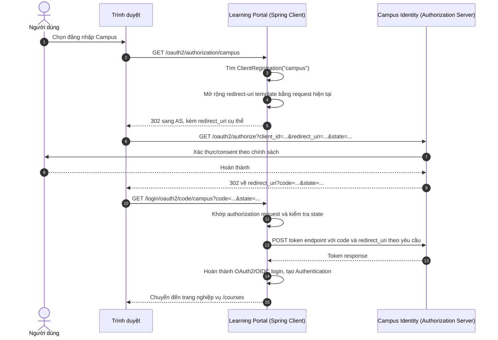
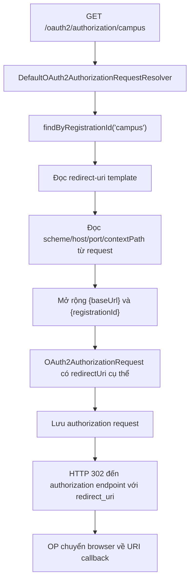
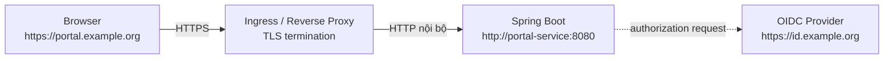

# 8.11. Tính Redirect URI từ template và ngữ cảnh request

## Mục tiêu bài học

Sau bài học, bạn có thể:

- Giải thích chính xác **redirect URI** trong OAuth 2.0 Authorization Code Flow và OpenID Connect (OIDC) là gì, cũng như phân biệt nó với URL bắt đầu đăng nhập, URL Authorization Server và trang điều hướng sau khi đăng nhập.
- Hiểu cách Spring Security OAuth2 Client mở rộng `ClientRegistration.redirectUri` từ **URI template** bằng dữ liệu của HTTP request đang khởi tạo authorization.
- Phân biệt các placeholder như `{baseUrl}`, `{baseScheme}`, `{baseHost}`, `{basePort}`, `{basePath}` và `{registrationId}`; dự đoán redirect URI ở môi trường local, context path và reverse proxy.
- Theo dõi giá trị `redirect_uri` từ authorization request đến callback và token request để giải thích lỗi `redirect_uri_mismatch`.
- Cấu hình chính xác các thành phần Spring Security Servlet liên quan: `ClientRegistration`, `OAuth2AuthorizationRequestRedirectFilter`, `OAuth2LoginAuthenticationFilter`, redirection endpoint và forwarded headers.
- Tránh lỗi và rủi ro khi dùng `Host`, `Forwarded`, `X-Forwarded-*` hoặc đường dẫn do người dùng kiểm soát để tạo URI bảo mật.

## 1. Redirect URI nằm ở đâu trong OAuth 2.0/OIDC?

Giả sử ứng dụng web **Learning Portal** chạy tại:

```text
https://portal.example.org
```

Portal là **OAuth2/OIDC Client**. Người dùng bấm “Đăng nhập Campus SSO”, được chuyển đến **Campus Identity** là Authorization Server/OpenID Provider, đăng nhập tại đó rồi quay về Portal.

Trong quá trình bắt đầu đăng nhập, Portal gửi cho Authorization Server một tham số rất quan trọng:

```text
redirect_uri=https://portal.example.org/login/oauth2/code/campus
```

Đây là **redirect URI**: địa chỉ mà Authorization Server được phép đưa **authorization response** của giao dịch về phía client. Với Authorization Code Flow, response thành công thường chứa `code` và `state` trong URL callback.

Nó trả lời câu hỏi:

> “Sau khi hoàn thành bước ủy quyền, Authorization Server sẽ chuyển trình duyệt người dùng quay về **endpoint nào của Client** để trả kết quả?”

Redirect URI **không phải** địa chỉ nơi người dùng phải nhập mật khẩu, **không phải** API token endpoint, và **không nhất thiết** là trang ứng dụng hiển thị sau khi login thành công.

### 1.1. Bốn URL dễ nhầm

| URL trong ví dụ | Thuộc hệ thống | Mục đích |
| --- | --- | --- |
| `https://portal.example.org/oauth2/authorization/campus` | Learning Portal (Client) | Bắt đầu authorization request bằng registration `campus` |
| `https://id.example.org/oauth2/authorize` | Campus Identity (Authorization Server) | Nhận yêu cầu xin ủy quyền, điều phối xác thực/consent |
| `https://portal.example.org/login/oauth2/code/campus` | Learning Portal (Client) | **Redirect URI** nhận callback `code` và `state` |
| `https://portal.example.org/courses` | Learning Portal (ứng dụng) | Trang nghiệp vụ người dùng được đưa đến sau khi Spring hoàn thành login |

Có thể thấy redirect URI hướng đến endpoint xử lý **giao thức OAuth/OIDC**, chứ không phải điểm đích giao diện `/courses`.

### 1.2. Sơ đồ luồng



Trong ví dụ, **Spring Security tính redirect URI trước khi chuyển trình duyệt sang Authorization Server**, rồi dùng nó trong giao dịch. Giá trị đưa vào yêu cầu ủy quyền phải phù hợp danh sách URI đã đăng ký ở Authorization Server.

## 2. Redirect URI là ranh giới bảo mật, không chỉ là URL điều hướng

Một Authorization Server tin cậy phải kiểm soát những nơi được trả authorization response. Nếu client được tùy ý gửi bất kỳ URI nào, mã ủy quyền có thể bị chuyển đến domain do kẻ tấn công kiểm soát.

Ví dụ client hợp lệ có:

```text
https://portal.example.org/login/oauth2/code/campus
```

Nhưng một URI không đáng tin cậy là:

```text
https://attacker.example.net/receive-code
```

Authorization Server không nên gửi code đến URI thứ hai chỉ vì tham số trên HTTP request chỉ định như vậy. Redirect URI được quản lý trong **client registration tại Authorization Server** và được so khớp theo chính sách OAuth hiện hành.

Các yêu cầu quan trọng:

1. URI được gửi trong authorization request phải phù hợp với URI đã được đăng ký cho **đúng `client_id`**.
2. Trong Authorization Code Grant, nếu client đưa `redirect_uri` vào authorization request, token request cần sử dụng cùng giá trị theo quy tắc của giao thức; Authorization Server kiểm tra sự ràng buộc giữa code, client và URI.
3. Client phải tiếp nhận callback ở địa chỉ tương ứng, khớp với filter hoặc handler đã cấu hình.
4. `state`, PKCE, xác thực client khi cần và kiểm tra ID Token của OIDC vẫn phải hoạt động đầy đủ; redirect URI không thay thế những biện pháp đó.

Đối với web client thông thường, redirect URI dùng **HTTPS** ở môi trường thực. Ngoại lệ có kiểm soát như loopback redirect cho native app được tiêu chuẩn xử lý riêng, không nên áp dụng tùy tiện cho web server.

## 3. `ClientRegistration.redirectUri`: giá trị cố định hay template?

Spring Security lưu thông tin đăng ký OAuth2/OIDC Client trong `ClientRegistration`. Một thuộc tính quan trọng là **redirect URI**.

Cấu hình phổ biến trong Spring Boot:

```yaml
spring:
  security:
    oauth2:
      client:
        registration:
          campus:
            provider: campus
            client-id: ${CAMPUS_CLIENT_ID}
            client-secret: ${CAMPUS_CLIENT_SECRET}
            client-authentication-method: client_secret_basic
            authorization-grant-type: authorization_code
            scope:
              - openid
              - profile
              - email
            redirect-uri: "{baseUrl}/login/oauth2/code/{registrationId}"
        provider:
          campus:
            issuer-uri: https://id.example.org
```

Đây là một **confidential client** ở backend; các domain và giá trị đều minh họa. Ứng dụng thực cần tạo client registration ở Authorization Server, cung cấp credentials phù hợp qua cơ chế bảo mật và khai báo redirect URI chính xác bên phía nhà cung cấp.

Đáng chú ý:

```yaml
redirect-uri: "{baseUrl}/login/oauth2/code/{registrationId}"
```

Đây **không phải URI cuối cùng** gửi tới OP. Nó là **template**. Khi người dùng bắt đầu OAuth2 Login, Spring mở rộng từng placeholder dựa trên:

- **HTTP request hiện tại:** scheme, host, port và context path sau khi được ứng dụng/proxy xử lý phù hợp;
- **ClientRegistration đã chọn:** đặc biệt `registrationId`;
- **Mẫu URI đã cấu hình:** các đoạn tĩnh như `/login/oauth2/code/`.

Ví dụ:

```text
Template:
  {baseUrl}/login/oauth2/code/{registrationId}

Request public origin:
  https://portal.example.org

Registration ID:
  campus

Kết quả:
  https://portal.example.org/login/oauth2/code/campus
```

### 3.1. Template được mở rộng khi nào?

Hãy phân biệt hai thời điểm:

- **Lúc khởi động:** Spring Boot đọc YAML và tạo `ClientRegistration` có trường redirect URI dạng template.
- **Khi có request bắt đầu authorization:** thành phần giải quyết authorization request sử dụng request hiện tại để mở rộng template thành URI cụ thể.

Vì thế cùng một cấu hình có thể sinh các URI khác nhau tùy request hoặc môi trường. Ví dụ ở local dùng `http://localhost:8080`, còn production dùng `https://portal.example.org`, nếu template phụ thuộc `{baseUrl}`.

Cách tính động này thuận tiện cho cấu hình đa môi trường, nhưng cũng là nguồn gây lỗi khi request đi qua reverse proxy hoặc host không đáng tin cậy.

### 3.2. `registrationId` đến từ đâu?

Trong YAML:

```yaml
registration:
  campus:
    client-id: learning-portal-web
```

Giá trị `campus` là **registration ID** của Spring, dùng tra cứu `ClientRegistration` và mở rộng `{registrationId}`.

Nó khác với:

```text
client_id = learning-portal-web
```

`client_id` là định danh OAuth Client mà Authorization Server nhận. Khi URL bắt đầu là:

```text
/oauth2/authorization/campus
```

Spring chọn registration `campus`, lấy **client ID** từ registration rồi mở rộng callback theo **registration ID**. Không thay `{registrationId}` bằng `clientId` hoặc tên hiển thị `clientName` trừ khi thiết kế và cấu hình URL đặc biệt yêu cầu điều khác.

## 4. Những placeholder Spring Security thường hỗ trợ

Với mẫu redirect URI dựa trên request của ứng dụng Servlet, các biến thông dụng gồm:

| Placeholder | Ý nghĩa | Ví dụ |
| --- | --- | --- |
| `{baseUrl}` | URL gốc của ứng dụng, thường bao gồm scheme, host, port cần thiết và context path | `https://portal.example.org/learning` |
| `{baseScheme}` | Scheme mà ứng dụng nhận diện cho request public | `https` |
| `{baseHost}` | Host mà ứng dụng nhận diện | `portal.example.org` |
| `{basePort}` | Phần port của URL gốc khi cần thiết | `:8443` hoặc rỗng nếu là port mặc định |
| `{basePath}` | Context path của ứng dụng (nếu có) | `/learning` |
| `{registrationId}` | Khóa của `ClientRegistration` đã chọn | `campus` |

Có thể gặp các template:

```text
{baseUrl}/login/oauth2/code/{registrationId}
{baseScheme}://{baseHost}{basePort}{basePath}/login/oauth2/code/{registrationId}
https://portal.example.org/login/oauth2/code/{registrationId}
https://portal.example.org/oauth/callback
```

Template cuối cùng không có placeholder: đây là **redirect URI cố định**.

**Chi tiết port:** cách một URI biểu diễn port phụ thuộc giá trị hiệu dụng của request và logic chuẩn hóa. Khi dùng `{basePort}`, cần để Spring xử lý thay vì tự thêm dấu `:` rồi có nguy cơ tạo thành `::8443` hoặc thêm port rỗng không cần thiết. Không suy đoán giá trị chuỗi của placeholder từ một ví dụ nếu chưa biết request thực tế.

### 4.1. `baseUrl` không phải toàn bộ URL của trang đang mở

Giả sử người dùng đang truy cập:

```text
https://portal.example.org/learning/courses/123?tab=lessons
```

Khi khởi tạo login, request đến Spring có thể là:

```text
https://portal.example.org/learning/oauth2/authorization/campus
```

Đối với template `{baseUrl}`, kết quả thông thường là:

```text
https://portal.example.org/learning
```

Chứ **không phải**:

```text
https://portal.example.org/learning/courses/123?tab=lessons
```

hay:

```text
https://portal.example.org/learning/oauth2/authorization/campus
```

`baseUrl` phản ánh **địa chỉ gốc của ứng dụng theo ngữ cảnh request**, trong khi phần callback được ghép bằng template. Query string và đường dẫn của request khởi tạo không tự trở thành redirect URI.

### 4.2. `basePath` thường liên quan đến Servlet context path

Một Servlet app có thể chạy ở root context:

```text
contextPath = ""
baseUrl     = https://portal.example.org
```

Hoặc được triển khai dưới context `/learning`:

```text
contextPath = /learning
baseUrl     = https://portal.example.org/learning
```

Nếu dùng:

```text
{baseUrl}/login/oauth2/code/{registrationId}
```

thì URI callback sau mở rộng lần lượt là:

```text
https://portal.example.org/login/oauth2/code/campus
https://portal.example.org/learning/login/oauth2/code/campus
```

**Context path và request path là hai khái niệm khác nhau.** Không hiểu `{basePath}` là “mọi ký tự đứng sau domain”; với Servlet application, nó thường là phần context path được ứng dụng nhìn nhận.

## 5. Ví dụ tính redirect URI ở các môi trường

Xét template mặc định trong bài:

```text
{baseUrl}/login/oauth2/code/{registrationId}
```

Với `registrationId = campus`:

| Ngữ cảnh request công khai | `baseUrl` dự kiến | Redirect URI được tính |
| --- | --- | --- |
| Local, port 8080 | `http://localhost:8080` | `http://localhost:8080/login/oauth2/code/campus` |
| HTTPS production, root context | `https://portal.example.org` | `https://portal.example.org/login/oauth2/code/campus` |
| HTTPS với context path `/learning` | `https://portal.example.org/learning` | `https://portal.example.org/learning/login/oauth2/code/campus` |
| HTTPS qua port ngoài 8443 | `https://portal.example.org:8443` | `https://portal.example.org:8443/login/oauth2/code/campus` |
| Test env có host riêng | `https://staging.example.org` | `https://staging.example.org/login/oauth2/code/campus` |

Bảng trên giả định Spring nhận diện chính xác scheme/host/port/context path mà browser nhìn thấy. Trong thực tế, proxy, forwarded headers hoặc cấu hình servlet có thể làm khác.

### 5.1. `localhost` là ví dụ có điều kiện

Nhiều provider cho phép redirect URI local ở môi trường phát triển với một số điều kiện, nhưng không phải provider nào cũng cho phép mọi URI `http://localhost`. Phải tuân theo chính sách cụ thể của Authorization Server.

Ví dụ:

```text
Registered redirect URI (dev):
http://localhost:8080/login/oauth2/code/campus
```

Khi chuyển sang production, cần khai báo URI production thích hợp. Không đưa callback dev lên production hoặc dùng client secret production trong ứng dụng local không được bảo vệ.

### 5.2. Nhiều registration tạo nhiều callback

Ví dụ:

```yaml
registration:
  campus-student:
    ...
    redirect-uri: "{baseUrl}/login/oauth2/code/{registrationId}"

  campus-staff:
    ...
    redirect-uri: "{baseUrl}/login/oauth2/code/{registrationId}"
```

Trên cùng host:

```text
https://portal.example.org/login/oauth2/code/campus-student
https://portal.example.org/login/oauth2/code/campus-staff
```

Hai redirect URI khác nhau do `{registrationId}`. Nếu hai registration dùng hai OAuth `client_id` khác nhau, Authorization Server cần ghi nhận callback phù hợp cho **từng client registration bên phía nó**.

Việc callback chứa từ `staff` **không xác nhận** người đăng nhập là nhân viên: đây là định danh kỹ thuật của registration, quyền thật phải được kiểm tra ở ứng dụng.

## 6. Quy trình Spring Security mở rộng URI trong Authorization Request

Ở Servlet OAuth2 Login, các thành phần thường gặp gồm:

| Thành phần | Trách nhiệm |
| --- | --- |
| `ClientRegistrationRepository` | Lưu hoặc tra cứu `ClientRegistration` theo `registrationId` |
| `OAuth2AuthorizationRequestRedirectFilter` | Xử lý URL bắt đầu OAuth2 và chuyển hướng browser tới Authorization Server |
| `OAuth2AuthorizationRequestResolver` | Tạo yêu cầu ủy quyền, bao gồm xác định registration, redirect URI, scope và tham số bảo vệ |
| `DefaultOAuth2AuthorizationRequestResolver` | Resolver mặc định của Spring Security |
| `OAuth2AuthorizationRequestRepository` | Lưu authorization request trước khi browser đi sang Authorization Server để liên kết callback |
| `OAuth2LoginAuthenticationFilter` | Nhận callback, kiểm tra tương quan authorization request và đổi authorization code để đăng nhập |

Đường đi của việc tính URI có thể diễn đạt như sau:



Trình tự diễn giải:

1. Browser truy cập endpoint bắt đầu OAuth2 Login, mặc định `/oauth2/authorization/campus`.
2. Resolver đọc **registration ID `campus`** từ URL theo cấu hình authorization request base URI.
3. Repository tìm registration chứa `clientId`, authorization endpoint, scope và `redirectUri` template.
4. Resolver mở rộng template dựa trên `HttpServletRequest` hiệu dụng và registration.
5. Authorization request được tạo với một trường `redirectUri` **cụ thể**, không còn placeholder.
6. Spring lưu ngữ cảnh yêu cầu ủy quyền và trả redirect tới Authorization Server, truyền `redirect_uri` như một tham số query.
7. Sau khi nhận callback và kiểm tra `state`/authorization request, Spring xử lý token exchange; các giá trị ràng buộc phải tuân theo yêu cầu của flow.

Trong ví dụ, URL authorization request được mã hóa có thể trông như:

```text
https://id.example.org/oauth2/authorize
  ?response_type=code
  &client_id=learning-portal-web
  &redirect_uri=https%3A%2F%2Fportal.example.org%2Flogin%2Foauth2%2Fcode%2Fcampus
  &scope=openid%20profile
  &state=<random-state>
```

Các dòng được tách để đọc; URL thực tế là một chuỗi URL hợp lệ và có thể có thêm `nonce`, PKCE `code_challenge`, các tham số bảo vệ hoặc mở rộng phù hợp cấu hình.

### 6.1. `redirect_uri` trong authorization request được mã hóa thế nào?

Khi đưa một URI vào **query parameter** của một URI khác, ký tự như `:`, `/` và `?` phải được encode theo quy tắc URI.

Ví dụ giá trị logic:

```text
https://portal.example.org/login/oauth2/code/campus
```

Trong query của authorization endpoint có thể trở thành:

```text
redirect_uri=https%3A%2F%2Fportal.example.org%2Flogin%2Foauth2%2Fcode%2Fcampus
```

Hai chuỗi này biểu diễn cùng redirect URI sau khi parse đúng, nhưng khi chẩn đoán lỗi, cần xem **giá trị đã decode** mà Authorization Server so khớp. Không lẫn lộn sự khác nhau giữa hiển thị URL-encoded và khác biệt thực sự về scheme, host, port hoặc path.

### 6.2. Spring không lấy URI từ `Referer` hoặc một giá trị frontend tùy ý

Trong cấu hình mặc định, redirect URI được xây từ registration template và request context hiệu dụng. Một nút ở frontend:

```html
<a href="/oauth2/authorization/campus">Đăng nhập</a>
```

chỉ kích hoạt luồng chọn registration. Nó **không** có quyền tùy chọn:

```text
redirect_uri=https://somewhere.example
```

nếu backend không cố ý hỗ trợ kiểu tùy biến đó. Cho phép browser tùy ý quyết định callback là một thiết kế rủi ro và thường bị Authorization Server từ chối.

## 7. Request context: scheme, host, port, context path

Để hiểu vì sao template hoạt động khác giữa môi trường, cần biết **Spring thực sự thấy HTTP request như thế nào**.

Một request Servlet chứa các thông tin như:

```java
request.getScheme();      // Ví dụ "https"
request.getServerName();  // Ví dụ "portal.example.org"
request.getServerPort();  // Ví dụ 443
request.getContextPath(); // Ví dụ "/learning"
request.getRequestURI();  // Ví dụ "/learning/oauth2/authorization/campus"
```

Trong bối cảnh OAuth2 Login, Spring phải tìm **public origin/context** phù hợp để tạo callback. `getRequestURI()` chứa đường dẫn endpoint bắt đầu login, còn `getContextPath()` cho biết nơi ứng dụng được mount trong Servlet container.

Một cách tự mô phỏng để hiểu URI (đây **không** phải mã thay thế resolver của Spring):

```text
scheme      = https
host        = portal.example.org
publicPort  = 443
contextPath = /learning
registrationId = campus

baseUrl     = https://portal.example.org/learning
redirectUri = baseUrl + /login/oauth2/code/ + registrationId
```

Không nên tự viết lại thuật toán bằng cách nối chuỗi không kiểm soát trong ứng dụng. Spring hỗ trợ URI template, xử lý phần lớn chi tiết này và đảm bảo logic nhất quán với các thành phần OAuth2 Login.

### 7.1. Request path không quyết định callback path

Nếu người dùng truy cập:

```text
GET /learning/oauth2/authorization/campus
```

thì phần `/oauth2/authorization/campus` giúp chọn `ClientRegistration`, nhưng callback path do **template** quyết định:

```text
/login/oauth2/code/campus
```

Nó không phải bản sao của authorization-start URL.

### 7.2. Nếu ứng dụng có Servlet context path

Ví dụ:

```yaml
server:
  servlet:
    context-path: /learning
```

Đường dẫn browser thường sẽ bao gồm prefix:

```text
/learning/oauth2/authorization/campus
/learning/login/oauth2/code/campus
```

Còn pattern trong `oauth2Login().redirectionEndpoint().baseUri(...)` thường được định nghĩa theo đường dẫn **bên trong context** mà filter xử lý. Đừng tự ghép lại `/learning` ở cả template `{baseUrl}` lẫn pattern callback nếu dẫn đến lặp prefix.

### 7.3. Nhiều host public trên cùng một ứng dụng

Nếu ứng dụng cho phép truy cập qua:

```text
https://portal.example.org
https://academy.example.org
```

thì `{baseUrl}` có thể dẫn đến hai callback khác nhau, tùy request:

```text
https://portal.example.org/login/oauth2/code/campus
https://academy.example.org/login/oauth2/code/campus
```

Authorization Server phải chấp nhận những URI được đăng ký theo chính sách; không thể cho rằng vì hai host trỏ cùng backend thì OP tự nhận cả hai.

Đối với cấu hình nhiều hostname/tenant, cần thiết kế rõ cách chọn registration/issuer/callback đáng tin cậy. Không được cho request `Host` bất kỳ quyết định client callback nếu không có cơ chế kiểm tra host và tenant.

## 8. Reverse proxy: vì sao `{baseUrl}` dễ tính sai?

Một triển khai sản xuất thường đặt Spring Boot sau ingress, load balancer hoặc reverse proxy:



Trình duyệt nhìn thấy:

```text
https://portal.example.org
```

nhưng nếu không xử lý forwarded headers, Servlet request tại Spring có thể thấy:

```text
scheme = http
host   = portal-service
port   = 8080
```

Spring có thể tính ra:

```text
http://portal-service:8080/login/oauth2/code/campus
```

Đây là địa chỉ nội bộ, có thể không truy cập được từ browser và không nằm trong danh sách redirect URI của OP.

Kết quả: người dùng bấm login nhưng Authorization Server báo lỗi kiểu `redirect_uri_mismatch` hoặc `invalid_request`.

### 8.1. Vai trò của forwarded headers

Reverse proxy thường gửi những metadata mô tả request công khai, ví dụ:

```http
Forwarded: proto=https;host=portal.example.org
```

hoặc:

```http
X-Forwarded-Proto: https
X-Forwarded-Host: portal.example.org
X-Forwarded-Port: 443
X-Forwarded-Prefix: /learning
```

Tùy môi trường, các header được thêm vào hoặc biến đổi bởi ingress và hạ tầng trước ứng dụng. Spring Boot có cơ chế xử lý forwarded headers để request được diễn giải đúng khi **proxy là nguồn đáng tin cậy**.

Một cấu hình có thể áp dụng trong một số triển khai Servlet:

```yaml
server:
  forward-headers-strategy: framework
```

Spring Boot còn có những chiến lược xử lý header khác tùy server container và hạ tầng. Cần chọn theo deployment thực tế và cơ chế xử lý forwarded headers của ingress/container.

**Rủi ro quan trọng:** Không đơn thuần bật tin mọi `Forwarded` hoặc `X-Forwarded-*` từ Internet. Nếu client tự gửi `X-Forwarded-Host: attacker.example.net` và proxy không ghi đè/lọc header đó, ứng dụng có thể xây redirect URI dựa trên host giả mạo. Phải cấu hình biên proxy nhận diện, loại bỏ hoặc thay thế các header không đáng tin cậy, và kiểm soát hostname hợp lệ.

### 8.2. Ví dụ sai scheme vì TLS termination

Giả sử:

```text
Public:  https://portal.example.org
Backend: http://portal-service:8080
```

Template:

```text
{baseUrl}/login/oauth2/code/{registrationId}
```

Kết quả sai nếu Spring chỉ nhìn kết nối nội bộ:

```text
http://portal-service:8080/login/oauth2/code/campus
```

Kết quả mong muốn khi forwarded metadata được xử lý đáng tin cậy:

```text
https://portal.example.org/login/oauth2/code/campus
```

Có ba yếu tố cần đồng bộ:

1. Proxy chuyển thông tin public scheme/host/port chính xác.
2. Spring Boot/Spring Security diễn giải thông tin đó theo cấu hình tin cậy.
3. OP có redirect URI public tương ứng trong cấu hình của đúng OAuth Client.

Đổi `clientName` hoặc `registrationId` không giải quyết được lỗi **sai scheme/host**.

### 8.3. Proxy thêm hoặc bỏ prefix

Ví dụ browser truy cập:

```text
https://example.org/learning/oauth2/authorization/campus
```

nhưng reverse proxy chuyển request nội bộ tới:

```text
http://portal-service:8080/oauth2/authorization/campus
```

Nếu ứng dụng không nhận diện public prefix `/learning`, URI có thể bị tính thiếu prefix:

```text
https://example.org/login/oauth2/code/campus
```

thay vì:

```text
https://example.org/learning/login/oauth2/code/campus
```

Cần xem cách proxy cấu hình prefix rewrite và các header mà Spring Boot thực sự xử lý. Tránh vừa cấu hình servlet context path `/learning` **vừa** thêm prefix bằng proxy/forwarded header theo cách khiến URI bị nhân đôi:

```text
https://example.org/learning/learning/login/oauth2/code/campus
```

Không có một dòng YAML duy nhất giải quyết mọi kiểu proxy prefix. Cần xác định rõ public route, internal route, context path và cấu hình tin cậy của proxy.

### 8.4. Một số môi trường nên dùng redirect URI cố định

Nếu ứng dụng chỉ có **một origin production được phép**, có thể chọn cấu hình cố định:

```yaml
spring:
  security:
    oauth2:
      client:
        registration:
          campus:
            redirect-uri: "https://portal.example.org/login/oauth2/code/campus"
```

Ưu điểm:

- Không phụ thuộc vào `Host`/`X-Forwarded-Host` để tính hostname callback.
- Thuận tiện khi OP yêu cầu một callback cụ thể.
- Giảm khả năng một request bị gửi từ host alias không dự kiến làm thay đổi `redirect_uri`.

Đổi lại, mỗi môi trường có origin khác nhau cần cấu hình riêng, và callback cố định phải được route về đúng ứng dụng/filter. Dù redirect URI cố định, ứng dụng vẫn cần bảo vệ request, cookie, session, proxy và luồng OIDC theo đúng quy tắc.

## 9. Callback URL cần khớp với filter nhận phản hồi

Tính redirect URI đúng chưa đủ. Spring Security phải **nhận được request callback** trên đường dẫn đó.

Mặc định với Servlet OAuth2 Login:

```text
/login/oauth2/code/{registrationId}
```

Một ví dụ callback:

```http
GET /login/oauth2/code/campus?code=<authorization-code>&state=<state> HTTP/1.1
Host: portal.example.org
```

Thành phần nhận callback trong Spring Security thường là `OAuth2LoginAuthenticationFilter`. Filter cần có request matcher phù hợp với path của URI callback. Nếu URI ngoài được đăng ký đúng nhưng Spring không xử lý đường dẫn, login vẫn thất bại.

### 9.1. Cấu hình mặc định đồng bộ

```yaml
redirect-uri: "{baseUrl}/login/oauth2/code/{registrationId}"
```

Khi giữ đường dẫn xử lý callback mặc định của OAuth2 Login, phần path từ template tương thích với matcher mặc định.

### 9.2. Tùy biến callback đồng bộ ở hai nơi

Giả sử muốn callback dạng:

```text
https://portal.example.org/auth/callback/campus
```

Cần đổi **redirect URI** của registration:

```yaml
spring:
  security:
    oauth2:
      client:
        registration:
          campus:
            redirect-uri: "{baseUrl}/auth/callback/{registrationId}"
```

Và cấu hình Spring Security nhận callback:

```java
@Bean
SecurityFilterChain securityFilterChain(HttpSecurity http) throws Exception {
    http
        .authorizeHttpRequests(auth -> auth
            .anyRequest().authenticated()
        )
        .oauth2Login(oauth2 -> oauth2
            .redirectionEndpoint(redirection -> redirection
                .baseUri("/auth/callback/*")
            )
        );

    return http.build();
}
```

Đồng thời OP phải đăng ký redirect URI cuối cùng:

```text
https://portal.example.org/auth/callback/campus
```

Lưu ý phân biệt:

- `redirect-uri: "{baseUrl}/auth/callback/{registrationId}"` là template để tính **URI đầy đủ gửi OP**.
- `.redirectionEndpoint().baseUri("/auth/callback/*")` là cấu hình **đường dẫn mà filter Spring nhận callback**.
- `*` là ký hiệu matcher path ở phía Spring; callback thực tế đăng ký tại OP thường là một URI xác định không chứa wildcard.

Nếu chỉ đổi YAML mà quên filter, hoặc chỉ đổi filter mà quên YAML và OP, callback sẽ không đồng bộ.

### 9.3. Đổi URL bắt đầu login không tự đổi callback

Đây là ba điểm cấu hình riêng:

```text
Trang login:
  /login

Authorization start endpoint:
  /oauth2/authorization/{registrationId}

Authorization callback:
  /login/oauth2/code/{registrationId}
```

Có thể tùy biến authorization start endpoint:

```java
http.oauth2Login(oauth2 -> oauth2
    .authorizationEndpoint(authorization -> authorization
        .baseUri("/signin/oauth2")
    )
);
```

Khi đó link bắt đầu login có thể là:

```text
/signin/oauth2/campus
```

Nhưng redirect URI callback **không tự chuyển** thành `/signin/oauth2/...`; nó vẫn do `ClientRegistration.redirectUri` quyết định.

Tương tự, đổi login page sang `/signin` để có giao diện đẹp không làm thay đổi redirect URI nếu không đổi cấu hình callback.

## 10. Tương quan callback, `state` và token request

Trong Authorization Code Flow, khi client yêu cầu ủy quyền, nó thường tạo và lưu một `OAuth2AuthorizationRequest` có:

- Authorization URI của OP.
- Client ID, requested scopes và các tham số giao thức.
- Redirect URI đã mở rộng.
- `state` ngẫu nhiên để tương quan response với yêu cầu ban đầu.
- PKCE parameters và nonce trong trường hợp được sử dụng.

Khi OP chuyển browser về:

```text
https://portal.example.org/login/oauth2/code/campus?code=abc&state=xyz
```

Spring cần khôi phục authorization request đã lưu và kiểm tra callback tương ứng với giao dịch hợp lệ. Authorization code sau đó được đổi ở token endpoint bằng giao tiếp trực tiếp giữa Client và Authorization Server.

Trong trường hợp `redirect_uri` đã được cung cấp ở authorization request, token request phải dùng giá trị đó theo ràng buộc của OAuth. Một kiểu lỗi dễ gặp nếu tự can thiệp vào flow là:

```text
Authorization request:
  redirect_uri=https://portal.example.org/login/oauth2/code/campus

Token request do code tùy biến tạo:
  redirect_uri=http://portal-service:8080/login/oauth2/code/campus
```

Hai giá trị không khớp; Authorization Server có thể từ chối token exchange. Với cơ chế Spring Security mặc định, hạn chế tự ghép lại redirect URI ở giai đoạn token request: nên để framework giữ thông tin authorization request đã sử dụng.

### 10.1. Không dùng redirect URI để thay `state`

Đăng ký redirect URI đúng giúp hạn chế nơi gửi response nhưng không chứng minh rằng callback hiện tại thuộc giao dịch login do **trình duyệt này** khởi tạo.

`state` là thành phần quan trọng để ràng buộc authorization response với yêu cầu trước đó và chống các kiểu CSRF/login CSRF. PKCE giúp bảo vệ việc đổi code trong các tình huống thích hợp. Trong OIDC, client cần xác minh ID Token và `nonce` khi đã gửi theo quy tắc giao thức.

Đừng sửa một lỗi `state` bằng cách tắt cơ chế kiểm tra. Hãy xác định có bị mất session, cookie, authorization request repository hoặc cấu hình proxy hay không.

### 10.2. Vì sao callback có thể hoạt động trên trình duyệt này nhưng lỗi trình duyệt khác?

Một số nguyên nhân:

- Session cookie không đi theo redirect do domain, path, `SameSite`, `Secure` hoặc HTTPS không phù hợp.
- Browser chuyển sang host khác với host khởi tạo login.
- Proxy làm đổi route/cookie path.
- Load balancer chuyển request qua instance khác nhưng trạng thái authorization request chỉ lưu local session không được chia sẻ.
- Tác vụ tự viết thay đổi `state` hoặc redirect URI giữa hai bước.

Những trường hợp này không nhất thiết là URI template sai; cần xem **sự nhất quán toàn bộ giao dịch**.

## 11. Sử dụng Java để quan sát cấu hình và ngữ cảnh

Một cách hiểu rõ dữ liệu đầu vào là quan sát `ClientRegistration` trong code server-side.

### 11.1. Đọc redirect URI template

```java
@Component
class ClientRegistrationReporter {

    private final ClientRegistrationRepository repository;

    ClientRegistrationReporter(ClientRegistrationRepository repository) {
        this.repository = repository;
    }

    void reportConfiguration() {
        ClientRegistration registration =
            repository.findByRegistrationId("campus");

        if (registration == null) {
            throw new IllegalStateException(
                "Missing OAuth2 client registration: campus"
            );
        }

        String registrationId = registration.getRegistrationId();
        String redirectUriTemplate = registration.getRedirectUri();

        // Dùng các giá trị này để kiểm tra cấu hình nội bộ.
        // Không log clientSecret hoặc token.
    }
}
```

`registration.getRedirectUri()` có thể trả về **template**, ví dụ `{baseUrl}/login/oauth2/code/{registrationId}`. Đây chưa chắc là URI đã được mở rộng cho từng request.

### 11.2. Xem các thành phần request trong môi trường kiểm thử

Một handler nội bộ (không nên công khai nguyên trạng) có thể giúp hiểu request mà Spring nhìn thấy:

```java
@GetMapping("/internal/request-context")
Map<String, Object> requestContext(HttpServletRequest request) {
    Map<String, Object> result = new LinkedHashMap<>();
    result.put("scheme", request.getScheme());
    result.put("serverName", request.getServerName());
    result.put("serverPort", request.getServerPort());
    result.put("contextPath", request.getContextPath());
    result.put("requestURI", request.getRequestURI());
    return result;
}
```

Ví dụ trả dữ liệu:

```json
{
  "scheme": "https",
  "serverName": "portal.example.org",
  "serverPort": 443,
  "contextPath": "/learning",
  "requestURI": "/learning/internal/request-context"
}
```

Đây chỉ là cách **quan sát nguyên liệu** để hiểu phép mở rộng, không phải API bảo mật hay cơ chế thay thế logic của framework. Trong production, metadata host và route có thể nhạy cảm; nên hạn chế endpoint cho môi trường quản trị/debug, áp dụng quyền truy cập thích hợp hoặc không triển khai nó.

Đặc biệt, **không ghi ra log access token, authorization code, `state`, `clientSecret`, cookie session hoặc toàn bộ HTTP headers** để chẩn đoán redirect.

### 11.3. Một điểm mở rộng nâng cao: authorization request resolver

Nếu cần logic đặc biệt, Spring Security cho phép cấu hình `OAuth2AuthorizationRequestResolver` tùy biến:

```java
http.oauth2Login(oauth2 -> oauth2
    .authorizationEndpoint(authorization -> authorization
        .authorizationRequestResolver(customResolver)
    )
);
```

`customResolver` phải được ứng dụng tạo và quản lý; đoạn trên chỉ minh họa **hook mở rộng**, không phải bean tự có.

Nhiều trường hợp có thể delegate cho `DefaultOAuth2AuthorizationRequestResolver` rồi chỉ bổ sung tham số ủy quyền thật sự cần thiết. Mọi can thiệp vào redirect URI, `state`, nonce hoặc PKCE phải giữ các ràng buộc bảo mật của OAuth/OIDC, đồng thời phù hợp những URI đã được OP đăng ký.

Không nên tạo redirect URI bằng cách chấp nhận query parameter tùy ý, ví dụ:

```text
/oauth2/authorization/campus?callback=https://user-input.example
```

rồi ghép giá trị đó thẳng vào `redirect_uri` gửi OP.

## 12. Chẩn đoán lỗi `redirect_uri_mismatch` theo từng thành phần

Giả sử Learning Portal gửi:

```text
client_id=learning-portal-web
redirect_uri=http://portal-service:8080/login/oauth2/code/campus
```

trong khi OP đăng ký:

```text
https://portal.example.org/login/oauth2/code/campus
```

Người dùng nhận thông báo từ OP về redirect URI.

Để xác định lỗi, hãy tách các thành phần:

| Thành phần | URI Spring gửi | URI OP đã đăng ký | Trùng? |
| --- | --- | --- | --- |
| Scheme | `http` | `https` | Không |
| Host | `portal-service` | `portal.example.org` | Không |
| Port | `8080` | Port HTTPS mặc định | Không |
| Path | `/login/oauth2/code/campus` | `/login/oauth2/code/campus` | Có |
| Registration ID | `campus` | `campus` | Có |

Vấn đề nằm ở **public origin/request context**, không phải callback path. Hướng xử lý là cấu hình proxy/forwarded metadata đúng hoặc dùng redirect URI cố định cho public host.

### 12.1. Những biến thể lỗi thường gặp

| Hiện tượng | Nguyên nhân có thể | Hướng kiểm tra |
| --- | --- | --- |
| OP báo `redirect_uri_mismatch` | Scheme, host, port, context path hoặc callback path không khớp registration | So URI đã decode trong authorization request với URI OP đã đăng ký |
| Redirect URI chứa `http://` ở production HTTPS | Spring nhìn thấy HTTP nội bộ sau TLS termination | Kiểm tra proxy và forwarded headers |
| Redirect URI có host service nội bộ | Spring không nhận public host từ proxy | Kiểm tra Host/Forwarded/X-Forwarded-Host đã được xử lý đúng |
| Callback thiếu `/learning` | Proxy rewrite prefix hoặc context path chưa thống nhất | So public path, internal path và forwarded prefix |
| Callback có `/learning/learning` | Prefix bị cộng hai lần | Kiểm tra context path và cấu hình proxy |
| URL có `:8080` dù public đang dùng 443 | Port nội bộ lọt vào base URL | Kiểm tra forwarded port và chiến lược xử lý header |
| Login bắt đầu được nhưng callback trả 404 | Callback path không khớp filter hoặc proxy route | Kiểm tra `redirect-uri`, `redirectionEndpoint.baseUri` và ingress |
| Callback có `code` nhưng Spring báo lỗi state | Session/authorization request bị mất, không đúng browser hoặc callback sang host khác | Kiểm tra cookie, session, proxy và repository |
| Login qua một hostname được, hostname khác lỗi | `{baseUrl}` phụ thuộc host request nhưng OP chỉ đăng ký một host | Dùng hostname chuẩn hoặc đăng ký các callback hợp lệ theo chính sách |
| Đổi `registrationId` xong OP từ chối | URI template tạo callback với path mới, OP vẫn lưu URI cũ | Cập nhật callback OP và mọi link/lookup liên quan |
| Đổi trang login `/signin` nhưng callback vẫn `/login/oauth2/code/...` | Hai endpoint độc lập, đây thường là hành vi đúng | Chỉ đổi callback khi thực sự muốn và cấu hình đồng bộ |
| Token endpoint trả `invalid_grant` sau callback | Code đã dùng/hết hạn, client/redirect URI mismatch hoặc PKCE sai | Kiểm tra token request và authorization request đã lưu |
| Một số request bị redirect sang host bất thường | Proxy tin Host hoặc forwarded headers do client kiểm soát | Rà cấu hình trust boundary, host allowlist và proxy header stripping |

### 12.2. Trình tự đọc lỗi cụ thể

Khi gặp lỗi, có thể lần theo dữ liệu theo thứ tự:

1. **Lấy đúng registration đang được chọn** từ đường dẫn bắt đầu, ví dụ `/oauth2/authorization/campus`, rồi đối chiếu `registration.campus.client-id`.
2. **Xem template** tại `registration.campus.redirect-uri`.
3. **Xác định public scheme/host/port/prefix** mà browser truy cập, và request context hiệu dụng mà Spring nhìn thấy.
4. **Xác định redirect URI cuối cùng** trong authorization request gửi OP (giá trị đã URL-decode), so sánh chính xác với URI OP cho phép đối với `client_id` đó.
5. **Đối chiếu callback matcher** của Spring với path trong redirect URI.
6. Nếu callback tới được Spring nhưng login lỗi, tiếp tục kiểm tra `state`, session, PKCE, code exchange và OIDC validation thay vì mặc định quy lỗi cho URI template.

Đừng sửa lỗi bằng cách tắt kiểm tra redirect URI tại Authorization Server hoặc bằng cách cho phép wildcard tùy ý; việc này làm mất ranh giới bảo mật của authorization response.

## 13. Các tình huống minh họa

### Tình huống A — Local chạy ổn, production lỗi

Cấu hình ở cả hai môi trường:

```yaml
redirect-uri: "{baseUrl}/login/oauth2/code/{registrationId}"
```

Local:

```text
Request:      http://localhost:8080/oauth2/authorization/campus
Redirect URI: http://localhost:8080/login/oauth2/code/campus
```

Production có reverse proxy nhưng không xử lý forwarded headers:

```text
Browser:      https://portal.example.org/oauth2/authorization/campus
Backend sees: http://portal-service:8080/oauth2/authorization/campus
Redirect URI: http://portal-service:8080/login/oauth2/code/campus
```

**Giải thích:** cùng template nhưng ngữ cảnh request khác. Cần tin cậy và cấu hình đúng thông tin public URL hoặc sử dụng redirect URI cố định cho production; OP cũng phải đăng ký URI phù hợp.

### Tình huống B — Ứng dụng được mount dưới `/academy`

Spring Boot:

```yaml
server:
  servlet:
    context-path: /academy
```

Với `registrationId = campus` và public URL là `https://portal.example.org`, URI dự kiến:

```text
https://portal.example.org/academy/login/oauth2/code/campus
```

**Giải thích:** `{baseUrl}` bao gồm context path mà ứng dụng nhận diện. Nếu OP chỉ đăng ký path không có `/academy`, cần cập nhật callback hoặc thiết kế lại routing/context một cách thống nhất.

### Tình huống C — Hai nhà cung cấp đăng nhập

Registrations:

```text
google  -> clientId của Google
campus  -> clientId của Campus Identity
```

Template chung:

```text
{baseUrl}/login/oauth2/code/{registrationId}
```

Trên domain public, callback tương ứng là:

```text
https://portal.example.org/login/oauth2/code/google
https://portal.example.org/login/oauth2/code/campus
```

**Giải thích:** cùng template có thể mở rộng theo từng registration. Mỗi Authorization Server kiểm tra callback thuộc OAuth Client mà nó quản lý.

### Tình huống D — Đã đổi nút login sang `/signin`

Ứng dụng dùng:

```java
http.oauth2Login(oauth2 -> oauth2
    .loginPage("/signin")
);
```

Nhưng vẫn để:

```yaml
redirect-uri: "{baseUrl}/login/oauth2/code/{registrationId}"
```

**Kết luận:** cấu hình này có thể hoàn toàn đúng. `/signin` là trang chọn cách đăng nhập; callback `/login/oauth2/code/campus` là endpoint giao thức. Không cần đổi callback chỉ để đồng bộ thẩm mỹ với tên trang login.

### Tình huống E — Nhận callback ở `/sso/callback/campus` nhưng 404

URI đã đăng ký tại OP:

```text
https://portal.example.org/sso/callback/campus
```

YAML:

```yaml
redirect-uri: "{baseUrl}/sso/callback/{registrationId}"
```

Nhưng Spring chưa thay redirection endpoint matcher mặc định.

**Giải thích:** OP có thể redirect về đúng URI mới, nhưng `OAuth2LoginAuthenticationFilter` không nhận đường dẫn đó theo cấu hình hiện tại. Cần cấu hình `.redirectionEndpoint(...baseUri("/sso/callback/*"))` tương ứng.

### Tình huống F — Browser chọn host tùy ý

Ứng dụng phục vụ được cả `portal.example.org` và một host alias không được quản lý; `{baseUrl}` phụ thuộc `Host`. Nếu host alias chưa nằm trong danh sách redirect URI ở OP, login sẽ thất bại. Nếu proxy tin một host giả mạo từ forwarded header, việc tính URI còn có thể trở thành điểm rủi ro bảo mật.

**Giải pháp:** xác định hostname chuẩn, đặt host allowlist ở biên và cấu hình proxy đáng tin cậy; cân nhắc redirect URI cố định khi nghiệp vụ chỉ có một callback chính thức.

## 14. Bảo mật khi tính redirect URI động

Bản chất redirect URI là một điểm tin cậy trong OAuth. Đối với ứng dụng Spring Security Servlet, cần duy trì các nguyên tắc sau:

1. **Chỉ nhận public host đáng tin cậy:** cấu hình allowlist ở reverse proxy/ingress, làm sạch `Host`, `Forwarded` và `X-Forwarded-*` từ client không tin cậy.
2. **Giữ redirect URI trong tập đăng ký hợp lệ:** không đưa host hoặc URL tùy ý của người dùng vào template.
3. **Sử dụng HTTPS ở production:** tránh để authorization response đi qua kết nối không bảo mật.
4. **Phân tách client callback và post-login success URL:** callback là endpoint giao thức; trang sau login do saved request, success handler hoặc cấu hình ứng dụng điều khiển.
5. **Giữ `state`/PKCE/nonce:** redirect URI chính xác không thay thế kiểm tra tương quan giao dịch và danh tính OIDC.
6. **Chọn registration bằng định danh cục bộ đúng:** URL bắt đầu dùng `registrationId`, trong khi OP kiểm tra `client_id` và URI đã đăng ký.
7. **Đồng bộ callback ở cả hai phía:** URI cuối cùng phải vừa được Authorization Server cho phép vừa có filter nhận tại Spring.
8. **Không log dữ liệu bí mật:** chỉ log metadata đã được làm sạch, không đưa authorization code, token, `state`, client secret hoặc cookie vào log.
9. **Hạn chế sửa thuật toán mở rộng:** ưu tiên cấu hình template chuẩn, chỉ viết resolver tùy biến khi có yêu cầu cụ thể và đã hiểu đầy đủ OAuth/OIDC security boundary.
10. **Bảo vệ session và cookie sau reverse proxy:** tránh mất authorization request hoặc nhầm phiên do chuyển host/prefix khi callback.

## 15. Bài tập thực hành

### Bài tập 1 — Tính URI từ template

Cho:

```text
redirect-uri template:
{baseUrl}/login/oauth2/code/{registrationId}

request:
scheme      = https
serverName  = learning.example.org
serverPort  = 443
contextPath = /portal

registrationId = university
```

**Hỏi:** Redirect URI được tính là gì?

**Đáp án:**

```text
https://learning.example.org/portal/login/oauth2/code/university
```

### Bài tập 2 — Phân biệt tên client và registration ID

Cho registration:

```yaml
registration:
  school:
    client-id: portal-production-client
    client-name: "Đăng nhập SSO"
    redirect-uri: "{baseUrl}/login/oauth2/code/{registrationId}"
```

Ứng dụng được truy cập ở:

```text
https://portal.example.org
```

**Hỏi:** Giá trị `{registrationId}` là gì? OP nhận `client_id` nào? Callback là gì?

**Đáp án:**

```text
registrationId = school
client_id      = portal-production-client
redirect_uri   = https://portal.example.org/login/oauth2/code/school
```

`clientName = "Đăng nhập SSO"` chỉ là tên hiển thị; nó không tham gia thay `{registrationId}`.

### Bài tập 3 — Xác định lỗi proxy

Spring gửi:

```text
http://localhost:8080/login/oauth2/code/campus
```

OP chỉ chấp nhận:

```text
https://portal.example.org/login/oauth2/code/campus
```

**Hỏi:** Nên kiểm tra điều gì trước?

**Đáp án:** kiểm tra request context mà Spring thấy khi request đi qua proxy, TLS termination và các forwarded headers đáng tin cậy. Host và scheme không khớp; không phải lỗi phần `{registrationId}`.

### Bài tập 4 — Tùy biến callback

Bạn muốn callback:

```text
https://portal.example.org/security/callback/campus
```

**Hỏi:** Những cấu hình nào cần thống nhất?

**Đáp án:** đặt `redirect-uri: "{baseUrl}/security/callback/{registrationId}"`, cấu hình Spring OAuth2 Login redirection endpoint để nhận `/security/callback/*`, và đăng ký callback đầy đủ tại OP cho đúng `client_id`.

### Bài tập 5 — Đổi URL của login page

Trang `/login` được thay bằng `/signin`. Bạn có phải đổi redirect URI không?

**Đáp án:** không bắt buộc. Trang `/signin` chọn provider; redirect URI của OAuth callback là endpoint riêng. Chỉ thay callback khi có yêu cầu thiết kế giao thức và cấu hình đồng bộ.

### Bài tập 6 — Nhiều hostname

App truy cập được ở `https://a.example.org` và `https://b.example.org`, cùng template `{baseUrl}/login/oauth2/code/{registrationId}`. OP chỉ đăng ký callback ở host `a`.

**Hỏi:** Điều gì xảy ra nếu người dùng bắt đầu login từ `b`?

**Đáp án:** nếu Spring tính `{baseUrl}` theo request ở host `b`, nó có thể gửi callback với host `b` và OP từ chối. Hãy định tuyến người dùng về hostname chuẩn hoặc quản lý các callback đã đăng ký một cách có kiểm soát.

## 16. Câu hỏi ôn tập

**1. `redirect_uri` được tính ở thời điểm Spring Boot đọc YAML hay khi người dùng bắt đầu đăng nhập?**

> Template được cấu hình khi khởi tạo `ClientRegistration`, nhưng với các placeholder dựa trên request, URI cụ thể được mở rộng khi Spring xử lý authorization request của người dùng.

**2. `{baseUrl}` có bao gồm `/oauth2/authorization/campus` của request bắt đầu login không?**

> Không theo ý nghĩa thông dụng của placeholder này. Nó biểu diễn URL gốc của ứng dụng từ scheme, host, port và context path; callback path được ghép bởi template.

**3. `registrationId` có phải OAuth `client_id` gửi đến OP không?**

> Không. `registrationId` là khóa cục bộ của Spring; `clientId` lấy từ registration mới là tham số OAuth `client_id`.

**4. Vì sao `redirect-uri` dạng `{baseUrl}` chạy ở localhost nhưng lỗi trên production sau proxy?**

> Spring có thể nhìn thấy HTTP host/port nội bộ thay vì HTTPS origin công khai. Cần cấu hình proxy và forwarded headers tin cậy, hoặc URI cố định, rồi đối chiếu registration tại OP.

**5. Vì sao OP kiểm tra redirect URI nghiêm ngặt?**

> Để tránh chuyển authorization response/code tới endpoint không được đăng ký cho client, giảm rủi ro đánh cắp code và nhầm client.

**6. Nếu chỉ đổi `.authorizationEndpoint().baseUri(...)`, redirect URI callback có tự đổi không?**

> Không. Endpoint bắt đầu authorization và endpoint nhận callback là hai cấu hình độc lập.

**7. Nếu OP đã redirect đúng nhưng Spring trả 404 thì nên kiểm tra gì?**

> Đối chiếu callback path với `oauth2Login().redirectionEndpoint().baseUri(...)`, context path, ingress route và filter chain.

**8. `state` có còn cần khi redirect URI đã được đăng ký chính xác?**

> Có. Redirect URI giới hạn địa chỉ nhận response; `state` liên kết callback với authorization request của phiên người dùng, còn PKCE và kiểm tra OIDC bảo vệ những phần khác của giao dịch.

**9. Cấu hình `X-Forwarded-Host` có phải luôn an toàn nếu nó làm login hoạt động?**

> Không. Header này chỉ nên được tin khi reverse proxy đáng tin cậy kiểm soát hoặc ghi đè. Tin giá trị do Internet client tự gửi có thể khiến Spring tính callback theo host giả.

---

## Ghi nhớ

**Redirect URI** là địa chỉ callback mà OAuth2/OIDC Client đăng ký với Authorization Server để nhận kết quả ủy quyền. Trong Spring Security Servlet, `ClientRegistration.redirectUri` có thể là template như **`{baseUrl}/login/oauth2/code/{registrationId}`**. Khi khởi tạo authorization request, Spring mở rộng `{baseUrl}` từ **ngữ cảnh HTTP request hiệu dụng** và `{registrationId}` từ **client registration được chọn**. URI sau mở rộng phải khớp URI mà Authorization Server cho phép và khớp endpoint callback do Spring Security xử lý. Khi triển khai dưới context path hoặc reverse proxy, cần thống nhất public scheme/host/port/prefix, cấu hình forwarded headers đáng tin cậy và giữ nguyên các ràng buộc `state`, PKCE, token exchange và OIDC validation.
