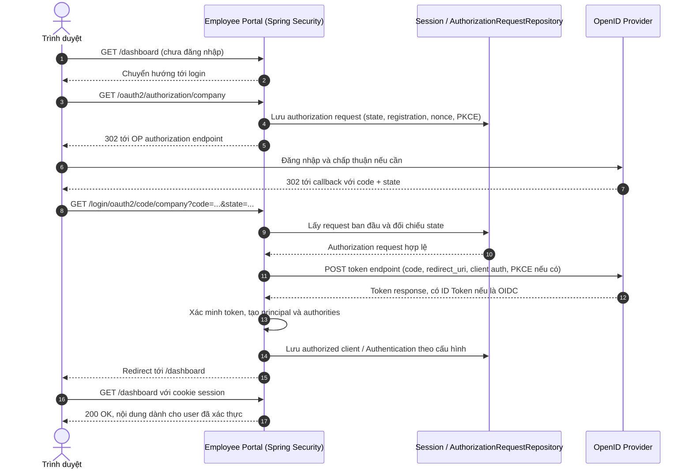

# 9.5. Xử lý callback thành công chứa authorization code

## 1. Tình huống: người dùng quay về ứng dụng sau khi đăng nhập tại OIDC Provider

Giả sử ứng dụng **Employee Portal** viết bằng Spring Boot và Spring Security cho phép nhân viên đăng nhập thông qua một OpenID Provider (OP). Người dùng mở `/dashboard` khi chưa đăng nhập. Ứng dụng chuyển hướng họ tới trang xác thực của OP, sau đó OP gửi trình duyệt về địa chỉ callback đã đăng ký:

```http
GET /login/oauth2/code/company?code=<authorization-code>&state=<state-value> HTTP/1.1
Host: portal.example.com
Cookie: JSESSIONID=<session-id>
```

Callback này cho biết **Authorization Server đã cấp một authorization code**, nhưng **chưa đủ để khẳng định người dùng đã đăng nhập thành công vào Employee Portal**. Ứng dụng vẫn phải liên kết callback với yêu cầu ban đầu, đổi code lấy token, xác minh token theo các quy tắc OAuth 2.0/OIDC và tạo trạng thái đăng nhập.

Điều quan trọng trong chương **Callback và correlation** là hiểu: làm sao Spring Security nhận biết callback thuộc đúng lần đăng nhập do chính trình duyệt/phiên đó khởi tạo, đúng `ClientRegistration` và đúng nhà cung cấp.

Sau bài này, bạn sẽ biết:

- Phân biệt **authorization code**, **state**, **nonce** và **PKCE code verifier** trong callback.
- Theo dõi thứ tự xử lý của **`OAuth2LoginAuthenticationFilter`**, `AuthorizationRequestRepository` và các authentication provider trong Servlet stack.
- Cấu hình `SecurityFilterChain` / `oauth2Login` để nhận callback mặc định hoặc một callback tùy chỉnh.
- Hiểu thời điểm **OAuth2AuthorizedClient**, **Authentication**, **SecurityContext** và HTTP session được tạo/lưu.
- Điều hướng sau đăng nhập bằng **success handler** mà vẫn giữ request cache và tránh open redirect.
- Xử lý trường hợp callback có code nhưng lại thiếu state/session, lỗi đổi code hoặc xác minh ID Token.

> **Nguyên tắc:** Authorization code là **mã tạm thời để đổi lấy token**. Một callback thành công về mặt HTTP vẫn phải vượt qua đầy đủ bước correlation, token exchange và token validation trước khi Spring Security coi người dùng là authenticated.

## 2. Toàn cảnh luồng Authorization Code + OIDC Login

Trong ví dụ:

| Thành phần | Vai trò |
| --- | --- |
| **Browser** | Giữ cookie phiên, thực hiện redirect tới OP rồi trở về ứng dụng |
| **Employee Portal** | Spring Security OAuth2/OIDC Client (Relying Party) |
| **OpenID Provider** | Xác thực người dùng, cấp authorization code và token |
| **ClientRegistrationRepository** | Lưu cấu hình client `company`, client ID, issuer, endpoint, scopes và redirect URI |
| **AuthorizationRequestRepository** | Lưu authorization request tạm thời để ghép callback với lần bắt đầu login |
| **SecurityContext** | Lưu thông tin `Authentication` sau khi đăng nhập thành công |

### 2.1. Sơ đồ trình tự



Thông thường **authorization code được chuyển qua browser**, còn thao tác **đổi code lấy token** là yêu cầu HTTP từ backend của Employee Portal đến token endpoint. Vì vậy, Browser DevTools có thể hiển thị callback nhưng không hiển thị server-to-server token request.

### 2.2. Các mốc trạng thái cần phân biệt

| Mốc | Có gì? | Chưa có gì? |
| --- | --- | --- |
| Trước khi bắt đầu login | `ClientRegistration` đã cấu hình tại Spring | Chưa có request đăng nhập cụ thể |
| Sau `GET /oauth2/authorization/company` | Authorization request, state và dữ liệu correlation được lưu | Người dùng chưa được xác thực bởi callback |
| Ngay khi browser trở về với `code` và `state` | Authorization response từ OP | Chưa có bảo đảm code hợp lệ hoặc token hợp lệ |
| Sau khi correlation và token exchange thành công | Token response, có ID Token trong OIDC | Chưa nhất thiết hoàn tất mọi bước xác minh claims/UserInfo |
| Sau khi xác minh và hoàn tất authentication | `Authentication` và authorized client thích hợp | Có thể còn cần kiểm tra quyền ứng dụng cho từng URL |
| Sau khi success handler xử lý | Có thể chuyển về request đã lưu hoặc trang đích | Không đồng nghĩa OP đã đăng xuất các phiên cũ hoặc mọi API có quyền |

## 3. Authorization code là gì, và vì sao callback chỉ nhận code?

**Authorization code** là một giá trị tạm thời do Authorization Server phát hành sau authorization request hợp lệ. Client sử dụng code trong **Authorization Code Grant** để đổi lấy token.

Đặc điểm của code:

- **Ngắn hạn** và **chỉ dùng một lần** theo OAuth 2.0: code đã đổi token không thể dùng lại.
- Được cấp cho **một client cụ thể**, liên kết với redirect URI và authorization request.
- Có thể cần bằng chứng **PKCE code verifier** khi token endpoint xử lý code.
- Bản thân code **không phải access token**, **không phải ID Token**, và không nên dùng để gọi API hoặc thiết lập user principal trực tiếp.

Ví dụ callback:

```text
https://portal.example.com/login/oauth2/code/company
    ?code=SplxlOBeZQQYbYS6WxSbIA
    &state=0wZ4xYpA9m2U
```

Các giá trị chỉ minh họa. Trong HTTP thật, URL nằm trên một dòng; code và state nên đủ ngẫu nhiên/khó đoán. Không hard-code hai giá trị này trong application code.

### 3.1. Authorization code khác các token nhận được sau đó

| Dữ liệu | Xuất hiện ở đâu? | Mục đích |
| --- | --- | --- |
| **Authorization code** | Callback từ OP về client; sau đó gửi tới token endpoint | Đổi lấy token |
| **Access token** | Token response của OP | Gọi Resource Server/API phù hợp audience và scopes |
| **ID Token** | Token response khi dùng OIDC | Cho OIDC Client xác thực thông tin đăng nhập của người dùng |
| **Refresh token** | Có thể xuất hiện trong token response tùy scope/chính sách | Xin access token mới mà không cần chạy toàn bộ interactive flow |
| **State** | Authorization request và callback | Correlation/chống giả mạo luồng |
| **Nonce** | Authorization request và claim tương ứng trong ID Token khi được sử dụng | Liên kết ID Token với yêu cầu xác thực ban đầu |
| **Code verifier** | Dữ liệu nội bộ của client và token request khi dùng PKCE | Chứng minh bên đổi code nắm bí mật tạm thời đã khởi tạo request |

**Không gửi ID Token làm Bearer access token cho API**, và không dùng access token thay ID Token để kết luận danh tính ở OIDC Client. Token nào được phép dùng ở đâu còn phụ thuộc issuer, audience, scope và chính sách hệ thống.

## 4. Correlation: vì sao `state` quan trọng hơn việc callback có `code`?

Nếu kẻ tấn công tự tạo một callback chứa code thuộc phiên đăng nhập khác, ứng dụng không được nhận nó như một login thành công của nạn nhân. Spring Security giải quyết bài toán liên kết yêu cầu–phản hồi bằng **authorization request đã lưu** cùng **state**.

### 4.1. Trước khi callback đến, Spring lưu những gì?

Khi người dùng mở:

```text
GET /oauth2/authorization/company
```

`OAuth2AuthorizationRequestRedirectFilter` và resolver tạo một `OAuth2AuthorizationRequest`, có thể gồm:

- Authorization URI của OP theo `ClientRegistration`.
- `client_id`, `redirect_uri`, `scope` và `response_type=code`.
- `state` ngẫu nhiên.
- `nonce` và dữ liệu liên quan khi OIDC sử dụng nonce.
- `code_challenge` / `code_challenge_method` và `code_verifier` được giữ tại client khi dùng PKCE.
- Internal attributes như registration ID để khôi phục ngữ cảnh khi callback về.

Theo mặc định Servlet OAuth2 Login, Spring thường dùng **`HttpSessionOAuth2AuthorizationRequestRepository`** để lưu request tạm trong HTTP session. Cookie session trong browser giúp callback truy cập lại đúng state của lần bắt đầu đăng nhập.

### 4.2. Callback được đối chiếu như thế nào?

Khi browser gọi:

```text
GET /login/oauth2/code/company?code=...&state=abc
```

Spring cố khôi phục authorization request phù hợp với state/ngữ cảnh đã lưu. Sau đó những thành phần xử lý OAuth2 Authorization Code xác thực rằng response phù hợp với request ban đầu. Các bước triển khai cụ thể phụ thuộc phiên bản Spring Security, nhưng nguyên tắc bắt buộc là:

1. Phải tìm được authorization request ban đầu.
2. State của response phải khớp state của request.
3. Phải dùng đúng registration/client và redirect URI tương ứng.
4. Chỉ tiếp tục đổi code nếu authorization response hợp lệ.
5. Dữ liệu request không được chấp nhận lại một cách vô hạn sau khi callback đã được xử lý.

Nếu `state` sai hoặc request ban đầu đã mất, callback chứa một chuỗi `code` có vẻ hợp lệ **vẫn phải thất bại**.

### 4.3. Correlation không chỉ là `state`

| Dữ liệu liên kết | Nguy cơ nó giải quyết | Được kiểm tra ở đâu? |
| --- | --- | --- |
| **State** | Callback giả mạo, response bị trộn giữa các phiên/login request | OAuth2 Client khi nhận callback |
| **Session / authorization request** | Không biết lần đăng nhập gốc, registration, redirect và dữ liệu PKCE | Authorization request repository |
| **Redirect URI** | Authorization code bị chuyển đến endpoint khác hoặc sai client flow | OP ở authorization/token endpoint; Spring gửi URI theo registration |
| **Client authentication** | Client khác cố đổi code của ứng dụng | Token endpoint |
| **PKCE** | Bên đánh cắp code cố đổi token mà không giữ code verifier | Token endpoint |
| **Nonce OIDC** | ID Token bị phát lại/ghép với request xác thực khác | OIDC Client khi xác minh ID Token |
| **Issuer / audience** | Token đến từ OP khác hoặc dành cho client khác | OIDC token validation |

Không có một giá trị duy nhất thay thế được toàn bộ các ràng buộc này. Ví dụ **`state` khớp chưa có nghĩa ID Token hợp lệ**; còn ID Token có chữ ký hợp lệ nhưng sai audience/nonce cũng không được chấp nhận.

## 5. Cấu hình Spring Security Servlet để xử lý callback mặc định

Ví dụ dùng **Spring Boot 3.x / Spring Security 6.x** và **Spring MVC/Servlet**. Nhà cung cấp OIDC minh họa có issuer `https://id.example.com/realms/company`.

### 5.1. Dependencies

```xml
<dependencies>
    <dependency>
        <groupId>org.springframework.boot</groupId>
        <artifactId>spring-boot-starter-web</artifactId>
    </dependency>
    <dependency>
        <groupId>org.springframework.boot</groupId>
        <artifactId>spring-boot-starter-security</artifactId>
    </dependency>
    <dependency>
        <groupId>org.springframework.boot</groupId>
        <artifactId>spring-boot-starter-oauth2-client</artifactId>
    </dependency>
</dependencies>
```

Đây là Servlet stack, dùng `HttpSecurity` và `SecurityFilterChain`. Nếu dự án dùng Spring WebFlux, API tương ứng là `ServerHttpSecurity` và `SecurityWebFilterChain`; không trộn hai cách cấu hình trong cùng ví dụ.

### 5.2. Client registration ở `application.yml`

```yaml
server:
  port: 8080

spring:
  security:
    oauth2:
      client:
        registration:
          company:
            provider: company-idp
            client-id: ${COMPANY_CLIENT_ID}
            client-secret: ${COMPANY_CLIENT_SECRET}
            client-authentication-method: client_secret_basic
            authorization-grant-type: authorization_code
            redirect-uri: "{baseUrl}/login/oauth2/code/{registrationId}"
            scope:
              - openid
              - profile
              - email
        provider:
          company-idp:
            issuer-uri: https://id.example.com/realms/company
```

Các giá trị môi trường chứa client ID/secret phải được cấp an toàn từ cấu hình runtime hoặc secret manager. Không ghi client secret vào repository, browser, log hoặc URL.

**`company` là registration ID trong Spring**, còn `COMPANY_CLIENT_ID` chứa client ID tại OP. Registration ID quyết định phần cuối của URL `/oauth2/authorization/company` và callback mặc định `/login/oauth2/code/company`.

Tại OP, phải đăng ký chính xác callback ứng dụng gửi:

```text
Local:
http://localhost:8080/login/oauth2/code/company

Production:
https://portal.example.com/login/oauth2/code/company
```

### 5.3. `SecurityFilterChain` tối thiểu

```java
package com.example.portal.security;

import org.springframework.context.annotation.Bean;
import org.springframework.context.annotation.Configuration;
import org.springframework.security.config.Customizer;
import org.springframework.security.config.annotation.web.builders.HttpSecurity;
import org.springframework.security.web.SecurityFilterChain;

@Configuration
public class SecurityConfig {

    @Bean
    SecurityFilterChain securityFilterChain(HttpSecurity http) throws Exception {
        http
            .authorizeHttpRequests(authorize -> authorize
                .requestMatchers("/", "/css/**", "/js/**", "/error").permitAll()
                .anyRequest().authenticated()
            )
            .oauth2Login(Customizer.withDefaults());

        return http.build();
    }
}
```

Với `oauth2Login(Customizer.withDefaults())`, Spring Security đăng ký cơ chế khởi tạo authorization request và xử lý OAuth2 Login callback. **Không cần tạo controller `@GetMapping("/login/oauth2/code/company")`** để tự nhận `code` và đổi token.

Các endpoint mặc định quan trọng:

| URL | Vai trò |
| --- | --- |
| `/oauth2/authorization/company` | Khởi tạo login theo registration `company` và redirect đến OP |
| `/login/oauth2/code/company` | Callback để `OAuth2LoginAuthenticationFilter` xử lý authorization response |
| `/login` | Trang login mặc định hoặc trang tùy chỉnh trong ứng dụng |
| `/dashboard` | Một trang yêu cầu `authenticated()` trong ví dụ |

Callback không cần có `permitAll()` riêng khi dùng đúng cơ chế filter mặc định; Spring Security cấu hình yêu cầu xác thực tương ứng trong `oauth2Login`. Nếu ứng dụng dùng nhiều filter chain, phải đảm bảo callback được xử lý trong chain có bật `oauth2Login`.

## 6. Filter nào xử lý callback chứa code?

### 6.1. `OAuth2LoginAuthenticationFilter` là điểm nhận callback

Ở Servlet OAuth2 Login, filter **`OAuth2LoginAuthenticationFilter`** khớp callback mặc định `/login/oauth2/code/*`. Nó đọc authorization response và thông tin authorization request đã lưu, tạo authentication request và chuyển cho `AuthenticationManager`.

Một số lớp chính:

| Thành phần | Công việc điển hình |
| --- | --- |
| `OAuth2AuthorizationRequestRedirectFilter` | Bắt đầu flow, lưu request và redirect tới OP |
| `HttpSessionOAuth2AuthorizationRequestRepository` | Lưu/đọc/xóa authorization request tạm từ session |
| `OAuth2LoginAuthenticationFilter` | Nhận callback và tạo `OAuth2LoginAuthenticationToken` để xác thực |
| `OAuth2LoginAuthenticationProvider` | Xử lý Authorization Code login OAuth2 thông thường |
| `OidcAuthorizationCodeAuthenticationProvider` | Xử lý phần OIDC, gồm xác minh ID Token |
| `OAuth2AccessTokenResponseClient<OAuth2AuthorizationCodeGrantRequest>` | Trao đổi authorization code tại token endpoint |
| `OAuth2UserService` / `OidcUserService` | Xây dựng principal từ thông tin user phù hợp với loại login |
| `OAuth2AuthorizedClientRepository` hoặc service | Lưu trạng thái client đã được cấp token |
| `SecurityContextRepository` | Lưu `SecurityContext` để duy trì authentication |
| `AuthenticationSuccessHandler` | Xử lý thành công, thường là redirect về trang đã yêu cầu |

Các nhà cung cấp có thể có thêm bước UserInfo, token validation hoặc authority mapping tùy cấu hình. Không nên sao chép các filter này thành controller tự viết; chúng phối hợp với state, nonce, token exchange, session và exception handling của framework.

### 6.2. Thứ tự xử lý logic

```text
Browser callback: GET /login/oauth2/code/company?code=...&state=...
    |
    v
OAuth2LoginAuthenticationFilter nhận callback
    |
    v
Khôi phục authorization request đã lưu
    |
    +-- Không có request / state không đúng → authentication failure
    |
    v
Xác định ClientRegistration và token endpoint
    |
    v
Đổi authorization code lấy token (client auth, PKCE nếu có)
    |
    +-- invalid_grant / invalid_client / timeout → authentication failure
    |
    v
Xác minh ID Token nếu là OIDC, lấy UserInfo nếu phù hợp
    |
    +-- ID Token invalid / issuer-audience-nonce sai → failure
    |
    v
Tạo authenticated principal + authorities
    |
    v
Lưu authorized client và SecurityContext
    |
    v
AuthenticationSuccessHandler → redirect về trang đích
```

Lưu ý: **“Callback thành công”** trong ngữ cảnh bài học có nghĩa **cả chuỗi xác thực hoàn tất**. Chỉ HTTP GET callback trả về 302 chưa đủ; có thể đó là redirect đến trang báo lỗi.

## 7. Token exchange: Spring làm gì với authorization code?

Khi correlation hợp lệ, OAuth2 Client gửi một POST đến token endpoint đã biết từ `ClientRegistration` hoặc OIDC Discovery.

### 7.1. Token request ở mức giao thức

Ví dụ confidential client sử dụng `client_secret_basic`:

```http
POST /realms/company/protocol/openid-connect/token HTTP/1.1
Host: id.example.com
Content-Type: application/x-www-form-urlencoded
Authorization: Basic <base64(client_id:client_secret)>

grant_type=authorization_code&
code=<authorization-code>&
redirect_uri=https%3A%2F%2Fportal.example.com%2Flogin%2Foauth2%2Fcode%2Fcompany
```

Dữ liệu xuống dòng để dễ đọc. Một request form-encoded thật được gửi theo đúng quy tắc HTTP. Nếu client sử dụng **PKCE**, form body có thêm:

```text
code_verifier=<original-code-verifier>
```

Nếu OP yêu cầu phương thức xác thực client khác (ví dụ `private_key_jwt`, `client_secret_post` hoặc mTLS), cách client xác thực tại token endpoint phải phù hợp với registration thực tế.

### 7.2. Phản hồi token minh họa

```json
{
  "access_token": "<access-token>",
  "id_token": "<id-token>",
  "token_type": "Bearer",
  "expires_in": 300,
  "scope": "openid profile email"
}
```

Một số OP cũng cấp `refresh_token` theo chính sách và phạm vi quyền đã cấp; không phải mọi callback OIDC đều có refresh token.

| Thành phần phản hồi | Spring sử dụng để làm gì? |
| --- | --- |
| `access_token` | Dùng cho UserInfo hoặc API được cấp quyền; được lưu trong authorized client theo cấu hình |
| `id_token` | Xác minh danh tính người dùng theo quy tắc OIDC |
| `expires_in` | Xác định vòng đời access token |
| `refresh_token` | Nếu có, có thể dùng để làm mới access token trong tương lai |
| `scope` | Quyền được cấp thực tế, có thể hẹp hơn scope yêu cầu |

Authorization Server xác thực code, client, redirect URI và PKCE theo yêu cầu. Code đã được đổi thành công **không được chấp nhận lần thứ hai**. Token endpoint có thể trả `invalid_grant` nếu code hết hạn, bị dùng lại hoặc không phù hợp với request.

### 7.3. Tại sao token không được lấy trực tiếp từ callback?

Trong Authorization Code flow, browser thường chỉ chuyển **code** cho backend. Access token và ID Token được nhận qua kết nối backend tới token endpoint, giảm việc token trực tiếp xuất hiện trong URL callback.

Dù vậy, authorization code cũng phải được bảo vệ: nó có thể xuất hiện trong browser history, proxy log hoặc referrer nếu cấu hình không cẩn thận. Sử dụng HTTPS, không ghi query string callback chứa code ra log chia sẻ và không đưa code sang trang bên thứ ba.

## 8. Với OIDC: phải xác minh ID Token trước khi tạo principal

Khi `ClientRegistration` yêu cầu scope `openid` và OP hỗ trợ OIDC, token response cần có **ID Token** hợp lệ. Spring Security OIDC Client sử dụng cơ chế OIDC để kiểm tra token, tạo principal kiểu `OidcUser` và bổ sung thông tin người dùng nếu phù hợp.

### 8.1. Những kiểm tra cốt lõi

| Kiểm tra | Ý nghĩa |
| --- | --- |
| **Chữ ký số / JWKS** | Token được ký bởi khóa đáng tin cậy của OP, nội dung không bị thay đổi |
| **`iss`** | Issuer của token phải khớp OP đã cấu hình |
| **`aud`** | ID Token phải dành cho đúng client ID |
| **`exp`**, **`iat`** | Thời hạn và thời điểm phát hành theo quy tắc OIDC |
| **`nonce`** | Nếu request có nonce, claim nonce phải liên kết đúng với authorization request ban đầu |
| **`azp`**, **`auth_time`**, **`at_hash`** | Được xem xét theo quy tắc và điều kiện cụ thể của OIDC |
| **Thuật toán ký** | Chỉ chấp nhận thuật toán được cấu hình/tin cậy, không tin tùy ý vào header `alg` |

Spring Security cần biết issuer và khóa ký (thường qua OIDC Discovery/JWKS). Không tự phân tích JWT bằng Base64URL rồi tin các claim vì một payload đọc được **không chứng minh chữ ký hợp lệ**.

### 8.2. Phân biệt state và nonce

- `state` được đưa vào **authorization request và authorization response**; ứng dụng kiểm tra correlation ở callback.
- `nonce` được gửi trong authorization request OIDC (khi áp dụng) và được ràng buộc vào **ID Token**; kiểm tra nonce giúp bảo vệ liên kết giữa ID Token và lần xác thực.

Ví dụ **state hợp lệ nhưng ID Token có nonce sai** vẫn phải bị từ chối. Tương tự, một ID Token có chữ ký hợp lệ nhưng `aud` thuộc client khác không được chấp nhận.

### 8.3. UserInfo không thay thế ID Token validation

Một số OP trả thông tin hồ sơ người dùng qua **UserInfo endpoint**. Spring có thể lấy thông tin này bằng access token để tạo/bổ sung `OidcUser`. Tuy nhiên, UserInfo không biến một ID Token không hợp lệ thành hợp lệ. Nếu dùng UserInfo, OIDC yêu cầu bảo đảm claim `sub` phù hợp với subject của ID Token theo quy tắc áp dụng.

Không dùng email chưa xác thực hoặc một claim chưa được kiểm tra làm bằng chứng độc lập rằng callback thuộc đúng user.

## 9. Callback thành công tạo `Authentication` và `SecurityContext` ra sao?

Sau token exchange và user validation, Spring Security tạo một kết quả authentication đã được xác thực. Với OIDC login, controller thường thấy principal dạng `OidcUser`; `Authentication` thường có kiểu `OAuth2AuthenticationToken`.

```java
import org.springframework.security.core.Authentication;
import org.springframework.security.oauth2.client.authentication.OAuth2AuthenticationToken;

public void inspectAuthentication(Authentication authentication) {
    if (authentication instanceof OAuth2AuthenticationToken oauth) {
        String registrationId = oauth.getAuthorizedClientRegistrationId();
        boolean authenticated = oauth.isAuthenticated();
        // Ví dụ chỉ minh họa cách đọc metadata không nhạy cảm.
    }
}
```

Các dữ liệu cần phân biệt:

| Dữ liệu | Vai trò |
| --- | --- |
| `ClientRegistration` | Mô tả OAuth2/OIDC client và provider |
| `OAuth2AuthorizedClient` | Gắn registration và principal với access/refresh token nhận được |
| `Authentication` | Đối tượng principal và authorities của user đã xác thực |
| `SecurityContext` | Chứa `Authentication` cho hệ thống bảo mật request |
| `HttpSession` | Có thể lưu trạng thái để browser duy trì đăng nhập qua cookie |
| `SavedRequest` | Request ban đầu người dùng muốn đến, ví dụ `/dashboard` |

### 9.1. SecurityContext được dùng ở request tiếp theo

Ở ứng dụng Servlet dùng phiên, sau khi login, Spring Security lưu `SecurityContext` thông qua cơ chế `SecurityContextRepository` được cấu hình. Ở request tiếp theo, browser gửi session cookie và Spring khôi phục `Authentication` để áp dụng các rule `authenticated()`, `hasRole(...)` hoặc authority khác.

**Session cookie không phải access token.** Với web server-side, browser không cần giữ raw ID Token/access token trong JavaScript để duy trì phiên đăng nhập. Nếu ứng dụng cần gọi API thay mặt người dùng, backend dùng `OAuth2AuthorizedClient` để quản lý token theo flow phù hợp.

### 9.2. Xem principal tại controller

```java
package com.example.portal.web;

import java.util.Map;

import org.springframework.security.core.annotation.AuthenticationPrincipal;
import org.springframework.security.oauth2.core.oidc.user.OidcUser;
import org.springframework.web.bind.annotation.GetMapping;
import org.springframework.web.bind.annotation.RestController;

@RestController
public class ProfileController {

    @GetMapping("/me")
    public Map<String, String> me(@AuthenticationPrincipal OidcUser user) {
        return Map.of(
                "subject", user.getSubject(),
                "issuer", user.getIssuer().toString(),
                "name", user.getFullName() != null
                        ? user.getFullName()
                        : user.getSubject()
        );
    }
}
```

Endpoint `/me` được bảo vệ bởi `anyRequest().authenticated()`. Ví dụ giả định ứng dụng chỉ sử dụng OIDC login cho URL này; nếu hỗ trợ nhiều cơ chế xác thực, principal không phải lúc nào cũng là `OidcUser` và code cần xử lý phù hợp.

`sub` là định danh của user **trong phạm vi issuer**. Nếu ứng dụng có nhiều OP, nên kết hợp `iss` và `sub` khi thiết kế khóa nhận diện người dùng, thay vì chỉ tin email (có thể thay đổi hoặc thiếu).

### 9.3. Authentication thành công không đồng nghĩa mọi URL đều được phép

`authenticated()` chỉ yêu cầu có phiên/Authentication hợp lệ. Một đường dẫn nhạy cảm như `/admin/**` có thể còn cần `ROLE_ADMIN` hoặc quyền riêng:

```java
http.authorizeHttpRequests(authorize -> authorize
    .requestMatchers("/", "/css/**").permitAll()
    .requestMatchers("/admin/**").hasRole("ADMIN")
    .anyRequest().authenticated()
);
```

OIDC provider có thể không đưa role theo cấu trúc Spring tự hiểu. Nếu user đăng nhập thành công nhưng bị **403** ở trang quản trị, thường cần kiểm tra mapping authorities/chính sách nghiệp vụ, không phải sửa callback hoặc client secret.

## 10. Người dùng đi đâu sau callback thành công?

Sau khi xác thực hoàn tất, **`AuthenticationSuccessHandler`** quyết định response tiếp theo. Với cơ chế mặc định, Spring Security thường dùng **`SavedRequestAwareAuthenticationSuccessHandler`** để chuyển người dùng về URL họ đã yêu cầu trước khi bị đưa tới login.

Ví dụ:

```text
1. Browser yêu cầu /dashboard
2. Spring lưu SavedRequest và chuyển đến login
3. Browser đăng nhập ở OP, callback vào Spring
4. Spring xác thực thành công
5. Success handler redirect trở lại /dashboard
```

**`SavedRequest` khác với authorization request**:

- Authorization request lưu thông số OAuth (`state`, registration, PKCE/nonce) để xử lý callback.
- SavedRequest lưu URL hoặc HTTP request **nghiệp vụ ban đầu** để người dùng quay lại sau đăng nhập.

### 10.1. Đặt trang mặc định khi login thành công

```java
http.oauth2Login(oauth2 -> oauth2
        .defaultSuccessUrl("/dashboard", false)
);
```

Đối số `false` cho phép handler ưu tiên request đã lưu; `/dashboard` là URL mặc định khi không có request hợp lệ để quay lại. Nếu truyền `true`, handler mặc định sẽ luôn chọn URL đích được khai báo theo thiết lập này.

Trong ứng dụng thực, URL đích phải tuân thủ chính sách điều hướng của sản phẩm. Không lấy nguyên giá trị query parameter như `?next=https://evil.example` rồi gọi `sendRedirect` mà không kiểm tra; hành vi đó có thể gây **open redirect** sau đăng nhập.

### 10.2. Viết success handler khi cần xử lý thêm

Một số ứng dụng cần ghi audit event, đồng bộ thông tin hồ sơ hoặc đo thời gian đăng nhập. Có thể thêm success handler, sau đó **ủy quyền việc redirect cho handler mặc định**:

```java
package com.example.portal.security;

import org.slf4j.Logger;
import org.slf4j.LoggerFactory;
import org.springframework.context.annotation.Bean;
import org.springframework.context.annotation.Configuration;
import org.springframework.security.config.annotation.web.builders.HttpSecurity;
import org.springframework.security.oauth2.client.authentication.OAuth2AuthenticationToken;
import org.springframework.security.web.SecurityFilterChain;
import org.springframework.security.web.authentication.SavedRequestAwareAuthenticationSuccessHandler;

@Configuration
public class LoginSuccessConfig {

    private static final Logger log =
            LoggerFactory.getLogger(LoginSuccessConfig.class);

    @Bean
    SecurityFilterChain loginSecurity(HttpSecurity http) throws Exception {
        SavedRequestAwareAuthenticationSuccessHandler delegate =
                new SavedRequestAwareAuthenticationSuccessHandler();
        delegate.setDefaultTargetUrl("/dashboard");

        http.authorizeHttpRequests(authorize -> authorize
                .requestMatchers("/", "/css/**", "/error").permitAll()
                .anyRequest().authenticated()
            )
            .oauth2Login(oauth2 -> oauth2
                .successHandler((request, response, authentication) -> {
                    if (authentication instanceof OAuth2AuthenticationToken oauth) {
                        log.info(
                            "OIDC login success for registration={}",
                            oauth.getAuthorizedClientRegistrationId()
                        );
                    }
                    delegate.onAuthenticationSuccess(
                            request, response, authentication);
                })
            );

        return http.build();
    }
}
```

Đây là **một cấu hình thay thế** cho `SecurityFilterChain` ở mục 5, không khai báo cả hai bean cùng matcher mặc định trong cùng ứng dụng demo. Đoạn code ghi log chỉ là metadata `registrationId`, không ghi authorization code, ID Token, access token, refresh token hay client secret.

Vì một custom success handler thay thế behavior của handler mặc định, nếu có yêu cầu redirect đặc biệt bạn phải đảm bảo logic vẫn xử lý đúng SavedRequest và giới hạn đích an toàn. Nếu chỉ cần chọn trang mặc định, `defaultSuccessUrl(...)` ở mục 10.1 đơn giản hơn.

### 10.3. Không dùng success handler để bỏ qua token validation

Handler thành công chỉ được gọi khi authentication đã thành công theo pipeline Spring Security. Không nhận raw `code` trong success handler rồi tự giải mã, gọi UserInfo bằng code, hoặc tự dựng `Authentication` để tránh bước xác minh OIDC. Các thao tác đó thuộc token exchange/authentication provider hoặc user service tùy loại tích hợp.

## 11. Tùy chỉnh callback URI khi đường dẫn mặc định không phù hợp

Thông thường nên sử dụng `/login/oauth2/code/{registrationId}`. Nếu dự án phải nhận callback tại `/sso/callback/company`, cần đổi **đồng thời** matcher của filter và URI mà client gửi tới OP.

### 11.1. Cấu hình filter callback

```java
http.oauth2Login(oauth2 -> oauth2
        .redirectionEndpoint(redirection -> redirection
                .baseUri("/sso/callback/*"))
);
```

### 11.2. Cấu hình ClientRegistration

```yaml
spring:
  security:
    oauth2:
      client:
        registration:
          company:
            redirect-uri: "{baseUrl}/sso/callback/{registrationId}"
```

### 11.3. Khai báo callback cho phép tại OIDC Provider

```text
http://localhost:8080/sso/callback/company

# Hoặc production:
https://portal.example.com/sso/callback/company
```

Đảm bảo ba nơi thống nhất:

1. **`redirectionEndpoint().baseUri(...)`**: đường dẫn `OAuth2LoginAuthenticationFilter` nhận request.
2. **`ClientRegistration.redirectUri`**: redirect URI gửi trong authorization request và có liên hệ với token exchange.
3. **Allowed redirect URI tại OP**: nơi được phép trả code.

Chỉ sửa URI ở một nơi thường dẫn tới `redirect_uri_mismatch` hoặc callback không vào đúng filter. **Không viết thêm controller cùng URL callback** nếu dự định dùng `oauth2Login` để xử lý flow.

## 12. Callback chạy sau reverse proxy và khi ứng dụng có nhiều instance

Một cấu hình production điển hình:

```text
Browser
   |
   | https://portal.example.com
   v
Reverse Proxy / Ingress (kết thúc TLS)
   |
   | http://employee-portal:8080
   v
Spring Boot Servlet
```

Spring phải tạo redirect URI **công khai** `https://portal.example.com/login/oauth2/code/company`, dù request nội bộ có thể đến bằng HTTP. Với hạ tầng proxy đã cấu hình ranh giới tin cậy, một lựa chọn Spring Boot là:

```yaml
server:
  forward-headers-strategy: framework
```

Proxy cần kiểm soát và ghi đè `Forwarded`/`X-Forwarded-*` do client bên ngoài gửi. Không tin header forwarded chưa kiểm soát, vì nó có thể ảnh hưởng đến URL được dựng từ request.

### 12.1. Session phải tồn tại đến khi callback về

Authorization request gốc thường nằm trong HTTP session. Browser cần gửi đúng cookie khi quay về callback. Những lý do gây mất state:

- Cookie có sai `Domain` hoặc `Path`.
- Cookie `Secure` không được dùng qua HTTPS đúng cách.
- Chính sách `SameSite` không phù hợp với kiểu redirect/response mode.
- Browser chặn cookie hoặc người dùng mở callback ở trình duyệt/phiên khác.
- HTTP session hết hạn khi user chờ MFA/consent quá lâu.
- Load balancer chuyển callback tới instance không chia sẻ session.
- Proxy thay đổi host/path/scheme giữa lúc bắt đầu login và lúc callback.

Với Authorization Code flow dạng redirect GET thông dụng, cookie `SameSite=Lax` thường có thể hoạt động vì callback là top-level navigation. Nếu dùng `response_mode=form_post` hoặc nhúng iframe/cross-site context, chính sách cookie có thể khác; cần xác nhận Spring/provider có hỗ trợ response mode đó và cấu hình bảo mật phù hợp.

Trong hệ thống nhiều instance, có thể dùng session affinity hoặc **Spring Session** với store chung tùy kiến trúc. Không giải quyết tình trạng callback mất session bằng cách bỏ đối chiếu `state`.

### 12.2. Correlation khi có nhiều tab trình duyệt

Một người dùng có thể bấm đăng nhập nhiều lần hoặc mở nhiều tab cùng lúc. Khi nhiều authorization request diễn ra song song trong một browser session, cơ chế lưu request tạm thời cần xử lý cách lưu/chọn state phù hợp.

Implementation mặc định `HttpSessionOAuth2AuthorizationRequestRepository` lưu authorization request theo cơ chế riêng của nó; với các phiên bản/cấu hình nhất định, nhiều flow song song có thể ảnh hưởng nhau. Nếu sản phẩm có yêu cầu **multi-tab concurrent login** cao, hãy xem xét hành vi repository đang dùng và thiết kế một `AuthorizationRequestRepository` có thể tương quan theo state một cách an toàn, đồng thời dọn dữ liệu hết hạn. Không tự ghi đè một session attribute bất kỳ rồi giả định có thể xử lý mọi callback song song.

## 13. Callback thành công không cần Java Controller xử lý `code`

Một nhầm lẫn phổ biến là viết controller như sau:

```java
// Ví dụ KHÔNG nên dùng khi đã bật oauth2Login mặc định.
@GetMapping("/login/oauth2/code/company")
public String callback(@RequestParam String code) {
    // Tự POST token endpoint và tự lưu session ở đây.
    return "redirect:/dashboard";
}
```

Trong Spring Security Servlet, callback đã là trách nhiệm của `OAuth2LoginAuthenticationFilter`. Controller thủ công trên URL này thường không được gọi theo cách mong đợi hoặc gây trùng lặp xử lý và có nguy cơ bỏ qua state, nonce, PKCE, issuer/audience validation.

Nếu ứng dụng cần xử lý logic sau khi login, hãy dùng:

- `AuthenticationSuccessHandler` để điều hướng, audit hoặc hành động hậu đăng nhập phù hợp.
- `OAuth2UserService` / `OidcUserService` để bổ sung/ánh xạ user từ nguồn tin cậy.
- Một service/controller **sau khi đã authenticated** để phục vụ nghiệp vụ ứng dụng.
- `OAuth2AuthorizedClientManager`/repository để dùng access token khi cần gọi API.

Chỉ khi cố ý xây dựng một OAuth2/OIDC Client tùy biến mà không sử dụng `oauth2Login`, bạn mới phải tự thiết kế correlation, token exchange và validation theo tiêu chuẩn. Đó là phạm vi kỹ thuật lớn hơn, dễ tạo lỗi bảo mật và không cần thiết cho bài học này.

## 14. Xử lý failure: code có mặt nhưng callback vẫn thất bại

Một callback mang cả `code` và `state` có thể thất bại ở nhiều giai đoạn.

| Dấu hiệu | Nguyên nhân có thể xảy ra | Phần cần kiểm tra |
| --- | --- | --- |
| `authorization_request_not_found` hoặc lỗi tương đương | Không tìm thấy request ban đầu; session hết hạn, cookie mất, nhiều node khác store | `AuthorizationRequestRepository`, cookie, session store, load balancer |
| `invalid_state` / state mismatch | Callback không khớp request, bị phát lại hoặc custom code thay state | Resolver, session, state/correlation |
| `redirect_uri_mismatch` | Callback Spring dựng khác URI cho phép tại OP | `redirect-uri`, registration ID, proxy và OP |
| Token endpoint trả `invalid_grant` | Code hết hạn, đã dùng lại, sai redirect hoặc PKCE | Token request và chính sách code |
| Token endpoint trả `invalid_client` | Sai client ID/secret hoặc phương thức xác thực client | OP registration, secret manager và `client-authentication-method` |
| Token endpoint timeout/5xx | OP hoặc mạng giữa backend và OP gặp sự cố | DNS/TLS/network, timeout, dịch vụ OP |
| `nonce` mismatch | ID Token không tương ứng authorization request | OIDC nonce và session state |
| Invalid ID Token signature/JWKS | Sai issuer/khóa, JWKS cache chưa cập nhật hoặc token bị thay | OIDC Discovery, JWKS, thuật toán |
| `iss` / `aud` / `exp` invalid | Token từ issuer khác, dành cho client khác hoặc hết hạn | Client registration và token validation |
| Login thành công nhưng `/dashboard` trả 403 | Người dùng không đủ authority/role nghiệp vụ | Authorization rules và mapping authorities |
| Callback nhận code rồi lặp về login | SecurityContext/session không tồn tại giữa các request, cookie/proxy sai | SecurityContext repository, session/cookie |
| Một số instance lỗi, instance khác hoạt động | Session/cookie không chia sẻ, cấu hình client/secret khác nhau | Load balancer, deployment và session store |

### 14.1. Nhận ra callback “lỗi” khác callback “thành công”

Callback **thành công ở bước authorization** thường có `code` và `state`. OP cũng có thể trả về **error response** dạng:

```text
/login/oauth2/code/company?error=access_denied&state=<state>
```

Trường hợp có `error` thay vì code thuộc nhánh **authorization failure**. Còn trường hợp có code nhưng token exchange hoặc OIDC validation thất bại là **authentication failure sau callback**. Spring Security xử lý cả hai theo error handling của OAuth2 Login; có thể cấu hình `failureUrl(...)` để đưa người dùng đến trang thông báo phù hợp.

Ví dụ:

```java
http.oauth2Login(oauth2 -> oauth2
        .failureUrl("/login?error")
);
```

Đây là đoạn tùy chỉnh trên chain đã bật OAuth2 Login. Trang lỗi chỉ nên hiển thị thông tin phù hợp với người dùng; không đưa code/token/secret hoặc stack trace ra response.

### 14.2. Đường truy tìm sự cố

```text
Browser về callback /login/oauth2/code/company?code=...&state=...
        |
        +-- Callback không vào OAuth2LoginAuthenticationFilter?
        |      -> securityMatcher / @Order / callback baseUri / proxy
        |
        v
Khôi phục authorization request đã lưu
        |
        +-- Không thấy request / state không khớp?
        |      -> session / cookie / state / nhiều tab / node khác
        |
        v
Xác định registration và đổi code lấy token
        |
        +-- invalid_client / invalid_grant / timeout?
        |      -> secret / grant / redirect_uri / PKCE / token endpoint
        |
        v
OIDC ID Token và UserInfo được xác minh
        |
        +-- issuer / audience / signature / nonce / time sai?
        |      -> cấu hình OP / JWKS / client registration
        |
        v
Tạo Authentication, lưu SecurityContext/AuthorizedClient
        |
        +-- Truy cập tiếp lại như chưa login?
        |      -> SecurityContextRepository / session / cookie
        |
        v
SuccessHandler redirect về trang nghiệp vụ
        |
        +-- 403?
               -> role/authority/policy của ứng dụng
```

## 15. Những điểm bảo mật cần giữ khi xử lý callback

### 15.1. Không dùng code khi chưa đối chiếu request ban đầu

Tuyệt đối không nhận một code tùy ý từ query rồi tự lấy token mà bỏ `state`. Điều này làm mất khả năng ghép callback với flow hợp lệ và có thể tạo login CSRF hoặc nhầm danh tính.

### 15.2. Không log code, token hoặc toàn bộ callback URL

Authorization code có tuổi thọ ngắn nhưng vẫn nhạy cảm. Tránh:

```text
INFO Callback: /login/oauth2/code/company?code=REAL_CODE&state=REAL_STATE
DEBUG TokenResponse: { access_token: REAL_TOKEN, id_token: REAL_TOKEN }
```

Thay bằng log tối thiểu:

```text
INFO OAuth2 login completed: registration=company, result=success
WARN OAuth2 login failed: registration=company, category=state_mismatch
```

Khi cần phân tích kỹ, có thể ghi timestamp, request correlation ID đã được thiết kế riêng, registration ID, HTTP status và loại lỗi. Không dùng raw `code` hoặc token như correlation ID trong hệ thống giám sát.

### 15.3. Callback HTTPS và redirect URI chính xác

Provider chỉ nên gửi code đến URI đã đăng ký cho client. Production cần HTTPS và callback rõ ràng, hạn chế wildcard. Kiểm tra proxy forwarding và tránh để request bất kỳ làm thay host/scheme của redirect URI.

### 15.4. Không tự tạo Authentication chỉ vì token endpoint trả 200

Sau khi token endpoint trả về token, ứng dụng vẫn phải kiểm tra **ID Token theo OIDC** và policy của provider. Access token/ID Token không được hoán đổi vai trò. Việc thành công khi gọi token endpoint không chứng minh người dùng có quyền admin hoặc có thể truy cập mọi dữ liệu.

### 15.5. Đảm bảo trạng thái callback có vòng đời ngắn

Authorization request, state, nonce và PKCE verifier chỉ tồn tại để hoàn tất một lần đăng nhập. Cơ chế lưu nên có vòng đời phù hợp, loại bỏ sau xử lý và không cho phát lại callback đã dùng. Nếu xây `AuthorizationRequestRepository` tùy biến, phải chủ động giải quyết TTL, one-time consumption, đồng thời nhiều request và việc giữ bí mật dữ liệu tạm.

### 15.6. Không tin vào mọi tham số do browser cung cấp

Browser có thể sửa query parameters. Client không được dùng callback `registrationId`, `returnUrl` hay `next` do input chưa được kiểm tra để đổi issuer, token endpoint, client ID hoặc điều hướng tùy ý. **Nguồn tin cậy cho OAuth client là ClientRegistration đã được cấu hình** và authorization request có correlation hợp lệ.

## 16. Hướng dẫn quan sát luồng callback trong môi trường thử nghiệm

Các bước sau là **kịch bản minh họa cần thực hiện trên môi trường có OIDC Provider và client registration hợp lệ**; không phải kết quả chạy thực tế của bài.

### 16.1. Đăng nhập thành công

1. Khởi động ứng dụng Spring Boot trên `http://localhost:8080` với registration `company`.
2. Đăng ký callback `http://localhost:8080/login/oauth2/code/company` ở provider.
3. Mở trình duyệt riêng tư và vào `/dashboard`.
4. Theo dõi redirect đến login và `/oauth2/authorization/company`.
5. Đăng nhập trên OP; browser quay về callback với `code` và `state`.
6. Quan sát trình duyệt được chuyển tiếp tới `/dashboard`.
7. Mở `/me` và xác nhận ứng dụng hiển thị subject/issuer từ `OidcUser`.
8. Reload trang; nếu session hợp lệ, ứng dụng không phải chạy lại callback cho mỗi request.

### 16.2. Quan sát bằng Browser DevTools

Trong Network tab của browser, có thể nhận thấy:

| Request | Hành vi thường thấy |
| --- | --- |
| `GET /dashboard` (anonymous) | 302 tới login |
| `GET /oauth2/authorization/company` | 302 tới authorization endpoint của OP |
| Request tới OP | Người dùng xác thực, MFA/consent nếu yêu cầu |
| `GET /login/oauth2/code/company?code=...&state=...` | Spring xử lý callback, có thể trả redirect |
| `GET /dashboard` sau callback | Browser gửi session cookie, nhận nội dung xác thực |

**Token exchange** là lời gọi backend-to-OP, vì vậy không nhất thiết xuất hiện trong Network tab của browser. Không xem đây là lỗi khi token endpoint không được liệt kê giữa các request của trình duyệt.

### 16.3. Kịch bản từ chối đúng

Để hiểu correlation, có thể thiết kế môi trường thử nghiệm có kiểm soát với các tình huống:

- Callback không có `state`.
- Callback mang state sai hoặc state đã dùng.
- Session browser mất trước khi callback.
- Authorization code hết hạn/đã sử dụng.
- Client secret sai hoặc redirect URI token request không khớp.
- ID Token sai issuer, audience hoặc nonce theo cơ chế test được phép.
- Login thành công nhưng quyền ứng dụng không cho vào URL nhạy cảm.

Những case này giúp phân biệt **mất correlation**, **lỗi token exchange**, **lỗi OIDC validation**, **lỗi lưu session** và **lỗi authorization nghiệp vụ**. Không nên tạo test bằng cách sử dụng code/token của tài khoản người dùng thật ngoài môi trường được cho phép.

## 17. Câu hỏi thường gặp

**1. Tại sao có `code` trong callback mà Spring vẫn không đăng nhập?**

Vì Spring còn cần authorization request gốc và state khớp, đổi code lấy token thành công và xác minh OIDC token. `code` có mặt chưa chứng minh mọi bước đã hợp lệ.

**2. Có cần viết `@GetMapping("/login/oauth2/code/company")` không?**

Không khi đã dùng `oauth2Login` trên Servlet. `OAuth2LoginAuthenticationFilter` đã xử lý callback. Code nghiệp vụ chạy sau login nên đặt ở controller được xác thực, user service hoặc success handler tùy yêu cầu.

**3. `state` và `nonce` khác nhau ở đâu?**

`state` so khớp authorization response với request ban đầu; `nonce` ràng buộc ID Token với yêu cầu OIDC khi sử dụng. Chúng bảo vệ hai khía cạnh khác nhau và không thay thế nhau.

**4. Authorization code có thể được dùng lại để gọi API không?**

Không. Code dùng để đổi token một lần. API thường yêu cầu **access token** hợp lệ và quyền phù hợp.

**5. Vì sao refresh browser trên callback có thể báo lỗi?**

Code là một lần dùng và authorization request có thể đã được lấy/xóa sau lần xử lý đầu tiên. Reload callback có thể dẫn đến thiếu authorization request hoặc `invalid_grant`. Người dùng nên được điều hướng sang trang bình thường ngay sau login.

**6. Vì sao đăng nhập thành công rồi trang tiếp theo vẫn là anonymous?**

Cần kiểm tra cookie/session và việc lưu/khôi phục `SecurityContext`. Trong hệ thống nhiều node, session affinity hoặc session store chung có thể cần thiết. Không phải lúc nào cũng là lỗi token.

**7. Callback có thể dùng POST thay GET không?**

Một số OP hỗ trợ `response_mode=form_post`, nhưng phải đảm bảo Spring Security, browser cookie và CSRF/session settings tương thích với response mode đó. Cấu hình mặc định của ví dụ tập trung vào **query response qua redirect GET**. Không giả định mọi provider/mọi cấu hình đều hỗ trợ form_post.

**8. Nếu chỉ muốn đổi trang đích sau login, có cần tùy chỉnh OAuth2LoginAuthenticationFilter không?**

Không. Dùng `defaultSuccessUrl(...)` hoặc `AuthenticationSuccessHandler`. Đó là lớp xử lý phù hợp sau khi Authentication đã thành công.

**9. Có cần gửi access token từ browser tới ứng dụng trong URL callback không?**

Không trong Authorization Code flow tiêu chuẩn. Browser nhận `code`, backend đổi code tại token endpoint, rồi lưu trạng thái authentication và authorized client phù hợp.

**10. Vì sao OIDC Login khác với API nhận JWT Bearer?**

OIDC Login sử dụng **authorization code callback** để đăng nhập người dùng vào web client. Resource Server nhận **access token** trên từng API request và xác minh token/quyền. Resource Server không cần browser callback để xác thực một request Bearer thông thường.

## 18. Tổng kết theo Employee Portal

Một lần callback thành công chứa authorization code trong Spring Security Servlet đi qua chuỗi thao tác rõ ràng:

1. **Spring đã lưu authorization request** khi người dùng bắt đầu login, gồm state và dữ liệu correlation cần thiết.
2. **Browser quay về callback** `/login/oauth2/code/company?code=...&state=...`.
3. **`OAuth2LoginAuthenticationFilter`** nhận response, khôi phục request và phối hợp kiểm tra correlation.
4. **OAuth2 Client đổi code** lấy token bằng đúng client registration, redirect URI, client authentication và PKCE nếu có.
5. **OIDC Client xác minh ID Token** (chữ ký, issuer, audience, thời hạn, nonce và claim cần thiết).
6. **Spring tạo Authentication**, lưu authorized client/SecurityContext theo cấu hình để duy trì phiên.
7. **Success handler điều hướng** về trang đã yêu cầu hoặc trang mặc định; controller tiếp theo nhìn thấy user đã authenticated.

Điểm quan trọng nhất của chương callback và correlation là **không bao giờ xem tham số `code` như bằng chứng đăng nhập độc lập**. Giữ cơ chế request–response correlation mặc định của Spring Security, sử dụng callback filter có sẵn, và chỉ tùy chỉnh những chỗ cần thiết như trang đích hoặc mapping quyền để bảo toàn tính toàn vẹn của toàn bộ OAuth2/OIDC login flow.

### Tài liệu tham khảo

- [Spring Security — OAuth2 Login (Servlet)](https://docs.spring.io/spring-security/reference/servlet/oauth2/login/index.html)
- [Spring Security — OAuth2 Login Advanced Configuration](https://docs.spring.io/spring-security/reference/servlet/oauth2/login/advanced.html)
- [Spring Security — OAuth2 Login Core Configuration](https://docs.spring.io/spring-security/reference/servlet/oauth2/login/core.html)
- [Spring Security — OAuth2 Client Authorization Code](https://docs.spring.io/spring-security/reference/servlet/oauth2/client/authorization-grants.html)
- [RFC 6749 — Authorization Code Grant](https://www.rfc-editor.org/rfc/rfc6749#section-4.1)
- [RFC 7636 — Proof Key for Code Exchange (PKCE)](https://www.rfc-editor.org/rfc/rfc7636)
- [OpenID Connect Core 1.0 — Authorization Code Flow](https://openid.net/specs/openid-connect-core-1_0.html#CodeFlowAuth)
