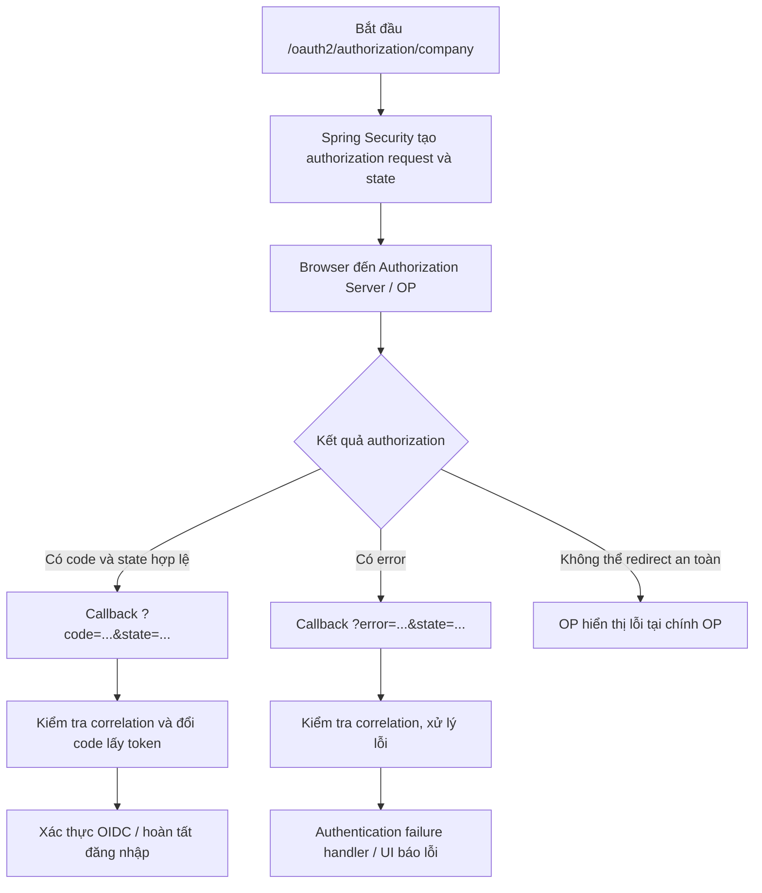
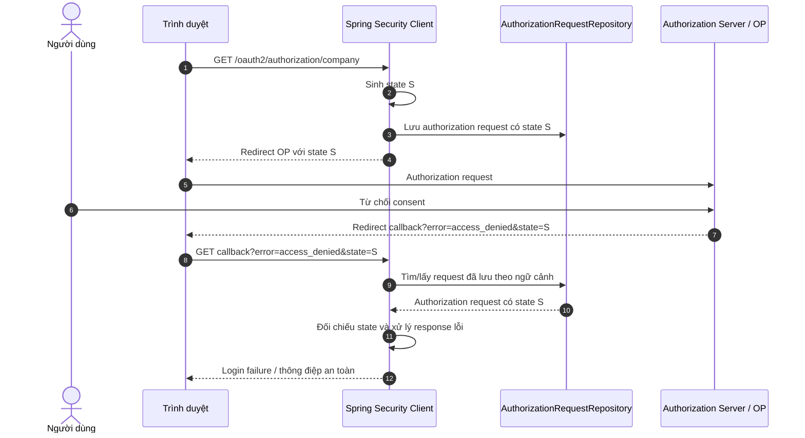

# 9.6. Xử lý error, error_description và error_uri từ provider

Trong **Spring Security OAuth 2.0 / OIDC Client**, callback từ Authorization Server (hoặc OpenID Provider, viết tắt là **OP**) không phải lúc nào cũng mang `code`. Người dùng có thể từ chối cấp quyền, phiên đăng nhập tại OP có thể hết hạn, request có thể thiếu scope, hoặc provider gặp sự cố. Khi có thể trả lỗi qua redirect hợp lệ, provider thường gửi một **authorization error response** chứa `error` cùng các tham số tùy chọn `error_description`, `error_uri` và `state`.

Một ứng dụng xử lý tốt cần thực hiện đồng thời hai nhiệm vụ:

1. **Xử lý đúng giao thức:** phân biệt callback thành công và callback lỗi; liên kết callback với authorization request ban đầu; không tiếp tục đổi authorization code khi callback đã báo lỗi.
2. **Xử lý an toàn cho người dùng và hệ thống:** hiển thị thông điệp phù hợp, ghi nhận mã lỗi để chẩn đoán, tránh đưa dữ liệu từ provider chưa được tin cậy vào HTML, redirect hoặc log.

Bài học tập trung vào **Authorization Code Flow trên Servlet stack** với Spring Security OAuth 2.0 Login/OIDC Login. Các ví dụ dùng Spring Boot 3.x và Spring Security 6.x theo API phổ biến; URL và giá trị mã lỗi là dữ liệu minh họa.

## 1. Hai nhánh của callback Authorization Code Flow

Giả sử ứng dụng có registration `company`. Người dùng bắt đầu đăng nhập tại:

```text
GET https://app.example.test/oauth2/authorization/company
```

Spring Security tạo authorization request, lưu trạng thái tương quan và chuyển browser đến OP. Sau tương tác ở OP sẽ có hai trường hợp chính.

### 1.1. Callback thành công

```http
GET /login/oauth2/code/company?code=AUTHORIZATION_CODE&state=ORIGINAL_STATE HTTP/1.1
Host: app.example.test
```

Client cần kiểm tra response tương ứng với request gốc, rồi mới dùng authorization code để gọi token endpoint. Nếu là OIDC, client còn thực hiện các bước xác minh thông tin định danh được trả về.

### 1.2. Callback lỗi

```http
GET /login/oauth2/code/company?error=access_denied&error_description=User%20cancelled%20authorization&state=ORIGINAL_STATE HTTP/1.1
Host: app.example.test
```

Đây là authorization response báo lỗi. Với callback kiểu này, ứng dụng phải kết thúc quá trình xác thực hiện tại ở trạng thái thất bại. Nó **không có authorization code hợp lệ để đổi lấy token** chỉ vì URL đi vào callback endpoint.



Nhánh cuối rất quan trọng: **không phải mọi lỗi tại OP đều được gửi về callback**. Nếu `client_id` không hợp lệ hoặc `redirect_uri` không hợp lệ/không khớp chính sách, Authorization Server thường phải dừng tại phía OP để tránh gửi authorization response đến một URI chưa được xác nhận.

## 2. Ý nghĩa chính xác của ba tham số lỗi

Một ví dụ đầy đủ, URL đã được xuống dòng cho dễ đọc:

```text
https://app.example.test/login/oauth2/code/company
  ?error=access_denied
  &error_description=The%20resource%20owner%20denied%20the%20request
  &error_uri=https%3A%2F%2Fid.example.test%2Fdocs%2Ferrors%23access-denied
  &state=STATE_FROM_ORIGINAL_REQUEST
```

Theo mô hình OAuth 2.0, các trường được hiểu như sau:

| Tham số | Bắt buộc trong error response? | Ý nghĩa | Cách ứng dụng nên xử lý |
| --- | --- | --- | --- |
| **`error`** | Có | Mã lỗi giao thức, chẳng hạn `access_denied` hoặc `invalid_scope` | Phân loại và ánh xạ sang hành vi/thông báo nội bộ đã biết |
| **`error_description`** | Không | Mô tả lỗi do server cung cấp để hỗ trợ người phát triển hiểu nguyên nhân | Chỉ dùng làm dữ liệu chẩn đoán có kiểm soát; không hiển thị trực tiếp |
| **`error_uri`** | Không | URI chỉ đến trang tài liệu bổ sung về lỗi | Không tự chuyển hướng hoặc mở URL; chỉ sử dụng nếu được xác thực theo allowlist tin cậy |
| **`state`** | Có nếu authorization request đã gửi `state` | Giá trị dùng liên kết response với request khởi đầu | Đối chiếu với trạng thái đã lưu; không dựa vào callback không khớp |

**`error` là mã máy đọc**, không phải câu thông báo cho người dùng cuối. Ví dụ `access_denied` thường có thể chuyển thành “Bạn chưa cấp quyền đăng nhập/cho phép truy cập”, nhưng không thể tự suy ra mọi mã tùy biến của nhà cung cấp.

**`error_description` không được đảm bảo là văn bản ổn định**. Provider có thể đổi câu chữ, ngôn ngữ, dấu câu, tham số phụ hoặc định dạng mà không thay đổi loại lỗi. Không phân nhánh nghiệp vụ bằng cách so khớp chính xác một thông điệp mô tả.

**`error_uri` không phải Redirect URI của ứng dụng.** Redirect URI là nơi OP gửi callback về; error URI là một liên kết tài liệu mà OP khai báo. Hai URI này có mục đích khác nhau.

### 2.1. Cả ba tham số là dữ liệu đi qua trình duyệt

Trong Authorization Code Flow thông thường, callback lỗi đi qua **front channel** (trình duyệt). Dù OP hợp lệ là nguồn được kỳ vọng, request callback tới ứng dụng vẫn có thể bị người dùng hoặc đối tượng khác gửi thủ công.

Vì vậy, đừng coi một URL chứa:

```text
?error=access_denied&state=anything
```

là bằng chứng chắc chắn có một giao dịch OAuth hợp lệ. **Correlation với authorization request gốc** vẫn là điều kiện quan trọng trước khi diễn giải kết quả này trong ngữ cảnh đăng nhập.

### 2.2. Dấu cách, ký tự đặc biệt và URL encoding

Giá trị `error_description` và `error_uri` thường được percent-encode khi nằm trong query string. Framework nhận và giải mã request parameter theo cơ chế Servlet.

Ví dụ:

```text
error_description=Login%20required
```

sẽ trở thành chuỗi “Login required” sau khi giải mã.

Không cần tự giải mã nhiều lần hoặc ghép chuỗi HTML từ query thô. **Giải mã không đồng nghĩa dữ liệu đã an toàn để render**. Chuỗi có thể vẫn chứa các ký tự gây XSS nếu ứng dụng dùng nó làm HTML không escape.

## 3. Những mã lỗi OAuth 2.0 hay gặp

Các mã dưới đây thường xuất hiện tại **authorization endpoint** theo OAuth 2.0:

| `error` | Ý nghĩa cơ bản | Hướng chẩn đoán |
| --- | --- | --- |
| **`access_denied`** | Resource Owner hoặc Authorization Server từ chối yêu cầu | Người dùng bấm Cancel/Deny? Chính sách quyền/truy cập có chặn? |
| **`invalid_request`** | Authorization request thiếu/thừa/sai tham số hoặc có cấu trúc không hợp lệ | `response_type`, `client_id`, `redirect_uri`, `state`, tham số mở rộng |
| **`unauthorized_client`** | Client không được phép yêu cầu authorization theo phương thức đang dùng | Grant type/response type có được cấp cho client ID này? |
| **`unsupported_response_type`** | Authorization Server không hỗ trợ kiểu response yêu cầu | Client có gửi `response_type=code` không? AS có cho phép Code Flow không? |
| **`invalid_scope`** | Scope yêu cầu sai, không tồn tại hoặc nằm ngoài phạm vi được phép | Scope đăng ký, chính sách consent và scope của môi trường |
| **`server_error`** | Authorization Server không thể xử lý request do lỗi nội bộ | Sự cố OP; kiểm tra status, request ID và log tại OP |
| **`temporarily_unavailable`** | Authorization Server tạm thời không phục vụ, ví dụ bảo trì/quá tải | Kiểm tra tình trạng OP, đợi hệ thống phục hồi rồi bắt đầu giao dịch mới |

Những mã này có thể xảy ra trong nhiều hoàn cảnh, và một số provider phân loại khác nhau theo chính sách. Không suy diễn nguyên nhân chỉ từ một mã nếu chưa có thêm dữ kiện.

### 3.1. Những mã bổ sung của OIDC

OIDC Core định nghĩa thêm các lỗi liên quan đến yêu cầu xác thực, đặc biệt khi client sử dụng tham số như `prompt=none`:

| Mã | Tình huống có thể gặp |
| --- | --- |
| **`login_required`** | OP cần người dùng đăng nhập, nhưng request không thể hoàn tất mà không tương tác |
| **`interaction_required`** | Cần tương tác với người dùng mà chế độ hiện tại không cho phép |
| **`consent_required`** | Phải xin đồng ý cấp quyền |
| **`account_selection_required`** | Phải để người dùng chọn tài khoản |

Ví dụ khi client cố thực hiện một yêu cầu OIDC không hiển thị UI:

```text
prompt=none
```

và OP chưa có phiên đăng nhập phù hợp, OP có thể trả:

```text
error=login_required
```

Điều đó không nhất thiết có nghĩa mật khẩu sai; **OP đang thông báo không thể hoàn thành xác thực một cách im lặng**. Nếu nghiệp vụ yêu cầu người dùng đăng nhập, ứng dụng có thể hướng họ bắt đầu một **giao dịch đăng nhập tương tác mới**, tùy loại client và chính sách.

### 3.2. Mã lỗi tùy biến

Một Identity Provider có thể trả mã không có trong bảng chuẩn, hoặc dùng mã riêng để phản ánh chính sách tổ chức. Hãy coi mã lạ là **lỗi chưa phân loại**:

- Không hiển thị nguyên mã hoặc description lên UI một cách thiếu kiểm soát.
- Không coi mã lạ là thành công.
- Không dùng mã lạ làm tham số điều hướng tùy ý.
- Có thể ghi lại mã đã lọc/giới hạn cho chẩn đoán nội bộ, cùng thông tin provider và request ID được phép lưu.

Trong ứng dụng có yêu cầu UX cụ thể, nên duy trì **mapping mã lỗi → nhóm lỗi nội bộ → thông báo UI**.

## 4. Error callback khác với lỗi từ token endpoint

Sự nhầm lẫn phổ biến là thấy cùng một trường `error` ở nhiều bước và kết luận mọi lỗi đều xảy ra trong callback.

### 4.1. Authorization endpoint error: đến qua browser

Ví dụ:

```http
GET /login/oauth2/code/company?error=access_denied&state=... HTTP/1.1
Host: app.example.test
```

Người dùng đã ở bước tương tác với OP và OP gửi response báo lỗi về callback. Spring Security xử lý nhánh thất bại của việc đăng nhập.

### 4.2. Token endpoint error: xảy ra sau callback có code

Callback có thể hoàn toàn hợp lệ:

```http
GET /login/oauth2/code/company?code=CODE&state=... HTTP/1.1
Host: app.example.test
```

Nhưng khi backend đổi code lấy token, token endpoint trả JSON lỗi:

```http
HTTP/1.1 400 Bad Request
Content-Type: application/json

{
  "error": "invalid_grant",
  "error_description": "Authorization code is expired or invalid"
}
```

`invalid_grant` ở đây là **token endpoint error**, không phải error response của authorization redirect. Nguyên nhân có thể là code đã hết hạn, bị sử dụng lại, redirect URI khi đổi code không khớp, hoặc PKCE verifier sai.

Đối với người dùng cuối, cả hai có thể dẫn tới đăng nhập thất bại, nhưng **cách chẩn đoán và vị trí kiểm tra log khác nhau**:

| Lớp lỗi | Dấu hiệu | Nơi xử lý |
| --- | --- | --- |
| Authorization redirect error | Callback chứa `error=...` | OAuth2 Login callback/filter |
| Token exchange error | Callback có `code`, nhưng POST token endpoint bị từ chối | OAuth2 token response client / authentication provider |
| OIDC ID token validation error | Token endpoint thành công nhưng ID token không vượt qua kiểm tra | OIDC authentication provider và token validator |
| UserInfo/API error | Login hoặc token thành công nhưng lời gọi tiếp theo thất bại | OIDC UserInfo client / resource API caller |
| Session/correlation error | Không tìm thấy authorization request hoặc state không hợp lệ | AuthorizationRequestRepository và callback processing |

Không thể sửa lỗi token endpoint bằng cách chỉ thay UI đọc `error_description` của callback.

## 5. Correlation: tại sao phải kiểm tra state ngay cả khi provider báo lỗi?

Trong Authorization Code Flow, Spring Security thường tạo một `OAuth2AuthorizationRequest` trước khi chuyển trình duyệt sang provider. Request này chứa `state` ngẫu nhiên và các thông tin như registration, redirect URI, scope, cùng thuộc tính phục vụ PKCE/OIDC khi được cấu hình.

Request đang chờ được lưu qua **`AuthorizationRequestRepository<OAuth2AuthorizationRequest>`**. Với Servlet login phổ biến, Spring Security dùng **`HttpSessionOAuth2AuthorizationRequestRepository`**.

Khi provider trả về callback thành công **hoặc** callback lỗi, cần bảo đảm response thuộc authorization request thực sự do ứng dụng đã khởi động.



### 5.1. Nếu state không khớp thì sao?

Giả sử ứng dụng đang lưu request với `state=S1`, nhưng callback có:

```text
?error=access_denied&state=S2
```

Không nên chấp nhận callback này như kết quả của request `S1`. Có thể đây là:

- Callback bị thay đổi hoặc bị chèn từ bên ngoài.
- Browser mất cookie/session cũ, hoặc một tab khác tạo giao dịch mới.
- Ứng dụng có nhiều instance nhưng không chia sẻ trạng thái authorization request.
- Callback về khác hostname/context path, khiến cookie phiên không được gửi.
- Authorization request bị timeout trước khi user hoàn tất trên OP.

Lỗi correlation phải được xem như **thất bại bảo mật của giao dịch hiện tại**, không phải một `access_denied` thông thường có thể coi là đã được OP xác nhận.

### 5.2. Có cần so sánh `error_description` với request ban đầu?

Không. Correlation dựa trên giá trị và metadata được thiết kế cho giao thức, chủ yếu là `state` cùng authorization request đã lưu. `error_description` là văn bản chẩn đoán, không phải cơ chế xác thực thông điệp.

### 5.3. Khi provider không trả state

Theo OAuth 2.0, nếu client gửi `state` trong authorization request, provider phải trả lại cùng giá trị trong authorization response phù hợp. Nếu không có hoặc không khớp, ứng dụng không nên bỏ qua validation chỉ vì có `error`.

Đừng “sửa nhanh” bằng cách tạo một state mặc định, bỏ kiểm tra session hoặc nhận mọi callback lỗi như hợp lệ.

## 6. Spring Security xử lý callback lỗi qua những thành phần nào?

Với `oauth2Login()` trên Servlet stack, callback thường nằm ở:

```text
/login/oauth2/code/{registrationId}
```

**`OAuth2LoginAuthenticationFilter`** phụ trách request này. Nó tham gia quy trình dựng và xác thực authorization response, kiểm tra ngữ cảnh request ban đầu và gọi các authentication provider tương ứng. Nếu lỗi xảy ra, authentication sẽ thất bại và **`AuthenticationFailureHandler`** có cơ hội quyết định response trả về browser.

Một cách hình dung:

```text
OAuth2AuthorizationRequestRedirectFilter
  └── Tạo authorization request và state
      └── AuthorizationRequestRepository.save(...)
          └── 302 đến OP

Browser quay về /login/oauth2/code/company
  └── OAuth2LoginAuthenticationFilter
      ├── Đọc authorization response (code hoặc error)
      ├── Khôi phục authorization request gốc
      ├── Kiểm tra correlation và thực hiện xác thực
      └── Nếu thất bại:
          └── AuthenticationFailureHandler
              ├── Ghi nhận nhóm lỗi an toàn
              └── Hiển thị trang login/lỗi phù hợp
```

Thực tế, quá trình đổi code và xác thực OIDC được chia giữa filter, authentication manager/provider và các client/service liên quan. Không nên viết Servlet controller để tự giải mã `error` rồi bỏ qua cơ chế callback có sẵn của Spring Security.

### 6.1. Đối tượng OAuth2Error

Spring Security có kiểu **`org.springframework.security.oauth2.core.OAuth2Error`** để biểu diễn một lỗi OAuth2:

```java
String code = error.getErrorCode();
String description = error.getDescription();
String uri = error.getUri();
```

Các trường thể hiện **dữ liệu lỗi theo giao thức**, không có nghĩa description và URI là nội dung đã được kiểm duyệt.

Trong một số thất bại xác thực liên quan OAuth2, bạn có thể gặp **`OAuth2AuthenticationException`** và lấy `OAuth2Error` qua `getError()`. Nhưng không phải mọi lỗi đăng nhập đều mang nguyên mã từ provider: lỗi correlation, token parsing, network, token validation hoặc exception khác có thể được biểu diễn bằng mã hoặc exception do framework tạo.

Do đó, handler nên **có nhánh fallback** và không giả định luôn nhận được `access_denied`.

### 6.2. AuthenticationFailureHandler

`AuthenticationFailureHandler` nhận:

```java
void onAuthenticationFailure(
        HttpServletRequest request,
        HttpServletResponse response,
        AuthenticationException exception)
```

Nhiệm vụ thường là:

1. Phân loại lỗi thành nhóm nội bộ an toàn để quan sát.
2. Trả về một trang hoặc redirect cố định cho người dùng.
3. Không cho login request hiện tại trở thành trạng thái authenticated.
4. Không phản chiếu nguyên `error_description` hoặc `error_uri` từ URL vào response.

Cách Spring Security chuyển hướng mặc định khi thất bại có thể thay đổi theo cấu hình `loginPage`, failure URL/handler và phiên bản. Đừng giả định mọi ứng dụng đều hiển thị cùng `/login?error` khi chưa đọc cấu hình thực tế.

## 7. Ví dụ: cấu hình failure handler an toàn trong Spring Security

Giả sử application có một OIDC registration `company`, và bạn muốn mọi lỗi đăng nhập quay về trang `/login?authError=1`, đồng thời ghi nhận nhóm lỗi trong log.

### 7.1. Client registration

```yaml
spring:
  security:
    oauth2:
      client:
        registration:
          company:
            provider: company
            client-id: ${OIDC_CLIENT_ID}
            client-secret: ${OIDC_CLIENT_SECRET}
            authorization-grant-type: authorization_code
            redirect-uri: "{baseUrl}/login/oauth2/code/{registrationId}"
            scope:
              - openid
              - profile
              - email

        provider:
          company:
            issuer-uri: ${OIDC_ISSUER_URI}
```

URI issuer trong ví dụ cần trỏ tới OP thật và tương thích cấu hình discovery. Secret phải được quản lý bên ngoài repository.

### 7.2. SecurityFilterChain với failure handler

```java
import org.slf4j.Logger;
import org.slf4j.LoggerFactory;
import org.springframework.context.annotation.Bean;
import org.springframework.context.annotation.Configuration;
import org.springframework.security.authentication.AuthenticationServiceException;
import org.springframework.security.config.annotation.web.builders.HttpSecurity;
import org.springframework.security.core.AuthenticationException;
import org.springframework.security.oauth2.core.OAuth2AuthenticationException;
import org.springframework.security.web.SecurityFilterChain;

@Configuration
class OidcLoginSecurityConfig {

    private static final Logger log =
            LoggerFactory.getLogger(OidcLoginSecurityConfig.class);

    @Bean
    SecurityFilterChain securityFilterChain(HttpSecurity http) throws Exception {
        return http
            .authorizeHttpRequests(auth -> auth
                .requestMatchers("/", "/login", "/error", "/assets/**").permitAll()
                .anyRequest().authenticated())
            .oauth2Login(oauth2 -> oauth2
                .loginPage("/login")
                .failureHandler((request, response, exception) -> {
                    String category = safeCategory(exception);

                    // Ghi metadata đã phân loại; không ghi URL callback, state,
                    // error_description, error_uri, token hoặc nguyên exception.
                    log.warn("OAuth2 login failed: category={}", category);

                    response.sendRedirect(
                        request.getContextPath() + "/login?authError=1");
                }))
            .build();
    }

    private static String safeCategory(AuthenticationException exception) {
        if (exception instanceof OAuth2AuthenticationException oauth2) {
            String code = oauth2.getError().getErrorCode();

            return switch (code) {
                case "access_denied" -> "access_denied";
                case "login_required" -> "login_required";
                case "interaction_required" -> "interaction_required";
                case "consent_required" -> "consent_required";
                case "invalid_scope" -> "invalid_scope";
                case "server_error", "temporarily_unavailable" ->
                    "provider_unavailable";
                default -> "oauth2_authentication_failed";
            };
        }

        if (exception instanceof AuthenticationServiceException) {
            return "authentication_service_failed";
        }

        return "authentication_failed";
    }
}
```

**Điểm quan trọng của ví dụ:**

- Handler dùng một **đích redirect cố định**, tránh tạo URL từ `error_uri` hay description không được tin cậy.
- `safeCategory(...)` chỉ trả về nhãn từ danh sách cố định. Không dùng raw error code làm đường dẫn, HTML hay metric label có cardinality không kiểm soát.
- Không gọi `exception.getMessage()` để đưa lên trang login; thông điệp exception có thể chứa dữ liệu từ provider.
- Nếu framework đóng gói lỗi theo cách khác, nhóm `authentication_failed` vẫn an toàn và rõ nghĩa.
- Đoạn code chỉ minh họa xử lý error callback. Ứng dụng thật cần cung cấp route/view cho `/login` và quản lý logging/observability theo thiết kế hệ thống.

### 7.3. Trang login hiển thị thông điệp gì?

Ví dụ nội dung UI do ứng dụng tự cung cấp:

```html
<div role="alert" id="login-error" hidden>
  Không thể hoàn tất đăng nhập. Vui lòng thử lại
  hoặc liên hệ bộ phận hỗ trợ nếu lỗi tiếp diễn.
</div>

<a href="/oauth2/authorization/company">Đăng nhập bằng Company SSO</a>
```

Mã giao diện cần quyết định có hiển thị cảnh báo dựa vào tham số cố định `authError=1` hoặc trạng thái nội bộ đã kiểm soát, và phải bảo vệ XSS. Tham số này **chỉ điều khiển UI**, không chứng minh rằng provider đã gửi một lỗi thực; người dùng có thể tự gõ URL `/login?authError=1`.

Nếu muốn hiển thị câu cụ thể như “Bạn đã hủy đăng nhập”, có thể dùng nhóm lỗi an toàn do backend tạo và lưu tạm qua cơ chế phù hợp, thay vì hiện toàn bộ `error_description`. Cần cân nhắc vòng đời session và việc thông điệp còn tồn tại sau redirect.

### 7.4. Vì sao không log nguyên AuthenticationException?

Một số exception có thể chứa description do provider cung cấp. Ghi `exception.getMessage()` hoặc full stack trace ở mọi lần user bấm Cancel dễ gây nhiễu, còn có thể làm lộ callback data, context nội bộ hoặc nội dung nhạy cảm.

Đối với hành vi thông thường như `access_denied` do người dùng hủy, logging có thể ở mức INFO hoặc metric với nhãn cố định; các lỗi hệ thống cần log chi tiết hơn qua kênh được bảo vệ và đã lọc dữ liệu. Ví dụ code ở trên dùng `WARN` cho dễ quan sát, không nhất thiết là mức log tối ưu cho mọi tổ chức.

## 8. Mapping mã lỗi thành hành vi ứng dụng

Một chính sách tốt tách **mã lỗi giao thức** khỏi **phản ứng sản phẩm** và **điều tra kỹ thuật**.

| Nhóm | Mã minh họa | Hành vi UI hợp lý | Hành vi hệ thống |
| --- | --- | --- | --- |
| **Người dùng hủy/từ chối** | `access_denied` | “Bạn chưa hoàn tất đăng nhập.” | Giữ ở trạng thái chưa đăng nhập; cho phép bắt đầu lại |
| **Cần tương tác** | `login_required`, `interaction_required`, `consent_required` | “Cần xác thực hoặc xác nhận quyền truy cập.” | Hướng tới flow tương tác mới nếu phù hợp |
| **Cấu hình client/scope lỗi** | `invalid_scope`, `unauthorized_client`, `unsupported_response_type` | “Không thể đăng nhập lúc này. Hãy liên hệ hỗ trợ.” | Cảnh báo vận hành, đối chiếu registration/OP config |
| **Provider gặp sự cố** | `server_error`, `temporarily_unavailable` | “Dịch vụ đăng nhập đang gặp sự cố. Vui lòng thử lại sau.” | Ghi nhận provider/correlation ID an toàn; theo dõi tình trạng OP |
| **Correlation hoặc callback không hợp lệ** | State thiếu/sai, request gốc không tồn tại | Thông báo thất bại chung | Không tiếp tục giao dịch; rà session/cookie/route |
| **Lỗi không nhận diện** | Mã vendor riêng hoặc exception khác | Thông báo chung | Giữ mã nội bộ được kiểm soát để điều tra |

**Không tự động retry vô hạn** với `access_denied` hoặc `login_required`. Mỗi lần authorization cần tương tác phải do flow thích hợp khởi tạo, không nên tạo vòng redirect liên tục giữa ứng dụng và OP.

Trong ứng dụng phải phân biệt lỗi người dùng **chủ động từ chối** với lỗi kỹ thuật. Mặc dù đều thất bại về authentication, chúng cần cách giao tiếp và mức độ cảnh báo khác nhau.

## 9. Xử lý an toàn error_description

`error_description` rất hữu ích cho nhà phát triển, nhưng là **dữ liệu bên ngoài**. Ba vấn đề phổ biến:

### 9.1. XSS và HTML injection

Giả sử callback chứa một description không an toàn:

```text
error_description=<script>alert('unexpected')</script>
```

Một ứng dụng tự viết controller có thể mắc lỗi nếu ghép description trực tiếp vào HTML bằng `innerHTML` hoặc template unescaped.

Ví dụ **không nên làm**:

```javascript
const params = new URLSearchParams(window.location.search);
document.getElementById("error").innerHTML =
    params.get("error_description");
```

Đoạn code trên có thể biến chuỗi trong URL thành nội dung HTML có khả năng thực thi. Dùng thông báo nội bộ cố định là cách tốt nhất. Nếu bắt buộc phải hiển thị văn bản từ nguồn bên ngoài trong công cụ quản trị, hãy dùng cơ chế escape phù hợp, chính sách làm sạch nội dung, giới hạn độ dài và quyền truy cập nghiêm ngặt.

### 9.2. Description không phải API ổn định

Provider có thể thay đổi từ:

```text
User denied consent
```

thành:

```text
The user cancelled the authorization request
```

mà cả hai vẫn đi với mã `access_denied`.

Nếu ứng dụng phân loại bằng `description.contains("cancelled")`, thay đổi văn bản sẽ làm hỏng logic. Hãy dùng **`error` hoặc loại exception nội bộ** để phân nhóm; description chỉ là gợi ý chẩn đoán có thể thiếu hoặc thay đổi.

### 9.3. Log injection và tiết lộ thông tin

Description có thể chứa ký tự xuống dòng, chuỗi giống log entry, email/account hint hoặc nội dung do cấu hình provider sinh ra. Ghi nguyên chuỗi có thể làm log khó phân tích hoặc đưa thông tin không nên lưu vào hệ thống quan sát.

Hướng xử lý:

- Ghi **mã nhóm lỗi đã allowlist** và metadata không nhạy cảm.
- Không ghi nguyên query string của callback, state, authorization code, access token, ID token hay refresh token.
- Nếu quy trình hỗ trợ thực sự cần description, lọc ký tự điều khiển, giới hạn độ dài, che dữ liệu nhạy cảm và giữ trong log bảo vệ với thời hạn lưu phù hợp.
- Dùng request/correlation ID được hệ thống tạo và quản lý thay vì biến `state` thành mã theo dõi công khai.

## 10. Xử lý an toàn error_uri

`error_uri` có thể chứa địa chỉ tài liệu từ provider:

```text
https://id.example.test/docs/errors/access_denied
```

Nhưng nó cũng có thể là URL không mong đợi trong callback giả mạo:

```text
https://untrusted.example.test/collect?data=...
```

**Không tự động:**

- `response.sendRedirect(errorUri)`.
- Gọi HTTP GET đến URI đó từ backend chỉ vì provider trả về.
- Render thành liên kết không kiểm soát trong UI.
- Gửi cookie, token hoặc thông tin user vào URI đó.

Nếu sản phẩm muốn cung cấp liên kết “Tìm hiểu thêm”, hãy dùng **URL tài liệu được cấu hình cố định** của tổ chức hoặc OP đã xác minh. Trong trường hợp cần sử dụng `error_uri` từ response, phải kiểm tra scheme HTTPS, hostname allowlist, đường dẫn/chính sách phù hợp và cách mở liên kết an toàn. Việc thực hiện HTTP request từ backend theo URI tùy ý còn có thể tạo rủi ro SSRF.

**Mục đích của error_uri là tham khảo tài liệu, không phải điểm đến của flow xác thực.**

## 11. Những trường hợp callback không nên diễn giải như lỗi provider thông thường

### 11.1. Thiếu correlation

```text
/login/oauth2/code/company?error=access_denied&state=UNKNOWN
```

Nếu không có authorization request tương ứng, ứng dụng không có đủ ngữ cảnh để chấp nhận response. Lỗi này phải được xử lý như giao dịch không hợp lệ, không dựa vào `error` để xác nhận một phiên đã được provider từ chối.

### 11.2. Có đồng thời code và error

Một response chuẩn thành công chứa authorization code, trong khi response lỗi chứa `error`. Nếu callback có cả:

```text
?code=SOME_CODE&error=access_denied&state=...
```

đây là dữ liệu bất thường. Đừng cố chọn nhánh “thành công” vì có code. Hãy để thư viện xử lý theo validation của giao thức và coi dữ liệu không nhất quán là thất bại cần điều tra.

### 11.3. Redirect URI không hợp lệ

Nếu ứng dụng gửi:

```text
redirect_uri=https://wrong.example.test/login/oauth2/code/company
```

nhưng OP chỉ cho phép callback tại `https://app.example.test/login/oauth2/code/company`, provider có thể hiển thị lỗi ngay ở trang của nó. Ứng dụng **không nhận** `?error=invalid_request` ở callback, vì OP không nên redirect đến URI chưa được xác nhận.

Khi debug, hãy xem response của authorization request và log tại OP/AS, thay vì chỉ tìm `AuthenticationFailureHandler` trong ứng dụng.

### 11.4. Người dùng đóng tab hoặc rời khỏi OP

Nếu người dùng đóng cửa sổ đăng nhập trước khi OP trả về callback, **không có HTTP callback** để ứng dụng xử lý. Một timeout hoặc lần vào trang sau đó phải được phân biệt với error response thực sự.

### 11.5. Form POST response mode

Một số triển khai OIDC có thể sử dụng `response_mode=form_post` để OP gửi authorization response bằng POST form thay vì query trên redirect GET. Khi đó các tham số lỗi có thể nằm trong **form body**; session cookie và CSRF protection cần được cấu hình tương ứng.

Không giả định mọi `error` đều nằm trong query string GET. Đồng thời, không thay đổi CSRF handling chỉ để nhận POST callback nếu chưa đánh giá đầy đủ hỗ trợ của phiên bản Spring Security và chính sách SameSite/cross-site của browser.

## 12. Lỗi đăng nhập và trạng thái phiên người dùng

Một callback báo lỗi **không tự tạo `OAuth2AuthorizedClient` mới** và cũng không chứng minh người dùng đã đăng nhập.

Tuy nhiên, cần phân biệt hai trạng thái:

- **Authorization request đang chờ:** dữ liệu gắn với lần chuyển hướng vừa bắt đầu. Nó cần được sử dụng/loại bỏ theo cơ chế callback và không nên được dùng lại như một giao dịch mới.
- **SecurityContext hoặc phiên đăng nhập đã có từ trước:** nếu người dùng đã có phiên hợp lệ rồi khởi động một liên kết account mới, thất bại của authorization mới không nhất thiết đồng nghĩa mọi session trước đó đã bị xóa.

Khi dùng `OAuth2LoginAuthenticationFilter` và failure handler mặc định hoặc tùy biến, hành vi xóa security context/session, lưu exception hay điều hướng còn phụ thuộc filter configuration và session policy. Không nên viết logic thủ công “lỗi provider → xóa toàn bộ session” mà không cân nhắc mục đích business, logout và quy trình liên kết tài khoản.

Nếu màn hình đăng nhập báo thất bại, trạng thái UI phải phản ánh **giao dịch đăng nhập đó**; không tự tuyên bố đã logout khỏi OP hoặc đã revoke token từ xa.

## 13. Quan sát và chẩn đoán lỗi qua nhiều môi trường

Một lỗi callback thường liên quan ít nhất ba nơi:

1. **Browser/Network:** authorization request, redirect đến OP, callback URL/HTTP status.
2. **Spring Boot Client:** SecurityFilterChain, OAuth2 Login filter, authorization request repository, failure handler, session/cookie.
3. **Authorization Server / OP:** cấu hình client, scope, Redirect URI allowlist, chính sách consent/MFA và sự cố nội bộ.

Dưới đây là những trường hợp thường gặp.

| Triệu chứng | Lớp lỗi có thể có | Hướng tìm nguyên nhân |
| --- | --- | --- |
| Người dùng bấm “Cancel” rồi quay lại trang login | `access_denied` | Xác nhận flow từ chối là hành vi hợp lệ, UI có nút thử lại |
| OP hiện “Redirect URI mismatch” và không trở về app | Lỗi validate authorization request tại OP | So sánh `redirect_uri` với allowlist của đúng client ID |
| Callback có `error=invalid_scope` | Scope request không hợp lệ/không được cho phép | Xem registration scopes, chính sách client và môi trường OP |
| Callback có `error=login_required` | OP cần người dùng tương tác | Có dùng `prompt=none` hay silent authorization? |
| Callback có `error=temporarily_unavailable` | OP tạm ngừng xử lý | Tình trạng OP, lịch bảo trì, retry sau qua flow mới |
| Callback có error hợp lệ nhưng ứng dụng báo state mismatch | Session/correlation | Kiểm tra session cookie, domain, timeout, nhiều instance |
| Callback có code nhưng token endpoint trả `invalid_grant` | Token exchange | Code lifetime, PKCE, redirect URI, đồng hồ và token request |
| OIDC login thất bại dù token endpoint thành công | ID token validation | Issuer, audience, signature/JWKS, expiry, nonce |
| User không thấy gì, browser vẫn ở OP | Không có callback hoặc OP lỗi tại chỗ | Xem Network/OP; không giả định app failure handler đã chạy |
| UI hiển thị chuỗi kỹ thuật hoặc URL lạ | Ứng dụng render raw provider response | Thay bằng mapping thông điệp đã kiểm soát |

### 13.1. Local

Ở local, callback thường có dạng:

```text
http://localhost:8080/login/oauth2/code/company
```

Nếu đổi `localhost` thành `127.0.0.1` hoặc đổi port, cookie/session và allowlist Redirect URI có thể không còn khớp. Có thể kết quả nhìn giống một lỗi provider, nhưng nguyên nhân thật nằm ở cấu hình local.

### 13.2. Staging

Staging thường đứng sau HTTPS reverse proxy. Nếu Spring Boot suy ra `http://internal-service:8080` để dựng Redirect URI, OP có thể từ chối ngay tại authorization request hoặc đưa browser về sai origin. Cần cấu hình forwarded headers từ proxy đáng tin hoặc Redirect URI tường minh.

### 13.3. Production

Production cần tránh log query callback chưa lọc, bảo vệ session trên nhiều instance, giới hạn quyền đọc log và phân biệt người dùng từ chối với lỗi hệ thống. Khi tỷ lệ `server_error` hoặc `temporarily_unavailable` tăng bất thường, nhóm vận hành có thể điều tra sức khỏe provider với metadata đã lọc mà không cần thu thập token hay mật khẩu.

## 14. Thiết kế quan sát lỗi có cấu trúc

Một sự kiện đăng nhập thất bại có thể ghi nhận:

```json
{
  "event": "oauth2_login_failure",
  "registration_id": "company",
  "category": "access_denied",
  "environment": "staging",
  "request_id": "internal-trace-id",
  "result": "authentication_failed"
}
```

Đây là **schema gợi ý** chứ không phải JSON Spring Security tự động phát ra. Các giá trị phải xuất phát từ cấu hình nội bộ/metadata đã kiểm soát; **không lấy `registration_id` hoặc `request_id` tùy tiện từ query callback của người dùng**.

Không đưa vào event này:

- Giá trị `state` gốc.
- Authorization code hoặc toàn bộ callback URL.
- Access token, ID token, refresh token hoặc client secret.
- Password, cookie session hoặc nguyên thông báo lỗi chứa PII.
- `error_uri` chưa kiểm tra.
- `error_description` chưa qua quy trình lọc phù hợp.

Đối với metric, dùng nhãn có tập giá trị hạn chế như `category` và `registration_id` cấu hình sẵn. Tránh để raw `error` hoặc `error_description` tạo vô số nhãn khác nhau làm tăng cardinality.

### Khi cần thông tin chi tiết để điều tra

Nếu có sự cố khó tái hiện, có thể bật log bảo mật chọn lọc trong môi trường kiểm soát, ví dụ:

```yaml
logging:
  level:
    org.springframework.security.oauth2.client: DEBUG
    org.springframework.security.web.FilterChainProxy: DEBUG
```

Mục tiêu là thấy request đi vào chain nào và exception xuất hiện ở bước nào. Không bật TRACE rộng hoặc log raw header, raw query/body, token exchange payload trong production. Trước khi chia sẻ ảnh chụp Network, hãy che `code`, `state`, cookie và mọi token/secret.

## 15. Hướng dẫn xử lý theo từng loại lỗi

### 15.1. `access_denied`: người dùng từ chối cấp quyền

**Tình huống:** người dùng nhấn Cancel ở màn hình consent. OP redirect về:

```text
/login/oauth2/code/company?error=access_denied&state=...
```

**Hành vi nên có:**

- Không tạo phiên đăng nhập mới từ giao dịch đó.
- Trả về trang login với thông báo trung tính.
- Cho phép người dùng chủ động bấm đăng nhập lại.
- Không tự động redirect ngay về OP, vì có thể tạo vòng lặp và bỏ qua lựa chọn từ chối của người dùng.

Nếu `access_denied` xảy ra vì chính sách của OP (ví dụ tài khoản chưa được cấp quyền), UI vẫn nên có hướng liên hệ hỗ trợ. Muốn phân biệt nguyên nhân chi tiết, cần nguồn đáng tin từ chính sách/quan sát phía OP, không suy diễn chỉ từ mã lỗi.

### 15.2. `login_required`: không thể đăng nhập im lặng

**Tình huống:** ứng dụng gửi authorize request có `prompt=none` nhưng OP cần xác thực tương tác. OP trả:

```text
?error=login_required&state=...
```

Ứng dụng có thể gợi ý người dùng mở flow đăng nhập tương tác thông thường. Không được tự gỡ mọi kiểm tra MFA hay tự giả định OP gặp lỗi hệ thống.

### 15.3. `invalid_scope`: cấu hình sai quyền yêu cầu

**Tình huống:** local dùng `scope=openid profile report.read` nhưng client ID không được cấp `report.read`.

**Hướng xử lý:** kiểm tra `spring.security.oauth2.client.registration.company.scope`, client grants/scopes tại OP và chính sách của môi trường. Đây thường là lỗi cấu hình cần kỹ thuật can thiệp, không nên yêu cầu user thử lại liên tục.

### 15.4. `server_error` hoặc `temporarily_unavailable`

**Tình huống:** OP bị quá tải hoặc đang bảo trì.

**Hướng xử lý:** dùng thông điệp “Dịch vụ đăng nhập đang tạm thời gặp sự cố”, ghi nhận sự kiện vận hành, và chỉ khuyến nghị retry có giới hạn sau khi người dùng hoặc workflow phù hợp bắt đầu phiên mới. Đừng replay authorization response cũ hoặc dùng lại authorization code nếu có.

### 15.5. Correlation lỗi sau khi có error callback

**Tình huống:** callback có `error=access_denied` nhưng không có authorization request tương ứng trong session.

**Hướng xử lý:** ưu tiên điều tra session và bảo mật correlation. Không nên báo chắc chắn “Bạn đã từ chối cấp quyền” nếu ứng dụng không xác nhận được giao dịch; thông điệp “Phiên đăng nhập không còn hợp lệ. Vui lòng bắt đầu lại” là phù hợp hơn.

## 16. Điều không nên tự làm ở controller callback

Một anti-pattern là tạo controller:

```java
// Ví dụ sai về thiết kế: không sử dụng thay OAuth2LoginAuthenticationFilter.
@GetMapping("/login/oauth2/code/company")
String callback(@RequestParam(required = false) String error,
                @RequestParam(required = false) String error_description) {
    // Sai: tùy ý đọc query, bỏ qua state/repository,
    // rồi hiển thị error_description trực tiếp.
    return error_description;
}
```

Vấn đề:

1. Controller không thay được luồng kiểm tra `state`/authorization request ban đầu.
2. Nếu trả raw description, có thể lộ dữ liệu hoặc bị injection tùy cách render.
3. Không xử lý đúng token exchange, PKCE, OIDC validation và các nhánh lỗi khác.
4. Có thể xung đột với URL vốn thuộc filter callback của Spring Security.

Trong Servlet application dùng `oauth2Login()`, nên **để filter và authentication provider chuẩn nhận callback**, sau đó tùy biến **`AuthenticationFailureHandler`** để điều khiển cách ứng dụng phản hồi về UI.

Nếu hệ thống có giao thức callback phi chuẩn từ một nhà cung cấp, cần đánh giá rõ giới hạn tương thích của provider và cơ chế mở rộng thích hợp; không nên bỏ validation để làm callback “chạy được”.

## 17. Bài thực hành: phân biệt lỗi và quyết định phản ứng

Giả sử ứng dụng có registration:

```yaml
spring:
  security:
    oauth2:
      client:
        registration:
          company:
            provider: company
            client-id: ${OIDC_CLIENT_ID}
            client-secret: ${OIDC_CLIENT_SECRET}
            authorization-grant-type: authorization_code
            redirect-uri: "{baseUrl}/login/oauth2/code/{registrationId}"
            scope: openid, profile
        provider:
          company:
            issuer-uri: ${OIDC_ISSUER_URI}
```

Khi thử nghiệm, chỉ nên dùng **OP test/staging** và tài khoản thử nghiệm. Các cách quan sát hữu ích:

1. Bắt đầu đăng nhập từ `/oauth2/authorization/company` để Spring Security sinh một authorization request và state thật.
2. Ở màn hình consent của OP, chọn từ chối nếu OP hỗ trợ để quan sát callback `access_denied`.
3. Dùng browser Network để nhận diện `error` và xem có `state`; không chia sẻ nguyên giá trị state.
4. Xác nhận ứng dụng không lập Authentication mới và chuyển đến trang lỗi/login an toàn.
5. Nếu OP cần scope không hợp lệ để tạo `invalid_scope`, thực hiện trên client test, tránh làm hỏng client production.
6. Tái hiện lỗi session có kiểm soát bằng cách để authorization request hết hạn, rồi quan sát việc callback không khớp và đảm bảo ứng dụng xử lý như một giao dịch lỗi.

**Không dùng thủ thuật gõ trực tiếp `?error=access_denied&state=FAKE` rồi kết luận Spring Security không hỗ trợ error callback**. Một callback giả không có giao dịch đang chờ rất có thể bị chặn do correlation; đó là hành vi cần có.

### Ma trận hành vi mong đợi

| Kiểm tra | Kết quả mong đợi |
| --- | --- |
| User hủy consent, state hợp lệ | Login thất bại an toàn, không đổi code, hiển thị trang/thông báo phù hợp |
| Callback thiếu hoặc sai state | Bị từ chối, không xác lập Authentication |
| Callback có description chứa HTML/script | Không được render như HTML có thể thực thi |
| Callback có error_uri trỏ tới domain lạ | Không tự redirect hoặc backend fetch URL đó |
| Provider trả mã không nhận diện | Nhóm lỗi mặc định, không coi là thành công |
| Token endpoint trả `invalid_grant` sau callback có code | Phân loại lỗi token exchange; không nhầm với authorization redirect error |
| OP từ chối redirect URI ngay tại authorize request | Có thể không có callback; chẩn đoán ở OP/authorize request |
| User đóng tab trước khi OP callback | Không có callback error để xử lý; flow đang chờ sẽ hết hạn theo cơ chế |
| Login thành công từ provider | Không đi vào failure handler; tiếp tục xác minh OIDC và thiết lập trạng thái đăng nhập |

## 18. Câu hỏi tự kiểm tra

**Câu 1.** Callback có:

```text
?error=access_denied&error_description=Denied&state=EXPECTED_STATE
```

Có nên thực hiện token request không?

> Không. Đây là nhánh authorization error. Ứng dụng phải kiểm tra correlation và kết thúc giao dịch ở trạng thái thất bại, không lấy token bằng một authorization code không tồn tại.

**Câu 2.** Vì sao `error_description` không nên đưa thẳng lên trang web?

> Nó là dữ liệu đi qua front channel và không được đảm bảo an toàn hoặc ổn định. Có thể chứa nội dung gây XSS hoặc thông tin không phù hợp với người dùng. Hãy dùng mapping lỗi nội bộ sang thông điệp đã kiểm soát.

**Câu 3.** `error_uri` khác `redirect_uri` thế nào?

> `redirect_uri` là callback mà OP đưa browser trở lại. `error_uri` là URL tài liệu bổ sung về lỗi, không phải một điểm đích mà ứng dụng phải chuyển hướng tới.

**Câu 4.** Nếu error callback có state khác authorization request trong session, có được bỏ qua mismatch vì “provider chỉ báo lỗi” không?

> Không. Error response vẫn cần correlation. Một callback không khớp phải được xem là giao dịch không hợp lệ, không dựa vào `error` để khẳng định kết quả từ OP.

**Câu 5.** OP hiển thị `invalid_redirect_uri` và trình duyệt không quay về ứng dụng. Vì sao `AuthenticationFailureHandler` không chạy?

> Vì OP có thể từ chối một authorization request trước khi chuyển hướng, nhằm tránh gửi response đến URI chưa được xác thực. Không có callback vào Spring Security để filter xử lý.

**Câu 6.** Callback có `code` và `state` hợp lệ, nhưng token endpoint trả JSON `error=invalid_grant`. Đây có phải authorization callback error không?

> Không. Đây là lỗi khi đổi code lấy token, xảy ra phía backend sau callback. Người dùng vẫn thấy login thất bại, nhưng nên chẩn đoán token request, PKCE, code lifetime và redirect URI.

**Câu 7.** Khi tùy biến failure handler, nên ghi gì vào log?

> Một nhóm mã lỗi đã lọc, registration/provider từ cấu hình, môi trường, trace ID nội bộ và kết quả. Không log nguyên callback URL, state, token, error_uri hoặc description chưa được lọc.

**Câu 8.** Có nên tự động gửi browser đến `error_uri` vì provider yêu cầu trợ giúp không?

> Không. Đây chỉ là tham chiếu tài liệu, có thể không tin cậy. Nếu muốn cung cấp hướng dẫn, dùng URL tài liệu cố định hoặc một link đã xác minh theo allowlist và chính sách sản phẩm.

---

## Ghi nhớ

Trong luồng đăng nhập OAuth2/OIDC, callback lỗi có thể được nhận diện qua:

```text
/login/oauth2/code/{registrationId}
    ?error=<error-code>
    &error_description=<optional-text>
    &error_uri=<optional-reference>
    &state=<original-state-if-sent>
```

Bốn nguyên tắc cần giữ:

- **`error`** là mã để phân loại; **`error_description`** là gợi ý chẩn đoán; **`error_uri`** là tham chiếu tài liệu.
- Callback báo lỗi vẫn phải được **liên kết đúng với authorization request ban đầu bằng state và repository**; không tin dữ liệu callback chỉ vì nó có `error`.
- Trong Spring Security Servlet, nên để **`OAuth2LoginAuthenticationFilter` và các authentication provider** xử lý giao thức, rồi tùy biến **`AuthenticationFailureHandler`** cho UX và quan sát.
- Không render hoặc chuyển hướng trực tiếp theo description/URI chưa được tin cậy; không ghi token, code, state, cookie hoặc secret vào log.

### Tài liệu tham khảo

- [RFC 6749 — OAuth 2.0, Authorization Code Grant: Error Response](https://www.rfc-editor.org/rfc/rfc6749#section-4.1.2.1)
- [OpenID Connect Core 1.0 — Authentication Error Response](https://openid.net/specs/openid-connect-core-1_0.html#AuthError)
- [Spring Security — OAuth 2.0 Login Advanced Configuration](https://docs.spring.io/spring-security/reference/servlet/oauth2/login/advanced.html)
- [Spring Security API — OAuth2LoginAuthenticationFilter](https://docs.spring.io/spring-security/reference/api/java/org/springframework/security/oauth2/client/web/OAuth2LoginAuthenticationFilter.html)
