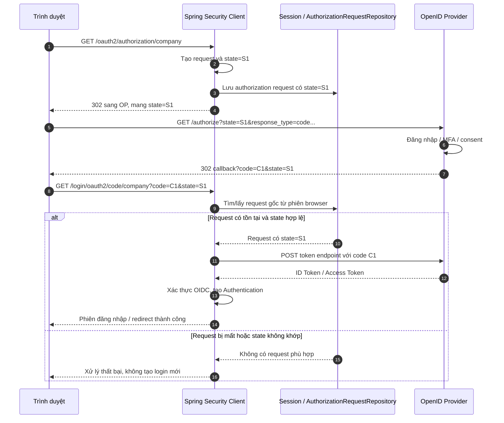

# 9.7. State không khớp, request thất lạc và phiên hết hạn

Khi một ứng dụng Spring Boot dùng **Spring Security OAuth 2.0 / OpenID Connect (OIDC) Client** nhận callback sau khi người dùng đăng nhập tại nhà cung cấp định danh, ba lỗi dễ gây nhầm lẫn là **`state` không khớp**, **không tìm được authorization request đã lưu** và **phiên trình duyệt đã hết hạn**. Người dùng có thể nhìn thấy màn hình đăng nhập thành công ở OpenID Provider (OP), nhưng ứng dụng vẫn không thể hoàn tất đăng nhập vì không đối chiếu được callback với yêu cầu ban đầu.

Đây là các lỗi liên quan **correlation**: ứng dụng cần chứng minh authorization response được trả về cho **đúng lần authorization request**, trong **đúng ngữ cảnh trình duyệt**, và đủ điều kiện để tiếp tục đổi authorization code lấy token. Không thể suy ra một callback hợp lệ chỉ từ việc URL có `code` hoặc OP đã xác thực mật khẩu/MFA thành công.

Bài học này phân biệt từng hiện tượng, mô tả cơ chế Spring Security Servlet sử dụng để giữ authorization request, giải thích nguyên nhân theo cookie/session, nhiều tab, reverse proxy và nhiều instance, đồng thời đưa ra cách điều tra, khắc phục mà vẫn giữ các ràng buộc bảo mật của OAuth 2.0/OIDC.

## 1. Bối cảnh: callback phải tìm được authorization request gốc

Giả sử ứng dụng quản lý đơn hàng chạy tại `https://orders.example.org`, đăng nhập qua OP tại `https://login.example.org`. Trong Spring Security, client registration có tên `company`.

Một luồng Authorization Code Flow điển hình:

1. Trình duyệt truy cập `/oauth2/authorization/company` trên **ứng dụng**.
2. Spring Security tạo `OAuth2AuthorizationRequest` gồm `state` và những dữ liệu cần thiết khác.
3. Ứng dụng lưu request đang chờ và chuyển trình duyệt sang authorization endpoint của OP.
4. Người dùng được OP xác thực; OP đưa browser trở lại `/login/oauth2/code/company?code=...&state=...`.
5. Ứng dụng lấy lại authorization request gốc, đối chiếu `state` rồi mới trao đổi authorization code với token endpoint.
6. Với OIDC, ứng dụng xác minh ID Token trước khi tạo `Authentication` và lưu `SecurityContext` để thiết lập phiên đăng nhập cục bộ.



Ở phía Servlet, những thành phần chính gồm:

| Thành phần | Vai trò |
|---|---|
| `OAuth2AuthorizationRequestRedirectFilter` | Khởi tạo và lưu authorization request, sau đó chuyển trình duyệt đến OP. |
| `OAuth2AuthorizationRequestResolver` | Xây dựng authorization request từ `ClientRegistration` cùng ngữ cảnh request. |
| `OAuth2AuthorizationRequest` | Chứa tham số yêu cầu như `state`, `redirect_uri`, scope và dữ liệu bổ sung liên quan. |
| `AuthorizationRequestRepository<OAuth2AuthorizationRequest>` | Hợp đồng lưu, tìm và tiêu thụ request đang chờ giữa hai lần HTTP request. |
| `HttpSessionOAuth2AuthorizationRequestRepository` | Repository mặc định thường dùng trong Spring Security Servlet, lưu authorization request bằng HTTP session. |
| `OAuth2LoginAuthenticationFilter` | Nhận callback tại `/login/oauth2/code/*`, khôi phục request gốc và kích hoạt xác thực OAuth2/OIDC. |
| `SecurityContextRepository` | Lưu trạng thái **sau khi đăng nhập thành công**, khác mục đích với repository chứa authorization request đang chờ. |

**Cốt lõi:** khi authorization response trở về, Spring Security cần khôi phục được request đã tạo trước đó. Lỗi correlation xảy ra trước hoặc trong quá trình liên kết response với request, nên chưa thể xem đăng nhập thành công ở ứng dụng.

## 2. Phân biệt ba hiện tượng chính

Tên lỗi hiển thị thực tế phụ thuộc phiên bản Spring Security, failure handler và cách triển khai repository. Các mã như `authorization_request_not_found` hoặc `invalid_state_parameter` có thể xuất hiện dưới dạng `OAuth2AuthenticationException`/`OAuth2Error`; đôi khi ứng dụng chỉ hiển thị `/login?error`.

| Hiện tượng | Điều gì đang xảy ra? | Dấu hiệu thường thấy |
|---|---|---|
| **State không khớp** | Có authorization response, nhưng `state` không tương ứng với authorization request mà client đang chờ. | Callback có `state=S1`, repository trả request có `state=S2`, hoặc cơ chế đối chiếu đánh dấu response không hợp lệ. |
| **Authorization request thất lạc** | Client không tìm được yêu cầu authorization ban đầu trong repository tại callback. | `authorization_request_not_found` hoặc thông báo tương tự, dù URL callback có `code` và `state`. |
| **Phiên hết hạn** | HTTP session lưu request chờ đã hết hiệu lực trước khi callback đến; vì vậy authorization request cũng không còn. | Callback về sau MFA/consent lâu; browser vẫn gửi cookie nhưng server không còn session tương ứng, hoặc không gửi cookie. |

Quan hệ giữa chúng là **nguyên nhân và biểu hiện**, không phải ba trạng thái loại trừ hoàn toàn:

- **Phiên hết hạn** có thể là nguyên nhân khiến **request thất lạc**.
- **Nhiều tab** có thể khiến request sau ghi đè request trước, biểu hiện thành **request thất lạc** hoặc **state không tương ứng**.
- **Mất cookie, proxy sai hoặc nhiều node** có thể khiến repository không nhìn thấy request gốc, giống triệu chứng của session hết hạn.
- **Một callback giả mạo** cũng có thể mang `state` không đúng; không nên mặc định tất cả lỗi state là lỗi hạ tầng vô hại.

Ngược lại, callback vượt qua bước kiểm tra state vẫn có thể thất bại ở token endpoint hoặc khi xác minh ID Token. Cần xác định **bước đầu tiên thất bại** thay vì gộp mọi lỗi OIDC thành «state lỗi».

## 3. `state` là gì và tại sao phải so khớp?

`state` là tham số của OAuth 2.0 authorization request, do **client sinh trước khi redirect** tới Authorization Server. Trong một triển khai an toàn, giá trị này đủ ngẫu nhiên, khó đoán, được gắn với authorization request và liên kết với ngữ cảnh browser.

Ví dụ authorization request:

```text
GET https://login.example.org/authorize
  ?response_type=code
  &client_id=orders-web
  &redirect_uri=https%3A%2F%2Forders.example.org%2Flogin%2Foauth2%2Fcode%2Fcompany
  &scope=openid%20profile
  &state=S1_random_value
```

Sau khi xác thực, OP trả browser về:

```text
https://orders.example.org/login/oauth2/code/company
  ?code=C1_short_lived_code
  &state=S1_random_value
```

Ứng dụng phải tìm request gốc của **chính browser này** và xác minh `state` được trả về tương ứng với `S1_random_value`. Nếu request đang lưu là `S2_random_value`, response không được chấp nhận.

### 3.1. Cơ chế bảo vệ login CSRF

Không có ràng buộc đúng giữa request/response, kẻ tấn công có thể thử hoàn tất một response xuất phát từ luồng của mình trong browser nạn nhân. Điều này có thể khiến nạn nhân đăng nhập nhầm vào tài khoản của kẻ tấn công hoặc bị trộn lẫn luồng xác thực.

`state` giúp giảm rủi ro **login CSRF/authorization response injection** khi được client sinh an toàn, lưu cùng authorization request và đối chiếu theo đúng browser. Sự tồn tại của một giá trị state trong callback không đủ; client phải biết giá trị ấy thuộc về request hợp lệ nào.

### 3.2. `state` không phải những giá trị nào?

| Giá trị | Chức năng |
|---|---|
| `state` | Liên kết authorization response với authorization request đã khởi tạo. |
| `nonce` | Trong OIDC, ràng buộc ID Token với yêu cầu xác thực nếu đã gửi nonce. |
| `code_verifier` / PKCE | Ràng buộc việc đổi authorization code tại token endpoint với client đã khởi tạo code challenge. |
| `JSESSIONID` / session cookie | Giúp browser tham chiếu tới phiên HTTP của ứng dụng; trong phiên có thể có authorization request đang chờ. |
| CSRF token của ứng dụng | Bảo vệ các request thay đổi trạng thái nghiệp vụ sử dụng cookie xác thực. |
| ID Token | Bằng chứng danh tính OIDC dành cho client sau khi đã được xác minh. |
| Access Token | Token để truy cập Resource Server theo phạm vi được cấp. |

Không dùng `state` làm ID phiên, không dùng nó làm token truy cập API và không gán một chuỗi cố định như `state=company` cho mọi lần login. Không tắt cơ chế state vì đã có PKCE hay `nonce`: các ràng buộc có vai trò khác nhau.

### 3.3. Vì sao đúng URL callback vẫn chưa đủ?

Bất kỳ ai cũng có thể thử gọi một URL kiểu:

```http
GET /login/oauth2/code/company?code=some-code&state=some-state HTTP/1.1
Host: orders.example.org
```

Tên `company` trong path chỉ xác định một phần cấu hình, không chứng minh browser đã bắt đầu login. Client phải kiểm tra authorization request đã lưu, `state`, client/issuer liên quan, rồi mới tiến hành token exchange.

Trong hệ thống có nhiều OP, không tin một query parameter tùy ý để tự đổi issuer/token endpoint. Phải gắn response với registration/issuer đã được chọn trước đó và kiểm tra ID Token tương ứng; điều này còn giúp giảm rủi ro **authorization server mix-up**.

## 4. Authorization request được lưu như thế nào?

Spring Security Servlet mặc định thường dùng `HttpSessionOAuth2AuthorizationRequestRepository`. Khi browser truy cập điểm bắt đầu OAuth2 login, repository lưu `OAuth2AuthorizationRequest` vào HTTP session của ứng dụng.

Sơ đồ khái niệm:

```text
Trước khi chuyển sang OP:

Browser
  Cookie: JSESSIONID=SESSION_A
    |
    v
HTTP session SESSION_A
  └── OAuth2AuthorizationRequest
       ├── registration / provider context
       ├── redirect_uri
       ├── scopes
       ├── state = S1
       ├── nonce (nếu áp dụng OIDC)
       └── code_verifier (nếu áp dụng PKCE)
```

Đến callback, browser phải trở về **ngữ cảnh phiên phù hợp**:

```text
GET /login/oauth2/code/company?code=C1&state=S1
Cookie: JSESSIONID=SESSION_A
```

Repository dùng HTTP session trong request hiện tại để tìm lại authorization request đã lưu. Việc so khớp state chỉ có ý nghĩa khi **request gốc được lấy từ đúng nơi lưu trữ**.

### 4.1. Vì sao session có thể tồn tại trước khi login?

Trước khi người dùng nhập mật khẩu tại OP, ứng dụng vẫn có thể cần HTTP session để giữ:

- Authorization request và state.
- Dữ liệu nonce/PKCE dùng để hoàn tất OIDC Code Flow.
- Request ứng dụng mà người dùng định truy cập sau login (ví dụ thông qua `RequestCache`).

Do đó, browser có `JSESSIONID` **chưa có nghĩa** đã đăng nhập. Sau login thành công, Spring Security mới tạo `Authentication` và lưu `SecurityContext` theo repository được cấu hình. Cơ chế chống session fixation còn có thể đổi session ID sau khi xác thực.

### 4.2. Authorization request thường được tiêu thụ

Khi callback được xử lý đúng, authorization request được lấy và loại khỏi nơi lưu phù hợp với implementation của repository. Không nên dựa vào việc có thể dùng lại `state` mãi mãi.

Hai ràng buộc cần phân biệt:

- **OP** kiểm soát authorization code hết hạn và việc code chỉ được đổi theo các điều kiện cho phép, thông thường một lần.
- **Client** kiểm soát authorization request đang chờ và đối chiếu `state` trước khi tiếp tục xử lý.

Nếu người dùng refresh URL callback cũ, request có thể đã bị tiêu thụ và code đã được dùng. Một lỗi sau refresh là hành vi có thể dự kiến, không nhất thiết cho thấy lần đăng nhập đầu tiên đã thất bại.

### 4.3. Cơ chế lưu mặc định và giới hạn nhiều tab

`HttpSessionOAuth2AuthorizationRequestRepository` mặc định thường lưu **một authorization request đang chờ trên mỗi HTTP session**. Khi tab khác khởi tạo login mới trước khi callback đầu tiên về, request mới có thể thay thế request cũ.

Ví dụ:

```text
09:00:00  Tab A khởi tạo login -> state=A1, lưu request A
09:00:04  Tab B khởi tạo login -> state=B1, lưu request B
09:00:07  Tab A nhận callback -> state=A1
09:00:07  Repository hiện giữ request B (state=B1)
09:00:07  Không thể hoàn tất callback của A như request hợp lệ
```

Tình trạng này không được khắc phục bằng việc chấp nhận bất kỳ `state` nào từng xuất hiện. Nếu sản phẩm cần đăng nhập song song nhiều tab hoặc nhiều OP, cần cơ chế repository hỗ trợ **nhiều request chờ**, vẫn ràng buộc chúng với đúng browser, TTL và quy tắc tiêu thụ một lần.

## 5. State không khớp: các nguyên nhân cụ thể

Một mismatch có thể là lỗi bảo mật cần từ chối, hoặc hậu quả vận hành của trạng thái bị thay thế. Cách hiểu phải bắt đầu từ dữ liệu có thể kiểm chứng.

### 5.1. Trình duyệt mở hai flow đăng nhập cùng lúc

Như ví dụ hai tab, request mới ghi đè request cũ. Khi callback của request cũ đến, `state` không còn tương ứng.

Dấu hiệu:

- Đăng nhập một tab thường thành công; hai tab hoặc hai lần nhấn login liên tiếp dễ thất bại.
- Mỗi lần bắt đầu login đều tạo authorization request khác.
- Callback thất bại thường là callback của lần khởi tạo trước.

Hướng xử lý:

- Hạn chế khởi tạo nhiều login flow đồng thời nếu sản phẩm chỉ hỗ trợ một flow mỗi browser session.
- Nếu thực sự cần parallel login, xây dựng `AuthorizationRequestRepository` đa request có giới hạn số lượng/TTL và binding theo browser.
- Không tự động đổi code của callback không khớp state.

### 5.2. Callback được gửi tới phiên khác

Một callback sinh từ browser A nhưng được mở trong browser B, chế độ ẩn danh khác, hoặc trên thiết bị khác không có session tương ứng. Dù `state` trong URL là giá trị từng tồn tại ở A, nó không thuộc authorization request của B.

Hướng xử lý: người dùng bắt đầu lại flow trong **cùng trình duyệt và ngữ cảnh cookie**; hệ thống vẫn phải từ chối callback không liên kết được.

### 5.3. URL callback bị sửa hoặc có callback giả mạo

Nếu một script, plugin, ứng dụng trung gian hoặc actor khác gửi `state` sai, đây là dấu hiệu response không thể tin cậy. Không nên suy đoán đây chỉ là lỗi nhỏ rồi bỏ kiểm tra.

Đặc biệt khi hỗ trợ nhiều provider, kiểm tra state cùng thông tin registration/issuer đã lưu giúp phát hiện phản hồi không thuộc yêu cầu ban đầu.

### 5.4. Client tùy biến resolver/repository không nhất quán

Một `OAuth2AuthorizationRequestResolver` tự viết có thể vô ý:

- Thay đổi `state` sau khi request đã được lưu.
- Làm mất attributes liên quan registration, nonce hoặc PKCE.
- Sinh request một lần để lưu nhưng tạo request khác khi xây dựng redirect.
- Dùng hai repository khác nhau giữa điểm khởi tạo và callback.
- Không hỗ trợ logic load/remove theo cùng quy ước state.

Khi đó callback đúng của OP cũng có thể bị từ chối. Nếu chỉ cần thêm `prompt`, `login_hint` hoặc tham số hợp lệ của OP, nên dùng extension point của Spring Security sao cho cơ chế sinh state và lưu request mặc định vẫn hoạt động.

## 6. Authorization request thất lạc: các nguyên nhân cụ thể

Thông báo kiểu `authorization_request_not_found` thường có nghĩa **client không khôi phục được authorization request ban đầu**. Nó không tự động chứng minh OP bị lỗi.

### 6.1. Cookie session không quay về callback

Authorization request nằm trong HTTP session của ứng dụng. Nếu browser không gửi cookie tham chiếu phiên ấy, server có thể nhìn callback như một browser mới.

Nguyên nhân thường thấy:

- Cookie domain/path không bao phủ callback URL.
- Cookie có thuộc tính `Secure` nhưng callback được sinh qua HTTP.
- Chính sách `SameSite` và phương thức callback không phù hợp.
- Browser chặn cookie hoặc môi trường nhúng trong iframe/third-party context.
- Người dùng mở callback từ một trình duyệt hoặc thiết bị khác.
- Host khác nhau, chẳng hạn bắt đầu với `localhost` nhưng callback về `127.0.0.1`, hoặc đổi subdomain trong lúc flow chạy.

Cần quan sát **cookie của ứng dụng ở request bắt đầu và callback**, không chỉ cookie SSO của OP.

### 6.2. Session bị xóa hoặc hết hạn ở server

Browser vẫn có thể gửi `JSESSIONID` nhưng backend đã xóa session do timeout, restart node, eviction, mất dữ liệu ở kho session hoặc thao tác chủ động vô hiệu session. Cookie có mặt không có nghĩa session còn tồn tại.

Khi đó repository không tìm được authorization request. Hành vi từ chối login là cần thiết vì không còn dữ liệu để đối chiếu response.

### 6.3. Một yêu cầu khác đã thay thế hoặc tiêu thụ request

Bấm login nhiều lần, mở nhiều tab, callback gửi hai lần, hoặc retry không đúng có thể khiến request đầu tiên bị thay thế/loại bỏ. Đây là nhóm nguyên nhân liên quan **vòng đời authorization request**, không phải OP mất khả năng xác thực người dùng.

### 6.4. Callback không đi qua filter/repository dự kiến

Nếu có nhiều `SecurityFilterChain`, reverse proxy rewrite path, custom callback URI, hoặc nhiều ứng dụng nhận cùng hostname, callback có thể đến nhầm nơi. Trong trường hợp đó, kết quả có thể là 404/401/redirect hoặc request not found tùy cấu hình.

Luồng Servlet mặc định nhận callback tại `/login/oauth2/code/{registrationId}` nhờ `OAuth2LoginAuthenticationFilter`. Nếu đổi URL, phải đồng bộ `redirect-uri` ở registration, matcher của redirection endpoint và danh sách callback tại OP.

### 6.5. Nhiều instance không chia sẻ session

Khi bắt đầu login trên node A, authorization request có thể được lưu trong session cục bộ của A. Callback qua load balancer đến node B không có dữ liệu đó.

```text
Browser -> Load Balancer -> Spring A
                           lưu SESSION_A / OAuth2AuthorizationRequest

Browser -> OP -> callback -> Load Balancer -> Spring B
                                          không thấy SESSION_A
                                          -> request thất lạc
```

Đây là tình huống phổ biến khi mở rộng hệ thống từ một instance sang nhiều instance mà chưa giải quyết vấn đề session persistence hoặc affinity.

## 7. Phiên hết hạn: phải phân biệt thời điểm và loại phiên

Từ «hết phiên» có thể chỉ nhiều hiện tượng khác nhau. Trong OIDC Client, cần phân biệt:

| Loại | Ai quản lý? | Khi hết hạn thường gây điều gì? |
|---|---|---|
| **Phiên HTTP của ứng dụng trước callback** | Ứng dụng Spring Boot/session store | Authorization request đang chờ không còn; callback bị từ chối. |
| **Phiên HTTP của ứng dụng sau login** | Ứng dụng Spring Boot | Request nghiệp vụ tiếp theo không còn authentication; có thể bị chuyển sang login mới. |
| **Phiên SSO tại OP** | OpenID Provider | Khi được chuyển đến OP, người dùng có thể phải đăng nhập/MFA lại. |
| **Authorization code** | Authorization Server/OP | Token endpoint có thể trả `invalid_grant` do code hết hạn/đã dùng, dù state vẫn hợp lệ. |
| **ID Token / Access Token** | OP/Authorization Server với chính sách kiểm tra tương ứng | Ảnh hưởng việc xác minh token hoặc gọi API; không đồng nhất với thời hạn HTTP session của ứng dụng. |

### 7.1. Phiên hết hạn trước callback

Ví dụ:

```text
09:00   App tạo authorization request, state=S1, session=SESSION_A
09:01   User được chuyển tới OP và bắt đầu MFA
09:15   Session phía app hết hạn theo cấu hình hoặc eviction
09:18   User hoàn tất MFA, OP chuyển callback state=S1 về app
09:18   App không tìm thấy SESSION_A/request S1 -> login thất bại
```

Ở đây **MFA đã thành công** nhưng request chưa thể hoàn tất vì thời hạn tồn tại của authorization request/session tại client không đủ.

Hướng xử lý hợp lệ:

- Điều chỉnh timeout của session/kho authorization request đủ cho luồng xác thực thực tế, nhưng không kéo dài vô hạn.
- Giảm các hoạt động làm mất session giữa redirect và callback.
- Cung cấp thông báo rõ ràng để người dùng **bắt đầu lại login** khi flow hết hạn.
- Nếu có TTL riêng cho authorization request, thiết lập TTL thích hợp và xóa request cũ.
- Không chấp nhận callback cũ chỉ vì người dùng nói rằng họ vừa xác thực tại OP.

### 7.2. Phiên hết hạn sau login

Một phiên đăng nhập đã được tạo thành công có thể hết hạn sau một thời gian không hoạt động. Truy cập `/orders` về sau có thể khởi tạo một authorization request **mới**. Nếu OP vẫn có SSO cookie, browser có thể quay về gần như ngay lập tức và người dùng tưởng rằng phiên ứng dụng chưa từng hết hạn.

Đây là hành vi bình thường khi **phiên ứng dụng** và **phiên SSO tại OP** độc lập. Không nên kết luận có lỗi state chỉ vì ứng dụng khởi động lại login sau khi timeout.

### 7.3. Authorization code hết hạn không giống session hết hạn

Nếu client đã tìm được request và state khớp nhưng backend đổi code quá muộn, OP có thể từ chối code (thường `invalid_grant`). Trọng tâm điều tra chuyển từ session/state sang **token exchange**: code đã hết hạn, được sử dụng trước đó, redirect URI hoặc PKCE không phù hợp.

Cần ghi rõ **bước lỗi đầu tiên**:

- Không tìm request gốc: vấn đề correlation/session repository.
- Tìm request nhưng `state` không khớp: vấn đề state/callback correlation.
- State hợp lệ, token endpoint trả lỗi: vấn đề code/client/PKCE/provider.
- Token hợp lệ, nhưng request sau login lại anonymous: vấn đề lưu/khôi phục `SecurityContext` và phiên sau login.

## 8. Cookie và browser: những chi tiết dễ làm mất request

### 8.1. Cookie phiên ứng dụng khác cookie SSO

Ví dụ:

```text
orders.example.org -> JSESSIONID của ứng dụng
login.example.org  -> cookie SSO của OP
```

Màn hình OP cho thấy người dùng vẫn đăng nhập không chứng minh HTTP session của ứng dụng còn tồn tại. Trong DevTools, phải kiểm tra domain/path của cookie và request header **`Cookie` gửi đến callback của ứng dụng**.

### 8.2. `SameSite` phụ thuộc phương thức callback

Với callback OAuth2/OIDC thông dụng là chuyển hướng **GET** top-level, cookie có `SameSite=Lax` thường được gửi theo chính sách browser hiện đại. Nhưng nếu OP dùng **`response_mode=form_post`**, callback có thể là **POST cross-site**; nhiều trình duyệt sẽ không gửi cookie `SameSite=Lax` trong ngữ cảnh ấy.

Khi không có session cookie, authorization request trở thành «không tìm thấy» dù state trên URL/body là chính xác. Không nên ngay lập tức sửa bằng cách đặt mọi cookie thành `SameSite=None`: giá trị này có yêu cầu `Secure` và ảnh hưởng tới bề mặt CSRF của ứng dụng.

Xác định response mode thực tế, luồng trình duyệt, chính sách cookie và hỗ trợ của provider trước khi chọn cách cấu hình.

### 8.3. `Secure`, domain, path và host

Nếu ứng dụng khởi tạo tại `https://orders.example.org` nhưng callback được sinh thành `http://orders.example.org`, cookie `Secure` không được gửi qua HTTP, đồng thời đường truyền không đáp ứng yêu cầu triển khai an toàn.

Tương tự, cookie host-only của `orders.example.org` không mặc nhiên được gửi sang `auth.orders.example.org`. Nếu dùng context path `/app`, callback thực tế phải đi đúng path và cookie path phải bao phủ endpoint cần thiết.

Không mở cookie domain quá rộng chỉ để giải quyết lỗi login mà không đánh giá phạm vi subdomain tin cậy.

### 8.4. Tác động của refresh, back và thao tác lại

Sau khi callback đã được xử lý, browser refresh chính URL chứa code/state có thể đưa đến lỗi vì:

- Authorization request đã được tiêu thụ.
- Authorization code đã được sử dụng một lần.
- Session ID có thể đã thay đổi sau khi login thành công do chống session fixation.

Ứng dụng nên redirect từ callback sang một URL nghiệp vụ sạch, không còn code/state. Người dùng không cần lưu hoặc refresh callback URL.

## 9. Reverse proxy và nhiều instance

Một URL public và URL backend khác nhau:

```text
Browser:
https://orders.example.org/oauth2/authorization/company

Reverse proxy / Ingress:
https://orders.example.org -> http://orders-service:8080

Backend:
http://orders-service:8080/oauth2/authorization/company
```

Nếu Spring tạo `{baseUrl}` theo host/scheme nội bộ, Authorization Server có thể từ chối redirect URI hoặc browser quay về host không có cookie ban đầu. Với `redirect-uri` mặc định:

```yaml
redirect-uri: "{baseUrl}/login/oauth2/code/{registrationId}"
```

cần bảo đảm `{baseUrl}` đại diện cho địa chỉ **public**. Proxy phải chuyển và ứng dụng phải xử lý các forwarded headers theo hạ tầng tin cậy; không chấp nhận forwarded headers do client bên ngoài tự giả mạo.

### 9.1. Cấu hình phiên mẫu

Một cấu hình Spring Boot Servlet minh họa:

```yaml
server:
  servlet:
    session:
      timeout: 30m
      cookie:
        http-only: true
        secure: true
        same-site: lax
```

Thời gian `30m` chỉ là ví dụ, phải phù hợp trải nghiệm đăng nhập và chính sách tổ chức. `secure: true` giả định truy cập ngoài qua HTTPS; môi trường dev HTTP cần cấu hình môi trường khác phù hợp. `same-site: lax` thích hợp cho nhiều callback dạng GET, nhưng không mặc định đúng với `form_post` hoặc flow nhúng.

Nếu reverse proxy được cấu hình để gửi các forwarded headers đáng tin cậy, có thể cần cấu hình xử lý forwarded headers của Spring Boot/Servlet container tương ứng. Luôn giới hạn nguồn header ở proxy được kiểm soát.

### 9.2. Thiết kế session cho nhiều node

Các lựa chọn kiến trúc thường dùng:

| Cách tổ chức | Lợi ích | Cần chú ý |
|---|---|---|
| **Shared session store**, ví dụ Spring Session trên kho dùng chung | Node nhận callback có thể đọc session tạo ở node khác. | TTL, tính sẵn sàng, serialization, bảo mật kho session và vận hành. |
| **Session affinity** tại load balancer | Có thể đưa callback về cùng node với bước khởi tạo. | Node restart/failover có thể mất session; phải hiểu giới hạn của affinity. |
| **Custom AuthorizationRequestRepository** phân tán | Có thể quản lý nhiều pending request và TTL rõ ràng. | Phải giữ binding với browser, tính toàn vẹn, an toàn khi tiêu thụ request. |
| **Một node trong môi trường nhỏ/dev** | Đơn giản để triển khai và chẩn đoán. | Không thay thế kiến trúc session phù hợp khi scale. |

Trong hệ thống phân tán, ngoài authorization request còn có **`SecurityContext` sau login** và có thể có `OAuth2AuthorizedClient`/token storage. Chúng có vòng đời và trách nhiệm khác nhau; phải xác định thứ gì cần chia sẻ khi mở rộng ứng dụng.

## 10. Cấu hình Spring Security và vị trí quản lý correlation

### 10.1. Ví dụ OIDC client tối thiểu

Trong `application.yml`:

```yaml
spring:
  security:
    oauth2:
      client:
        registration:
          company:
            provider: company-oidc
            client-id: ${OIDC_CLIENT_ID}
            client-secret: ${OIDC_CLIENT_SECRET}
            authorization-grant-type: authorization_code
            redirect-uri: "{baseUrl}/login/oauth2/code/{registrationId}"
            scope:
              - openid
              - profile
              - email
        provider:
          company-oidc:
            issuer-uri: https://login.example.org/realms/company
```

Trong cấu hình Servlet security:

```java
import org.springframework.context.annotation.Bean;
import org.springframework.context.annotation.Configuration;
import org.springframework.security.config.Customizer;
import org.springframework.security.config.annotation.web.builders.HttpSecurity;
import org.springframework.security.web.SecurityFilterChain;

@Configuration
public class SecurityConfiguration {

    @Bean
    SecurityFilterChain webSecurityFilterChain(HttpSecurity http)
            throws Exception {
        http
            .authorizeHttpRequests(auth -> auth
                .requestMatchers("/", "/login", "/public/**").permitAll()
                .anyRequest().authenticated()
            )
            .oauth2Login(Customizer.withDefaults());

        return http.build();
    }
}
```

Với cấu hình phổ biến này, Spring Security dùng các thành phần mặc định quản lý authorization request/state ở phía Servlet. Không cần tự viết callback controller để đọc `code` rồi đổi token; `OAuth2LoginAuthenticationFilter` xử lý callback.

Nếu dùng custom login page, success handler hoặc failure handler, phải giữ nguyên những ràng buộc xác thực của flow.

### 10.2. Vì sao không dùng `STATELESS` tùy tiện?

Spring Security OAuth2 Login Servlet mặc định dựa vào repository để giữ authorization request trong thời gian browser rời ứng dụng. Nếu ứng dụng cấu hình toàn bộ luồng thành `SessionCreationPolicy.STATELESS` nhưng không thiết kế repository/binding riêng, việc khôi phục request và duy trì phiên có thể không đúng kỳ vọng.

Một ứng dụng kiến trúc stateless vẫn phải giải quyết bằng cách an toàn:

- Tạo `state` khó đoán cho authorization request.
- Lưu dữ liệu cần đối chiếu trong kho có kiểm soát hoặc dữ liệu bảo vệ tính toàn vẹn.
- Ràng buộc request với **browser đã khởi tạo**.
- Giữ nonce/PKCE verifier phù hợp với request nếu được dùng.
- Đặt TTL, cơ chế tiêu thụ một lần và ngăn phản hồi giả mạo.
- Xác định riêng cơ chế khôi phục authentication cho các request nghiệp vụ sau login.

Chỉ bỏ HTTP session không loại bỏ nhu cầu bảo vệ correlation.

### 10.3. Cấu hình repository tường minh

Để nhìn rõ điểm lưu và tra cứu, có thể khai báo `HttpSessionOAuth2AuthorizationRequestRepository` rồi gắn vào `oauth2Login()`:

```java
import org.springframework.context.annotation.Bean;
import org.springframework.context.annotation.Configuration;
import org.springframework.security.config.annotation.web.builders.HttpSecurity;
import org.springframework.security.oauth2.client.web.AuthorizationRequestRepository;
import org.springframework.security.oauth2.client.web.HttpSessionOAuth2AuthorizationRequestRepository;
import org.springframework.security.oauth2.core.endpoint.OAuth2AuthorizationRequest;
import org.springframework.security.web.SecurityFilterChain;

@Configuration
public class OAuth2CorrelationConfiguration {

    @Bean
    AuthorizationRequestRepository<OAuth2AuthorizationRequest>
            authorizationRequestRepository() {
        return new HttpSessionOAuth2AuthorizationRequestRepository();
    }

    @Bean
    SecurityFilterChain securityFilterChain(
            HttpSecurity http,
            AuthorizationRequestRepository<OAuth2AuthorizationRequest>
                    authorizationRequestRepository) throws Exception {

        http
            .authorizeHttpRequests(auth -> auth
                .requestMatchers("/", "/login", "/public/**").permitAll()
                .anyRequest().authenticated()
            )
            .oauth2Login(oauth2 -> oauth2
                .authorizationEndpoint(endpoint -> endpoint
                    .authorizationRequestRepository(authorizationRequestRepository)
                )
            );

        return http.build();
    }
}
```

Đoạn code này là **một cấu hình thay thế** ví dụ `SecurityFilterChain` trước đó, không đăng ký hai chain trùng phạm vi trong cùng project. Khi chỉ cần flow chuẩn, không bắt buộc tạo Bean này vì Spring Security đã có repository mặc định. Khi tùy biến, phải bảo đảm thành phần bắt đầu login và thành phần nhận callback **dùng cơ chế lưu tương thích**.

### 10.4. Không sửa `state` bằng customization tùy tiện

Nếu muốn thêm tham số của provider như `prompt=login` hoặc `login_hint`, nên dùng `DefaultOAuth2AuthorizationRequestResolver`/customizer phù hợp. Không tự tạo một `OAuth2AuthorizationRequest` mới mà đánh mất state, nonce, PKCE hoặc attributes ràng buộc client registration.

Không thiết kế một request resolver gán `state` bằng URL nghiệp vụ hoặc thông tin từ browser. URL cần quay về sau login thường được xử lý bằng `RequestCache` hoặc cơ chế được kiểm soát riêng; `state` nên được dành cho vai trò correlation.

## 11. Cách điều tra: theo dõi từng chặng, xác định điểm mất dữ liệu

Hãy điều tra từ request đầu tiên, vì **callback chỉ là chặng cuối của một yêu cầu đã được lưu**.

| Bước | Điều cần xác định | Câu trả lời giúp làm rõ |
|---|---|---|
| **1. Bắt đầu** | Browser có gọi `/oauth2/authorization/company` đúng ứng dụng không? | Có thực sự tạo authorization request mới không? |
| **2. Redirect** | Ứng dụng có redirect tới OP đúng issuer/client với `state` không? | Registration và base URL có đúng không? |
| **3. Cookie ứng dụng** | Browser có nhận cookie phiên khi khởi tạo, và có gửi lại cookie phù hợp tại callback không? | Có khả năng khôi phục cùng session không? |
| **4. Callback route** | Callback có đến `/login/oauth2/code/company` và đúng Security Filter Chain không? | OAuth2 login filter có xử lý request không? |
| **5. Repository** | Có tìm lại authorization request cho session callback không? | Request thất lạc hay vẫn tồn tại? |
| **6. State** | State callback có tương ứng với request đã lưu không? | Mismatch hay pass correlation? |
| **7. Token exchange** | Nếu state hợp lệ, token endpoint chấp nhận code không? | Phân biệt code/PKCE/client authentication với lỗi state. |
| **8. Phiên sau login** | `SecurityContext` có lưu và khôi phục ở request tiếp theo không? | Login đã thành công nhưng phiên ứng dụng lại mất? |

### 11.1. Dấu hiệu trong Network panel

Một trình tự hợp lệ thường gồm:

```text
GET /oauth2/authorization/company
    -> 302 Location: https://login.example.org/authorize?...&state=...

GET https://login.example.org/authorize?...   (browser ở OP)
    -> tương tác login/MFA/consent
    -> 302 Location: https://orders.example.org/login/oauth2/code/company?code=...&state=...

GET /login/oauth2/code/company?code=...&state=...
    -> backend xử lý callback
    -> 302 Location: /orders

GET /orders
    -> gửi cookie phiên ứng dụng
    -> nhận nội dung nếu đã xác thực và được phép
```

Đây là sơ đồ minh họa; response mode khác có thể dùng POST tại callback. Browser thường **không nhìn thấy** backend POST token endpoint, vì đó là kết nối trực tiếp giữa Spring Boot và OP.

Tại browser, kiểm tra sự hiện diện và chính sách cookie, host/scheme/path, số lần bắt đầu login, phương thức callback và chuỗi redirect. Không chụp/chia sẻ raw callback URL chứa authorization code hoặc cookie phiên lên ticket công khai.

### 11.2. Nhật ký server nên ghi gì?

Có thể log các thông tin **không nhạy cảm**, ví dụ:

- Tên registration đã cấu hình, nếu biết từ ngữ cảnh đáng tin cậy.
- Tên giai đoạn: authorization start, callback arrived, request lookup result, state validation outcome, token endpoint status, authentication success/failure.
- Mã lỗi OAuth2 đã được giới hạn/chuẩn hóa.
- Một **diagnostic correlation ID nội bộ** được sinh riêng cho mục đích logging, không dùng raw `state` hoặc session ID.
- Boolean như «có cookie session?», «có session trong server?», «tìm thấy authorization request?» nếu có thể thu thập an toàn.
- Node/instance nhận request và thời gian, để phát hiện vấn đề load balancer.

Không log **authorization code, `state` đầy đủ, `code_verifier`, `nonce`, ID Token, Access Token, Refresh Token, client secret, header Authorization, cookie session hoặc toàn bộ callback URL**. Dữ liệu correlation cần đủ để điều tra, nhưng không biến log thành kho credential.

### 11.3. Ví dụ failure handler báo lỗi cho người dùng

Đăng nhập thất bại nên được chuyển tới trang rõ ràng, không hiển thị stack trace hoặc raw dữ liệu OP:

```java
import org.springframework.context.annotation.Bean;
import org.springframework.context.annotation.Configuration;
import org.springframework.security.config.annotation.web.builders.HttpSecurity;
import org.springframework.security.web.SecurityFilterChain;

@Configuration
public class LoginErrorConfiguration {

    @Bean
    SecurityFilterChain securityFilterChain(HttpSecurity http) throws Exception {
        http
            .authorizeHttpRequests(auth -> auth
                .requestMatchers("/", "/login", "/public/**").permitAll()
                .anyRequest().authenticated()
            )
            .oauth2Login(oauth2 -> oauth2
                .failureUrl("/login?oauth2Error")
            );

        return http.build();
    }
}
```

Đây là một cấu hình độc lập thay cho Bean `SecurityFilterChain` ở ví dụ khác. Ứng dụng cần có trang `/login` truy cập được không cần authentication và thông báo phù hợp như «Phiên đăng nhập đã hết hạn hoặc yêu cầu không còn hợp lệ. Vui lòng bắt đầu lại». Việc người dùng bắt đầu lại flow **không** có nghĩa server được phép tái sử dụng code/state cũ.

Nếu xây custom `AuthenticationFailureHandler` để log mã lỗi, phải giới hạn thông tin được ghi và không đưa nguyên exception/authorization request/token response vào log. Có thể gắn diagnostic ID tự sinh vào màn hình lỗi và log để hỗ trợ đối chiếu nội bộ.

## 12. Các kịch bản điển hình

### Kịch bản A — Đăng nhập một tab thành công, hai tab thất bại

**Diễn biến:** Tab A khởi tạo state `A1`. Tab B khởi tạo state `B1` trước khi A hoàn tất. Callback của A về khi repository hiện chứa B.

**Cách hiểu:** đây thường là giới hạn của mô hình lưu một request chờ trong phiên, hoặc ứng dụng đã thay request vì một luồng login mới.

**Xử lý:** chỉ cho phép một lần login đang chờ khi sản phẩm phù hợp, hoặc thiết kế repository đa request bảo vệ đúng browser, state, TTL, tiêu thụ một lần và giới hạn tài nguyên. Không cho callback `A1` dùng request `B1`.

### Kịch bản B — Sau MFA lâu, callback báo request not found

**Diễn biến:** Session lưu authorization request hết hạn trong lúc user thực hiện MFA.

**Cách hiểu:** OP xác thực user nhưng client mất correlation. Đây thường là **session timeout trước callback**, không phải access token hết hạn.

**Xử lý:** xem thời gian thực tế của MFA/consent và chính sách session/authorization request TTL; đặt timeout hợp lý, hỗ trợ khởi tạo lại login an toàn.

### Kịch bản C — Chỉ production lỗi, localhost luôn thành công

**Diễn biến:** Ứng dụng dev một node, production có reverse proxy và nhiều replica. Callback đôi khi đến node khác hoặc cookie có path/scheme sai.

**Cách hiểu:** cùng URL OIDC nhưng hạ tầng session khác nhau.

**Xử lý:** kiểm tra forwarded headers, public redirect URI, cookie, session affinity/shared store và thời hạn phiên. Không sửa bằng cách nới lỏng đối chiếu state.

### Kịch bản D — Provider báo đăng nhập thành công, app vẫn hỏi login

**Diễn biến:** Callback có thể đã thành công, nhưng request tiếp theo không khôi phục được `SecurityContext`. Hoặc callback bị từ chối từ trước vì không thấy authorization request.

**Cách hiểu:** phải phân biệt **lỗi trước token exchange** với **lỗi lưu/khôi phục session sau login**.

**Xử lý:** quan sát thứ tự callback, token endpoint, authentication success handler và cookie/`SecurityContextRepository` của request tiếp theo. Không gộp mọi vòng lặp redirect thành state mismatch.

### Kịch bản E — Refresh callback cũ thấy lỗi

**Diễn biến:** User đã đăng nhập, sau đó refresh `/login/oauth2/code/company?code=...&state=...` từ browser history.

**Cách hiểu:** code và request đã được dùng/tiêu thụ; flow cũ không còn hợp lệ.

**Xử lý:** đưa người dùng về URL sạch sau login; nếu cần đăng nhập lại, tạo authorization request mới. Không đổi lại code cũ hoặc cho phép replay.

### Kịch bản F — State hợp lệ nhưng OP trả `invalid_grant`

**Diễn biến:** Client tìm được authorization request, `state` hợp lệ, nhưng token endpoint từ chối code vì hết hạn, đã dùng, sai PKCE verifier hoặc redirect URI.

**Cách hiểu:** **không phải** authorization request not found. Root cause nằm sau bước correlation.

**Xử lý:** xem token request, grant type, client authentication, redirect URI, PKCE và thời gian code. Không bỏ kiểm tra state để sửa lỗi token endpoint.

### Kịch bản G — IdP vẫn SSO nhưng ứng dụng không còn session

**Diễn biến:** HTTP session của app đã hết hạn; khi truy cập, ứng dụng bắt đầu OIDC login mới. OP có SSO cookie nên ngay lập tức trả code mới.

**Cách hiểu:** hai phiên độc lập, hành vi có thể hoàn toàn hợp lệ.

**Xử lý:** định nghĩa rõ chính sách session ứng dụng/SSO và trải nghiệm sau timeout. Đảm bảo flow mới có authorization request/state mới; không giả định SSO cookie tự giữ HTTP session của app.

## 13. Tư duy khắc phục: xử lý theo đúng nguyên nhân

| Nguyên nhân được xác định | Hành động phù hợp | Điều cần tránh |
|---|---|---|
| Browser không gửi cookie session về callback. | Sửa cookie domain/path, HTTPS, `SameSite` và phương thức callback. | Tắt state validation hoặc mở rộng cookie domain vô hạn. |
| Session hết hạn trong thời gian MFA. | Điều chỉnh TTL/timeout hợp lý; cho người dùng bắt đầu flow mới. | Dùng lại callback/code cũ. |
| Hai tab ghi đè pending request. | Thiết kế hành vi một flow hoặc repository đa request an toàn. | Chấp nhận mismatch vì user đã đăng nhập OP. |
| Callback đến node không có session. | Shared session store, session affinity phù hợp hoặc repository phân tán. | Dựa vào session memory cục bộ trong cluster mà không có cơ chế định tuyến. |
| Sai public URL/reverse proxy. | Sửa scheme/host/path, forwarded headers tin cậy, OP redirect URI. | Wildcard redirect URI rộng hoặc sử dụng URL backend nội bộ. |
| Custom resolver/repository làm mất state. | Dùng extension point đúng và giữ dữ liệu/binding cần thiết. | Tự đổi code trong controller. |
| State hợp lệ, code exchange lỗi. | Điều tra code, PKCE, client authentication và token endpoint. | Chẩn đoán nhầm là session timeout. |
| Login thành công nhưng session sau login mất. | Kiểm tra `SecurityContextRepository`, cookie, session store, session fixation và redirect. | Tái chạy token exchange cho mọi request. |

**Nguyên tắc bảo mật:** khi callback không có authorization request hợp lệ hoặc state không tương ứng, client phải **từ chối hoàn tất đăng nhập**. Trải nghiệm người dùng có thể được cải thiện bằng thông báo và liên kết khởi tạo lại flow, nhưng không bằng cách hạ thấp kiểm tra correlation.

## 14. Phân biệt correlation trước login và quản lý phiên sau login

Hai giai đoạn dùng dữ liệu riêng:

```text
Trước khi login:
  OAuth2AuthorizationRequest
    ├── state
    ├── registration / redirect_uri
    ├── nonce (nếu OIDC dùng)
    └── code_verifier (nếu PKCE dùng)
      |
      v
  Callback: tìm request, kiểm tra state
      |
      v
  Token exchange, xác minh ID Token, Authentication thành công
      |
      v
Sau login:
  SecurityContext
    └── Authentication (principal, authorities)
  Session cookie giúp request sau khôi phục SecurityContext
```

Một session ID có thể **thay đổi sau login** do chống session fixation. Vì thế, khi điều tra, không yêu cầu session ID trước redirect phải giống mãi mãi với session ID ở request nghiệp vụ sau khi xác thực. Điều cần thiết là authorization request được tìm thấy tại callback **trước khi login thành công**, và `SecurityContext` được lưu/khôi phục ở các request tiếp theo.

Một HTTP session có thể còn tồn tại nhưng authorization request đã bị thay thế hoặc tiêu thụ. Ngược lại, authorization request vẫn có thể tìm được nhưng OP đã từ chối code. Luôn xác định chính xác **dữ liệu nào mất** và **mất ở bước nào**.

## 15. Tài liệu tham khảo

- [Spring Security — OAuth 2.0 Login (Servlet)](https://docs.spring.io/spring-security/reference/servlet/oauth2/login/index.html)
- [Spring Security — OAuth 2.0 Client Core](https://docs.spring.io/spring-security/reference/servlet/oauth2/client/core.html)
- [Spring Security API — HttpSessionOAuth2AuthorizationRequestRepository](https://docs.spring.io/spring-security/site/docs/current/api/org/springframework/security/oauth2/client/web/HttpSessionOAuth2AuthorizationRequestRepository.html)
- [Spring Security — Session Management (Servlet)](https://docs.spring.io/spring-security/reference/servlet/authentication/session-management.html)
- [OAuth 2.0 RFC 6749 — Authorization Code Flow và `state`](https://www.rfc-editor.org/rfc/rfc6749#section-4.1)
- [OAuth 2.0 Security Best Current Practice — RFC 9700](https://www.rfc-editor.org/rfc/rfc9700)
- [OpenID Connect Core 1.0 — Authorization Code Flow](https://openid.net/specs/openid-connect-core-1_0.html#CodeFlowAuth)

Khi xử lý lỗi callback trong Spring Security OIDC Client, cần nhớ rằng **`state` chỉ có ý nghĩa nếu client còn authorization request gốc gắn với đúng ngữ cảnh trình duyệt**. State không khớp là dấu hiệu phản hồi không thể chấp nhận; request thất lạc là dấu hiệu dữ liệu correlation không truy xuất được; session hết hạn là một trong những nguyên nhân làm request thất lạc. Phân biệt đúng ba hiện tượng giúp tìm tới nguyên nhân ở browser, repository, proxy hoặc hạ tầng session mà vẫn giữ nguyên những ràng buộc xác thực quan trọng của OAuth2/OIDC.

