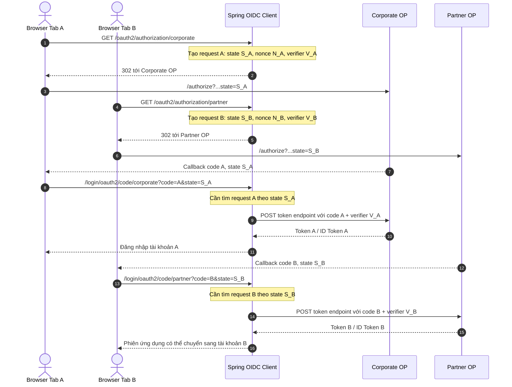

# 9.8. Đăng nhập đồng thời trên nhiều tab và nhiều provider

Một website dùng **Spring Security OAuth 2.0 / OpenID Connect (OIDC) Client** có thể cho người dùng đăng nhập bằng nhiều nhà cung cấp danh tính, chẳng hạn hệ thống SSO doanh nghiệp và một OpenID Provider của đối tác. Cùng lúc, người dùng có thể mở hai tab, nhấn nút đăng nhập hai lần, quay lại từ hai provider theo thứ tự bất kỳ hoặc hoàn thành một luồng đăng nhập trong khi luồng còn lại vẫn chờ.

Vấn đề khó không nằm ở việc hiển thị hai nút “Đăng nhập”. Mỗi callback phải được **liên kết đúng với authorization request đã tạo ra nó**, bao gồm provider, client registration, `state`, dữ liệu `nonce`/PKCE, redirect URI và HTTP session. Đồng thời, ứng dụng cần quyết định khi nào một phiên đăng nhập mới được phép **thay thế Authentication** đang hoạt động trong browser.

Bài này đi sâu vào hai dạng đồng thời:

1. **Nhiều authorization request đang chờ** trong cùng một browser session: hai tab mở login trước khi tab nào hoàn thành.
2. **Nhiều provider được cấu hình** trong cùng ứng dụng: mỗi lần login có thể chọn một OpenID Provider khác nhau.

Ví dụ đặt trong **Spring Boot 3.x, Spring Security 6.x, ứng dụng Servlet/Spring MVC**, dùng `oauth2Login()` và Authorization Code Flow. Chi tiết của repository/filter có thể khác theo phiên bản hoặc cấu hình tùy biến, nên các ví dụ chỉ rõ giả định và ranh giới trách nhiệm.

## 1. Phân biệt các tình huống dễ bị gom làm một

| Tình huống | Điều gì đang diễn ra? | Rủi ro chính |
| --- | --- | --- |
| Người dùng mở hai tab, đều chọn cùng OP | Hai authorization request cùng sử dụng cookie session của ứng dụng | Request sau có thể thay thế trạng thái chờ request trước; callback đầu không tìm được `state`. |
| Hai tab chọn hai OP khác nhau | Mỗi authorization request thuộc một `ClientRegistration` và issuer riêng | Nhầm provider, trộn thông tin giữa các lần login, hoặc mất trạng thái chờ. |
| Tab A đã login; tab B hoàn thành login sau | Cả hai tab chia sẻ session cookie và thường dùng chung `SecurityContext` | Authentication của browser session có thể chuyển sang tài khoản/provider vừa hoàn thành. |
| Người dùng mở hai cửa sổ trong cùng browser profile | Thường cùng cookie jar, nên cũng cùng session ứng dụng | Có thể phát sinh các rủi ro giống hai tab. |
| Hai browser profile/incognito context độc lập | Các cookie jar và session thường tách biệt | Flow thường độc lập; không nên mặc định đồng bộ danh tính. |
| Nhiều người dùng trên các máy khác nhau | Mỗi người có browser/session riêng | Chủ yếu là quy mô tải, quản lý session phân tán và cấu hình OP. |

**Một tab không tương đương một HTTP session.** Các tab thuộc cùng browser profile và cùng origin thường gửi cùng cookie `JSESSIONID`. Vì thế, “mỗi tab đăng nhập độc lập” không tự xảy ra chỉ vì có hai tab trình duyệt.

Mặt khác, **nhiều authorization request đang chờ** không đồng nghĩa ứng dụng hỗ trợ **nhiều tài khoản đăng nhập đồng thời trong cùng một session**. Đây là hai bài toán sản phẩm và bảo mật khác nhau.

## 2. Correlation: làm sao biết callback thuộc flow nào?

Mỗi lần bắt đầu đăng nhập tạo một tập dữ liệu tương quan. Ví dụ:

```text
Authorization request A:
  registrationId: corporate
  issuer:         https://sso.corp.example.com/realms/staff
  state:          S_A
  nonce:          N_A
  PKCE verifier:  V_A
  redirect_uri:   https://app.example.com/login/oauth2/code/corporate

Authorization request B:
  registrationId: partner
  issuer:         https://login.partner.example.com/tenant/training
  state:          S_B
  nonce:          N_B
  PKCE verifier:  V_B
  redirect_uri:   https://app.example.com/login/oauth2/code/partner
```

Các giá trị này chỉ là ký hiệu minh họa. Trong ứng dụng thật, `state`, nonce và PKCE verifier phải được tạo theo phương thức an toàn của framework, là những giá trị mới cho mỗi request.

Callback từ OP không mang mọi thông tin trên. Với Authorization Code Flow dùng query response:

```http
GET /login/oauth2/code/corporate?code=CODE_A&state=S_A HTTP/1.1
Host: app.example.com
Cookie: JSESSIONID=APP_SESSION
```

Client cần tìm lại **authorization request A** đã lưu, so khớp `state=S_A`, lấy đúng `ClientRegistration`, rồi thực hiện token exchange với **token endpoint của corporate OP**. Không được lấy `code` và suy đoán provider hoặc chọn token endpoint chỉ theo dữ liệu không tin cậy mà callback mới đưa vào.

Một flow được xem là tương quan đúng khi:

- **`state` của authorization response** khớp chính xác yêu cầu đang chờ, yêu cầu đó thuộc phiên/browser hợp lệ và chưa bị tiêu thụ.
- **Client registration và provider dự kiến** được lấy từ yêu cầu đã khởi tạo hoặc ngữ cảnh tin cậy tương ứng.
- **Authorization code** được đổi tại đúng token endpoint với đúng client, redirect URI, client authentication và PKCE verifier khi được áp dụng.
- **ID Token** được kiểm tra chữ ký, issuer, audience, thời hạn và nonce theo OIDC.
- Chỉ sau các bước trên, Spring Security tạo `Authentication` của ứng dụng.

### 2.1. Tại sao callback URL chưa đủ để nhận diện provider?

Đường dẫn `/login/oauth2/code/corporate` có thể chứa registration ID trong route. Tuy nhiên, request HTTP và query string được browser gửi đến có thể bị tác động bởi bên ngoài. **Thông tin được tin cậy phải dựa trên authorization request mà chính ứng dụng đã lưu** và xác minh theo giao thức.

Spring Security OAuth2 Login mặc định sử dụng `OAuth2AuthorizationRequest` đã lưu để lấy ngữ cảnh authorization exchange, bao gồm registration liên quan. Khi tự viết callback controller hoặc resolver, không được bỏ qua ràng buộc này.

Nếu client dùng nhiều Authorization Server, cần thêm bảo vệ chống **authorization server mix-up**: xác minh đúng issuer trong ID Token và áp dụng cơ chế ràng buộc issuer của authorization response như `iss` theo **RFC 9207** khi được OP/framework hỗ trợ, hoặc cơ chế chống mix-up thích hợp khác. `state` đơn lẻ không nên được coi là giải pháp đầy đủ cho mọi nguy cơ mix-up.

## 3. Sơ đồ hai tab cùng mở login

Giả sử Tab A chọn corporate, Tab B chọn partner trước khi callback của Tab A tới ứng dụng.



Sơ đồ này mô tả **hệ thống có khả năng lưu nhiều authorization request đang chờ**. Ở repository mặc định chỉ giữ một request, flow A có thể thất bại từ bước callback; ở repository hỗ trợ nhiều pending requests, cả hai callback có thể hợp lệ nhưng vẫn có câu hỏi nghiệp vụ: **Authentication cuối cùng của một shared session là A hay B?**

### 3.1. Hai điều kiện thành công khác nhau

**Điều kiện giao thức:** từng callback A/B phải khớp với đúng authorization request và được xác thực bởi đúng OP.

**Điều kiện phiên ứng dụng:** ứng dụng quyết định có cho callback B ghi đè Authentication A đang ở session hay không. Với website có một principal/session, hai lần login thành công có thể khiến **lần hoàn tất sau cùng trở thành danh tính hiện tại**.

Nói cách khác, giải quyết lỗi `state` khi mở nhiều tab mới giải được **correlation**. Nó chưa tự bảo đảm UX “mỗi tab vẫn ở tài khoản riêng”.

## 4. Repository mặc định của Spring Security: một điểm dễ gặp xung đột

Trong ứng dụng Servlet dùng `oauth2Login()`, Spring Security thường dùng **`HttpSessionOAuth2AuthorizationRequestRepository`** để lưu authorization request trước khi redirect. Triển khai thông dụng của lớp này giữ **một `OAuth2AuthorizationRequest` trong HTTP session tại một thời điểm** và khi callback đến sẽ tìm request có `state` tương ứng.

Ví dụ diễn biến:

| Thời điểm | Tác vụ | Authorization request đang lưu trong session |
| --- | --- | --- |
| T1 | Tab A bắt đầu corporate login, sinh `S_A` | A |
| T2 | Tab B bắt đầu partner login, sinh `S_B` | B (thay thế A) |
| T3 | Tab A callback với `S_A` | Repository không tìm được A → lỗi |
| T4 | Tab B callback với `S_B` | Có thể hợp lệ, nếu chưa bị tiêu thụ/hết hạn |

Kết quả không có nghĩa **Corporate OP sai** hoặc **`state` được sinh sai**. Vấn đề nằm ở **cách lưu authorization request đang chờ** trong session.

Trong một số cấu hình/tùy biến, repository có thể hỗ trợ nhiều request; hãy kiểm tra repository thực tế đang được ứng dụng sử dụng. Không nên suy ra mọi phiên bản hoặc mọi ứng dụng đều chỉ có một request, đặc biệt khi đã thay repository.

### 4.1. Vì sao Spring phải lưu authorization request?

Authorization request không chỉ chứa `state`. Nó còn có thể mang:

- Client registration ID và các thông số provider;
- Redirect URI, scope và request attributes cần thiết;
- `nonce` hoặc dữ liệu tương quan OIDC tương ứng;
- PKCE `code_verifier` để backend đổi authorization code;
- Những tham số/tùy biến khác phục vụ xử lý callback.

Nếu mất bản ghi gốc, client có thể mất khả năng xác minh response đúng flow. **Không tự dựng lại request từ query string callback** hoặc bỏ qua `state` để cố hoàn tất login.

### 4.2. Có nên coi việc đăng nhập trên nhiều tab là lỗi?

Không phải lúc nào cũng là lỗi cần hỗ trợ về giao thức. Nếu sản phẩm chỉ cho một lần đăng nhập đang chờ, có thể chọn **chính sách một flow tại một thời điểm** và truyền đạt rõ cho người dùng. Tuy nhiên, khi sản phẩm yêu cầu nhiều tab, nhiều provider hoặc người dùng thường bấm hai lần, nên thiết kế repository có khả năng phân biệt **nhiều pending requests**.

Quyết định này phải đi cùng giới hạn số request đang chờ, thời hạn ngắn, tiêu thụ một lần và chính sách xử lý callback đến muộn.

## 5. `state`: khóa tương quan cho nhiều authorization requests

`state` là một giá trị khó đoán do OAuth2 Client tạo khi bắt đầu authorization request. Client gửi nó tới OP, OP trả lại trong authorization response, và client đối chiếu với ngữ cảnh đã lưu.

Đối với nhiều tab, một mô hình hợp lý là **ánh xạ pending authorization request theo state**:

```text
HTTP session APP_SESSION
  |
  +-- pendingOAuth2Requests
  |      |
  |      +-- S_A -> OAuth2AuthorizationRequest A
  |      |           registrationId = corporate
  |      |           nonce / PKCE context A
  |      |           createdAt = T1
  |      |
  |      +-- S_B -> OAuth2AuthorizationRequest B
  |                  registrationId = partner
  |                  nonce / PKCE context B
  |                  createdAt = T2
  |
  +-- SecurityContext
         Authentication hiện tại của website (nếu có)
```

Khi callback `state=S_A` đến, repository phải **lấy và tiêu thụ đúng bản ghi A**, để nguyên bản ghi B còn chờ. Callback `S_B` sau đó vẫn có thể xử lý riêng.

Các yêu cầu tối thiểu của kho lưu trạng thái:

1. **Key bằng state khó đoán** và ràng buộc với session/browser đã bắt đầu flow.
2. **Mỗi state chỉ thuộc một request**; collision không được làm mất dữ liệu im lặng.
3. **TTL ngắn** để dọn những flow bị bỏ dở, ví dụ vài phút theo nhu cầu UX/OP.
4. **Giới hạn số flow pending mỗi session** để tránh tích tụ bộ nhớ hoặc lạm dụng.
5. **Tiêu thụ một lần**: callback lặp lại/replay không được lấy cùng bản ghi để đăng nhập lần nữa.
6. **Tính nhất quán khi nhiều request đến cùng lúc**: tránh race lúc thêm, đọc, xóa.
7. **Lưu nguyên bối cảnh Spring cần thiết**: `state`, attributes nonce, PKCE, registration, redirect và thông tin bổ sung.

Không nên dùng cookie phía browser chứa **raw PKCE verifier** hoặc các dữ liệu nhạy cảm mà không có thiết kế bảo vệ phù hợp. Session phía server là cách triển khai dễ hiểu nhất khi bắt đầu.

## 6. `nonce` và PKCE phải độc lập trên từng tab

Ngoài state, mỗi authorization request OIDC có thể sử dụng nonce và PKCE:

| Flow | State | Nonce của yêu cầu OIDC | PKCE verifier/challenge |
| --- | --- | --- | --- |
| Tab A, Corporate OP | `S_A` | `N_A` | `V_A` → `C_A` |
| Tab B, Partner OP | `S_B` | `N_B` | `V_B` → `C_B` |

Ví dụ nếu Tab A callback hợp lệ nhưng code A được đổi bằng verifier B, **Token Endpoint phải từ chối** vì `code_verifier` không khớp `code_challenge` đã gắn với code A. Nếu client nhận ID Token A nhưng so với nonce B, **OIDC validation phải từ chối** khi nonce không tương ứng.

Một repository keyed by state giúp giữ các dữ liệu này cùng authorization request của đúng tab. Nó không cho phép dùng chung nonce hoặc verifier giữa các flow.

### 6.1. Những điểm cần phân biệt

- **`state`** bảo vệ tương quan của authorization response với authorization request và giúp chống login CSRF.
- **`nonce`** gắn ID Token với yêu cầu xác thực OIDC; nó được kiểm tra trong ID Token sau khi token được xác minh.
- **PKCE** gắn authorization code với bên sở hữu `code_verifier`, được Authorization Server kiểm tra tại Token Endpoint.
- **`redirect_uri`** liên kết response với callback đã đăng ký.
- **Issuer/client validation** bảo đảm token do đúng provider cấp và dành cho đúng client.

Nhiều cơ chế được thực thi bởi các thành phần khác nhau trong Spring Security và OP. Không đưa toàn bộ logic này vào một callback controller tự viết nếu không có yêu cầu rất đặc biệt.

## 7. Cấu hình nhiều provider bằng `application.yml`

Ví dụ website có hai lựa chọn đăng nhập:

- **Corporate SSO:** `corporate`, issuer thuộc OP của doanh nghiệp.
- **Partner Login:** `partner`, issuer thuộc OP của đối tác.

```yaml
spring:
  security:
    oauth2:
      client:
        registration:
          corporate:
            provider: corporate-op
            client-id: ${CORPORATE_OIDC_CLIENT_ID}
            client-secret: ${CORPORATE_OIDC_CLIENT_SECRET}
            authorization-grant-type: authorization_code
            scope: [openid, profile, email]
            redirect-uri: "{baseUrl}/login/oauth2/code/{registrationId}"
          partner:
            provider: partner-op
            client-id: ${PARTNER_OIDC_CLIENT_ID}
            client-secret: ${PARTNER_OIDC_CLIENT_SECRET}
            authorization-grant-type: authorization_code
            scope: [openid, profile]
            redirect-uri: "{baseUrl}/login/oauth2/code/{registrationId}"
        provider:
          corporate-op:
            issuer-uri: https://sso.corp.example.com/realms/staff
          partner-op:
            issuer-uri: https://login.partner.example.com/tenant/training
```

Các hostname trong ví dụ là giả lập; thay bằng issuer thực được công bố trong metadata của mỗi OP. Credential lấy qua môi trường/secret manager; **không commit secret vào Git**.

Các URL mặc định tương ứng:

| Provider chọn trên UI | URL bắt đầu login | Callback URI mẫu |
| --- | --- | --- |
| Corporate | `/oauth2/authorization/corporate` | `https://app.example.com/login/oauth2/code/corporate` |
| Partner | `/oauth2/authorization/partner` | `https://app.example.com/login/oauth2/code/partner` |

Ở mỗi OP phải đăng ký đúng **callback URI của client tương ứng**. Một OP không nên chấp nhận callback của provider khác nếu không có cấu hình rõ ràng. Với reverse proxy, `{baseUrl}` phải phản ánh đúng URL HTTPS công khai.

### 7.1. Cấu hình tương đương bằng properties

```properties
spring.security.oauth2.client.registration.corporate.provider=corporate-op
spring.security.oauth2.client.registration.corporate.client-id=${CORPORATE_OIDC_CLIENT_ID}
spring.security.oauth2.client.registration.corporate.client-secret=${CORPORATE_OIDC_CLIENT_SECRET}
spring.security.oauth2.client.registration.corporate.authorization-grant-type=authorization_code
spring.security.oauth2.client.registration.corporate.scope=openid,profile,email
spring.security.oauth2.client.registration.corporate.redirect-uri={baseUrl}/login/oauth2/code/{registrationId}
spring.security.oauth2.client.provider.corporate-op.issuer-uri=https://sso.corp.example.com/realms/staff

spring.security.oauth2.client.registration.partner.provider=partner-op
spring.security.oauth2.client.registration.partner.client-id=${PARTNER_OIDC_CLIENT_ID}
spring.security.oauth2.client.registration.partner.client-secret=${PARTNER_OIDC_CLIENT_SECRET}
spring.security.oauth2.client.registration.partner.authorization-grant-type=authorization_code
spring.security.oauth2.client.registration.partner.scope=openid,profile
spring.security.oauth2.client.registration.partner.redirect-uri={baseUrl}/login/oauth2/code/{registrationId}
spring.security.oauth2.client.provider.partner-op.issuer-uri=https://login.partner.example.com/tenant/training
```

Chọn một định dạng mà dự án sử dụng. `registrationId` (`corporate`/`partner`) là bí danh của client trong Spring; `provider-id` (`corporate-op`/`partner-op`) là nhóm metadata của OP. Các ID này **không nhất thiết trùng client ID thật hoặc issuer URL**.

### 7.2. Nút chọn provider không cần controller riêng

Trong ứng dụng dùng Spring Security OAuth2 Login, các liên kết có thể trỏ thẳng tới endpoint bắt đầu login:

```html
<a href="/oauth2/authorization/corporate">Đăng nhập Corporate SSO</a>
<a href="/oauth2/authorization/partner">Đăng nhập Partner</a>
```

Đây là những request GET đi vào `OAuth2AuthorizationRequestRedirectFilter`, không phải token endpoint. Spring xây authorization request riêng cho từng registration.

**Không cho phép người dùng nhập issuer URL, token endpoint hoặc client ID tùy ý qua query string để đổi provider.** Chọn provider từ danh sách registration đã cấu hình và được phê duyệt; nếu cần dynamic registration đa tenant, phải thiết kế một lớp chọn và xác thực tenant/issuer riêng.

## 8. Chống nhầm provider và authorization server mix-up

Khi có một OP, callback giả mạo đã nguy hiểm. Khi có **nhiều OP**, một nguy cơ khác là client có thể gắn response từ OP A vào luồng vốn dự định dành cho OP B, hoặc gửi authorization code/credential tới sai token endpoint.

### 8.1. Mô hình mix-up đơn giản

```text
Client tạo request cho Corporate OP
        |
        v
Một response không thuộc Corporate OP tới callback
        |
        v
Nếu client chỉ tin code/path và chọn sai provider:
  - trao đổi code tại token endpoint không đúng
  - có thể làm lộ code hoặc credential
  - hoặc xác thực sai issuer/người dùng
```

Biện pháp giảm thiểu cần triển khai cùng nhau:

- Gắn authorization request đang chờ với **registration/issuer dự kiến**.
- Dùng `state` khó đoán để liên kết response và request.
- Kiểm tra **issuer (`iss`) và audience (`aud`)** của ID Token bằng OP/client đã chọn.
- Khi OP hỗ trợ **RFC 9207**, xem xét kiểm tra tham số `iss` trong authorization response theo đúng quy tắc và khả năng framework.
- Dùng callback URI phân biệt theo registration nếu phù hợp kiến trúc, nhưng **không coi route khác nhau là bằng chứng duy nhất**.
- Cấu hình token endpoint, JWKS, authorization endpoint từ metadata issuer tin cậy; tránh nhận URL tùy ý từ response chưa xác minh.

`state` và ID Token validation đều cần thiết, nhưng **không tự tuyên bố** chúng thay thế mọi biện pháp chống mix-up. Chẳng hạn một số nguy cơ phát sinh trước khi client nhận được ID Token, tại bước gửi code tới token endpoint.

### 8.2. Spring xác định registration tại callback như thế nào?

Trong OAuth2 Login Servlet, `OAuth2LoginAuthenticationFilter` nhận callback, khôi phục `OAuth2AuthorizationRequest` đã lưu và dùng thông tin gắn với request đó để tạo `OAuth2AuthorizationExchange`, tìm đúng `ClientRegistration` rồi chuyển cho `AuthenticationManager` và authentication provider phù hợp. Provider tiếp tục token exchange và OIDC validation.

Với custom `AuthorizationRequestRepository` hoặc custom callback, phải giữ thông tin registration trong request và không dùng duy nhất `request.getRequestURI()` hay một query param do browser điều khiển để quyết định OP.

### 8.3. Hai OP có user cùng email

`email=an@example.com` từ Corporate OP và từ Partner OP không tự chứng minh là cùng người. Trong OIDC, `sub` được hiểu trong phạm vi issuer; vì thế một khóa nhận diện nội bộ thường có dạng:

```text
ExternalIdentityKey = (issuer, subject)

Corporate: (https://sso.corp.example.com/realms/staff, user-42)
Partner:   (https://login.partner.example.com/tenant/training,  user-42)
```

Hai khóa trên **khác nhau** dù `sub` trùng chuỗi. Email, `preferred_username` và tên hiển thị có thể thay đổi hoặc thiếu; việc **liên kết tài khoản giữa các provider** phải là một workflow có kiểm chứng riêng.

## 9. Chiến lược xử lý nhiều authorization requests đang chờ

Có thể lựa chọn theo nhu cầu sản phẩm:

| Chiến lược | Hành vi | Khi phù hợp |
| --- | --- | --- |
| **Chỉ một pending flow mỗi session** | Login mới thay thế hoặc hủy flow trước; callback cũ thất bại với thông báo rõ | Giao diện muốn một đăng nhập tại một thời điểm, chấp nhận hạn chế nhiều tab |
| **Nhiều pending flow keyed by state** | Mỗi callback tìm và tiêu thụ đúng request của mình | Sản phẩm cần mở nhiều tab, nhiều OP hoặc tương tác song song |
| **Session độc lập cho mỗi ngữ cảnh browser** | Cookie/session tách biệt theo profile hoặc cơ chế riêng | Người dùng cần dùng nhiều tài khoản đồng thời nhưng không cùng một shared app session |

Với mục tiêu **hỗ trợ nhiều tab mà vẫn dùng chung phiên đăng nhập website**, phương án keyed by state thường là hướng xử lý hợp lý nhất cho authorization request đang chờ.

Nhưng còn một quyết định khác: **nếu hai callback đều thành công, callback nào được phép thay Authentication của session?** Điều này cần được thiết kế độc lập với repository.

### 9.1. Các nguyên tắc của repository nhiều flow

Một repository hỗ trợ nhiều requests phải xử lý đúng:

- `saveAuthorizationRequest`: thêm request mới theo `state` riêng, không làm mất request khác.
- `loadAuthorizationRequest`: tìm request theo `state` trong callback thuộc đúng session mà không tiêu thụ sớm nếu contract yêu cầu đọc.
- `removeAuthorizationRequest`: chỉ loại bỏ request tương ứng, theo cơ chế tiêu thụ một lần.
- Làm sạch bản ghi hết hạn và giới hạn lượng pending requests.
- Giữ toàn bộ `OAuth2AuthorizationRequest`, bao gồm attributes quan trọng cho OIDC/PKCE.
- Bảo đảm thao tác **take/consume** đủ nguyên tử trong môi trường chạy nhiều luồng/nhiều instance.
- Không mở rộng thời gian sống `state` vô hạn chỉ để người dùng có thể hoàn tất rất muộn.

**Lưu ý:** mặc dù có thể dùng session map, việc đọc-sửa-ghi một `Map` trong session từ hai request song song vẫn có thể gây race. Cần tính nhất quán của storage; khóa trong một JVM không tự bảo vệ session phân tán giữa nhiều instance.

## 10. Ví dụ thiết kế `AuthorizationRequestRepository` cho nhiều tab

Đoạn sau minh họa một **repository dùng HTTP session và map keyed by state** cho **môi trường một instance**. Mục đích là làm rõ contract và chặng lưu/tiêu thụ; khi triển khai đa instance cần một store có thao tác nguyên tử (hoặc cơ chế khóa phân tán) và TTL riêng.

```java
import java.io.Serializable;
import java.time.Duration;
import java.time.Instant;
import java.util.Iterator;
import java.util.LinkedHashMap;
import java.util.Map;

import jakarta.servlet.http.HttpServletRequest;
import jakarta.servlet.http.HttpServletResponse;
import jakarta.servlet.http.HttpSession;

import org.springframework.security.oauth2.client.web.AuthorizationRequestRepository;
import org.springframework.security.oauth2.core.endpoint.OAuth2AuthorizationRequest;
import org.springframework.security.oauth2.core.endpoint.OAuth2ParameterNames;

public final class MultiTabAuthorizationRequestRepository
        implements AuthorizationRequestRepository<OAuth2AuthorizationRequest> {

    private static final String SESSION_KEY =
            MultiTabAuthorizationRequestRepository.class.getName() + ".PENDING";

    private static final Duration TTL = Duration.ofMinutes(5);
    private static final int MAX_PENDING = 8;

    private record Pending(
            OAuth2AuthorizationRequest authorizationRequest,
            Instant createdAt
    ) implements Serializable {
        private static final long serialVersionUID = 1L;
    }

    @Override
    public OAuth2AuthorizationRequest loadAuthorizationRequest(
            HttpServletRequest request) {

        String state = request.getParameter(OAuth2ParameterNames.STATE);
        HttpSession session = request.getSession(false);
        if (state == null || session == null) {
            return null;
        }

        synchronized (session) {
            Map<String, Pending> pending = copyFromSession(session);
            removeExpired(pending);
            persist(session, pending);

            Pending item = pending.get(state);
            return item == null ? null : item.authorizationRequest();
        }
    }

    @Override
    public void saveAuthorizationRequest(
            OAuth2AuthorizationRequest authorizationRequest,
            HttpServletRequest request,
            HttpServletResponse response) {

        if (authorizationRequest == null) {
            removeAuthorizationRequest(request, response);
            return;
        }

        HttpSession session = request.getSession(true);
        synchronized (session) {
            Map<String, Pending> pending = copyFromSession(session);
            removeExpired(pending);

            // Giữ giới hạn tối đa; bản ghi cũ nhất sẽ bị loại bỏ.
            while (pending.size() >= MAX_PENDING) {
                Iterator<String> keys = pending.keySet().iterator();
                keys.next();
                keys.remove();
            }

            pending.put(authorizationRequest.getState(),
                    new Pending(authorizationRequest, Instant.now()));
            persist(session, pending);
        }
    }

    @Override
    public OAuth2AuthorizationRequest removeAuthorizationRequest(
            HttpServletRequest request,
            HttpServletResponse response) {

        String state = request.getParameter(OAuth2ParameterNames.STATE);
        HttpSession session = request.getSession(false);
        if (state == null || session == null) {
            return null;
        }

        synchronized (session) {
            Map<String, Pending> pending = copyFromSession(session);
            removeExpired(pending);
            Pending removed = pending.remove(state);
            persist(session, pending);

            return removed == null ? null : removed.authorizationRequest();
        }
    }

    @SuppressWarnings("unchecked")
    private Map<String, Pending> copyFromSession(HttpSession session) {
        Object stored = session.getAttribute(SESSION_KEY);
        if (stored == null) {
            return new LinkedHashMap<>();
        }
        return new LinkedHashMap<>((Map<String, Pending>) stored);
    }

    private void removeExpired(Map<String, Pending> pending) {
        Instant cutoff = Instant.now().minus(TTL);
        pending.values().removeIf(item -> item.createdAt().isBefore(cutoff));
    }

    private void persist(HttpSession session, Map<String, Pending> pending) {
        if (pending.isEmpty()) {
            session.removeAttribute(SESSION_KEY);
        } else {
            session.setAttribute(SESSION_KEY, pending);
        }
    }
}
```

Cách hoạt động trong điều kiện một instance:

1. `saveAuthorizationRequest` thêm A với khóa `S_A` rồi thêm B với khóa `S_B`.
2. `loadAuthorizationRequest` tìm đúng request nhờ `state` của callback.
3. `removeAuthorizationRequest` loại bỏ đúng state được sử dụng; request còn lại không bị xóa.
4. Một request quá hạn sẽ bị dọn trong lần truy cập map tiếp theo.
5. Giới hạn `MAX_PENDING` ngăn một session tích trữ không giới hạn flow đang chờ.

**Giới hạn của mã minh họa:** `synchronized(session)` chỉ đồng bộ trên đối tượng session trong **cùng JVM**; nó không bảo đảm atomicity giữa các node và còn phụ thuộc implementation của session wrapper. Bản ghi hết hạn chỉ được dọn khi có thao tác tiếp theo, và chính sách loại bản ghi cũ có thể làm flow cũ thất bại khi vượt giới hạn. Với hệ thống production đa instance, nên dùng kho keyed-by-session-and-state có TTL, thao tác lấy-xóa nguyên tử và chính sách giới hạn rõ ràng, ví dụ thiết kế trên Redis phù hợp với Spring Session.

### 10.1. Tích hợp repository vào `oauth2Login()`

Ví dụ sau là cấu hình **thay thế** security chain đơn giản. Nó cho phép Spring dùng repository nhiều flow khi tạo authorization request và xử lý callback:

```java
import org.springframework.context.annotation.Bean;
import org.springframework.context.annotation.Configuration;
import org.springframework.security.config.Customizer;
import org.springframework.security.config.annotation.web.builders.HttpSecurity;
import org.springframework.security.web.SecurityFilterChain;
import org.springframework.security.oauth2.client.web.AuthorizationRequestRepository;
import org.springframework.security.oauth2.core.endpoint.OAuth2AuthorizationRequest;

@Configuration
class WebSecurityConfig {

    @Bean
    AuthorizationRequestRepository<OAuth2AuthorizationRequest>
    authorizationRequestRepository() {
        return new MultiTabAuthorizationRequestRepository();
    }

    @Bean
    SecurityFilterChain webSecurityFilterChain(
            HttpSecurity http,
            AuthorizationRequestRepository<OAuth2AuthorizationRequest> repository
    ) throws Exception {

        http
            .authorizeHttpRequests(auth -> auth
                .requestMatchers("/", "/login", "/assets/**", "/error")
                .permitAll()
                .anyRequest().authenticated()
            )
            .oauth2Login(oauth2 -> oauth2
                .authorizationEndpoint(endpoint -> endpoint
                    .authorizationRequestRepository(repository)));

        return http.build();
    }
}
```

`oauth2Login()` cấu hình repository dùng cho authorization endpoint và callback trong mô hình Servlet thông thường; nếu ứng dụng tự tùy biến filter, cần bảo đảm **cả nơi lưu lẫn nơi đọc** cùng dùng repository. Không tạo hai repository độc lập với session key/contract khác nhau.

Để cho người dùng chọn provider, trang `/login` của ứng dụng phải có liên kết đến `/oauth2/authorization/corporate` và `/oauth2/authorization/partner`. Khi khai báo `loginPage("/login")` tùy biến, nên kiểm tra trang đó được `permitAll` và không tạo redirect loop. Nếu dùng trang login tự sinh của Spring Security với cấu hình phù hợp, framework có thể hiển thị lựa chọn nhiều provider.

### 10.2. Khi nào dùng storage ngoài session?

Nếu có nhiều instance và callback có thể đi tới máy khác, có hai lựa chọn phổ biến:

- **Sticky session** cùng một instance: đơn giản nhưng phụ thuộc routing, lỗi khi instance chết và chưa giải quyết hết nhu cầu scaling.
- **Session/authorization request store chia sẻ**: có thể dùng Spring Session + kho phù hợp, nhưng phải bảo đảm thao tác trên **nhiều pending requests** được cập nhật nhất quán.

Một mô hình phân tán là khóa:

```text
oauth2:pending:{sessionId}:{state} -> serialized authorization request
TTL: 5 phút
```

Khi callback, dùng thao tác **đọc và xóa nguyên tử** nếu store hỗ trợ; xác minh đúng session mà browser đang sử dụng và request chưa bị tiêu thụ. Không đưa raw session ID vào log, không để người dùng tùy ý đọc khóa theo state, và mã hóa/bảo vệ thông tin nhạy cảm trong kho lưu.

## 11. Điều gì xảy ra khi hai callback đều thành công?

Giải quyết nhiều pending requests có thể dẫn tới hai callback đều hợp lệ:

```text
T1: Tab A bắt đầu corporate login.
T2: Tab B bắt đầu partner login.
T3: Tab B hoàn tất, Spring lưu Authentication B.
T4: Tab A hoàn tất, Spring lưu Authentication A.
T5: Cả hai tab gửi cookie session của ứng dụng.
```

Nếu cả hai tab cùng dùng một session và ứng dụng chấp nhận **đăng nhập thay thế**, Authentication hiện tại có thể trở thành A sau T4. Tab B không nhất thiết giữ được tài khoản B khi request tiếp theo: nó có thể được xử lý dưới **Authentication A**.

Kết quả cuối chịu ảnh hưởng thứ tự hoàn thành và lưu `SecurityContext`, session strategy, repository và những bước hậu xử lý. Trong môi trường concurrent thật, không nên coi “callback cuối cùng” là quy tắc giao dịch chắc chắn nếu các thao tác đang race; ứng dụng phải có chính sách rõ.

### 11.1. Chọn chính sách thay đổi danh tính

Một số chính sách thường dùng:

| Chính sách | Ý nghĩa | Hành vi khi callback khác tài khoản đến |
| --- | --- | --- |
| **Last successful login wins** | Session chấp nhận thay đổi danh tính khi login mới thành công | Context hiện tại chuyển sang principal mới; các tab cùng thấy danh tính mới. |
| **Chặn login khi đã có principal khác** | Chỉ cho phép chuyển tài khoản qua thao tác switch account rõ ràng | Callback khác principal bị từ chối hoặc yêu cầu xác nhận. |
| **Chỉ chấp nhận request mới nhất** | Login request mới làm request cũ mất hiệu lực có chủ ý | Callback từ request cũ không được hoàn tất dù state còn tồn tại. |
| **Separate browser profiles/sessions** | Mỗi ngữ cảnh browser có principal riêng | Hai tài khoản có thể cùng hoạt động ở hai profile riêng. |

Không tồn tại lựa chọn đúng cho mọi sản phẩm. Một ứng dụng doanh nghiệp thường cần **account switching rõ ràng**, tránh âm thầm hiển thị dữ liệu của người dùng/provider khác trong tab đang mở.

### 11.2. Cần cảnh giác với trạng thái UI cũ

Trình duyệt có thể hiển thị một trang được tải khi đang đăng nhập với principal A. Nếu một tab khác đổi session sang principal B, những nút/bộ lọc trên trang cũ vẫn có thể phản ánh A, nhưng request API tiếp theo mang cookie session và được xử lý dưới B.

Biện pháp UX:

- Hiển thị **tài khoản và provider hiện tại** ở các màn hình quan trọng.
- Với hành động nhạy cảm, kiểm tra principal/tenant trên server ở mỗi request.
- Khi session đổi danh tính, có thể yêu cầu trang tải lại, xóa bộ nhớ tạm gắn tài khoản hoặc chuyển người dùng về màn hình xác nhận.
- Không tin vào thông tin người dùng hiển thị trong tab cũ để quyết định authorization.

Ứng dụng không nên đảm bảo “hai tab cùng một browser sẽ luôn có hai tài khoản khác nhau” khi chỉ dùng một cookie session chung.

## 12. Tách dữ liệu pending login, Authentication và authorized clients

Có ba nhóm trạng thái khác nhau mà ứng dụng dễ nhầm lẫn:

| Dữ liệu | Được tạo/lưu khi nào? | Mục đích |
| --- | --- | --- |
| **Pending `OAuth2AuthorizationRequest`** | Lúc bắt đầu OAuth2/OIDC login | Tương quan callback, `state`, nonce, PKCE, provider |
| **`SecurityContext` với `Authentication`** | Khi flow xác thực thành công | Xác định principal/authorities hiện tại ở ứng dụng |
| **`OAuth2AuthorizedClient`** | Khi client nhận access token và lưu thông tin ủy quyền | Cho phép gọi API thay mặt principal qua client registration |

Một ứng dụng có thể lưu nhiều `OAuth2AuthorizedClient` theo registration và principal; điều đó **không có nghĩa** có nhiều principal đang hoạt động đồng thời trong một `SecurityContext`. Nếu đổi tài khoản, cần xem xét cách dọn hoặc quản lý authorized client/token của principal trước để tránh token cũ bị sử dụng nhầm, tùy repository/service đang dùng.

Ví dụ một trang web đang đăng nhập bằng corporate có thể vẫn giữ token của provider partner từ flow trước trong một storage tùy biến. Không tự động coi các token đó thuộc cùng một người. Khi gọi API, phải kiểm tra authorized client có gắn với **principal/registration đúng mục đích**.

### 12.1. SecurityContext và session fixation

Spring Security thường áp dụng bảo vệ **session fixation** khi login thành công, ví dụ thay đổi session ID. Việc thay session ID không mặc định loại bỏ mọi session attributes: tùy strategy, dữ liệu đang chờ có thể được giữ hoặc thay đổi.

Nếu đang có flow A và B cùng session, một callback hoàn tất và thay đổi session ID có thể ảnh hưởng tab còn lại nếu cookie hoặc session state không được cập nhật nhất quán. Khi có custom session strategy, kiểm tra rằng pending request và session migration tương thích với thiết kế nhiều tab.

Logout cũng cần phân biệt:

- Logout khỏi **ứng dụng Spring** làm mất Authentication/session theo cấu hình.
- Logout tại **OpenID Provider** là luồng SSO/OIDC khác.
- Thu hồi access/refresh token và dọn authorized client có thể cần bước riêng.
- Nếu logout xảy ra khi còn pending flows, nên xác định có hủy chúng hay không; không để callback cũ bất ngờ đăng nhập lại nếu sản phẩm không cho phép.

## 13. Callback method, cookie và reverse proxy

### 13.1. SameSite của session cookie

Khi authorization response trở về từ OP, browser phải gửi lại session cookie để Spring tìm authorization request đã lưu. Các cookie attributes thường được xét:

| Thuộc tính | Tác động |
| --- | --- |
| `Secure` | Cookie được gửi qua HTTPS, cần đúng với public scheme. |
| `HttpOnly` | Giảm khả năng JavaScript đọc trực tiếp session cookie. |
| `SameSite=Lax` | Thường tương thích với callback **top-level GET** từ OP về ứng dụng. |
| `SameSite=Strict` | Có thể khiến cookie không được gửi trong cross-site redirect, làm mất authorization request. |
| `SameSite=None; Secure` | Có thể cần khi callback dùng `form_post` hoặc ngữ cảnh cross-site khác; phải đánh giá CSRF/browser policy. |
| `Domain`, `Path` | Phải bao phủ host/path callback thực tế, tránh chia sẻ quá rộng. |

Nhiều tab dùng chung cookie jar nên những thuộc tính này ảnh hưởng đồng thời mọi flow. Nếu một tab mất cookie sau redirect, nó có thể báo lỗi correlation dù các tab khác vẫn đang hoạt động.

### 13.2. Reverse proxy và URL callback

Ví dụ public URL là `https://app.example.com`, trong khi Spring backend chạy HTTP nội bộ ở `http://spring-app:8080`. Nếu Spring tạo `redirect_uri` với host/scheme nội bộ, OP có thể từ chối hoặc browser không thể quay về đúng nơi.

Một phần cấu hình có thể cần khi proxy được tin cậy:

```yaml
server:
  forward-headers-strategy: framework
  servlet:
    session:
      cookie:
        secure: true
        http-only: true
        same-site: lax
```

Thiết lập forwarded headers chỉ an toàn khi reverse proxy kiểm soát/ghi đè `Forwarded` và `X-Forwarded-*`, không nhận những header giả mạo từ internet làm nguồn tin cậy. Các URI callback tại OP phải đúng theo từng registration, với external scheme và host chính xác.

### 13.3. Callback response mode `form_post`

Authorization Code Flow thường dùng callback GET qua query. Một số provider/ứng dụng chọn `response_mode=form_post`, làm browser POST authorization response về callback. Cookie `SameSite=Lax` có thể không được gửi trong cross-site POST; đồng thời cần cấu hình CSRF filter và callback matcher đúng theo phương thức này.

Không tự đổi cả website sang `SameSite=None` hoặc tắt CSRF toàn ứng dụng để giải quyết callback mà chưa xem xét tổng thể. Phải đảm bảo correlation bằng state/nonce/PKCE và bảo vệ các request nghiệp vụ.

## 14. Xử lý lỗi ở nhiều tab sao cho dễ hiểu

Khi callback A đến sau khi request A đã bị ghi đè/hủy/hết hạn, người dùng thường chỉ thấy một trang lỗi “Login failed”. Để giảm nhầm lẫn, ứng dụng có thể hiển thị thông báo an toàn:

> Phiên đăng nhập này đã hết hiệu lực hoặc đã được thay thế bởi một lần đăng nhập khác. Vui lòng bắt đầu lại từ nút đăng nhập.

Không hiển thị authorization code, token, client secret, raw session ID hoặc stack trace ra trang lỗi. Có thể cung cấp liên kết thử lại đến trang chọn provider.

### 14.1. Bảng triệu chứng và lớp cần kiểm tra

| Triệu chứng | Lớp liên quan | Hướng điều tra |
| --- | --- | --- |
| Tab A login thất bại khi Tab B bắt đầu trước | Pending authorization request repository | Repository có chỉ giữ một request/session? `S_A` có bị `S_B` thay thế không? |
| Callback có `state` nhưng báo không tìm thấy authorization request | Session/cookie/repository | Cookie có quay lại? Session timeout? Flow bị xóa/hết hạn/ghi đè? |
| Login corporate nhưng callback gắn nhầm partner | Registration/provider correlation | Kiểm tra request gốc, issuer, route, cấu hình và cơ chế chống mix-up. |
| ID Token có `iss` không khớp | OIDC validation | Đang nhận token từ sai OP/tenant hoặc chọn sai ClientRegistration. |
| ID Token có nonce sai | OIDC nonce binding | Dữ liệu nonce của flow A có bị lấy từ flow B, custom resolver hoặc repository sai không? |
| Token endpoint trả `invalid_grant` | Code/PKCE/redirect URI | Code dùng một lần/hết hạn, verifier không đúng flow, redirect URI sai. |
| Mở Tab A với tài khoản A, Tab B login B rồi Tab A hiện dữ liệu B | Shared application session | Cùng cookie session; SecurityContext bị đổi sang B theo chính sách login. |
| Login thành công nhưng vào trang sau lại bị yêu cầu login | SecurityContext/session persistence | Session ID đổi, cookie không giữ, session store không chia sẻ, context không lưu. |
| Khi scale nhiều instance mới xảy ra lỗi thất thường | Session/atomic storage | Sticky sessions, Spring Session, race update session map, TTL, session migration. |
| Lỗi chỉ khi OP dùng `form_post` | Cookie + CSRF + callback method | `SameSite`, `Secure`, CSRF matcher và cách xử lý POST callback. |
| Hai provider cùng email bị gộp một tài khoản sai | Identity linking | Kiểm tra issuer+subject, quy trình liên kết tài khoản và nguồn tin cậy. |

Một mã lỗi như `invalid_grant` không nhất thiết do PKCE; nhiều sai lệch code/client/redirect URI cũng có thể đưa về cùng lỗi. Sử dụng log/tracing ở mức đủ thông tin và loại bỏ credential.

### 14.2. Logging nên ghi gì?

Những dữ liệu có thể giúp phân tích mà không cần lộ secret:

- Correlation/request ID nội bộ của ứng dụng;
- Registration ID và tên provider alias;
- Dấu thời gian bắt đầu và kết thúc flow;
- Trạng thái: `started`, `callback_received`, `validated`, `expired`, `consumed`, `failed`;
- Nhóm lỗi đã chuẩn hóa: missing state, request not found, issuer mismatch, token exchange failed;
- Số lượng pending requests trong session (không log raw state values);
- Thông tin node/instance và routing khi có nhiều server.

Tránh ghi nguyên URL callback chứa `code`, query string có `state`, `Authorization` header, PKCE `code_verifier`, nonce nội bộ, access/refresh token, ID Token, client secret và session ID. Nếu cần trace xuyên các chặng, dùng ID nội bộ không có chức năng xác thực thay cho credential.

## 15. Trình tự lựa chọn giải pháp trong một dự án thực tế

Nếu ứng dụng gặp lỗi khi người dùng mở nhiều tab và đăng nhập bằng nhiều provider, cách phân tích có thể theo trình tự sau:

1. **Xác định kỳ vọng sản phẩm.** Ứng dụng cần nhiều flow đang chờ trong cùng session, hay cần nhiều tài khoản đồng thời? Hai mục tiêu cần giải pháp khác nhau.
2. **Xác định repository hiện hành.** Xem `OAuth2AuthorizationRequestRepository` thực sự đang dùng: mặc định một request hay đã có map keyed by state?
3. **Kiểm tra các registration và issuer.** Mỗi provider có client ID/secret, issuer, redirect URI và callback đúng OP không?
4. **Đánh giá vòng đời pending request.** Có thời hạn, giới hạn số lượng, tiêu thụ một lần và dọn trạng thái sau callback/logout không?
5. **Xác định hành vi khi callback trễ.** Callback của flow cũ có được phép đổi principal sau khi flow mới đã thành công không?
6. **Xác định storage và concurrency.** Session có tồn tại trên nhiều node không? Thao tác thêm/xóa request có nhất quán khi request song song không?
7. **Kiểm tra cookie/proxy.** `SameSite`, HTTPS, session migration, forwarded headers và callback mode có giữ được session gốc không?
8. **Giữ đầy đủ xác minh giao thức.** `state`, nonce, PKCE, issuer/audience và ràng buộc authorization server phải được thực thi ở đúng bước.
9. **Giải thích hành vi cho người dùng.** Đặc biệt khi account switching có thể làm tất cả tab dùng principal mới.

Cách tiếp cận này giúp phân biệt **lỗi mất correlation** với **hành vi thay đổi session identity đã được ứng dụng cho phép**.

## 16. Bài tập tư duy

### Tình huống A — Hai tab, một provider

Tab A chọn Corporate OP và lưu `S_A`. Tab B chọn cùng OP và lưu `S_B`. Repository chỉ có một ô/session.

**Câu hỏi:** Callback Tab A với state chính xác `S_A` có thể vẫn thất bại không?

**Gợi ý:** Có. Tab B có thể đã thay bản ghi A bằng B. State A đúng theo request ban đầu nhưng repository không còn request A để đối chiếu. Không được bỏ kiểm tra state để sửa lỗi; phải thay chính sách pending request hoặc thông báo flow A đã bị thay thế.

### Tình huống B — Hai provider, cùng tên tài khoản

Corporate OP phát `sub=user-17`, Partner OP cũng phát `sub=user-17`.

**Câu hỏi:** Có được tự gộp thành một user nội bộ không?

**Gợi ý:** Không. `sub` được định danh trong phạm vi issuer. Phải xét ít nhất cặp `(issuer, subject)` và có quy trình liên kết tài khoản rõ ràng nếu muốn hợp nhất.

### Tình huống C — State đúng, provider sai

Flow A bắt đầu với Corporate OP, nhưng custom callback controller chỉ xem path `/partner` rồi gửi code A đến Partner Token Endpoint.

**Câu hỏi:** Điều gì sai về bảo mật?

**Gợi ý:** Controller đang chọn provider theo route do browser gửi, bỏ ngữ cảnh issuer/registration đáng tin cậy của authorization request. Có thể xảy ra mix-up hoặc lộ code/credential. Phải ràng buộc provider với request gốc và xác minh issuer ở các bước thích hợp.

### Tình huống D — Cả hai callback đều hợp lệ

Tab B đăng nhập Partner thành công trước; Tab A hoàn tất Corporate sau. Hai tab dùng cùng cookie session.

**Câu hỏi:** Vì sao Tab B có thể đọc dữ liệu tài khoản Corporate ở request sau?

**Gợi ý:** Browser chia sẻ session; Authentication của session đã được thay bởi callback hoàn tất sau. Muốn hai tài khoản thực sự độc lập, cần các session/browser context độc lập hoặc thiết kế multi-account chuyên biệt; repository keyed by state không tự giải quyết vấn đề này.

### Tình huống E — Session Redis nhưng vẫn mất request

Ứng dụng dùng Spring Session + Redis, nhưng lưu cả map pending trong một session attribute, hai node cùng đọc map, thêm mỗi node một state và cùng ghi đè attribute.

**Câu hỏi:** Vì sao session store chia sẻ chưa đủ?

**Gợi ý:** Hai thao tác đọc–sửa–ghi trên cùng map có thể mất cập nhật (lost update) nếu thiếu cơ chế nhất quán. Cần thao tác nguyên tử hoặc thiết kế lưu mỗi state thành một entry riêng có TTL và ràng buộc session.

### Tình huống F — Logout giữa hai callback

Tab A bắt đầu login rồi người dùng thực hiện logout ứng dụng ở Tab B. Callback A đến sau logout.

**Câu hỏi:** Có nên tự động cho flow A đăng nhập lại không?

**Gợi ý:** Đây là quyết định chính sách. Với sản phẩm muốn logout hủy mọi luồng đang chờ, cần invalidate pending requests và ngăn callback cũ tái lập session. Không để hành vi phụ thuộc vô tình vào một repository giữ lại dữ liệu cũ.

## 17. Những điểm cần ghi nhớ

- **Nhiều tab trong cùng browser profile thường chia sẻ HTTP session**, nên không tự động có Authentication độc lập.
- **Mỗi authorization request phải có state và ngữ cảnh OIDC/PKCE riêng**; callback chỉ có thể chấp nhận khi tìm được đúng request đang chờ.
- **`HttpSessionOAuth2AuthorizationRequestRepository` thông dụng chỉ giữ một authorization request/session**; login song song có thể khiến request trước bị thay thế.
- Để hỗ trợ nhiều pending flows, dùng repository **keyed by state**, có TTL, giới hạn, tiêu thụ một lần và tính nhất quán trong môi trường đồng thời.
- **Provider phải được ràng buộc với request gốc**, rồi xác minh issuer/audience và các biện pháp chống mix-up phù hợp. Không chọn OP chỉ theo URL callback chưa được đối chiếu.
- **Cho nhiều callback hợp lệ không đồng nghĩa cho nhiều tài khoản cùng tồn tại trong một SecurityContext**. Account switching cần chính sách và UX rõ ràng.
- Session/cookie, `SameSite`, reverse proxy và lưu trữ phân tán có thể làm mất correlation dù cấu hình OIDC provider đúng.
- Giữ cơ chế Spring Security cho `state`, nonce, PKCE, token exchange và ID Token validation; chỉ mở rộng repository/filter khi yêu cầu thật sự cần.

### Tài liệu tham khảo

- [Spring Security Reference — OAuth 2.0 Login](https://docs.spring.io/spring-security/reference/servlet/oauth2/login/index.html).
- [Spring Security Reference — OAuth 2.0 Login Advanced Configuration](https://docs.spring.io/spring-security/reference/servlet/oauth2/login/advanced.html).
- [Spring Security API — HttpSessionOAuth2AuthorizationRequestRepository](https://docs.spring.io/spring-security/site/docs/current/api/org/springframework/security/oauth2/client/web/HttpSessionOAuth2AuthorizationRequestRepository.html).
- [Spring Security API — AuthorizationRequestRepository](https://docs.spring.io/spring-security/site/docs/current/api/org/springframework/security/oauth2/client/web/AuthorizationRequestRepository.html).
- [Spring Security API — OAuth2LoginAuthenticationFilter](https://docs.spring.io/spring-security/site/docs/current/api/org/springframework/security/oauth2/client/web/OAuth2LoginAuthenticationFilter.html).
- [Spring Session Reference](https://docs.spring.io/spring-session/reference/).
- [OpenID Connect Core 1.0](https://openid.net/specs/openid-connect-core-1_0.html).
- [RFC 6749 — OAuth 2.0 Authorization Framework](https://www.rfc-editor.org/rfc/rfc6749).
- [RFC 7636 — Proof Key for Code Exchange (PKCE)](https://www.rfc-editor.org/rfc/rfc7636).
- [RFC 9207 — OAuth 2.0 Authorization Server Issuer Identification](https://www.rfc-editor.org/rfc/rfc9207).
- [RFC 9700 — OAuth 2.0 Security Best Current Practice](https://www.rfc-editor.org/rfc/rfc9700).
