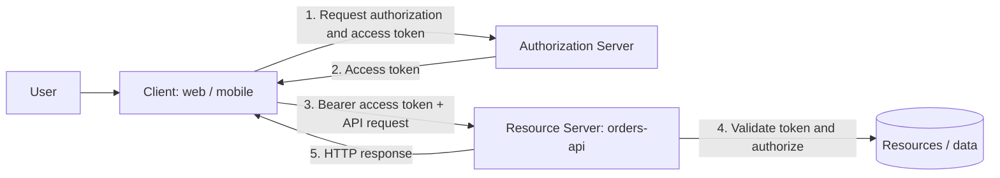
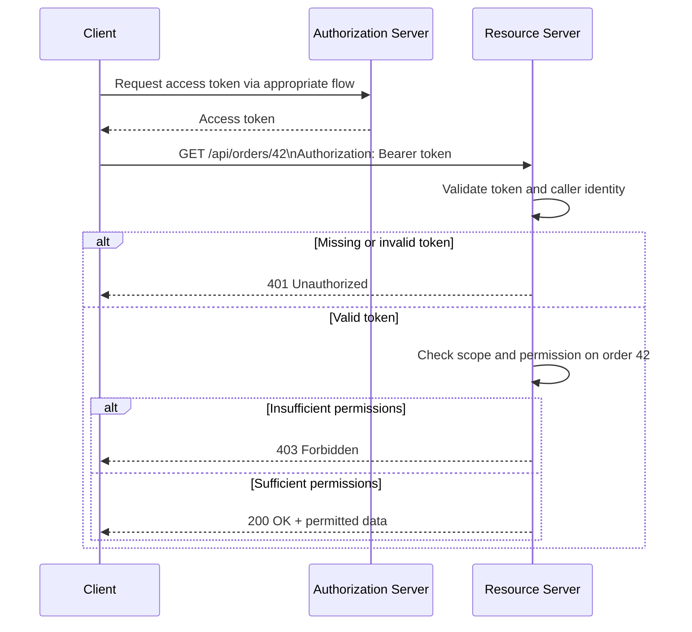
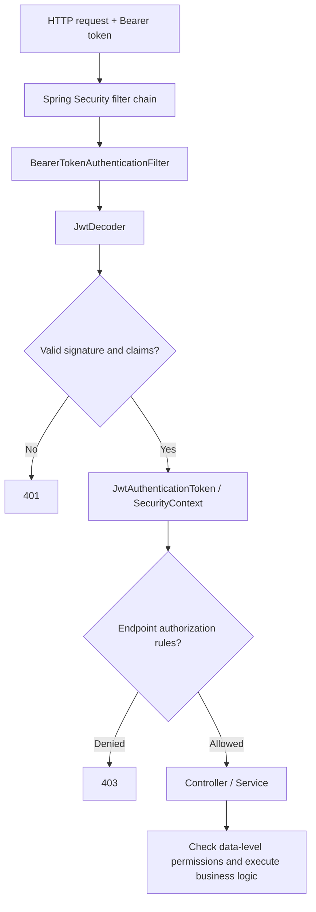

# What is a Resource Server and how does it protect APIs?

## 1. What problem does a Resource Server solve?

Suppose an e-commerce system exposes the following APIs:

```http
GET    /api/products
GET    /api/orders/42
POST   /api/orders
DELETE /api/orders/42
```

The public product API can allow everyone to access it, whereas the orders API must distinguish who the caller is, what operations they are allowed to perform, and whether they are actually permitted to access order `42`. If every API had to accept usernames and passwords itself, issue login sessions itself, and perform its own permission checks, the system would become hard to maintain, hard to scale, and increase the risk of exposing credentials.

In OAuth 2.0, a **Resource Server** is the server that hosts or serves **protected resources** and receives requests to access those resources. In modern applications, a Resource Server is typically a REST API, a GraphQL API, or an internal service. It receives an **access token** issued by an authorization authority, validates the token, and applies authorization rules before returning data or executing an action.

For example, the orders API acts as a Resource Server when it:

1. Receives `GET /api/orders/42` with an access token.
2. Checks whether the token is valid, unexpired, issued by a trusted authority, and intended for this API.
3. Checks whether the caller has the `orders.read` permission.
4. Checks whether order `42` belongs to the caller or whether the caller has appropriate administrative permissions.
5. Returns the data only when all required conditions are met.

**Key takeaway:** A Resource Server protects resources; it does not necessarily log users in or issue access tokens itself. Those two responsibilities usually belong to another component in the system.

### What you will learn in this lesson

- Distinguish between Resource Server, Authorization Server, Client, and Resource Owner.
- Explain the flow of an access token and the two steps: **token authentication** and **operation authorization**.
- Distinguish an access token from an ID token, a JWT from an opaque token, and HTTP `401` from `403`.
- Understand how Spring Security turns a Spring Boot API into an OAuth 2.0 Resource Server.

## 2. Where does the Resource Server fit in OAuth 2.0 and OpenID Connect?

Common roles:

| Component | Responsibility | Example in an order system |
|---|---|---|
| **Resource Owner** | Entity that has authority over a resource; in many flows, the user | The customer who owns the order |
| **Client** | Application requesting access to resources | Web frontend, mobile app, another service |
| **Authorization Server** | Handles authorization grants, issues access tokens, and may provide verification key metadata | Identity server or OAuth 2.0 provider |
| **Resource Server** | Serves the API and rejects requests that do not meet access requirements | The `orders-api` service |

In a small system, the Authorization Server and Resource Server may be deployed close together. At the protocol level, they still retain **distinct roles**. A system can also have multiple Resource Servers trusting the same Authorization Server; each API must verify whether a token was issued for **that specific API**.



In practice, the browser may be redirected to the Authorization Server's login page and returned to the Client after the user authenticates. Redirecting and obtaining tokens depend on the grant/flow, not actions that the Resource Server performs itself.

### How are OAuth 2.0 and OIDC related?

**OAuth 2.0** is an authorization framework: a Client can be granted limited permissions to call an API. **OpenID Connect (OIDC)** adds an identity authentication layer on top of OAuth 2.0, enabling the Client to know who the logged-in user is. When an Authorization Server supports OIDC, it is commonly called an **OpenID Provider**.

Two token types that are very easy to confuse:

| Criterion | Access token | ID token (OIDC) |
|---|---|---|
| Primary purpose | Allows a Client to access a Resource Server within granted scopes | Conveys information about the authentication event and identity to the Client |
| Primary consumer | Resource Server | OIDC Client (relying party) |
| Intended recipient (`aud`) | The API or resource the token was issued for, depending on implementation | Typically the `client_id` of the OIDC Client |
| Format | JWT, opaque, or another system-specific format | Typically JWT |
| Should it be used to call APIs? | **Yes**, if the token is valid and intended for that API | **No**; an ID token does not replace an access token |

A user logging in successfully **does not automatically mean** every API must grant them access. The Resource Server must still validate the access token and check permissions for its own resources.

## 3. How does a protected API request work?

First, the Client obtains an access token through an appropriate OAuth 2.0 flow. For example, user-facing applications commonly use **Authorization Code + PKCE**; service-to-service communication can use **Client Credentials**. Choosing the flow and issuing the token belong to the Client/Authorization Server side.

Then the Client sends the token to the API:

```http
GET /api/orders/42 HTTP/1.1
Host: api.example.com
Authorization: Bearer <access-token>
Accept: application/json
```

`Bearer` means that whoever **holds the token** can present it to request access according to the permissions it carries. Therefore, if a token is stolen, someone else can use it while it remains valid, unless the system has additional token-binding or revocation mechanisms. Bearer tokens must be transmitted over **HTTPS**, and must never be logged in plaintext or shared via URLs.



The Resource Server performs two groups of checks with distinct meanings:

1. **Authentication — authenticating the request:** Is the token trustworthy, is it still valid, and which principal does it represent? In Spring Security, a valid token is converted into an `Authentication` stored in the `SecurityContext`.
2. **Authorization — authorizing the action:** Can that principal call this endpoint, execute this HTTP method, and operate on this specific record?

Verifying the token signature only answers part of the first question; it **does not automatically** prove the caller is allowed to read every order.

### How do `401` and `403` differ?

| Scenario | Typical response | Meaning |
|---|---|---|
| API requires a token, but the request has no valid credentials | `401 Unauthorized` | No accepted authentication credentials provided |
| Token is expired, has an invalid signature, or is rejected | `401 Unauthorized` | Authentication failed |
| Token is valid, but lacks `orders.write` when creating an order | `403 Forbidden` | Authenticated, but insufficient permissions |
| Token is valid and has the scope, but the order does not belong to the caller | `403 Forbidden` or `404 Not Found` depending on API policy | Resource-level authorization rules deny the request |
| Token is valid, with matching scope and record-level permission | `200 OK`, `201 Created`, or appropriate success code | Request is permitted |

When using standard Bearer authentication, the server often sends the `WWW-Authenticate: Bearer` header for certain authentication errors; error details may include `invalid_token` or `insufficient_scope`. Never include tokens, keys, or sensitive data in error payloads.

## 4. How does a Resource Server validate an access token?

Two common strategies are **self-contained JWTs** and **opaque tokens validated via introspection**. A Resource Server must be explicitly configured to trust the right Authorization Server.

### 4.1. With JWTs: verifying signatures and claims

A JWT typically has three Base64URL-encoded parts separated by dots:

```text
<header>.<payload>.<signature>
```

Illustrative payload example (not a real token):

```json
{
  "iss": "https://id.example.com/realms/shop",
  "sub": "user-123",
  "aud": ["orders-api"],
  "exp": 1893456000,
  "nbf": 1893452400,
  "scope": "orders.read orders.write"
}
```

Commonly important claims:

| Claim | Meaning and what to check |
|---|---|
| `iss` (issuer) | Token was issued by the exact Authorization Server trusted by the API |
| `aud` (audience) | Token was issued for this Resource Server, e.g. `orders-api` |
| `exp` (expiration) | Token has not expired |
| `nbf` (not before) | Token has reached the time when it is allowed to be used |
| `sub` (subject) | Identifier of the principal the token represents; may be a user or a Client/service |
| `scope` or `scp` | Granted access scopes; claim name and structure depend on the issuer |

The Resource Server uses **trusted verification keys** to verify the JWT's digital signature, while also checking claims for time, issuer, audience, and application policies. With asymmetric signature algorithms, the Authorization Server keeps the **private key** for signing; the Resource Server uses the **public key** for verification. Many issuers publish public keys via a **JWKS endpoint**; Spring Security can fetch and refresh keys from it when properly configured.

Signed JWTs are usually **not encrypted**: the header/payload contents can be read after Base64URL decoding. Do not place passwords or secret data in the payload, do not treat merely "decoding a JWT" as proof that a token is valid, and do not blindly trust an arbitrary algorithm or key proposed by the token itself.

> **Security bug example:** An API checks only the signature and `exp`, but ignores `aud`. A valid token issued for `inventory-api` could be mistakenly accepted by `orders-api` if both APIs share the same issuer and lack audience enforcement. Audience validation is an essential part of the trust boundary.

### 4.2. With opaque tokens: validating via introspection

An opaque token is a string whose validity a Resource Server cannot determine by decoding its contents locally, for example:

```text
Authorization: Bearer 7gT...<masked-token-string>...9Q
```

The Resource Server typically sends the token to the Authorization Server's **introspection endpoint**. The response may indicate `active`, `scope`, `sub`, `exp`, and other attributes. The API server accepts the token only if the response shows the token is active and satisfies all required checks. The introspection endpoint usually requires the Resource Server to authenticate itself to the Authorization Server.

| Characteristic | Locally verified JWT | Opaque token via introspection |
|---|---|---|
| Common validation method | Verify signature and claims using a JWT decoder | Call the Authorization Server to query token status |
| Network dependency per request | Usually no call per request once appropriate keys are cached | Usually requires an introspection call per request, unless a caching policy is used |
| Early revocation | Already-issued JWTs generally remain usable until expiration unless additional blocking mechanisms exist | Authorization Server can return `active: false` as soon as revocation takes effect |
| Considerations | Must validate `iss`, `aud`, expiration, signature, and scope | Must protect introspection credentials and validate response attributes/scopes |

You cannot conclude that one token type is "more secure" solely from its format. Choosing between JWT and opaque tokens depends on latency requirements, token revocation needs, architecture, and how much control you have over the Authorization Server. Regardless of token type, **business-level access permissions must still be checked by the API**.

## 5. How does Spring Security turn an API into a Resource Server?

In the Spring ecosystem, **Spring Security OAuth2 Resource Server** provides the components to read a Bearer token from an HTTP request, validate the token, and create an Authentication object for authorization. For JWTs, the high-level flow looks like this:



The path for opaque tokens plays a similar role, but uses an **`OpaqueTokenIntrospector`** component to validate the token via introspection instead of `JwtDecoder`. The filter chain, Authentication, and access control mechanisms remain part of Spring Security.

### 5.1. Add dependencies

Example Java application using Spring Boot and Gradle:

```groovy
dependencies {
    implementation 'org.springframework.boot:spring-boot-starter-web'
    implementation 'org.springframework.boot:spring-boot-starter-security'
    implementation 'org.springframework.boot:spring-boot-starter-oauth2-resource-server'
}
```

The Resource Server starter provides the components needed for Bearer token handling. When using JWTs, the framework includes support for decoding/verifying signatures and handling common claims. Adding the dependency alone **does not complete** configuring trust and access rules.

### 5.2. Specify the trusted Authorization Server

If access tokens are JWTs, you can configure `issuer-uri` in `application.yml`:

```yaml
spring:
  security:
    oauth2:
      resourceserver:
        jwt:
          issuer-uri: https://id.example.com/realms/shop
```

Replace the illustrative address with the **exact issuer** published by your Authorization Server. Spring Security can use the issuer metadata to discover the public key endpoint, then verify JWTs and check the issuer/timestamps according to appropriate default validators. If your API requires a specific audience or custom claim rules, configure the corresponding validator as well; **having `issuer-uri` alone does not mean all application authorization and audience rules are already set up**.

### 5.3. Authorize by path, HTTP method, and scope

Example `SecurityFilterChain` for an API that only uses Bearer tokens and does not use cookies for authentication:

```java
import org.springframework.context.annotation.Bean;
import org.springframework.context.annotation.Configuration;
import org.springframework.http.HttpMethod;
import org.springframework.security.config.Customizer;
import org.springframework.security.config.annotation.web.builders.HttpSecurity;
import org.springframework.security.config.http.SessionCreationPolicy;
import org.springframework.security.web.SecurityFilterChain;

@Configuration
public class SecurityConfig {

    @Bean
    SecurityFilterChain apiSecurity(HttpSecurity http) throws Exception {
        return http
            // Only suitable for stateless APIs using Bearer tokens,
            // not using session cookies to authenticate requests.
            .csrf(csrf -> csrf.disable())
            .sessionManagement(session ->
                session.sessionCreationPolicy(SessionCreationPolicy.STATELESS))
            .authorizeHttpRequests(authorize -> authorize
                .requestMatchers("/api/public/**").permitAll()
                .requestMatchers(HttpMethod.GET, "/api/orders/**")
                    .hasAuthority("SCOPE_orders.read")
                .requestMatchers(HttpMethod.POST, "/api/orders/**")
                    .hasAuthority("SCOPE_orders.write")
                .anyRequest().authenticated()
            )
            .oauth2ResourceServer(oauth2 ->
                oauth2.jwt(Customizer.withDefaults()))
            .build();
    }
}
```

Key points explained:

- `oauth2ResourceServer(...jwt(...))` enables receiving and validating JWT Bearer tokens.
- `requestMatchers` uses paths and HTTP methods to define access conditions. More specific rules must be ordered before general rules.
- By default, Spring Security converts values in the JWT `scope` or `scp` claim into authorities prefixed with **`SCOPE_`**. The scope `orders.read` maps to `SCOPE_orders.read`. This can be customized with a converter when the claim structure differs from the default.
- `anyRequest().authenticated()` requires authentication for unlisted endpoints, but **does not automatically enforce fine-grained business permissions** on them; applications should add explicit rules for sensitive endpoints.
- `STATELESS` indicates that the API does not rely on HTTP sessions to maintain login state. The example disables CSRF because it assumes tokens are sent explicitly in the Authorization header rather than automatically via cookies. **Do not disable CSRF mechanically** if your application uses cookie-based authentication or browser UI integrations that require CSRF protection.

The code above is only an example of Resource Server configuration, **not an Authorization Server**; it does not provide login endpoints, consent pages, or access token issuance.

### 5.4. Reading identity from the token in a controller

When a token is valid, an endpoint can access the validated JWT claims:

```java
import java.util.Map;
import org.springframework.security.core.annotation.AuthenticationPrincipal;
import org.springframework.security.oauth2.jwt.Jwt;
import org.springframework.web.bind.annotation.GetMapping;
import org.springframework.web.bind.annotation.RequestMapping;
import org.springframework.web.bind.annotation.RestController;

@RestController
@RequestMapping("/api/orders")
public class OrderController {

    @GetMapping("/me")
    public Map<String, String> currentCaller(@AuthenticationPrincipal Jwt jwt) {
        return Map.of("subject", jwt.getSubject());
    }
}
```

With the configuration in Section 5.3, `GET /api/orders/me` requires the `SCOPE_orders.read` authority. If the token is valid, `jwt.getSubject()` returns the `sub` attached by the issuer; this value **is not necessarily a human username**, because tokens can also be issued to machine-to-machine applications.

In real APIs, never take an `ownerId` from a request parameter and blindly return data for that ID. For example, after identifying the principal from the token, the Service/Repository layer must restrict queries by owner or check authorization policies:

```java
// Illustrates a business rule, not a complete controller.
Order order = orderRepository.findById(orderId)
    .orElseThrow(ResourceNotFoundException::new);

if (!order.getOwnerSubject().equals(authenticatedSubject)
        && !permissionService.canReadOthersOrders(authenticatedSubject)) {
    throw new AccessDeniedException("Not allowed to view this order");
}
```

**Scope** answers the general question "was the token granted permission to read orders?", while checking **ownership/data object** answers "is the caller allowed to read **this specific order**?". Both layers are required for resources with ownership rules.

### 5.5. Configuring audience validation for JWTs

If a system issues tokens for multiple APIs, the Resource Server must reject tokens whose audience is not meant for it. Spring Security allows configuring additional validators. The example below enforces `orders-api` as a required audience while keeping the default issuer and timestamp validators:

```java
import org.springframework.context.annotation.Bean;
import org.springframework.beans.factory.annotation.Value;
import org.springframework.security.oauth2.core.DelegatingOAuth2TokenValidator;
import org.springframework.security.oauth2.core.OAuth2Error;
import org.springframework.security.oauth2.core.OAuth2TokenValidator;
import org.springframework.security.oauth2.core.OAuth2TokenValidatorResult;
import org.springframework.security.oauth2.jwt.Jwt;
import org.springframework.security.oauth2.jwt.JwtDecoder;
import org.springframework.security.oauth2.jwt.JwtDecoders;
import org.springframework.security.oauth2.jwt.JwtValidators;
import org.springframework.security.oauth2.jwt.NimbusJwtDecoder;

// Add to security configuration when audience validation is required.
@Bean
JwtDecoder jwtDecoder(
        @Value("${spring.security.oauth2.resourceserver.jwt.issuer-uri}") String issuer) {
    NimbusJwtDecoder decoder = (NimbusJwtDecoder) JwtDecoders.fromIssuerLocation(issuer);

    OAuth2TokenValidator<Jwt> issuerAndTime =
        JwtValidators.createDefaultWithIssuer(issuer);
    OAuth2TokenValidator<Jwt> audience = jwt ->
        jwt.getAudience().contains("orders-api")
            ? OAuth2TokenValidatorResult.success()
            : OAuth2TokenValidatorResult.failure(
                new OAuth2Error("invalid_token", "Invalid audience", null));

    decoder.setJwtValidator(
        new DelegatingOAuth2TokenValidator<>(issuerAndTime, audience));
    return decoder;
}
```

This addition is meaningful when the Authorization Server actually issues access tokens whose `aud` includes `orders-api`; otherwise, tokens will be rejected and the issuer configuration will need to be adjusted accordingly. The exact validator setup may vary across Spring Security versions, but the mandatory principle is to **enforce issuer, audience, expiration, and trusted algorithms/keys**.

### 5.6. If the Authorization Server issues opaque tokens

Instead of JWTs, the application can use introspection:

```yaml
spring:
  security:
    oauth2:
      resourceserver:
        opaque-token:
          introspection-uri: https://id.example.com/oauth2/introspect
          client-id: ${INTROSPECTION_CLIENT_ID}
          client-secret: ${INTROSPECTION_CLIENT_SECRET}
```

```java
// In SecurityFilterChain, choose opaque token instead of jwt:
.oauth2ResourceServer(oauth2 ->
    oauth2.opaqueToken(Customizer.withDefaults()))
```

The URI and credentials are examples only. Use your issuer's actual introspection endpoint, store secrets in secret management or environment variables, and define audience or permission attribute checks according to the actual introspection response. **The JWT and opaque token configurations shown here are mutually exclusive deployment options**, not two snippets to combine verbatim into the same example.

## 6. Real-world scenarios

### Scenario A: A user reads their own order

1. The user logs in through a web app using Authorization Code + PKCE.
2. The Client receives an access token with scope `orders.read`, issued for `orders-api`.
3. The Client sends `GET /api/orders/42` with the Bearer token.
4. The Resource Server validates the token, checks `orders.read`, looks up order `42`, and verifies the user is allowed to view it.
5. The API returns the order if all checks pass.

If the Client changes `42` to `43` (someone else's order), the `orders.read` scope still does not bypass the ownership check. That is the defense against object-level authorization flaws (commonly known as BOLA/IDOR).

### Scenario B: Payment service calls the orders service

A backend service uses Client Credentials to obtain an access token representing the **service client**, for example with scope `orders.update-payment-status`. The orders API validates the token and only permits the corresponding payment-status update operation. Because there is no interactive end user in this flow, the Resource Server must not assume `sub` is an end user; it needs authorization rules designed for machine/service identities.

### Scenario C: Expired or revoked tokens

When a JWT expires (`exp` has passed), the Resource Server rejects it even if its signature is still valid. If a JWT needs to be revoked **before** its expiration time, the system must adopt additional strategies, such as short token lifetimes, blocklists, or centralized session/permission checks. With opaque tokens, introspection can reflect revoked status, though latency and caching policies must also be accounted for.

## 7. Testing the API over HTTP

After configuring the Resource Server with an actual Authorization Server, you can test the following three cases with `curl` (replacing the URL and token with values from your environment):

```bash
# 1. No token provided for protected endpoint
curl -i https://api.example.com/api/orders/me

# 2. Fake/invalid token: expected to be rejected
curl -i -H 'Authorization: Bearer invalid.token.value' \
  https://api.example.com/api/orders/me

# 3. Valid access token, matching audience and orders.read scope
curl -i -H "Authorization: Bearer ${ACCESS_TOKEN}" \
  https://api.example.com/api/orders/me
```

Real token values must be kept secret; do not place them in documentation, logs, commits, or inappropriate monitoring tools. If a valid request is still rejected, check **issuer**, **audience**, **token expiration**, **signature/JWKS**, the **scope** claim, `SCOPE_` mapping, and path rules in order. Never fix a `403` by removing all authorization checks.

## 8. Common mistakes and how to avoid them

| Mistake | Consequence | How to handle it |
|---|---|---|
| Using an ID token to call APIs | A token intended for Client authentication may be misused | Use an access token issued for the API |
| Only decoding the JWT or only checking `exp` | Forged tokens or tokens from untrusted sources may be accepted | Verify the signature with trusted keys and validate all required claims |
| Not checking `aud` when multiple APIs share an issuer | An API may accept tokens intended for another service | Enforce the audience for each Resource Server |
| Letting `orders.read` scope read every order | Exposure of other users' data | Check ownership and per-resource policies |
| Trusting role/scope values sent by the Client outside the token | Clients can escalate their own privileges | Rely only on authenticated trusted claims and server-side business permissions |
| Sending tokens over HTTP, in URLs, or logging tokens | Tokens are leaked and can be reused | Use HTTPS; Authorization header; mask sensitive data |
| Assuming a revoked JWT immediately stops working | Unexpired tokens can still be accepted | Design short lifetimes and appropriate revocation mechanisms |
| Ignoring CSRF when using cookies for login | Exposes vulnerabilities to browser-originated requests | Evaluate how credentials are stored/sent and enable CSRF protection when needed |
| Equating scope with roles or ownership | Authorization rules become overly broad | Separate OAuth scopes, Spring authorities, and business permissions |

## 9. API protection architecture checklist

When designing a Resource Server, always be able to answer these questions:

1. **Which resources does the API protect?** Which endpoints are public, and which require permissions?
2. **Who issues the tokens?** What are `iss` and the trusted key set/introspection endpoint?
3. **Is the token meant for this API?** What is the expected `aud`, and is the token still valid?
4. **What permissions does the token carry?** Which scopes/authorities apply to each operation?
5. **Who owns the data object?** What additional ownership, tenant, or business conditions must be checked?
6. **How should failures respond?** Distinguish authentication errors (`401`) from authorization errors (`403`) and avoid leaking data.

A Resource Server is the **access control gate for your API**. OAuth 2.0 enables the Client to bring granted access rights to that gate; OIDC adds user identity authentication information for the Client; Spring Security provides the infrastructure layer for token validation and request authorization. An API is only truly protected when **valid tokens**, **appropriate access scopes**, and **object-level permission rules** work together.
