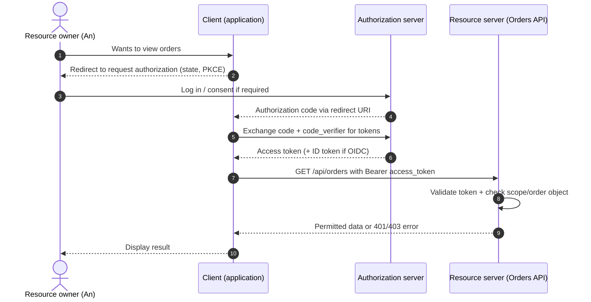
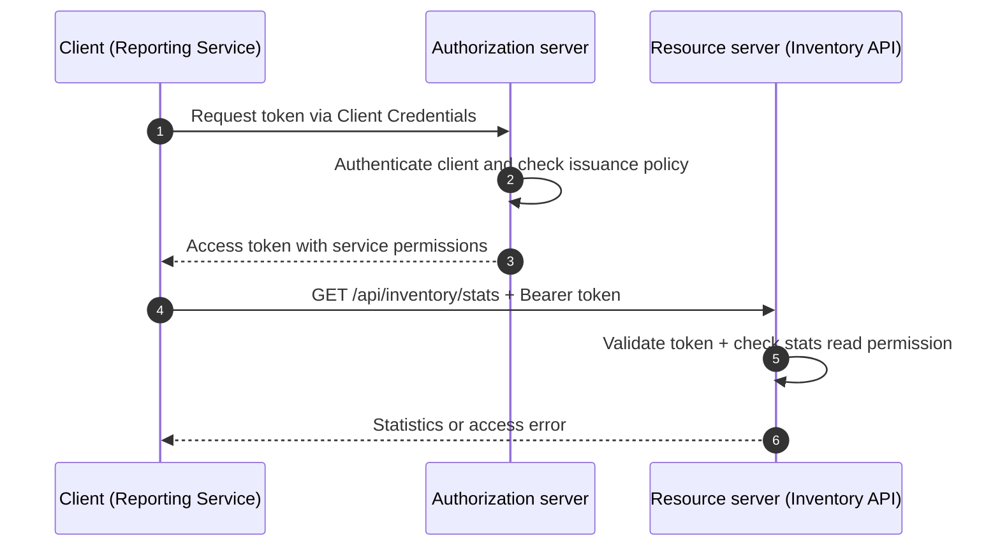

# Resource Owner, Client, Authorization Server, and Resource Server

In **OAuth 2.0** architecture, the four foundational roles are the **resource owner**, **client**, **authorization server**, and **resource server**. Understanding the exact responsibility boundaries of these four roles is essential for designing secure APIs with **Spring Security OAuth 2.0 Resource Server**, and for avoiding confusion between **access authorization** and **user login/authentication** when adding **OpenID Connect (OIDC)**.

> **Key takeaway:** The client requests access; the authorization server decides and issues access tokens according to policy; the resource server accepts access tokens to protect the API; the resource owner is the party with authority over the accessed resource. These are **logical roles**, not necessarily four separate servers or four separate applications.

## 1. Starting from a real-world scenario

Suppose a retail system has:

- **An**: a person who has orders in the system.
- **Order management application**: the web UI or mobile app that An uses.
- **Login/token issuance system**: a service that handles login requests and grants API access.
- **Orders API**: a service providing order data at `/api/orders`.

An wants the application to display their list of orders. The application should not ask An for their password and then use that password to call the Orders API. Instead, using an appropriate OAuth 2.0 flow, the application directs An to the authorization system, receives an **access token**, and sends the token when calling the API. The Orders API checks the token and access rules before returning data.

Mapping the four roles:

| Role | In the example | Core responsibility |
| --- | --- | --- |
| **Resource owner** | An, for the orders An has authority over | The party authorized to grant access to resources under the system's permission model |
| **Client** | Order management application | Requests authorization, obtains tokens through a supported flow, and uses access tokens to call APIs |
| **Authorization server** | Login/token issuance system | Authenticates parties as needed, processes authorization requests, and issues tokens |
| **Resource server** | Orders API | Validates access tokens, enforces access policies, and serves protected resources |

In a real system, the same product may include multiple clients and multiple resource servers. An organization may use one authorization server to issue tokens for Orders API, Payments API, and Inventory API; each API remains responsible for controlling access to its own resources.

## 2. The four roles and their responsibility boundaries

### 2.1. Resource owner

In the OAuth 2.0 model, the **resource owner** is the entity capable of granting access to a protected resource. When the resource owner is a person, that entity is typically an **end-user**.

In our example, An can consent to let the application read An's orders. However, two questions must be kept separate:

1. **Who is logged in?** This is a question of identity/authentication.
2. **Who is allowed to access which orders?** This is a question of resource access authorization.

The two questions are not synonymous. An being logged in successfully does not automatically allow An to read Binh's orders. The resource owner is also not necessarily the person who directly created a record: a resource may belong to an organization, team, or enterprise account, with usage rights determined by business policy.

A few notes:

- A resource owner is **not** another name for a resource server. One party has authority over the resource; the other is the system storing or serving the protected resource.
- A user clicking **Approve/Consent** only appears in flows and policies that require it. Not every access token originates from a consent screen.
- With the **Client Credentials** flow for machine-to-machine communication, there is typically no end user participating in the transaction. Permissions are granted based on the client's identity and the authorization server's policy; do not arbitrarily attribute such a token to a human resource owner.
- The resource owner does not need to give their password to the client application. An appropriate authorization flow allows the client to receive bounded access without holding user credentials.

### 2.2. Client — the application requesting access

A **client** is an application making protected resource requests on behalf of the resource owner or on its own behalf. A client can be:

- A server-side web application (backend web app/BFF).
- A **Single-page application (SPA)** running in the browser.
- A mobile or desktop application.
- A backend service calling another backend service's API.

In OAuth 2.0, distinguish between:

| Client type | Characteristics | Examples |
| --- | --- | --- |
| **Confidential client** | Capable of maintaining the confidentiality of its client credentials in a trusted environment | A server-side backend calling the token endpoint with securely stored credentials |
| **Public client** | Cannot reliably keep an application secret confidential | A browser-based SPA, a mobile app distributed to user devices |

`client_id` identifies the client when interacting with the authorization server; it is **not a secret**. Never treat hiding `client_id` in JavaScript or a mobile app as a security measure. `client_secret`, if issued to a confidential client, must be kept somewhere capable of protecting secrets; never embed it in a public application.

Clients are typically registered with the authorization server with details such as client identifier, redirect URIs, allowed grant types, and intended scopes. For user-interactive applications, **Authorization Code + PKCE** is an important pattern to prevent stolen authorization codes from being misused; PKCE does not replace all client authentication mechanisms when the client is confidential.

**A client does not decide for itself whether a token is valid for an API**. It can request `orders.read`, but only the authorization server decides what to issue, and the Orders API still validates the token and business policy before serving data.

### 2.3. Authorization server

The **authorization server** is the system that issues access tokens to the client after processing an authorization request according to its protocol and policies. Depending on the flow, its responsibilities may include:

- Identifying/authenticating the end user, and authenticating the client when required.
- Validating the client, redirect URI, grant type, requested scopes, and other issuance conditions.
- Handling consent or organizational authorization rules where applicable.
- Issuing **access tokens**, optionally **refresh tokens**; and with OIDC, **ID tokens**.
- Publishing metadata, public keys for verifying JWT signatures via **JWKS**, or providing a **token introspection** endpoint for opaque tokens when supported.
- Managing credential lifecycles, token lifetimes, key rotation, revocation policies, and login sessions according to the product's capabilities.

Implementation examples include Keycloak, an OAuth 2.0/OIDC-compliant identity provider, or an authorization server built with **Spring Authorization Server**. The authorization server is the **token-issuing** role; adding the **Spring Security Resource Server** library to an API does not turn that API into an authorization server.

An important point: the authorization server can decide to grant the `orders.read` scope, but it usually **does not hold all order data** to decide which specific order records An may view. The final decision at the resource level still belongs to the resource server and the business layer.

### 2.4. Resource server

The **resource server** is the service hosting or serving protected resources and accepting access tokens as part of its access control mechanism. Examples: Orders API, Payments API, an HR records system, or a documents API.

Upon receiving a request, the resource server must enforce two layers of control:

1. **Token validation**: Can the token be verified, is it still valid, did it come from a trusted issuer, is it intended for this API, and does it meet required conditions such as scopes/claims?
2. **Business authorization**: Is the principal in the token allowed to view/modify this exact record, in this tenant, in this business state?

With a **signed JWT** access token, the resource server can verify the signature using the corresponding public key published by the issuer, then validate relevant claims such as `iss`, `exp`, `nbf`, and `aud` according to configuration. With an **opaque token**, the resource server typically calls an introspection endpoint or uses a trusted lookup mechanism to obtain the token's status and attributes.

A resource server may **not display any login page at all**. It typically only receives HTTP requests with `Authorization: Bearer ...` and returns data or appropriate error codes. Spring Security OAuth 2.0 Resource Server primarily serves this role.

## 3. How do the roles collaborate?

### 3.1. User grants access via Authorization Code + PKCE

The diagram below illustrates an order management application using Authorization Code + PKCE. Exact steps depend on the platform and OAuth 2.0/OIDC configuration, but the boundaries of the four roles remain unchanged.



Step-by-step walkthrough:

1. **Client → Authorization server:** The client initiates an authorization request with `client_id`, `redirect_uri`, `scope`, `state`, and PKCE parameters. In OIDC, `scope` typically includes `openid`.
2. **Resource owner ↔ Authorization server:** The user logs in and may decide whether to grant access. The authorization server uses its policies to decide whether to proceed or deny.
3. **Authorization server → Client:** Upon completion, the authorization server returns an **authorization code**; the client exchanges the code at the token endpoint to receive tokens. An authorization code is not an access token.
4. **Client → Resource server:** The client places the **access token** in the HTTP `Authorization` header when calling the Orders API. The client does not send an ID token in place of an access token.
5. **Resource server:** The API validates the token and applies specific access rules. If valid and authorized, the API returns the data; otherwise, it rejects the request.

An illustrative HTTP request at step 4:

```http
GET /api/orders/123 HTTP/1.1
Host: orders.example.com
Authorization: Bearer <access-token>
Accept: application/json
```

`<access-token>` is a placeholder, not an actual token. The client should transmit the bearer token via a header over an HTTPS connection; do not put tokens in URLs because URLs easily leak into browser history, logs, or intermediaries.

### 3.2. Server-to-server calls using Client Credentials

Not every OAuth 2.0 request starts with a person opening a login page. For example, an internal reporting service needs to read statistics from the Inventory API:



In this case, no end user participates in token issuance. The token represents permissions granted to the **client/service** according to policy. The API must not assume there is always a human user behind the access token's `sub`.

## 4. Where do access tokens, ID tokens, and refresh tokens go?

These three token types often appear alongside each other, yet they have **different purposes and intended recipients**.

| Token type | Purpose | Primary consumer | Sent to the resource server as API access proof? |
| --- | --- | --- | --- |
| **Access token** | Represents granted permissions to access resources | Client sends to resource server; resource server validates | **Yes** — when the token is intended for that API |
| **ID token (OIDC)** | Provides information about the user authentication event to the client | OIDC client verifies and uses it to establish a login session | **No** — does not replace an access token |
| **Refresh token** | Allows the client to request a new access token when permitted | Client sends to authorization server | **No** — never sent to resource APIs |

### Access tokens do not have to be JWTs

OAuth 2.0 does not require an access token to be a JWT string with readable claims. An authorization server can issue opaque tokens, or JWTs structured according to the provider's token profile and implementation. An **illustrative** payload for a JWT-formatted access token might look like this:

```json
{
  "iss": "https://auth.example.com/realms/shop",
  "sub": "user-42",
  "aud": ["orders-api"],
  "scope": "orders.read",
  "client_id": "orders-web-app",
  "exp": 1893456000
}
```

This is only an example of claims that may appear, **not a mandatory format** or a complete token. Claim names, permission representations (`scope`, `scp`, custom roles...), how `sub` is interpreted, and the format of `aud` vary by issuer and system conventions. Being able to Base64-decode a JWT payload does not mean its signature is valid.

Different claims carry different meanings:

- `iss` (**issuer**): the token issuer. The API must trust the exact configured issuer.
- `sub` (**subject**): the principal the token refers to; may be a user or a service principal depending on the grant and issuer.
- `aud` (**audience**): the intended target of the token. An access token meant for the Payments API must not be accepted by the Orders API merely because the signature is valid.
- `exp` and `nbf`: the expiration timestamp and the time when the token becomes valid, when present.
- `scope`: permissions granted at the scope level, e.g. `orders.read`; **does not automatically prove** ownership of all orders.

JWTs are usually validated at the resource server using signatures and appropriate keys; opaque tokens usually require querying status via introspection. Choosing JWT or opaque is a joint design decision between the issuer and the consuming APIs, not an inherent property of each role.

### What does OIDC add?

**OAuth 2.0** primarily answers: *"Which resources may this application access, and within what scope?"* **OpenID Connect** is an identity layer built on top of OAuth 2.0, adding an end-user authentication protocol and standardized identity information, including the **ID token**.

For example: the order management application uses OIDC to know that **An has logged in**; it then uses an OAuth 2.0 access token to call the **Orders API**. Those are two separate purposes, even though the user may receive both an ID token and an access token in the same workflow.

An OIDC provider typically fulfills the authorization server role and adds OIDC capabilities such as discovery, ID tokens, and potentially a UserInfo endpoint. On the Spring Security side, **OAuth2 Login/OIDC Client** configuration for applications logging users in is different from **OAuth2 Resource Server** configuration for APIs accepting bearer tokens.

## 5. Trust boundaries and security decisions

Each role sees only part of the picture. Therefore, checks must be placed at the right boundaries:

| Boundary | What must be protected | Mistakes to avoid |
| --- | --- | --- |
| Resource owner ↔ Authorization server | User authentication and authorization decisions | Client collecting user passwords directly to obtain access |
| Client ↔ Authorization server | Client identity, redirect URI, grant, PKCE, scopes | Putting `client_secret` in an SPA, skipping `state` or PKCE checks where required |
| Client ↔ Resource server | Access token and secure transport channel | Sending an ID token as a bearer token to an API or placing a bearer token in a URL |
| Resource server ↔ Issuer/metadata | Signature/keys, issuer, audience, and token validity | Trusting `sub` or `scope` from a JWT just because the decoded payload is readable |
| Resource server ↔ Business data | Object access rights and business context | Letting `orders.read` view **all** orders of every customer |

**Authentication, token validation, and authorization are three distinct steps.**

- **Authentication**: Who is interacting, or which client is authenticating itself to the authorization server?
- **Token validation**: Was this token truly issued by a trusted issuer, is it still valid, and is it appropriate for the receiving API?
- **Authorization**: Is the authenticated principal allowed to perform this specific action on this specific resource?

For example, both An and Binh have valid tokens carrying the `orders.read` scope. The resource server must still check whether order `123` is within the set An is permitted to view. If an API only matches scopes without checking order ownership/tenant/assigned permissions, that is a **Broken Object Level Authorization (BOLA)** vulnerability.

When a token is rejected, HTTP typically distinguishes:

- **401 Unauthorized**: missing or invalid authentication credentials/token; Bearer APIs typically return an appropriate `WWW-Authenticate` header.
- **403 Forbidden**: valid authentication credentials were provided, but permissions are insufficient for the operation, such as a missing scope or denial by a business rule.

Actual status codes also depend on Spring Security configuration and the application's error handling; do not assume every 403 means a missing scope.

## 6. Mapping the four roles onto Spring Security Resource Server

For a Spring Boot application serving the Orders API, its deployment role is **resource server**. The authorization server can be an independent OIDC/OAuth 2.0 system. A client calling the API can be written in Java, JavaScript, a mobile SDK, or any language supporting HTTP.

### 6.1. Minimal configuration for an API receiving JWTs

In a Spring Boot application using a compatible Spring Security version, add the Resource Server dependency:

```xml
<dependency>
    <groupId>org.springframework.boot</groupId>
    <artifactId>spring-boot-starter-oauth2-resource-server</artifactId>
</dependency>
```

Example `application.yml`:

```yaml
spring:
  security:
    oauth2:
      resourceserver:
        jwt:
          issuer-uri: https://auth.example.com/realms/shop
```

`issuer-uri` tells Spring Security the trusted issuer so it can discover metadata and public keys according to what the issuer supports. JWT configuration must match the tokens the authorization server actually issues. In addition to standard configuration checks, the API must ensure the **audience** matches itself; do not assume configuring the issuer alone enforces all system audience policies.

Example HTTP access rules:

```java
import org.springframework.context.annotation.Bean;
import org.springframework.context.annotation.Configuration;
import org.springframework.http.HttpMethod;
import org.springframework.security.config.annotation.web.builders.HttpSecurity;
import org.springframework.security.config.http.SessionCreationPolicy;
import org.springframework.security.web.SecurityFilterChain;
import org.springframework.security.config.Customizer;

@Configuration
public class ApiSecurityConfiguration {

    @Bean
    SecurityFilterChain apiSecurity(HttpSecurity http) throws Exception {
        return http
            // Suitable for pure Bearer APIs, not using session cookies for authentication.
            .csrf(csrf -> csrf.disable())
            .sessionManagement(session ->
                session.sessionCreationPolicy(SessionCreationPolicy.STATELESS))
            .authorizeHttpRequests(auth -> auth
                .requestMatchers("/public/**").permitAll()
                .requestMatchers(HttpMethod.GET, "/api/orders/**")
                    .hasAuthority("SCOPE_orders.read")
                .requestMatchers(HttpMethod.POST, "/api/orders/**")
                    .hasAuthority("SCOPE_orders.write")
                .anyRequest().authenticated())
            .oauth2ResourceServer(oauth2 ->
                oauth2.jwt(Customizer.withDefaults()))
            .build();
    }
}
```

In the common default configuration, Spring Security converts JWT scopes into authorities prefixed with `SCOPE_`: the `orders.read` scope becomes `SCOPE_orders.read`. If the issuer uses a different permission claim or representation, configure an appropriate mapping. Do not treat `ROLE_` and `SCOPE_` as interchangeable names unless you have intentionally designed such a convention.

**Note on CSRF:** The `csrf(...disable())` line in the example is appropriate only when the API strictly accepts Bearer tokens and does not rely on session cookies automatically attached by browsers. For web applications with login cookies, evaluate and retain appropriate CSRF protection.

The example above protects **paths and operations**; it does not yet check whether the user is allowed to view order `123`. Object-level permission checks must be performed in the service/domain layer or via an appropriate authorization mechanism. For instance, `orderService.findVisibleOrder(orderId, subject, tenant)` must verify ownership/delegated permissions against trusted data rather than relying solely on scopes.

To validate **audience**, you can declare the audience expected by the API using supported configuration mechanisms or add an `OAuth2TokenValidator<Jwt>` to `JwtDecoder`. Configure this properly for your Spring Boot/Spring Security version and how the authorization server emits `aud`; this is a protection step independent of `hasAuthority(...)` rules.

### 6.2. If the authorization server issues opaque tokens

With opaque tokens, the resource server cannot parse a JWT and verify its signature locally; it needs a verification mechanism such as token introspection provided by the issuer. Spring Security supports configuring an opaque-token resource server, for example:

```yaml
spring:
  security:
    oauth2:
      resourceserver:
        opaquetoken:
          introspection-uri: https://auth.example.com/oauth2/introspect
          client-id: ${INTROSPECTION_CLIENT_ID}
          client-secret: ${INTROSPECTION_CLIENT_SECRET}
```

The introspection path is an **example**; you must use the endpoint published by your authorization server. Introspection credentials belong to the resource server when calling the authorization server, not the resource owner's password. With opaque tokens, the HTTP security configuration must select opaque token support instead of `.jwt(...)`.

### 6.3. Which roles does Spring Security cover?

| Component/capability | Typical role | What to distinguish |
| --- | --- | --- |
| **Spring Security OAuth2 Resource Server** | Resource server | Accepts Bearer access tokens, validates them, and protects API endpoints |
| **Spring Security OAuth2 Client / OAuth2 Login** | Client | Initiates OAuth 2.0/OIDC flows, handles login and tokens for the application |
| **Spring Authorization Server** | Authorization server | Builds a token-issuing service and related endpoints |
| **Application controller/service/domain** | Part of resource server implementation | Enforces access control at the record, tenant, and business levels |

A single application can take on multiple roles—for example, both logging users in via OIDC as a client and serving APIs as a resource server. However, each role has its own configuration and processing flow; simply adding the Resource Server starter does not create an OIDC login page or a token endpoint to issue access tokens.

## 7. Common misconceptions

| Common misconception | Accurate understanding |
| --- | --- |
| "The client is the browser, and the resource server is the backend." | The client is the **application** requesting access; it may be an SPA, mobile app, or backend. The resource server is the role serving protected resources. |
| "The logged-in user is the resource server." | The user is usually the resource owner; the resource server is the service/API. |
| "Once the authorization server allows it, the API needs no further checks." | The API must still validate the token, scope, audience, and access to the specific object. |
| "With a valid JWT, you can call any API." | A valid signature is only one condition; issuer, audience, expiration, permissions, and API policies all matter. |
| "An OIDC ID token is used to call APIs." | ID tokens serve user authentication for the client; APIs are protected with access tokens intended for those APIs. |
| "OAuth 2.0 always has a user clicking consent." | Client Credentials and machine-to-machine grant policies do not involve an end user in each transaction. |
| "The `orders.read` scope allows reading every order." | Scopes are operation/range-level conditions; permissions on individual orders must be checked separately. |
| "Configuring Resource Server also creates an Authorization Server." | Spring Security Resource Server validates tokens for an API; the token-issuing system is a separate role. |

## 8. Matching roles to system needs

**Case A — User views their own data:** An logs in at the OIDC provider; the application is the OAuth2/OIDC client; the provider acts as the authorization server; Orders API is the resource server. The token needs read permissions, and the API verifies An may view only An's orders.

**Case B — Internal nightly batch job processes data:** The job acts as a client using Client Credentials; the authorization server issues a token matching the job's permissions; Reporting API is the resource server. Do not create fake users to attribute all job actions to an end-user.

**Case C — One client calls multiple APIs:** The application calls Orders API and Payments API. Both APIs are resource servers, yet they may require different **audiences** and scopes. Do not treat an access token issued for API A as a universal pass for API B.

**When designing a Spring Security Resource Server API, clearly answer four questions:** Who has authority over the resource? Which application is requesting access? Which system issues the tokens? Which API receives the tokens and controls the data? The answers will determine how to place OAuth 2.0/OIDC at the right boundaries, configure trust with the issuer, and implement permission checks in the API.
