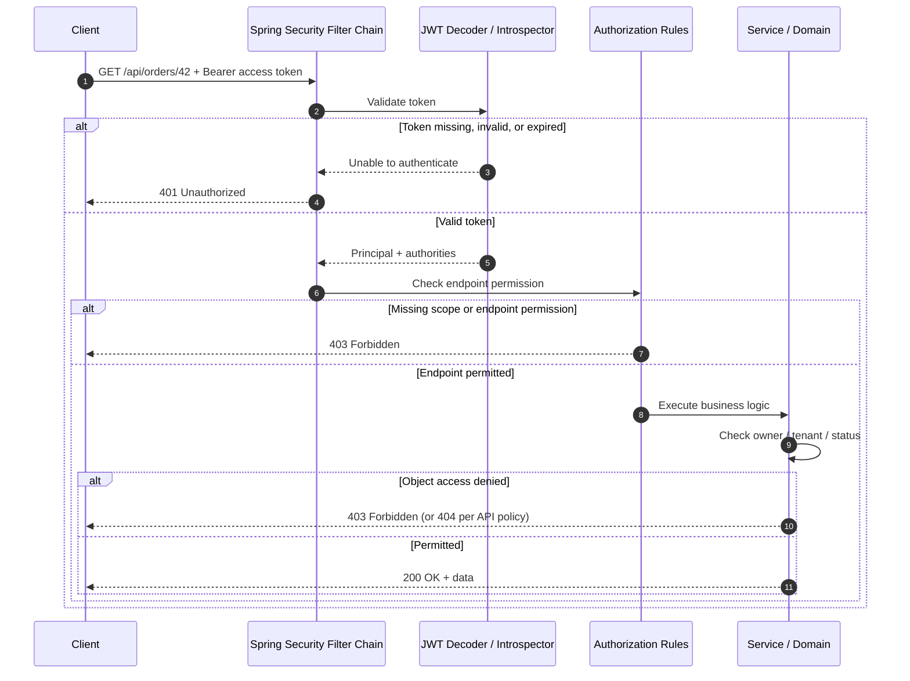

# Token Authentication and Resource Authorization Are Two Separate Steps

In **Spring Security OAuth 2.0 Resource Server**, a request carrying a `Bearer` token can **pass authentication** and still be **denied access to the resource**. That is the right behavior: token authentication and authorization answer two different questions.

- **Authentication:** Is this token valid, issued by a trusted issuer, and usable to establish an identity/security context for this request?
- **Authorization:** Given the established security context, is this principal allowed to perform this **specific action** on this **specific resource**?

For example, an access token that is validly signed, unexpired, and carries the `orders.read` scope may allow a user to call an API to read orders. However, if order `42` belongs to another user, the application must still deny it. **A valid token does not equate to permission to access all data.**

## 1. Where does the Resource Server fit in OAuth 2.0 and OIDC?

In a typical architecture:

| Component | Primary responsibility |
| --- | --- |
| **Client** (web, mobile, backend) | Obtains an access token through an appropriate OAuth 2.0 flow and sends requests to the API. |
| **Authorization Server / OpenID Provider** | Authenticates users as needed, issues tokens, publishes public keys, or provides an introspection endpoint. |
| **Resource Server** (Spring Boot API application) | Validates received access tokens and enforces resource access policies. |
| **Business resources** | Orders, accounts, profiles, reports, per-tenant data… that policies must protect. |

A request to the Resource Server typically looks like this:

```http
GET /api/orders/42 HTTP/1.1
Host: api.example.com
Authorization: Bearer <access-token>
```

The Resource Server **does not need to handle login screens directly** to protect an API. It receives the access token sent by the Client, validates the token per configuration, and decides what the request is permitted to do.

> **Important distinction in OIDC:** An `ID Token` is primarily used by the Client to verify information about the user's login session. The Resource Server must check the **access token intended for its API**. Never accept an ID Token in place of an access token simply because both can be represented as JWTs with valid signatures.

## 2. Step one: authenticating the access token

When an API is configured as an OAuth 2.0 Resource Server, Spring Security integrates Bearer token handling into the security filter chain. With JWT configuration, the high-level flow is:

1. Read the token from the `Authorization: Bearer ...` header.
2. Decode and verify the JWT signature using trusted public keys obtained from the issuer's configuration/JWK Set.
3. Validate validity conditions such as timestamps (`exp`, `nbf`) and `iss`; check `aud` if the API requires it and an appropriate audience policy is configured.
4. Convert the valid claims into an `Authentication` (typically a `JwtAuthenticationToken`) containing a principal and `GrantedAuthority` instances.
5. Place the `Authentication` into the request's `SecurityContext`, so the authorization step has the data needed to make decisions.

With opaque tokens (strings that do not carry self-contained readable claims like JWTs), the Resource Server typically calls the Authorization Server's **introspection endpoint** to determine whether the token is active and receive corresponding metadata/authorities. The validation mechanism differs, but **the authorization step is still necessary afterward**.

### What does a valid JWT mean?

An illustrative JWT has a payload like this (these are claims only, **not a usable real token**):

```json
{
  "iss": "https://login.example.com/realms/shop",
  "sub": "user-123",
  "aud": ["orders-api"],
  "exp": 1790000000,
  "nbf": 1789990000,
  "scope": "orders.read orders.write",
  "roles": ["CUSTOMER"],
  "tenant_id": "tenant-a"
}
```

Claims play different roles:

| Claim | Meaning when the API processes the token |
| --- | --- |
| `iss` | Issuer identifier; the API must trust the exact issuer. |
| `sub` | Subject identifier; typically used as `Authentication.getName()` by default with JWTs. |
| `exp`, `nbf` | Bounds the time window in which the token is allowed to be used. |
| `aud` | Intended recipient of the token; prevents tokens issued for other services from calling this API. |
| `scope` or `scp` | Granted permission scopes, typically converted into authorities prefixed with `SCOPE_`. |
| `roles`, `tenant_id` | System-specific claims; **do not automatically** become all required authorization rules. |

Do not equate **reading a JWT's contents** with **having validated the JWT**: a JWT payload is typically only Base64URL-encoded, so anyone holding the token string can decode and read it. The API must trust claims **only after** verifying the signature and running mandatory validations.

### Why does audience matter?

Suppose a system has two APIs: `orders-api` and `payments-api`. A token with `aud: ["orders-api"]` may have a valid signature and timestamp, yet `payments-api` must still reject that token if it was not issued for `payments-api`. Without proper audience checks, a token from the same issuer risks being misused at the wrong recipient.

For a JWT Resource Server, configuring `issuer-uri` enables Spring Security to validate issuer, signature, and timestamps using default validators. **Do not assume audience is automatically validated according to your business intent**; configure an audience validator or the audience properties supported by your Spring Boot version.

## 3. Step two: authorizing actions and resources

Only after the token is authenticated does the Resource Server have a basis to evaluate policies such as:

- Is the user logged in to call this endpoint (`authenticated()`)?
- Does the token have the right scope to read or write (`SCOPE_orders.read`, `SCOPE_orders.write`)?
- Does the principal have the appropriate business role (`ROLE_ADMIN` if the application maps roles)?
- Does this order belong to the principal, the same organization/tenant, or fall within the scope they manage?
- Does the resource's state permit the action (for instance, not modifying a completed order)?

The last questions usually cannot be answered by a JWT signature or a broad scope. They require business data and the Resource Server's own policies.

### Three common layers of authorization

| Verification layer | Example | Appropriate implementation location |
| --- | --- | --- |
| **Endpoint** | Only tokens with `orders.read` may call `GET /api/orders/**`. | `authorizeHttpRequests` in `SecurityFilterChain`. |
| **Function / method** | Only callers with `orders.write` may invoke update business logic. | `@PreAuthorize`, `@PostAuthorize`, or checks inside the service. |
| **Object / data** | Users may only read their own orders, unless they have valid administrative permissions. | Service/domain policies, queries scoped by principal/tenant, or an ownership-checking component. |

If endpoints are protected only with `authenticated()`, a user with a valid token can reach more functionality than intended. If only scopes are checked while ignoring ownership/tenant, a user can change an ID in the URL to access someone else's data. This is the **Broken Object Level Authorization (BOLA/IDOR)** risk.

## 4. Where do the two steps sit in a request?



The arrow **authentication → authorization** represents the mental order. Authorization components can appear in multiple places in a request (filters, method security, services). What matters is that every place making a permission decision relies on a valid security context and corresponding policy.

### Easily confused scenarios

| Scenario | Token authentication | Authorization | Typical outcome |
| --- | --- | --- | --- |
| Request without a Bearer token to an endpoint requiring authentication | Fails / absent | Cannot be permitted | `401 Unauthorized` |
| JWT with invalid signature, wrong issuer, or expired | Fails | Permissions of that token are not evaluated | `401 Unauthorized` |
| Valid JWT, only has `orders.read`, calls an API requiring `orders.write` | Succeeds | Insufficient authority | `403 Forbidden` |
| Valid JWT, has `orders.read`, reads another user's order | Succeeds | Denied on the object | `403` or `404` per policy |
| Valid JWT, sufficient scope, matching owner/tenant | Succeeds | Permitted | `2xx` if business processing succeeds |

`401` typically includes the `WWW-Authenticate: Bearer` header; when the token is invalid, it may include `error="invalid_token"`. With an authenticated Bearer token lacking permissions, a `403` response may include `insufficient_scope` depending on configuration. Do not rely on exact error text strings instead of HTTP statuses and published API contracts.

## 5. Configuring a JWT Resource Server with Spring Security

This example uses Spring Boot 3 and Spring Security 6 with the `SecurityFilterChain` configuration API. First, add the required dependencies:

```gradle
dependencies {
    implementation 'org.springframework.boot:spring-boot-starter-security'
    implementation 'org.springframework.boot:spring-boot-starter-oauth2-resource-server'
}
```

Configure the Authorization Server/OpenID Provider issuer:

```yaml
spring:
  security:
    oauth2:
      resourceserver:
        jwt:
          issuer-uri: https://login.example.com/realms/shop
```

The issuer must be the real address matching tokens in your deployment environment. Spring Security uses the issuer's metadata/JWK Set to set up JWT verification. Tokens must still pass the decoder's validity checks.

### Protecting the API by HTTP method and scope

```java
import org.springframework.context.annotation.Bean;
import org.springframework.context.annotation.Configuration;
import org.springframework.http.HttpMethod;
import org.springframework.security.config.Customizer;
import org.springframework.security.config.annotation.method.configuration.EnableMethodSecurity;
import org.springframework.security.config.annotation.web.builders.HttpSecurity;
import org.springframework.security.config.http.SessionCreationPolicy;
import org.springframework.security.web.SecurityFilterChain;

@Configuration
@EnableMethodSecurity
public class SecurityConfig {

    @Bean
    SecurityFilterChain apiSecurity(HttpSecurity http) throws Exception {
        return http
            .csrf(csrf -> csrf.disable())
            .sessionManagement(session -> session
                .sessionCreationPolicy(SessionCreationPolicy.STATELESS))
            .authorizeHttpRequests(auth -> auth
                .requestMatchers("/actuator/health").permitAll()
                .requestMatchers(HttpMethod.GET,
                    "/api/orders", "/api/orders/**")
                    .hasAuthority("SCOPE_orders.read")
                .requestMatchers(HttpMethod.POST,
                    "/api/orders", "/api/orders/**")
                    .hasAuthority("SCOPE_orders.write")
                .anyRequest().denyAll())
            .oauth2ResourceServer(oauth2 -> oauth2
                .jwt(Customizer.withDefaults()))
            .build();
    }
}
```

Key takeaways in this configuration:

1. `oauth2ResourceServer(...jwt(...))` configures the **Bearer JWT authentication mechanism**. It does not by itself define which endpoints may be read or modified.
2. `hasAuthority("SCOPE_orders.read")` is an **authorization rule**. Even a valid JWT is blocked if this authority is absent.
3. By default, Spring Security maps scope values from the `scope`/`scp` claim into authorities prefixed with `SCOPE_`. For example, the `orders.read` scope becomes `SCOPE_orders.read`.
4. `anyRequest().denyAll()` closes any endpoints without an explicit policy in the example. A real application should add valid routes and cover other HTTP methods if used.
5. `STATELESS` suits APIs using Bearer tokens on every request. The example disables CSRF on the assumption that the API is **only** authenticated via explicitly sent Bearer tokens in headers; if the application also uses cookies/sessions for browsers, evaluate and configure CSRF properly rather than copying the disable setting.

This is a policy at the **endpoint layer**. It does not yet check which order belongs to which user.

### Validating the JWT audience

If `orders-api` should accept only access tokens with audience `orders-api`, you can create a `JwtDecoder` with an additional validator:

```java
import java.util.List;

import org.springframework.context.annotation.Bean;
import org.springframework.context.annotation.Configuration;
import org.springframework.security.oauth2.core.DelegatingOAuth2TokenValidator;
import org.springframework.security.oauth2.core.OAuth2TokenValidator;
import org.springframework.security.oauth2.jwt.Jwt;
import org.springframework.security.oauth2.jwt.JwtClaimValidator;
import org.springframework.security.oauth2.jwt.JwtDecoder;
import org.springframework.security.oauth2.jwt.JwtValidators;
import org.springframework.security.oauth2.jwt.NimbusJwtDecoder;

@Configuration
public class JwtValidationConfig {

    private static final String ISSUER =
        "https://login.example.com/realms/shop";

    @Bean
    JwtDecoder jwtDecoder() {
        NimbusJwtDecoder decoder =
            NimbusJwtDecoder.withIssuerLocation(ISSUER).build();

        OAuth2TokenValidator<Jwt> defaultValidator =
            JwtValidators.createDefaultWithIssuer(ISSUER);

        OAuth2TokenValidator<Jwt> audienceValidator =
            new JwtClaimValidator<List<String>>(
                "aud", aud -> aud != null && aud.contains("orders-api"));

        decoder.setJwtValidator(new DelegatingOAuth2TokenValidator<>(
            defaultValidator, audienceValidator));
        return decoder;
    }
}
```

This validator enforces the exact issuer and audience alongside default checks such as timestamps. In real projects, put these values in environment-specific configuration; if your Spring Boot version provides a corresponding `audiences` property, you can use that mechanism. Never drop the default validations when adding a custom validator.

## 6. Having a scope does not mean you can view every order

Consider two accounts, `user-123` and `user-456`, each holding a valid access token with `orders.read`. `GET /api/orders/42` should succeed only if the caller is permitted to read **order 42**, even though both tokens carry the exact same scope.

One implementation approach is to check permissions in the service layer after loading the object:

```java
import org.springframework.http.HttpStatus;
import org.springframework.security.access.AccessDeniedException;
import org.springframework.security.access.prepost.PreAuthorize;
import org.springframework.security.core.Authentication;
import org.springframework.stereotype.Service;
import org.springframework.web.server.ResponseStatusException;

@Service
public class OrderService {

    private final OrderRepository repository;

    public OrderService(OrderRepository repository) {
        this.repository = repository;
    }

    @PreAuthorize("hasAuthority('SCOPE_orders.read')")
    public OrderDto getOrder(long orderId, Authentication authentication) {
        Order order = repository.findById(orderId)
            .orElseThrow(() ->
                new ResponseStatusException(HttpStatus.NOT_FOUND));

        String callerSubject = authentication.getName();
        if (!order.getOwnerSubject().equals(callerSubject)) {
            throw new AccessDeniedException("Order access denied");
        }

        return OrderDto.from(order);
    }
}
```

`OrderRepository`, `Order`, and `OrderDto` are illustrative domain types to be implemented in the application. The controller passes the `Authentication` obtained from the request context to the service, for example:

```java
@GetMapping("/api/orders/{id}")
public OrderDto getOrder(@PathVariable long id,
                         Authentication authentication) {
    return orderService.getOrder(id, authentication);
}
```

`@EnableMethodSecurity` from the earlier configuration enables `@PreAuthorize`. The annotation checks the scope, while the `ownerSubject` comparison checks permission on the **specific order**. With default JWT handling, `authentication.getName()` typically corresponds to the `sub` claim; if the system customizes the principal, ensure consistent retrieval of the caller identifier.

In multi-tenant systems, check **both the tenant** and object access permissions. Comparing user IDs alone may be insufficient when data is partitioned by organization. For list APIs, apply owner/tenant conditions directly inside the query (e.g., `findAllByTenantIdAndOwnerSubject(...)`) to avoid loading and returning out-of-scope data; do not merely filter results after assembling a response.

Some systems choose to return `404 Not Found` for resources outside the caller's access rights to avoid disclosing whether a record exists. That policy should remain consistent with the API contract and must not weaken actual permission checks.

## 7. How do scopes and roles differ?

An Authorization Server might issue a token containing `scope: "orders.read orders.write"` or a role claim such as `roles: ["ADMIN"]`. The Resource Server must clearly define which claims it trusts and how they map to authorities.

| Check | Meaning | Notes |
| --- | --- | --- |
| `hasAuthority("SCOPE_orders.read")` | Token carries the mapped OAuth scope `orders.read`. | Scope mapping is usually built into JWT Resource Server configuration. |
| `hasAuthority("ROLE_ADMIN")` | Caller has the exact authority string `ROLE_ADMIN`. | Requires a trusted source and a role mapping mechanism. |
| `hasRole("ADMIN")` | Checks authority `ROLE_ADMIN` using the default role prefix. | Not equivalent to `SCOPE_ADMIN`. |
| Ownership/tenant check | Caller has permission on the exact target object. | Requires business data and specific authorization conditions. |

**Just because `roles` appears in the JWT payload does not mean Spring Security will automatically turn it into `ROLE_*`.** If roles reside in a custom claim, configure a `JwtAuthenticationConverter` with explicit mapping rules. For example, when a trusted issuer emits a list-typed `roles` claim:

```java
import java.util.ArrayList;
import java.util.Collection;
import java.util.List;

import org.springframework.context.annotation.Bean;
import org.springframework.security.core.GrantedAuthority;
import org.springframework.security.core.authority.SimpleGrantedAuthority;
import org.springframework.security.oauth2.jwt.Jwt;
import org.springframework.security.oauth2.server.resource.authentication.JwtAuthenticationConverter;
import org.springframework.security.oauth2.server.resource.authentication.JwtGrantedAuthoritiesConverter;

@Bean
JwtAuthenticationConverter jwtAuthenticationConverter() {
    JwtGrantedAuthoritiesConverter scopeConverter =
        new JwtGrantedAuthoritiesConverter();

    JwtAuthenticationConverter converter = new JwtAuthenticationConverter();
    converter.setJwtGrantedAuthoritiesConverter((Jwt jwt) -> {
        Collection<GrantedAuthority> authorities =
            new ArrayList<>(scopeConverter.convert(jwt));

        List<String> roles = jwt.getClaimAsStringList("roles");
        if (roles != null) {
            for (String role : roles) {
                authorities.add(new SimpleGrantedAuthority("ROLE_" + role));
            }
        }
        return authorities;
    });
    return converter;
}
```

Wire the converter into Resource Server configuration with `.jwt(jwt -> jwt.jwtAuthenticationConverter(jwtAuthenticationConverter()))`. The example above applies only when the `roles` claim contract actually matches this shape and the issuer is trusted. If the provider places roles elsewhere (for instance, in nested objects), the claim-reading logic must change. Also never assign administrative roles based on a value self-declared by the client in the request.

For an API, scope typically expresses **permissions granted to the token/client**, whereas role expresses **the principal's role within the application**. Both concepts can participate in authorization, yet neither replaces resource-level permission checks.

## 8. Same token: four different requests

Suppose `user-123` holds a valid JWT with `aud = orders-api` and scope `orders.read`; order `42` belongs to `user-123`, and order `99` belongs to `user-456`.

```text
GET  /api/orders/42   + valid token, orders.read   -> Permitted      -> 200
GET  /api/orders/99   + valid token, orders.read   -> Wrong owner    -> 403/404
POST /api/orders      + valid token, orders.read   -> Missing write  -> 403
GET  /api/orders/42   + expired token              -> Invalid token  -> 401
```

These are illustrative outcomes assuming endpoints and data are configured as shown above. For valid requests, the final status also depends on business logic execution.

You can observe this with `curl` (replace URL and token with real environment values):

```bash
# No token: protected endpoint typically returns 401.
curl -i https://api.example.com/api/orders/42

# Authenticated token: proceeds to scope and ownership authorization.
curl -i \
  -H "Authorization: Bearer ${ACCESS_TOKEN}" \
  https://api.example.com/api/orders/42
```

To test Spring Security's authorization layer, `spring-security-test` provides helpers such as `jwt()` in MockMvc to mock a JWT security context with specified authorities. However, testing with `jwt()` **does not prove that real token signatures/issuers/audiences are verified by the decoder**. Verifying decoder configuration requires a separate integration test.

## 9. Design mistakes to avoid

**Checking only `isAuthenticated()`:** This answers "is there an authenticated identity?" rather than "is this caller allowed to modify or read this data?". Enforce action-level and object-level permissions.

**Treating a broad scope as absolute permission:** `orders.read` typically means permission *to request reading orders*. It does not automatically grant permission to read every order of every tenant. Define the exact applicability of scopes.

**Using an ID Token to call APIs:** An ID Token serves the Client's login context. APIs require an access token of the right type, issuer, and accepted audience per the security contract.

**Only decoding the payload without verifying:** A JWT with a readable payload is not necessarily a valid JWT. Never build authorization decisions from unverified claims.

**Ignoring `aud` when multiple APIs exist:** A valid signature and issuer do not guarantee the token was issued for the API receiving it. Use audience or an equivalent recipient constraint per your system's token profile.

**Confusing `SCOPE_` with `ROLE_`:** `hasRole("ADMIN")`, `hasAuthority("ROLE_ADMIN")`, and `hasAuthority("SCOPE_admin")` check different authorities. Pick a consistent mapping convention.

**Assuming a revoked JWT becomes invalid immediately:** Self-contained JWTs are normally validated locally until expiration; early revocation requires additional mechanisms such as short TTLs, denylists, or appropriate session/token management. Opaque token introspection can allow the Authorization Server to reflect token status when queried, depending on caching and deployment policies.

**Protecting only at the API Gateway:** A gateway can authenticate/filter incoming requests, yet each Resource Server must still protect data-level permissions and never blindly trust identity headers sent by clients. When internal services exist, define trust boundaries and proper identity propagation/verification mechanisms.

## 10. Self-checklist when designing an endpoint

Suppose you need to add `PATCH /api/orders/{id}/address`. Determine each item in order:

1. **Which tokens are accepted?** Access token from which issuer, for which audience, unexpired, and with a valid signature?
2. **Which action permissions are required?** For example, `orders.write` to update an address, rather than merely requiring a logged-in user.
3. **Which object may be modified?** Order owner, authorized delegate, or staff with an appropriate role; does the tenant match?
4. **Does business logic permit the update?** Can a delivered or canceled order have its address changed?
5. **How should errors be returned?** Missing/malformed tokens typically yield `401`; valid tokens lacking permission yield `403`; nonexistent resources yield `404` per API policy.

Separating these questions ensures that changing the identity provider, token format (JWT/opaque), or role/scope model is far less likely to tangle authentication logic with business access permissions.

**Key point to remember:** The Resource Server must first obtain a **trustworthy access token** to establish `Authentication`; only then does it apply **authorization by action, role/scope, and data object**. A successfully validated token only opens the door to access-control decisions—it is not the final decision to allow access.
