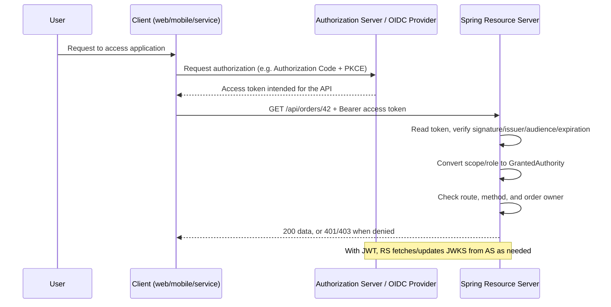

# Roadmap from Protected API to Full Verification, Authorization, and Testing

An **OAuth 2.0 Resource Server** in Spring Security is an application that serves resources/APIs and returns data only when a request carries valid access credentials. When using OpenID Connect (OIDC), an Identity Provider often simultaneously acts as the Authorization Server: authenticating users, issuing token types, and publishing metadata along with public keys. The Resource Server must validate **access tokens** intended for its API, convert token details into permissions, enforce access rules, and test both allowed and denied branches.

This lesson lays out an actionable sequence you can follow step by step: **public API → authenticated API → token verification → scope/role checks → data-level permission checks → HTTP and real-signature testing → secure operations**. Examples use Java 17+, Spring Boot 3.5.x, and Spring Security 6.x. Domains, issuers, audiences, and tokens in this article are illustrative values; when deploying, replace them with your actual Authorization Server configuration.

## 1. Understanding the path of a protected request



Three roles to keep distinct:

| Component | Responsibility | Do not confuse with |
|---|---|---|
| **Authorization Server / OIDC Provider** | Authenticates, requests consent/authorization, issues tokens; publishes issuer and JWKS. | Business API processing orders. |
| **Client** | Requests tokens via an appropriate OAuth flow and sends `Authorization: Bearer <access-token>`. | Resource Server logging in on the client's behalf. |
| **Resource Server** | Validates tokens, establishes identity/permissions, and protects resources. | Token-issuing system or storage for user passwords. |

OIDC adds an **identity authentication** layer on top of OAuth 2.0, where `id_token` provides login session info to the client. **Never use an ID token in place of an access token to call an API**: the two token types have different intended uses and `aud` values. The Resource Server needs the access token that the Authorization Server intended for that API.

With **JWT access tokens**, the Resource Server typically verifies signatures locally using public keys fetched from JWKS. With **opaque access tokens** (strings unreadable by the API), the Resource Server must call the Authorization Server's introspection endpoint. Both paths authenticate the token before authorizing, yet their configuration and operational characteristics differ. The main hands-on walkthrough uses JWTs.

## 2. Finalizing the security contract before writing configuration

Suppose we are building `orders-api`. Each order has an `ownerSub` representing the owner's identifier (`sub`) in the token. Users need matching scopes to read/create orders; administrators need the `ADMIN` role to view reports. The permission table serves as the API contract:

| Endpoint | Minimum requirement | Additional check | Expected |
|---|---|---|---|
| `GET /api/public/ping` | No token required | None | `200 OK` |
| `GET /api/me` | Valid access token | None | `200 OK` and `sub` identifier |
| `POST /api/orders` | `orders:write` | Assign `ownerSub` from token, not from request body | `201 Created` |
| `GET /api/orders/{id}` | `orders:read` | Caller is the owner of the order | `200 OK` if permitted |
| `GET /api/admin/reports` | Role `ADMIN` | Tenant restrictions may be added later | `200 OK` |
| Other paths | Deny by default | None | `403` if authenticated but unauthorized; unauthenticated behavior depends on interception point |

For protected endpoints, the two core error codes are:

- **401 Unauthorized**: no valid Bearer token provided, or token has an invalid signature / is expired / untrusted / not intended for this API. The `WWW-Authenticate` header may report the Bearer error.
- **403 Forbidden**: token is valid, yet the caller lacks required scopes/roles or lacks permission on the specific resource. You may choose to return **404** to avoid disclosing resource existence; apply consistently.

An example decoded JWT may contain the following claims (this is only an **illustrative payload**, not a usable token):

```json
{
  "iss": "https://login.example.test/realms/lab",
  "sub": "alice",
  "aud": ["orders-api"],
  "scope": "orders:read orders:write",
  "roles": ["ADMIN"],
  "iat": 1890000000,
  "exp": 1890003600
}
```

Items to align with the identity team: exact `iss`; `aud` value for the API; signing algorithm and JWKS; token lifetime; permission representation via `scope`/`scp`; role source via `roles`, `groups`, or a custom claim; and definition of `sub` for users versus service accounts. `roles` is **not a mandatory standard OAuth/OIDC claim**: to use it, configure the Authorization Server to emit it and the Resource Server to read that exact claim. A token with scopes does not necessarily carry roles, and vice versa.

### Milestone 1 — Be able to answer four questions

1. Who issues access tokens and which issuer does the Resource Server trust?
2. Which `aud` in the token proves it was issued for `orders-api`?
3. Where are scopes, roles, and order ownership determined from?
4. What should invalid tokens, missing permissions, and resources not owned by the caller return?

## 3. Creating the Spring Boot API and enabling JWT authentication

Create a Spring Boot application with the following Maven dependencies (versions managed by the Spring Boot parent/BOM):

```xml
<dependencies>
    <dependency>
        <groupId>org.springframework.boot</groupId>
        <artifactId>spring-boot-starter-web</artifactId>
    </dependency>
    <dependency>
        <groupId>org.springframework.boot</groupId>
        <artifactId>spring-boot-starter-security</artifactId>
    </dependency>
    <dependency>
        <groupId>org.springframework.boot</groupId>
        <artifactId>spring-boot-starter-oauth2-resource-server</artifactId>
    </dependency>
    <dependency>
        <groupId>org.springframework.boot</groupId>
        <artifactId>spring-boot-starter-validation</artifactId>
    </dependency>
    <dependency>
        <groupId>org.springframework.boot</groupId>
        <artifactId>spring-boot-starter-test</artifactId>
        <scope>test</scope>
    </dependency>
    <dependency>
        <groupId>org.springframework.security</groupId>
        <artifactId>spring-security-test</artifactId>
        <scope>test</scope>
    </dependency>
</dependencies>
```

Configure `src/main/resources/application.yml`:

```yaml
server:
  port: 8080

spring:
  security:
    oauth2:
      resourceserver:
        jwt:
          issuer-uri: https://login.example.test/realms/lab
          audiences:
            - orders-api
```

`issuer-uri` tells Spring Security the accepted issuer while using metadata discovery to locate the issuer's JWKS endpoint. `audiences` requires the JWT to target `orders-api`. When running against a real issuer, the server must be able to reach the metadata/JWKS endpoints over TLS. For an Authorization Server that does not support discovery or to reduce startup coupling, you can configure `jwk-set-uri` **alongside** `issuer-uri`; in that case, still enforce `iss`, `aud`, and associated validators. Never take the JWKS URL from client-sent token contents.

Keep the API stateless without storing authentication sessions; allow public endpoints, check scopes/roles on the remaining routes, and deny undeclared routes by default. `SecurityConfig.java`:

```java
package com.example.orders;

import java.util.ArrayList;
import java.util.Collection;
import java.util.List;

import org.springframework.context.annotation.Bean;
import org.springframework.context.annotation.Configuration;
import org.springframework.http.HttpMethod;
import org.springframework.security.config.Customizer;
import org.springframework.security.config.annotation.method.configuration.EnableMethodSecurity;
import org.springframework.security.config.annotation.web.builders.HttpSecurity;
import org.springframework.security.config.annotation.web.configurers.AbstractHttpConfigurer;
import org.springframework.security.config.http.SessionCreationPolicy;
import org.springframework.security.core.GrantedAuthority;
import org.springframework.security.core.authority.SimpleGrantedAuthority;
import org.springframework.security.oauth2.server.resource.authentication.JwtAuthenticationConverter;
import org.springframework.security.oauth2.server.resource.authentication.JwtGrantedAuthoritiesConverter;
import org.springframework.security.web.SecurityFilterChain;

@Configuration
@EnableMethodSecurity
public class SecurityConfig {

    @Bean
    SecurityFilterChain apiSecurity(HttpSecurity http,
                                    JwtAuthenticationConverter jwtConverter) throws Exception {
        return http
            .csrf(AbstractHttpConfigurer::disable)
            .sessionManagement(s -> s.sessionCreationPolicy(SessionCreationPolicy.STATELESS))
            .authorizeHttpRequests(auth -> auth
                .requestMatchers(HttpMethod.GET, "/api/public/ping").permitAll()
                .requestMatchers(HttpMethod.GET, "/api/me").authenticated()
                .requestMatchers(HttpMethod.POST, "/api/orders")
                    .hasAuthority("SCOPE_orders:write")
                .requestMatchers(HttpMethod.GET, "/api/orders/*")
                    .hasAuthority("SCOPE_orders:read")
                .requestMatchers(HttpMethod.GET, "/api/admin/reports")
                    .hasRole("ADMIN")
                .anyRequest().denyAll())
            .oauth2ResourceServer(oauth -> oauth.jwt(jwt ->
                jwt.jwtAuthenticationConverter(jwtConverter)))
            .build();
    }

    @Bean
    JwtAuthenticationConverter jwtConverter() {
        JwtGrantedAuthoritiesConverter scopes = new JwtGrantedAuthoritiesConverter();
        JwtAuthenticationConverter converter = new JwtAuthenticationConverter();

        converter.setJwtGrantedAuthoritiesConverter(jwt -> {
            Collection<GrantedAuthority> authorities =
                new ArrayList<>(scopes.convert(jwt));

            // Demo contract only: IdP issues roles: ["ADMIN"].
            List<String> roles = jwt.getClaimAsStringList("roles");
            if (roles != null && roles.contains("ADMIN")) {
                authorities.add(new SimpleGrantedAuthority("ROLE_ADMIN"));
            }
            return authorities;
        });
        return converter;
    }
}
```

In the configuration above:

- `oauth2ResourceServer().jwt()` enables Bearer authentication; Spring Security uses `JwtDecoder` to validate tokens before constructing `Authentication`.
- `JwtGrantedAuthoritiesConverter` by default reads `scope` or `scp` and prepends `SCOPE_`: the `orders:read` scope yields authority `SCOPE_orders:read`.
- `hasRole("ADMIN")` requires the `ROLE_ADMIN` authority. Role conversion must rely on **signed claims from a trusted issuer** and actual role-issuance policies; never trust a `role` header/parameter sent by the client.
- `@EnableMethodSecurity` enables method-level permission checks, especially when decisions depend on data.
- `denyAll()` prevents new endpoints from accidentally becoming public. Explicitly declare health checks, actuator endpoints, API docs, or CORS if needed by your system.
- Disabling CSRF in the example fits **stateless APIs strictly using Bearer tokens via the Authorization header**, and is not automatically safe for applications also authenticating with browser cookies/sessions.

No `formLogin`, login page, or `UserDetailsService` is needed for this Bearer JWT path. Clients handle login/authorization with the Authorization Server; the API only receives and validates access tokens.

### Milestone 2 — Authenticate properly before authorizing

No complex business logic is needed yet. After pointing `issuer-uri` to a real system, sending a request to a protected endpoint without a Bearer token must be rejected; sending a validly signed, unexpired token with matching `iss` and `aud` must clear authentication. If you send a self-crafted fake token or an ID token meant for a client, the API must reject it.

## 4. Adding business logic and per-record permissions

The minimal example below stores orders in memory to observe the security flow, not as a production persistence solution. Create `OrderApi.java` in the same package as `SecurityConfig`:

```java
package com.example.orders;

import java.util.Map;
import java.util.Optional;
import java.util.concurrent.ConcurrentHashMap;
import java.util.concurrent.atomic.AtomicLong;

import jakarta.validation.Valid;
import jakarta.validation.constraints.Min;
import jakarta.validation.constraints.NotBlank;
import org.springframework.http.HttpStatus;
import org.springframework.security.access.prepost.PreAuthorize;
import org.springframework.security.core.Authentication;
import org.springframework.security.oauth2.jwt.Jwt;
import org.springframework.security.oauth2.server.resource.authentication.JwtAuthenticationToken;
import org.springframework.security.core.annotation.AuthenticationPrincipal;
import org.springframework.stereotype.Component;
import org.springframework.web.bind.annotation.*;
import org.springframework.web.server.ResponseStatusException;

@RestController
@RequestMapping("/api")
class OrderApi {
    private final OrderStore store;

    OrderApi(OrderStore store) {
        this.store = store;
    }

    @GetMapping("/public/ping")
    Map<String, String> ping() {
        return Map.of("status", "ok");
    }

    @GetMapping("/me")
    Map<String, String> me(@AuthenticationPrincipal Jwt jwt) {
        return Map.of("subject", jwt.getSubject());
    }

    @PostMapping("/orders")
    @ResponseStatus(HttpStatus.CREATED)
    OrderView create(@Valid @RequestBody CreateOrderRequest request,
                     @AuthenticationPrincipal Jwt jwt) {
        // Take owner from the authenticated token, never from the input JSON.
        return OrderView.from(store.create(jwt.getSubject(), request));
    }

    @GetMapping("/orders/{id}")
    @PreAuthorize("hasAuthority('SCOPE_orders:read') " +
                  "and @orderAccess.isOwner(#p0, authentication)")
    OrderView read(@PathVariable long id) {
        OrderData data = store.find(id)
            .orElseThrow(() -> new ResponseStatusException(HttpStatus.NOT_FOUND));
        return OrderView.from(data);
    }

    @GetMapping("/admin/reports")
    Map<String, Integer> report() {
        return Map.of("orderCount", store.count());
    }
}

record CreateOrderRequest(@NotBlank String sku, @Min(1) int quantity) { }
record OrderData(long id, String ownerSub, String sku, int quantity) { }
record OrderView(long id, String sku, int quantity) {
    static OrderView from(OrderData data) {
        return new OrderView(data.id(), data.sku(), data.quantity());
    }
}

@Component
class OrderStore {
    private final AtomicLong ids = new AtomicLong();
    private final Map<Long, OrderData> orders = new ConcurrentHashMap<>();

    OrderData create(String ownerSub, CreateOrderRequest request) {
        long id = ids.incrementAndGet();
        OrderData data = new OrderData(id, ownerSub, request.sku(), request.quantity());
        orders.put(id, data);
        return data;
    }

    Optional<OrderData> find(long id) {
        return Optional.ofNullable(orders.get(id));
    }

    int count() {
        return orders.size();
    }
}

@Component("orderAccess")
class OrderAccess {
    private final OrderStore store;

    OrderAccess(OrderStore store) {
        this.store = store;
    }

    public boolean isOwner(long id, Authentication authentication) {
        if (!(authentication instanceof JwtAuthenticationToken jwtAuth)) {
            return false;
        }
        String callerSub = jwtAuth.getToken().getSubject();
        return store.find(id)
            .map(order -> order.ownerSub().equals(callerSub))
            .orElse(false);
    }
}
```

**Two authorization layers working together:** `SecurityFilterChain` enforces route-level scopes, while `@PreAuthorize` checks ownership of the exact record. For example, Alice is prevented from reading Bob's order even though Alice holds `orders:read`. `#p0` refers to the method's first argument (`id`), avoiding reliance on parameter names at compile time; `authentication` is Spring Security's authenticated principal.

In the demo version, `isOwner` also returns `false` when an order is not found, so most requests to nonexistent IDs are rejected with `403` before entering the controller. In real systems, if you want a uniform `404` for both *not found* and *unauthorized*, design an owner-scoped query (e.g. `findByIdAndOwnerSub`) in the service/repository layer, base the decision on that result, and test the behavior. The rule **never leak another user's data** matters more than which status code is chosen.

`ConcurrentHashMap` is for learning only; data is lost on restart, there are no transactions, and consistency guarantees are absent. When moving to a database, filter by user/tenant **inside the business query**, not merely by hiding fields in the returned JSON. If the API supports multi-tenancy, check `tenant_id` from a trusted context as well; a generic admin role must not automatically grant access across all tenants.

### Milestone 3 — Read the right data, not just reach the endpoint

Create an order as Alice, then try reading the same ID with Alice's and Bob's tokens. Both may carry `orders:read`, yet only Alice passes `@orderAccess.isOwner(...)`. If Bob can still retrieve Alice's order by changing the ID in the URL, authorization is still missing a layer.

## 5. Calling the API with real access tokens

Obtain tokens from the Authorization Server using the appropriate flow for each client type: **Authorization Code + PKCE** for interactive user applications; **Client Credentials** for service-to-service communication when authorized. Client Credentials represents the **application**, and does not inherently carry a human user's permissions: APIs enforcing order ownership by `sub` must explicitly define whether service accounts are supported.

After receiving a valid access token from the IdP, try the following commands (replace `<ACCESS_TOKEN>` with a real token; examples use `curl` syntax):

```bash
# Public: no Bearer token required.
curl -i http://localhost:8080/api/public/ping

# Protected: missing token -> 401.
curl -i http://localhost:8080/api/me

# Valid token present -> 200; returns token subject.
curl -i -H 'Authorization: Bearer <ACCESS_TOKEN>' \
  http://localhost:8080/api/me

# Requires orders:write to create an order.
curl -i -X POST http://localhost:8080/api/orders \
  -H 'Authorization: Bearer <ACCESS_TOKEN>' \
  -H 'Content-Type: application/json' \
  -d '{"sku":"BOOK-01","quantity":2}'

# Requires orders:read AND being the owner of order 1.
curl -i -H 'Authorization: Bearer <ACCESS_TOKEN>' \
  http://localhost:8080/api/orders/1
```

When diagnosing tokens, you can inspect the JWT payload to view `iss`, `aud`, `exp`, `scope`, and `roles`, yet **Base64URL decoding is not signature verification**. Never paste real tokens into online decoder tools or logs. Verify that the token was issued by the right IdP and contains the API's audience; many IdPs require configuring a resource/audience mapper before emitting the expected `aud`. The `access_token` obtained by a client may also be opaque, in which case it cannot be decoded using JWT structure.

### Milestone 4 — Clearly distinguish three failure causes

| Symptom | Indicator | Where to check |
|---|---|---|
| `401` even with a token attached | Token did not pass authentication | Check Bearer header, `iss`, `aud`, `exp`/`nbf`, signature, JWKS, clock skew, and token type. |
| `403` at `/api/orders/{id}` | Authentication succeeded, authorization failed | Check `scope`, `SCOPE_` mapping, `ownerSub`, `sub`, and data/tenant. |
| `403` at `/api/admin/reports` | Missing `ROLE_ADMIN` | Check role claim emitted by IdP and converter logic; avoid spoofing roles on the client. |

## 6. Token verification: what the API must check

A JWT has three parts: `header.payload.signature`. A trustworthy pipeline consists of **reading the Bearer token → selecting trusted keys → verifying signature/algorithm → validating required claims → building the principal**. Only then are permissions evaluated.

| Criterion | Security rule | If violated |
|---|---|---|
| Signature and algorithm | Accept only configured algorithms using public keys from the trusted issuer's JWKS; reject `alg=none` or arbitrary request-specified keys. | `401` |
| `iss` | Exact match with configured issuer; do not combine multiple IdPs before defining trust boundaries. | `401` |
| `aud` | Contains the API identifier (`orders-api`), not solely the frontend app's ID. | `401` |
| `exp`, `nbf` | Token has not expired and is already active; allow bounded clock skew. | `401` |
| `scope`/`scp`, roles | Use only permissions issued by trusted issuers and mapped by valid converters. | Typically `403` if authenticated but lacking permissions |
| `sub`, `client_id`/`azp`, tenant | Match user-token vs. service-token model; check owner/tenant in business logic. | `403` or `404` per API contract |

Combining `issuer-uri` and `audiences` in Spring Boot configures common JWT verification steps. If you **manually create** a `JwtDecoder` bean, remember to reattach validators for issuer, timestamps, and audience; providing a custom decoder can override auto-configuration. Example of composing a custom audience validator when needed:

```java
OAuth2TokenValidator<Jwt> audienceValidator = jwt -> {
    if (jwt.getAudience().contains("orders-api")) {
        return OAuth2TokenValidatorResult.success();
    }
    return OAuth2TokenValidatorResult.failure(
        new OAuth2Error("invalid_token", "Invalid audience", null));
};

NimbusJwtDecoder decoder = NimbusJwtDecoder.withPublicKey(trustedPublicKey).build();
decoder.setJwtValidator(new DelegatingOAuth2TokenValidator<>(
    JwtValidators.createDefaultWithIssuer("https://login.example.test/realms/lab"),
    audienceValidator));
```

In the snippet above, `trustedPublicKey` is an `RSAPublicKey` **configured from a trusted source**; this snippet only illustrates attaching validators and does not replace the full configuration declared earlier. For JWTs with `kid`, the Resource Server picks the matching key from JWKS; when the IdP rotates keys, verify JWKS cache/refresh behavior and the overlap window where both old and new keys coexist.

**Limitation of offline JWTs:** an unexpired token generally remains valid at the Resource Server even if the user's session has logged out or permissions were just revoked, unless the architecture includes additional mechanisms. For immediate revocation requirements, consider opaque tokens + introspection, short access token lifetimes, or an explicit revocation strategy. Never store the IdP's private signing key inside the Resource Server.

### Alternative branch: opaque tokens

When the Authorization Server issues opaque tokens, replace the JWT mechanism with introspection and supply the endpoint and client credentials via a secret manager/environment variables:

```yaml
spring:
  security:
    oauth2:
      resourceserver:
        opaquetoken:
          introspection-uri: https://login.example.test/oauth2/introspect
          client-id: ${INTROSPECTION_CLIENT_ID}
          client-secret: ${INTROSPECTION_CLIENT_SECRET}
```

Switch the security config to `oauth2ResourceServer(oauth -> oauth.opaqueToken(Customizer.withDefaults()))` and adjust how principals/claims are read for the opaque branch. This branch introduces a network call to validate tokens (unless purposefully cached), so account for latency, network failures, and availability policies. Never enable both branches arbitrarily just to accept any token.

## 7. Multi-layer testing: from HTTP to real signatures

Thorough testing must prove both **permitted** and **denied** paths. Never test only controllers returning `200`: many security bugs hide in the filter chain, validators, or per-record permission checks.

### 7.1. Minimum test matrix

| Scenario | Token/permissions | Endpoint | Expected result |
|---|---|---|---|
| Public | No token | `GET /api/public/ping` | `200` |
| Missing token | No token | `GET /api/me` | `401` |
| Fake/malformed token | Unverifiable Bearer | `GET /api/me` | `401` |
| Valid token | Any permissions | `GET /api/me` | `200`, returns matching `sub` |
| Missing create scope | `orders:read` only | `POST /api/orders` | `403` |
| Sufficient create scope | `orders:write` | `POST /api/orders` | `201`, owner assigned from token |
| Missing read scope | `orders:write` only | `GET /api/orders/{id}` | `403` |
| Sufficient scope, right owner | `orders:read`, `sub=alice` | Alice's order | `200` |
| Sufficient scope, wrong owner | `orders:read`, `sub=bob` | Alice's order | `403` per example |
| No admin role | Valid token, without `ADMIN` | `GET /api/admin/reports` | `403` |
| With admin role | Trusted role claim: `ADMIN` | `GET /api/admin/reports` | `200` |
| Wrong issuer/audience, expired/not-yet-valid | JWT validation fails | Protected endpoint | `401` |
| Undeclared endpoint | Valid token | Other route | Denied per policy |

### 7.2. HTTP testing with MockMvc and a mocked `JwtDecoder`

`@SpringBootTest` + `@AutoConfigureMockMvc` exercises the real Spring Security filter chain. `@MockitoBean` (Spring Framework 6.2 / Spring Boot 3.4+, matching Boot 3.5.x in this lesson) replaces `JwtDecoder`: this quickly tests Bearer authentication, permission mapping, and routing, **not** cryptography or discovery in this test layer.

```java
package com.example.orders;

import static org.mockito.Mockito.when;
import static org.springframework.test.web.servlet.request.MockMvcRequestBuilders.*;
import static org.springframework.test.web.servlet.result.MockMvcResultMatchers.*;

import java.time.Instant;
import java.util.List;

import com.fasterxml.jackson.databind.ObjectMapper;
import org.junit.jupiter.api.BeforeEach;
import org.junit.jupiter.api.Test;
import org.springframework.beans.factory.annotation.Autowired;
import org.springframework.boot.test.autoconfigure.web.servlet.AutoConfigureMockMvc;
import org.springframework.boot.test.context.SpringBootTest;
import org.springframework.http.MediaType;
import org.springframework.security.oauth2.jwt.BadJwtException;
import org.springframework.security.oauth2.jwt.Jwt;
import org.springframework.test.context.bean.override.mockito.MockitoBean;
import org.springframework.test.web.servlet.MockMvc;
import org.springframework.test.web.servlet.MvcResult;

@SpringBootTest
@AutoConfigureMockMvc
class OrdersSecurityHttpTest {
    @Autowired MockMvc mvc;
    @Autowired ObjectMapper json;
    @MockitoBean org.springframework.security.oauth2.jwt.JwtDecoder decoder;

    @BeforeEach
    void stubTokens() {
        when(decoder.decode("alice-write"))
            .thenReturn(jwt("alice-write", "alice", "orders:write", List.of()));
        when(decoder.decode("alice-read"))
            .thenReturn(jwt("alice-read", "alice", "orders:read", List.of()));
        when(decoder.decode("bob-read"))
            .thenReturn(jwt("bob-read", "bob", "orders:read", List.of()));
        when(decoder.decode("admin-token"))
            .thenReturn(jwt("admin-token", "admin", "", List.of("ADMIN")));
        when(decoder.decode("broken"))
            .thenThrow(new BadJwtException("Token rejected"));
    }

    @Test
    void publicRouteAndMissingToken() throws Exception {
        mvc.perform(get("/api/public/ping"))
            .andExpect(status().isOk());
        mvc.perform(get("/api/me"))
            .andExpect(status().isUnauthorized());
    }

    @Test
    void invalidTokenIsUnauthorized() throws Exception {
        mvc.perform(get("/api/me").header("Authorization", "Bearer broken"))
            .andExpect(status().isUnauthorized());
    }

    @Test
    void validTokenRevealsOnlyAuthenticatedIdentity() throws Exception {
        mvc.perform(get("/api/me").header("Authorization", "Bearer alice-read"))
            .andExpect(status().isOk())
            .andExpect(jsonPath("$.subject").value("alice"));
    }

    @Test
    void creationNeedsWriteScope() throws Exception {
        String body = "{\"sku\":\"BOOK-01\",\"quantity\":2}";
        mvc.perform(post("/api/orders")
                .header("Authorization", "Bearer alice-read")
                .contentType(MediaType.APPLICATION_JSON).content(body))
            .andExpect(status().isForbidden());

        mvc.perform(post("/api/orders")
                .header("Authorization", "Bearer alice-write")
                .contentType(MediaType.APPLICATION_JSON).content(body))
            .andExpect(status().isCreated())
            .andExpect(jsonPath("$.sku").value("BOOK-01"));
    }

    @Test
    void readNeedsScopeAndMatchingOwner() throws Exception {
        MvcResult created = mvc.perform(post("/api/orders")
                .header("Authorization", "Bearer alice-write")
                .contentType(MediaType.APPLICATION_JSON)
                .content("{\"sku\":\"BOOK-02\",\"quantity\":1}"))
            .andExpect(status().isCreated()).andReturn();
        long id = json.readTree(created.getResponse().getContentAsString())
            .get("id").asLong();

        mvc.perform(get("/api/orders/{id}", id)
                .header("Authorization", "Bearer alice-write"))
            .andExpect(status().isForbidden()); // Missing orders:read.

        mvc.perform(get("/api/orders/{id}", id)
                .header("Authorization", "Bearer bob-read"))
            .andExpect(status().isForbidden()); // Right scope, wrong owner.

        mvc.perform(get("/api/orders/{id}", id)
                .header("Authorization", "Bearer alice-read"))
            .andExpect(status().isOk())
            .andExpect(jsonPath("$.sku").value("BOOK-02"));
    }

    @Test
    void adminRoleIsRequired() throws Exception {
        mvc.perform(get("/api/admin/reports")
                .header("Authorization", "Bearer alice-read"))
            .andExpect(status().isForbidden());
        mvc.perform(get("/api/admin/reports")
                .header("Authorization", "Bearer admin-token"))
            .andExpect(status().isOk());
    }

    private static Jwt jwt(String value, String sub, String scope, List<String> roles) {
        Instant now = Instant.now();
        return Jwt.withTokenValue(value)
            .header("alg", "RS256")
            .claim("iss", "https://login.example.test/realms/lab")
            .claim("aud", List.of("orders-api"))
            .claim("sub", sub)
            .claim("scope", scope)
            .claim("roles", roles)
            .issuedAt(now)
            .expiresAt(now.plusSeconds(300))
            .build();
    }
}
```

In these tests, strings like `alice-read` and `bob-read` are merely lookup keys for Mockito to return a prebuilt `Jwt` object; they are **not real-world valid Bearer JWTs**. These tests prove that the Spring Security pipeline and business rules are wired properly, yet do not catch bugs in issuer, audience, signature, or key validation. Use a separate test layer with **real signed JWTs** to close that gap.

### 7.3. Testing the decoder with JWTs signed by a test RSA key pair

In cryptographic tests, generate an RSA key pair at test time, sign tokens with the private key, and pass **only the public key** into the decoder. That way tests do not depend on network access or IdP accounts. Example of a negative test for `aud` (imports follow Spring Security 6.x, Nimbus JOSE provided by the JWT starter):

```java
package com.example.orders;

import static org.junit.jupiter.api.Assertions.assertThrows;

import java.security.KeyPair;
import java.security.KeyPairGenerator;
import java.security.interfaces.RSAPrivateKey;
import java.security.interfaces.RSAPublicKey;
import java.time.Instant;
import java.util.List;

import com.nimbusds.jose.jwk.JWKSet;
import com.nimbusds.jose.jwk.RSAKey;
import com.nimbusds.jose.jwk.source.ImmutableJWKSet;
import org.junit.jupiter.api.Test;
import org.springframework.security.oauth2.core.DelegatingOAuth2TokenValidator;
import org.springframework.security.oauth2.core.OAuth2Error;
import org.springframework.security.oauth2.core.OAuth2TokenValidator;
import org.springframework.security.oauth2.core.OAuth2TokenValidatorResult;
import org.springframework.security.oauth2.jose.jws.SignatureAlgorithm;
import org.springframework.security.oauth2.jwt.*;

class JwtSignatureAndClaimsTest {
    private static final String ISSUER = "https://login.example.test/realms/lab";

    @Test
    void jwtWithValidSignatureButWrongAudienceIsRejected() throws Exception {
        KeyPairGenerator generator = KeyPairGenerator.getInstance("RSA");
        generator.initialize(2048);
        KeyPair keys = generator.generateKeyPair();
        RSAPublicKey publicKey = (RSAPublicKey) keys.getPublic();

        RSAKey signingKey = new RSAKey.Builder(publicKey)
            .privateKey((RSAPrivateKey) keys.getPrivate())
            .keyID("test-key")
            .build();
        NimbusJwtEncoder encoder = new NimbusJwtEncoder(
            new ImmutableJWKSet<>(new JWKSet(signingKey)));

        NimbusJwtDecoder decoder = NimbusJwtDecoder.withPublicKey(publicKey).build();
        OAuth2TokenValidator<Jwt> audience = token ->
            token.getAudience().contains("orders-api")
                ? OAuth2TokenValidatorResult.success()
                : OAuth2TokenValidatorResult.failure(
                    new OAuth2Error("invalid_token", "Wrong audience", null));
        decoder.setJwtValidator(new DelegatingOAuth2TokenValidator<>(
            JwtValidators.createDefaultWithIssuer(ISSUER), audience));

        Instant now = Instant.now();
        JwtClaimsSet claims = JwtClaimsSet.builder()
            .issuer(ISSUER)
            .subject("alice")
            .audience(List.of("another-api"))
            .issuedAt(now)
            .expiresAt(now.plusSeconds(300))
            .claim("scope", "orders:read")
            .build();
        JwsHeader header = JwsHeader.with(SignatureAlgorithm.RS256)
            .keyId("test-key").build();
        String token = encoder.encode(JwtEncoderParameters.from(header, claims))
            .getTokenValue();

        assertThrows(JwtValidationException.class, () -> decoder.decode(token));
    }
}
```

Extend the same test fixture to verify: valid signature and claims decode successfully; a token signed by a **different private key** is rejected; wrong `iss` is rejected; `exp` in the past is rejected; `nbf` in the future is rejected; `aud` missing the API is rejected; disallowed algorithms are rejected. When testing timestamps, use an offset larger than the clock skew allowed by the validator so results do not depend on a few seconds of clock drift.

Testing with `NimbusJwtDecoder.withPublicKey(...)` proves local signature verification and validators, **not** that the application fetches the IdP's JWKS properly. Add an integration test using a local HTTP JWKS server (such as WireMock): serve the public JWK at the configured URL; issue a token signed with the matching `kid`; then rotate `kid`/keys and verify refresh/rotation behavior. Staging tests against a real Authorization Server confirm discovery, `issuer-uri`, `aud` mapping, `scope` claims, and token issuance policies.

### 7.4. End-to-end scenario with a real Authorization Server

Proceed in order to isolate issues:

1. Client obtains an **access token** through an OAuth flow supported by the IdP; confirm it carries the expected `iss`, `aud`, scopes, and is unexpired.
2. Call `/api/me` without a token: receive `401`. With the right token: receive `200`, `subject` matching `sub`.
3. Call order creation with a token holding only `orders:read`: receive `403`; grant `orders:write` and create an order: receive `201`.
4. Read the created order using the owner's `orders:read` token: receive `200`; switch to another user's token: receive the denial response per contract.
5. Call reports with a regular user token: receive `403`; use a token granted the `ADMIN` role: receive `200`.
6. Test a token from **another issuer**, a token with `aud` for another app, an expired token, and a token with an invalid signature: all must fail at authentication.
7. If the system is multi-tenant, repeat scenarios across two tenants. If using a browser, test CORS preflight `OPTIONS` and allowed origins; CORS does not replace authentication.
8. If using JWKS, test signing-key rotation per rotation plan; if using introspection, test inactive tokens and behavior when the introspection endpoint fails.

In test environments, maintain separate identities for user A, user B, admin, and service accounts; assign permissions via actual Authorization Server configuration. Never test authorization by editing a JWT payload without re-signing: modifying a single byte of the payload must invalidate the signature and result in `401`.

## 8. Deploying to real environments and operating safely

Once functional milestones pass, verify commonly overlooked operational aspects:

| Aspect | Action required |
|---|---|
| HTTPS/TLS | Mandate HTTPS between client, API, and IdP; never send Bearer tokens over plain HTTP. |
| Secrets | Resource Server verifies JWTs with public keys; protect client secrets if using introspection and never commit secrets to repos. |
| Logging | Log request ID, endpoint, 401/403 status, and safe reason codes; never log access tokens, refresh tokens, or sensitive data. |
| Key rotation | Ensure `kid`, JWKS cache, and key overlap schedules allow unexpired older tokens to keep working per policy. |
| Time/expiry | Synchronize clocks, bound clock skew; define token lifetimes and early revocation needs. |
| Privilege separation | Scopes describe actions, roles describe permission groups, ownership/tenant are per-record conditions; never substitute one for another. |
| Least privilege | Clients request only needed scopes; APIs return only needed fields; restrict admin access by tenant/context where required. |
| Error handling | Consistent `401`/`403`, never expose tokens or private key details; never turn authentication failures into `500`. |
| Monitoring | Track anomalous 401/403 rates, JWKS/introspection errors, and auth latency; avoid logging user info beyond necessity. |
| Contract changes | When changing claims, `aud`, issuer, or scopes, update IdP, API, client config, and tests in a coordinated rollout. |

Mistakes worth avoiding:

- **Decoding a JWT and immediately trusting claims**: reading a payload does not verify signature, issuer, audience, or expiration.
- **Checking only `.authenticated()`**: a valid token may still lack required scopes, roles, or record-level permissions.
- **Letting clients send arbitrary `ownerId`/`role`**: ownership and permissions must come from a trusted principal and business data.
- **Placing `permitAll()` or overly broad matchers ahead of sensitive routes**: matcher order can open access gaps; prefer explicit declarations and trailing `denyAll`.
- **Using an ID token or a token meant for another API**: wrong audience breaks trust boundaries between services.
- **Assuming `@WithMockUser`/`jwt()` tests are enough**: mocked authentication tests authorization, not real signatures, metadata, JWKS, or validators.
- **Thinking JWT logout revokes the token immediately**: local verifiers do not automatically know latest session or permission state without additional mechanisms.
- **Disabling CSRF mechanically**: APIs using cookies/sessions need dedicated CSRF analysis, even if they also support OAuth.

## 9. Implementation roadmap by delivery milestone

| Milestone | Completed deliverable | Concrete evidence |
|---|---|---|
| **A. API with boundaries** | Public and protected endpoints, other routes blocked by default | `ping` returns `200`, `/me` without token returns `401` |
| **B. Trust the right tokens** | JWT Resource Server, issuer/JWKS, audience, and expiration | Valid tokens pass; wrong `iss`/`aud`/signature returns `401` |
| **C. Action permissions** | Scopes `orders:read`, `orders:write`; role `ADMIN` | Missing scope/role returns `403`, sufficient permissions pass filter |
| **D. Data permissions** | Compare `sub` with owner; add tenant if applicable | User B cannot read/edit User A's order merely by changing ID |
| **E. Multi-layer tests** | MockMvc, decoder with real signed JWTs, JWKS/IdP integration | Positive/negative matrix runs automatically and passes staging |
| **F. Operations** | HTTPS, secret management, monitoring, key rotation, revocation strategy | Pilot deployment observes authn/authz failures and rotates keys safely |

Following this order keeps every failure cleanly scoped: **missing token** is authentication, **bad signature/issuer/audience** is trust and validation, **valid token missing scope/role** is action authorization, and **right scope reading someone else's data** is object authorization. A complete Resource Server enforces all four layers and backs each layer with tests.
