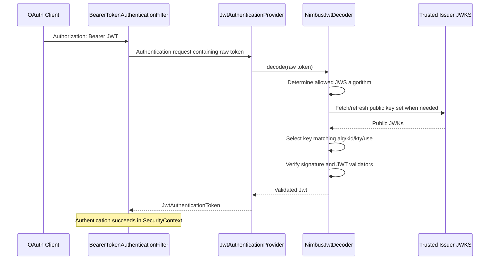

# JWK Set, Key Types, Key Usage, and Algorithms

## 1. Where JWK Fits in Spring Security OAuth 2.0 Resource Server

When an API uses **Spring Security OAuth 2.0 Resource Server** to accept **JWT access tokens**, the API must verify the signature before trusting claims such as `sub`, `scope`, `aud`, or `roles`. For JWTs signed with an asymmetric algorithm like `RS256` or `ES256`, the Authorization Server holds the **private key** to sign, while the Resource Server uses the corresponding **public key** to verify.

**JSON Web Key (JWK)** is a JSON representation of a cryptographic key. **JSON Web Key Set (JWKS)** is a JSON document containing **an array of JWKs**. An Authorization Server/OpenID Provider typically publishes a JWKS over HTTPS so that Resource Servers and OIDC Clients can fetch the public keys used for signature verification.

Example flow:

```text
Authorization Server / OpenID Provider
  |
  | 1. Hold private signing key
  | 2. Sign access token (JWS)
  | 3. Publish public JWKs at jwks_uri
  |
  +------ JWT: header { alg: "RS256", kid: "signing-2026-b" }
  |                      |
  |                      v
  |                Client calls API
  |                      |
  |                      v
  |              Spring Resource Server
  |                      |
  +------ JWKS ----------+--> Find candidate public key
                                |
                                v
                         Verify JWT signature
                                |
                                v
                         Validate issuer,
                         audience, lifetime,
                         access token type
                                |
                                v
                         Check scope and
                         resource permissions
```

In this process, three groups of data play distinct roles:

- **JWK/JWKS** describes **which keys may be used for verification**, along with information about key type and usage.
- **JOSE header** of a JWT typically contains `alg` (signature algorithm), `kid` (key ID), and possibly `typ` (token type). The header helps the verifier select the operation and candidate key.
- **JWT claims** such as `iss`, `aud`, `exp`, and `scope` identify who issued the token, which API the token is intended for, whether it is still valid, and which permissions it carries. Claims are only trustworthy **after authentication succeeds**.

**Do not confuse "found a key with a matching `kid`" with "the signature is verified."** Selecting a key is only a preparatory step. The Resource Server must still perform cryptographic verification and validate the access token contract.

## 2. How Do JWK, JWKS, JWS, JWE, and JWT Relate?

| Concept | Role | Related Example |
|---|---|---|
| **JWT — JSON Web Token** | Represents a set of claims; may be protected using JWS or JWE | An access token containing `iss`, `aud`, `exp` claims |
| **JWS — JSON Web Signature** | Signs/MACs content to verify integrity and cryptographic origin | A three-part JWT `header.payload.signature` |
| **JWE — JSON Web Encryption** | Encrypts content to protect confidentiality | An encrypted JWT; Compact Serialization typically has five parts |
| **JWK — JSON Web Key** | Represents **a single key** in JSON | An RSA public key with `kty`, `n`, `e` |
| **JWKS — JSON Web Key Set** | Contains **multiple JWKs** in `keys` | A JWKS containing the current signing key and old signing key during rotation |
| **JOSE header** | Processing instructions for JWS/JWE | `alg`, `kid`, `typ` in the token |

In particular, **a JWK is not a JWT**. A JWK is key data, whereas a JWT is token/claims data. A Resource Server does not check permissions by reading `scope` from a JWKS; a JWKS is not designed to carry user permissions.

Example of a JWT signed using JWS Compact Serialization:

```text
BASE64URL(UTF8(protected header))
.
BASE64URL(UTF8(JWT claims JSON))
.
BASE64URL(signature)
```

The decoded header might look like:

```json
{
  "alg": "RS256",
  "kid": "signing-2026-b",
  "typ": "at+jwt"
}
```

The JWS header and payload can be read via Base64URL decoding, but **being readable does not mean the signature has been verified**. A forged token can declare plausible-looking `alg` and `kid` values. Only after verifying with a **trusted, configured key and algorithm** may the Resource Server use the claims to build an `Authentication`.

## 3. Structure of a JWK Set

A JWKS document is a JSON object with a `keys` field containing an **array of JWKs**. Illustrative example for an Authorization Server with two public RSA signing keys:

```json
{
  "keys": [
    {
      "kty": "RSA",
      "kid": "signing-2026-a",
      "use": "sig",
      "alg": "RS256",
      "n": "PUBLIC_RSA_MODULUS_A_BASE64URL_PLACEHOLDER",
      "e": "AQAB"
    },
    {
      "kty": "RSA",
      "kid": "signing-2026-b",
      "use": "sig",
      "alg": "RS256",
      "n": "PUBLIC_RSA_MODULUS_B_BASE64URL_PLACEHOLDER",
      "e": "AQAB"
    }
  ]
}
```

The two `n` values here are **placeholders, not valid Base64URL encodings of RSA keys**; this example illustrates the structure and is not meant to construct a real `JwtDecoder`. Real public JWKs carry properly encoded numeric values and coordinates generated by key generation/management libraries.

Meaning:

- `keys` is a set, allowing multiple keys to coexist.
- `kid` helps identify candidate keys, especially when the issuer is rotating keys.
- `kty` indicates the **key material type**, which in this example is RSA.
- `use` may indicate that the key is used for **signatures** (`sig`).
- `alg` may specify the **intended algorithm** associated with the key, here `RS256`.
- `n` and `e` are the **public RSA key** components.

A JWKS is **not required** to contain only one key or only one `kty`. An issuer's key set may include RSA, EC, and OKP depending on the token types and algorithms the issuer supports. The Resource Server must restrict which keys may be used based on **algorithm, usage, and trusted issuer**.

### Where Is the JWKS Endpoint Typically Found?

Metadata from OIDC Discovery or OAuth Authorization Server Metadata may provide:

```json
{
  "issuer": "https://id.example.com/realms/shop",
  "jwks_uri": "https://id.example.com/realms/shop/protocol/openid-connect/certs"
}
```

The Resource Server can fetch the JWKS from `jwks_uri`. Be sure to distinguish:

- **Issuer URI:** the identifier of the issuing party, used to validate the JWT `iss` claim.
- **Metadata endpoint:** where `issuer`, `jwks_uri`, and AS/OP endpoints are published.
- **JWKS URI:** where the **key set** is downloaded for verification.

Do not set `issuer-uri` directly to `jwks_uri`, or confuse the metadata document with the `{"keys":[...]}` document.

## 4. Important Metadata Fields of a JWK

A JWK has common parameters defined by RFC 7517:

| Field | Full Name | Role | Required in Every JWK? |
|---|---|---|---|
| `kty` | Key Type | Identifies the key type, e.g., `RSA`, `EC`, `oct`, or `OKP` via extensions | **Yes** |
| `kid` | Key ID | Helps identify a key within a key set | No |
| `use` | Public Key Use | High-level purpose: `sig` or `enc` | No |
| `key_ops` | Key Operations | Declared set of operations: `sign`, `verify`, `encrypt`, `decrypt`, ... | No |
| `alg` | Algorithm | Algorithm intended for use with the key, e.g., `RS256` | No |
| `x5u` | X.509 URL | Links to an X.509 certificate resource | No |
| `x5c` | X.509 Certificate Chain | Base64 DER-encoded X.509 certificate chain | No |
| `x5t` | X.509 Certificate SHA-1 Thumbprint | SHA-1 thumbprint of the certificate, used in applicable profiles | No |
| `x5t#S256` | X.509 Certificate SHA-256 Thumbprint | SHA-256 thumbprint of the certificate | No |

In addition to common fields, each `kty` has its own parameters representing a public key or a secret key. In an Authorization Server's public JWKS, only **the public components** sufficient for signature verification normally appear—never private keys or shared secrets.

**The `use`, `key_ops`, and `alg` fields are not standalone certificates proving a key is trustworthy.** They are metadata attached to the key; the Resource Server still must trust the **key source**, restrict the **algorithm**, and perform actual signature verification.

## 5. `kty`: Key Type Determines Valid Operations

`kty` describes the form of the key material and which cryptographic operations can be performed. Common types include:

| `kty` | Name | Characteristic Fields | Common Usage |
|---|---|---|---|
| `RSA` | RSA Key | `n`, `e`; private key also has fields like `d`, `p`, `q` | Verifying JWS `RS256`/`PS256` with a public key |
| `EC` | Elliptic Curve key | `crv`, `x`, `y`; private key adds `d` | ECDSA JWS such as `ES256` |
| `OKP` | Octet Key Pair, per RFC 8037 | `crv`, `x`; private key may add `d` | `EdDSA` JWS with Ed25519/Ed448; some key agreement algorithms using X25519/X448 |
| `oct` | Octet Sequence / symmetric key | `k` is Base64URL-encoded key material | HMAC such as `HS256`; symmetric encryption schemes |

**Having the same algorithm name in the JOSE header is not enough to establish a valid key**: key type, size, and cryptographic constraints must match. `RS256` uses an RSA key; `ES256` uses an EC key matching P-256; `HS256` uses an `oct` shared secret. A verifier must never treat an RSA public key as an HMAC secret simply because a JWT specifies `HS256`.

### 5.1. RSA JWK: `n` and `e`

A public RSA JWK has the form:

```json
{
  "kty": "RSA",
  "kid": "rsa-signing-key",
  "use": "sig",
  "alg": "RS256",
  "n": "BASE64URL_ENCODED_RSA_MODULUS_PLACEHOLDER",
  "e": "AQAB"
}
```

- `n`: RSA modulus, represented as Base64URLUInt.
- `e`: RSA public exponent; `AQAB` commonly represents the number 65537.
- `d` and private parameters such as `p`, `q` are used for creating signatures or private RSA operations and **must not be published in a public JWKS**.

In an asymmetric signing system:

```text
Authorization Server: RSA private key -> signs JWT
Resource Server:      RSA public key  -> verifies JWT
```

The Resource Server does not need the private signing key. Exposing a private RSA key in a public JWKS allows anyone to create accepted signatures, causing severe impact.

### 5.2. EC JWK: `crv`, `x`, `y`

Example structure of a public EC JWK for ECDSA P-256:

```json
{
  "kty": "EC",
  "kid": "ec-p256-signing",
  "use": "sig",
  "alg": "ES256",
  "crv": "P-256",
  "x": "BASE64URL_X_COORDINATE_PLACEHOLDER",
  "y": "BASE64URL_Y_COORDINATE_PLACEHOLDER"
}
```

- `crv` identifies the elliptic curve, e.g., `P-256`, `P-384`, `P-521`.
- `x` and `y` are the public point coordinates on the curve.
- A private EC JWK may contain `d`; do not place `d` in a public JWKS.
- `ES256` corresponds to ECDSA using P-256 and SHA-256; do not arbitrarily pair a P-384 key with `ES256`.

The length of `x`/`y`, curve membership, and signature operations must be verified by the JOSE library. Never merely check `kty=EC` and accept any curve.

### 5.3. OKP JWK: Ed25519 Differs from X25519

Per RFC 8037, `OKP` describes an octet key pair for certain Edwards/Montgomery curves. Example public Ed25519 JWK:

```json
{
  "kty": "OKP",
  "kid": "ed25519-signing",
  "use": "sig",
  "alg": "EdDSA",
  "crv": "Ed25519",
  "x": "BASE64URL_PUBLIC_KEY_PLACEHOLDER"
}
```

Ed25519 is normally associated with EdDSA signatures; X25519 is typically used for **key exchange/key agreement** and does not become a public signing key to verify EdDSA. Both may be represented via `OKP`, but their `crv` values and cryptographic purposes differ.

Support for `OKP`/`EdDSA` in Spring Security, Nimbus JOSE, and the JDK can vary by version. Do not assume that seeing a JSON-valid JWK guarantees every `JwtDecoder` can use that algorithm.

### 5.4. `oct` JWK: Symmetric Keys Must Be Kept Secret

Example of a symmetric JWK used for HMAC:

```json
{
  "kty": "oct",
  "kid": "internal-hmac-1",
  "use": "sig",
  "alg": "HS256",
  "k": "BASE64URL_SHARED_SECRET_PLACEHOLDER"
}
```

`k` is the **entire secret key material**, not a public key. Therefore, **never publish an `oct` JWK containing a secret at a public JWKS endpoint**.

With `HS256`, the verifier requires the same secret as the signer and cryptographically has the ability to generate valid MACs as well. In a system with multiple Resource Servers, this creates a very different trust boundary than RSA/EC public-key verification. If APIs do not need the ability to sign tokens, using asymmetric signatures generally keeps the private signing key solely on the Authorization Server.

## 6. `use`: High-Level Key Purpose

JWK `use` is **Public Key Use**, typically taking values:

- `sig` — key used in digital signature or MAC operations.
- `enc` — key used in encryption-related operations.

Example of two keys in the same JWKS:

```json
{
  "keys": [
    {
      "kty": "RSA",
      "kid": "rsa-for-signatures",
      "use": "sig",
      "alg": "RS256",
      "n": "PUBLIC_SIGNING_MODULUS_PLACEHOLDER",
      "e": "AQAB"
    },
    {
      "kty": "RSA",
      "kid": "rsa-for-encryption",
      "use": "enc",
      "alg": "RSA-OAEP-256",
      "n": "PUBLIC_ENCRYPTION_MODULUS_PLACEHOLDER",
      "e": "AQAB"
    }
  ]
}
```

When an API needs to verify a JWT access token **signed with JWS RS256**, a `use=enc` key is not an eligible signing key merely because it also has `kty=RSA`. The decoder must adhere to the allowed purpose, key type, and algorithm configured by policy.

### Is `use` Required?

No. According to the JWK specification, `use` is **optional information**. A JWK missing `use` is not automatically a forged key or a key usable for everything. One must rely on the profile, library constraints, and issuer contract.

If `use` is present, do not deliberately ignore `use=enc` and force the key into verification arbitrarily. If both `use` and `key_ops` are present, their values must be **consistent** in purpose.

### `use` Does Not Say Who Can Call an API

`use=sig` describes the purpose of **the key**, not scopes or roles. A Resource Server can successfully verify a signature with a `use=sig` key and still reject the token because `aud=billing-api`, `exp` has expired, or `orders.read` is missing.

## 7. `key_ops`: Detailed Description of Permitted Operations

In JWK, `key_ops` is an array of strings indicating the operations for which the key is intended to be used. Standard values include:

| `key_ops` Value | Purpose |
|---|---|
| `sign` | Compute digital signature/MAC |
| `verify` | Verify digital signature/MAC |
| `encrypt` | Encrypt content |
| `decrypt` | Decrypt content and validate decryption |
| `wrapKey` | Encrypt (wrap) another key |
| `unwrapKey` | Decrypt (unwrap) a wrapped key |
| `deriveKey` | Derive key |
| `deriveBits` | Derive bits not to be used as a key |

Example of a public signing key intended solely for verification:

```json
{
  "kty": "RSA",
  "kid": "rsa-verify-1",
  "use": "sig",
  "key_ops": ["verify"],
  "alg": "RS256",
  "n": "PUBLIC_RSA_MODULUS_PLACEHOLDER",
  "e": "AQAB"
}
```

This form explicitly expresses that the public key is intended for **verify**. The private key on the Authorization Server may carry a `sign` policy in the internal keystore, but **the private key must not be placed in the public JWKS**.

### How Does `key_ops` Differ from `use`?

- `use` is a **high-level purpose** label such as `sig` and `enc`.
- `key_ops` lists **granular operations** such as `verify`, `sign`, `encrypt`.

For example, `use=sig` can be compatible with `key_ops=["verify"]`, because verifying a signature is an operation in the signature group. Configuring `use=enc` together with `key_ops=["verify"]` is contradictory in purpose.

Per RFC 7517, issuers **should use either** `use` or `key_ops` to avoid redundant metadata; if both are declared, they **must be consistent**. `key_ops` is also an optional field; not every JWKS provides it.

### Does Having `key_ops=["verify"]` Mean the Key Is Trusted?

No. An attacker can craft an arbitrary JWKS and set `key_ops=["verify"]`. An API should only accept JWKs loaded from a key source **bound to a trusted issuer**. After that, it must still verify the JWS and claims. `key_ops` is metadata that helps rule out inappropriate usage; **it does not establish trust on its own**.

## 8. `alg`: Algorithm Declared for the Key

The `alg` field in a JWK normally describes the **algorithm intended for use with the key**:

```json
{
  "kty": "RSA",
  "kid": "rsa-signing-2026",
  "use": "sig",
  "key_ops": ["verify"],
  "alg": "RS256",
  "n": "PUBLIC_RSA_MODULUS_PLACEHOLDER",
  "e": "AQAB"
}
```

In a JWS JWT, the JOSE header also has `alg`:

```json
{
  "alg": "RS256",
  "kid": "rsa-signing-2026",
  "typ": "at+jwt"
}
```

The two fields share a name but appear in two different objects:

| Location | What Does `alg` Indicate? |
|---|---|
| **JWK** | Algorithm **intended for use with the key**; may be absent |
| **JWS protected header** | Algorithm **used to compute/verify the signature or MAC** |
| **JWE protected header** | Algorithm for **key management or key agreement**; JWE also has `enc` for the content encryption algorithm |

A secure verifier does not decide to allow an algorithm simply because the **JWT header** or **JWK** declares it. The Authorization Server, allowed algorithms, and key types must be defined in the **Resource Server policy**.

### Mapping Between JWS Algorithms and Key Types

| JOSE `alg` | Meaning | Matching JWK Type | Notes |
|---|---|---|---|
| `RS256` | RSA PKCS#1 v1.5 + SHA-256 | `RSA` | Public RSA key verifies signature |
| `PS256` | RSA-PSS + SHA-256 | `RSA` | Also RSA, but uses a different padding scheme |
| `ES256` | ECDSA P-256 + SHA-256 | `EC` + `crv=P-256` | Curve must match |
| `ES384` | ECDSA P-384 + SHA-384 | `EC` + `crv=P-384` | Distinct from ES256 |
| `EdDSA` | EdDSA with a matching curve | `OKP` + `crv=Ed25519` or Ed448 | Requires corresponding library support |
| `HS256` | HMAC SHA-256 | `oct` | Shared secret; do not use a public JWKS |
| `none` | Unsecured JWT/JWS without signature | No signing key | Do not accept for API JWT access tokens requiring signatures |

`RS256` is a **signature algorithm**, not a **JWT confidentiality encryption algorithm**. A signed JWS protects integrity and cryptographic origin; the payload can still be read by anyone holding the token. Protecting confidentiality requires an appropriate encryption mechanism, such as JWE in systems that support it.

### Algorithm Confusion: Why Must Policy Be Fixed?

Suppose an issuer issues JWTs with `alg=RS256` and the Resource Server holds an RSA public key. A token crafted by an attacker might change the JOSE header to `alg=HS256`. If a flawed verifier uses the **RSA public key as an HMAC shared secret**, the attacker can forge tokens whose MAC passes verification.

Defenses against this class of vulnerability include:

1. Configure an algorithm allow-list, e.g., **RS256 only** when the issuer contract uses RS256.
2. Enforce key-type binding: `RS256` with `RSA`, `ES256` with `EC/P-256`, `HS256` with an `oct` secret.
3. Reject `none`, and never automatically "fallback" to a weaker algorithm when validation fails.
4. Only select keys from a trusted JWKS and validate both the signature and critical JWT claims.

## 9. `kid`: Selecting a Key from a Key Set

A JWS header typically contains:

```json
{
  "alg": "RS256",
  "kid": "signing-2026-b",
  "typ": "at+jwt"
}
```

The Resource Server can use `kid` to filter JWKs in the issuer's JWKS. However, `kid` is **not** a checksum, signature, or issuer identifier.

Logical process:

```text
1. Resource Server has a trusted configured issuer/JWKS
2. JWT has header kid="signing-2026-b", alg="RS256"
3. Select a key from the JWKS:
      matching kid
      kty compatible with the algorithm
      use/key_ops compatible with verify
      alg, if present, does not conflict
4. Perform signature verification with the public key
5. Validate iss, aud, exp, nbf, token profile, scope
6. Enforce authorization on the requested resource
```

### Is `kid` Required?

Not every JWK/JWS is required to have a `kid`. With a single key, libraries can locate the key using other criteria. However, when an issuer publishes multiple keys or rotates keys, `kid` makes key selection clearer and more efficient.

Situations to handle according to policy:

- **`kid` not found:** the JWKS cache may be stale, the token may be signed by the wrong issuer, or the token may be invalid; if refreshing the JWKS from the trusted source is enabled, follow the library's rules, and still verify the signature afterward.
- **Two JWKs share the same `kid`:** if key selection is ambiguous, rely on key/algorithm constraints or reject according to the contract; do not pick a key arbitrarily.
- **Token has no `kid`:** do not assume all keys from the issuer are suitable; only use algorithms/key types permitted by policy.
- **Two issuers share the same `kid`:** this is entirely possible; look up keys within the namespace of **the specific issuer**, never merge all JWKs into a single boundaryless trust store.
- **`kid` looks like a filename or URL:** never concatenate this string directly into a file path or remote URL to load a key.

`kid` helps identify **candidate keys**, whereas verification determines whether **the signature actually corresponds to that key**.

## 10. How Do `use`, `key_ops`, and `alg` Work Together?

These fields answer distinct questions:

```text
kty     -> What type of key material is this?
use     -> Does the key belong to the sig or enc purpose group?
key_ops -> Which specific operations is the key intended for?
alg     -> Which JOSE algorithm is associated with the key?
```

Example configurations:

| JWK Metadata | When API Verifies JWS RS256 | Interpretation |
|---|---|---|
| `kty=RSA`, `use=sig`, `alg=RS256` | May be a candidate key | Must verify signature afterward |
| `kty=RSA`, `key_ops=["verify"]`, `alg=RS256` | May be a candidate key | Metadata indicates verify usage |
| `kty=RSA`, without `use`/`alg` | Depends on policy and library | Do not automatically conclude valid or invalid |
| `kty=RSA`, `use=enc`, `alg=RSA-OAEP-256` | Not suitable for JWS RS256 | Intended for encryption mechanisms |
| `kty=EC`, `crv=P-256`, `alg=ES256` | Not suitable for RS256 | May be suitable if the API allows ES256 |
| `kty=RSA`, `use=enc`, `key_ops=["verify"]` | Contradictory metadata | Do not "fix" by reinterpreting its purpose yourself |
| `kty=oct`, `alg=HS256` | Not suitable for RS256 | Uses a shared secret for HMAC under a separate policy |
| `kty=RSA`, `alg=RS256`, matching `kid` but invalid signature | **Reject** | Matching metadata does not prove a valid signature |

Do not design a policy that "picks the first JWK with `kid`" without checking key type, algorithm, and constraints. At the same time, do not turn every optional metadata field into a mandatory requirement **if the issuer contract does not require it**; JWKS endpoints from different providers may represent the same public key with different sets of fields.

### Do `use=sig` and `key_ops=["verify"]` Conflict?

No. `sig` is the signature operation group; `verify` is an operation within that group. In a public JWKS used by a Resource Server, specifying `verify` makes sense.

Conversely, `use=enc` alongside `key_ops=["verify"]` is inconsistent because encryption and signature verification purposes are mixed. Either fix the metadata on the Authorization Server or reject keys that do not meet policy—avoid weakening your validation rules.

## 11. JWS Signing Keys Differ from JWE Encryption Keys

A JWKS may contain both signing keys and encryption keys, but the Resource Server must know whether it is processing a **JWS** or a **JWE**.

### JWS — Signature Verification

Example:

```json
{
  "alg": "RS256",
  "kid": "jwt-signing-key",
  "typ": "at+jwt"
}
```

`alg=RS256` requires RSA signature verification. The public signing key can have `use=sig`.

### JWE — Data Encryption

Example JWE protected header:

```json
{
  "alg": "RSA-OAEP-256",
  "enc": "A256GCM",
  "kid": "jwt-encryption-key",
  "cty": "JWT"
}
```

In **JWE**, `alg` specifies **key management**, while `enc` specifies **content encryption**. An RSA JWK with `use=enc` may fit JWE, but that does not make it usable for verifying JWS `RS256`.

For a Resource Server receiving encrypted or nested JWT access tokens, decryption and verification steps must be designed according to the issuer's token profile. Standard JWT Resource Server configuration targets **signed JWS tokens**, and does not automatically decrypt arbitrary five-part JWEs.

This is also why you cannot classify a token merely by seeing a JWK with `kty=RSA`: the same key type can be used in different cryptographic operations, with different `use` and `alg` values.

## 12. Can a Public JWKS Contain Private Keys?

**No**, not for a public JWKS endpoint used by Resource Servers to verify JWTs.

Examples of secret components that must never appear in a public JWKS:

| Key Type | Typical Secret Fields | Why Publishing Is Dangerous |
|---|---|---|
| RSA private JWK | `d`, `p`, `q`, `dp`, `dq`, `qi` | Allows performing private RSA operations or forging signatures |
| EC private JWK | `d` | Allows creating ECDSA signatures with the same key pair |
| OKP private JWK | `d` | Private key material |
| Symmetric JWK `oct` | `k` | Shared secret; anyone knowing the secret can compute MACs or decrypt depending on algorithm |

Distinguish between:

- **Public JWKS:** fetched by APIs to verify; contains only **public verification keys** and appropriate metadata.
- **Private signing-key store:** managed by the Authorization Server, possibly in an HSM/KMS/keystore; never exposed via a public endpoint.
- **Symmetric secrets:** provisioned only to components that genuinely need symmetric operations, via secure secret management; you cannot "publish the public half" like RSA/EC.

Even when a private JWK resides in an internal file, access control, encryption at rest where appropriate, rotation, auditing, and avoiding logging key material are required. A **public JWKS response** must never leak secrets due to misconfiguration when serializing a full key pair.

## 13. JWK Thumbprint Differs from `kid`

**RFC 7638 — JSON Web Key Thumbprint** defines how to compute a deterministic fingerprint from the required public member fields of a JWK canonicalized according to standard rules.

Conceptual example:

```text
RSA public key:
  kty = "RSA"
  n = modulus
  e = exponent

Canonical JSON of public members per RFC 7638
        |
        v
Hash with chosen algorithm, e.g., SHA-256
        |
        v
JWK thumbprint
```

Key distinctions:

- `kid` is an **identifier** that an issuer can choose according to deployment conventions.
- **Thumbprint** is computed from the key material and the required fields defined for `kty`.
- An issuer **may** use the thumbprint to derive `kid`, but is **not required** to.
- Changing `use`, `key_ops`, or `alg` does not change the RFC 7638 thumbprint, because these fields are not part of the minimal public members used to compute the thumbprint per RFC rules.
- Matching `kid` does not prove two JWKs share the same public key; matching thumbprints only reflect the public key members used in the calculation and still do not prove the issuer is trustworthy.

A Resource Server must never accept an arbitrary public key simply because its thumbprint looks properly formatted. Trusting a key still depends on the pre-established issuer/JWKS and policy.

## 14. Key Rotation: Why Does a JWK Set Have Multiple Keys?

**Key rotation** is the process of changing the keys used to sign and verify tokens in a system. A JWT normally remains valid until `exp` even after the Authorization Server begins signing new tokens with a different key. Therefore, a JWKS typically holds **multiple public keys simultaneously** during a transition window.

Lifecycle example:

```text
Time T0
  AS signs tokens with private key A
  JWKS publishes public key A (kid=A)

Time T1 — preparing key rotation
  AS generates key pair B
  JWKS publishes public A + public B
  Resource Server can observe B upon cache refresh

Time T2 — switching to sign with B
  New tokens have kid=B, signed with private B
  Older unexpired tokens have kid=A, signed with private A
  JWKS still contains A + B

Time T3 — old token window expires
  After remaining A tokens expire (accounting for cache/clock skew policy)
  AS can stop publishing public A
  JWKS contains B (and next key if preparing to rotate)
```

The purpose of retaining the old key is so Resource Servers can continue verifying **unexpired older access tokens**. Keeping a key for verification during the transition window does not mean the Authorization Server continues using the old private key to sign new tokens.

### JWKS Response During the Transition Phase

```json
{
  "keys": [
    {
      "kty": "RSA",
      "kid": "A",
      "use": "sig",
      "alg": "RS256",
      "n": "PUBLIC_A_PLACEHOLDER",
      "e": "AQAB"
    },
    {
      "kty": "RSA",
      "kid": "B",
      "use": "sig",
      "alg": "RS256",
      "n": "PUBLIC_B_PLACEHOLDER",
      "e": "AQAB"
    }
  ]
}
```

If a JWT carries `kid=B` while the JWKS cache only knows `A`, the decoder may need to refresh the key set from the trusted URL according to library capabilities. This is a normal operational case during key rotation, not a reason to skip signature checks or fetch keys from a URL supplied by the JWT.

### Operational Factors to Coordinate

| Factor | Question to Decide |
|---|---|
| Access token lifetime | How long can tokens signed by the old key remain alive? |
| Clock skew | Is clock skew allowed, and by how much? |
| JWKS cache duration | When do Resource Servers pick up new keys? |
| Refresh rate on unknown `kid` | Is there refresh, rate limiting, or backoff? |
| New key publication cycle | Is there a pre-publication window before signing with the key? |
| Emergency key revocation | If a private key leaks, how do we stop trusting the old key, invalidate old tokens, and reduce caching? |
| Multi-region/multi-instance | Do signing servers and verifying APIs see the same key set? |
| JWKS endpoint availability | Are there sensible retry/caching mechanisms and a strategy to avoid failing open? |

In a **private signing key compromise incident**, response plans may require removing the key from trust and invalidating tokens signed by that key before `exp`. This differs from scheduled rotation, which prioritizes uninterrupted transition.

## 15. Caching and JWKS Checks in Resource Server

Many Resource Servers do not fetch a fresh JWKS on **every request**; JWT/JWK libraries typically cache the key set to reduce latency and network dependency. When a token arrives with a new `kid`, a decoder may attempt to refresh the key set using an internal strategy, though details depend on version and configuration.

Three states must be distinguished:

1. **Invalid JWT signature:** a candidate key may be found, but the signature does not match. Do not query untrusted key sources just to let the token pass.
2. **No candidate key found:** the JWKS cache might not yet be updated after rotation, the `kid` may be wrong, or the issuer may be incorrect. If configuration permits refreshing the JWKS, fetch only from the trusted endpoint.
3. **JWKS endpoint temporarily unreachable:** depending on policy, the decoder may use still-trusted cached keys or reject authentication. **Never skip signature verification to let requests proceed.**

If an API frequently receives random `kid` values from untrusted clients, unbounded refresh mechanisms can create unnecessary load on the JWKS endpoint. Rate limiting, cache policies, and error monitoring may be needed; never allow arbitrary `kid` strings to trigger unchecked outbound HTTP requests.

### Logging and Observability

Some metadata can be helpful for diagnostics, such as the configured issuer identifier, expected algorithm, "key not found" outcomes, and JWKS refresh cycles. However:

- Never log raw `Authorization` headers or JWT access tokens.
- Never log private keys, HMAC secrets, or the `k` field of an `oct` JWK.
- Restrict `kid` values from unverified tokens if logged, to avoid log injection and high cardinality.
- Do not blindly dump entire JWKS payloads into logs if the key set might contain sensitive content.
- Do not treat a `kid` string appearing in logs as proof that a token was issued by the trusted issuer.

## 16. How Spring Security Resource Server Uses JWKS

In a Servlet Resource Server, the flow typically looks like this:



The diagram illustrates logical responsibilities; JWKS fetching/caching can occur earlier or hit a cache, and does not imply the decoder makes a network call on every request.

### 16.1. Configuration via `issuer-uri`

Common approach in Spring Boot:

```yaml
spring:
  security:
    oauth2:
      resourceserver:
        jwt:
          issuer-uri: https://id.example.com/realms/shop
```

With an issuer supporting metadata discovery and JWKS, Spring Security can use the issuer to locate `jwks_uri`, retrieve public keys, and verify JWTs. The exact well-known endpoint paths depend on OIDC Discovery, OAuth AS metadata, and Spring Security version behavior.

**Issuer URI is a trust identifier**, not a path to a JWKS file. The Resource Server must match `iss` in the JWT against the expected issuer. If you only verify the signature with an arbitrary public key and omit issuer checks, the API might accept tokens from the wrong trust domain.

### 16.2. Direct Configuration of `jwk-set-uri`

If the JWKS address is already known and you want to configure it explicitly:

```yaml
spring:
  security:
    oauth2:
      resourceserver:
        jwt:
          issuer-uri: https://id.example.com/realms/shop
          jwk-set-uri: https://id.example.com/realms/shop/protocol/openid-connect/certs
```

When the framework version supports combining both properties, `jwk-set-uri` specifies where to load keys without necessarily going through discovery, while `issuer-uri` is still used to validate `iss`. This is helpful when the metadata endpoint is unreachable from the Resource Server's network, yet the JWKS URI has been provisioned through a trusted channel.

**Do not configure `jwk-set-uri` alone and assume the Resource Server automatically knows the issuer** if you have bypassed `iss` configuration/validators. Key source and issuing authority are two separate constraints.

### 16.3. Restricting the JWS Algorithm and Validating Audience

Example for an `orders-api` accepting **RS256** JWT access tokens from a fixed issuer:

```java
import org.springframework.context.annotation.Bean;
import org.springframework.context.annotation.Configuration;
import org.springframework.http.HttpMethod;
import org.springframework.security.config.Customizer;
import org.springframework.security.config.annotation.web.builders.HttpSecurity;
import org.springframework.security.oauth2.core.DelegatingOAuth2TokenValidator;
import org.springframework.security.oauth2.core.OAuth2Error;
import org.springframework.security.oauth2.core.OAuth2TokenValidator;
import org.springframework.security.oauth2.core.OAuth2TokenValidatorResult;
import org.springframework.security.oauth2.jose.jws.SignatureAlgorithm;
import org.springframework.security.oauth2.jwt.Jwt;
import org.springframework.security.oauth2.jwt.JwtDecoder;
import org.springframework.security.oauth2.jwt.JwtValidators;
import org.springframework.security.oauth2.jwt.NimbusJwtDecoder;
import org.springframework.security.web.SecurityFilterChain;

@Configuration
public class ApiSecurityConfig {
    private static final String ISSUER =
            "https://id.example.com/realms/shop";
    private static final String JWKS_URI =
            "https://id.example.com/realms/shop/protocol/openid-connect/certs";

    @Bean
    JwtDecoder jwtDecoder() {
        NimbusJwtDecoder decoder =
                NimbusJwtDecoder.withJwkSetUri(JWKS_URI)
                        .jwsAlgorithm(SignatureAlgorithm.RS256)
                        .build();

        OAuth2TokenValidator<Jwt> issuerAndTime =
                JwtValidators.createDefaultWithIssuer(ISSUER);

        OAuth2TokenValidator<Jwt> audience = jwt ->
                jwt.getAudience().contains("orders-api")
                    ? OAuth2TokenValidatorResult.success()
                    : OAuth2TokenValidatorResult.failure(
                            new OAuth2Error(
                                    "invalid_token",
                                    "Token audience is not orders-api",
                                    null));

        decoder.setJwtValidator(
                new DelegatingOAuth2TokenValidator<>(
                        issuerAndTime, audience));

        return decoder;
    }

    @Bean
    SecurityFilterChain api(HttpSecurity http) throws Exception {
        return http
                .authorizeHttpRequests(auth -> auth
                        .requestMatchers(HttpMethod.GET, "/api/orders/**")
                            .hasAuthority("SCOPE_orders.read")
                        .anyRequest().authenticated())
                .oauth2ResourceServer(oauth2 ->
                        oauth2.jwt(Customizer.withDefaults()))
                .build();
    }
}
```

In this example:

1. `JWKS_URI` is a **pre-configured URL from a trusted issuer**. The decoder fetches keys only from this source.
2. `jwsAlgorithm(RS256)` fixes the accepted JWS algorithm. A JWT declaring `alg=HS256` or `alg=none` cannot alter the policy.
3. JWKs in the JWKS are selected based on matching metadata and signature verification. `kid` helps find candidate keys.
4. `createDefaultWithIssuer` retains validators for issuer and token validity window.
5. `audience` requires the access token to be intended for `orders-api`.
6. `SCOPE_orders.read` is an HTTP authorization policy applied after the token is authenticated; if permission checks are needed on a specific order, enforce them at the business layer.

**Note:** `setJwtValidator` replaces the decoder's existing validator. When customizing, preserve all required issuer, time, audience, and token profile checks. The code above only illustrates RS256-signed JWTs; do not assume every Authorization Server uses RS256, nor guarantee that every access token is a JWT.

If the issuer uses the RFC 9068 JWT Access Token Profile, the API should also enforce the `at+jwt` type and required claims per the profile. If the provider uses a custom claim to distinguish access tokens from ID tokens, apply their exact contract. A valid signature from the same JWKS does not turn an ID token into an authorized access token for an API.

## 17. Why Must a Resource Server Never Trust Arbitrary JWKS URLs in a Token?

JOSE headers have key-source fields such as `jku` (JWK Set URL), `jwk` (embedded JWK), `x5u` (X.509 URL), or `x5c` (certificate chain). If a server automatically fetches keys from a URL declared by an arbitrary token, it can introduce a severe vulnerability:

```text
Attacker:
  1. Generates their own key pair
  2. Publishes a JWKS containing the attacker's public key
  3. Signs a forged JWT with the attacker's private key
  4. Adds jku pointing to the attacker's JWKS

Vulnerable Resource Server:
  5. Trusts jku from the unverified token
  6. Downloads the attacker's public key
  7. "Successfully verifies" the forged JWT
```

A signature only proves that a private key matching the public key created the token. It **does not prove that the public key belongs to an issuer the API trusts** if the key source is also controlled by the attacker.

Therefore:

- The JWKS must be bound to a **pre-configured trusted issuer or key source**.
- Do not let tokens control the hostname, path, or protocol used to load keys.
- Do not use `kid` as a path segment to open arbitrary key files.
- Do not blindly trust a certificate chain in `x5c` without verifying the trust chain and issuer/policy constraints.
- With multiple issuers, maintain a strict `issuer -> JWKS -> alg -> audience` boundary per issuer.
- Validate `aud`, `iss`, `exp`, and token purpose after verifying the signature.

In production applications, metadata/JWKS URLs use HTTPS and require TLS/certificate trust verification; publish only public keys intended for verification.

## 18. Multi-Issuer: Same `kid` Does Not Mean Same Key

In a multi-tenant system, suppose two issuers both publish `kid="primary"`:

```text
Issuer A: https://auth-a.example.com
  JWKS A:
    kid = primary, kty=RSA, public key A

Issuer B: https://auth-b.example.com
  JWKS B:
    kid = primary, kty=RSA, public key B
```

If a Resource Server mixes both key sets into a single issuer-agnostic cache, key selection can pick the wrong key. A secure design must:

1. Identify an issuer **belonging to the trusted list**.
2. Use the JWKS and algorithms defined for that issuer.
3. Verify the signature and re-validate JWT `iss`.
4. Validate audience/token profile and the permissions that specific issuer is allowed to grant to the API.

Spring Security supports multi-tenant models via `AuthenticationManagerResolver` or multiple filter chains as needed. If an unverified `iss` is used to **select** a configuration, allow selection only from **pre-registered trusted issuers**. Never dynamically download a JWKS from an unknown issuer simply because a token claims that `iss`.

`kid` is normally meaningful **within the scope of a single JWKS/issuer**, not as a globally unique key identifier across the Internet.

## 19. Practical Troubleshooting Scenarios: JWK Metadata and Validation Failures

| Scenario | Meaning | Expected Outcome / Handling |
|---|---|---|
| Token `alg=RS256`, JWK `kty=RSA`, matching `kid` | Candidate key available | Must still verify signature and claims |
| Token `alg=HS256`, API allows `RS256` only | Algorithm outside allow-list | Reject |
| Token `alg=none` | No signature protection | Reject at a signed JWT Resource Server |
| Token `alg=ES256`, JWK `kty=RSA` | Key type does not match algorithm | Do not use this key to verify |
| Token `alg=ES256`, JWK EC `crv=P-384` | Curve does not match ES256 | Do not use this key to verify |
| JWK `use=enc` when verifying JWS | Wrong key usage | Do not use as signing verification key |
| JWK `use=sig`, `key_ops=["verify"]` | Metadata fits verification | Still requires signature validation |
| JWK `use=enc`, `key_ops=["verify"]` | Inconsistent metadata | Do not use in violation of policy |
| JWT `kid` missing from JWKS cache | Could be rotation/cache or forged token | Refresh JWKS only from trusted source per policy |
| JWT has matching `kid` but invalid signature | Key ID may have been copied | Reject |
| JWT properly signed but `aud` is another API | Token intended for a different resource | Reject |
| ID token properly signed with shared JWKS | Valid signature but wrong token type | Do not accept as an API access token |
| Public JWKS contains `kty=oct` / secret `k` | Shared secret leak | Security incident; remove secret from endpoint, rotate, and revoke affected tokens |
| Public JWKS contains RSA private `d` | Private key leak | Security incident; revoke trust and perform emergency rotation |
| JWKS endpoint 404 or TLS failure | Resource Server cannot retrieve keys | Fix endpoint/connectivity/trust; never skip signature validation |
| New token has `kid` B after rotation | New cache may need refresh | Prepublish/refresh key set and retain A until old tokens expire |
| JWT has `jku` pointing to arbitrary URL | Untrusted key source | Do not fetch keys from unverified data |

This table describes **design scenarios**, not test results against a specific provider. Exact decoder, cache, and exception behavior depends on the Spring Security/Nimbus JOSE version and configured validators.

## 20. How to Inspect a JWKS Without Leaking Keys

In an environment with permitted access, you can fetch the **public JWKS** to inspect metadata:

```bash
curl --fail-with-body --silent --show-error \
  https://id.example.com/realms/shop/protocol/openid-connect/certs
```

`id.example.com` is an example, not a real endpoint. Before using a URL in a Resource Server, confirm that it belongs to a trusted configured issuer.

Common checkpoints when analyzing JWT errors:

- Do the API's **Issuer URI** and the JWT `iss` claim match?
- Does the JWKS contain `keys` with a key type matching the JWS algorithm?
- Does the JOSE header `kid` match a candidate key in the JWKS?
- Does the JWK have `use`, `key_ops`, `alg` if present; do they conflict with verification?
- Does the API allow-list `RS256`/`ES256`/... matching the issuer contract?
- Has the JWKS cache picked up the new public key after rotation?
- Even if the signature is valid, does the token satisfy `exp`, `aud`, `iss`, token type, and Resource Server scopes?

Do not extract private keys from a secrets store to "compare against the JWKS" by copying them to a workstation or writing them to logs. For public JWKs, you can inspect key IDs and metadata, but avoid directly logging unverified token payloads or full user bearer tokens.

### An Example of a Key Rotation Failure

Suppose an API returns 401 after the Authorization Server switches to private key B. Diagnostic path:

```text
New JWT: kid=B
   |
   +-> Does the trusted JWKS endpoint currently contain public B?
          |
          +-- Yes: check cache, alg/kty/use, and signature
          |
          +-- No: AS must publish B properly / check JWKS endpoint
   |
   +-> Once signature is valid:
          validate issuer, audience, time, and token profile
```

Do not "quick-fix" by changing the API to drop `aud`, disable `JwtDecoder`, or allow algorithm `none`. Key rotation is a **key lifecycle** issue; token validation and authorization must remain intact.

## 21. Key Takeaways

1. **A JWK is one key; a JWKS is a key set** in JSON. A JWT is a data token, and JWS/JWE are mechanisms protecting the token; they are not the same concept.
2. **`kty` identifies the key type**: `RSA`, `EC`, `OKP`, `oct`. Each type has distinct public/private fields and algorithm compatibility.
3. **`use` describes the general purpose**, typically `sig` or `enc`; **`key_ops` describes granular operations**, such as `verify` or `decrypt`. When both appear, they must be consistent.
4. **`alg` associates a key with an intended algorithm**, yet the Resource Server decides which JWS algorithms are trusted. A JOSE header `alg` in a JWT cannot escalate what is accepted.
5. **`kid` helps select a candidate key**, especially during rotation; `kid` neither proves a signature nor guarantees global uniqueness.
6. **A public JWKS contains only public verification keys and appropriate metadata**; never publish RSA/EC/OKP private material or symmetric `oct.k` secrets.
7. **Key rotation requires a transition window and cache policy** so unexpired old tokens remain verifiable while new tokens use the new key.
8. **The JWKS source must belong to a trusted issuer**. Never load keys from `jku`, `x5u`, or `kid` values supplied by an arbitrary JWT.
9. **Signature verification is only the first step**. The Resource Server must still check issuer, lifetime, audience, token type, and resource authorization.
10. **Spring Security provides built-in JWT decoders and Resource Server filters**; configure `issuer-uri`, `jwk-set-uri`, algorithm allow-lists, and validators rather than writing a parallel custom JWT verification filter.

When reading a JWK inside a JWKS, the accurate mental model is: **key material type (`kty`) → purpose and operations (`use`, `key_ops`) → intended algorithm (`alg`) → key selection (`kid`) → actual signature verification → validate token usage for the intended API and permissions**.

## 22. Standards and Framework References

- **RFC 7517 — JSON Web Key (JWK):** `kty`, `use`, `key_ops`, `alg`, `kid`, JSON Web Key Set, and consistency rules. https://www.rfc-editor.org/rfc/rfc7517
- **RFC 7518 — JSON Web Algorithms (JWA):** JOSE algorithms and key usage requirements. https://www.rfc-editor.org/rfc/rfc7518
- **RFC 7515 — JSON Web Signature (JWS):** JWS signing and verification, JOSE header, key selection. https://www.rfc-editor.org/rfc/rfc7515
- **RFC 7516 — JSON Web Encryption (JWE):** distinguishing key management `alg` from content encryption `enc`. https://www.rfc-editor.org/rfc/rfc7516
- **RFC 7519 — JSON Web Token (JWT):** JWT Claims Set, signed/encrypted JWTs, and token validation responsibilities. https://www.rfc-editor.org/rfc/rfc7519
- **RFC 7638 — JSON Web Key (JWK) Thumbprint:** computing a fingerprint from public JWK members. https://www.rfc-editor.org/rfc/rfc7638
- **RFC 8037 — CFRG Elliptic Curve Diffie-Hellman and Signatures in JOSE:** `OKP` JWK type, Ed25519/EdDSA, X25519. https://www.rfc-editor.org/rfc/rfc8037
- **RFC 8725 — JWT Best Current Practices:** preventing algorithm confusion, enforcing issuer/audience, and trust boundaries. https://www.rfc-editor.org/rfc/rfc8725
- **RFC 9068 — JWT Profile for OAuth 2.0 Access Tokens:** distinguishing JWT access tokens using the `at+jwt` profile. https://www.rfc-editor.org/rfc/rfc9068
- **Spring Security Reference — OAuth 2.0 Resource Server JWT:** `issuer-uri`, `jwk-set-uri`, `NimbusJwtDecoder`, algorithms, and validators. https://docs.spring.io/spring-security/reference/servlet/oauth2/resource-server/jwt.html
