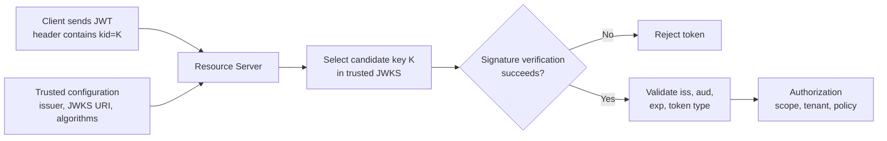
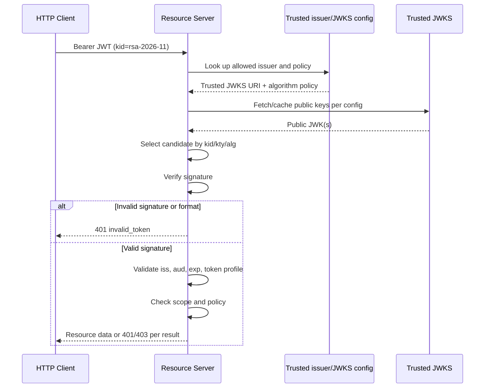

# `kid` Helps Select a Key, Not Establish Trust

## 1. The Problem: Knowing a Key Name Does Not Mean Trusting the Key

In a **Spring Security OAuth 2.0/OIDC Resource Server**, the Authorization Server may sign JWT access tokens with one of several private keys. To help the Resource Server verify the signature, a JWT typically carries a **`kid` (Key ID)** field in its JOSE header. This field helps the verifier quickly locate the matching public key inside a **JWKS (JSON Web Key Set)**.

For example, a JWT with a protected header:

```json
{
  "alg": "RS256",
  "typ": "at+jwt",
  "kid": "rsa-2026-11"
}
```

From `kid: "rsa-2026-11"`, the API can look up the key with the same ID in the trusted issuer's JWKS. However, **merely seeing `kid` does not prove the JWT was signed by the issuer**, because the sender of the token can easily craft a header containing any arbitrary `kid` string.

There are two separate questions:

1. **Key selection:** within a *given key set*, which key can be tried to verify this JWT's signature?
2. **Trust:** why does the Resource Server allow that key set to be used, and do the signature and token actually pass security checks?

`kid` helps answer the **key selection** question; trust comes from the **configured issuer, trusted JWKS source, allowed algorithms, signature verification result, and claims/token profile validation**.

> **Rule of thumb:** `kid` is an **identifier used to look up a key**, not a password, signature, certificate, or API access grant. Never grant permissions simply because `kid` matches a familiar key name.

## 2. JWS Compact, JOSE Header, and the Role of `kid`

A signed JWT access token in **JWS Compact Serialization** typically consists of three parts:

```text
BASE64URL(protected-header).BASE64URL(payload).BASE64URL(signature)
```

The payload might contain:

```json
{
  "iss": "https://login.example.test/realms/shop",
  "sub": "user-123",
  "aud": ["orders-api"],
  "scope": "orders:read",
  "iat": 1893452400,
  "exp": 1893456000
}
```

In JWS Compact, the header is Base64URL-encoded, **not encrypted for confidentiality**. An unauthenticated client can still read, modify, or construct a new header. Therefore, values such as `alg`, `typ`, and `kid` are caller-supplied inputs and **untrusted at parse time**.

| JOSE Header Field | Role | What It Does **Not** Guarantee on Its Own |
| --- | --- | --- |
| `alg` | Declares the JWS algorithm, such as `RS256`, `PS256`, `ES256`. | Does not decide which algorithms the API is **allowed** to accept; policy must live on the server. |
| `kid` | Hints at key selection when multiple keys exist. | Does not prove the key is trusted or the signature is valid. |
| `typ` | Hints at the object type, e.g., `JWT` or `at+jwt` per profile. | Does not replace audience, token profile, and authorization validation. |
| `jku` | URL hinting where a JWK Set is located per JOSE. | Does not authorize the API to fetch arbitrary URLs from the token. |
| `x5u` | URL hinting at an X.509 certificate. | Does not prove the URL/certificate is safe without a trust policy. |
| `x5t` / `x5t#S256` | X.509 certificate thumbprint. | Does not by itself establish a trust chain to the issuer or permission to call the API. |

Per the JOSE specification, `kid` is a string, normally **case-sensitive**, and **not required to be present in every JWS**. When an issuer has multiple keys, assigning a unique `kid` within the key set makes key lookup efficient. However, **there is no guarantee that a `kid` is globally unique across the Internet**.

### 2.1. Is the Header Signed?

In JWS Compact, the protected header is part of the signed input:

```text
signingInput = BASE64URL(header) + "." + BASE64URL(payload)
signature    = SIGN(privateKey, signingInput)
```

If an attacker modifies `kid` after the token is signed while keeping the original signature, the signing input changes and **the signature must be rejected**. Still, an attacker can **mint a new JWT** containing any `kid` and a forged signature. Thus, even though the protected header is covered by the signature, **the signature must be verified before trusting header or payload contents**.

`kid` may be read before verification as a **technical hint to locate candidate keys**. It is not an identity authentication step.

## 3. JWK and JWKS: How Keys Are Described

**JWK (JSON Web Key)** represents a cryptographic key in JSON. **JWKS (JSON Web Key Set)** holds multiple JWKs, usually published by an Authorization Server/OP over an HTTPS endpoint so Resource Servers can verify JWT signatures.

Illustrative JWKS example with two **RSA public keys**:

```json
{
  "keys": [
    {
      "kty": "RSA",
      "use": "sig",
      "kid": "rsa-2026-10",
      "alg": "RS256",
      "n": "<base64url-modulus-A>",
      "e": "AQAB"
    },
    {
      "kty": "RSA",
      "use": "sig",
      "kid": "rsa-2026-11",
      "alg": "RS256",
      "n": "<base64url-modulus-B>",
      "e": "AQAB"
    }
  ]
}
```

The `n` fields are placeholders for the **RSA modulus**, not valid runnable keys. Meaning:

- `keys`: list of JWKs.
- `kty`: key type, such as `RSA` or `EC`.
- `use: "sig"`: key intended for signature operations.
- `alg`: hint of the algorithm the key is used with; the API still needs to enforce an algorithm allowlist.
- `kid`: identifier used to find a candidate key in the key set.
- `n`, `e`: **RSA public key** components.

A public JWKS for asymmetric signing **must not expose** RSA private JWK components such as `d`, `p`, `q`. For symmetric HMAC keys, a `kty: "oct"` JWK holds the secret in `k`; **never publish that secret on a public JWKS**.

### 3.1. A `kid` Is Not a Mandatory Cryptographic Fingerprint

For instance, an issuer may set `kid` to `rsa-2026-11`, `key-blue`, or a random string. That value itself is not necessarily a hash of the public key, does not prove the key has not been replaced, and does not guarantee global uniqueness.

**RFC 7638 (JWK Thumbprint)** specifies how to compute a stable fingerprint from canonicalized public JWK components. An issuer *may* use the thumbprint as `kid`, but the standard **does not require every `kid` to be a thumbprint**. If a system wants to pin keys by fingerprint, it must explicitly design and manage a pinning/trust policy rather than inferring anything from the `kid` name.

### 3.2. Why Does a Key Set Have Multiple Keys?

During **key rotation**, an issuer typically publishes both the old and new public keys so APIs can keep verifying JWTs issued with the old private key while accepting new JWTs. `kid` separates the two keys within the same JWKS, reducing the need to try every public key.

If multiple JWKs in a JWKS accidentally share **the same `kid`**, the verifier may face ambiguous key selection. Issuers should assign distinct key IDs within the scope of the key set, and Resource Servers must handle ambiguity safely—**never picking an unsuitable key arbitrarily or skipping signature checks**.

## 4. Trust Anchor: What Makes a JWKS Trusted?

In the standard model, the Resource Server is configured with a system-approved **issuer URI**:

```text
https://login.example.test/realms/shop
```

The Resource Server can use this issuer's metadata/discovery endpoint to learn the corresponding `jwks_uri`, for example:

```json
{
  "issuer": "https://login.example.test/realms/shop",
  "jwks_uri": "https://login.example.test/realms/shop/protocol/openid-connect/certs"
}
```

This is illustrative metadata. In a real deployment, the exact URL depends on the Authorization Server/OP and is obtained via discovery metadata or trusted configuration.

**The starting point of trust lives in the Resource Server's configuration**, not inside the incoming JWT sent by a caller. The server decides which issuers are permitted and which JWKS endpoints are accepted, and connections to that source must be properly protected (typically HTTPS/TLS with certificate validation).

Boundary diagram:



**There is no automatic `kid` → "trust" transformation.** There is only a chain of steps: configure trust → fetch the key set from a valid source → select a matching key → verify the signature → validate the token → enforce authorization.

### 4.1. Things That Are Not Standalone Trust Anchors

| Information Seen in Token/JWKS | Why It Is Insufficient |
| --- | --- |
| `kid: "production-key"` | Anyone can put the exact same name in a JWT. |
| `alg: "RS256"` | Algorithm declared from an unverified source; key and signature still need checking. |
| `iss: "https://trusted.example"` | Unauthenticated payload; an attacker can write a fake issuer. |
| Public key fetched from a URL declared by the JWT | That URL may be attacker-controlled; the key source is untrusted. |
| `use: "sig"` or `key_ops: ["verify"]` | Key usage metadata, not proof of a trusted issuer. |
| `x5c` containing a certificate chain | The certificate chain must be evaluated against an appropriate trust policy, not accepted merely because it appears in the header. |
| Signature passes with an arbitrary public key | Only proves the holder of the corresponding private key signed it; does not prove that holder is an issuer authorized by the API. |

## 5. Secure Verification Flow with `kid`

Suppose `orders-api` accepts JWT access tokens signed with `RS256` by issuer `https://login.example.test/realms/shop`.

### Step 1 — Configure Trusted Sources Before Receiving Requests

The API is deployed with trusted issuers, proper JWKS/discovery configuration, and an allowed algorithm list. Never let JWT headers or payloads expand the list of issuers or algorithms.

### Step 2 — Receive Token and Parse JOSE Header Safely

`BearerTokenAuthenticationFilter` extracts the token string from the request. The JWT decoder reads the header to inspect the algorithm, `kid`, and JWS structure. **Being able to read the header does not mean the data is authenticated.**

### Step 3 — Filter Keys Within the Correct Issuer's JWKS

If the header has `kid: "rsa-2026-11"`, the decoder looks for candidate public keys in the JWKS **of the configured issuer**. It also checks key type and algorithm compatibility: never use an HMAC secret to verify an RSA JWS, or vice versa.

### Step 4 — Verify the Signature

Use the appropriate public key to verify the signature over the actual signing input. If there is no candidate key, the signature is invalid, the algorithm is disallowed, or the format is malformed, the token **is rejected**.

### Step 5 — Validate Claims and Token Profile

After signature verification, the Resource Server must still check:

- `iss` must match the trusted issuer.
- `aud` must match the **resource API** being called, e.g., `orders-api`.
- `exp`, `nbf`, and time constraints must be valid.
- The token must match the type/profile accepted by the API, e.g., an OAuth 2.0 JWT access token per contract, avoiding accepting an **OIDC ID token** meant for a client.
- Required claims and API permission constraints must be enforced.

### Step 6 — Enforce API and Data Permissions

An authenticated JWT may carry `scope: "orders:read"`. The API maps this to the appropriate authority and enforces `hasAuthority("SCOPE_orders:read")`, along with ownership/tenant checks if needed. **`kid` must never be used as a role or permission.**



Different libraries may perform key selection, verification, and claim validation in slightly different internal orders. The security invariant to preserve is **never using unverified values to grant access or load arbitrary key sources**.

## 6. Important Example: Same `kid`, Different Issuers

Two issuers can easily both use `kid: "current"`:

```text
Issuer A: https://login-a.example.test
JWKS A: kid="current" → publicKeyA

Issuer B: https://login-b.example.test
JWKS B: kid="current" → publicKeyB
```

Token A with `kid=current` must never be verified with **issuer B's key set** just because the ID matches. `kid` resolution must always stay within the **context of a specific key source**.

If a system accepts multiple issuers, each issuer needs:

1. A pre-configured list of allowed issuers.
2. Its own JWKS/decoder and algorithm policy.
3. A validator requiring the JWT's actual `iss` to match the selected issuer.
4. Audience, token profile, and permissions tailored to the API.

**Do not maintain a single global `kid → publicKey` map populated from all issuers and select keys by `kid` alone.** That erases the boundary between trust domains.

### 6.1. Reading an Unverified Issuer to Select a Decoder: When Is It Safe?

To select a manager in a multi-issuer system, a resolver may need to **read the unverified `iss`** as a routing hint. This is only safe when that value is matched against a **fixed issuer allowlist**, and the selected issuer's JWT decoder **re-verifies both the signature and `iss`**.

A flawed design reads an arbitrary `iss` and fetches `https://<arbitrary-issuer>/.well-known/...` to dynamically add a new issuer on incoming requests. An attacker could operate their own issuer/JWKS and sign tokens the API should never trust, or exploit arbitrary outbound URL fetches.

## 7. Spring Boot Resource Server: Where Is Trust Configured?

For JWT access tokens from an issuer supporting discovery, Spring Boot can be configured as:

```yaml
spring:
  security:
    oauth2:
      resourceserver:
        jwt:
          issuer-uri: https://login.example.test/realms/shop
```

With supported Spring Security versions and valid issuer metadata, the Resource Server uses the issuer configuration/discovery to locate public keys and verify JWTs. `kid` helps the decoder choose a key **within the key set pointed to by this configuration**.

API endpoint protection:

```java
@Configuration
class ApiSecurityConfig {

    @Bean
    SecurityFilterChain apiSecurity(HttpSecurity http) throws Exception {
        return http
                .authorizeHttpRequests(auth -> auth
                        .requestMatchers(HttpMethod.GET, "/api/orders/**")
                            .hasAuthority("SCOPE_orders:read")
                        .anyRequest().authenticated())
                .oauth2ResourceServer(oauth2 ->
                        oauth2.jwt(Customizer.withDefaults()))
                .build();
    }
}
```

In a typical configuration, `BearerTokenAuthenticationFilter` extracts the Bearer token, `JwtAuthenticationProvider` invokes `JwtDecoder`, the decoder verifies the JWS and validators, and `JwtAuthenticationConverter` maps claims like `scope`/`scp` to `SCOPE_...` authorities.

**Essential addition for real-world APIs:** Configuring `issuer-uri` alone does not automatically enforce an API audience policy in every version/setup. You must validate `aud` and token type/profile according to the Authorization Server in use.

### 7.1. Enforcing Algorithm, Issuer, and Audience via `JwtDecoder`

An explicit configuration example:

```java
@Configuration
class JwtValidationConfig {

    private static final String ISSUER =
            "https://login.example.test/realms/shop";
    private static final String AUDIENCE = "orders-api";

    @Bean
    JwtDecoder jwtDecoder() {
        NimbusJwtDecoder decoder =
                NimbusJwtDecoder.withIssuerLocation(ISSUER)
                        .jwsAlgorithm(SignatureAlgorithm.RS256)
                        .build();

        OAuth2TokenValidator<Jwt> standard =
                JwtValidators.createDefaultWithIssuer(ISSUER);

        OAuth2TokenValidator<Jwt> audience = jwt ->
                jwt.getAudience().contains(AUDIENCE)
                        ? OAuth2TokenValidatorResult.success()
                        : OAuth2TokenValidatorResult.failure(
                                new OAuth2Error(
                                        "invalid_token",
                                        "Token audience is not orders-api",
                                        null));

        decoder.setJwtValidator(
                new DelegatingOAuth2TokenValidator<>(
                        standard, audience));
        return decoder;
    }
}
```

This example uses the Spring Security classes `NimbusJwtDecoder`, `JwtDecoder`, `SignatureAlgorithm`, `JwtValidators`, `OAuth2TokenValidator`, `OAuth2TokenValidatorResult`, `DelegatingOAuth2TokenValidator`, and `OAuth2Error`. Imports are omitted to focus on policy; specific builder/API signatures must match your deployed Spring Security version.

Meaning:

- **`withIssuerLocation(ISSUER)`:** binds key sourcing and metadata to the configured issuer.
- **`jwsAlgorithm(RS256)`:** restricts the signature algorithm accepted by the API in this example.
- **`JwtValidators.createDefaultWithIssuer`:** applies default time/issuer validators.
- **Audience validator:** requires `aud` to contain the `orders-api` resource identifier.
- **Authorities/endpoint rules:** grants access only after authentication and claim validation.

This is a **pattern for RS256-signed JWS JWTs**, not a universal way to validate every access token type. If the Authorization Server issues **opaque access tokens**, configure introspection appropriately. If tokens are encrypted with **JWE**, a corresponding decryption/profile mechanism is required; a standard JWT signature decoder does not automatically handle JWE simply because `kid` is present.

### 7.2. Specifying the JWKS Source Directly Without Discovery

If the API is configured with a JWKS URI verified through a trusted process, you can use:

```yaml
spring:
  security:
    oauth2:
      resourceserver:
        jwt:
          issuer-uri: https://login.example.test/realms/shop
          jwk-set-uri: https://login.example.test/realms/shop/protocol/openid-connect/certs
```

`jwk-set-uri` must be a **trusted configured address**, not a URL from an incoming JWT header. Keep issuer validation enabled; configuring only the JWKS URI without checking issuer and audience means a valid signature is still not enough to prove the token is authorized for this API.

The JWKS path in the example follows a typical provider convention; the exact URL must come from your issuer's contract or metadata.

## 8. Attacks and Misconfigurations Related to `kid`

### 8.1. Spoofing `kid` to Match a Valid Key Name

An attacker crafts a JWT:

```json
{
  "alg": "RS256",
  "kid": "rsa-2026-11"
}
```

The attacker might set `sub=admin` and `scope=orders:write` and sign it with a private key they own. When the Resource Server selects the **issuer's real public key** for `kid=rsa-2026-11`, the forged signature will not match and will be rejected. That is the correct behavior.

Risk arises when an application assumes "`kid` is in the whitelist → token is trusted" and skips verification. **A Key ID is not a signature.**

### 8.2. Injecting Paths or Queries into `kid`

Example of a custom-built implementation:

```java
// WRONG: kid from an unverified JWT is used directly as a filename.
Path path = Path.of("/app/keys/" + headerKid + ".pem");
PublicKey key = loadKey(path);
```

If the application fails to sanitize inputs and constrain key sources, using `kid` as a file path or query can open up **path traversal, key substitution**, or query-injection flaws driven by attacker-supplied strings.

Instead, let the JOSE library select keys from a **trusted** JWKS, or use a fixed server-configured and protected `kid → key` mapping. If an internal keystore is used, lookups must be restricted to validated allowlisted IDs, proper permissions, and strict error handling.

### 8.3. Dynamically Fetching `jku` or `x5u` from a JWT

An attacker can craft a header:

```json
{
  "alg": "RS256",
  "kid": "attacker-key",
  "jku": "https://keys.attacker.example/jwks.json"
}
```

If the API trusts `jku` without a trust policy, it could download the attacker-hosted public key and **successfully verify the attacker's forged signature**. Beyond key substitution, fetching URLs from unverified input can lead to **SSRF**, internal resource access, or resource exhaustion if unbounded.

Similarly, `x5u` does not make a certificate URL trustworthy. The server must pin/control key sources and validate a proper trust chain. In a standard Resource Server, there is no reason to accept arbitrary JWKS URLs nominated by an access token.

### 8.4. Mixing Keys from Two Issuers

If an API pools public keys from issuers A and B into a shared keystore indexed solely by `kid`, a token may be verified with a key from an unexpected trust domain. Even if the signature passes, `iss` must still be verified against the selected issuer, along with audience/resource checks. Each issuer needs its own trust configuration, token profile, and permissions.

### 8.5. Algorithm Confusion

`alg` also resides in the unverified header. Never allow a token to switch from RSA (`RS256`) to HMAC (`HS256`) and then use the **RSA public key** as an HMAC secret. A public key is public data; treating it as a secret enables MAC forgery in flawed custom verifiers.

Therefore, APIs should use `NimbusJwtDecoder` or a reputable JOSE library, restrict algorithms by issuer and key type, and reject `alg: none` for signed access tokens.

### 8.6. Accepting a Tampered JWKS in Transit

Even when a JWT has the right `kid`, a tampered JWKS can trick the verifier into using an attacker's public key. Consequently, **HTTPS/TLS configuration, endpoint trust, metadata/configuration protection, and access control over JWKS changes** are part of the trust boundary. For stricter security requirements, systems can apply lifecycle-managed key pinning or dedicated trust policies.

`kid` cannot detect a substituted JWKS if the attacker keeps the same key ID.

## 9. Key Lifecycle: Preparation, Transition, and Retirement

`kid` is especially valuable when an issuer rotates keys:

```text
Phase 1: issuer signs with private key A.
  JWKS = [public key A, kid=A]

Phase 2: pre-publish public key B.
  JWKS = [public key A, public key B]

Phase 3: issue new tokens signed with private key B.
  New JWTs: kid=B
  Old JWTs: kid=A, still valid

Phase 4: once A tokens are no longer permitted,
  JWKS may remove public key A.
```

### 9.1. Why Publish the New Public Key First?

Resource Servers typically cache the JWKS. If the Authorization Server starts signing JWTs with private key B while Resource Servers only hold public key A, new tokens may receive **401 invalid_token** because no matching key is found or signature verification fails.

To minimize disruption:

1. Generate key pair B using secure randomness and a protected keystore.
2. Publish public key B in the trusted JWKS **before** the issuer starts signing tokens with B.
3. Keep public key A so Resource Servers can still verify unexpired A tokens.
4. Monitor cache refreshes and readiness across all Resource Servers.
5. Remove A only after a window covering maximum old token lifetime, clock skew, and cache/propagation delays.

Seeing public key B appear in the JWKS does not mean the issuer has already started signing with B. `kid` identifies which candidate key a new token references.

### 9.2. When Should the Old Key Be Removed?

Do not delete public key A immediately upon switching issuance to B. The last token signed by A may not have expired yet. Removal timing must account for:

- Maximum access token lifetime and the timestamp when issuing with A stopped.
- Issuer/resource server clocks and allowed clock skew.
- JWKS caches across regions/instances.
- Whether token refresh/reissue flows could still produce tokens signed with A.
- Emergency procedures if private key A was compromised.

In a private key compromise incident, controlled revocation/trust-update procedures apply; you may have to stop accepting A tokens early and accept disruption. **Having the right public key/`kid` cannot distinguish forged tokens once a private key is stolen.**

### 9.3. Should `kid` Change on Every Rotation?

Assign a new `kid` to each new key pair to avoid confusion and stale-cache bugs. Reusing the same `kid` for a different public key can cause Resource Servers to cache the old key and experience hard-to-diagnose signature failures. `kid` should stay stable throughout a key's lifetime and be managed via key issuance procedures.

Never assume "newer `kid` = more trusted token." Only a trusted JWKS and full signature/token validation determine acceptance.

## 10. When `kid` Is Missing, Not Found, or Duplicated

| Scenario | What to Understand | Recommended Handling |
| --- | --- | --- |
| JWT **has no `kid`** | JOSE does not require `kid` on every JWS; a key may still be chosen if there is one unambiguous candidate. | Follow decoder/JWKS policy. Reject if unable to verify reliably. |
| JWT `kid` is missing from JWKS cache | Could be an unpublished key, stale JWKS cache, wrong issuer, or forged token. | Refresh JWKS **only from the trusted source** per policy; reject if still not found. |
| Multiple JWKs share the same `kid` | Key selection may be ambiguous. | Check issuer configuration; filter by key type/algorithm per policy and fail closed when unable to select/verify safely. |
| Matching `kid` but signature fails | Finding a key name does not mean the signature is valid. | Check public key material, signature, key rotation, and issuer source; reject the token. |
| Matching `kid`, signature passes, wrong `aud` | Valid signature, but token is not for this API. | Reject via audience validator. |
| Matching `kid`, signature passes, expired token | No longer valid. | Reject via time validator. |
| Token uses an `alg` disallowed by the API | Key ID cannot override algorithm policy. | Reject disallowed algorithm. |
| Token has `kid` only, missing signature | No cryptographic proof to verify. | Reject; do not create a principal from the header. |

Some decoders/JWKS clients refresh when `kid` is not found; exact caching and refresh behavior is a library/version detail. Applications should configure timeouts, caching, load limits, and proper error handling to prevent floods of tokens with random `kid` values from driving continuous calls to the JWKS endpoint.

## 11. Common HTTP Failure Scenarios

### 11.1. JWT Uses Unknown `kid`, API Has No Matching Key

Client sends:

```http
GET /api/orders HTTP/1.1
Host: api.example.test
Authorization: Bearer <jwt-with-unknown-kid>
```

If the JWT decoder cannot find/verify with a trusted key, the token fails authentication. Typical response:

```http
HTTP/1.1 401 Unauthorized
WWW-Authenticate: Bearer error="invalid_token"
```

Never automatically fetch a public key from a host suggested by the JWT just to "fix" an unknown `kid` error.

### 11.2. JWT Signature Passes, Missing Scope

The token has a matching `kid`, valid signature, and correct `iss` and `aud`, but only carries `scope: "orders:read"`. The `POST /api/orders` endpoint requires `orders:write`. The token **is authenticated**, but authorization lacks permission:

```http
HTTP/1.1 403 Forbidden
WWW-Authenticate: Bearer error="insufficient_scope"
```

This error is not caused by `kid` or JWKS, so do not alter key configuration to fix a 403.

### 11.3. Missing Bearer Token

A request without `Authorization` to an authenticated endpoint typically returns **401** with a Bearer challenge:

```http
HTTP/1.1 401 Unauthorized
WWW-Authenticate: Bearer
```

This is a case of **no credentials to verify**, distinct from a token with a nonexistent `kid` or invalid signature.

### 11.4. API Returns 401 After Issuer Key Rotation

The new JWT has `kid=B`, while the API caches a JWKS containing only A. Check:

1. Has the issuer published public key B in the JWKS trusted by the API?
2. Is the API using the right issuer/JWKS URL and TLS trust settings?
3. Does the cache refresh when B appears, and what are its TTL/timeout settings?
4. Was the token actually signed with the corresponding private key B?
5. Is the token unexpired, with valid audience and profile?

If all of these hold, the issue may still lie in the algorithm or claim validator. Never troubleshoot solely by staring at the `kid` name.

## 12. Practicing with Spring Security: Bootstrapping Security from Configuration

Suppose an API wants to accept two approved issuers in a multi-tenant architecture. In Spring Security versions that support it, a resolver such as:

```java
AuthenticationManagerResolver<HttpServletRequest> resolver =
        JwtIssuerAuthenticationManagerResolver.fromTrustedIssuers(
                "https://login-a.example.test",
                "https://login-b.example.test");
```

can select the manager corresponding to an issuer **in the allowlist**. Each manager must then verify JWTs from its own issuer, including signature, `iss` claim, and resource-specific constraints. Multi-issuer APIs also need audience validators, token type checks, and permissions appropriate for **each trust domain**.

In single-issuer systems, explicit `issuer-uri`/`jwk-set-uri` configuration is usually simpler. Use a multi-issuer resolver only when genuinely required; never add issuers to the trusted list merely because a new `iss` shows up in a token.

### 12.1. Why Should You Never Build a Global `kid` Map Yourself?

A flawed design:

```java
// WRONG regarding trust boundaries if keyMap mixes multiple issuers.
PublicKey key = globalKeyMap.get(unverifiedHeaderKid);
boolean valid = verifyJwtWithKey(token, key);
// Also wrong if treating valid as enough for any API without checking iss/aud.
```

You must determine the issuer and policy first, select keys only from that issuer's allowed set, verify the signature, and **validate the actual issuer and audience**. In multi-issuer systems, resource IDs or tenant identifiers must still be bound to their specific trust domain.

### 12.2. Do Not Let `kid` Decide Access Permissions

API rules should rely on **verified authorities/claims**, not `kid`:

```java
@Bean
SecurityFilterChain apiSecurity(HttpSecurity http) throws Exception {
    return http
            .authorizeHttpRequests(auth -> auth
                    .requestMatchers(HttpMethod.GET, "/api/orders/**")
                        .hasAuthority("SCOPE_orders:read")
                    .requestMatchers(HttpMethod.POST, "/api/orders/**")
                        .hasAuthority("SCOPE_orders:write")
                    .anyRequest().authenticated())
            .oauth2ResourceServer(oauth2 ->
                    oauth2.jwt(Customizer.withDefaults()))
            .build();
}
```

Never write conditions like "if `kid=admin-key` then administrator." `kid` serves cryptographic key selection only, and a single private key can sign tokens carrying many different privilege levels.

## 13. Distinguishing `kid`, `issuer`, `audience`, `scope`, and `jti`

| Field | Typical Location | Question It Answers |
| --- | --- | --- |
| `kid` | JOSE header or JWK metadata | Which candidate key should be used to verify the signature? |
| `alg` | JOSE header | Which signing mechanism does the token declare, and does it match the allowlist/key type? |
| `iss` | JWT payload claims | Who is the declared issuer, and does it match a trusted issuer after verification? |
| `aud` | JWT payload claims | Which intended recipient/resource was the JWT issued for? |
| `sub` | JWT payload claims | Which subject did the issuer identify? |
| `scope` / `scp` | Access token claims/profile | Which permissions are granted within the token's scope? |
| `exp` / `nbf` | JWT payload claims | Is the token valid at the current time? |
| `jti` | JWT payload claims | ID of the **specific token**, for tracing or replay policies if supported. |

Do not use `kid` as a session ID, `jti` to select keys, or `aud` as a substitute for permissions. Each field solves a different problem.

**A valid signature also does not guarantee sufficient scope:** an issuer can sign a token for a user who has no permission to create orders. The API must still enforce `AuthorizationManager`/method security and ownership/tenant checks at the business layer.

## 14. Anti-Patterns to Eliminate

### 14.1. "`kid` is in the whitelist, so the token is valid"

`kid` is just a label. A forged JWT can use the exact same label. Only verifying the signature with the right public key distinguishes an issuer-signed token from a forged one.

### 14.2. "Signature passes with any public key, so trust the token"

If an API accepts an arbitrary public key from `jku`, internal files, or an unverified store, an attacker can generate their own key pair and valid signature. The key source must belong to an approved issuer.

### 14.3. "One globally unique `kid` across the entire system"

There is no global uniqueness guarantee. If multiple issuers share `kid=key1`, the Resource Server must still isolate keys by issuer.

### 14.4. "Whenever a new `kid` appears, automatically add a new issuer"

Key rotation and issuer trust are separate concerns. A JWKS belonging to a trusted issuer can rotate keys; that does not authorize trusting a new issuer or new JWKS URL proposed by a request.

### 14.5. "Using `kid` directly in file paths, SQL queries, or uncontrolled HTTP URLs"

`kid` is untrusted input. Never pass it directly into paths or queries fetching secrets/keys without going through a restricted, protected mapping pointing exclusively to trusted key sources.

### 14.6. "If the key is not found, skip signature checks so the API doesn't error"

That is fail-open. When no trusted key can be found or the signature is invalid, the Resource Server must reject the token. Policy-governed JWKS refresh/retries can be used, but verification must never be disabled.

### 14.7. "Signature and `kid` match, so we can skip audience"

An issuer may sign JWTs for an OIDC Client or a different API. The Resource Server must check `aud` and token profile; never accept an ID token just because it shares the same public key/`kid`.

## 15. Safe Diagnostics and Observability

When a JWT is rejected, categorize errors by **stage** rather than staring at the `kid` string:

| Stage | Symptom | Investigation Direction |
| --- | --- | --- |
| HTTP Bearer | No token in the request. | Did the client/proxy send and forward `Authorization`? |
| Parser/JOSE | Malformed JWT, disallowed `alg`, `kid` key not found. | Is the JWT valid JWS Compact? Right decoder/token type? Key/algorithm policy? |
| JWKS/rotation | New tokens fail after issuer rotates keys. | JWKS URL, TLS, cache, `kid`, when the new public key was published. |
| Signature | Public key present, signature mismatch. | Tampered token, wrong key pair, issuer/environment mismatch, or algorithm mismatch. |
| Claim validation | Signature passes, `iss`/`aud`/`exp` invalid. | Compare against issuer contract and API audience; do not disable validators. |
| Authorization | Valid JWT, insufficient scope. | Authority mapping, `hasAuthority`, tenant, ownership, business policy. |

To investigate in development, you can enable controlled Spring Security logging:

```yaml
logging:
  level:
    org.springframework.security: DEBUG
```

**Never log raw JWTs, access tokens, private keys, shared secrets, or sensitive payloads.** If a system needs to log observed `kid` values for rotation diagnostics, bound the length, sanitize formatting, and recognize that pre-verification values **are untrusted**. Use request IDs and normalized error codes where appropriate; avoid using unverified `kid` values as unbounded metric labels, which causes cardinality explosion or spam.

### 15.1. Knowledge Check Test Scenarios

| Input | Expected Outcome |
| --- | --- |
| JWT has `kid=A`, signed with private key A, trusted JWKS has public key A; `iss`/`aud`/time valid. | Authentication can succeed; permissions still must be checked. |
| JWT has `kid=A` but signed with attacker's private key. | Signature fails, not authenticated. |
| JWT has `kid=B`, cache only has public key A; issuer has published B. | May require safe JWKS refresh; reject if unable to verify. |
| JWT has `kid=key1` from issuer A, but resource API only trusts issuer B. | Must not look up key solely by name `key1`; reject if outside valid trust domain. |
| JWT declares `jku` pointing to attacker website with self-generated key. | Do not fetch/accept per arbitrary header; reject when not using a trusted key. |
| JWT has `alg=none` and a `kid` matching a production key. | No valid signature; reject. |
| JWT signature valid, `aud=web-client`, API requires `orders-api`. | Reject token with wrong audience/token type. |
| Valid JWT, `scope=orders:read`, calling endpoint needing `orders:write`. | Authentication succeeds, authorization rejects, typically 403. |
| JWKS has two keys with the same `kid` and cannot be safely disambiguated. | Do not accept blindly; resolve ambiguity or reject. |

These are **scenarios for understanding behavior**, not test execution results from a repository. When writing real tests, provide signed tokens and matching test public keys; mocking `JwtAuthenticationToken` does not test key selection or JWS signature logic.

## 16. Self-Check Questions

**1. Does `kid` prove a JWT was signed with the issuer's real key?** No. It only hints at a key name; the Resource Server must verify the signature using a key from a trusted source.

**2. Can two issuers use the same `kid`?** Yes. Therefore, key IDs must be interpreted within the context of an issuer/JWKS, never treated as globally unique key identifiers.

**3. What should happen when a JWT has a `kid` absent from the JWKS?** The JWKS may be refreshed from the configured trusted source according to cache policy; if verification still cannot succeed, reject the token.

**4. Does adding public key B to the JWKS allow an attacker to issue token B?** No, as long as the attacker does not possess the corresponding private key and the JWKS genuinely comes from a trusted source.

**5. Can a token with a valid signature and matching `kid` but wrong `aud` be used?** No; the token was not issued for this resource API.

**6. Should `jku` specified by a JWT automatically be used as the JWKS URL?** Never trust arbitrary URLs. Key sources must be pinned or controlled according to issuer and trust policies.

**7. Must `kid` be a SHA-256 thumbprint?** No. There is a separate JWK Thumbprint standard, but the `kid` name can be chosen by the issuer.

**8. If the issuer signs with HS256, what is the verification key?** The same shared HMAC secret; secrets cannot be published like RSA/EC public keys.

**9. Does changing the key ID change the access token's scope?** No. `kid` is for key selection; scope is permission data that must be authenticated and authorized.

**10. Should tokens be accepted if the JWKS endpoint errors so the system stays up?** Never fail-open. Trusted cached keys may be used per policy, but tokens failing signature/claim validation must be rejected.

## 17. Related Standards

- **RFC 7515 – JSON Web Signature (JWS):** JOSE protected header, `alg`, `kid`, and JWS Compact.
- **RFC 7517 – JSON Web Key (JWK):** JWK representation, JWKS, `kty`, `use`, `key_ops`, and `kid`.
- **RFC 7518 – JSON Web Algorithms (JWA):** JWS algorithms and corresponding key types.
- **RFC 7519 – JSON Web Token (JWT):** payload claims `iss`, `aud`, `exp`, and JWT concepts.
- **RFC 7638 – JSON Web Key (JWK) Thumbprint:** computing a JWK fingerprint, distinct from assuming `kid` is a hash.
- **RFC 8725 – JSON Web Token Best Current Practices:** preventing algorithm confusion, enforcing issuer/audience, and separating token types.
- **RFC 9068 – JWT Profile for OAuth 2.0 Access Tokens:** JWT access token rules when a system adopts this profile.
- **Spring Security – OAuth 2.0 Resource Server JWT:** `NimbusJwtDecoder`, trusted `issuer-uri`/`jwk-set-uri`, validators, and authority mapping.

**Conclusion:** `kid` helps a Resource Server **select a candidate key within an already-trusted key set**. It does not on its own verify the issuing source, signature, issuer, audience, expiration, or scope. During key rotation, `kid` enables transitioning from an old key to a new key while continuing to verify valid tokens, but only within the boundary of a configured and protected JWKS/issuer. **Picking the right key name is a lookup step; proving a token is trustworthy requires the entire verification and authorization pipeline.**
